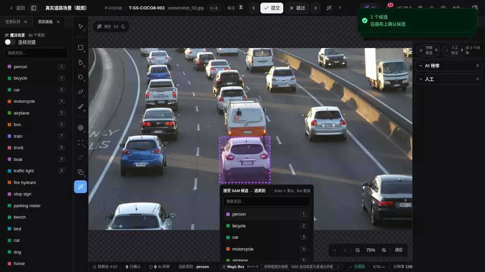
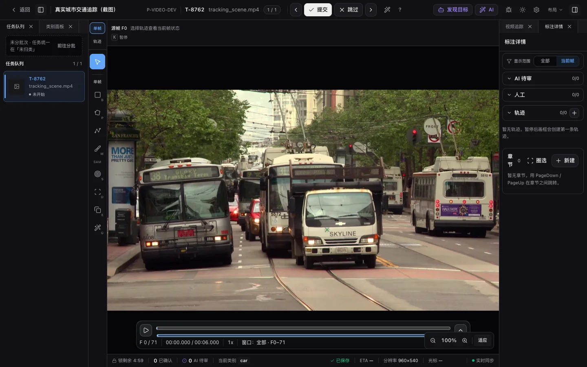
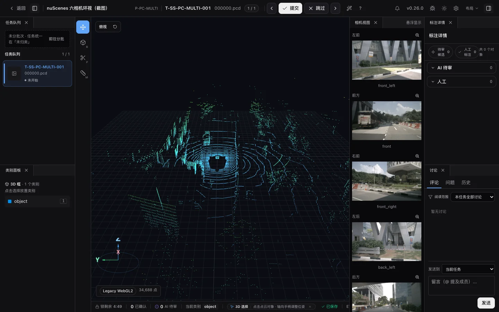
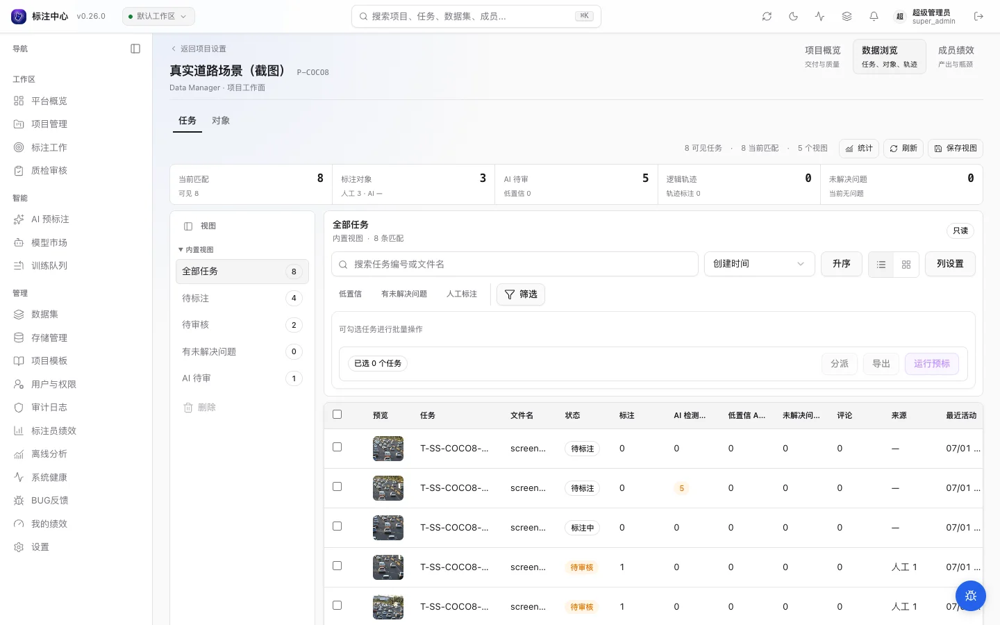

<div align="center">


<h1>YOAO</h1>

<p><strong>You Only Annotate Once — 开源多模态 AI 辅助数据标注与在线学习平台</strong></p>

<p>
  <a href="https://github.com/yyq19990828/ai-annotation-platform/actions/workflows/ci.yml"></a>
  <a href="https://github.com/yyq19990828/ai-annotation-platform/actions/workflows/docs-deploy.yml"></a>
  <a href="./LICENSE"></a>
</p>

<p>
  <a href="https://yyq19990828.github.io/ai-annotation-platform/">文档站</a>
  ·
  <a href="#核心特色">核心特色</a>
  ·
  <a href="#快速开始">快速开始</a>
  ·
  <a href="./docs-site/api/index.md">API</a>
  ·
  <a href="./CHANGELOG.md">更新日志</a>
</p>

</div>

<p align="center">
  
</p>

YOAO 是一个开源、可私有化部署的多模态 AI 辅助数据标注平台，覆盖**图像、视频与 3D 点云**的完整生产链路。

它不只是一个画框工具，而是将**数据集管理、多模态标注工作台、AI 交互与批量预标注、质量审核和在线训练回流**整合在同一个系统里——模型负责提速，人负责判断，系统负责数据血缘与质量闭环。

## 核心特色

- **多模态专业工作台**：在同一工作台内完成图像（矩形框、旋转框、多边形、折线、关键点、像素级 Mask、OCR）、视频轨迹追踪（关键帧插值、跨帧追踪、章节定位）以及 3D 点云（3D 框、点级分割、多视角相机投影联动）。
- **AI 交互辅助与批量预标注**：内置 Smart Point、Smart Box、Magic Box、Exemplar 等 SAM 交互工具与当前题推理；支持多阶段批量预标注管线与异步任务队列，人工采纳、修正与撤销全程可追溯。
- **数据 → 训练 → 模型回流闭环**：支持按筛选条件冻结训练数据版本，接入受控 GPU 训练执行器（YOLOv8 / YOLO11 / YOLO26、LibreYOLO9）完成实验对比、逐样本评估、自动训练与主动学习选样，并将训练模型回流发布为项目预标模型。
- **生产级数据集与灵活存储**：提供独立数据集工作台与质量复核（异常图与重复检测），支持本地受控目录、S3、SFTP 原地引用或托管导入，并可通过跨网络只读站点 Agent 接入远端存储。
- **协作审核与开放交付**：内置 Data Manager 多维视图、角色与项目职责分离、批次分派、审阅工作台与问题讨论线程，支持导出 COCO、YOLO、DAVIS、MOT、KITTI、NuScenes 等主流格式。
- **插件化推理与开放生态**：推理后端与核心平台解耦，可按需安装官方插件或基于插件 SDK 扩展自定义模型；提供完整 OpenAPI 契约与 `yoao-sdk`（Python SDK / CLI / TUI），便于接入自动化流水线。

<table>
  <tr>
    <td width="33%" align="center">
      
      <br><sub>视频轨迹工作台</sub>
    </td>
    <td width="33%" align="center">
      
      <br><sub>3D 点云与多相机联动</sub>
    </td>
    <td width="33%" align="center">
      
      <br><sub>Data Manager 数据管理</sub>
    </td>
  </tr>
</table>

## 技术栈与生态

| 模块       | 技术                                                                            |
| ---------- | ------------------------------------------------------------------------------- |
| 前端       | React 18 · TypeScript · Vite · Konva · Three.js                                 |
| 后端       | FastAPI · SQLAlchemy 2 · Celery · PostgreSQL 16 · Redis 7 · MinIO · DuckDB      |
| AI 与训练  | Grounded-SAM-2 · SAM 3 · Ultralytics YOLO · LibreYOLO · ONNX Runtime · RapidOCR |
| 文档与集成 | VitePress · OpenAPI · `yoao-sdk`（Python SDK / CLI / TUI）                      |

- **[YOAO-Plugins](https://github.com/YOAO-Labs/YOAO-Plugins)** — 官方推理插件仓库（Grounded-SAM-2、SAM 3、YOLO、ONNXTools、RapidOCR 等）。
- **[Plugin-SDK](https://github.com/YOAO-Labs/Plugin-SDK)** — 自定义推理插件的开发工具与运行时契约。

## 快速开始

前置依赖：`Node.js >= 22` · `pnpm >= 10` · `Python >= 3.11` · `uv` · `Docker Compose`。

完整的依赖安装、推理运行时制品准备与本地启动步骤，请查阅：

- **本地开发环境**：[本地开发教程](./docs-site/dev/tutorials/local-dev.md)（细节与常用命令见 [DEV.md](./DEV.md)）
- **私有化与局域网部署**：[部署与运维文档](./docs-site/ops/index.md)
- **本地预览文档站**：

```bash
pnpm install
pnpm docs:dev
```

## 文档

- **[在线文档站](https://yyq19990828.github.io/ai-annotation-platform/)** — 完整的用户、开发、API 与运维文档
- **[使用指南](./docs-site/user-guide/index.md)** — 项目管理、数据集、多模态工作台、AI 预标注、审阅与在线学习
- **[开发文档](./docs-site/dev/index.md)** — 架构概念、本地开发、Python SDK 与 ML 协议
- **[API 参考](./docs-site/api/index.md)** — OpenAPI 契约与模块接口指南
- **[部署与运维](./docs-site/ops/index.md)** — Docker Compose、局域网生产部署、站点 Agent 与备份恢复
- **[更新日志](./CHANGELOG.md)** — 版本演进记录

## License

第一方代码采用 [MIT](./LICENSE) 许可。第三方依赖、vendor 与模型权重遵循各自原有许可证。
