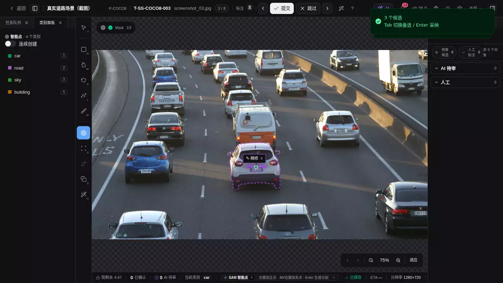
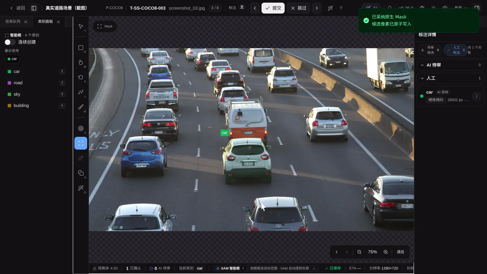
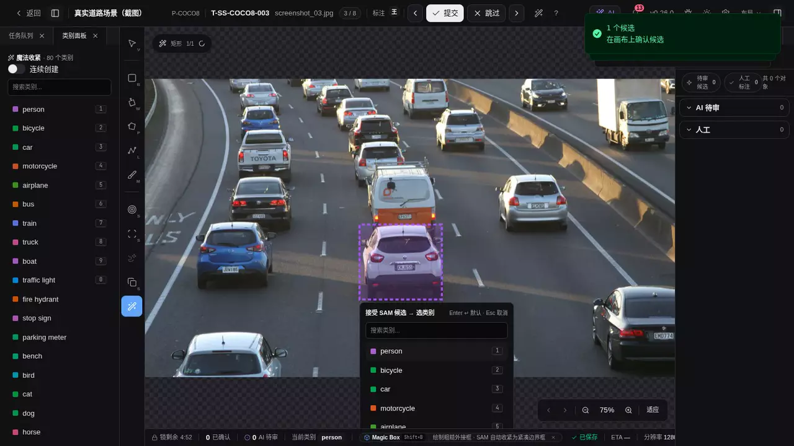
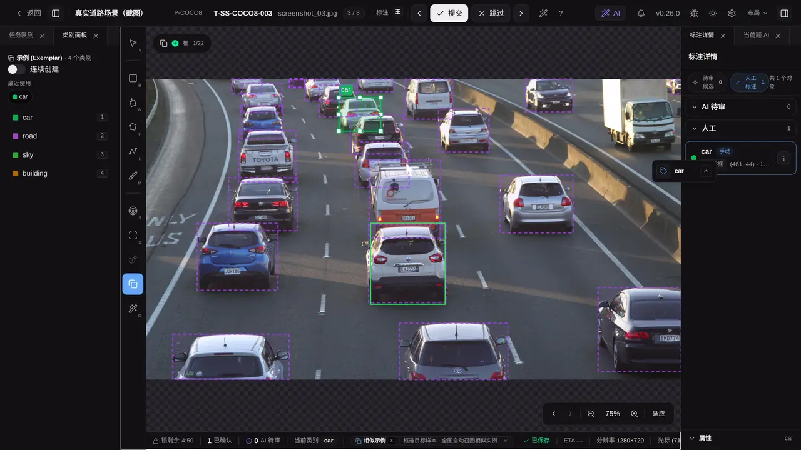

<div align="center">


<h1>AI Annotation Platform</h1>

<p><strong>A production-grade labeling control plane for image, video, point-cloud, and AI-assisted dataset operations.</strong></p>

<a href="https://github.com/yyq19990828/ai-annotation-platform/actions/workflows/ci.yml"></a>
<a href="https://github.com/yyq19990828/ai-annotation-platform/actions/workflows/docs-deploy.yml"></a>


<a href="https://yyq19990828.github.io/ai-annotation-platform/">Docs Site</a>
·
<a href="#快速开始">Quick Start</a>
·
<a href="#架构">Architecture</a>
·
<a href="./docs-site/api/">API</a>
·
<a href="./CHANGELOG.md">Changelog</a>

</div>

AI Annotation Platform 把项目管理、Data Manager、多模态标注工作台、AI 预标注、审核、导出、后台任务与可观测性放在同一条产品链路里。它不是一个只画框的 Demo，而是一个用于持续迭代标注生产系统的全栈仓库。

数据集可[预览归档并按当前权限恢复](./docs-site/user-guide/datasets/index.md#归档与恢复)，保留已有任务、标注和冻结内容，阻止旧接入作业跨生命周期续写。数据集使用独立详情页浏览分页样本、来源、项目进度和关联训练版本；来源问题可定位到统一存储位置再返回。连接配置集中在存储管理，九用途映射只读展示；未知容量不使用对象字节代替。 详情支持扩展名/尺寸等服务端组合筛选和个人动态视图；保存视图随当前数据变化，训练版本固定输入。

统一挂载的服务器目录可通过[受控存储位置 API](./docs-site/api/guides/storage-locations.md)动态登记、授权浏览并按指定 worker 探测；根内新增子目录无需重建容器。已有数据集还可通过[目录来源与观测扫描](./docs-site/api/guides/dataset-sources.md)保留可恢复的只读目录清单；扫描不创建样本。完整预检后可分页核对[增量差异](./docs-site/api/guides/dataset-sources.md#手动增量差异)，确认仅登记新增路径；变化和未见项保留旧绑定；不同摘要的内容变化可[逐项接受为新修订](./docs-site/api/guides/dataset-sources.md#接受内容为新修订)，创建新样本和空白任务，保留旧标注。同内容的观测变化可[明确重新核验](./docs-site/api/guides/dataset-sources.md#同内容重新核验)，保留原样本、任务与标注。同来源内文件移动也可[明确重定位](./docs-site/api/guides/dataset-sources.md#移动重定位)，继续原任务。还可预览并确认调整扫描规则，保留原任务读取；来源面板保留分页历史和最近完整扫描，存储页可跳转到对应来源与后台任务。来源还可配置[周期扫描与预检](./docs-site/api/guides/dataset-sources.md#周期扫描与预检)，默认人工核对，也可显式启用纯新增轮次自动登记；含变化、未见、排除或失败的整轮仍等待核对。管理员可通过[内容核验与严格读取](./docs-site/api/guides/verified-content.md)核验图片并按摘要读取请求内快照，托管图片任务也有同样的严格 API。数据集 UI 支持受控目录、外部 S3 和具备部署资格的只读 SFTP 原地登记，也保留上传和连接器复制导入。

数据集当前筛选可选择关联项目并进入训练预检，创建后固定匹配任务、原图与标注；成员变化会要求重新预检。组合筛选与个人视图支持 Scene 条件，按场景 ID 限定包含多模态和校准文件的业务成员；选项可搜索、分页，失效 Scene 不会扩大为全部样本。详见[数据集工作台](./docs-site/user-guide/datasets/index.md#独立数据集详情)。

数据集详情的“质量”页签支持固定整份数据集的图片解码、尺寸与可信精确重复检测，可取消恢复并记录人工复核。批量复核支持勾选或全部筛选结果，先预览固定范围，再逐项检查修订、保留冲突与恢复进度。结果保留内容身份和时间，不自动删除、合并或影响训练；详见[质量检测说明](./docs-site/user-guide/datasets/index.md#图片质量检测与复核)与[API 合同](./docs-site/api/guides/datasets.md#图片质量运行)。

超级管理员可在外部位置详情使用[位置访问维护](./docs-site/user-guide/datasets/storage-connections.md#位置访问维护)，关闭新访问、等待未收尾记录归零后确认停止，再按新修订恢复。部署须先核实所有 API/Worker 已采用访问登记协议；维护只涵盖该逻辑位置，不代表共享目录或整台存储静止。

新托管上传、ZIP、连接器复制及目录托管复制使用[条件创建与直传隔离](./docs-site/user-guide/datasets/storage-connections.md#新托管原件的创建与直传隔离)：浏览器只写暂存区，后端保存实际写回执并完整回读后才关联最终原件。原上传 URL 重放不覆盖已接受原件；业务回滚或结果不明保留独立创建责任，历史扫描不补造创建证明。

兼容的[独立 Task 上传接口](./docs-site/api/guides/tasks-and-annotations.md#独立任务原件上传)同样先暂存、再完整核验封存，单文件最多5GiB，要求当前项目管理权限与原上传发起者。Task与原件责任分开保留；数据集导入继续沿用已有DatasetItem归属。[严格图片读取](./docs-site/api/guides/verified-content.md#图片任务)与数据集质量检查使用原件记录保存的位置，完整核对字节；独立Task图片也支持该认证读取接口。[认证通用原件下载](./docs-site/api/guides/verified-content.md#认证通用原件下载)支持Task、相机关联及DatasetItem的完整二进制，单文件最多512MiB，身份查询不代表对象在线。图片工作台、审核与数据管理预览、点云和相机已使用认证原件读取，托管原件 DTO 不再签发原件地址；另有[视频原件准备与范围读取 API](./docs-site/api/guides/verified-content.md#视频原件准备与范围读取)，完整核验后以短租约复用临时文件处理HEAD和Range。视频工作台已接入原件准备、租约更新和失效恢复；视频元数据、海报和精确帧派生使用[独立输出归属](./docs-site/api/guides/video-derivatives.md)，其余下游消费者继续推进，完整用途切换保持关闭。

[图片金字塔](./docs-site/dev/concepts/image-pyramid-assets.md)使用已登记原件的保存位置和完整 SHA 核验，每次租约固定独立派生输出。读取、缩略图与清理沿用该归属；旧无归属代需要在原件登记后重新生成，未知旧文件保留待核对。后台生成继续检查发起者的 Task 可见性与凭据，不增加数据集管理权限要求；目录与原地引用限制保持。

删除托管数据集或样本时，平台在同一事务保留已登记原件的位置证据。超级管理员可在“平台对象占用”展开[托管原件保留与回收预演](./docs-site/user-guide/datasets/storage-connections.md#托管原件保留与回收预演)，查看保留记录和当前引用，并在居中详情中预览确认期限设置、备份/迁移保留要求及显式解除。未指定期限按无限期保护，相关记录共同保护；详情还可显式启动[原件完整核验](./docs-site/user-guide/datasets/storage-connections.md#核验原件完整内容)，保存与历史摘要比较的观测，不提供物理删除许可。

存储位置详情的[来源诊断](./docs-site/user-guide/datasets/storage-connections.md#位置内的来源诊断)将原地引用样本的原件观测、预览生成记录、扫描及预检进展分开显示，可定位到对应来源、轮次和后台任务；刷新只读已有记录，不进行实时存储探测。

存储连接编辑使用修订号防止旧表单覆盖新配置；参数或凭据变更先验证认证与目录列举，失败保留原配置，详见[连接管理](./docs-site/user-guide/datasets/storage-connections.md)。

存储管理的[平台对象占用](./docs-site/user-guide/datasets/storage-connections.md#平台对象占用与后台盘点)通过后台分页盘点九种用途并按实际桶去重；刷新页面只读取持久快照，失败或取消保留上次成功值与时间，统计对象字节不代表底层磁盘容量。

维护者可运行[一致备份与隔离恢复演练](./docs-site/ops/deploy/storage-recovery.md)，在两套随机资源中验证数据库、九用途对象、独立密钥及冻结内容。源销毁后再恢复并对账，原人工环境保留；结果只说明本地合成演练。

超级管理员可在外部存储位置详情展开[维护影响](./docs-site/user-guide/datasets/storage-connections.md#位置维护影响)，查看已保存的业务关系、活动工作与副本账本，以及位置停用、人员授权和配置修订的实际边界。位置使用范围和缓存配置先预览差异与影响，再在五分钟内确认；提交会复核权限、配置及关系，拒绝失效确认。

数据集上传按稳定身份隔离原图，同名不同内容保留为独立文件；改名不移动已有原图。旧数据可按真实对象键回填内容与位置映射，参见[数据集上传与扫描](./docs-site/api/guides/datasets.md)及[兼容回填](./docs-site/dev/concepts/storage-connections.md#内容身份与兼容回填)。

[3D 质量检查](./docs-site/user-guide/workbench/3d-box.md#3d-质量检查)按已登记 PCD 原件的保存位置、完整 SHA-256、大小与坐标约定读取，持续复核审核员的任务可见性；全部读取和解析真实收尾后才统一提交问题、运行结果与通知。取消、权限或来源变化不发布半轮问题，已有人工判定保留。缺少原件合同的旧待执行／执行中运行在派发或重放时标为过期，不回源补证；历史结果仍可查看，旧原件相关问题需重新扫描。

工作台支持按账号保存图片、视频和通用命令的自定义快捷键；类别直选使用 `1–9` 和 `0`，更多类别可搜索。使用方式见[工作台快捷键](./docs-site/user-guide/workbench/index.md#完整快捷键)，偏好读写契约见[认证与账号 API](./docs-site/api/guides/auth.md)。

受控模型分别记录原始训练版本与每个部署的实际推理版本；旧权重升级推理环境后需重新加载试用，新建评估和预标任务冻结核验后的推理身份。操作见[模型回流与默认预标](./docs-site/user-guide/online-learning/models.md#训练版本与推理版本)。

原地引用图片支持[后台图片导出](./docs-site/api/guides/export.md)：固定任务和内容，核验后将原图放入 ZIP，可取消且失败不发布部分包。

图片预标的覆盖模式在结果通过检查后逐题替换；失败或提交前取消会保留旧候选及已采纳 AI 标注，多条结果一起提交。取消边界与已完成数量见[异步任务 API](./docs-site/api/guides/async-jobs.md)。

原地引用图片也可从关联项目创建训练版本，预检展示预计原图复制体量，后台严格核验并保留独立训练副本；源目录后续变化不改变已就绪版本。新增引用版本同时冻结安全的来源/位置/采纳修订证据，样本详情和两版比较解释来源变化；历史证据缺失明确显示未知。

项目负责人可通过[在线学习数据版本](./docs-site/user-guide/online-learning/data-versions.md)按检测或分割任务浏览项目派生的冻结版本，下载包含原图、类别映射和独立训练/验证划分的 Ultralytics 数据包。检测版本提供图片／类别／划分摘要、类别频次、尺寸与框分布热力图、每图目标数及版本差异，可对照前后冻结样本，或明确采用该版本新建实验；历史数据包和训练引用保持不变。接口见[训练数据版本 API](./docs-site/api/guides/training-datasets.md)。

训练版本的 ZIP、保留图片与掩码使用[固定存储归属](./docs-site/user-guide/online-learning/data-versions.md#固定存储归属与历史版本)，重试、下载、评估及增强预览读取同一版本位置，删除意图也保留该归属。历史未固定版本须先显式核验保留副本；改变当前训练桶不会重解释已有版本，端点身份不符时明确拒绝。

托管图片训练预检沿已登记原件的保存位置完整读取、核对 SHA 并解码。构建优先复用已核验的训练副本，缺失时才按冻结原件身份回源；旧版本缺少原件身份且训练副本缺失时，需要重新登记原图并创建新版本。图片、掩码和训练包写入后均完整读回核验，通过后才发布就绪状态。

训练实验也在创建时[固定整个产物前缀](./docs-site/user-guide/online-learning/experiments.md#产物位置与历史实验)，各次执行和续训共用该归属。候选模型的下载、安装及权重初始化沿同项目来源实验与执行记录解析位置，与输入数据版本各自独立。旧实验可查看元数据，使用或删除产物前须由管理员通过 [storage-pin API](./docs-site/api/guides/training-datasets.md#实验产物归属与历史核验) 显式核验；清理和离线恢复保留固定事实。

异步导出产物也保存[独立归属与固定期限](./docs-site/api/guides/export.md#产物归属与固定期限)，重复导出从原位置校验并只签剩余窗口；未知上传结果保留候选责任，到期清理可重试。

新上传头像也固定实际位置与完整内容摘要，更换或清除时保留可重试的清理责任。历史上传头像没有固定归属时，请在[个人资料](./docs-site/user-guide/reference/settings.md#个人资料)重新上传或选择内置头像；升级与待核对文件处理见[存储恢复部署说明](./docs-site/ops/deploy/storage-recovery.md#上传头像归属的部署顺序)。

预览、逐样本评估和主动学习也分别固定自己的报告或图片位置，与输入版本及来源模型独立；历史记录须先通过[辅助产物归属核验](./docs-site/api/guides/training-datasets.md#辅助产物归属与历史核验)。旧记录可看元数据和安全停止，未知位置不会被当前桶替代；预览过期清理、评估延迟删除和隔离恢复保留同一归属。

实例分割还可显式选择原生 RLE 桥接，保留画笔／SAM 修正、孔洞、断连和重叠实例。检测与分割各自维护发布及自动策略，原生掩码回流和像素评估见[实例分割链路](./docs-site/dev/concepts/instance-segmentation-learning.md)。

持久 RLE 掩码以独立记录固定实际位置与完整内容回执，SHA 引用保持可移植；发布保护跨越后台进度提交，回收检查当前业务引用并分轮退休、删除。历史未知归属明确拒绝读取并保留待核对，详见 [Mask 内容合同](./docs-site/api/guides/tasks-and-annotations.md)。

模型市场分为模型目录与协议能力。已发布的 Ultralytics 图片检测模型可在普通预标、工作台当前题 AI 和裁剪检测管线中选择，各阶段固定模型与类别来源，失败按原管线重试。操作见[模型回流](./docs-site/user-guide/online-learning/models.md)，接口见[项目模型目录](./docs-site/api/guides/projects.md#项目可用模型目录)。

训练实验和数据版本列表支持在服务端按名称、状态、任务与 UTC 创建日期筛选；实验还可按框架筛选，并通过基础模型名称搜索。筛选后的总数与分页保持一致，接口参数见[在线学习与模型训练 API](./docs-site/api/guides/training-datasets.md)。

实验详情顶部提供删除入口，训练中或已被项目模型引用时禁用；同一次成功执行只回流一个项目模型，详情接口返回已回流模型信息，服务端同时拦截重复注册。

删除无引用的数据版本和终态实验时，先持久保存清理责任，再移除文件；存储故障由后台继续处理。自动训练策略在保存时核验初始版本的任务与媒体资格，避免接受调度无法使用的父版本。

训练和推理统一使用 `task=detect|segment|classify|pose|obb`；AAP/COCO/YOLO 由 `format` 区分。混合标注项目可按任务分别抽取训练数据版本，保留工具、类别和媒体来源，参见[训练数据接口](docs-site/api/guides/training-datasets.md)。

候选模型可逐层查看数据、实验、精确尝试、部署与发布谱系，并追加研究、拒绝发布或归档说明；归档不会改变当前项目发布。

成功训练的权重可在同一页面注册为候选模型，完成类别绑定、认证推理实例加载及固定样本试用后发布。受控模型支持单阶段图片检测预标注，任务保留创建时的模型、实验和数据版本来源；发布与回退仅影响新任务。

受控实例分割的整图原生掩码可按真实像素外接框向后续管线提供 ROI，保留原掩码并按项目类别富集属性。分割模型仍限整图源阶段，不能作为裁剪子阶段；图片原生 Mask 候选已支持按真实像素显示、拾取和失败重试；原地引用图片也支持该整图分割预标、原模型失败重试与核验后采纳，见[预标注管线](./docs-site/dev/concepts/prediction-pipeline.md)。

超级管理员可在「模型市场 → 注册管理 → 实例」编辑现有服务的 Token 认证，包括已受 GPU 管理的实例；保存后重新健康检查，再由项目负责人启用服务。认证更新保留 GPU 成员关系，服务端须配置相同令牌，详见[模型回流与默认预标](./docs-site/user-guide/online-learning/models.md)。

启用独立训练执行器后，从侧栏「训练队列」查看训练仓库、可管理项目与全局实验队列。项目内按训练实验、训练数据、模型与发布、自动训练分标签操作；实验、数据与模型均使用可筛选分页表格及独立详情页，返回时保留筛选和页码，候选模型通过居中面板注册；实验详情提供阶段进度、验证与损失曲线、各次续训记录和校验后的产物下载。项目内可比较 2–4 个实验的具体执行、冻结输入与最终评估，只有证据完整且口径兼容时才计算差值或叠加曲线。项目内可查看完整原生参数目录、默认值与支持边界。扩展配置固定参数定义和有效值，并核验执行器的实际配置。训练固定数据与环境，单张 GPU 串行执行；失联期间保留资源租约，防止重复训练。

训练器目录按任务、框架、模型家族和规格选择基础模型：Ultralytics YOLOv8、YOLO11、YOLO26 均覆盖 n/s/m/l/x 检测与实例分割，LibreYOLO9 覆盖 t/s/m/c 检测。管理员显式配置经过校验的权重和执行镜像后，页面按节点就绪情况开放对应组合。分割支持多边形与原始像素 RLE、完整检查点续训、最佳权重下载及独立框／掩码报告；设备容量、GPU 故障和多机生命周期仍须在目标部署独立验收。两个训练容器的参数与边界分别见 [Ultralytics](./docs-site/user-guide/online-learning/ultralytics.md) 和 [LibreYOLO](./docs-site/user-guide/online-learning/libreyolo.md)。

基础权重可统一保存在当前环境的训练桶，通过 SHA256 地址准备到节点缓存。同机容器挂载同一实际目录时共用基础权重文件；不同主机分别准备，桶名相同不代表本地缓存共用。受控回流权重按 SHA 去重下载，同时保留每个模型版本的安装收据。准备步骤见[部署与权重准备](./docs-site/ops/deploy/docker-compose.md)。

项目训练配方保存完整参数、原始基础权重与不可变修订。新建实验可先核对生效参数差异再采用配方，或从完整配置实验克隆新草稿；数据版本仍需明确选择。自动策略固定具体配方修订，新修订不会自动替换已采用配置。

Ultralytics 新实验可从预训练权重、从零初始化或同项目保留候选开始；项目候选要求框架版本、家族、规格、任务与原生类别顺序一致。预检和执行核对固定权重身份，从第 0 轮和全新训练状态开始；配方与克隆保留所选来源，本实验的断点续训使用自己的检查点。

Ultralytics YOLO11 的配置页可生成原生增强预览，对照冻结原图、变换后的完整矩形框和实际来源；预览使用独立且有界的 CPU 槽，种子／轮次不改变训练草稿。结果保留一天，LibreYOLO 暂不开放变换预览，仍可配置与训练。

训练监控按执行记录展示资源采样、阶段耗时、带观测依据的剩余时间范围和脱敏实时日志，明确区分整卡与训练进程数据。失败说明与检查点续训资格由实际回执和后端校验决定；采样中断不会改变训练状态或释放 GPU。

项目参数搜索支持最多 20 个显式网格组合，开始前预览全部配置并填写试验数、计划总轮数和原生计算时间预算。试验复用普通训练队列串行执行，截止时间由执行器独立停止；只对同口径、已校验的最终验证报告排名，时间证据缺失时暂停后续试验与续训。

项目模型支持逐样本评估：明确选择已安装候选及最多 32 个冻结验证成员，固定置信度、匹配 IoU 与推理环境，查看真值／预测叠加、TP／FP／FN 和误差诊断。同口径的两个评估可比较差值；历史证据保持不变，打开当前标注任务前会沿已登记原件的保存位置完整核对图片与标签变化。未知归属或内容不符会明确提示无法核对，不按现行桶猜读。该报告使用固定阈值匹配，不等同于训练报告的 AP/mAP。

「主动学习人工选样」固定模型、未标注候选池和显式预算，保留检测启发式建议与等量随机对照。负责人选择子集后创建普通人工批次，继续分派、标注和审核；反馈只记录实际审核与部分会话时间，缺失的纠正次数和完整工时保持未知，不自动发布或宣称效率提升。

选样预览、后台补图和接纳复核共用已登记原件身份与保存位置，完整核验后才使用图片。旧轮次可继续查看已有冻结图片；缺少原件事实时不能按当前桶补图或新增接纳，需重新选样。

## 工作台 AI 案例

图片标注工作台支持对已确认标注做[二次推理](./docs-site/user-guide/ai/current-task-inference.md)，由标注员、项目管理员或超级管理员使用。审核工作台隐藏相关入口，接口也拒绝审核员调用；人工审核修改保留。

<table>
  <tr>
    <td width="50%" valign="top" align="center">
      <strong>智能点 · Smart Point</strong><br>
      <a href="https://yyq19990828.github.io/ai-annotation-platform/media/sam/smart-point.mp4">
        
        <br>▶ 播放视频
      </a>
    </td>
    <td width="50%" valign="top" align="center">
      <strong>智能框 · Smart Box</strong><br>
      <a href="https://yyq19990828.github.io/ai-annotation-platform/media/sam/smart-box.mp4">
        
        <br>▶ 播放视频
      </a>
    </td>
  </tr>
  <tr>
    <td width="50%" valign="top" align="center">
      <strong>Magic Box</strong><br>
      <a href="https://yyq19990828.github.io/ai-annotation-platform/media/ai/assisted-annotation.mp4">
        
        <br>▶ 播放视频
      </a>
    </td>
    <td width="50%" valign="top" align="center">
      <strong>Exemplar</strong><br>
      <a href="https://yyq19990828.github.io/ai-annotation-platform/media/sam/exemplar.mp4">
        
        <br>▶ 播放视频
      </a>
    </td>
  </tr>
</table>

## 控制台能力

<table>
  <tr>
    <td width="33%" valign="top">
      <strong>Project & Labeling Ops</strong><br>
      项目、数据集、批次、任务分配、审核回退、个人通知与后台任务历史。
    </td>
    <td width="33%" valign="top">
      <strong>Image & OCR Workbench</strong><br>
      bbox、rotated bbox、polygon、polyline、keypoint、mask 与 OCR 标注链路。
    </td>
    <td width="33%" valign="top">
      <strong>Video Workbench</strong><br>
      <code>video_bbox</code>、<code>video_track</code>、关键帧、插值、outside 段、帧缓存与 chunk 服务。
    </td>
  </tr>
  <tr>
    <td width="33%" valign="top">
      <strong>3D & Multimodal Workbench</strong><br>
      点云 3D 框、点级分割、scene 时序、LiDAR 坐标归一化与相机投影联动。
    </td>
    <td width="33%" valign="top">
      <strong>AI & Model Ops</strong><br>
      Grounded-SAM-2、SAM 3、YOLO、ONNXTools、RapidOCR，以及交互预测、批量预标和视频追踪。
    </td>
    <td width="33%" valign="top">
      <strong>Review & Data Delivery</strong><br>
      Data Manager 项目概览、任务 / 对象 / 轨迹浏览、选定任务操作与成员绩效看板，<a href="./docs-site/user-guide/review/index.md#在视频画面标记问题">视频问题标记与上下文恢复</a>（源帧范围、对象、画布和时间窗）、审核反馈，以及 COCO、YOLO、DAVIS、MOT、KITTI、Multi-camera COCO、Point Mask 等导出。
    </td>
  </tr>
</table>

管理员可用[项目邀请](./docs-site/user-guide/superadmin/user-management.md)为新老账号指定目标项目；超级管理员可在[系统设置](./docs-site/user-guide/reference/settings.md)管理常用运营参数、查看生效来源并恢复部署默认。接口与并发语义见[系统设置 API](./docs-site/api/guides/system-settings.md)。

成员管理支持按项目、用户组、角色和账号状态分页筛选，统计与导出采用相同范围；批量邀请与分组逐项报告结果，批次派发前可核对负责人变化和任务负载。

项目管理的列表与卡片支持服务端分页，默认每页 20 个，搜索、筛选和页码可通过链接恢复。分页接口为 [`GET /api/v1/projects/query`](./docs-site/api/guides/projects.md#列表与分页)，原项目数组接口继续供 SDK 与项目选择器使用。

应用业务列表共用分页栏，默认每页 20 行，可选 10／20／50／100 行；筛选和修改每页行数后从首页继续浏览。使用方法见[列表分页](./docs-site/user-guide/reference/filtering.md#列表分页)，批次、预标历史和在线学习的分页参数见各 [API 指南](./docs-site/api/)。

项目成员可在工作台阅读[标注指引](./docs-site/user-guide/projects/index.md#编写标注指引)及示例图；指引编辑和图片上传、删除由项目负责人或超级管理员管理。图片通过认证接口上传和读取，完整核对保存位置与内容；复制项目为已核验图片建立独立引用，源项目移除图片或被删除不影响副本。历史未核实图片保留原信息并提示重新上传；接口与图片清单的修订校验见[项目 API](./docs-site/api/guides/projects.md#标注指引图片)。

平台把**账号身份（平台角色）**与**项目职责（项目角色）**分开：同一个员工可以在 A 项目标注、B 项目质检、C 项目只读，无须切换账号。项目访问与写入由项目成员关系和固定能力集决定，全项目导出收紧到质检员 / 负责人、自审按持久贡献者证据拒绝。设计见 [ADR-0075](./docs/adr/0075-platform-identity-vs-project-authority.md)，迁移、回滚与已签发 URL 限制见[员工项目角色迁移与回滚 runbook](./docs-site/ops/runbooks/project-role-migration.md)。

## 架构

<table>
  <tr>
    <td width="50%" valign="top" align="center">
      <strong>数据航线</strong><br>
      <a href="./docs/assets/readme/data-route.excalidraw">
        
      </a>
    </td>
    <td width="50%" valign="top" align="center">
      <strong>系统架构</strong><br>
      <a href="./docs/assets/readme/system-architecture.excalidraw">
        
      </a>
    </td>
  </tr>
</table>

## 快速开始

### 前置依赖

| 依赖           | 版本                       |
| -------------- | -------------------------- |
| Node.js        | `>= 22`                    |
| pnpm           | `>= 10`                    |
| Python         | `>= 3.11`                  |
| uv             | Python 包管理              |
| Docker Compose | 本地数据库、队列、对象存储 |
| pre-commit     | 可选，但推荐               |

### 本地启动

```bash
# 1. 安装依赖
pnpm install
cd apps/api && uv sync --extra test && cd ../..
pnpm codegen

# 可选：已安装 pre-commit 时启用本地 hooks
pre-commit install

# 2. 启动基础设施
docker compose up -d postgres redis minio mailpit

# 3. 初始化数据库
cd apps/api && uv run alembic upgrade head && cd ../..

# 4. 启动后端和前端
pnpm dev:api        # http://localhost:8000
pnpm dev:web        # http://localhost:3000

# 多 worktree 并行时可用一条命令启动当前 checkout 的前后端
pnpm dev:worktree   # 独立数据库/Redis/bucket，自动选择端口并配置代理
```

`dev:worktree` 为每个工作树的 `dev/test/e2e` 模式管理独立数据库、Redis、八个 bucket
及本地文件；共享本机 PostgreSQL/MinIO 实例，不修改共享数据库。默认从 API `8100`
和 Web `3100` 寻找空闲端口，可用 `--with-worker` 启动本工作树的后台任务消费者。
`doctor` 诊断、`stop` 停止、带精确确认值的 `reset/destroy` 重建或清理环境。
首次启动不复制已有账号和项目。详见[独立工作树开发环境](docs-site/dev/how-to/worktree-environments.md)。

需要演示数据时：

```bash
cd apps/api
PYTHONPATH=. uv run python scripts/seed.py
```

### 常用入口

| 服务          | 地址                       | 说明                            |
| ------------- | -------------------------- | ------------------------------- |
| Web App       | http://localhost:3000      | 标注平台主界面                  |
| Swagger UI    | http://localhost:8000/docs | 运行时 API 文档                 |
| Docs Site     | http://localhost:5173      | `pnpm docs:dev` 后打开          |
| MinIO Console | http://localhost:9001      | `minioadmin / minioadmin`       |
| Mailpit       | http://localhost:8025      | 开发邮件收件箱                  |
| Grafana       | http://localhost:3001      | `monitoring` profile 启动后打开 |

### 局域网生产部署

已有开发环境时，可使用独立 `docker-compose.lan-prod.yml` 复用 PostgreSQL、MinIO 和模型服务，生产账号、项目、数据集、队列和存储桶单独管理。前端提供局域网 HTTPS 3030，API 提供 HTTPS 8080；客户端首次导入内部 CA 公共证书。配置、初始化与回退步骤见[局域网生产部署](./docs-site/ops/deploy/lan-production.md)。

## 可选服务

```bash
# Celery 后台任务：通用队列、GPU / CPU 预标、导出、视频帧、通知等
docker compose up -d celery-worker celery-worker-maintenance celery-worker-gpu celery-worker-cpu celery-worker-export celery-beat

# GPU ML Backend 在叠加文件 docker-compose.ml.yml，按显存预算选择独立 profile
# Grounded-SAM-2：适合图片 SAM / DINO 与视频 tracker
docker compose -f docker-compose.yml -f docker-compose.ml.yml --profile gpu up -d grounded-sam2-backend

# SAM 3：独立 GPU profile，需要 HF_TOKEN 与更高显存
docker compose -f docker-compose.yml -f docker-compose.ml.yml --profile gpu-sam3 up -d sam3-backend

# 其它可选后端：YOLO、ONNXTools、RapidOCR
docker compose -f docker-compose.yml -f docker-compose.ml.yml --profile gpu-yolo up -d yolo-backend
docker compose -f docker-compose.yml -f docker-compose.ml.yml --profile gpu-onnxtools up -d onnxtools-backend
docker compose -f docker-compose.yml -f docker-compose.ml.yml --profile gpu-rapidocr up -d rapidocr-backend

# Prometheus + Grafana
docker compose --profile monitoring up -d prometheus grafana
```

修改 `apps/api/**` 下的 worker 业务代码后，Celery 不会热重载，重启 worker 即可；修改依赖、Dockerfile 或 compose build 配置才需要 rebuild。开发 worker 不自动迁移数据库；更新包含迁移时，应先按上面的初始化命令显式迁移，再启动 worker。

## 开发工作流

```bash
# 全仓格式与静态检查
pnpm format:check
pnpm lint
pnpm typecheck

# 自动修复格式（提交前执行）
pnpm format

# 前端测试
pnpm test
pnpm test:e2e          # 需要 Postgres/Redis/MinIO；自启 3001/8010 与 annotation_e2e
pnpm --filter @anno/web test:e2e:visual  # 视觉基线（独立于默认功能集）
pnpm --filter @anno/web test:e2e:stress  # 完整布局压力矩阵

# 后端
cd apps/api && uv run pytest

# API 契约
pnpm openapi:export    # API 变更后刷新 snapshot
pnpm openapi:check     # CI 同款契约校验

# 文档站
pnpm docs:dev
pnpm docs:build
```

E2E 不复用开发环境的 `3000/8000` 或 `annotation` 数据库。测试路由
默认关闭，仅对显式开启且名称以 `_e2e` / `_test` 结尾的数据库开放。
详见 [E2E 运行说明](./apps/web/e2e/README.md)。

API 变更后同步跑 `pnpm openapi:export` 和 `pnpm codegen`；环境变量变更后同步更新 `.env.example` 并跑 `pnpm docs:gen-env-vars`。

Data Manager 将未解决问题与普通评论分别计数，兼容旧反馈筛选；成员绩效统计已保存、仍保留的图片与标注记录，不要求先提交任务。字段、统计口径与权限见[项目 API 指南](./docs-site/api/guides/projects.md)。

BUG 截图通过认证 API 上传原图字节并返回实际回执，每条反馈最多绑定五张本人上传图片，固定保存 180 天。附件下载携带 Bearer Token，直接返回核验后的图片；旧直传初始化入口返回迁移提示，历史无归属图片需重新上传。调用顺序和错误见[BUG 反馈 API 指南](./docs-site/api/guides/bug-reports.md)。

审计月归档在完整上传读回及源分区复核后发布，固定保存位置和独立内容回执；失败或取消保留已完成月份。超级管理员通过认证接口查看已发布月份和核验后的分页内容，历史未知归属保留待核对。接口见[审计归档指南](./docs-site/api/guides/audit-archives.md)，升级与恢复见[存储恢复手册](./docs-site/ops/deploy/storage-recovery.md#审计归档归属的部署顺序)。

视频轨迹 API 保留旧关键帧缺失的来源字段，客户端应按「来源未知」处理；新建标注仍使用现有来源默认值，详见[任务与标注 API](./docs-site/api/guides/tasks-and-annotations.md)。

内部账号支持邮件恢复、按状态查询、逐项目职责交接、紧急停用与恢复。管理员确认交接时会重新核对接收资格及预览状态；恢复不会拿回已交接工作或恢复已撤销的凭据。接口与兼容字段见[认证与账号生命周期](./docs-site/api/guides/auth.md)。

工作台显示保存和本机待同步状态，并按账号保留离线操作；普通标注创建支持持久幂等键，避免重试生成重复对象。详见[任务与标注 API](./docs-site/api/guides/tasks-and-annotations.md#保存标注与提交任务)。

任务讨论 API 汇总原标注评论和原生任务留言，任务留言支持提及项目成员、项目负责人与启用的平台超级管理员（候选见 `GET /api/v1/projects/:id/mention-candidates`），图片任务留言还可附绘图；提供按标注 ID 批量统计评论数，图片和视频画布提示可通过默认开启的账号偏好关闭。聚合记录保留来源、附件与视频锚点；问题 API 提供根记录筛选、准确状态数量和历史回复分页，图片和视频像素问题均可关联对象，读写都检查项目与任务权限。详见[任务讨论与问题线程](./docs-site/api/guides/tasks-and-annotations.md#任务讨论与问题线程)。

标注评论附件通过认证接口上传通用文件（含空文件，每文件不超过20MiB），只接受同一上传者、同一标注的服务端回执首次绑定；下载完整核对保存位置与内容，不提供匿名URL。上传满90天或评论软删满7天后按较早期限清理，失败保留重试；历史未知附件需重新上传。详见[评论与附件](./docs-site/api/guides/tasks-and-annotations.md)。

问题回复、状态变化、任务留言和标注评论提及复用站内通知与按类型偏好，点击时重新核对权限并定位原对话。`GET/PUT /api/v1/notification-preferences` 按类型返回并更新「接收通知（in_app）」与「弹出提示（toast）」；PUT 至少提供其一，只原子合并请求出现的键，`toast` 读取为显式选择或类型默认计算出的有效值。讨论通知在业务提交成功后推送，网络推送失败不影响已保存内容，详见[讨论通知](./docs-site/api/guides/tasks-and-annotations.md#讨论通知)。

命名布局预设通过账号偏好 API 跨设备保存；`namedPresets` 采用带 revision 的整份 map 替换与省略删除语义，陈旧设备写入返回冲突，而 `contexts` 可在预设专用 PATCH 中缺席。安全更新方式与兼容规则见[账号偏好与命名布局预设](./docs-site/api/guides/auth.md#账号偏好与命名布局预设)。

工作台之外的全局界面偏好（主题、二次推理工具条显隐、登录后「本次更新」提醒的已确认版本）保存在账号偏好的 `ui` 子树并跨设备同步；`ui.changelog_seen_version` 为空表示从未确认，客户端仅在当前构建版本更高时提醒一次。契约见[账号偏好与命名布局预设](./docs-site/api/guides/auth.md#账号偏好与命名布局预设)。

图片 Polygon 和 Raster Mask 支持预览后原子切割与保留对象 ID 的撤销/重做。提交和恢复使用独立幂等请求，恢复受完整版本集与原切割后 30 天期限约束，Mask 支持保留全部像素的直线切割，撤销后的内容引用受资源清理保护。Mask 质检批量修复原子保存 SAM 候选与完成记录，Tracker 重试复用子任务，回滚中断后可从分片检查点继续。详见[Mask 切割](./docs-site/user-guide/workbench/mask-brush.md#直线切割为两个实例)、[Polygon 切割](./docs-site/user-guide/workbench/polygon.md#切割为两个对象)与[API 合同](./docs-site/api/guides/tasks-and-annotations.md#polygon-原子切割与恢复)。

SAM3 示例召回支持成对返回矩形框与原生 Mask，图片和视频当前帧均可分别采纳；客户端须保留 Mask 在完整候选数组中的索引。详见[交互式示例候选合同](./docs-site/api/guides/ml-backend.md#交互式示例候选)。

## 文档地图

| 角色 / 任务                | 入口                                                                                                                            |
| -------------------------- | ------------------------------------------------------------------------------------------------------------------------------- |
| 标注员、审核员、项目管理员 | [docs-site/user-guide/](./docs-site/user-guide/)                                                                                |
| 本地开发                   | [docs-site/dev/tutorials/local-dev.md](./docs-site/dev/tutorials/local-dev.md)                                                  |
| 测试策略                   | [docs-site/dev/testing.md](./docs-site/dev/testing.md)                                                                          |
| API 文档                   | [docs-site/api/](./docs-site/api/)                                                                                              |
| Python SDK / CLI           | [docs-site/dev/sdk/quickstart.md](./docs-site/dev/sdk/quickstart.md)                                                            |
| ML Backend 协议            | [docs-site/dev/reference/ml-backend-protocol.md](./docs-site/dev/reference/ml-backend-protocol.md)                              |
| Data Manager               | [用户指南](./docs-site/user-guide/projects/data-manager.md) · [查询与校验契约](./docs-site/dev/reference/data-manager-query.md) |
| 视频帧服务                 | [docs-site/dev/reference/video-frame-service.md](./docs-site/dev/reference/video-frame-service.md)                              |
| 导出格式                   | [docs-site/user-guide/reference/export-formats.md](./docs-site/user-guide/reference/export-formats.md)                          |
| 部署与运维                 | [docs-site/ops/](./docs-site/ops/)                                                                                              |
| 架构概念                   | [docs-site/dev/concepts/](./docs-site/dev/concepts/)                                                                            |
| ADR                        | [docs/adr/](./docs/adr/)                                                                                                        |
| 变更记录                   | [CHANGELOG.md](./CHANGELOG.md)                                                                                                  |

部署版文档站：[https://yyq19990828.github.io/ai-annotation-platform/](https://yyq19990828.github.io/ai-annotation-platform/)

## 仓库结构

```text
ai-annotation-platform/
├── apps/
│   ├── api/                       # FastAPI 后端、SQLAlchemy、Alembic、Celery workers
│   ├── web/                       # React 18 + TypeScript + Vite 标注前端
│   ├── grounded-sam2-backend/     # Grounded-SAM-2 GPU ML Backend
│   ├── sam3-backend/              # SAM 3 GPU ML Backend
│   ├── yolo-backend/              # YOLO 检测 / 分割 / Exemplar ML Backend
│   ├── onnxtools-backend/         # ONNX 检测与属性推理 ML Backend
│   ├── rapidocr-backend/          # OCR 检测 / 识别 / 端到端 ML Backend
│   └── _shared/                   # Backend runtime、协议与 mask 工具共享包
├── docs-site/                     # VitePress 用户 / 开发 / API / 运维文档
├── docs/
│   ├── adr/                       # 架构决策记录
│   ├── changelogs/                # 历史版本变更
│   ├── plans/                     # 实施计划
│   └── research/                  # 调研报告
├── infra/                         # Docker、Prometheus、Grafana、Nginx 等基础设施配置
├── scripts/                       # OpenAPI、docs impact、seed、维护脚本
├── docker-compose.yml             # 基础栈（postgres/redis/minio/celery + 监控 profile）
├── docker-compose.ml.yml          # GPU ML Backend 与截图协议 stub 叠加
├── pnpm-workspace.yaml
└── package.json
```

## 技术栈

| 层   | 技术                                                                             |
| ---- | -------------------------------------------------------------------------------- |
| 前端 | React 18、TypeScript、Vite、TanStack Query、Zustand、Konva、Three.js、Playwright |
| 后端 | FastAPI、Pydantic、SQLAlchemy 2、Alembic、Celery、pytest                         |
| 数据 | PostgreSQL 16、Redis 7、MinIO / OSS、DuckDB 分析视图                             |
| AI   | Grounded-SAM-2、SAM 3、YOLO、ONNX Runtime、RapidOCR、开放 ML Backend 协议        |
| 文档 | VitePress、Mermaid、OpenAPI / Scalar、ADR                                        |
| CI   | GitHub Actions、docs impact、visual regression、OpenAPI snapshot check           |

项目开工检查和员工指南确认的 API 见[项目 API 指南](docs-site/api/guides/projects.md#开工状态)，操作说明见[快速开始](docs-site/user-guide/getting-started.md)与[项目设置](docs-site/user-guide/projects/index.md#开工准备与项目设置)。

[成员管理](docs-site/user-guide/superadmin/user-management.md)支持服务端分页筛选、同范围导出、批量邀请和分组，以及角色影响预览；[批次分派](docs-site/user-guide/projects/batch.md#分配人员)确认前展示负责人变化与任务负载。

## 贡献前检查

- 只改和当前目标直接相关的文件。
- 前端样式使用 `apps/web/src/styles/shadcn.css` 的 `--sc-*` 运行时 token 或 Tailwind 语义类，不再读取旧 `--color-*` 变量。
- API、环境变量、用户可见行为变更时，同步更新相关 docs。
- 提交前至少跑和改动范围匹配的 lint / test / OpenAPI / docs 校验。

## License

MIT

内置推理服务默认使用系统托管认证，平台分别生成并持久保存各服务凭据，无需手填 Token。旧服务首次升级需重建镜像并应用共享目录挂载；之后由超管初始化或同步。远程和已手动配置的服务保留原认证。详见[推理实例认证](docs-site/user-guide/superadmin/ml-backend-registry.md)。

超管可在「设置 → 系统设置 → ML 服务认证与维护」查看凭据状态、初始化并同步认证。安装[宿主机维护程序](docs-site/ops/deploy/ml-backend-maintenance.md)后，可在同一区域重建指定服务的镜像与容器并查看执行进度。

超级管理员可从存储页登记已挂载的受控目录并配置使用范围；获授权的项目管理员可管理自己创建的数据集，在数据集页“接入服务器目录”，扫描并预检后确认批量登记，也可逐条核验登记。后台登记支持取消、继续和异常单项重试。原图可选择原地引用或托管复制，预览缓存独立设置并计量；来源提供停用、恢复和注销影响确认。原地引用的普通图片项目可通过工作台严格读取、手工标注和运行后台图片预标（单阶段及 geometry/ROI 管线）；引用失败重试保留原模型与内容，普通几何及合格整图分割原生 Mask 候选可在当前权限下严格核验后采纳，支持交互提示、原生掩码创建/精修采纳、模型预测测试，以及确定性批量 Mask 修复和局部 SAM 重跑；修复候选可核验采纳或驳回，执行与回滚按当前权限严格核验原图；部署与使用边界见[目录接入说明](docs-site/user-guide/datasets/import-images.md#服务器目录原地引用)。位置详情可配置按需完整原图缓存的额度、TTL并查看分项用量和提交受控清理；来源策略受位置上限约束，缓存命中仍复核当前权限与完整内容，来源状态与缓存记录分开展示。新增根内子目录无需重启，增加宿主机挂载通常只需重建相关容器，无需重建镜像。
