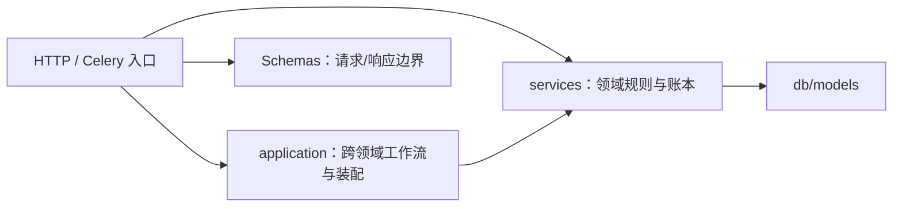

# 后端分层

## 分层规则



**单向依赖**：入口可调用应用工作流或领域服务，工作流组合服务，服务可调模型；领域服务不反向导入入口或应用装配。

## 模块语言与隔离实验

完整目标与逐模块缺口见[模块独立部署与语言替换](./module-deployment)。assets 的视频探测
三个操作已独立到 `apps/media-probe`，通过文件流与 JSON/NDJSON 合同运行；调用方的
授权、源对象读取和最终 SQL 写入仍由原所有者负责。该子能力已有 Python/Node 真实
消费者替换验收，其他业务模块的运行与事务边界继续逐项提取。

[ADR 0090](../adr/0090-module-languages-and-audit-summary-process) 记录语言评估：身份、项目、标注、学习及正常审计月报继续 Python；Go 归并仅作隔离实验；几何计算复用原生库，Rust 需先有计算核与性能依据。

`services/audit_summary.py` 持有正常月报的本地算法；主 API 保留超级管理员准入、保留期和 SQL 查询，不调用远程服务。实验适配器和测试位于 `apps/api/experiments`，不属于生产导入图或普通应用镜像。

`apps/audit-summary` 保留实验 OpenAPI、精确计数及进程恢复验证。它只由单独 Compose profile、显式实验测试或手动 workflow 启动，不进入默认／生产部署，也不改变公开 API 错误合同。其它领域的本地事务尚未变成跨语言协议。

本地验收分别验证隔离容器、既有作业执行权和负载曲线。训练交接使用真实 TCP API、独立数据库 observer 与两个受控 Supervisor 进程，SQL 写入仍由 API 持有；原生模型/GPU 与无中断训练升级不在该证据内。Go 的两名额保护和正常请求有本地证据，但默认 HTTPX 大上传在超载时可能得到连接读取错误，未通过稳定的可重试 503 资格；数据与复现入口见 `apps/audit-summary/EXPERIMENT_COST.md` 和[测试指南](../testing#本地执行器交接与负载观测)。

## 路由（api/v1）

- 薄壳：解析参数、调权限、调服务、序列化响应
- 不写业务逻辑
- 必须有 docstring（被 OpenAPI 拾取）
- 必须给所有响应码写 `responses={}` 类型

## 应用工作流（application）

`application/job_terminal.py` 显式绑定六类作业的领域账本回填及评估/主动学习的中断处理。通用 `async_job` 只持有通用状态；`services/async_job_terminal.py::JobTerminal` 是只含作业 ID、kind、取消标记和错误的不可变事实，不携带 ORM 或传输对象。

领域回填由 `mask_qc.service`、`point_cloud_quality.service`、`mask_repair`、`mask_formats.service` 和 `training_datasets` 的 `reconcile_job_terminal` 持有。`partial`、`rollback_failed` 和已有终态保护仍由各领域决定；评估与主动学习继续采用自身失联、取消意图和 attempt fencing，不强制变成通用终态。

HTTP 硬取消保留原授权、锁和通知顺序；Celery 信号适配器负责连接、按执行 ID 查作业、调用工作流与提交/释放。工作流和领域回调不自行提交，通用行、领域行及持久通知仍可在调用方同一事务中回滚。普通 worker 的正常完成路径没有改成事件分发。当前回调仍使用本地 `AsyncSession`，不是可直接替换为 HTTP 的远程接口。

`application/job_cancellation.py` 持有取消用例的准入、kind/状态分支与组合，不直接写修复、格式导入、数据版本或评估模型。各领域的 `request_job_cancel` 保留行锁及 pending/running 差异；批量预测和跨帧的取消结果由各自所有者构建，HTTP 入口只调用用例并提交。执行停止请求经纯类型 `JobExecutionControl` 注入，由 `deps.get_job_execution_control()` 装配 Celery 适配器，仍使用非强制撤销；请求取消不等于确认执行已停止，撤销发布失败后的原落库策略不变。

训练数据构建分支消费 `training_dataset_cancellation_contract.TrainingDatasetCancellationPort`，仅传 job/project/actor UUID，返回原 None 回执；`training_datasets.SqlTrainingDatasetCancellation` 私有绑定请求 Session 与执行控制。先保留当前管理权围栏、Version 行锁，再从同一 Session 取回中央用例仍持有的 Job，并按原位置 refresh；该身份映射命中不新增查询，终态和执行 ID 使用刷新后的值。撤销、通用/领域取消、持久通知继续同事务，最终提交仍由 HTTP 持有；预期 status/detail/headers 在用例恢复，未知失败透传。其他 kind 的分支及训练构建执行围栏保持独立。

`services/async_job.py` 是通用作业行的写入所有者：`bind_execution_id` 只绑定或清空 Celery 执行 ID，不读取作业行、不提交；调用方保留既有缺行/条件优先级、预分配或回传 ID 及提交/派发时序。`update_payload` 浅合并 payload，`update_progress` 裁剪百分比并替换显式提供的 result，`replace_result` 只替换结果而不改变生命周期。`delete_terminal_jobs_before` 按调用方给定的 cutoff 和终态集合删除旧行，返回删除 ID，仍由 worker 计算 30 天 cutoff、选择原状态集合、提交并计数。状态写命令不提交或发布通知；创建和 `track_job` 保留显式 flush，其他状态写命令不额外 flush。默认取消仅允许 pending/running，特殊执行器必须明确提供自身状态优先级。

跨帧 worker 保留已取消时不回写增量进度、逐帧结果整体替换及原提交点；最终取消显式允许覆盖已有终态、推进至 100、保留旧错误，再按原顺序通知和提交。连接器导入允许 pending/running/已经 cancelled 三种状态回填最终计数，不强制进度 100，通知仍由原调用方发一次。旧导入预算快照仍在刷新后的作业排他锁内生成，浅合并并提交后才枚举源文件；这些进程内命令不是语言无关的作业协议。

`application/prediction_retry.py` 持有单项及按作业重试用例。单项仍按原 backend 设备选择队列，按作业重试仍走默认路由；当前管理权、失败项、原始 Labeling 作用域、pending Job 和派发记录在同一准入事务固定。发布结果不确定时保留这次受理，由 outbox 继续投递相同 Job UUID。

`application/durable_prediction_retry.py` 组合已保存的输入、推理结果和最终回执。Jobs 持有执行租约及派发账本，Labeling 持有不可变 attempt、原始／准备结果与失败项结算。成功写入 Prediction／Meta、删除原失败行、结算回执和 Job 在同一事务；模型永久失败只计一次，输入等待、写锁竞争和提交确认丢失继续同一结果。账号、来源或失败项状态失效时终结当前 attempt 并释放对应占用，不计模型失败。`PredictionService` 继续持有 dismiss/restore 和预测写入校验，原生能力负责重试的最终组合。

`services/prediction_retry.py` 保留次数上限、上下文预算和纯派发端口；Celery 适配器只传失败项、actor、稳定 Job UUID 与执行队列。函数专用 executor 登录负责读取及 outbox，业务写入方保留原事务与最终 Labeling guard；协议见[失败预测重试](/api/guides/module-data#失败预测重试)。

`application/dataset_task_creation.py::DatasetTaskCreationWorkflow` 协调素材关联、同步/排队选择、素材准备与建题，消费版本化 PostgreSQL 数据能力。接受阶段通过 Identity/Workspace 当前管理权固定 actor、关联代次和可选作业；Labeling 随后冻结来源、推进持久游标并写回执。适配器只传 UUID、JSON 和标量，同一连接的外层事务继续持有提交权，结果保留 `created` / `total` 计数字典。

`services/labeling_tasks.py::LabelingTaskService` 是初始/追加建题数据能力的 Python 客户端；实际初始 Task、点云链接和计数写入只在冻结 SQL 中实现。`task_creation_contract.py` 严格验证响应 schema、范围与计数。`DatasetService` 继续持有其他素材服务；同步 ZIP/旧前缀扫描由既有 `apps/assets-source` 工作流装配。`pointcloud_import` 保留标定和建题调用，纯帧分组及 Scene/frame 规划由 `aap_assets_source.frame_layout` 与 `aap_assets_source.scene_layout` 提供。初始建题默认每块 5000 项，追加不内部提交；普通点云标定仍前置提交，nuScenes 关闭内部提交。

素材关联向应用返回 `link_id`、是否已有、素材数和项目类型，不携带 ORM。重复关联可以找回同代次的活跃作业，入口提交后重新派发。`task_creation_jobs.py` 通过 Jobs 原生能力领取、完成、失败和取消；执行器重启后从持久游标恢复，不重新授权已接受操作的发起者。每块检查原关联和作业状态，解绑或显式取消后拒绝新块，已提交任务保留。分块回执与 Task、链接、计数和 Jobs 进度同事务保存；详见[同库事务数据接口](/api/guides/module-data)。

普通上传由 `DatasetUploadWorkflow` 协调暂存 intent、ETag 条件拷贝和原生原子完成；Item、Labeling 追加任务及冻结结果共同提交。已完成重放不重新复制，缺失或重复不删除旧来源；旧无 intent 记录只走非破坏性兼容完成。图片尺寸回填继续复用 `DatasetService.set_item_dimensions`，HTTP 不直接修改 `DatasetItem`。

存量图片尺寸回填也复用该素材命令：仍按 dataset、`file_type='image'` 与 `width IS NULL` 限量选行，不额外要求 height 为空、不新增排序或数据集可见性规则。读取失败计入 failed，已存在 width 的行即使缺 height 也不处理；`remaining_hint` 只表示本批是否填满，不是总剩余数。全部成功尺寸仍由 HTTP 在循环后一次提交，命令不 flush 或 commit。

`application/dataset_deletion.py` 保留素材删除与项目解绑的 HTTP 装配。项目解绑现在通过严格的 `DatasetUnlinkCommand` / `DatasetUnlinkReceipt` 和 `DatasetUnlinkData` 调用 `aap_workspace_v1.unlink_dataset`；`preview_dataset_unlink` 与执行共享 Labeling 来源选择。Workspace 在同一 PostgreSQL 调用方事务中复核当前账号/管理权和关联代次，调用 Learning/Labeling 保留检查、Diagnostics 引用解除、Assets 派生清理 outbox、Jobs 精确代次取消、Labeling 删除与项目/批次计数、Assets 关联移除和 Audit，最后写入不可变 Workspace 回执。任何 owner 失败或调用方回滚都撤销整条业务写入；SQL 函数本身不提交，也不执行 broker/S3 操作。

公开 Dataset/Item 删除使用 `DatasetSourceDeletionCommand` / `Receipt` 和 Assets 原生协调命令，
沿用全局素材库管理员政策。Learning/Labeling/Jobs 在同一来源围栏内检查保留引用和活动工作；
Audit、来源 metadata、精确 item-owned pyramid outbox 及 Assets 回执一起提交。普通上传改为
intent→staging 条件拷贝→原子 Item/Labeling append/回执；初始化不会暴露占位 Item。
独立 `apps/assets-cleanup` 进程用两个 SQL 能力和一个 prefix 范围内的 S3 删除身份轮询责任，
不导入 API、ORM、Celery 或 Redis。它同时接收项目解绑和来源删除产生的 outbox，等待捕获的
writer lease 后处理；原始 bytes 始终保留，包括不确定提交产生的未引用拷贝。详见
[ADR-0096](/dev/adr/0096-assets-source-deletion-and-cleanup)。

解绑 HTTP 仍执行 `datasets:read` / `datasets:write` scope 与项目负责人预检，Workspace 原生命令再检查当前身份和管理权；可选 UUID `Idempotency-Key` 对应回执身份并在成功响应回传，SDK/Web 重试沿用原 key。独立清理进程直接轮询已提交的 outbox，不依赖 Celery 派发；解绑保留 Dataset、DatasetItem、原始文件及共享来源金字塔，公开来源删除使用上面的 Assets 合同。

目录列表、详情、文件分页和公开创建/更新通过 `services/assets_catalog.py::AssetsCatalogGateway` 消费五项原生目录能力。本地装配沿用请求方事务，显式远程装配由独立 `apps/assets-catalog` 提交并签发文件 URL，远程故障不自动切回本地。创建/更新与 `dataset_catalog_operations` 回执原子保存，当前账号与素材库管理权在数据库内重验；响应中断后同键重放原快照。普通创建只写 SQL，不再写空目录标记。该服务使用 execute-only LOGIN 与只读 S3 身份，协议见[独立素材目录](/api/guides/assets-catalog)。

`application/project_task_cleanup.py::cleanup_annotation_orphans` 组合当前项目管理权、配置和 `AnnotationService`。执行命令先按账号 → 项目取得当前管理权，再取得项目排他锁并刷新 `tool_bindings`；`AnnotationService` 持有孤儿筛选 / 修剪、贡献证据及任务统计 DML，按批次 → 任务 → 标注排序锁定并刷新目标身份。权限撤销、项目转移或目标改向不会沿用旧快照，NOWAIT 忙锁返回冲突。默认 dry-run 只读且不写审计；真实修改与 HTTP 审计同事务提交，保留标注来源、几何、`_` 系统元数据，不执行对象存储删除。该服务所有者不反向依赖应用层。

`application/nuscenes_import.py::NuScenesImportWorkflow` 组合 Dataset/Project workspace、关联、点云标定和建题；nuScenes 入口把标定前置与建题分块提交关闭，使素材、Scene、pose、workspace、Task 和标定都只 flush 到脚本持有的同一个 `AsyncSession`，由入口最终提交。普通任务创建仍使用原默认提交点。Scene 来源元数据更新通过 Assets spatial 原生能力执行。Operational `ensure_import_admin` 经 `services/identity_provisioning_data.py` 调用 Identity provisioning owner 并只返回 UUID；既有 admin 行无论 role/status 均原样复用，恰为 `production` 且账号缺失时保持原拒绝文案，导入仍与 Assets/Workspace/Labeling 共用一个提交／回滚边界。图片导入的 Dataset/Item 写入由 `DatasetService` 持有。

`application/dataset_reset.py::DatasetResetWorkflow` 组合任务素材引用解除与 `DatasetService` 的链接/素材/Dataset 行删除；CLI 只列出和提交，重置仍是数据库清理，不遍历或删除 MinIO 对象。nuScenes/图片导入先写对象再由调用方提交 SQL；SQL 回滚无法回滚新对象上传或对既有键的覆盖。开发 seed 替换旧 `P-PC-DEV` 时仅把旧对象 key 作为清理计划返回，并在所属调用方 SQL 提交成功后删除；SQL 提交失败保留旧对象，提交后对象删除失败则保留无引用对象并告警。数据库与对象存储仍非原子事务，新上传对象在 SQL 回滚后可能成为孤儿。

运维 CLI 仅保留参数/环境读取、报告和对应 owner 的命令装配：`application/bootstrap_admin.py` 调用 Identity provisioning owner 创建单邮箱 bootstrap 管理员；user 与固定 bootstrap Audit 在 Identity/Audit owner 同一外层事务中提交，CLI 保留提交和既有 boolean 返回，不重复 ORM Audit。`application/task_dataset_backfill.py` 扫描并委托项目关联。`application/video_timetable_rebuild.py` 通过媒体 owner 的稳定分页选择来源，非 dry-run 受理持久时间表作业并等候终态；dry-run 仅读取来源并使用同一 `media-probe` 客户端探测，不写时间表。显式选择远程媒体服务后，CLI 不在本地替它执行作业；探测服务的选择也继续生效。

`DatasetService` 继续持有连接器导入管理、部分派生写入及内部组合所需的 ORM 读取；`application/project_task_cleanup.py` 的无源任务清理也保留既有本地组合。目录五项 HTTP、来源删除/上传和同步 ZIP/扫描已有选定合同，但其他入口、跨 owner 读取和完整 Blob 协议仍需迁移。共享 PostgreSQL 的冻结 SQL 及来源/目录子工件不代表 Assets、Labeling 或 Workspace 全模块已完成独立部署。

`application/task_lifecycle.py`、`task_review.py` 和 `task_submission.py` 组合标注生命周期、贡献证据、首次审核事实、反馈镜像、计数、审计、持久通知及质检。Task 状态和对应 Project 计数写入归 `LabelingTaskService`；原路由共享提交函数已删除，单题与批次入口直接消费同一工作流。`AuditOriginContext` 仅保存 method/path/IP，不把 FastAPI 请求对象传入用例；其他审计调用方仍保留原请求适配。

单题保持原事务及提交后通知发布；整批送审保留默认 200 题分块提交、每块提交后质检派发、最终批次投影/审计另提交。批次自动迁移事件仍沿用原发布时点，不能据此宣称全部事件提交后发布。这些工作流仍接受本地 ORM、Session 和领域派发端口，不是跨语言 wire 契约；最终写入授权与并发锁边界需单独验证。

`application/trained_model_deployment.py` 组合模型检查、实例安装/固定验证样本试用与检查结果发布。检查行与 `check_id` 由 `trained_models` 持有，安装/试用及 ready 回执复查 HTTP 归 `trained_model_backend`；需要安装时先提交 checking，I/O 后重新取得项目管理权威和检查行，只有同一检查可以发布结果。项目 advisory 复用 `training_claims.project_lock`，注册、候选决策和发布入口也使用该所有者，不复制锁键或等待策略。该本地多阶段工作流不是数据库与模型实例间的原子事务。

`trained_model_reference_contract.FreezeModelReferencePort` 定义冻结与验证引用的进程内契约，参数只含项目/实例 ID、当前类别事实和原冻结 JSON；`trained_models.bind_frozen_model_reference` 为调用者原 Session 绑定 SQL 实现。排队后继续校验原发布及部署身份，不把后续发布选择覆盖到旧作业。引用保留显式空发布字段、框架专属资格字段和原 canonical 摘要，验证不丢弃未知字段；ML wire 仍只发送模型 UUID、权重 SHA 与类别摘要。固定试用使用已加载行的普通事实构建引用，保持 checking 状态可试用；不借 ready 解析器改变原准入。错误以纯 code/status/detail 交付，当前消费者在原位置还原 HTTP/ValueError 语义。嵌套 JSON 沿用原引用，没有额外全量序列化或深复制。

## 服务（services）

- 业务逻辑核心：状态机、规则、跨表事务
- 可调 db 也可调外部 HTTP（结合 httpx）
- 单测主要打这里

规模较大的业务不再堆在 `services/` 根目录的单个平铺文件中，而是放入领域 package：

```text
services/
├── gpu_arbitration/  # 契约、策略、ledger、proof、fence 与 orchestration
├── ml_routing/       # 服务池路由：SWRR、route-lease ledger、router
├── video_tracking/   # adapter、job 与 runner
├── exporting/       # 导出服务、打包和格式实现
└── data_management/  # schema、查询 primitive 和高层服务
```

领域内依赖保持单向：稳定契约和 primitive 不反向导入高层 orchestration，package `__init__.py` 不为了使用便利而 eager-import 整个高层图。服务不得反向导入 `app.api`、`app.workers`、`app.application` 或 HTTP 依赖装配 `app.deps`；需要外部执行时注入执行端口，由入口装配传输适配器，不把任务注册名当作传输无关接口。

任务资源的可见性、编辑阶段、有效标注员、标注写能力及审核调整证据统一由 `services/task_access.py` 持有。HTTP 依赖、WebSocket、标注写入服务和 worker 直接消费该所有者，不导入或重新导出 `api/v1/tasks/_shared.py` 的旧私有准入函数。`_shared.py` 保留 FastAPI 依赖适配和其他 HTTP 装配辅助，不是服务层的业务规则来源。

`services/project_write_guard.py` 组合任务阶段规则与当前项目授权。`resolve_project_access(lock_membership=True)` 与 `lock_project_manager` 复用同一个 `lock_current_project_access()`：按账号→项目→成员持有当前权威，直到调用方提交或回滚，覆盖账号停用、所有权转移和成员撤销；异步 `lock_actor_scope` 同样覆盖项目行。资源/编辑锁、阶段证据与用例提交仍由对应写入所有者保留。训练、模型、评估不再导入 API 的旧 `lock_owner`；本地 ORM、Session 和 HTTP 错误仍不是可远程提取的协议。决策见 ADR-0088。

独立共享契约包的 `aap_workspace_contract.access` 持有 `ProjectAccess`、能力枚举与标量角色规则，并为成员生命周期提供同一兼容规则。原 Workspace 值模块已删除，schema/API/服务/worker 的实际调用方直接导入共享契约所有者；冷加载不装配 Workspace、API、SQL 或 FastAPI。`services/project_access.py` 保留当前权限解析、同事务锁和消费已加载 User/Project 的管理者谓词，不重导出旧纯符号。访问值不能跨事务代替最终授权，REST 身份依赖、JWT/API key 和 WebSocket 的现行语义也未因类型搬迁改变。

项目解析器、任务可见性/编辑性/审核证据 helper 及调度的主体参数统一为 `actor_id` UUID；HTTP、WebSocket、工作流与 worker 的真实消费者不再为这些入口传 User 或身份事实对象。`get_next_task` 在原 SQL Session 内复用认证缓存的 User，仅供原管理者谓词；批量清理同样保留锁后 User 的角色与审计投影。训练恢复/删除和模型部署的本地主体输入也只传 UUID。项目配置、实际锁定行和事务组合仍由原所有者持有，这不是可远程调用的授权协议。

仅需访问决策的写入通过 `ProjectWritePolicyResolver.resolve(ProjectWritePolicyRequest)` 传 actor/project UUID；SQL 适配器绑定原 Session，复用原账号→项目→成员锁，只返回 `ProjectAccess`。管理围栏、预测导入和传统上传的锁定分支不再接收授权来源 ORM；管理围栏全部调用点传 actor ID。端口将原 401/403/404/409 的 status/detail/headers 投影为纯错误，在原消费者处恢复 HTTP 语义；各自 manager 拒绝正文、提交窗口和行锁所有权保持不变。真正需要行的 workspace/任务工作流仍使用原本地 helper。

审核认领/通过/退回、跳过/撤回/重开/接受退回，以及单题/整批送审的三个工作流都只接收 actor UUID。`application/task_workflow_locks` 保留当前账号→项目→成员及批次/任务锁，在原访问绑定和目标复核后投影 `identity_contracts.IdentityActorFacts`；用例继续检查各自能力与可见性，并用这些事实填入审计和通知姓名。锁后投影填充 id/name/email/全局 role/is_active，weekly_target_default 保留默认 null；只读事实不含 ORM 或凭据；项目授权仍由单独的 `ProjectAccess` 决定。整批送审每个后续分块及最终回填都重新取权并投影当前账号，不能复用前一个提交前的事实。`deps.get_current_user` 的认证后上下文现在通过既有 AUTH boundary 获取 Identity facts，但这个请求上下文不取代上述事务内的锁后重读，也不替代写路径的账号锁、目标 User 查询或 ORM mutation synchronization。协议和资格边界见 [ADR-0130](/dev/adr/0130-identity-post-admission-actor-context)。

`IdentityAccountLockData` 将 `aap_identity_v1.lock_accounts_{share,update,key_share}` 绑定到调用方现有连接／事务，并只投影五个字段的只读 account facts；锁持续到调用方完成 Workspace/Labeling/Inference/Identity 写入，数据适配器不 commit/rollback，也不捕获 native SQLSTATE。它不是 HTTP lock RPC，不能换成独立连接，也不替代既有 credential FENCE。`project_write_guard.lock_actor_account_facts` 读取 SHARE facts，旧 `lock_actor_account` 仍丢弃返回值；`project_access` 保留 Project/member ORM 行及原锁序。单账号、组合项目 guard 与项目授权仍各自映射 `account_busy`／`project_busy` 或账号／项目／成员争用；`UserLifecycleService.lock_accounts` 刻意 rollback 所有 DBAPIError 并保留其旧 409 语义。帧 worker 每个 eligible frame 重新取事实并检查当前权限，维持原 per-frame commit、rollback、cancellation 和 failure 分类。未锁定的 Workspace 查询及 bootstrap/import 写账号不在本 slice。三项函数及 lock mode、角色权限和 SQLSTATE 约束见 [ADR-0131](/dev/adr/0131-identity-transactional-account-locks)。

上述九个 HTTP 处理器也只接收 `get_current_user_id` 提供的 UUID，访问依赖仍保留原位置并共享同一次 `get_current_user`/Session 缓存。身份解析、停用检查和 API key 的 scope/使用时间提交继续由认证边界持有；取 ID 不增加账号查询，也不替代工作流的锁后授权。

WebSocket 的活动账号与共享凭据 helper 在原 Session 内投影 `IdentityActorFacts`，流消费者持有普通身份事实；ML stats 的独立 API key 分支采用同一投影。各通道原有 JWT/API key 握手和后续重验策略、API key 使用时间提交及通知投递门禁保留。项目/任务重验仍在各自本地 SQL Session 读取当前账号和项目；访问解析器接受身份事实的 ID 后照常刷新权威行，不能用事实中的旧 role/is_active 授权。

`api_key_contracts.ApiKeyManagementPort` 用 `aap-identity-keys/v1` 消息覆盖自有凭据的列表、创建、修改、轮换和吊销。`get_current_principal` 提供准入和失败请求的审计身份，管理路由不水合 User；命令运行时独立验证凭据，原生事务再锁当前账号、凭据及目标 key，并比较已经验证的 API-key 哈希。key 变化与冻结回执共同提交，重放不重做写入；省略字段、显式空过期时间及软吊销语义保留。专用命令 LOGIN 只有两项函数能力，显式远程故障不回退。其他路由的 `get_current_user` 仍在主体后水合资料，不能把这组命令的围栏视为所有业务已完成凭据撤权串行化。签发重放和 secret 轮换限制见 [Identity 私有协议](/api/guides/identity-runtime)。

`identity_session_commands.SessionCommandsPort` 用 `aap-identity-sessions/v1` 覆盖登录、刷新、登出和全端登出。独立提供方拥有密码验证、失败计数、签发及当前凭据围栏；API 保留通用限流和 Turnstile 边缘验证，不水合 User 或写会话状态。三函数 LOGIN 调用原生命令，User → 凭据锁保护当前 hash、generation 和 JTI，业务审计经 Audit 能力与状态、成功回执共同提交。错误密码等有效失败也提交业务审计；无效响应不确认事务。冻结声明可在重启和恢复后重放，当前角色与历史声明分别保留。注册／邀请等仍使用现有签发端，完整 Identity 和 API 权限边界尚未完成。

项目权威使用 `FOR KEY SHARE`，与所有权转移/删除的显式 `FOR UPDATE` 互斥，但允许项目计数的普通更新；标注生命周期计数使用 SQL 原子增减及下限裁剪，不从旧 ORM 数值回写。Group 指派现在通过 `aap_workspace_v1.lock_group_assignment_scope(uuid,uuid[],boolean)` 按 Project→ProjectMember 顺序锁定并重查项目范围，写入持有范围锁至事务提交；Group/User 锁与账号角色、停用和凭据写锁按 Group→User 顺序协调。登录与偏好合并保留原有等待式账号锁，不把并发上下文合并或预设 CAS 改成抢锁失败。

作业列表/明细、取消和失败重试消费 `application/async_job_contracts.py` 的三个值端口，只传主体/资源 UUID 与原过滤参数，返回原响应或取消状态。`SqlAsyncJobReadAdapter` 私下持有列表谓词、ORM 与响应投影；`services/async_job_access.py::_can_access_job` 保留项目、导出能力和审核范围判断。取消/重试适配器绑定原请求 Session 与控制/派发端口，保留领域取消分支、HTTP 的最终提交，以及重试 claim 提交、派发失败补偿的原顺序。预期失败携带原 status/detail/headers；列表不改为逐行权限查询，初始身份事实不替代各领域的当前写入围栏。

列表范围先读取当前账号；超管快捷判断和无项目作业访问/重试刷新身份，普通项目分支复用原访问解析器的当前读取，避免旧 identity map 沿用高权限。停用账号的取消拒绝仍为原 401/认证响应头，资源不可见仍按原访问规则返回。该重读不构成新的跨进程授权令牌或全程权限原子性保证。

讨论读模型与通知接收人筛选直接调用 `project_access.resolve_project_access_by_id`，再检查 `task_access.assert_task_visible`，不消费 HTTP 依赖助手。`deps.assert_project_visible` 仍是 HTTP 侧对同一解析器的适配，不另建权限实现。当前成员状态、任务批次/分派限制及 404 隐藏语义不变；讨论回复和通知行仍同事务写入，提交后再发布并复核投递权限。

评论与历史的十二个 HTTP 处理器只接收认证主体 UUID；评论保留原平台角色依赖，历史不新增角色限制。`task_discussion` 与 `AnnotationCommentWorkflow` 在原 Session 内解析已有身份，继续执行原项目/任务权限重读和最终行锁。评论创建将锁后的 `IdentityActorFacts` 交给响应与 mention 通知，保留当前姓名及提交/投递时序；讨论 SQL 投影和评论行仍是本地组合。

`services/annotation_evidence.py` 持有标注贡献累积、审核轮次创建/确保、贡献者快照、提交审计缺失时的保留行回退，以及首次审核事实记录。HTTP 提交/跳过/审核和视频片段服务直接调用该所有者，不再消费 `_shared.py` 的私有快照函数；当前轮授权证据与历史绩效归属仍是不同记录，不互相替代。

手工创建通过 `annotation_create_contract.AnnotationCreatePort` 接收任务/actor UUID、原 `AnnotationCreate`、幂等键和纯审计来源，首次创建与重放均返回 `AnnotationOut`。HTTP 继续先锁 Task、核验当前权限和视频写入范围，再将原 Session 与已加载行绑定给 `application/annotation_create.py` 的 SQL 实现；命令 ID 与绑定不符时在数据库访问前拒绝，不额外查询身份行。

创建实现 trim 并校验 `Idempotency-Key`，`AnnotationService` 持有窄化的创建收据查询/写入，按 actor + task + key 查找，以 canonical `AnnotationCreate` 摘要区分精确重放与 409 冲突。新建仍按标注写入/flush → legacy video heartbeat → 响应 refresh/收据 → 审计 → commit → 最终 refresh；重放直接返回冻结响应，不重复创建贡献、历史、审计或 heartbeat。`audit_origin_contract.AuditOriginContext` 仅含 method/path/IP，HTTP 通过 `audit.audit_origin_from_request` 捕获；命令不传 Request 或 ORM。没有新增通用幂等/重试框架或 HTTP 合同，也不改变本地贡献证据和写入围栏查询。

预期 HTTP 拒绝通过纯 `AnnotationCreateError` 的 status/detail/headers 交付，入口还原原状态和正文；Mask 的既有领域错误映射继续保留。数据库或未知内部错误不伪装成可重放成功回执。

手工 PATCH/DELETE 通过 `annotation_mutation_contract.AnnotationMutationPort` 传任务/标注/actor UUID、既有更新 schema、原 If-Match 字符串和纯审计来源。HTTP 仍先取得 Task 锁并检查当前可见性/编辑许可，再绑定原 Session、Task、actor 与 ProjectAccess；错绑身份在 SQL 前拒绝。SQL 实现保留标注预读、视频范围、Mask I/O 前版本检查、Annotation 锁后二次校验、属性溯源、贡献/heartbeat、审计与提交；PATCH 返回 `AnnotationOut`，入口按其 version 设置原 ETag。DELETE 仍软删并保留子框/SceneTrack/相机成员级联和原 204 响应，审计类别在删除前冻结。

两种命令的预期拒绝以 `AnnotationMutationError` 保留 status/detail/headers，再由 HTTP 入口恢复。属性 diff 仍通过 `AuditService.log_many` 一次批量 flush，纯 origin 与单条 log 使用相同优先级；其他 Request 调用保留原路径。

批量编辑使用同一契约文件中的 `AnnotationBulkUpdatePort`，传 actor UUID、既有批量请求和审计来源，返回原 `AnnotationBulkUpdateResponse`。私有实现绑定请求 Session/actor，按原顺序选取标注 ID、锁定唯一 Task、检查当前许可/审核证据/可见性和编辑阶段，再记录贡献、调用原批量写入、审计并提交。重复 ID 仍拒绝，空或全部为 null 的补丁仍递增版本；不增加去重或跳过逻辑。

人工候选接受/驳回消费 `candidate_decision_contract.CandidateDecisionPort`，命令只含原 `LabelingWriteScope`、候选 UUID 及原形状下标、类别/属性覆盖和片段参数。`application/candidate_decision.py` 为原 Session/Task/actor 绑定实现，错误绑定在 SQL 前拒绝；HTTP 保留初始权限/可见性/编辑检查和接受前的视频租约检查。候选预读、最终权威与 Task 锁仍按原顺序执行，SQL 步骤留在 `AnnotationService` 的私有方法，不增加 Prediction 行锁。接受后继续逐标注核验视频范围、heartbeat、提交，再返回本次新建的 `AnnotationOut`；缺候选/越界的 None 分支不提交，由入口返回原 404。驳回在最终 Task 锁与原形状下标检查后，只刷新 `rejected_shape_indexes` 再合并，避免并发决策覆盖已提交的拒绝历史；其余下标去重、heartbeat、提交与 204 保留。预期拒绝通过纯 status/detail/headers 恢复，worker 的 `ApplyPredictionResultPort` 不参与人工决策。

单框/整批跨帧传播和区间插值消费 `annotation_cross_frame_contract.AnnotationCrossFramePort`，只传命名 UUID、原请求 schema 和纯审计来源，返回原响应 schema。HTTP 保留源 Task 准入，`application/annotation_cross_frame.py` 绑定原 Session/source Task/actor/access，保留源标注归属、目标读取/权限、几何与 SceneTrack、heartbeat/审计/提交顺序；先 refresh 全部输出，再投影 DTO。中间帧的可见性/编辑回调留在私有 SQL 组合，端口不传 ORM 或回调。

手工跨帧写入在初检后按稳定 Task ID 顺序取得源、目标的当前权威与批次/Task 围栏，重验可见性、写权限、可编辑状态、审核证据及编辑占用；源框在围栏后重新读取，拒绝已删除内容并保留并发更新后的轨迹/版本。插值只对未命中既有框跳过规则的中间帧执行最终准入。后台跨帧作业仍使用其既有的逐目标作用域和源版本围栏。

异步跨帧作业使用独立的 `CrossFrameBatchStager`，在同一 Session 绑定一次，按目标返回创建数量；写入只 flush，进度、回滚、逐帧提交和取消仍由原 worker 持有。手工与作业实现复用 `AnnotationService` 的三个私有 SQL 方法，保留原上下文/位姿读取及补偿算法。共用纯 `AnnotationMutationError` 在 HTTP/worker 装配恢复原拒绝，worker 再执行原失败分类；没有统一提交开关或新作业协议。

`annotation_slice_contracts` 持有纯错误、摘要、固定恢复期限与 `AnnotationSlicePort`，`mask_mutation_contract` 持有 `MaskMutationPort` 和原 Mask 错误。三个 HTTP 命令只传任务/actor/operation UUID、原请求模型及 `AuditOriginContext`；`application/mask_annotation_slices.py` 私有绑定原 Session、actor 和 access，再调用原 SQL owner。HTTP 保留原错误回滚和成功提交位置，Mask Repair 内部继续调用同一私有 SQL 实现。Polygon/Mask 重放仍先于可编辑性检查，恢复下层不反向导入切割编排；原 JSON 编码、409/410 等错误、30 天截止和非缩短 revision 保留不变，操作账本仍只存 Mask 版本及摘要引用。

Mask 的 Task 行锁查询同时刷新 identity map，后续可见性、审核证据和可编辑性检查读取锁后的分派/状态；不增加查询或改变资源锁顺序。已成功操作的同键回执仍沿用原先的重放位置。

`mask_formats.registry` 只定义登记、查询、过滤和版本快照原语，不在查询时导入或注册内置实现。`mask_formats.catalog.registry` 在明确的装配模块绑定原描述符及具体 adapter；HTTP、格式导入 worker 和导出消费者直接导入该实例。package root 不重导出或 eager-load catalog，adapter 也不反向导入 registry；格式 ID、能力、选项、版本和原有输入输出不变。

`services/video_context.py` 持有共享 `VideoContext` 与源帧采样纯函数。上下文只含经验证的 `VideoMetadata`、素材 UUID/源对象键/缩略图/顶层宽高和可选任务/项目 UUID；帧服务从原先已读行投影，消费者不再携带 DatasetItem/Task。回滚后上下文仍可供实际帧缓存查询使用，不触发隐式身份加载。导出、追踪、质检、HTTP 和逐帧 worker 都直接读取这些值，旧 ORM 属性没有兼容别名。

构造入口使用 `video_context_contract.VideoContextReader`：任务分支只传已加载的 task/project/item UUID 和 file_type，素材分支可保留无 Task 身份；SQL 实现在原 Session 至多读取一次 DatasetItem，不重新查询 Task。顶层 `source_width/source_height` 与 JSON `VideoMetadata.width/height` 保持各自来源，原验证、错误及任务缺失语义不变。任务视频、素材视频、预标注、修复、逐帧 worker、质检、反馈和导出均消费该接口，旧 ORM builder 已删除。

片段提交/重开显式接收调用方已有的同一个本地 Task；不匹配的绑定在 SQL 前拒绝，证据刷新/Task 锁仍先于片段锁，末段送审、贡献者冻结和重开清理保持原事务。自动邻段质检复用已有 metadata 计算两侧范围及采样；Mask 关键帧校验复用同源事实，保留素材顶层宽高优先于视频 JSON 的规则。这些显式值替代原 ORM 强引用造成的缓存命中，避免普通用例的重复来源查询；上下文不携带权限或远程提交保证。

点云清单通过 `application/point_cloud_manifest.build_point_cloud_manifest` 组合两个值端口：Labeling 的 `TaskDatasetItemLinksReader` 返回原顺序的素材 ID/role，Assets 的 `PointCloudManifestAssetsReader` 返回素材、相机标定及主点云的坐标约定/Scene/帧数/位姿事实。HTTP 保留任务可见性和项目类型检查，再传 UUID、回退对象键及签名能力；两个 SQL 适配器绑定原 Session，已加载素材 ORM 只留在 Assets 内。主点云和相机签名、逐相机标定降级、最后的 Scene/位姿读取顺序保持，位姿的自由 JSON 单独复制以脱离 ORM；不读取对象正文。此端口仅覆盖点云清单，视频清单、Task 媒体摘要和视频上下文使用各自事实。

Task 列表/详情、Data Manager、视频清单及轨迹转换的素材摘要通过 `assets_media_summary_contract.TaskMediaSummaryReader` 调用媒体 owner。结果保留宽高、缩略图、blurhash、原视频 JSON 的五元组；未知视频字段和非视频旧帧数兼容性保留。用于帧范围、尺寸及汇总的投影只接受来源代次一致且未漂移的视频；诊断仍可读取原始 metadata。批量摘要按 500 项读取；Data Manager 用有重复来源权重的 owner 聚合，避免把全项目 metadata 拉回 API。HTTP 保留缺素材与无关联任务的原回退差异。

`services/prediction_context.py` 持有规范化预测上下文、模型展示名及原图 RGB 读取；`services/prediction_roi.py` 持有裁剪、父框索引、属性合并和坐标回映；`services/prediction_progress.py` 持有原 Redis 频道与消息构造。HTTP、同步二次推理、批量和逐帧 worker 直接消费这些下层所有者，同步服务不再导入 worker，逐帧 worker 也不再反向导入批量 worker。上下文和 ROI 冷加载不引入 ORM、入口、Celery 或配置；原图读取仍在调用时使用对象存储，进度发布仍绑定现有 Redis/config。执行队列、fan-out、根作业身份、裁剪缓存、授权及提交边界未改，这些本地助手不是新的跨语言协议。

批量执行用例由 `application/preannotation_execution.run_preannotation` 持有，接收纯 `BatchPredictionRequest` 与明确的帧派发能力；数据库创建、正常/提前/异常退出统一由应用的 finally 释放。`deps.get_batch_prediction_dispatcher` 只在入口装配 Celery producer，保留原 task 名、参数、CPU/GPU 队列、预建执行 ID 与 tracker 超时；根 worker 仅适配参数、执行 ID 和失败信号。应用先在当前 Session 读取帧数事实，再调用仅接收 ID/帧数的 chord 端口。最终候选写入仍绑定本地同事务；批量作用域、冻结模型身份、逐题提交与回滚、合作取消、阶段错误和成本统计沿用原行为。

推理产物经 `labeling_prediction_contract.ApplyPredictionResultPort` 的类型化请求交回标注所有者，携带不可变 `labeling_write_scope` 前置事实，不携带权限许可。`PredictionService.apply_prediction_result` 是绑定原 Session 的实现，持有候选、分区 Meta 和预测数写入，只 flush、不提交；回执仅含预测 UUID、UTC 创建时间与派生工具单位，不返回 ORM 或复制几何。错误以稳定 code、retryable、原状态/detail 交付；HTTP 在入口映射，逐帧执行仅对暂态忙锁重试，继续保留未写候选及原作用域。

`AnnotationService` 持有采纳/拒绝及二次推理属性/子框写入，`BatchService` 持有推理后的批次推进。`labeling_write_guard` 复用 `project_access.lock_current_project_access()`，锁定并读取当前账号→项目→成员，保留 Task/批次、编辑 advisory、源版本及作业终态的本地最终写入边界；不信任排队时的角色或 URL 的另一题。当前端口没有远程幂等操作 ID 或独立提交范围；业务 JSON 在调用完成前仍由调用方持有，不能因 dataclass 冻结就当作深层不可变产物。

`application/bulk_clear_preannotate.py` 持有批量清空的模式选择、逐项结果、审计和最终提交；`annotation_cleanup.py` 持有标注父预测引用解绑及已采纳 AI 标注软删，`PredictionService.delete_for_tasks()` 持有分区预测/失败预测及 Meta 的删除次序，`async_job.delete_batch_predict_jobs()` 只清对应批次的预标作业，批次回退仍归 `BatchService`。下层标注命令避免建立 `BatchService ↔ AnnotationService` 循环；领域命令不自行提交，批量入口没有新增逐项 savepoint。领域异常若已经回滚事务，工作流立即向外保留异常，不继续使用已释放的权威围栏或累计成功列表。

批量清空使用 `project_access.lock_current_project_rows()` 刷新并围住当前账号与项目，再按原全局管理员/当前负责人策略判断；该原语只锁定事实，不授予可见性或管理能力。普通项目访问继续由 `lock_current_project_access()` 在相同行锁后解析成员及能力，不能把批量管理入口的 `forbidden` 结果改成成员可见性策略。当前持久化命令仍使用本地 Session/SQL Select，不是跨语言 wire 合同。

`secondary_inference_result` 是只依赖标准库的不可变产物事实，引擎不再代写标注；实际属性写入推进标注版本并保留人工来源。`test_seed_access` 单独持有无主体夹具的环境/真实数据库准入，不能用它绕过普通写入的 actor 要求。传输、公开 schema 与协作取消边界不变；这些持久化准入仍绑定本地 Session、ORM 和 HTTP 错误，不宣称已经可直接远程提取。

二次推理的最终写入消费 `annotation_secondary_inference_contract.SecondaryInferenceWritePort`：只传原 `LabelingWriteScope`、不可变产物、模型 UUID、原写入目标和审计来源，返回原响应。应用适配器绑定原 Session/Task/Annotation/actor/ML 服务，保留写入→heartbeat→审计中的模型池查询→提交→全部 refresh→响应投影；预期 HTTP 拒绝通过纯标注错误还原。SQL owner 方法为私有，长推理前的准入、只读提交和实际推理调用仍在原位置，没有额外逐子框查询。

`services/labeling_assignment.py::LabelingTaskAssignmentService` 持有选定任务分派预览与写入，`schemas/labeling_assignment.py` 持有原公开请求/响应模型；Data Manager 的查询及保存视图不再代写 Task。确认使用当前管理围栏、共享批次接收人校验和非阻塞编辑围栏，复用已经锁定的批次/任务计划；领域只 flush，HTTP 保留审计与提交。缺失/null、任务覆盖/批次默认、审核态限制、预览摘要与逐项失败语义见 [Data Manager 查询与聚合](../reference/data-manager-query)。

身份、成员与项目交接分别由 Identity、Workspace、Labeling 当前 owners 组合。`services/user_lifecycle.py` 仅保留 `UserLifecycleService.lock_accounts` 共享账号锁能力；旧 API lifecycle coordinator 已移除，offboarding 由独立 Identity owner 持有。`identity_commands.py` 只适配共享账号锁及运维 provisioning；本人资料、偏好、心跳与自助改密由既有 Identity Account owner 处理。运维 bootstrap/import 的 mutable User DML 由独立 provisioning owner 持有，API command 只适配调用方事务。分组目录／指派、完整 invitation lifecycle、四项用户目录读取、管理员临时密码重置、平台角色预览／变更、管理员暂停／恢复、管理员删除与管理员 offboarding 各由版本化 Identity owners 处理；核心会话状态也由独立 Identity 命令持有。前述 owner slices 均有各自限定的本地资格；offboarding 有 77 个 selected cases（76 DB/process、1 static artifact），UserBrief 有 64 个 distinct cases（59 DB/process、5 pure/static），均零跳过。其他用户水合、registration-status settings 与其余跨 owner lifecycle 仍在后续范围。

Workspace membership 命令将新增、角色预览／变更和移除从 API ORM 流程交给 `apps/workspace` 的便携 owner；public routes 和 DTO 保持原样。`aap-workspace-membership/v1` manager 负责原 Python policy 与 preview digest，Native `aap_workspace_membership_v1` 以同一事务的 prepare/apply 控制当前账号、Project、membership 与 Labeling 权威，原子提交 member row、Labeling handoff／release、typed Audit 和不可变 receipt。专用 `workspace_membership_client` 仅有 `membership_policy()`、`prepare_membership_command(jsonb)` 与 `apply_membership_command(jsonb)`；跨 owner 访问通过 Identity、Labeling、Audit 的窄函数，不给 Workspace 原表权限。邀请接受继续由 Identity invitation owner 处理。成员命令与直接负责人转移分别已通过限定本地验收；配置命令的限定本地验收另见后文；模板读取的当前状态另见后文；项目读取、mention 与其他 Workspace consumers 仍需继续迁移。

Project 列表、分页、详情、统计、就绪度、写后响应投影和项目搜索由 `apps/workspace` 的 `aap-workspace-project-query/v1` owner 编排。API 选择借用事务、专用只读函数账号或独立 HTTP 服务；跨域计数、资料和就绪度事实通过类型化能力提供，Task/member 搜索在原查询中消费固定 Workspace 关系。独立运行时显式配置 Identity Briefs 依赖，空列表及无需资料的读取不初始化它，显式失败不回退。源码、Native 数据库权限、50 个 HTTP 样本的三路径对照、独立安装包、受限镜像、进程故障恢复及备份恢复已验证，完整迁移验收到0261；有限容器并发样本不代表生产容量，完整 Workspace 与全模块独立部署目标仍未完成。见 [ADR-0139](/dev/adr/0139-workspace-project-query-owner)。

Operational bootstrap/import 不再由 API `IdentityCommandService` 自行查 User、hash password 或写 User ORM。`services/identity_provisioning_data.py` 将 `AccountProvisioningData` 绑定到原 caller transaction；Identity portable manager 的两种固定命令仅返回 UUID，0252 Native owner 创建账号并在 bootstrap 时经 Audit capability 原子记录固定事件。CLI 仍持有原 commit/rollback，import 回滚仍覆盖 Assets、Workspace、Labeling 的导入行。Provisioning 已通过限定本地资格，不属于邀请账号建立或一般 User CRUD；完整 Identity 仍待完成。

`project_access.resolve_project_access()` 的非锁定 account status 读取复用现有 `IdentityAccountLockData.read_actor_status`／`read_actor_facts`；它仍按账号、刷新 Project、membership 的原顺序计算 ProjectAccess，不新增锁或 role guard。Project ORM refresh 及 401/Bearer/403/404 映射保持，active-only guard 不新增 role 检查。`task_lock.py`、`batch.py` 和 `async_job_access.py` 将 authority-only User reads 换为已有 status/lock facts；原 lock mode、等待/NOWAIT、异常、空值和 policy mapping 保留。该 consumer migration 不增加 SQL、wire 或 network capability，也不扩展 member/task lifecycle。本切片已通过限定本地资格，详见 [ADR-0132](/dev/adr/0132-identity-operational-provisioning-and-authority-reads)；之前 account-lock 和 actor-context slices 继续独立计数。

在线状态扫描保留在 `workers/presence.py` 作为入口编排：每轮仍解析有效阈值并计算 UTC cutoff，随后提交、读取影响行数和记录日志；原 `status='online' AND (last_seen_at IS NULL OR last_seen_at < cutoff)` 的单次批量修改由 `IdentityCommandService.mark_inactive_accounts_offline(cutoff)` 持有。

完整邀请生命周期由 `apps/identity/src/aap_identity/{invitation_contract,invitation_manager,invitation_postgres}.py` 持有，通过私有 `aap-identity-invitations/v1` 覆盖 13 项邀请／注册／接受 operation。API 的 `api/v1/invitation_commands.py` 与 `services/identity_invitation_commands.py` 只绑定当前 Principal/HTTP errors 到 versioned owner，`identity_invitation_data.py` 是调用方事务的 SQL 适配；旧 `InvitationService`／`application/invitation_acceptance.py`／成员授予工作流不再作为另一套业务 writer。

Owner 在同一 PostgreSQL transaction 里协调 Identity 的 User/Group/Invitation、Workspace project/member、Settings invitation policy、Labeling 的活动批次摘要和 typed Audit。Authority 锁按排序 User → email advisory key → Project → Invitation/ProjectMember，锁后重读 owner/current credentials；SMTP、bcrypt、JWT 签名和密文加密不跨 SQL 锁执行。Batch preview 完全 rollback，apply 用逐项 savepoint 后一次提交；list/query/export 与写入口共享相同 manager scope。新用户、Group 和 Workspace membership 同事务创建；已有账号接受不会改平台角色。

`services/identity_invitation_commands.py` 在 owner commit 后可用同 executor kick MailV2；`app/services/identity_mail_v2_delivery.py` 和 `app/workers/identity_mail_v2_delivery.py` 不把 SMTP 搬进邀请事务。API 的 bounded wait 复用原 operation UUID；未到终态时保留 durable intent，发送 V2 进程用单独 MAILV2 SQL role 领取并在网络等待期间不持 SQL 锁。V1 Recovery worker 仍只处理 Recovery purposes。用户目录／平台角色后台、其他用户资料和完整 offboarding 仍不在这次邀请 slice。

Identity Directory owner 已通过四项 `aap-identity-directory/v1` operation 组合 `GET /api/v1/users`、`/users/query`、`/users/stats` 与 `/users/export`，保持原有 public REST 行为。Legacy list 的 project-admin active-employee picker 与 query/stats/export 的只读 active-super-admin arm 分别保留。Query lifecycle flags 使用 Workspace member/blocked projections 和 Labeling 每批最多 500 个用户的 project refs；用户行、count 与 flags 同属一个 PostgreSQL snapshot，不读取外部原表，也不做逐用户 RPC。仅 export 有写入：receipt 冻结 rows、metadata 和 Audit ID；重放按当前 scope 与原项目 ID 重验所有冻结用户，保留旧 filters/metadata，已删除或不可见用户冲突退出。此 slice 的 38 个选定数据库／进程案例包括 native、restore 和 live suites，其中 restore/live 含兼容性用例，并非 38 项全为新的 Directory 测试。详见 [Identity runtime guide](/api/guides/identity-runtime#用户目录读取) 与 [ADR-0123](/dev/adr/0123-independent-identity-directory-reads)；完整 Identity 与模块目标仍未完成。

`app/services/user_brief.py::resolve_briefs` 与 `resolve_briefs_with_project_role` 是内部 caller-bound enrichment helpers，分别为已有已授权 rows 补全 UserBrief；不新增 public profile 路由，也不把 Directory 的 manager scope 带到这些 callers。调用方仍先检查自己的 task/project/result 权限，再按需请求用户摘要。Identity owner 使用批量 ID 请求，保留六字段 `id/name/email/role/avatar_initial/avatar_ref`、inactive 与历史用户行、project role override/fallback、legacy Python initial 和缺失用户省略行为。API 空 DSN 走原 caller transaction，专用函数 DSN 或 `IDENTITY_URL` 选择后都不回退；嵌入式 SQL adapter 不提交／回滚调用方事务，并按 `autoflush` / `no_autoflush` 保留原 flush 语义。Owner 已通过 64 个 selected cases（59 DB/process、5 pure/static），零跳过；exact checks/hashes/restore/Image 与 Compose 证据见 [ADR-0129](/dev/adr/0129-identity-batched-user-brief-reads)。这只限定 UserBrief slice，不代表完整 Identity 或生产资格。

Projects 成员列表 `projects.list_members` 也使用该 owner，但保留 Workspace 对 membership 行的授权、选择和 `assigned_at DESC` 顺序。它将选中 IDs 一次性传给全局 `resolve_briefs`，将 brief 的全局角色映射到现有必填四值 `platform_role`，将 membership 角色继续作为项目职责，并只补充原 DTO 已有的姓名、邮箱和头像引用字段。它不使用 project-role overlay、不增加 `avatar_initial` 或其他公开字段；空成员集不访问 Identity，缺失 profile 继续省略，异常历史全局角色仍按现有 DTO 校验失败。该消费路径相较旧 JOIN 增加一次批量读取而非逐成员 RPC；远程 Workspace 与 Identity 读取没有共同快照。其 21 个选定案例（18 DB/process、3 pure/static）和 SDK 44 项序列化检查独立于前述 UserBrief owner 64 例；准确边界见 [ADR-0129](/dev/adr/0129-identity-batched-user-brief-reads#project-member-list-consumer)。

Project owner 展示同样消费全局 UserBrief，但只投影 `name` 和 `avatar_ref` 到可空的 `ProjectOut.owner_name` 与 `owner_avatar_ref`；`owner_id` 保持必需 UUID，资料只用于显示。Workspace Project 查询 owner 在原访问控制、过滤、排序、count 和分页之后，对当前返回页的 distinct owner IDs 做一次批量查找，重复 owner 共用结果，空页不发请求；单行投影复用同一份资料结果，不因空 lookup 而再次查询。单项目 create/detail/patch/rename/transfer 仅对非空 owner ID 按原授权和 commit/refresh 位置查询一次。名称和头像不清洗、不筛 inactive/history owner，缺失 profile 显示为 null；dataset-linked 项目列表不变，仍不填 owner display。该调用减少 owner 资料读取的 N+1，但其他每项目计数查询保持，不能据此声称整个列表 SQL 数量固定。59 个消费者选定案例（53 DB/process、6 pure/static）通过；更新后的 cold API image/OpenAPI checks 也已通过，具体范围见 [ADR-0129](/dev/adr/0129-identity-batched-user-brief-reads#project-owner-display-consumer)。

`identity_directory_client` 只有 `directory_policy()` 和 `execute_directory_command(jsonb)` 两项 capability。前三项 reads 不写 receipt；export 是例外，owner 以成功 receipt 冻结八字段文件行、metadata 和 Audit ID，使当前授权下的重放不重复写 `user.export` Audit。Directory 的 38 个选定数据库／进程案例已通过，restore/live 中包含旧 Invitation 与 legacy challenge 兼容路径；完整分类见 [ADR-0123](/dev/adr/0123-independent-identity-directory-reads)。平台角色修改、deactivate/delete、offboarding、reactivation、bootstrap/import provisioning 和 dashboard analytics 继续保留各自 API 路径。

管理员临时密码重置只抽取 `POST /api/v1/users/{user_id}/admin-reset-password`。它保留 3/minute 公开限流、既有三字段响应和 16 位随机密码约束；当前身份与 target 先按 UUID 排序加锁，Project-admin 范围再由 Workspace 以 Project→ProjectMember 顺序锁定并复查。Super-admin／project-admin 的历史角色 rank、active employee 全局例外及其余目标 membership scope 不可折叠成角色写入权限。Native 同事务提交 password hash、reset marker、typed Audit 与无明文 receipt；HMAC/operation-bound 密码可在 private UUID 下确定性重放，但 Superseded state 必须 409 拒绝。42 个选定 DB/process cases 与本地包、API、runtime/image 检查均通过；其中包含旧 owner 的兼容路径，详细范围见 [ADR-0124](/dev/adr/0124-independent-identity-admin-password-reset) 与[Identity 私有运行协议](/api/guides/identity-runtime#管理员临时密码重置)。本地 qualification 不代表生产容量或切换完成。

平台角色 owner 仅接管既有 public preview/change route。`apps/api/app/api/v1/platform_role_commands.py` 组合当前 Principal，`apps/api/app/services/identity_platform_role_commands.py` 装配 caller transaction 或 remote owner，`apps/api/app/services/identity_platform_role_data.py` 是窄 native data adapter；公开 routes 仍在 `users.py`；该 owner 接管原有平台角色写入。Identity 负责角色 policy、回执与事务；Workspace 只提供 target project facts/owned-project lock，Labeling 只提供 membership-level direct counts 与 unfinished-work facts，Audit 仅接收 typed role event。Preview 是 advisory，mutation 仍 recheck current super-admin credential；锁序为 shared last-super-admin fence → 排序 User/credential locks → 同角色 no-op receipt 或真实变更的排序 Project locks → work blockers → last-SA transition check。

此 slice 采用原有 response contracts，且 preview facts 与 blocker counts 有不同语义：项目展示 count 是所有状态下的 direct assignment，不使用 batch fallback；viewer blocker 则用 `COALESCE(Task.assignment, TaskBatch assignment)` 并只统计未完成状态。工作 blocker 在 preview 与 mutation 的先后顺序不同；同角色 mutation 不锁项目、不计算 blockers、不审计，但仍保存 accepted receipt。Replay 返回原历史 accepted User snapshot，不重新应用角色；A→B→A 后重放 B operation 会返回 B snapshot、数据库仍为 A。56 个 selected DB/process cases 通过、零跳过；source/installed package 各 447 项测试通过，API/architecture 499 项通过并延期 127 条规则，Node 22、SDK 35 项通过；read-only cold API image 也已通过。细节与不构成生产容量的 host sample 见 [ADR-0125](/dev/adr/0125-independent-identity-platform-role-commands) 与[Identity 私有运行协议](/api/guides/identity-runtime#平台角色预览与变更)。

管理员暂停／恢复账号 owner 已迁移两条既有公开路由。HTTP composition 由 `apps/api/app/api/v1/suspension_commands.py` 绑定当前 Principal；`apps/api/app/services/identity_suspension_commands.py` 装配 caller transaction 或 Identity owner，`apps/api/app/services/identity_suspension_data.py` 是本地 command data adapter。它只覆盖管理员 suspend/reactivate，不合并 self-deactivation、DELETE 或 offboarding。目标边界由 Identity 与 Workspace 在同一调用事务中退休凭据、更新状态并提交 typed Audit；支持 helpers 仅暴露一个 typed Workspace scope read/lock capability 和两个 typed Audit event，不授予 Labeling 原表权限。

Suspend/reactivate 的 inactive early-return、PA target/project-scope 不对称、Project lock modes 和 credential-retirement 顺序继续保持旧行为；已受理的 self-deactivation reservation 不因管理员暂停而清除。Workspace 内部复用 Labeling 的批量 derived project reader，未新增 Labeling 协议或 generalized lock framework；原 batch removal race 不在此 slice。77 个选定 DB/process cases 通过且零跳过，受限 owner/API images 与 cold API image 也通过；这只完成该 owner 的本地资格，不代表全 Identity、生产容量或切换。细节见 [ADR-0126](/dev/adr/0126-independent-identity-suspension-commands) 和[Identity 私有运行协议](/api/guides/identity-runtime#管理员停用与恢复账号)。

管理员账号 DELETE owner 只接管 `DELETE /api/v1/users/{user_id}`。`apps/api/app/api/v1/deletion_commands.py` 组合公开 `users.py` 路由与当前 Principal；`apps/api/app/services/identity_deletion_commands.py` 选择调用方事务或远程 Identity，`identity_deletion_data.py` 仅适配本地命令数据。可移植命令持有软删除状态、直接 Task assignee 转交、TaskLock 释放、typed `USER_DELETE` Audit 和冻结 receipt；eligible transfer rows 同时更新 `assigned_at` 和 `updated_at`。DELETE 不退休凭据，与已限定验收的管理员 suspend/reactivate 保持不同副作用。Audit owner 先清除 target 历史 `actor_email`/`actor_role` 并捕获数量，再 INSERT 固定事件；没有 `detail_json` UPDATE 权限。传统 DELETE writer、任务转交和历史 actor 脱敏不再由 API／BatchService／AuditService 分别写入；offboarding 已改用独立 Labeling release capability；旧共享 handoff/release helpers 不再保留。Root 最终并集通过 72 个 selected acceptance cases（71 DB/process、1 static artifact），零跳过；source/installed suites 各 502 项、104 个安装文件 hash 精确匹配。API assembly 576 项通过并延期 129 条规则，Node 21、SDK 35 项通过；受限 owner/API images 也通过。有限 host-process sample 含 Node/HTTP 开销，不是容器时延、生产容量或 SLO。精确 hashes、migration/restore、sample 与 replay 证据见 [ADR-0127](/dev/adr/0127-independent-identity-deletion-commands) 和[Identity 私有运行协议](/api/guides/identity-runtime#管理员删除账号)。

管理员离职 preview/commit 只接管现有 `GET /api/v1/users/{user_id}/offboarding-preview` 与 `POST /api/v1/users/{user_id}/offboarding`。公开路由仍在 `users.py`；HTTP composition `apps/api/app/api/v1/offboarding_commands.py` 导出 `require_offboarding_manager`、`get_offboarding_commands` 与 `execute_offboarding`，`IdentityOffboardingCommands` 装配 `OffboardingCommandsPort`，`IdentityOffboardingCommandData` 在同一 caller transaction 内执行 prepare/apply。Identity portable owner 负责 exact Python snapshot/CAS、当前授权、项目/成员/batch/task/edit/lock 顺序、角色 handoff、凭据退休、Audit 与 frozen receipt；Workspace/Labeling 只给 typed facts/locks/transfer capability，不授予原表。API selector 留空时仍使用 caller transaction；独立 Identity runtime selector 留空则停用该 runtime capability，显式 DSN readiness 失败不 fallback。该 slice 已通过 77 个 selected cases（76 DB/process、1 static artifact），零跳过；精确 case union、migration、image hashes 与 baseline sample 见 [ADR-0128](/dev/adr/0128-independent-identity-offboarding-commands)。旧 API lifecycle coordinator 和 Batch handoff/release helpers 已退役，Project owner-transfer helper仍供其他workflow使用；完整 Identity 和生产资格仍未完成。

Notifications 的偏好、普通写入、已读状态和删除操作由 `apps/notifications` 的 `aap_notifications` 包与 PostgreSQL owner capability 持有。`preferences.policy.json` 固定可配置类型和默认 toast；版本化合同提供 GET、PATCH 与 mute 请求/响应；0311 `aap_notifications_v1.preference_command(jsonb)` 返回有效偏好、检查静音，并用 JSONB 原子合并 PATCH。0314 `append_notification(jsonb)` 写入普通通知；0316 `read_state_command(jsonb)` 按 API 认证得到的用户 ID 更新未读时间戳并返回变化记录 ID；0318 `delete_command(jsonb)` 对当前用户执行单条或清空已读操作，只返回 boolean/count。API 路由仍绑定当前 JWT 用户、处理输入错误，并在同一请求 `AsyncSession` 调用 owner；原生绑定保留 `autoflush` 与 `no_autoflush`，不提交。API 按原 SQLAlchemy bulk UPDATE／DELETE 的 identity-map evaluator 同步缓存，不再用另一条私有表查询。所有变更仍由 API 协调事务并在成功提交后发布对应 `notifications.sync`。严格权限脚本撤销普通 API LOGIN 对通知表的直接 INSERT／UPDATE／DELETE，同时保留当前列表读取。切换前须先更新 API/worker 工件并排空旧进程。

`api/v1/deactivation_commands.py` 通过 `get_deactivation_commands`／`execute_deactivation` 将自助注销请求和撤销绑定到 `get_current_principal`；`services/identity_deactivation_commands.py` 装配 caller-transaction、专用 DSN 或 Identity runtime，`identity_deactivation_data.py` 仅保留既有 SQL Session 适配。到期 beat 仍使用 `app.workers.deactivation.process_deactivation_requests`，经 operator port 读取冻结页并持续排空，不直接扫描 User ORM 或写 Notification ORM。

可移植实现分别位于 `apps/identity/src/aap_identity/deactivation_contract.py`、`deactivation_manager.py` 和 `deactivation_postgres.py`；runtime `api.py` 提供 user/due 两个私有协议。API/caller-transaction adapter 与独立 runtime 使用相同 manager/owner 数据协议，显式配置失败不回退。

Identity 自助注销、传统管理员停用／删除与版本化离职仍保留不同语义，不合并为通用删除。自助到期只做 inactive/offline 软删除与原有停用 metadata，不推进凭据 generation、不撤 API key，也不转移任务／项目；管理停用与离职仍保留各自凭据和交接副作用。已接受的自助申请跨管理员 suspension/reactivation 保持有效。共享的最终超管 advisory try-lock 先于所有降级／停用／offboard 用户行锁；争用返回 409，role preview 与执行都从 Identity owner 的超管状态能力读取是否还存在未预留继任者。

自助到期批准先写受限 Audit 事件，再只将该 actor 历史行的 `actor_email` 和 `actor_role` 置空；`detail_json` 与已存在的通知身份 payload 保留，这不是完整 GDPR 擦除。两种注销通知的业务行与 delivery outbox 由 Notifications owner 同事务创建；独立 publisher 或默认队列 relay 领取 lease 后推 Redis。其他通知调用方仍按各自的即时／提交后发布语义。

类别重命名由现有 Workspace 配置 owner 的 `rename_project_class` 组合，纯绑定策略位于 `aap_workspace.class_rename`。当前账户／项目／成员围栏与完整行解码先于权限判断，实际改名再升级项目排他锁、刷新配置；同一事务中先执行 Labeling 窄类名能力，再更新项目绑定。工具参数只限制绑定，标注仍按项目／旧名整体迁移，版本、预测与 alias 规则保留。借用事务不自行提交；独立提供方的同名操作在持锁期间完成项目投影，回滚无写入事务后交回绑定结果。该分支不制造回执或自动重发，原 API 工作流与写入副本已移除；当前验收边界见 [类别改名 ADR](/dev/adr/0143-workspace-project-class-rename-owner)。项目创建／更新及模板创建／更新／删除／复制通过 `services/workspace_configuration.py` 选择同一个 Workspace 配置 owner。`apps/workspace/src/aap_workspace` 持有便携配置编排、模型及纯策略，Native 持有当前权限围栏和固定列写入；原 API 配置工作流及 ORM 命令已移除。默认数据端口借用调用方事务，HTTP 保留 commit 与响应；专用 DSN／HTTP 自行持有业务事务。项目内嵌已保存流水线调用 `aap_inference.pipeline.validate_saved_pipeline` 校验结构；命名流水线的 apply、backend 启用交叉校验和组织范围读取由 Inference portable manager 与固定 Native 能力执行，不再由 API application/service 副本持有。模板列表、详情和回执绑定的提交后投影已由 `aap_workspace.template_queries` 与固定 Native 读取承接，`services/workspace_template_query.py` 只选择绑定并恢复标量。原模板 ORM 读取和组织表查询副本已移除，`apps/_shared/workspace_contract` 提供 tool_bindings 读投影。当前验收范围与剩余边界见 [配置命令 owner](/dev/adr/0136-workspace-configuration-command-owner)。

成员列表与提及候选由 `aap_workspace.directory_queries` 持有，API 不再直接选择目录成员或读取 User 表。两项读取复用 Project query 的分阶段当前权限流程；完整成员行和时间戳先解码，成员列表再单次批量消费 UserBrief。提及候选分别读取负责人、启用超管和成员，按 UUID 保留首次种类；成员 JOIN 不过滤停用账号，其 Workspace 与 Identity 事实仍在同一 SQL 语句快照内。独立目录进程、专用两函数角色和 API 默认借用事务使用相同协议，显式远程错误不回退。Project `/access`、相邻写入和完整模块资格继续推进，见 [目录 owner ADR](/dev/adr/0140-workspace-directory-query-owner)。

项目访问上下文 `GET /projects/{id}/access` 由 Project Query 的 `get_project_access` 提供，仍先完成可见性依赖对应的完整读取，再从当前账号开始重读项目与完整成员记录；最终职责、成员 ID 与版本来自同一次成员读取。API 锁定／非锁定解析器继续保留原 I/O 和锁序，管理者／成员的纯权限判断改为复用 Workspace 单一实现。它不访问显示资料、不新建部署配置，其他调用方尚未整体迁入独立 owner；见 [访问上下文 ADR](/dev/adr/0141-workspace-project-access-query)。

点云评估晋升也由 `application/point_cloud_quality_promotion.py::promote_point_cloud_quality_evaluation` 组合：HTTP 先复核当前 `project.manage` 权威，工作流保留阻塞式项目 `FOR UPDATE` 与评估项目归属检查，不复用普通配置 PATCH 的 NOWAIT 锁。quality 的 `prepare_evaluation_promotion` 持有已晋升、gate、基线 revision＋digest 校验及下一配置修订；workspace 的 `set_point_cloud_quality_config` 只写项目配置，quality 的 `record_evaluation_promotion` 只写评估晋升元数据。原 flush、审计和 HTTP commit 仍在同一调用者事务内，所有者命令不另行提交；本地 ORM 参数不是跨进程契约。

指南素材的四项无状态命令由 `aap_workspace.configuration.ConfigurationManager` 编排，
`aap_workspace.guide_asset_policy` 持有纯规则。公共路由通过 Workspace 查询执行管理／可见性预检；
完成上传仍在无排他锁时 HEAD，之后重取当前授权与项目 UPDATE 围栏，再追加最新登记。
DELETE 在围栏内尝试对象删除，失败仍移除登记；无效尺寸的清理错误则继续抛出。
借用端口不提交，HTTP 在提交后完整刷新项目行；独立 DSN／HTTP owner 自行提交后刷新。
初始化和签名不新增写入或调用方提交。旧 API 工作流、Guide ORM 写入与常量副本已移除。

Assets Source 的受限签名、HEAD 和普通删除端口持有对象凭据；独立 Workspace 运行时只持有
`WORKSPACE_GUIDE_OBJECTS_URL` 和专用 bearer。默认 API 装配复用现有 S3 客户端，选择字节 HTTP
提供方后失败不回退。对象操作不提供版本选择、自动重试或跨资源原子性。三绑定冻结回放、
实际权限锁、独立工件、容器重启与非空登记恢复已通过本地限定验收；完整模块与语言替换仍在推进。范围见
[指南素材 owner ADR](/dev/adr/0144-workspace-guide-assets-owner)。

命名预标编排由 Inference 的 `PipelineManager` 执行 portable 命令、读取和策略，API 的 `services/inference_pipelines.py` 只选择绑定、保留调用方提交边界并装配响应。`project_pipelines.py` 的五个 CRUD 路由与 `projects.py` 的 apply 路由仍是六个公开入口，DTO 与状态码保持原合同；API scope schema 复用 `aap_inference.pipeline_policy.validate_pipeline_scope_owner`。默认 binding 借用调用方 Session，显式 DSN 或 HTTP 则选独立 owner，配置错误不会回退到另一种 binding。独立 HTTP surface 由 `aap_inference.pipeline_server.PipelineHttpServer` 提供，`pipeline_client.PipelineHttpClient` 发送执行、查询和状态请求。

Native migration 0271 建立私有 schema `aap_inference_pipelines_v1` 和专用 LOGIN `inference_pipelines_client`；客户端只能执行 `pipeline_policy()` 与 `pipeline_step(jsonb,text,jsonb,text[],text[])`，不直接读写 Pipeline 表或回执表。`pipeline_step` 在同一 Inference 事务中调用 Workspace `project_query_step` 完成项目可见性子步骤，调用 `project_access_step` 执行 apply 的最终账号、项目和成员锁；组织范围通过固定 Identity 能力读取。API 把已由 Identity 接纳的 actor ID 和严格字符串 role 作为初始快照传入（包含规范化的 `viewer` 值）；apply 仍先经过 `require_project_owner` 再读取源编排，并在 backend 检查之后重取当前锁定权威。

成功写入后，借用 binding 由 API 提交，再用完整原命令证据请求回执绑定的新行投影；Identity UserBrief 在投影后补创建者显示名，apply 响应保留空显示名。这个投影可在调用方外层事务或 savepoint 内读取当前事务自己的回执，但它本身不表示事务已提交。Native status 通过回执的创建事务 ID 排除当前事务未提交的回执，并将其报告为 `unknown`；HTTP Client 和 API direct-DSN 路径在确认含糊时各最多查询一次同一命令的 status，不会再次发送写命令。

预标注请求的 canonical schema 位于 `aap_inference.preannotate`（`PipelineStage`、`PreannotateRequest`）。`aap_inference.pipeline.validate_saved_pipeline` 同时供项目内嵌配置和命名编排使用，仅校验结构；backend 存在及项目启用仍在 apply / 执行路径校验。

`application/ml_registry_deletion.py::delete_registry` 编排全局 registry 删除：先复核服务删除准入与路由静默，再解析 pool 并删除 registry；仅删除成功后调用 `services/workspace_backend_bindings.py::clear_primary_backend_binding_for_pool`，在同一调用者事务中清除且仅清除指向该 pool 的 `Project.ml_backend_pool_id`。主绑定清理调用 Workspace 固定 Native 命令 `aap_workspace_v1.clear_primary_backend_bindings(uuid)`；它不自行提交，Inference 只有固定执行权。主绑定 setter/clearer 归 workspace，`MLBackendService.delete` 不直接写 Project，独立的项目启用关系不变。HTTP 仍持有业务审计与提交；删除入口通过 `identity_commands.IdentityCommandService.lock_platform_super_admin()` 以账号行锁重新读取当前超管权威并持有至提交。

`application/annotation_comment.py::AnnotationCommentWorkflow` 组合原标注评论、独立反馈镜像、审计与延迟通知，`services/annotation_comment.py` 只持有提及校验及评论行修改。应用命令复用当前账号→项目→成员→批次→任务围栏，再锁定并刷新真实标注和已有评论；作者/管理动作与清空正文的内容约束依据当前记录计算，不增加标注编辑或编辑锁策略。创建保留 flush→镜像→审计→通知行→commit→publish→refresh，修改/软删不新增镜像同步、审计或通知语义；软删原有审计仍保留。

软删评论附件的候选筛选和附件行清空由 `AnnotationCommentService` 持有：仅选 inactive 且 `updated_at` 严格早于当前时刻减 7 天的最多 500 条，不指定顺序，空附件也占候选名额。cleanup worker 保留 `storage_key` 解释、MinIO 删除与日志，并在所有行命令后只提交一次；存储删除失败仍清空附件行，数据库提交失败会回滚行但无法恢复此前已删除的对象。这里没有重试或 outbox，也没有把 SQL 与 MinIO 描述成原子事务。

`application/annotation_feedback.py::AnnotationFeedbackWorkflow` 持有反馈创建、修改、软删与回复的准入和事务组合，`FeedbackService` 仍是反馈行所有者。项目级反馈重取当前权威；任务级反馈额外锁定真实批次/任务/标注，再以确定 ID 顺序锁定并刷新线程祖先和目标，核对根、父与作用域漂移后重算动作及内容约束。原生任务绘图/提及、通用创建与专用回复差异、QC 定位与过期判断、字段缺失/null、审核员状态专用规则、resolver 及各路径审计/通知顺序保留。返回的 ORM 装配结果仅为本地适配器，不是跨语言 wire DTO。

反馈的六个 HTTP 处理器只消费缓存认证的主体 UUID，原平台角色检查和 router 活跃账号检查保留。列表/线程的当前权限读取与作者动作投影不增加账号重载，API key 的认证提交仍先于业务处理，业务拒绝不会回滚已提交的使用时间。

`application/video_chapters.py::VideoChapterWorkflow` 组合当前管理权威与实际任务/素材/章节围栏，`services/video_chapter_service.py` 持有章节创建、范围/元数据更新及删除。命令只以稳定 ID 和当前访问解析定位，锁定并刷新视频任务来源与章节，不把传入 Task/User 当许可；HTTP 保留审计、提交、更新后 refresh 和响应构造。章节仍由素材条目拥有，不改成 Task 私有数据，也不增加任务可编辑或 segment 领取规则。

`application/raster_mask_retention.py::RasterMaskRetentionWorkflow` 组合采纳回执、追踪候选、转换计划与 Mask revision 的领域过期命令。`services/mask_gc_collection.py` 将业务消费者绑定到同一个持久协调器或独立 HTTP owner；原生引用根、代次、删除意图和回执决定回收，不再把完整根集合与复查回调交给对象删除循环。Celery 入口创建当前事件循环的 Session factory，每次原生操作使用新事务；原任务名、`cleanup` 路由与周期不变。

GC 先提交领域过期记录，即使 Celery 的 `dry_run=True` 也保留该阶段；随后释放指标读取事务再调用协调器。对象及生产／上传宽限均由原生 owner 校验；每轮最多扫描 20 页、每页 1000 项，独立领取至多 100 次删除。独立服务的预览只读并返回物理续扫位置。破坏性扫描游标与已领取删除的恢复分别推进，只有精确终态回执才能释放围栏。完整根规则、错误及计数语义见 [存储桶布局](../reference/storage-buckets#raster-mask-引用与清理)。

质量执行派发由 `services/quality_job_dispatch.py::QualityJobDispatcher` 定义，仅传递领域类型、资源 ID 和执行 ID，不依赖 ORM、FastAPI 或 Celery。`deps.get_quality_job_dispatcher()` 装配 `workers/quality_dispatch.py::CeleryQualityJobDispatcher`；Mask QC、点云质检、视频轨迹质检、Mask 修复/回滚及格式导入的领域派发函数必须显式接收该端口。路由保持先提交再派发，领域服务保持准入、作业身份和失败落库职责，适配器只选择原有 task 对象及队列选项。此边界没有新增远程调用，也不保证数据库与 broker 原子提交或 exactly-once；决策见 ADR-0089。

点云质检派发异常的领域终态由 `point_cloud_quality.service.record_dispatch_failure` 暂存：失败状态、原错误截断和完成时间归运行所有者；HTTP 仍经通用作业所有者标记失败，再共同提交并映射原错误。保留受理已提交、派发失败另行提交的窗口，不增加重试、通知或分布式补偿保证。

Mask QC 与点云质检问题的人工状态转移分别由 `services/mask_qc/service.py::decide_issue` 和 `services/point_cloud_quality/service.py::decide_issue` 持有；命令校验冻结的 Task 绑定与当前源新鲜度，并更新所属 issue 的解析/复核字段。API 继续负责既有项目角色/任务可见性、成员权威锁及 Task/issue NOWAIT 锁，点云路由保留审计，路由保留原提交、refresh 和响应次序。Issue 仍由各质检领域所有，反馈锚只表达评论上下文，不接管 issue 或源对象。

执行边界另由 `application/quality_execution.py` 装配：`services/quality_job_lifecycle.py::QualityJobLifecycle` 只传 UUID、进度、错误文本及 JSON 结果，不接收 Session。应用入口为每次执行创建适配器，私有绑定本次调用的同一 Session，再调用 `services.async_job` 状态函数与 `notify_job_terminal`；没有全局会话或额外提交。Mask QC 和点云质检的扫描/运行状态机分别由 `services/mask_qc/execution.py`、`services/point_cloud_quality/execution.py` 持有；视频轨迹质检 `services/video_track_quality.py::execute_run` 仍与其领域账本同模块。三个 worker 仅保留原 task 注册名、单个 run ID 参数和 Session 适配，然后调用应用组合；Celery 路由仍为 `media`。领域执行继续通过生命周期端口调用通用作业和通知，不反向导入 application 或 worker；既有事务检查点、取消探针和提交/通知顺序保留。终态与持久通知随调用方事务共同提交或回滚，现有通知发布时点不变；这仍是本地事务端口。

实际执行编排分别由 `application/mask_repair_execution.py::run_mask_repair` 与 `application/mask_format_import.py::run_mask_format_import` 持有；Celery worker 仅建立本地 Session 并调用应用入口，原 task 名称、签名及 `media` 队列不变。Mask services 持有批次/回滚或格式导入 ledger 与派发补偿；格式导入的状态、完成时间与逐项结果由 `services/mask_formats/service.py` 的窄命令写入。应用层保留逐项事务、取消检查点、对象读取、通用作业通知及提交顺序；格式适配器和 staged-object I/O 仍由现有领域适配器/存储 helper 提供。SAM 的预测和候选对象先按原时点持久化，随后单独提交以释放 AsyncJob 锁，再锁批次登记候选，保持取消者 job→batch 的锁顺序可完成。回滚失败时，批次 `rollback_failed` 与 AsyncJob failed 同事务提交。

数据库提交与 Celery broker 发布仍不原子：受理记录提交后、派发 task ID 落库前崩溃的窗口未解决；本次没有引入 outbox、自动重试或 exactly-once 语义。

历史兼容媒体 outbox relay 仍使用 `services/media_job_dispatch.py::MediaJobDispatcher` 和 `workers/media_dispatch.py::CeleryMediaJobDispatcher`；连接器/扫描工作流的剩余非图片派发由 relay 处理。新的 Dataset/Task 图像上传会在源事务中绑定身份并持久接受 Image 作业，图像尺寸和缩略图回填直接调用 Image owner；这些入口不再派发裸 Item/Task/Project UUID。视频元信息和帧/分块仍由媒体 owner 的各自入口处理。

传统直接任务上传由 `application/legacy_file_upload.py::LegacyFileUploadWorkflow` 组合当前管理权限、存储验证与 Labeling 写入。`LabelingTaskService` 持有上传任务创建、不可变 `LabelingUploadTarget` 读取及完成状态提交；来源快照只携带 UUID、批次、对象键、类型和状态。存储 I/O 前的管理检查不持有行锁，完成后复用 `application/task_workflow_locks.lock_current_task_target` 重新取权并锁定当前目标，再核对来源绑定。图像完成在任务状态事务中绑定源身份并接受持久 Image 作业；项目缩略图回填也由同一 Workflow 保留当前管理权检查并接受 owner 任务。原图地址复用完整任务可见性；没有把 UUID/DTO 当权限票据。

`apps/assets-media` 持有视频和图片的独立控制与执行进程，分别使用 `aap-assets-media/v1` 和 `aap-assets-images/v1`。视频元数据、时间表、海报、播放副本、帧和分块，以及图片尺寸、缩略图、金字塔和回填，都通过原生能力受理、领取、续租和发布。DatasetItem 投影由 Assets 持有；direct Task 的来源与缩略图投影通过 Labeling 窄能力读取和写入。最终发布同时核验来源、作业代次与未过期租约；旧图片结果写端口和 ORM writer 已移除。

`image_pyramid_contract.ImagePyramidApiPort` 将批量摘要、manifest、签名 URL 与重试回执投影为公开 REST 响应。API 传当前 actor、Task ID 和类型，来源、尺寸、Asset/Generation 与对象签名由 Image owner 负责，不由调用方复制私有来源字段。Task、Catalog 与数据集图片列表通过有界批量引用协议读取地址；个别来源失效可以隔离，服务故障不会放大成逐图重试。显式读取在 owner 内核验来源、签名保留期与清理租约，并按十分钟节流触达访问时间；随后 API 才计算 ETag。尺寸未知时，只在匹配的探测作业 pending/running 期间轮询；终态错误停止轮询，获得尺寸后重新判断客户端解码预算。

视频追踪经纯端口 `video_tracking.dispatch.VideoTrackerJobDispatcher` 派发，只传作业 UUID 并返回执行 ID。HTTP 的 `deps.get_video_tracker_job_dispatcher()` 或 Mask 修复 worker 入口装配 `workers/video_tracker_dispatch.py`；领域 `jobs` 不再导入 Celery 或持有任务注册名。原 `gpu` 队列、单个字符串 UUID 参数、执行 ID 提交和失败补偿不变；仅仍为 queued 的行才被补偿为失败，`fail_closed` 保留 503，发布后数据库失败仍不能证明消息未入队。

训练数据集使用异步端口 `services/training_dataset_dispatch.py::TrainingDatasetDispatcher`。HTTP 由 `deps.get_training_dataset_dispatcher()` 装配，周期学习策略 worker 在自身入口装配 `workers/training_dataset_dispatch.py::CeleryTrainingDatasetDispatcher`，经 `application.learning_policy_execution.tick` 和 `learning_policies.dispatch_pending` 显式传递。应用层的 tick 保留分批公平扫描、逐策略 Session/提交与失败回滚，并为每个策略将来源 reader 绑定到同一 Session；学习服务不接收来源适配器工厂。领域服务保留 version/job/attempt 身份、执行 ID 落库和同 attempt 且仍 pending 时的失败回填；派发适配器保留原 task 及线程卸载，业务服务不承担 Celery 或线程派发。

训练数据集构建 worker 保留先复核当前权威再锁定版本行、job/attempt/status 围栏、执行 advisory lock、逐样本提交及 S3 上传后最终发布的工作流；`TrainingDatasetVersion` 的运行/进度、ready 包字段和构建失败字段由 `training_datasets` 窄命令写入。worker 继续管理 AsyncJob/通知提交与未发布 attempt 清理；不增加通用生命周期抽象或 service→worker 依赖。

`dataset_task_facts.ProjectTaskSourceReader` 接收不可变的项目、工具、可选批次、任务 ID 集与上限请求；不接收 Session/ORM。`labeling_assets.SqlAlchemyProjectTaskSourceReader` 由请求依赖或策略应用入口绑定调用方 Session，在单条 PostgreSQL 语句中读取工具配置、任务/素材引用和活跃标注，并由标注所有者固定已审核、当前不可用和已审核空样本资格。事实按任务 UUID 排序，上限为 20,001；空任务 ID 集表示整个项目或所选批次，缺失/不属该范围的显式 ID 不出现在结果中，由 learning 拒绝不完整选择。无匹配结果为无任务且无工具配置。

返回值为标准库不可变事实，嵌套 JSON 也不可变；查询只返回所选工具的几何，其他工具仅计数，避免加载后再复制/丢弃。`training_datasets` 消费这些事实，负责训练选择、标签规范化、媒体身份与版本摘要，不查询生产 Task/Annotation 表或重算审核/跳过资格。当前联合读取仍是本地持久化适配器，不是可远程调用的快照协议；来源对象键也不是授权读取凭据。

`training_dataset_analysis.record_media_observation` 持有分析成员的 `media_state`、`media_checked_at` 及原提交：原字节校验成功记为 verified，只有 PNG 预览不可用仍记为 verified，冻结字节不可用才记为 unavailable。HTTP 保留当前授权、版本共享行锁、对象读取、错误映射和响应流关闭；成功后的观测提交失败仍关闭已打开的流，不把观测状态写入不可变统计。

训练公共下层由三个所有者提供：`training_adapters` 持有资源标识、配置目录、参数解析与受控模板；`training_claims` 持有项目级 PostgreSQL 事务锁及自动策略/参数搜索的执行器领取准入；`training_artifacts` 持有流式产物校验、观测摘要校验与有界 JSON 读取。它们不反向导入 run、策略、搜索、配方或观测编排服务，原编排模块的已迁移入口不再导出。

`training_runs` 保留执行状态机、资源租约与终态提交，学习策略、参数搜索、配方和观测服务直接消费上述下层。领取判定不在已持有资源/run 锁时额外取得项目/策略锁；项目事务锁的键和等待语义、手动恢复的授权前提、产物流式上限及线程卸载保持原行为。这些边界仍使用当前配置、ORM 或存储对象，不是跨语言 wire 契约。

训练数据版本创建由 `training_datasets.create_version` 持有。HTTP 只传递已解析的项目、当前负责人、请求携带的 API Key 身份及注入派发端口，并负责现有 `TrainingDatasetError` 响应映射；命令复用冻结选择与 `project_task_dataset.ensure_membership`，保留请求摘要/预检摘要冲突、成员关系重放修复、单事务创建和入队，再按原序提交、派发、刷新及附加读元数据。配方新建与追加修订由 `training_recipes.write_revision` 持有，复用项目 advisory 与当前管理权威，维护请求摘要重放、预期 head CAS 和来源解析，再由同一领域写入修订及 head。归档由 `training_recipes.archive_recipe` 保持同一管理/行锁围栏与 head CAS，只暂存归档，HTTP 在原位置提交后返回。HTTP 路由仍提供权限依赖和 schema，失败事务由请求 Session 边界回滚；这些都还是本地 ORM/Session 命令，没有创建新的进程协议。

共享训练准入使用 `training_authority_contract.TrainingAuthorityPort`，只传项目/actor UUID、冻结 API key ID 字符串及原 scope 集，成功返回 None。API 依赖与 worker/application 为调用方原 Session 绑定 SQL 实现；账号→项目及 API key 围栏一直保留到调用方提交/回滚，不新增事务。数据版本、主动学习、样本评估、执行器、预览、观测、Study 和策略在原来的外部 I/O 前后检查点调用同一端口。既有 `TrainingDatasetError`、执行器的 403 投影和守卫 HTTP 锁忙错误保持区分，策略仍只捕获原数据版本错误；旧 Session/Version ORM 准入函数已删除。

训练命令入口也保留在 learning 所有者内：`training_runs` 持有幂等实验准入、排队取消、Study 子实验 `TrainingRun`／首个 `TrainingAttempt` 创建与原生预算预留、Study 子运行取消、GPU 执行器恢复回执与运行读取；`training_studies` 持有冻结计划／Trial 创建、预算与账本计算及停止后续调度；`learning_policies` 持有策略修订、未启动候选取消、策略删除与触发历史。HTTP 只解析主体并调用这些命令；准入返回是否新建，使新请求在原位置提交、成功重放保持原来的无提交路径。策略检查仍先提交候选再派发数据构建。

自动策略检查在原项目权威、策略模板和数据快照校验内，将候选版本、任务数据集成员和异步作业的同事务 staging 委托给 `training_datasets.create_policy_candidate_version`；已验证的自动触发运行及首个 attempt 由 `training_runs.create_policy_triggered_run` 持久化。`learning_policies` 仍持有策略/触发状态机和触发 ledger；这两个窄命令不提交事务，也不提前派发，检查调用方仍在原提交点后启动数据构建。

跨所有者的续训与实验删除由 `application/training_control.py` 协调，保留项目/管理者权威、Study 预算重算、策略排他检查、资源租约锁、执行器 boot/attempt fence、取消优先级和引用保护，再委托各自学习服务写入。这里仍是单个 PostgreSQL Session/事务里的本地组合，不是新的训练协议或可远程调用的服务接口。

`training_runs.stage_run_deletion` 与 `training_datasets.stage_version_deletion` 只暂存各自的 ORM 删除；`training_storage_cleanup.stage_deletion` 只暂存独立存储意图，不再接收或删除任意业务行。运行的应用编排和版本的 HTTP 编排在原位置共同提交业务删除与意图，保留权威、执行锁、引用检查和 FK 失败后的回滚。随后 `purge_committed` 沿用尽力清理与告警，失败意图仍由既有维护器恢复；确切 bucket/prefix 和对象删除后的确认提交窗口不变。

`services/training_previews.expire` 持有预览过期时间与既有取消命令的组合；HTTP 仍先取得当前项目管理权、锁定预览行，并在原位置提交 204。过期命令先记录当前时刻，再复用 `cancel`：排队预览按既有规则成为 cancelled 并回填 AsyncJob，活动预览只请求协作取消并保留 CPU 租约，直至执行器确认退出。读取投影可因 `expires_at` 显示 expired；周期 cleanup 仍单独等待 PUT 授权窗口并处理产物和记录，不能与请求取消混为同一终态。

`active_learning_references` 单独持有训练数据版本/评估引用保留及项目、素材、任务和版本删除保护。主动学习创建、评估清理和各删除入口直接调用该下层所有者，不从主动学习池反向导入编排规则；`sample_evaluation_sources` 直接消费评估纯引擎的限制和原存储实例，不再反向导入 `sample_evaluations`。引用去重、409 错误、源图身份校验和调用方事务/清理顺序不变；引用保护仍是现有本地查询，不是新增的分布式保留协议。

评估的当前任务来源由 `labeling_evaluation_source_contract.CurrentTaskSourceReader` 交付：请求只含项目/任务 UUID 与标注投影上限；路由将 `SqlAlchemyLabelingEvaluationSourceReader` 绑定到原 Session。每次单条语句固定任务、素材尺寸和按 ID 限量的标注投影，返回可变但脱离 ORM 的值，缺失或不属该项目返回 None。learning 保留先取当前权限/读取/提交→条件读取对象→重取当前权限/再次读取/提交的顺序，再比较两个切面；冻结评估真值不随之修改。此查询与主动学习候选的编辑锁/草稿检查分别维护；来源 key 不授予访问权。

主动学习候选使用 `labeling_active_learning_source_contract.LabelingActiveLearningSources` 的分页、选定来源和编辑围栏契约；API 将 `SqlAlchemyLabelingActiveLearningSources` 绑定到同一 Session，并传入既有 bucket 名。候选资格仍检查任务/默认批次、活跃标注、草稿和编辑锁；单条 Task/TaskBatch/DatasetItem 联合投影固定选定来源，分页保持独立 count/page 两条查询及各自的锁到期切面。输出是脱离 ORM 的可变值，只复制 tags/assigned_user_ids 两个 JSON 字段，不复制媒体正文。

素材行的批量共享 NOWAIT 围栏归 `assets_active_learning_fence`，编辑围栏归 Labeling，learning 保留项目/批次/任务锁、历史排除、媒体 I/O、重新授权、摘要比较及提交顺序。`pool_stale/source_changed/pool_busy/pool_locked/source_busy` 在原工作流映射，原所有者内 SQL 联合读与同事务锁仍是明确保留的本地耦合；不把这个端口改成逐项 RPC 或独立数据库快照。

`sample_evaluations` 还持有执行账本与删除意图命令：worker 保留原有 claim/current-attempt/job/claim fence、authority 重查、推理和收据 I/O、报告发布、提交/派发窗口及取消/维护编排；Run/Attempt/Sample 的 claim、heartbeat、checkpoint、失败/lost、dispatch/maintenance 状态和 HTTP `deletion_requested_at` 均由该服务写入。普通 checkpoint 清空样本错误，取消收据恢复仅写证据、状态与 producer 身份，保留已有诊断；调用方显式选择原有字段集合。通用作业字段继续调用 `services.async_job`，不增加 commit、查询或跨进程协议。

主动学习执行写入由 `services.active_learning` 持有：`claim_attempt`、`record_heartbeat`、`record_inference_dispatch`、`record_candidate_inflight`、`record_candidate_success`、`mark_lost`、`release_claim`、`record_dispatched` 与 `record_maintenance` 负责 Round、Attempt、Candidate 账本。Worker 仍负责权威与当前尝试／claim 围栏、预算和冻结请求检查、模型／媒体 I/O、Celery 调度、原提交窗口、进度与取消／收据协调；命令不查询、不提交。失联字段与 claim 释放分开，保持 worker 在通用作业失败前释放、信号协调在通知后释放的既有顺序；不与样本评估合并为共享执行状态机。

`gpu_arbitration` 内部按职责分层：`contracts`（dispatch 请求/grant/错误与失败记录）和 `policy`（mode/claim/shadow 决策）是 cycle-safe 叶模块；`fences`、`proofs`、`control_preparation`、`reconciliation`、`retirement`、`diagnostics` 依次构建在低层之上；`dispatch`、`membership_activation`、`rollout_control` 是允许依赖 `ml_client` 的高层编排模块。API `ml_client` 保留 `contracts`、`policy`、`rollout_state` 的 GPU 权威装配；HTTP、预测结果、挑战常量、流预算和上游错误映射由 `aap_inference.backend_transport` 持有。动态超时、dispatch context、指标和公开 HTTP 错误工厂由 API 显式注入，核心不导入 API／ORM／配置模块。此本地回调尚不是 GPU 跨语言协议。

`ml_routing` 实现服务池请求路由（ADR-0050）：`contracts`（pool/instance 双 ID、route lease、outcome/rejection、error code）是纯数据叶模块；能力规范化、canonical 指纹与 diff 由独立包 `aap_inference.pool_capability` 持有；`policy`（smooth weighted round robin 纯核）无副作用；`ledger`（Redis acquire/heartbeat/finish/cancel 原子 Lua + 被动熔断，namespace `ml-router:v1`）独立于 `gpu_arbitration` ledger；`router`（`MLBackendRouter` 编排 DB 拓扑 + ledger，off/observe 返回 legacy instance、enforce fail-closed）、`safety`（卸载、成员移除和 registry 删除共用的 quiescence 校验）、`diagnostics`（topology/runtime-snapshot 读模型）、`metrics`（Prometheus）是高层模块。`safety` 只有在 router enforce、成员精确 draining、账本可读且清理过期 lease 后 exact inflight=0 时放行，未知状态失败关闭。`router` 不发 HTTP；选中实例后单向交给 `MLBackendClient`。GPU 仲裁不导入 `ml_routing`；路由选择完成后单向调用实例 client。

`diagnostics.build_topology` / `build_runtime_snapshot` 返回 typed Pydantic 模型（`app.schemas.ml_routing.TopologyResponse` / `RuntimeSnapshotResponse`），OpenAPI snapshot 与前端 generated TS 类型一致。topology 按 `super_admin` 标志做服务端角色裁剪：Project Admin 的 `routing_policy` 为 `"unknown"`、member 的 `weight` / `state` / `last_checked_at` / `gpu_resource_id` 为 `None`；这不是前端隐藏，是响应体内的真值。runtime-snapshot 带 freshness 信封（`observed_at` / `partial` / `partial_reason` / `sources[]`），单个来源失败不抹掉其它可信数据（ADR-0051）。前端在 `apps/web/src/pages/ModelMarket/runtimeTopology.ts` 用纯函数把两个读模型按稳定 ID 合并为页面 view model，保留 unknown / stale / partial，不做业务真值猜测；路由可用性、池健康与 drain 安全判定仍由后端合同给出，view-model 只负责显示。

`app.services.*` 是应用内部实现，不是公共 API。领域 package 或明确拥有职责的单文件服务是实现和导入边界。已收敛的领域旧平铺路径已物理删除，永久守卫（`tests/test_compat_facades.py` 的 `REMOVED_MODULE_SPECS`、`tests/test_domain_package_architecture.py` 的 `REMOVED_MODULES` 与 `scripts/check_removed_service_modules.mjs`）阻止旧路径以任何形式回流。

## 模型（db/models）

- 仅 SQLAlchemy 模型定义 + 简单的 `@hybrid_property`
- **不**在模型里写业务方法

## Schemas（pydantic）

- 请求模型（`*In`）和响应模型（`*Out`）严格区分
- 不要复用 SQLAlchemy 模型当响应（避免泄露 ORM 字段）
- 嵌套响应优先显式定义，不依赖 Pydantic 推导

> 反例：`ProjectOut.batch_summary: dict` → 改为 `ProjectBatchSummary` 显式模型

## Middleware

- 限流：`slowapi`，按 IP / 用户
- 审计：写 `audit_logs` 表
- 请求 ID：注入 `X-Request-ID` 到日志

## Workers（Celery）

- 任务定义在 `app/workers/`
- broker = Redis；result backend = Redis
- 长任务（导出 / AI 预标注）必走异步
- 短任务（发邮件）也走异步避免阻塞 HTTP

## 测试映射

| 层      | 测试位置                                     |
| ------- | -------------------------------------------- |
| 路由    | `tests/test_<feature>.py` 用 `httpx_client`  |
| 服务    | `tests/test_<service>_service.py` 直接调函数 |
| 模型    | 不单独测，由路由 / 服务测试覆盖              |
| Workers | `tests/test_<task>.py`，用 eager mode        |

领域结构额外由 `tests/test_domain_package_architecture.py` 检查依赖方向、相对导入、package root 和模块环，支持 package 内单文件所有者。声明的服务禁止反向导入 API、worker、应用工作流或 HTTP 装配；通用 `async_job` 的应用内依赖限定为自身模型，终态事实与重试策略/端口模块不依赖其他应用模块。SCC 守卫覆盖全服务图，不保留按领域选择的环豁免。该源码约束不证明跨域写入所有权、事务等价或跨语言部署已经完成。已删除实现路径另由 `tests/test_compat_facades.py` 等既有守卫防止回流，不保留兼容 facade。

## 权威数据与写入所有权

下表是逻辑业务所有权，不是要求每个领域都搬入同名目录。覆盖 `Base.metadata` 的全部映射表；计数不含 `alembic_version`、索引、序列、动态分区子表和 SQL view。模型文件位置不能替代写入所有权。入口与公开契约见[仓库地图](./repository-map#公开契约与入口台账)，对象与其他状态介质见[存储台账](../reference/storage-buckets#对象前缀所有者与删除边界)。

| 逻辑所有者 / 聚合        | 表数 | 权威表                                                                                                                                                                                                                                                                                                                                                                                                                                                                                                                                                                                                                                                                                                                                                                                                                                                                                                      | 当前写入所有者                                                                                                                       |
| ------------------------ | ---: | ----------------------------------------------------------------------------------------------------------------------------------------------------------------------------------------------------------------------------------------------------------------------------------------------------------------------------------------------------------------------------------------------------------------------------------------------------------------------------------------------------------------------------------------------------------------------------------------------------------------------------------------------------------------------------------------------------------------------------------------------------------------------------------------------------------------------------------------------------------------------------------------------------------- | ------------------------------------------------------------------------------------------------------------------------------------ |
| identity                 |    8 | `users`, `groups`, `organizations`, `organization_members`, `api_keys`, `password_reset_tokens`, `email_verification_tokens`, `user_invitations`                                                                                                                                                                                                                                                                                                                                                                                                                                                                                                                                                                                                                                                                                                                                                            | identity commands、账号/组、密钥、重置/验证与邀请服务                                                                                |
| workspace                |    5 | `projects`, `project_members`, `project_templates`, `project_deletion_operations`, `dataset_unlink_operations`                                                                                                                                                                                                                                                                                                                                                                                                                                                                                                                                                                                                                                                                                                                                                                                              | `project_workspace`、`project_membership`；项目计数字段另见下文                                                                      |
| assets                   |   34 | `datasets`, `scenes`, `dataset_items`, `sensor_calibration_revisions`, `project_datasets`, `video_frame_indices`, `video_chunks`, `video_frame_cache`, `scene_frame_poses`, `storage_connections`, `image_pyramid_assets`, `image_pyramid_generations`, `video_chapters`, `asset_storage_deletions`, `dataset_upload_intents`, `dataset_source_deletion_operations`, `dataset_catalog_operations`, `dataset_legacy_upload_operations`, `dataset_import_operations`, `dataset_import_entries`, `dataset_import_deliveries`, `dataset_source_ingest_operations`, `dataset_source_ingest_entries`, `dataset_source_ingest_deliveries`, `dataset_spatial_operations`, `storage_connection_operations`, `dataset_operator_operations`, `asset_media_jobs`, `asset_media_operations`, `asset_media_timetable_staging`, `asset_media_garbage`, `asset_image_jobs`, `asset_image_operations`, `asset_image_garbage` | Assets Media/Source/Catalog 的来源与连接、目录/空间状态、受信任导入注册、视频和图片派生作业/回执/清理责任、章节及素材技术执行所有者  |
| labeling：任务与标注     |   15 | `tasks`, `task_batches`, `task_locks`, `annotation_drafts`, `task_dataset_item_links`, `task_events`, `annotations`, `annotation_comments`, `annotation_feedbacks`, `predictions`, `prediction_metas`, `failed_predictions`, `task_append_operations`, `task_creation_operations`, `task_creation_chunks`                                                                                                                                                                                                                                                                                                                                                                                                                                                                                                                                                                                                   | task/batch/assignment/lock、annotation/comment/feedback、`annotation_prediction_command`、`prediction_record_command` 与事件入库服务 |
| labeling：轨迹与视频执行 |    5 | `scene_tracks`, `scene_track_operations`, `scene_track_intervals`, `video_segments`, `video_tracker_jobs`                                                                                                                                                                                                                                                                                                                                                                                                                                                                                                                                                                                                                                                                                                                                                                                                   | scene-track 命令、video-segment、video-tracking 与其同域执行账本                                                                     |
| labeling：Mask 与质检    |   16 | `raster_mask_uploads`, `ai_mask_accept_decisions`, `annotation_operations`, `annotation_lineage_edges`, `annotation_conversion_plans`, `mask_annotation_revisions`, `mask_qc_runs`, `mask_qc_issues`, `mask_review_scopes`, `mask_repair_batches`, `mask_format_imports`, `video_track_quality_runs`, `video_track_quality_issues`, `point_cloud_quality_runs`, `point_cloud_quality_issues`, `point_cloud_quality_evaluations`                                                                                                                                                                                                                                                                                                                                                                                                                                                                             | raster/mutation/conversion/restore、mask QC/repair/formats、video-track 与 point-cloud quality 所有者                                |
| inference                |    9 | `ml_backend_registry`, `project_ml_backend_pool`, `ml_backend_service_pools`, `ml_backend_pool_members`, `gpu_backend_fences`, `gpu_backend_memberships`, `gpu_backend_cancel_intents`, `gpu_arbiter_rollouts`, `project_pipelines`                                                                                                                                                                                                                                                                                                                                                                                                                                                                                                                                                                                                                                                                         | ML registry/pool、GPU arbitration、pipeline template；Project 主绑定字段仍归 workspace                                               |
| learning：数据与配方     |    7 | `training_dataset_versions`, `project_task_datasets`, `task_dataset_version_memberships`, `training_dataset_analyses`, `training_dataset_analyzed_samples`, `training_recipes`, `training_recipe_revisions`                                                                                                                                                                                                                                                                                                                                                                                                                                                                                                                                                                                                                                                                                                 | training datasets/analysis/recipes、project-task-dataset；构建 worker 调用版本所有者命令                                             |
| learning：执行与观察     |   13 | `training_runs`, `training_attempts`, `training_resource_leases`, `training_events`, `training_previews`, `training_preview_resource_leases`, `training_telemetry_samples`, `training_log_chunks`, `training_studies`, `training_trials`, `learning_policies`, `learning_triggers`, `training_storage_deletions`                                                                                                                                                                                                                                                                                                                                                                                                                                                                                                                                                                                            | runs/previews/observability/studies/policies；storage cleanup 只持有删除意图                                                         |
| learning：模型与发布     |    5 | `trained_model_versions`, `trained_model_deployments`, `project_model_releases`, `project_model_selections`, `model_decisions`                                                                                                                                                                                                                                                                                                                                                                                                                                                                                                                                                                                                                                                                                                                                                                              | trained-model 与 model-lineage 所有者，外部安装由应用工作流组合                                                                      |
| learning：样本评估       |    3 | `sample_evaluation_runs`, `sample_evaluation_attempts`, `sample_evaluation_samples`                                                                                                                                                                                                                                                                                                                                                                                                                                                                                                                                                                                                                                                                                                                                                                                                                         | `sample_evaluations`                                                                                                                 |
| learning：主动学习       |    7 | `active_learning_rounds`, `active_learning_attempts`, `active_learning_pool_members`, `active_learning_candidates`, `active_learning_decisions`, `active_learning_references`, `active_learning_feedback`                                                                                                                                                                                                                                                                                                                                                                                                                                                                                                                                                                                                                                                                                                   | active-learning、pool/reference/feedback 所有者                                                                                      |
| insights                 |    1 | `project_task_views`                                                                                                                                                                                                                                                                                                                                                                                                                                                                                                                                                                                                                                                                                                                                                                                                                                                                                        | Data Manager view 所有者                                                                                                             |
| supporting：作业         |    1 | `async_jobs`                                                                                                                                                                                                                                                                                                                                                                                                                                                                                                                                                                                                                                                                                                                                                                                                                                                                                                | `async_job`；领域账本不交给通用 Job helper 修改                                                                                      |
| supporting：审计         |    1 | `audit_logs`                                                                                                                                                                                                                                                                                                                                                                                                                                                                                                                                                                                                                                                                                                                                                                                                                                                                                                | audit 入库/归档所有者；历史行不可变                                                                                                  |
| supporting：通知         |    2 | `notifications`, `notification_preferences`                                                                                                                                                                                                                                                                                                                                                                                                                                                                                                                                                                                                                                                                                                                                                                                                                                                                 | preference command 与事务内 append 能力                                                                                              |
| supporting：缺陷反馈     |    2 | `bug_reports`, `bug_comments`                                                                                                                                                                                                                                                                                                                                                                                                                                                                                                                                                                                                                                                                                                                                                                                                                                                                               | bug-report 所有者及其反馈组合工作流                                                                                                  |
| supporting：设置         |    1 | `system_settings`                                                                                                                                                                                                                                                                                                                                                                                                                                                                                                                                                                                                                                                                                                                                                                                                                                                                                           | `system_settings_service`                                                                                                            |
| supporting：导出索引     |    1 | `export_artifacts`                                                                                                                                                                                                                                                                                                                                                                                                                                                                                                                                                                                                                                                                                                                                                                                                                                                                                          | exporting/cache 与到期清理所有者                                                                                                     |
| 合计                     |  136 | 全部映射表                                                                                                                                                                                                                                                                                                                                                                                                                                                                                                                                                                                                                                                                                                                                                                                                                                                                                                  | 不按同一物理表推断所有字段归属                                                                                                       |

组织两表仍由 identity 承接历史持久化责任；源码复核未发现普通生产入口写入它们，不因此删除表或假定数据无用。`video_segments` 虽定义在 dataset 模型文件中，仍是 labeling 聚合；`project_task_views` 是 SQL 表，不是 view。主动学习报告存于 Attempt JSON，不另造报告表或对象前缀。

已接受媒体输入、图片批量清单和视频帧计划另有十四张由 native SQL 迁移持有、未映射为 ORM 的表。Assets 持有图片输入/尝试、共享垃圾账本、图片清单/成员，以及视频清单/成员、视频输入/尝试、所选帧时间、派生帧/尝试，共十二张；Labeling 持有图片和视频 Annotation 证据表。它们不计入上表的 136 张映射表，但同样受 owner 凭据、保留责任与显式迁移约束。Alembic autogenerate 按 `app/db/native_schema.py` 的明确清单保留 Native 表，仍报告其他未映射表的删除。视频状态表没有 live Task/Job/User 外键，视频证据只引用 Labeling 自有 Annotation。

协调视频恢复另有八张 Native 私表：Jobs 持有 `video_restore_fence`；Inference 持有
`video_restore_records`、`video_restore_contexts`、`video_restore_scopes`、
`video_restore_attempts`、`video_restore_scope_retirements`、
`video_restore_no_scope_receipts` 与 `video_restore_function_restore`。
operator LOGIN 只可执行固定函数，不能读写这些表；存在恢复状态时拒绝降级。
ORM autogeneration 的真实对照已验证这八张表保留、普通未映射控制表的删除仍可见。
恢复编排、屏障及退休证明见 [ADR-0160](/dev/adr/0160-coordinated-video-restore)。

### 字段级所有权与派生投影

- `projects` 的配置、成员与模板命令归 workspace；`total_tasks`、`completed_tasks`、`review_tasks`、`in_progress_tasks`、`batch_summary` 是 labeling 维护的同库投影，不是 workspace 配置写入豁免。
- DatasetItem 的缩略图/blurhash 属于 assets；Task 对应投影由 labeling 命令写入，金字塔发布先验证当前 generation/lease，再调用已绑定的投影端口。
- `VideoTrackerJob` 不是 `AsyncJob`。tracker 的同域执行身份/失败账本、素材 worker 的缓存/技术行及审计 worker 的审计入库，是各自所有者内部写入，不能仅凭位于 worker 文件就判成跨域写。
- 共享 Session、外键与数据库级联仍是本地耦合。跨域删除由应用用例组合，但迁移所有者不等于移除外键、把每张表变成独立数据库或把行锁变成网络锁。

| 派生数据库对象                  | 类型              | 真值与维护责任                           |
| ------------------------------- | ----------------- | ---------------------------------------- |
| `v_annotation_feedback_unified` | 普通 view         | 标注反馈联合读投影，不是第二套反馈写入口 |
| `mv_user_perf_daily`            | materialized view | task-events 的绩效投影，由维护任务刷新   |
| `mv_audit_bi_daily`             | materialized view | audit 的 BI 投影，由维护任务刷新         |

## 事务与外部副作用边界

下表记录当前提交语义，不把本地接口称作远程协议。正常建题的分块提交、worker checkpoint 和请求单事务是不同合同；调用者必须沿用具体入口的提交点。

追加和初始分块建题使用 `aap_identity_v1`、`aap_workspace_v1`、`aap_assets_v1`、`aap_jobs_v1` 与 `aap_labeling_v1` 的版本化能力。PostgreSQL 协议和冻结 JSON Schema 公开必要事实及命令，外层连接继续持有原子提交权，不共享 ORM。`task_append_operations`、`task_creation_operations`、`task_creation_chunks` 归 labeling；原生调用和受限登录验收见[模块部署状态](./module-deployment#首个带状态的数据接口)。该边界仍依赖共享 PostgreSQL，不代表全部模块独立部署。

项目删除另由 `aap_workspace_v1.delete_project` 协调当前身份/管理权与排他项目锁，组合 Learning 保留检查、各 owner 私有清理、Audit 写入及 Workspace 不可变回执；外层连接共同提交或回滚。Python `application/project_deletion.py` 只绑定严格值协议和原 HTTP 错误。`project_deletion_operations` 没有项目/账号级联外键；原始素材和对象不在删除范围内。Jobs 删除引用时保留不带 FK 的项目范围，读列表、明细及通知继续按当前权限收窄，禁止改绑及从旧 payload 恢复授权。见 [ADR-0094](/dev/adr/0094-transactional-project-deletion)。

| 用例 / 介质                                | 当前必须保留的边界                                                                                | 不能推导出的保证                                                       |
| ------------------------------------------ | ------------------------------------------------------------------------------------------------- | ---------------------------------------------------------------------- |
| 标注提交、审核、候选接受与证据             | 当前权威/编辑围栏下组合领域修改、任务统计、证据与原有审计；同一 SQL 事务提交                      | 不能把聚合拆成多次 RPC 后仍声称原子                                    |
| 成员撤销、邀请接受与离职交接               | 账号→项目→成员及相关任务锁序、重新读取当前权威；身份/成员/业务变更按原用例同事务组合              | 预览、旧 token 或早期 ORM 快照不是最终授权                             |
| 项目删除、素材解绑、类别迁移与 Schema 清理 | 各所有者命令共享调用方事务；保留级联、引用检查和锁序                                              | 所有者迁移不授权扩大删除子集或清理原始对象                             |
| 建题与导入                                 | 普通初始建题保留分块提交；nuScenes 运维组合关闭内部前置/分块提交，由入口最终提交                  | 不能把所有导入都描述成一个事务                                         |
| 点云评估晋升                               | 项目配置、评估晋升元数据与审计同事务；保留阻塞项目锁与 revision＋digest 比较                      | gate 通过不等于允许覆盖已经变化的配置                                  |
| 学习执行账本                               | attempt/generation/claim、冻结规格和 producer 围栏跨 checkpoint 保留；运行状态由本域命令修改      | 通用 Job 状态或进度消息不是领域成功证据                                |
| SQL → broker                               | 连接器导入将后续派发意图同业务提交；其余保留各自准入/派发顺序                                     | 没有 SQL/broker 原子提交；持久派发可能重复，确认不代表计算完成         |
| 对象上传 → SQL                             | 保留上传、重新授权、登记/发布与失败清理顺序；头像旧对象删除仍是提交后的 best effort               | SQL 回滚不能回滚已经成功的对象 PUT                                     |
| SQL 删除意图 → 对象删除                    | Run/Version/Evaluation 业务删除由本域持有；删除意图在调用方提交后按已保存 bucket/key 清理         | 不能用当前进程桶配置替代已保存身份，或让通用存储 helper 删除任意业务行 |
| 内容寻址 Mask                              | 原生引用根、生产宽限、持久删除围栏和精确终态回执                                                  | 不能按桶过期、一次扫描或超时解除围栏                                   |
| 凭据代际、配额与 Redis                     | 凭据代际推进及部分配额写入仍在 SQL 提交前，沿用各自失败语义                                       | 不是 SQL/Redis 分布式原子事务                                          |
| 通知、进度与 pub/sub                       | 通知行提供持久事实；Redis 发布/进度是派送或观察通道                                               | 不保证 pub/sub 持久重放，不能据此确认任务终态                          |
| GPU 与模型安装                             | SQL 围栏、Redis 分配和 backend 实际生命周期分别验证；模型安装保留 checking 提交→外部调用→重查提交 | lease 到期不是子进程退出，外部安装不是一个 SQL 事务                    |
| 执行器与分析缓存                           | 文件 journal/SQLite/S3/HTTP/SQL 分阶段确认；DuckDB 数据与 watermark 按原步骤维护                  | 不是跨所有介质的事务，缓存不取代 PostgreSQL 权威                       |
| 审计冷归档                                 | 先确认归档上传，再删除对应热分区；历史读投影不修改审计行                                          | 未主动启用对象锁，备份建议不等于部署已配置                             |

标注创建的幂等回执与标注、任务计数及业务审计同事务提交。独立数据库会话的回归覆盖路由完成提交后丢失响应、从新请求会话以原幂等键重放，以及项目转移后旧负责人的重放拒绝；重放返回冻结响应，不增加写入副作用。该故障在 ASGI 响应层注入，没有模拟真实 TCP 断线、独立服务切换或 Celery 消费者硬崩溃。

## 跨语言提取前的条件

当前命令仍包含本地 `AsyncSession`、ORM、Pydantic 与部分 `HTTPException`；共享 API schema、同库读投影、跨域外键和上述强事务尚不是语言中立的模块协议。SCC 守卫与写入所有权台账不能替代这个条件。

真正提取某个模块时，先选定该模块与目标语言，明确批量读事实、标识、错误码、权限上下文、幂等/attempt/generation 和 Blob 身份，再证明强事务保持本地、随同迁移或已有明确的新一致性设计。之后才实现网络适配器，并验证真实新进程的提交、失败、重启、在途兼容与回退；不得把 Python 端口或已声明的 Celery 名称直接当成跨语言交付。

现有独立训练执行器继续使用原 HTTP 协议。训练的六个操作与 CPU 增强预览的四个操作均有明确成功响应模型：包含 claim 的分配/空闲、heartbeat 的停止要求、按名称上传授权及完成/恢复回执，保留 optional 字段缺失及显式 null，并允许响应扩展。预览的冻结规格与来源 URL 分开，取消后恢复分配仅返回停止要求和空 URL 表；通用取消响应固定作业 ID 与 `cancelled | cancel_requested`。这些 schema 补全不改变租约、attempt fence、当前授权或取消终态，也不把执行器私有能力纳入普通 SDK。

## 关联读取的公开边界

Dataset→Project 和 Project→Dataset 列表通过 `aap-assets-associations/v1` 与 Assets catalog 通信。Workspace 的纯配置快照及类别/属性投影位于 `apps/_shared/workspace_contract`；消费者不再导入旧 `app.services.project`。API 只在公开响应边界应用 `ProjectOut` 的派生字段和默认值。

查询由 Assets 在同一个数据库语句快照内组合 Identity 身份事实、Workspace 配置/可见性、Labeling 持久计数及直接来源任务聚合。不存在逐行 HTTP 扇出，也不借助其他 owner 的私有表权限。该切片继续依赖共享 PostgreSQL；其余未提取操作仍需按[模块部署台账](/dev/concepts/module-deployment)推进。

连接器导入的独立执行使用 Assets 接受操作、冻结清单、租约、逐文件完成和派发 outbox；素材、Labeling append、计数和游标同事务，Jobs/Settings/Notifications/Audit 数据经各自能力。复制采用独立 publication 路径，取消与期限围栏阻止迟到登记；原始字节不自动回收。见 [ADR-0100](/dev/adr/0100-durable-connector-import)。

本地图片和 nuScenes importer 使用 `aap-assets-operator/v1` 六项原生能力登记 Dataset 与 DatasetItem。旧 `DatasetService` 导入注册写入已移除；媒体素材回填与运维 reset 仍走各自路径，不使用 operator 注册能力。专用 `asset_operator_client` LOGIN 是受信任执行权限；owner UUID 只记录既有归属，nuScenes 继续执行原 Catalog 资格检查和 actor-before-Dataset 锁序。绑定使用 importer 的 SQL 连接；nuScenes 的 Dataset/Item 与 Labeling、Workspace、空间写入仍由同一个外层事务控制，不另建 HTTP runtime 或 Source URL 回退。条目有序分批（每批最多 500 项），重读校验完整稳定快照，patch 通过 Assets 的不透明 source snapshot CAS 合并有限字段。对象上传和覆盖仍在 SQL 事务之外，回滚保留对象字节。`dataset_operator_operations` 保存无 live FK 的不可变回执；Source、Catalog、importer 和 operator 的 LOGIN 能力各自独立。

## 空间素材边界

Scene、DatasetItem 的 Scene/frame 分配、位姿和标定通过 Assets 的 `aap-assets-spatial/v1` 与 0216 原生能力读写，复用独立 Catalog 工件。Labeling 的任务、相机链接、时间轴、标注与轨迹组合读取 detached Assets 事实；不会把这些关系交给 Assets 私有表查询。公开角色、旧值格式和整体轨迹响应保持。

标定 CAS、历史修订、当前元数据合并、Audit 和不可变回执共享事务；最终写入重新校验当前项目管理与共享相机权限。已受理点云准备保持原操作执行权，解绑、取消和关联代次变化阻止迟到结果。普通远程工作流由独立工件执行；明确要求整体回滚的导入在同一调用方 SQL 连接上组合公开原生能力，不在远程故障后自动回退。

Catalog LOGIN 精确执行 29 项公开能力；Source LOGIN 执行 26 项（14 项来源/入库能力、9 项连接管理能力和 3 项图片来源能力），导入 LOGIN 执行 9 项，operator LOGIN 单独执行 6 项 Dataset/Item 能力。共享 Assets Media 控制 LOGIN 执行视频、图片、受理输入及批量清单合计 49 项，视频 worker 20 项、图片 worker 10 项，Cleanup LOGIN 执行通用存储、图片及受理输入垃圾清理合计 8 项；各 LOGIN 只执行其冻结函数清单。连接列表、读取、策略、捕获、回执和四类写入均经既有 Assets Source runtime；它不直接读取业务表。`storage_connection_operations` 保存无 live FK 的不可变回执。需要网络策略的变更在 DNS/探测完成后才短暂锁定 Settings 并重查策略；锁不跨越外部 I/O。连接管理字段与重放规则见[连接器 API](/api/guides/storage-connections)；空间字段、分页完整性、S3 条件读取与部署次序见[空间素材协议](/api/guides/assets-spatial)及 [ADR-0102](/dev/adr/0102-assets-spatial-state)。其他媒体与 Blob 类型仍按各自 owner/生命周期管理。
