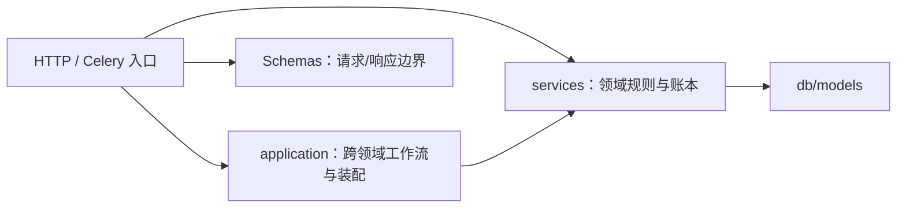

# 后端分层

## 分层规则



**单向依赖**：入口可调用应用工作流或领域服务，工作流组合服务，服务可调模型；领域服务不反向导入入口或应用装配。

## 路由（api/v1）

- 薄壳：解析参数、调权限、调服务、序列化响应
- 不写业务逻辑
- 必须有 docstring（被 OpenAPI 拾取）
- 必须给所有响应码写 `responses={}` 类型

## 应用工作流（application）

`application/job_terminal.py` 显式绑定六类作业的领域账本回填及评估/主动学习的中断处理。通用 `async_job` 只持有通用状态；`services/async_job_terminal.py::JobTerminal` 是只含作业 ID、kind、取消标记和错误的不可变事实，不携带 ORM 或传输对象。

领域回填由 `mask_qc.service`、`point_cloud_quality.service`、`mask_repair`、`mask_formats.service` 和 `training_datasets` 的 `reconcile_job_terminal` 持有。`partial`、`rollback_failed` 和已有终态保护仍由各领域决定；评估与主动学习继续采用自身失联、取消意图和 attempt fencing，不强制变成通用终态。

HTTP 硬取消保留原授权、锁和通知顺序；Celery 信号适配器负责连接、按执行 ID 查作业、调用工作流与提交/释放。工作流和领域回调不自行提交，通用行、领域行及持久通知仍可在调用方同一事务中回滚。普通 worker 的正常完成路径没有改成事件分发。当前回调仍使用本地 `AsyncSession`，不是可直接替换为 HTTP 的远程接口。

`application/job_cancellation.py` 持有取消用例的准入、kind/状态分支与组合，不直接写修复、格式导入、数据版本或评估模型。各领域的 `request_job_cancel` 保留行锁及 pending/running 差异；批量预测和跨帧的取消结果由各自所有者构建，HTTP 入口只调用用例并提交。执行停止请求经纯类型 `JobExecutionControl` 注入，由 `deps.get_job_execution_control()` 装配 Celery 适配器，仍使用非强制撤销；请求取消不等于确认执行已停止，撤销发布失败后的原落库策略不变。

`application/prediction_retry.py` 持有失败预测的单项及按作业重试用例。保留原管理准入、单项队列选择在占用提交前完成、批量先提交全部可占用项再按原默认路由投递的差异；异常仅释放派发调用尚未返回成功的项，已返回成功项继续占用。该工作流持有提交和补偿边界，不能套用取消/终态的调用方单事务。

失败预测管理权限和占用写入由 `services/prediction.py` 持有，放弃/恢复消费同一准入；重试上限和 UTF-8 JSON 的 8 KiB 上下文预算归 `services/prediction_retry.py`。该纯模块的 `PredictionRetryDispatcher` 定义具体重试操作，由 `deps.get_prediction_retry_dispatcher()` 装配 `workers/prediction_retry_dispatch.py`；只传 UUID 和单项预选的执行队列，不暴露 Celery 任务对象或注册名。它仍是本地同步派发接口，没有增加远程协议、自动重试或数据库与 broker 的原子提交；回执丢失等不确定发布仍沿用原语义，补偿不证明任务未入队。

`application/dataset_task_creation.py::DatasetTaskCreationWorkflow` 协调素材关联、请求时同步/排队选择、素材准备与标注建题。初始泛型待建题集合仍用原单语句 `NOT EXISTS` 只读投影，保留排序和一致切面，不先取全量素材 ID 再发大型 `IN` 查询。该投影仍绑定本地数据库，不是可直接远程化的素材查询协议。

`services/labeling_tasks.py::LabelingTaskService` 持有初始泛型/点云建题、追加建题、媒体关联和项目任务总数增量；输入为 `dataset_task_facts.py` 的不可变素材/帧事实，不接收素材 ORM。`DatasetService` 保留入库、去重、尺寸、素材行/文件数和管理关联；`pointcloud_import` 保留标定与帧准备，和 `scene_inference` 共用下层 `dataset_frame_grouping`，场景推断不再反向导入点云准备。初始任务保留默认 5000 项及调用方指定的分块提交，追加只 flush，点云标定独立前置提交和零新增帧重放均保持原语义。

`application/dataset_deletion.py` 组合素材删除及项目解绑，`application/project_deletion.py` 组合保留引用检查和项目跨域删除，`application/project_task_cleanup.py` 组合无源任务清理。素材关联、标注聚合、反馈、缺陷引用、学习保留和项目行分别由原领域所有者写入；原单事务、锁序和检查顺序不拆成 RPC。解绑仍只清理原有限子集，未找到关联时返回 `None`，调用方须回滚此前写入；无源任务继续使用数据库反连接子查询，不把全量 ID 带入所有删除语句。计数重算归 `LabelingTaskService`，解绑与无源清理保持各自原有字段集。素材的派生金字塔前缀只在数据库提交后清理，原图不因该操作删除。

## 服务（services）

- 业务逻辑核心：状态机、规则、跨表事务
- 可调 db 也可调外部 HTTP（结合 httpx）
- 单测主要打这里

规模较大的业务不再堆在 `services/` 根目录的单个平铺文件中，而是放入领域 package：

```text
services/
├── gpu_arbitration/  # 契约、策略、ledger、proof、fence 与 orchestration
├── ml_routing/       # 服务池路由：capability 指纹、SWRR、route-lease ledger、router
├── video_tracking/   # adapter、job 与 runner
├── exporting/       # 导出服务、打包和格式实现
└── data_management/  # schema、查询 primitive 和高层服务
```

领域内依赖保持单向：稳定契约和 primitive 不反向导入高层 orchestration，package `__init__.py` 不为了使用便利而 eager-import 整个高层图。服务不得反向导入 `app.api`、`app.workers`、`app.application` 或 HTTP 依赖装配 `app.deps`；需要外部执行时注入执行端口，由入口装配传输适配器，不把任务注册名当作传输无关接口。

任务资源的可见性、编辑阶段、有效标注员、标注写能力及审核调整证据统一由 `services/task_access.py` 持有。HTTP 依赖、WebSocket、标注写入服务和 worker 直接消费该所有者，不导入或重新导出 `api/v1/tasks/_shared.py` 的旧私有准入函数。`_shared.py` 保留 FastAPI 依赖适配和其他 HTTP 装配辅助，不是服务层的业务规则来源。

`services/project_write_guard.py` 组合任务阶段规则与当前项目授权，负责异步最终写入准入；`lock_project_manager` 统一管理者写命令的账号/项目共享锁与当前管理能力复核。训练、模型、评估等调用方不再导入训练数据集 API 的旧 `lock_owner`。账号、成员和资源锁的顺序、检查时点及提交仍由原调用方保持。该边界没有新增远程调用，也尚未去除 ORM 参数和 HTTP 错误映射；不能将它视为已经可独立部署的权限服务。决策见 ADR-0088。

`services/async_job_access.py` 持有作业结果的当前项目、导出能力与审核任务范围可见性；明细和取消用例直接消费该所有者，旧路由私有函数已删除。列表仍使用现有 SQL 范围谓词，不因本次下沉改为逐行权限查询。

讨论读模型与通知接收人筛选直接调用 `project_access.resolve_project_access_by_id`，再检查 `task_access.assert_task_visible`，不消费 HTTP 依赖助手。`deps.assert_project_visible` 仍是 HTTP 侧对同一解析器的适配，不另建权限实现。当前成员状态、任务批次/分派限制及 404 隐藏语义不变；讨论回复和通知行仍同事务写入，提交后再发布并复核投递权限。

`services/annotation_evidence.py` 持有标注贡献累积、审核轮次创建/确保、贡献者快照、提交审计缺失时的保留行回退，以及首次审核事实记录。HTTP 提交/跳过/审核和视频片段服务直接调用该所有者，不再消费 `_shared.py` 的私有快照函数；当前轮授权证据与历史绩效归属仍是不同记录，不互相替代。

`annotation_slice_contracts` 是只依赖标准库的错误、摘要和固定恢复期限所有者。Polygon 切割、Mask mutation 与 `mask_slice_restore` 直接消费该合同，恢复下层不再反向导入切割编排。原 JSON 编码、409/410 等错误、30 天截止和非缩短 revision 保留不变，操作账本仍只存 Mask 版本及摘要引用。

`mask_formats.registry` 只定义登记、查询、过滤和版本快照原语，不在查询时导入或注册内置实现。`mask_formats.catalog.registry` 在明确的装配模块绑定原描述符及具体 adapter；HTTP、格式导入 worker 和导出消费者直接导入该实例。package root 不重导出或 eager-load catalog，adapter 也不反向导入 registry；格式 ID、能力、选项、版本和原有输入输出不变。

`services/video_context.py` 持有共享 `VideoContext` 与源帧采样纯函数。帧服务负责上下文构建、缓存和 manifest 编排，片段与协作服务消费下层上下文/采样，不反向导入帧服务。导出、追踪与质检直接导入该新所有者；旧帧服务导出已移除，没有兼容别名。上下文仍包含 ORM 实体，不是已定义的跨语言 wire DTO。

`services/prediction_context.py` 持有规范化预测上下文、模型展示名及原图 RGB 读取；`services/prediction_roi.py` 持有裁剪、父框索引、属性合并和坐标回映；`services/prediction_progress.py` 持有原 Redis 频道与消息构造。HTTP、同步二次推理、批量和逐帧 worker 直接消费这些下层所有者，同步服务不再导入 worker，逐帧 worker 也不再反向导入批量 worker。上下文和 ROI 冷加载不引入 ORM、入口、Celery 或配置；原图读取仍在调用时使用对象存储，进度发布仍绑定现有 Redis/config。执行队列、fan-out、根作业身份、裁剪缓存、授权及提交边界未改，这些本地助手不是新的跨语言协议。

质量执行派发由 `services/quality_job_dispatch.py::QualityJobDispatcher` 定义，仅传递领域类型、资源 ID 和执行 ID，不依赖 ORM、FastAPI 或 Celery。`deps.get_quality_job_dispatcher()` 装配 `workers/quality_dispatch.py::CeleryQualityJobDispatcher`；Mask QC、点云质检、视频轨迹质检、Mask 修复/回滚及格式导入的领域派发函数必须显式接收该端口。路由保持先提交再派发，领域服务保持准入、作业身份和失败落库职责，适配器只选择原有 task 对象及队列选项。此边界没有新增远程调用，也不保证数据库与 broker 原子提交或 exactly-once；决策见 ADR-0089。

媒体准备与视频缓存使用独立的 `services/media_job_dispatch.py::MediaJobDispatcher`，由 `deps.get_media_job_dispatcher()` 装配 `workers/media_dispatch.py::CeleryMediaJobDispatcher`。数据集扫描、上传完成、ZIP 入库、视频帧/分块和媒体资产重试的 HTTP 入口显式注入；连接器导入 worker 在自身入口构造适配器。数据集服务和视频帧服务只提交资源 ID 与帧请求，保留原有提交、缓存命中、过期重排和失败处理时序，不选择 Celery task。

视频追踪经纯端口 `video_tracking.dispatch.VideoTrackerJobDispatcher` 派发，只传作业 UUID 并返回执行 ID。HTTP 的 `deps.get_video_tracker_job_dispatcher()` 或 Mask 修复 worker 入口装配 `workers/video_tracker_dispatch.py`；领域 `jobs` 不再导入 Celery 或持有任务注册名。原 `gpu` 队列、单个字符串 UUID 参数、执行 ID 提交和失败补偿不变；仅仍为 queued 的行才被补偿为失败，`fail_closed` 保留 503，发布后数据库失败仍不能证明消息未入队。

训练数据集使用异步端口 `services/training_dataset_dispatch.py::TrainingDatasetDispatcher`。HTTP 由 `deps.get_training_dataset_dispatcher()` 装配，周期学习策略 worker 在自身入口装配 `workers/training_dataset_dispatch.py::CeleryTrainingDatasetDispatcher`，经 `learning_policies.tick/dispatch_pending` 显式传递。领域服务保留 version/job/attempt 身份、执行 ID 落库和同 attempt 且仍 pending 时的失败回填；适配器保留原 task 及线程卸载，业务服务不再承担 Celery 或线程派发。

训练公共下层由三个所有者提供：`training_adapters` 持有资源标识、配置目录、参数解析与受控模板；`training_claims` 持有项目级 PostgreSQL 事务锁及自动策略/参数搜索的执行器领取准入；`training_artifacts` 持有流式产物校验、观测摘要校验与有界 JSON 读取。它们不反向导入 run、策略、搜索、配方或观测编排服务，原编排模块的已迁移入口不再导出。

`training_runs` 保留执行状态机、资源租约与终态提交，学习策略、参数搜索、配方和观测服务直接消费上述下层。领取判定不在已持有资源/run 锁时额外取得项目/策略锁；项目事务锁的键和等待语义、手动恢复的授权前提、产物流式上限及线程卸载保持原行为。这些边界仍使用当前配置、ORM 或存储对象，不是跨语言 wire 契约。

`active_learning_references` 单独持有训练数据版本/评估引用保留及项目、素材、任务和版本删除保护。主动学习创建、评估清理和各删除入口直接调用该下层所有者，不从主动学习池反向导入编排规则；`sample_evaluation_sources` 直接消费评估纯引擎的限制和原存储实例，不再反向导入 `sample_evaluations`。引用去重、409 错误、源图身份校验和调用方事务/清理顺序不变；引用保护仍是现有本地查询，不是新增的分布式保留协议。

`gpu_arbitration` 内部按职责分层：`contracts`（dispatch 请求/grant/错误与失败记录）和 `policy`（mode/claim/shadow 决策）是 cycle-safe 叶模块；`fences`、`proofs`、`control_preparation`、`reconciliation`、`retirement`、`diagnostics` 依次构建在低层之上；`dispatch`、`membership_activation`、`rollout_control` 是允许依赖 `ml_client` 的高层编排模块。`ml_client` 只依赖 `contracts`、`policy`、`rollout_state`。

`ml_routing` 实现服务池请求路由（ADR-0050）：`contracts`（pool/instance 双 ID、route lease、outcome/rejection、error code）和 `capability`（canonical 指纹 + diff，前后端单一真值）是纯数据叶模块；`policy`（smooth weighted round robin 纯核）无副作用；`ledger`（Redis acquire/heartbeat/finish/cancel 原子 Lua + 被动熔断，namespace `ml-router:v1`）独立于 `gpu_arbitration` ledger；`router`（`MLBackendRouter` 编排 DB 拓扑 + ledger，off/observe 返回 legacy instance、enforce fail-closed）、`safety`（卸载、成员移除和 registry 删除共用的 quiescence 校验）、`diagnostics`（topology/runtime-snapshot 读模型）、`metrics`（Prometheus）是高层模块。`safety` 只有在 router enforce、成员精确 draining、账本可读且清理过期 lease 后 exact inflight=0 时放行，未知状态失败关闭。`router` 不发 HTTP；选中实例后单向交给 `MLBackendClient`。GPU 仲裁不导入 `ml_routing`；路由选择完成后单向调用实例 client。

`diagnostics.build_topology` / `build_runtime_snapshot` 返回 typed Pydantic 模型（`app.schemas.ml_routing.TopologyResponse` / `RuntimeSnapshotResponse`），OpenAPI snapshot 与前端 generated TS 类型一致。topology 按 `super_admin` 标志做服务端角色裁剪：Project Admin 的 `routing_policy` 为 `"unknown"`、member 的 `weight` / `state` / `last_checked_at` / `gpu_resource_id` 为 `None`；这不是前端隐藏，是响应体内的真值。runtime-snapshot 带 freshness 信封（`observed_at` / `partial` / `partial_reason` / `sources[]`），单个来源失败不抹掉其它可信数据（ADR-0051）。前端在 `apps/web/src/pages/ModelMarket/runtimeTopology.ts` 用纯函数把两个读模型按稳定 ID 合并为页面 view model，保留 unknown / stale / partial，不做业务真值猜测；路由可用性、池健康与 drain 安全判定仍由后端合同给出，view-model 只负责显示。

`app.services.*` 是应用内部实现，不是公共 API。领域 package 或明确拥有职责的单文件服务是实现和导入边界。已收敛的领域旧平铺路径已物理删除，永久守卫（`tests/test_compat_facades.py` 的 `REMOVED_MODULE_SPECS`、`tests/test_domain_package_architecture.py` 的 `REMOVED_MODULES` 与 `scripts/check_removed_service_modules.mjs`）阻止旧路径以任何形式回流。

## 模型（db/models）

- 仅 SQLAlchemy 模型定义 + 简单的 `@hybrid_property`
- **不**在模型里写业务方法

## Schemas（pydantic）

- 请求模型（`*In`）和响应模型（`*Out`）严格区分
- 不要复用 SQLAlchemy 模型当响应（避免泄露 ORM 字段）
- 嵌套响应优先显式定义，不依赖 Pydantic 推导

> 反例：`ProjectOut.batch_summary: dict` → 改为 `ProjectBatchSummary` 显式模型

## Middleware

- 限流：`slowapi`，按 IP / 用户
- 审计：写 `audit_logs` 表
- 请求 ID：注入 `X-Request-ID` 到日志

## Workers（Celery）

- 任务定义在 `app/workers/`
- broker = Redis；result backend = Redis
- 长任务（导出 / AI 预标注）必走异步
- 短任务（发邮件）也走异步避免阻塞 HTTP

## 测试映射

| 层      | 测试位置                                     |
| ------- | -------------------------------------------- |
| 路由    | `tests/test_<feature>.py` 用 `httpx_client`  |
| 服务    | `tests/test_<service>_service.py` 直接调函数 |
| 模型    | 不单独测，由路由 / 服务测试覆盖              |
| Workers | `tests/test_<task>.py`，用 eager mode        |

领域结构额外由 `tests/test_domain_package_architecture.py` 检查依赖方向、相对导入、package root 和模块环，支持 package 内单文件所有者。声明的服务禁止反向导入 API、worker、应用工作流或 HTTP 装配；通用 `async_job` 的应用内依赖限定为自身模型，终态事实与重试策略/端口模块不依赖其他应用模块。SCC 守卫覆盖全服务图，不保留按领域选择的环豁免。该源码约束不证明跨域写入所有权、事务等价或跨语言部署已经完成。已删除实现路径另由 `tests/test_compat_facades.py` 等既有守卫防止回流，不保留兼容 facade。
