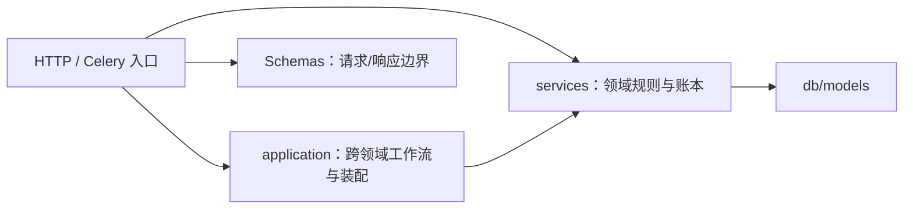

# 后端分层

## 分层规则



**单向依赖**：入口可调用应用工作流或领域服务，工作流组合服务，服务可调模型；领域服务不反向导入入口或应用装配。

## 路由（api/v1）

- 薄壳：解析参数、调权限、调服务、序列化响应
- 不写业务逻辑
- 必须有 docstring（被 OpenAPI 拾取）
- 必须给所有响应码写 `responses={}` 类型

## 应用工作流（application）

`application/job_terminal.py` 显式绑定六类作业的领域账本回填及评估/主动学习的中断处理。通用 `async_job` 只持有通用状态；`services/async_job_terminal.py::JobTerminal` 是只含作业 ID、kind、取消标记和错误的不可变事实，不携带 ORM 或传输对象。

领域回填由 `mask_qc.service`、`point_cloud_quality.service`、`mask_repair`、`mask_formats.service` 和 `training_datasets` 的 `reconcile_job_terminal` 持有。`partial`、`rollback_failed` 和已有终态保护仍由各领域决定；评估与主动学习继续采用自身失联、取消意图和 attempt fencing，不强制变成通用终态。

HTTP 硬取消保留原授权、锁和通知顺序；Celery 信号适配器负责连接、按执行 ID 查作业、调用工作流与提交/释放。工作流和领域回调不自行提交，通用行、领域行及持久通知仍可在调用方同一事务中回滚。普通 worker 的正常完成路径没有改成事件分发。当前回调仍使用本地 `AsyncSession`，不是可直接替换为 HTTP 的远程接口。

`application/job_cancellation.py` 持有取消用例的准入、kind/状态分支与组合，不直接写修复、格式导入、数据版本或评估模型。各领域的 `request_job_cancel` 保留行锁及 pending/running 差异；批量预测和跨帧的取消结果由各自所有者构建，HTTP 入口只调用用例并提交。执行停止请求经纯类型 `JobExecutionControl` 注入，由 `deps.get_job_execution_control()` 装配 Celery 适配器，仍使用非强制撤销；请求取消不等于确认执行已停止，撤销发布失败后的原落库策略不变。

`services/async_job.py` 是通用作业行的写入所有者：`bind_execution_id` 只绑定或清空 Celery 执行 ID，不读取作业行、不提交；调用方保留既有缺行/条件优先级、预分配或回传 ID 及提交/派发时序。`update_payload` 浅合并 payload，`update_progress` 裁剪百分比并替换显式提供的 result，`replace_result` 只替换结果而不改变生命周期。`delete_terminal_jobs_before` 按调用方给定的 cutoff 和终态集合删除旧行，返回删除 ID，仍由 worker 计算 30 天 cutoff、选择原状态集合、提交并计数。状态写命令不提交或发布通知；创建和 `track_job` 保留显式 flush，其他状态写命令不额外 flush。默认取消仅允许 pending/running，特殊执行器必须明确提供自身状态优先级。

跨帧 worker 保留已取消时不回写增量进度、逐帧结果整体替换及原提交点；最终取消显式允许覆盖已有终态、推进至 100、保留旧错误，再按原顺序通知和提交。连接器导入允许 pending/running/已经 cancelled 三种状态回填最终计数，不强制进度 100，通知仍由原调用方发一次。旧导入预算快照仍在刷新后的作业排他锁内生成，浅合并并提交后才枚举源文件；这些进程内命令不是语言无关的作业协议。

`application/prediction_retry.py` 持有失败预测的单项及按作业重试用例。保留原管理准入、单项队列选择在占用提交前完成、批量先提交全部可占用项再按原默认路由投递的差异；异常仅释放派发调用尚未返回成功的项，已返回成功项继续占用。该工作流持有提交和补偿边界，不能套用取消/终态的调用方单事务。

失败预测管理权限、dismiss/restore 和占用写入由 `services/prediction.py` 持有；同一 owner 还持有 retry 成功后的失败行删除及失败计数（递增 `retry_count`、更新 `last_retry_at`、移除 `retry_pending` 并保留可选仲裁错误）。HTTP 保留当前角色与项目管理准入、条件审计和提交；worker 只保留实际推理/队列编排，预测产物与失败行删除在同一调用事务提交。重试上限和 UTF-8 JSON 的 8 KiB 上下文预算归 `services/prediction_retry.py`。该纯模块的 `PredictionRetryDispatcher` 定义具体重试操作，由 `deps.get_prediction_retry_dispatcher()` 装配 `workers/prediction_retry_dispatch.py`；只传 UUID 和单项预选的执行队列，不暴露 Celery 任务对象或注册名。它仍是本地同步派发接口，没有增加远程协议、自动重试或数据库与 broker 的原子提交；回执丢失等不确定发布仍沿用原语义，补偿不证明任务未入队。

`application/dataset_task_creation.py::DatasetTaskCreationWorkflow` 协调素材关联、请求时同步/排队选择、素材准备与标注建题。初始泛型待建题集合仍用原单语句 `NOT EXISTS` 只读投影，保留排序和一致切面，不先取全量素材 ID 再发大型 `IN` 查询。该投影仍绑定本地数据库，不是可直接远程化的素材查询协议。

`services/labeling_tasks.py::LabelingTaskService` 持有初始泛型/点云建题、追加建题、媒体关联和项目任务总数增量；输入为 `dataset_task_facts.py` 的不可变素材/帧事实，不接收素材 ORM。`DatasetService` 保留入库、去重、尺寸、素材行/文件数和管理关联；`pointcloud_import` 保留标定与帧准备，和 `scene_inference` 共用下层 `dataset_frame_grouping`，场景推断不再反向导入点云准备。初始任务保留默认 5000 项及调用方指定的分块提交，追加只 flush，点云标定独立前置提交和零新增帧重放均保持原语义。

素材上传完成的已观察内容长度/MD5 由 `DatasetService.record_uploaded_item_content` 分别暂存，图片尺寸复用 `set_item_dimensions`；HTTP 不直接修改 `DatasetItem`。原 ContentLength truthy 条件、32 字符 ETag 去重、仅缺尺寸时读取图片、追加建题及最终提交/派发顺序均保留，缺对象或重复对象仍走原占位清理路径。尺寸命令复用当前 Session 已加载的身份，不新增逐项查询。

`application/dataset_deletion.py` 组合素材删除及项目解绑，`application/project_deletion.py` 组合保留引用检查和项目跨域删除。素材关联、标注聚合、反馈、缺陷引用、学习保留和项目行分别由原领域所有者写入；原单事务、锁序和检查顺序不拆成 RPC。解绑仍只清理原有限子集，未找到关联时返回 `None`，调用方须回滚此前写入；无源任务继续使用数据库反连接子查询，不把全量 ID 带入所有删除语句。计数重算归 `LabelingTaskService`，解绑与无源清理保持各自原有字段集；素材派生金字塔前缀仅在数据库提交后清理，原图不因该操作删除。

`application/project_task_cleanup.py::cleanup_annotation_orphans` 组合当前项目管理权、配置和 `AnnotationService`。执行命令先按账号 → 项目取得当前管理权，再取得项目排他锁并刷新 `tool_bindings`；`AnnotationService` 持有孤儿筛选 / 修剪、贡献证据及任务统计 DML，按批次 → 任务 → 标注排序锁定并刷新目标身份。权限撤销、项目转移或目标改向不会沿用旧快照，NOWAIT 忙锁返回冲突。默认 dry-run 只读且不写审计；真实修改与 HTTP 审计同事务提交，保留标注来源、几何、`_` 系统元数据，不执行对象存储删除。该服务所有者不反向依赖应用层。

`application/nuscenes_import.py::NuScenesImportWorkflow` 组合 Dataset/Project workspace、关联、点云标定和建题；nuScenes 入口把标定前置与建题分块提交关闭，使素材、Scene、pose、workspace、Task 和标定都只 flush 到脚本持有的同一个 `AsyncSession`，由入口最终提交。普通任务创建仍使用原默认提交点。`services/scene.py` 持有 Scene 来源元数据更新，`services/identity_commands.py::IdentityCommandService.ensure_import_admin` 持有 nuScenes CLI 的 admin 读取/开发环境创建与生产拒绝语义；图片导入的 Dataset/Item 写入由 `DatasetService` 持有。

`application/dataset_reset.py::DatasetResetWorkflow` 组合任务素材引用解除与 `DatasetService` 的链接/素材/Dataset 行删除；CLI 只列出和提交，重置仍是数据库清理，不遍历或删除 MinIO 对象。nuScenes/图片导入先写对象再由调用方提交 SQL；SQL 回滚无法回滚新对象上传或对既有键的覆盖。开发 seed 替换旧 `P-PC-DEV` 时仅把旧对象 key 作为清理计划返回，并在所属调用方 SQL 提交成功后删除；SQL 提交失败保留旧对象，提交后对象删除失败则保留无引用对象并告警。数据库与对象存储仍非原子事务，新上传对象在 SQL 回滚后可能成为孤儿。

运维 CLI 仅保留参数/环境读取、事务提交和报告：`application/bootstrap_admin.py` 组合 `IdentityCommandService.create_bootstrap_super_admin` 与 `AuditService.log`，既有邮箱不更新也不重复审计；`application/task_dataset_backfill.py` 承担版本扫描/核查并委托 `project_task_dataset.ensure_membership`，CLI 保持只读模式与逐批提交。`application/video_timetable_rebuild.py` 组合源对象读取、ffprobe 与稀疏锚点选择，`DatasetService` 写索引、总帧数及失败字段；CLI 按视频逐项提交，dry-run 不写数据库。批次开始前保存选择项 UUID；失败 rollback 后显式刷新后续 ORM 行，避免从已过期状态触发隐式 I/O，正常路径不增加逐项刷新。ffprobe 纯 helper 的 canonical 路径为 `services/media_probe.py`，不再从 worker 汇总模块导入。

`application/dataset_deletion.py` 组合素材删除及项目解绑，`application/project_deletion.py` 组合保留引用检查和项目跨域删除，`application/project_task_cleanup.py` 组合无源任务清理。素材关联、标注聚合、反馈、缺陷引用、学习保留和项目行分别由原领域所有者写入；原单事务、锁序和检查顺序不拆成 RPC。解绑仍只清理原有限子集，未找到关联时返回 `None`，调用方须回滚此前写入；无源任务继续使用数据库反连接子查询，不把全量 ID 带入所有删除语句。计数重算归 `LabelingTaskService`，解绑与无源清理保持各自原有字段集。素材的派生金字塔前缀只在数据库提交后清理，原图不因该操作删除。

`application/task_lifecycle.py`、`task_review.py` 和 `task_submission.py` 组合标注生命周期、贡献证据、首次审核事实、反馈镜像、计数、审计、持久通知及质检。Task 状态和对应 Project 计数写入归 `LabelingTaskService`；原路由共享提交函数已删除，单题与批次入口直接消费同一工作流。`AuditOriginContext` 仅保存 method/path/IP，不把 FastAPI 请求对象传入用例；其他审计调用方仍保留原请求适配。

单题保持原事务及提交后通知发布；整批送审保留默认 200 题分块提交、每块提交后质检派发、最终批次投影/审计另提交。批次自动迁移事件仍沿用原发布时点，不能据此宣称全部事件提交后发布。这些工作流仍接受本地 ORM、Session 和领域派发端口，不是跨语言 wire 契约；最终写入授权与并发锁边界需单独验证。

`application/trained_model_deployment.py` 组合模型检查、实例安装/固定验证样本试用与检查结果发布。检查行与 `check_id` 由 `trained_models` 持有，安装/试用及 ready 回执复查 HTTP 归 `trained_model_backend`；需要安装时先提交 checking，I/O 后重新取得项目管理权威和检查行，只有同一检查可以发布结果。项目 advisory 复用 `training_claims.project_lock`，注册、候选决策和发布入口也使用该所有者，不复制锁键或等待策略。该本地多阶段工作流不是数据库与模型实例间的原子事务。

## 服务（services）

- 业务逻辑核心：状态机、规则、跨表事务
- 可调 db 也可调外部 HTTP（结合 httpx）
- 单测主要打这里

规模较大的业务不再堆在 `services/` 根目录的单个平铺文件中，而是放入领域 package：

```text
services/
├── gpu_arbitration/  # 契约、策略、ledger、proof、fence 与 orchestration
├── ml_routing/       # 服务池路由：capability 指纹、SWRR、route-lease ledger、router
├── video_tracking/   # adapter、job 与 runner
├── exporting/       # 导出服务、打包和格式实现
└── data_management/  # schema、查询 primitive 和高层服务
```

领域内依赖保持单向：稳定契约和 primitive 不反向导入高层 orchestration，package `__init__.py` 不为了使用便利而 eager-import 整个高层图。服务不得反向导入 `app.api`、`app.workers`、`app.application` 或 HTTP 依赖装配 `app.deps`；需要外部执行时注入执行端口，由入口装配传输适配器，不把任务注册名当作传输无关接口。

任务资源的可见性、编辑阶段、有效标注员、标注写能力及审核调整证据统一由 `services/task_access.py` 持有。HTTP 依赖、WebSocket、标注写入服务和 worker 直接消费该所有者，不导入或重新导出 `api/v1/tasks/_shared.py` 的旧私有准入函数。`_shared.py` 保留 FastAPI 依赖适配和其他 HTTP 装配辅助，不是服务层的业务规则来源。

`services/project_write_guard.py` 组合任务阶段规则与当前项目授权。`resolve_project_access(lock_membership=True)` 与 `lock_project_manager` 复用同一个 `lock_current_project_access()`：按账号→项目→成员持有当前权威，直到调用方提交或回滚，覆盖账号停用、所有权转移和成员撤销；异步 `lock_actor_scope` 同样覆盖项目行。资源/编辑锁、阶段证据与用例提交仍由对应写入所有者保留。训练、模型、评估不再导入 API 的旧 `lock_owner`；本地 ORM、Session 和 HTTP 错误仍不是可远程提取的协议。决策见 ADR-0088。

项目权威使用 `FOR KEY SHARE`，与所有权转移/删除的显式 `FOR UPDATE` 互斥，但允许项目计数的普通更新；标注生命周期计数使用 SQL 原子增减及下限裁剪，不从旧 ORM 数值回写。账号数据组目录同样只对操作者持有账号权威 KEY SHARE，角色/启停/密码写入仍用完整账号写锁，避免两个管理员互改对方数据组时发生账号锁环。登录与偏好合并保留原有等待式账号锁，不把并发上下文合并或预设 CAS 改成抢锁失败。

`services/async_job_access.py` 持有作业结果的当前项目、导出能力与审核任务范围可见性；明细和取消用例直接消费该所有者，旧路由私有函数已删除。列表仍使用现有 SQL 范围谓词，不因本次下沉改为逐行权限查询。

讨论读模型与通知接收人筛选直接调用 `project_access.resolve_project_access_by_id`，再检查 `task_access.assert_task_visible`，不消费 HTTP 依赖助手。`deps.assert_project_visible` 仍是 HTTP 侧对同一解析器的适配，不另建权限实现。当前成员状态、任务批次/分派限制及 404 隐藏语义不变；讨论回复和通知行仍同事务写入，提交后再发布并复核投递权限。

`services/annotation_evidence.py` 持有标注贡献累积、审核轮次创建/确保、贡献者快照、提交审计缺失时的保留行回退，以及首次审核事实记录。HTTP 提交/跳过/审核和视频片段服务直接调用该所有者，不再消费 `_shared.py` 的私有快照函数；当前轮授权证据与历史绩效归属仍是不同记录，不互相替代。

`application/annotation_create.py::AnnotationCreateWorkflow` 承接锁后的手工标注创建事务；HTTP 继续先锁 Task 并核验当前权限和视频写入范围。工作流 trim 并校验 `Idempotency-Key`，`AnnotationService` 持有窄化的创建收据查询/写入，按 actor + task + key 查找，以 canonical `AnnotationCreate` 摘要区分精确重放与 409 冲突。新建仍按标注写入/flush → legacy video heartbeat → 响应 refresh/收据 → 审计 → commit → 最终 refresh；重放直接返回冻结响应，不重复创建贡献、历史、审计或 heartbeat。没有新增通用幂等/重试框架或 HTTP 合同。

`annotation_slice_contracts` 是只依赖标准库的错误、摘要和固定恢复期限所有者。Polygon 切割、Mask mutation 与 `mask_slice_restore` 直接消费该合同，恢复下层不再反向导入切割编排。原 JSON 编码、409/410 等错误、30 天截止和非缩短 revision 保留不变，操作账本仍只存 Mask 版本及摘要引用。

`mask_formats.registry` 只定义登记、查询、过滤和版本快照原语，不在查询时导入或注册内置实现。`mask_formats.catalog.registry` 在明确的装配模块绑定原描述符及具体 adapter；HTTP、格式导入 worker 和导出消费者直接导入该实例。package root 不重导出或 eager-load catalog，adapter 也不反向导入 registry；格式 ID、能力、选项、版本和原有输入输出不变。

`services/video_context.py` 持有共享 `VideoContext` 与源帧采样纯函数。帧服务负责上下文构建、缓存和 manifest 编排，片段与协作服务消费下层上下文/采样，不反向导入帧服务。导出、追踪与质检直接导入该新所有者；旧帧服务导出已移除，没有兼容别名。上下文仍包含 ORM 实体，不是已定义的跨语言 wire DTO。

`services/prediction_context.py` 持有规范化预测上下文、模型展示名及原图 RGB 读取；`services/prediction_roi.py` 持有裁剪、父框索引、属性合并和坐标回映；`services/prediction_progress.py` 持有原 Redis 频道与消息构造。HTTP、同步二次推理、批量和逐帧 worker 直接消费这些下层所有者，同步服务不再导入 worker，逐帧 worker 也不再反向导入批量 worker。上下文和 ROI 冷加载不引入 ORM、入口、Celery 或配置；原图读取仍在调用时使用对象存储，进度发布仍绑定现有 Redis/config。执行队列、fan-out、根作业身份、裁剪缓存、授权及提交边界未改，这些本地助手不是新的跨语言协议。

推理产物经不可变 `labeling_write_scope` 交回标注所有者，不携带权限许可。`PredictionService` 持有候选、分区 Meta 和预测数写入，`AnnotationService` 持有采纳/拒绝及二次推理属性/子框写入，`BatchService` 持有推理后的批次推进。`labeling_write_guard` 复用 `project_access.lock_current_project_access()`，锁定并读取当前账号→项目→成员，保留 Task/批次、编辑 advisory、源版本及作业终态的本地最终写入边界；不信任排队时的角色或 URL 的另一题。

`application/bulk_clear_preannotate.py` 持有批量清空的模式选择、逐项结果、审计和最终提交；`annotation_cleanup.py` 持有标注父预测引用解绑及已采纳 AI 标注软删，`PredictionService.delete_for_tasks()` 持有分区预测/失败预测及 Meta 的删除次序，`async_job.delete_batch_predict_jobs()` 只清对应批次的预标作业，批次回退仍归 `BatchService`。下层标注命令避免建立 `BatchService ↔ AnnotationService` 循环；领域命令不自行提交，批量入口没有新增逐项 savepoint。领域异常若已经回滚事务，工作流立即向外保留异常，不继续使用已释放的权威围栏或累计成功列表。

批量清空使用 `project_access.lock_current_project_rows()` 刷新并围住当前账号与项目，再按原全局管理员/当前负责人策略判断；该原语只锁定事实，不授予可见性或管理能力。普通项目访问继续由 `lock_current_project_access()` 在相同行锁后解析成员及能力，不能把批量管理入口的 `forbidden` 结果改成成员可见性策略。当前持久化命令仍使用本地 Session/SQL Select，不是跨语言 wire 合同。

`secondary_inference_result` 是只依赖标准库的不可变产物事实，引擎不再代写标注；实际属性写入推进标注版本并保留人工来源。`test_seed_access` 单独持有无主体夹具的环境/真实数据库准入，不能用它绕过普通写入的 actor 要求。传输、公开 schema 与协作取消边界不变；这些持久化准入仍绑定本地 Session、ORM 和 HTTP 错误，不宣称已经可直接远程提取。

`services/labeling_assignment.py::LabelingTaskAssignmentService` 持有选定任务分派预览与写入，`schemas/labeling_assignment.py` 持有原公开请求/响应模型；Data Manager 的查询及保存视图不再代写 Task。确认使用当前管理围栏、共享批次接收人校验和非阻塞编辑围栏，复用已经锁定的批次/任务计划；领域只 flush，HTTP 保留审计与提交。缺失/null、任务覆盖/批次默认、审核态限制、预览摘要与逐项失败语义见 [Data Manager 查询与聚合](../reference/data-manager-query)。

身份与责任交接由 `application/user_lifecycle.py`、`legacy_user_lifecycle.py`、`project_membership.py` 和 `project_workspace.py` 组合。`services/user_lifecycle.py` 持有账号锁、停用/恢复元数据与凭据代际；`identity_commands.py` 持有认证/自助资料、密码、在线状态、偏好及用户数据组投影，`account_groups.py` 持有数据组目录和成员投影。成员行写入留在 `services/project_membership.py`，任务/批次交接与编辑锁释放交给 `BatchService`，项目所有权由 workspace 写入，GDPR 审计历史脱敏由 `AuditService` 完成。

`application/invitation_acceptance.py` 组合身份邀请与 workspace 成员授予。`InvitationService` 保留 token、过期/撤销、当前邀请人和邮箱/项目/账号锁，以及邀请组名与接受状态写入；受邀账号字段由 `IdentityCommandService.create_invited_account` 写入，项目成员 INSERT、邀请人归属和并发重复 409 由 `project_membership.grant_invitation_membership` 持有。工作流不直接构造 User 或写 ProjectMember；HTTP 保留同一 Session 的审计 → commit → refresh → 注册 JWT 顺序。所有者不另行提交，不将本地跨域事务拆成 RPC。

`services/notification_preferences.py` 只依赖标准库，持有可配置通知类型与默认 toast 目录；`services/notification_preferences_command.py` 持有 JSONB 原子 upsert 和新行默认值，直接保留缺失频道及未知扩展键，且不提交事务。偏好路由仍负责当前用户绑定、HTTP 输入错误、提交与提交后 `notifications.sync` 发布；命令层不导入 API、worker 或配置装配。

版本化离职流程按账号→项目→目标/接收人成员→批次→任务→编辑 advisory→编辑锁读取稳定快照，再核对预览摘要与接收资格。传统停用/删除、自助注销和版本化离职仍保留各自语义，不合并为通用删除；Redis 凭据代际仍在 SQL 提交前推进，不把两者宣称为分布式原子事务。恢复不会重建旧密钥或退回已交接工作。

`application/project_class_rename.py` 组合 `services/project_workspace.py` 的类别绑定修改与 `AnnotationService.rename_class_name()` 的存量迁移；只由 HTTP 提交。当前管理权威锁之后取得项目排他围栏，与标注写入的 KEY SHARE 互斥，再刷新配置。工具参数只限制绑定，标注仍按项目/名称整体迁移，版本、预测与 alias 规则不变。项目配置与 ProjectTemplate 行命令也归 `services/project_workspace.py`；`application/project_workspace_configuration.py` 在请求事务内复核当前 actor、项目与模板权威，组合模板/源项目字段、项目 kind 与协作校验及 backend 启用/主绑定，HTTP 保留 commit 和响应。项目内嵌已保存流水线调用 `services/pipeline_template.py::validate_saved_pipeline` 校验结构；命名流水线的 backend 启用交叉校验仍由 `application/project_pipeline.py::apply_saved_pipeline` 持有。`services/project_template.py` 保留可见性/scope/payload helper，`services/project.py` 仅提供 tool_bindings 读投影。

`application/project_guide_assets.py::ProjectGuideAssetWorkflow` 显式绑定 storage transport 与 workspace 的 key、登记及移除规则；MIME/大小词表在纯标准库 `guide_asset_contracts`，不由 HTTP schema 拥有。完成的 HEAD 不持有行锁，返回后重取当前管理权威和项目排他锁，再追加最新 JSON；无效对象清理也在最终授权之后。显式 DELETE 则在围栏内执行，保留存储失败仍删登记的现有语义；签名读取使用当前项目可见性及共享项目围栏。对象存储与 SQL 没有跨资源原子性，已签发 URL 的时效不变。

`application/project_pipeline.py::apply_saved_pipeline` 组合当前项目管理权威与项目 backend 启用检查，再调用 `services/pipeline_template.py::apply_pipeline` 完成快照复制、使用计数和默认项切换。保存编排的创建、更新、删除、结构校验、阶段深拷贝及默认项命令均由 `services/pipeline_template.py` 持有；HTTP 路由只处理请求/可见性、提交、刷新和响应。

预标注请求的 canonical schema 位于 `schemas/preannotate.py`（`PipelineStage`、`PreannotateRequest`）。`services/pipeline_template.py::validate_saved_pipeline` 同时供项目内嵌配置和命名编排使用，仅校验结构；backend 存在及项目启用仍在 apply / 执行路径校验。

`application/ml_registry_deletion.py::delete_registry` 编排全局 registry 删除：先复核服务删除准入与路由静默，再解析 pool 并删除 registry；仅删除成功后调用 `services/project_workspace.py::clear_primary_backend_binding_for_pool`，在同一调用者事务中清除且仅清除指向该 pool 的 `Project.ml_backend_pool_id`。主绑定 setter/clearer 归 workspace，`MLBackendService.delete` 不直接写 Project，独立的项目启用关系不变。HTTP 仍持有业务审计与提交；删除入口通过 `identity_commands.IdentityCommandService.lock_platform_super_admin()` 以账号行锁重新读取当前超管权威并持有至提交。

`application/annotation_comment.py::AnnotationCommentWorkflow` 组合原标注评论、独立反馈镜像、审计与延迟通知，`services/annotation_comment.py` 只持有提及校验及评论行修改。应用命令复用当前账号→项目→成员→批次→任务围栏，再锁定并刷新真实标注和已有评论；作者/管理动作与清空正文的内容约束依据当前记录计算，不增加标注编辑或编辑锁策略。创建保留 flush→镜像→审计→通知行→commit→publish→refresh，修改/软删不新增镜像同步、审计或通知语义；软删原有审计仍保留。

软删评论附件的候选筛选和附件行清空由 `AnnotationCommentService` 持有：仅选 inactive 且 `updated_at` 严格早于当前时刻减 7 天的最多 500 条，不指定顺序，空附件也占候选名额。cleanup worker 保留 `storage_key` 解释、MinIO 删除与日志，并在所有行命令后只提交一次；存储删除失败仍清空附件行，数据库提交失败会回滚行但无法恢复此前已删除的对象。这里没有重试或 outbox，也没有把 SQL 与 MinIO 描述成原子事务。

`application/annotation_feedback.py::AnnotationFeedbackWorkflow` 持有反馈创建、修改、软删与回复的准入和事务组合，`FeedbackService` 仍是反馈行所有者。项目级反馈重取当前权威；任务级反馈额外锁定真实批次/任务/标注，再以确定 ID 顺序锁定并刷新线程祖先和目标，核对根、父与作用域漂移后重算动作及内容约束。原生任务绘图/提及、通用创建与专用回复差异、QC 定位与过期判断、字段缺失/null、审核员状态专用规则、resolver 及各路径审计/通知顺序保留。返回的 ORM 装配结果仅为本地适配器，不是跨语言 wire DTO。

`application/video_chapters.py::VideoChapterWorkflow` 组合当前管理权威与实际任务/素材/章节围栏，`services/video_chapter_service.py` 持有章节创建、范围/元数据更新及删除。命令只以稳定 ID 和当前访问解析定位，锁定并刷新视频任务来源与章节，不把传入 Task/User 当许可；HTTP 保留审计、提交、更新后 refresh 和响应构造。章节仍由素材条目拥有，不改成 Task 私有数据，也不增加任务可编辑或 segment 领取规则。

`application/raster_mask_retention.py::RasterMaskRetentionWorkflow` 组合采纳回执、追踪候选、转换计划与 Mask revision 的领域过期命令，并持有八类引用的本地只读投影。`services/raster_mask_storage.py` 持有对象筛选、reservation 清理、内容 advisory 围栏及物理删除；领域通过显式引用复查回调连接，不反向导入应用或 worker。Celery 入口只创建 job-local Session 并调用工作流，原任务名、`cleanup` 路由与周期不变。

GC 先提交过期记录，即使 `dry_run=True` 也不回滚该阶段；对象必须严格早于 24 小时宽限截止，每次最多处理 1000 个候选，列表读取没有同样上限。删除 reservation 提交后重新取得内容锁，复查引用和新 reservation，再持锁删除对象；数据库与 S3 仍非原子事务。该协议保护首次提交之后到达的上传，不保证首次锁之前已完成的同 key 去重上传 reservation 永远不被清理。完整根规则、错误及计数语义见 [存储桶布局](../reference/storage-buckets#raster-mask-引用与清理)；本地联合投影不是跨语言保留租约。

质量执行派发由 `services/quality_job_dispatch.py::QualityJobDispatcher` 定义，仅传递领域类型、资源 ID 和执行 ID，不依赖 ORM、FastAPI 或 Celery。`deps.get_quality_job_dispatcher()` 装配 `workers/quality_dispatch.py::CeleryQualityJobDispatcher`；Mask QC、点云质检、视频轨迹质检、Mask 修复/回滚及格式导入的领域派发函数必须显式接收该端口。路由保持先提交再派发，领域服务保持准入、作业身份和失败落库职责，适配器只选择原有 task 对象及队列选项。此边界没有新增远程调用，也不保证数据库与 broker 原子提交或 exactly-once；决策见 ADR-0089。

点云质检派发异常的领域终态由 `point_cloud_quality.service.record_dispatch_failure` 暂存：失败状态、原错误截断和完成时间归运行所有者；HTTP 仍经通用作业所有者标记失败，再共同提交并映射原错误。保留受理已提交、派发失败另行提交的窗口，不增加重试、通知或分布式补偿保证。

Mask QC 与点云质检问题的人工状态转移分别由 `services/mask_qc/service.py::decide_issue` 和 `services/point_cloud_quality/service.py::decide_issue` 持有；命令校验冻结的 Task 绑定与当前源新鲜度，并更新所属 issue 的解析/复核字段。API 继续负责既有项目角色/任务可见性、成员权威锁及 Task/issue NOWAIT 锁，点云路由保留审计，路由保留原提交、refresh 和响应次序。Issue 仍由各质检领域所有，反馈锚只表达评论上下文，不接管 issue 或源对象。

执行边界另由 `application/quality_execution.py` 装配：`services/quality_job_lifecycle.py::QualityJobLifecycle` 是只含操作契约的服务端口，应用层将它绑定到 `services.async_job` 状态函数与 `notify_job_terminal`。Mask QC 和点云质检的扫描/运行状态机分别由 `services/mask_qc/execution.py`、`services/point_cloud_quality/execution.py` 持有；视频轨迹质检 `services/video_track_quality.py::execute_run` 仍与其领域账本同模块。三个 worker 仅保留原 task 注册名、单个 run ID 参数和 Session 适配，然后调用应用组合；Celery 路由仍为 `media`。领域执行继续通过生命周期端口调用通用作业和通知，不反向导入 application 或 worker；既有事务检查点、取消探针和提交/通知顺序保留。

实际执行编排分别由 `application/mask_repair_execution.py::run_mask_repair` 与 `application/mask_format_import.py::run_mask_format_import` 持有；Celery worker 仅建立本地 Session 并调用应用入口，原 task 名称、签名及 `media` 队列不变。Mask services 持有批次/回滚或格式导入 ledger 与派发补偿；格式导入的状态、完成时间与逐项结果由 `services/mask_formats/service.py` 的窄命令写入。应用层保留逐项事务、取消检查点、对象读取、通用作业通知及提交顺序；格式适配器和 staged-object I/O 仍由现有领域适配器/存储 helper 提供。SAM 的预测和候选对象先按原时点持久化，随后单独提交以释放 AsyncJob 锁，再锁批次登记候选，保持取消者 job→batch 的锁顺序可完成。回滚失败时，批次 `rollback_failed` 与 AsyncJob failed 同事务提交。

数据库提交与 Celery broker 发布仍不原子：受理记录提交后、派发 task ID 落库前崩溃的窗口未解决；本次没有引入 outbox、自动重试或 exactly-once 语义。

媒体准备与视频缓存使用独立的 `services/media_job_dispatch.py::MediaJobDispatcher`，由 `deps.get_media_job_dispatcher()` 装配 `workers/media_dispatch.py::CeleryMediaJobDispatcher`。数据集扫描、上传完成、ZIP 入库、视频帧/分块和媒体资产重试的 HTTP 入口显式注入；连接器导入 worker 在自身入口构造适配器。数据集服务和视频帧服务只提交资源 ID 与帧请求，保留原有提交、缓存命中、过期重排和失败处理时序，不选择 Celery task。

传统直接任务上传由 `application/legacy_file_upload.py::LegacyFileUploadWorkflow` 组合当前管理权限、存储验证与 labeling 写入。`LabelingTaskService` 持有上传任务创建、不可变 `LabelingUploadTarget` 读取及完成状态提交；来源快照只携带 UUID、批次、对象键、类型和状态。存储 I/O 前的管理检查不持有行锁，完成后复用 `application/task_workflow_locks.lock_current_task_target` 重新取权并锁定当前目标，再核对来源绑定。初始化/完成保留原提交时点与完成后缩略图派发，回填通过媒体端口发布，原图地址复用完整任务可见性；没有把 UUID/DTO 当权限票据。

`services/media_materialization.py::MediaMaterializationWriter` 只定义 UUID、尺寸、缩略图/blurhash、视频 JSON 和帧时间表的写入端口。worker 的 `SqlAlchemyMediaMaterializationWriter` 在同一 Session 绑定 `DatasetService` 与 `LabelingTaskService`，由它们写素材/任务元信息与持久帧索引；codec、对象 I/O、视频帧/分块技术缓存仍由媒体执行适配器持有。`LabelingTaskService.set_task_thumbnail` 只修改调用者事务，由调用者提交；金字塔发布在确认当前 generation lease 后，通过该端口投影 Task overview 并与 worker 提交同一事务，DatasetItem 缩略图仍由 assets 写入。保留视频尺寸和帧索引在海报 I/O 前的提交、最终元信息/海报提交及图片金字塔失效语义。端口不传二进制正文、ORM 或 Celery 对象，但当前绑定和跨域权威围栏仍是本地数据库实现，不是已交付的远程协议。

视频追踪经纯端口 `video_tracking.dispatch.VideoTrackerJobDispatcher` 派发，只传作业 UUID 并返回执行 ID。HTTP 的 `deps.get_video_tracker_job_dispatcher()` 或 Mask 修复 worker 入口装配 `workers/video_tracker_dispatch.py`；领域 `jobs` 不再导入 Celery 或持有任务注册名。原 `gpu` 队列、单个字符串 UUID 参数、执行 ID 提交和失败补偿不变；仅仍为 queued 的行才被补偿为失败，`fail_closed` 保留 503，发布后数据库失败仍不能证明消息未入队。

训练数据集使用异步端口 `services/training_dataset_dispatch.py::TrainingDatasetDispatcher`。HTTP 由 `deps.get_training_dataset_dispatcher()` 装配，周期学习策略 worker 在自身入口装配 `workers/training_dataset_dispatch.py::CeleryTrainingDatasetDispatcher`，经 `learning_policies.tick/dispatch_pending` 显式传递。领域服务保留 version/job/attempt 身份、执行 ID 落库和同 attempt 且仍 pending 时的失败回填；适配器保留原 task 及线程卸载，业务服务不再承担 Celery 或线程派发。

`labeling_assets.read_project_task_source_facts` 在单条 PostgreSQL 语句中读取工具配置、任务/素材引用和活跃标注，并由标注所有者固定已审核、当前不可用和已审核空样本资格。`dataset_task_facts` 只返回标准库不可变事实，嵌套 JSON 也不可变；查询只返回所选工具的几何，其他工具仅计数，避免加载后再复制/丢弃。`training_datasets` 消费这些事实，负责训练选择、标签规范化、媒体身份与版本摘要，不再查询生产 Task/Annotation 表或重算审核/跳过资格。当前联合读取仍是本地持久化适配器，不是可远程调用的快照协议。

训练公共下层由三个所有者提供：`training_adapters` 持有资源标识、配置目录、参数解析与受控模板；`training_claims` 持有项目级 PostgreSQL 事务锁及自动策略/参数搜索的执行器领取准入；`training_artifacts` 持有流式产物校验、观测摘要校验与有界 JSON 读取。它们不反向导入 run、策略、搜索、配方或观测编排服务，原编排模块的已迁移入口不再导出。

`training_runs` 保留执行状态机、资源租约与终态提交，学习策略、参数搜索、配方和观测服务直接消费上述下层。领取判定不在已持有资源/run 锁时额外取得项目/策略锁；项目事务锁的键和等待语义、手动恢复的授权前提、产物流式上限及线程卸载保持原行为。这些边界仍使用当前配置、ORM 或存储对象，不是跨语言 wire 契约。

训练数据版本创建由 `training_datasets.create_version` 持有。HTTP 只传递已解析的项目、当前负责人、请求携带的 API Key 身份及注入派发端口，并负责现有 `TrainingDatasetError` 响应映射；命令复用冻结选择与 `project_task_dataset.ensure_membership`，保留请求摘要/预检摘要冲突、成员关系重放修复、单事务创建和入队，再按原序提交、派发、刷新及附加读元数据。配方新建与追加修订由 `training_recipes.write_revision` 持有，复用项目 advisory 与当前管理权威，维护请求摘要重放、预期 head CAS 和来源解析，再由同一领域写入修订及 head。归档由 `training_recipes.archive_recipe` 保持同一管理/行锁围栏与 head CAS，只暂存归档，HTTP 在原位置提交后返回。HTTP 路由仍提供权限依赖和 schema，失败事务由请求 Session 边界回滚；这些都还是本地 ORM/Session 命令，没有创建新的进程协议。

训练命令入口也保留在 learning 所有者内：`training_runs` 持有幂等实验准入、排队取消、Study 子实验 `TrainingRun`／首个 `TrainingAttempt` 创建与原生预算预留、Study 子运行取消、GPU 执行器恢复回执与运行读取；`training_studies` 持有冻结计划／Trial 创建、预算与账本计算及停止后续调度；`learning_policies` 持有策略修订、未启动候选取消、策略删除与触发历史。HTTP 只解析主体并调用这些命令；准入返回是否新建，使新请求在原位置提交、成功重放保持原来的无提交路径。策略检查仍先提交候选再派发数据构建。

自动策略检查在原项目权威、策略模板和数据快照校验内，将候选版本、任务数据集成员和异步作业的同事务 staging 委托给 `training_datasets.create_policy_candidate_version`；已验证的自动触发运行及首个 attempt 由 `training_runs.create_policy_triggered_run` 持久化。`learning_policies` 仍持有策略/触发状态机和触发 ledger；这两个窄命令不提交事务，也不提前派发，检查调用方仍在原提交点后启动数据构建。

跨所有者的续训与实验删除由 `application/training_control.py` 协调，保留项目/管理者权威、Study 预算重算、策略排他检查、资源租约锁、执行器 boot/attempt fence、取消优先级和引用保护，再委托各自学习服务写入。这里仍是单个 PostgreSQL Session/事务里的本地组合，不是新的训练协议或可远程调用的服务接口。

`training_runs.stage_run_deletion` 与 `training_datasets.stage_version_deletion` 只暂存各自的 ORM 删除；`training_storage_cleanup.stage_deletion` 只暂存独立存储意图，不再接收或删除任意业务行。运行的应用编排和版本的 HTTP 编排在原位置共同提交业务删除与意图，保留权威、执行锁、引用检查和 FK 失败后的回滚。随后 `purge_committed` 沿用尽力清理与告警，失败意图仍由既有维护器恢复；确切 bucket/prefix 和对象删除后的确认提交窗口不变。

`active_learning_references` 单独持有训练数据版本/评估引用保留及项目、素材、任务和版本删除保护。主动学习创建、评估清理和各删除入口直接调用该下层所有者，不从主动学习池反向导入编排规则；`sample_evaluation_sources` 直接消费评估纯引擎的限制和原存储实例，不再反向导入 `sample_evaluations`。引用去重、409 错误、源图身份校验和调用方事务/清理顺序不变；引用保护仍是现有本地查询，不是新增的分布式保留协议。

`sample_evaluations` 还持有执行账本与删除意图命令：worker 保留原有 claim/current-attempt/job/claim fence、authority 重查、推理和收据 I/O、报告发布、提交/派发窗口及取消/维护编排；Run/Attempt/Sample 的 claim、heartbeat、checkpoint、失败/lost、dispatch/maintenance 状态和 HTTP `deletion_requested_at` 均由该服务写入。普通 checkpoint 清空样本错误，取消收据恢复仅写证据、状态与 producer 身份，保留已有诊断；调用方显式选择原有字段集合。通用作业字段继续调用 `services.async_job`，不增加 commit、查询或跨进程协议。

`gpu_arbitration` 内部按职责分层：`contracts`（dispatch 请求/grant/错误与失败记录）和 `policy`（mode/claim/shadow 决策）是 cycle-safe 叶模块；`fences`、`proofs`、`control_preparation`、`reconciliation`、`retirement`、`diagnostics` 依次构建在低层之上；`dispatch`、`membership_activation`、`rollout_control` 是允许依赖 `ml_client` 的高层编排模块。`ml_client` 只依赖 `contracts`、`policy`、`rollout_state`。

`ml_routing` 实现服务池请求路由（ADR-0050）：`contracts`（pool/instance 双 ID、route lease、outcome/rejection、error code）和 `capability`（canonical 指纹 + diff，前后端单一真值）是纯数据叶模块；`policy`（smooth weighted round robin 纯核）无副作用；`ledger`（Redis acquire/heartbeat/finish/cancel 原子 Lua + 被动熔断，namespace `ml-router:v1`）独立于 `gpu_arbitration` ledger；`router`（`MLBackendRouter` 编排 DB 拓扑 + ledger，off/observe 返回 legacy instance、enforce fail-closed）、`safety`（卸载、成员移除和 registry 删除共用的 quiescence 校验）、`diagnostics`（topology/runtime-snapshot 读模型）、`metrics`（Prometheus）是高层模块。`safety` 只有在 router enforce、成员精确 draining、账本可读且清理过期 lease 后 exact inflight=0 时放行，未知状态失败关闭。`router` 不发 HTTP；选中实例后单向交给 `MLBackendClient`。GPU 仲裁不导入 `ml_routing`；路由选择完成后单向调用实例 client。

`diagnostics.build_topology` / `build_runtime_snapshot` 返回 typed Pydantic 模型（`app.schemas.ml_routing.TopologyResponse` / `RuntimeSnapshotResponse`），OpenAPI snapshot 与前端 generated TS 类型一致。topology 按 `super_admin` 标志做服务端角色裁剪：Project Admin 的 `routing_policy` 为 `"unknown"`、member 的 `weight` / `state` / `last_checked_at` / `gpu_resource_id` 为 `None`；这不是前端隐藏，是响应体内的真值。runtime-snapshot 带 freshness 信封（`observed_at` / `partial` / `partial_reason` / `sources[]`），单个来源失败不抹掉其它可信数据（ADR-0051）。前端在 `apps/web/src/pages/ModelMarket/runtimeTopology.ts` 用纯函数把两个读模型按稳定 ID 合并为页面 view model，保留 unknown / stale / partial，不做业务真值猜测；路由可用性、池健康与 drain 安全判定仍由后端合同给出，view-model 只负责显示。

`app.services.*` 是应用内部实现，不是公共 API。领域 package 或明确拥有职责的单文件服务是实现和导入边界。已收敛的领域旧平铺路径已物理删除，永久守卫（`tests/test_compat_facades.py` 的 `REMOVED_MODULE_SPECS`、`tests/test_domain_package_architecture.py` 的 `REMOVED_MODULES` 与 `scripts/check_removed_service_modules.mjs`）阻止旧路径以任何形式回流。

## 模型（db/models）

- 仅 SQLAlchemy 模型定义 + 简单的 `@hybrid_property`
- **不**在模型里写业务方法

## Schemas（pydantic）

- 请求模型（`*In`）和响应模型（`*Out`）严格区分
- 不要复用 SQLAlchemy 模型当响应（避免泄露 ORM 字段）
- 嵌套响应优先显式定义，不依赖 Pydantic 推导

> 反例：`ProjectOut.batch_summary: dict` → 改为 `ProjectBatchSummary` 显式模型

## Middleware

- 限流：`slowapi`，按 IP / 用户
- 审计：写 `audit_logs` 表
- 请求 ID：注入 `X-Request-ID` 到日志

## Workers（Celery）

- 任务定义在 `app/workers/`
- broker = Redis；result backend = Redis
- 长任务（导出 / AI 预标注）必走异步
- 短任务（发邮件）也走异步避免阻塞 HTTP

## 测试映射

| 层      | 测试位置                                     |
| ------- | -------------------------------------------- |
| 路由    | `tests/test_<feature>.py` 用 `httpx_client`  |
| 服务    | `tests/test_<service>_service.py` 直接调函数 |
| 模型    | 不单独测，由路由 / 服务测试覆盖              |
| Workers | `tests/test_<task>.py`，用 eager mode        |

领域结构额外由 `tests/test_domain_package_architecture.py` 检查依赖方向、相对导入、package root 和模块环，支持 package 内单文件所有者。声明的服务禁止反向导入 API、worker、应用工作流或 HTTP 装配；通用 `async_job` 的应用内依赖限定为自身模型，终态事实与重试策略/端口模块不依赖其他应用模块。SCC 守卫覆盖全服务图，不保留按领域选择的环豁免。该源码约束不证明跨域写入所有权、事务等价或跨语言部署已经完成。已删除实现路径另由 `tests/test_compat_facades.py` 等既有守卫防止回流，不保留兼容 facade。
