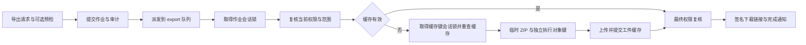

# 数据流

每张序列图配套关键代码路径——点 GitHub 或 IDE 跳转直达函数。

## 标注一条任务的完整链路

<ExcalidrawDiagram
  src="/diagrams/dev/concepts/annotation-task-flow.svg"
  alt="当前 React 工作台加载任务列表、申请与续期锁、分别读取媒体和预测、实时写标注、提交审核及条件 Mask 质检流程"
  caption="当前工作台完成一条标注任务的主链"
/>

当前 React 工作台先分页读取 `/tasks`，在本地选择记忆项、URL 指定项或首项，再单独申请 task lock；`GET /tasks/next` 是仍可用的调度旁路 API，但不是当前 UI 主链。`TaskOut.file_url`、annotations 与 predictions 分开读取，浏览器用签名 URL 直接访问对象存储。

标注在绘制过程中通过 POST / PATCH / DELETE 实时落库，首个有效标注会使 `pending → in_progress`。提交接口只负责 `pending / in_progress → review`、释放锁、批次计数 / 自动流转与 `task.submit` 审计；它不批量创建标注、不通知 reviewer，也不在响应中返回下一题。若项目启用提交时 Mask QC 且任务包含有效 Mask，事务提交后才会异步派发质检。

代码索引：

- 当前工作台选题：`apps/web/src/pages/Workbench/state/useWorkbenchShellModel.tsx`
- 任务列表与调度旁路：`apps/api/app/api/v1/tasks/list.py:list_tasks / next_task`、`apps/api/app/services/scheduler.py:get_next_task`
- Task 输出与签名 URL：`apps/api/app/api/v1/tasks/_shared.py:_task_with_url`、`apps/api/app/services/storage.py:generate_download_url`
- 任务锁：`apps/web/src/hooks/useTaskLock.ts`、`apps/api/app/api/v1/tasks/locks.py`、`apps/api/app/services/task_lock.py`
- 标注写入：`apps/api/app/api/v1/tasks/annotations.py`、`apps/api/app/services/annotation.py`
- 提交：`apps/api/app/api/v1/tasks/lifecycle.py:submit_task`
- 审计：`apps/api/app/services/audit.py:AuditAction.TASK_SUBMIT`
- 条件 Mask QC：`app/services/mask_qc/service.py` 创建冻结 Run；Celery consumer 调用 `app/application/quality_execution.py` → `app/services/mask_qc/execution.py`，`app/workers/mask_qc.py` 仅保留原任务名/参数的 Session 适配。

---

## AI 预标注

<ExcalidrawDiagram
  src="/diagrams/shared/ai/ai-preannotation-handoff.svg"
  alt="AI 预标注在 Web、FastAPI、Redis、Celery worker、服务池路由、物理 ML 实例、Postgres 与人工工作台之间的数据流"
  caption="AI 预标注数据流：派发边界、持久化作业、路由推理与人工接管"
/>

API 先提交 pending `AsyncJob(kind=batch_predict)`，再以该 UUID 派发 Celery。成功派发返回 HTTP 200 与可立即查询的 `job_id`；worker 认领同一持久作业。worker 不是每 batch 一次把所有媒体交给 ML，而是按 task 处理：根阶段通常每次 `/predict` 一题，成功写 `Prediction + PredictionMeta`，失败写 `FailedPrediction`，然后单题提交。

请求中的 registry ID 先解析到项目已启用的逻辑 service pool，`RoutedMLBackendClient` 再选物理实例。物理 backend 使用签名 URL 向 MinIO 拉取原媒体；多阶段 crop 才额外由 worker 读取原图、上传 ROI，下游 backend 再拉取 crop。

代码索引：

- 触发端点：`apps/api/app/api/v1/projects.py:trigger_preannotation`
- 服务池路由与 ML client：`apps/api/app/services/ml_routing/client.py:RoutedMLBackendClient`
- ML 协议契约：[`docs-site/dev/ml-backend-protocol.md`](../reference/ml-backend-protocol)
- Worker：`apps/api/app/workers/tasks.py:batch_predict` 与 `apps/api/app/application/preannotation_execution.py:run_preannotation`
- 对象存储签名 URL：`apps/api/app/services/storage.py:resolve_task_url`
- 项目 WS 中继：`apps/api/app/api/v1/ws.py:preannotate_progress`（当前无鉴权）
- 全局 admin WS：`apps/api/app/api/v1/ws.py:prediction_jobs_socket`
- WS 协议：[`docs-site/dev/ws-protocol.md`](../reference/ws-protocol)

---

## 数据导出

Mask export preflight 是项目范围的可选、只读计划步骤：adapter 统计对象和文件，返回 loss class、losses / warnings、容量估算与 plan digest。当前导出端点不接收该 digest，因此它帮助用户决策，但不锁定后续执行快照。

项目与批次导出先校验 targets / options。VOC 仅允许单选，在记录审计后同步返回 ZIP；其他目标创建 `AsyncJob(kind=export)` 并写导出审计，两者成功 `commit` 后才调用 `run_export.delay()`，然后返回 HTTP 202 与 `job_id`。因此 broker 不会拿到尚未提交的作业 ID。

Worker 将 active annotation 的 `max(updated_at) + count` 与 scope、targets、options、adapter contract 版本合成 cache key。未过期且 MinIO 对象仍存在时，缓存命中路径会生成新的 7 天预签名 URL，直接完成作业并发 `export.ready`。Worker 先取得作业的 PostgreSQL 会话锁，未命中缓存时再取得 cache key 的会话锁并重查缓存；竞争失败会每 5 秒重试，最多 120 次。两把锁与业务写入使用同一个连接，该连接以 `NullPool` 独占到执行结束，跨事务提交仍持锁，数据库会话关闭后释放。数据库尚未察觉客户端断开时，锁可能继续存在。

真正构建时按块读取任务与标注，ZIP 写磁盘 tempfile，再流式多段上传到 export bucket。每次执行使用 `媒体类型/项目 UUID/作业 UUID/随机执行标识.zip`，旧执行无法覆盖恢复执行的对象。`ExportArtifact` 记录提交后，Worker 才生成友好文件名与预签名 URL、写入 `AsyncJob.result` 并发送完成通知；客户端也可轮询 `/async-jobs/{job_id}` 读终态。

进度、工件记录和终态写入前核对最初的 PostgreSQL backend PID。连接失效或被替换后，执行永久失去写入权并进入重试，不能重新连接后写失败状态；其他异常沿用回滚、孤儿对象清理及失败通知。连接丢失时可能无法确认工件记录是否已提交，因此保留本次对象，避免删除已被恢复执行引用的产物；未发布或清理失败的对象由 export 桶生命周期回收。新投递只有取得作业锁后才可更新执行 task ID；已完成、失败或取消的作业保持终态。任务使用 late acknowledgement 和 worker-loss requeue；整个 Celery 主进程丢失后，Redis 原消息的自动恢复仍受 broker visibility timeout 约束。切换锁机制前须排空旧 export worker，避免混用两种锁。

代码索引：

- 项目导出端点：`apps/api/app/api/v1/projects.py:export_project`
- 批次导出端点：`apps/api/app/api/v1/batches.py:export_batch`
- 作业状态与下载 URL：`apps/api/app/api/v1/async_jobs.py:get_async_job`
- 审计：所有导出写 `AuditAction.PROJECT_EXPORT` / `BATCH_EXPORT`
- Worker：`apps/api/app/workers/export.py`（`app.workers.export.run_export` 任务）
- 工件缓存：`apps/api/app/services/exporting/cache.py`
- 格式 registry / plan / archive：`apps/api/app/services/mask_formats/`
- 导出打包：`apps/api/app/services/exporting/`

VOC 保留同步 ZIP 响应；其余目标走上述异步作业与缓存链路。

### 格式导入执行边界

格式导入先通过服务端生成的预签名 URL 上传到 import bucket，预检只接受当前项目与用户前缀下的 object key
和由调用方提交的 SHA-256。服务端流式复核字节配额与摘要，再将 adapter / manifest 版本、mapping / options digest、
逐任务计划和 15 分钟 receipt 写入 `mask_format_imports`。

执行时再次复核 object SHA-256 和全部 digest；任何一项变化都拒绝执行。Worker 逐 task 开启独立事务，并在
`result_json.items` 中记录 `committed / failed / skipped`；续跑只处理未提交项。本地临时目录在成功、失败和取消时都由
context manager 清理，staged object 由 import bucket 的 7 天 lifecycle 回收。项目标注导入 UI 在至少一个 Mask adapter 完成
consumer 闭环验证前保持关闭；capability 响应不会把未验证 adapter 暴露给前端。

---

## 实时通知

<ExcalidrawDiagram
  src="/diagrams/shared/realtime/durable-notification-delivery.svg"
  alt="普通通知默认由调用方提交后再尝试发布；终态 job 保留提交前兼容路径，WebSocket 先核验已提交行和权限再转发"
  caption="普通通知提交后发布、终态 job 提交前兼容路径及 WebSocket 可见性门禁"
/>

通知的持久化真值是 Postgres，Redis Pub/Sub 只是在线刷新提示。`NotificationService.notify()` 先通过偏好 owner 检查静音，再调用 `aap_notifications_v1.append_notification(jsonb)`，把返回行快照合并进原 Session identity map，最后执行调用方原有的完整 flush；事务仍由调用方提交或回滚。默认 `defer_publish=True`，普通调用方在 commit 成功后再 best-effort 发布。选定的通知工作流使用 owner durable outbox / lease，但不覆盖所有通知。

白名单后台 job 终态仍由 `notify_job_terminal` 在外层事务提交前写入并尝试发布，以保留既有 worker 调用顺序。通知 WS 对真实业务消息逐帧重新验证 JWT，确认通知行属于当前接收者并重验项目权限；row 尚不可见时最多查询 4 次，3 次未命中后分别等待 150ms（累计 sleep 450ms，另加查询耗时）。第四次仍未见行或事务回滚时，gate 丢弃消息，不会转发幽灵提示。若发布失败、或 gate 检查结束后事务才提交，Postgres 记录仍可由 REST 读取。

`useNotificationSocket` 为通知频道维护独立的 1s → 30s 无限重连循环，并在 `1008 / 4001` 鉴权关闭码下刷新 token。收到业务消息后它只让查询缓存失效，展示数据仍以 REST 已提交结果为准；连接打开或重开时也会失效通知查询，默认 30s REST 轮询、回到前台和网络重连继续补齐状态。

服务端 push 主要事件：

- 任务通过、驳回或重开（type=`task.approved` / `task.rejected` / `task.reopened`）
- 导出完成或失败（type=`export.ready` / `export.failed`）
- 用户发起的白名单后台作业终态（type=`job.completed` / `job.failed` / `job.cancelled`）

代码索引：

- WS 端点：`apps/api/app/api/v1/ws.py:notifications_socket`
- 通知服务：`apps/api/app/services/notification.py:NotificationService.notify`
- 通知模型：`apps/api/app/db/models/notification.py`
- 前端 hook：`apps/web/src/hooks/useNotificationSocket.ts`
- WS 协议详细：[`docs-site/dev/ws-protocol.md`](../reference/ws-protocol)
