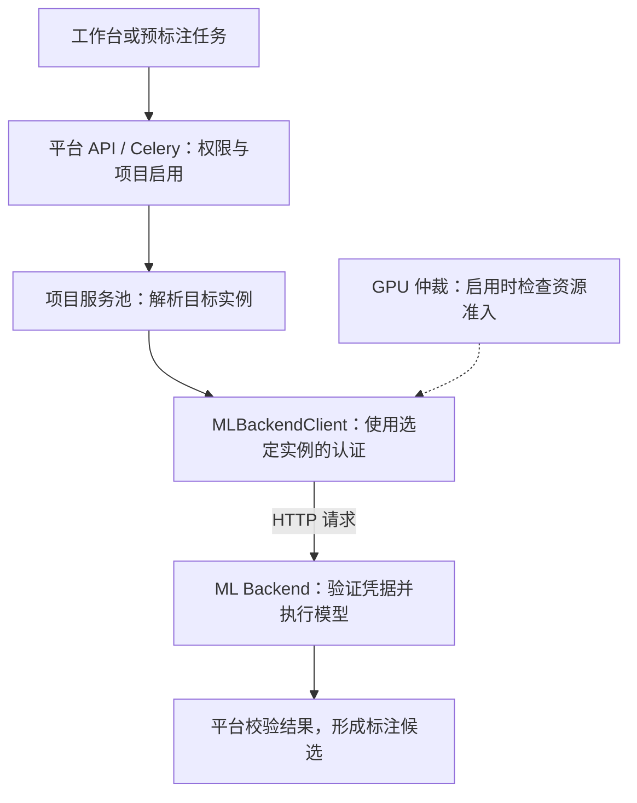
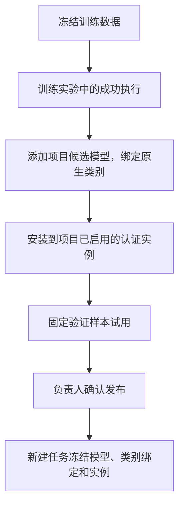

# 模型服务接入、路由与认证

训练完成后，权重还需要安装到推理服务、通过试用并由负责人发布，才能用于项目预标注。服务的访问凭据、项目启用和请求路由分别检查不同条件，因此服务在线、认证成功和模型可用是几个独立状态。

本页解释这些对象和请求的关系。实际操作入口见 [ML Backend 注册表](../../user-guide/superadmin/ml-backend-registry)、[模型回流](../../user-guide/online-learning/models)和[系统设置](../../user-guide/reference/settings#ml-服务认证与维护)。

## 服务实例、模型和服务池

| 对象             | 在平台中表示什么                                         | 会影响什么                       |
| ---------------- | -------------------------------------------------------- | -------------------------------- |
| 模型与权重       | 算法、类别和训练得到的参数文件                           | 推理任务、预测结果及精度         |
| Backend 服务实例 | 一个有明确 URL、认证和运行状态的推理服务，存于全局注册表 | 请求发给哪个服务、携带哪份凭据   |
| 服务池           | 一组能力合同一致的实例，注册实例时会创建对应的单实例池   | 哪些实例可以承接同一类请求       |
| 项目启用         | 项目对全局服务池的引用与启用关系                         | 当前项目能否调用该服务           |
| 项目候选模型     | 固定的训练权重、类别绑定、实验和数据来源                 | 后续加载、试用和发布的具体版本   |
| 项目当前发布     | 负责人确认采用的模型版本与已验证部署                     | 新建的受控预标注任务使用什么模型 |

一个 Backend 可以提供多个模型和变体；其访问 Token 对应服务实例。同一实例中的每份权重不需要各生成一份 Token。多个项目引用同一实例时也共用该实例的访问配置，项目权限仍由平台检查。

服务池用于组合可互换的实例。平台核对模型目录、请求结构、变体和追踪器等稳定能力的指纹；模型名字相似不代表可以放在同一个池。实例 URL、GPU 和实时显存占用是运行信息，不作为模型能力相同的依据。

## 一个推理请求如何到达 Backend



平台通过 `/setup` 读取服务支持的任务、模型、输入和输出，通过 `/predict` 等业务接口调用推理。浏览器使用平台账号访问 API；平台 API 或 worker 再携带实例凭据调用 Backend，浏览器不需要持有 Backend Token。

`ML_BACKEND_ROUTER_MODE` 决定服务池如何选择实际接收请求的实例：

| 模式      | 实际请求的去向                               | Redis 路由账本的作用                                                     |
| --------- | -------------------------------------------- | ------------------------------------------------------------------------ |
| `off`     | 池中的既有默认实例 `legacy_instance_id`      | 不申请 route lease                                                       |
| `observe` | 仍发给既有默认实例，同时记录新策略会选择谁   | 记录影子选择，不以此阻断实际请求                                         |
| `enforce` | 在合格的 active 成员中按平滑加权轮询选择实例 | 原子申请有时限的 route lease，约束跨进程并发；账本或拓扑不确定时拒绝接流 |

route lease 记录某个实例正在承接的请求，用于跨 API 和 worker 计算并发与维护时的在途数量。它与 HTTP Token、GPU 显存许可分别管理。`enforce` 接流检查项目启用、池状态、健康新鲜度、能力指纹、并发容量和熔断状态。

成员的 `active` 表示可接新流量，`draining` 表示停止接受新 route lease 并等待已有请求结束，`disabled` 表示不可参与选择。停流只在路由 `enforce` 下真正约束新请求；它不会自行卸载 GPU 模型。GPU 仲裁另有自己的 effective mode，负责资源准入、驱逐和驻留证明。

受控训练模型还会固定完成部署检查的确切实例。平台不会因为该实例不可用，就把相同请求交给池内另一个尚未安装该权重的实例，也不会替换成基础模型继续执行。

## 可安装插件的身份与退出

插件安装由 Registry／Inference 负责，仍使用同一个 Registry 和服务池，不创建第二套目录。安装记录绑定不可变 manifest、批准的 OCI 摘要、实例身份和资源；管理员检查镜像、manifest、容器及资源身份并提交启动收据，不接受任意 URL 或由插件持有平台数据库凭据。外部插件使用单独的手动 Token，不冒用内置 provider。启动收据是可信管理员的部署证据，不能当成服务端远程制品认证；平台还必须通过受认证的实际端点核对健康、能力、运行时和资源，发布者声明不能替代资格检查。本地开发检查也不能证明受管平台资格。

生命周期依次涉及准备、安装、激活、停用和退役；安装与激活不等于项目启用、候选部署或人工发布。受管 GPU 使用既有仲裁器的签名许可与生命周期资源，Bearer 认证不能替代 GPU 准入。

`disable` 的安装状态是所有路由模式的接流围栏，不依赖服务池成员 drain 或 route lease。它不证明原生执行已退出：`quiesce` 还需通过实际生命周期控制封住入口，等待全部池、构建者、借用者和原生在途执行排空，并将结果绑定启动及控制身份。只有经持久状态与修订核对返回的 `safe_to_stop` 授权停止对应实例，未知或过期证据不能放行。活动发布和冻结的执行／重试依赖会阻止退役；历史 Registry、部署和发布快照保留。

升级使用新安装身份，不替换旧身份下的制品或运行时；项目启用、模型部署试用和发布仍须分别明确操作。旧 CPU 部署由在线学习负责人先停止新引用，待当前发布切换且冻结任务和重试完成或明确处置后退役；已授权的冻结任务继续使用精确旧 CPU 身份，不自动转发到新安装。历史 Registry 外键与部署、发布记录保留，不通过删除历史 Registry 绕过依赖。

## 训练结果如何回流



在成功的训练执行详情点击「回流到项目模型」，或在「模型与发布」点击「从训练结果添加模型」。这一步保存候选及其来源；「加载模型并试用」才会向选定实例安装权重并检查实际推理。该过程要求训练任务、权重格式和运行时通过平台的资格检查。

认证只解决服务访问。还需要项目启用该实例、服务健康、类别绑定完整，以及指定模型通过加载和试用检查。发布由负责人确认；之后切换发布不会改变已排队任务冻结的权重和来源。普通基础模型的目录展示、候选模型注册和项目发布各有自己的状态。

## Token 与 Bearer 的基本含义

Token 是调用方随请求提供的凭据。本平台的 Backend 访问凭据由部署本地生成，默认使用 32 字节随机值，保存为 64 个十六进制字符，不需要向第三方申请或购买。

平台调用 Backend 时发送的格式如下，示例中的占位符不是真实凭据：

```http
Authorization: Bearer <backend-access-token>
```

Bearer 表示持有该凭据的调用方可以凭它访问受保护资源，服务收到后验证它是否匹配，参见 [RFC 6750 的定义](https://www.rfc-editor.org/rfc/rfc6750#section-1.2)。Bearer 本身不加密 HTTP 内容，凭据需要在存储和传输中受到保护；跨不可信网络部署时应使用 HTTPS，参见同一规范的[传输保护要求](https://www.rfc-editor.org/rfc/rfc6750#section-5.2)。平台开发环境中的内部 HTTP 地址也需要保持在受控网络内。

JWT 是携带声明的数据格式，Bearer 是提交凭据的方式，JWT 也可以通过 Bearer 传递。当前 Backend 默认凭据是随机字符串，没有用户名、项目权限或自动过期声明，初始化也不运行 OAuth 授权流程。JWT 格式见 [RFC 7519](https://www.rfc-editor.org/rfc/rfc7519)。

平台中的几种凭据用途不同：

| 凭据                        | 谁向谁出示                       | 授权范围                                         |
| --------------------------- | -------------------------------- | ------------------------------------------------ |
| 平台登录凭据、个人 API 密钥 | 浏览器或 SDK 向平台 API          | 当前用户及其角色、项目和 scope 允许的操作        |
| Backend 访问 Token          | 平台 API / worker 向某个 Backend | 通过该服务的入口认证；不会授予平台用户或项目权限 |
| GPU 准入与控制签名凭据      | 平台仲裁组件向受管 Backend       | 带资源、代际、操作范围和有效期的执行或控制许可   |

Backend Token 还保护 `/setup`、推理、模型加载、卸载及追踪等业务或控制入口，作用不限于训练模型回流。受管 GPU 操作在入口认证后继续校验各自要求的签名与资源许可，单独持有访问 Token 不等于已经获得 GPU 准入。默认仅 `/health` 和 `/metrics` 公开。

## 系统托管凭据如何生成和同步

五个内置服务使用固定的 provider ID，各自持有独立凭据：

| provider    | Compose 服务            | 默认宿主机凭据文件                    |
| ----------- | ----------------------- | ------------------------------------- |
| `gsam2`     | `grounded-sam2-backend` | `data/inference-auth/gsam2/token`     |
| `sam3`      | `sam3-backend`          | `data/inference-auth/sam3/token`      |
| `yolo`      | `yolo-backend`          | `data/inference-auth/yolo/token`      |
| `onnxtools` | `onnxtools-backend`     | `data/inference-auth/onnxtools/token` |
| `rapidocr`  | `rapidocr-backend`      | `data/inference-auth/rapidocr/token`  |

API 启动时创建或复用这些私有文件。服务子目录权限为 `0700`，文件为 `0600`；容器只读挂载自己的子目录，不能读取其他服务的凭据。API 使用可写的父目录，worker 使用注册表里已同步的值，无需挂载凭据目录。已有文件会复用，格式或权限异常的文件不会被静默覆盖。

部署通过 `ML_MANAGED_BACKEND_URLS` 固定 provider 对应的可信服务地址。系统托管方式如 `managed:yolo` 记录的是认证来源，字符串本身不含秘密。平台只向对应服务地址发送该服务凭据，禁用环境代理与重定向，并验证受认证的 `/managed-auth` 返回正确的 provider 和 `managed` 模式。

点击「设置 → 系统设置 → ML 服务认证与维护」的「初始化并同步认证」时，平台补齐本地文件，验证服务，再更新已有的无认证或托管实例。尚未注册时只准备文件；已有手动认证会保留。注册表创建、项目启用与 GPU 纳管都需要各自操作。

同一 provider 的托管地址在当前部署中固定为一个 HTTP origin，即协议、主机和端口的组合。额外部署的副本或外部服务使用各自的手动认证配置，不能通过把任意 URL 填成 `managed:yolo` 来领取默认凭据。

## None、空值、初始化和轮换

| 操作或配置                        | 当前行为                                                                         |
| --------------------------------- | -------------------------------------------------------------------------------- |
| 平台实例选 `none`                 | 不发送任何认证凭据；适用于确实允许匿名调用的外部服务                             |
| 内置服务的手动 Token 环境变量留空 | 使用私有文件中的默认凭据，服务继续要求认证                                       |
| 私有文件缺失、格式错误或凭据太短  | 内置服务拒绝受保护请求；不会退回匿名模式                                         |
| 编辑手动 Token 时输入框留空       | 保留已保存的值；首次设置或从系统托管切回手动 Token 时必须明确填写                |
| 再次点击初始化                    | 复用已有文件并尝试同步，凭据值不会因此轮换                                       |
| 更换实例访问凭据                  | 需要服务端和平台配置一致；平台认证修订号变化后，旧探活和旧控制证明不能覆盖新状态 |

因此，选择系统托管时可以完全不填写 Token，但认证方式仍应是对应服务的「系统托管」，而不是 `none`。默认内置服务没有通过空值关闭认证的开关。

内置服务可使用手动 `AAP_BACKEND_AUTH_TOKEN` 覆盖文件凭据；YOLO 的 `YOLO_MANAGED_MODELS_TOKEN` 优先级更高。手动值需要至少 32 个字符。服务返回手动模式时，托管握手不会把它当作托管模式接受，管理员应继续使用匹配的手动 Token，或明确完成部署侧切换。

通用手动变量需要显式传入 Backend 进程。仅在宿主机 `.env` 中增加一个变量，不会自动把它注入容器；默认 Compose 已保留 YOLO 旧变量的传入方式。系统托管使用共享文件，日常操作无需增加这些手动变量。

凭据初始化不是撤销或轮换入口。不要靠删除文件刷新状态，也不要在两个服务之间复制 Token。需要更换托管凭据时，应由部署管理员协调服务端文件与注册实例配置，再检查认证和健康；界面当前不提供自动轮换托管凭据的操作。

## 为什么有时要重建容器

镜像包含服务代码和依赖，容器运行镜像并接收启动环境变量与挂载，模型权重和凭据则分别保存在部署的持久目录或卷中。

| 改动                                    | 需要的动作                                                           |
| --------------------------------------- | -------------------------------------------------------------------- |
| 旧镜像首次接入默认认证                  | 升级镜像，并重建容器应用各服务的只读凭据挂载                         |
| 修改服务的手动 Token 环境变量或挂载配置 | 重建目标容器使新的启动配置生效；单纯修改 `.env` 不会更新运行中的容器 |
| 已升级部署中补齐默认文件或同步实例认证  | 使用初始化与同步入口，无需为此重建镜像                               |
| 只更新平台实例记录里的 Token            | 平台保存后按新值调用服务；服务端必须已经接受对应值                   |

「重建镜像与容器」由部署管理员安装的宿主机维护程序执行，API 只提交有审计的固定服务任务。构建成功、容器健康、认证通过和模型可用仍是独立结果；未知旧镜像可能需要先人工升级，不能依靠维护按钮跳过运行时校验。安装、等待退出与中断恢复见 [本机 ML 服务维护](../../ops/deploy/ml-backend-maintenance)。

## 按状态排查

| 页面或接口现象               | 已经证明什么                       | 继续核对什么                                       |
| ---------------------------- | ---------------------------------- | -------------------------------------------------- |
| 本地凭据已初始化             | 本地私有文件可读且格式有效         | 服务是否已升级、挂载是否正确、认证来源是否匹配     |
| `/health` 成功或容器 healthy | 服务进程可响应健康检查             | 受保护接口是否接受凭据、模型和 GPU 是否就绪        |
| 认证已验证并同步             | 对应服务接受托管凭据且实例记录更新 | 执行实例健康检查，再核对项目启用和实际模型         |
| Backend 返回 `403` 认证失败  | 当前请求没有通过入口认证           | 文件、手动变量优先级、实例认证方式和两端值是否一致 |
| 「加载模型并试用」不可用     | 某个前置条件尚未通过               | 按页面原因检查项目启用、认证、健康与训练结果资格   |
| 认证保存返回并发冲突         | 实例在验证期间发生变化             | 刷新并核对最新配置，不覆盖其他管理员的修改         |

实现入口为 `apps/api/app/services/managed_inference_auth.py`、`apps/api/app/services/ml_client.py` 和 `apps/api/app/services/ml_routing/`。Backend 入口认证由共享运行时 `aap_backend_runtime.backend_auth` 负责。协议字段见 [ML Backend 协议](../reference/ml-backend-protocol)，服务池决策与 GPU 仲裁分别见 [ADR-0050](../adr/archive/0050-ml-backend-service-pools-and-request-routing) 和 [GPU 仲裁验收](../../ops/runbooks/gpu-arbitration-acceptance)。
