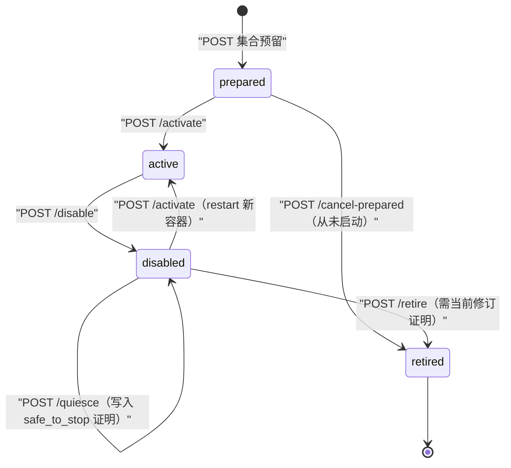

# 推理插件安装、资格与生命周期

独立推理插件通过管理员侧 `yoao plugins` CLI 与平台 Inference owner 协作完成预留、资格核验、激活、资产测量、停用和退役。平台 API 与 worker 不接触 Docker socket，插件容器也不挂载核心数据库、Redis 或 GPU 签发私钥。

本文说明插件安装的内部契约、容器隔离边界、状态机、路由替换与历史迁移细节。面向超级管理员的操作流程和安全概览见[可安装推理插件](/user-guide/superadmin/ml-backend-registry#可安装推理插件)，API 端点索引见 [ML Backend 独立插件安装](/api/guides/ml-backend#独立插件安装)。

## 包边界与职责划分

平台把插件管理、插件开发与具体模型实现拆成三类独立制品：

- **`yoao-sdk[plugins]`**：面向平台管理员的 API SDK 与本地 Docker 安装器。`plugins` extra 依赖平台便携契约包（`yoao-inference-contract`、`yoao-task-contract`、`yoao-lifecycle-contract` 与训练契约），不包含 backend runtime、FastAPI、Torch 或模型权重；仅安装核心 SDK 或 `cli` extra 不会引入插件管理依赖。
- **`yoao-inference-plugin-sdk`（[Plugin-SDK](https://github.com/YOAO-Labs/Plugin-SDK)）**：面向插件作者的协议抽象、开发工具 `yoao-plugin` 与构建脚手架，与管理员 API SDK 分包分发。
- **[YOAO-Plugins](https://github.com/YOAO-Labs/YOAO-Plugins)**：维护官方推理插件、模型专属适配与预训练资产目录。

必要的第一方便携契约应从可信渠道按显式 manifest 与 SHA-256 核验取得，源码由平台维护。历史公开制品不代表新发行名已发布到 PyPI；第一方 wheel 也不是离线全量依赖包，不包含模型权重或 OCI 镜像，更不自动授予托管 GPU 资格。

## OCI 镜像标签契约

插件镜像可通过两个 OCI label 内嵌声明，避免管理员手工复制大段 manifest 或拼接资格容器命令。

### `io.yoao.plugin.manifest`

该标签值为 UTF-8 编码的 JSON 对象，最大 64 KiB，解析时要求严格有限 JSON（拒绝 `NaN`/`Infinity`）且不允许重复键。对象包含 13 个归镜像所有的 manifest 字段：

| 字段                          | 含义与校验约束                                                                                                                        |
| ----------------------------- | ------------------------------------------------------------------------------------------------------------------------------------- |
| `plugin_id`                   | 插件唯一标识，激活时与 `/setup.plugin_identity.plugin_id` 核对                                                                        |
| `version`                     | 插件版本号，激活时与 `/setup.plugin_identity.version` 核对                                                                            |
| `publisher`                   | 发布者名称                                                                                                                            |
| `license`                     | 制品许可证声明，不替代管理员对模型权重的独立审批                                                                                      |
| `sdk_compatibility`           | 插件兼容的 SDK 版本基线                                                                                                               |
| `entrypoint`                  | 字符串数组 `[executable, ...args]`；拒绝 shell（`sh`/`bash`/`dash`/`ash`/`zsh`/`ksh`/`fish`）与 `python -c`                           |
| `capabilities`                | 声明的平台能力列表，未知能力会拒绝激活                                                                                                |
| `models`                      | 获准能力的最小安全投影，每项含 `id`、`task`、`is_interactive`、`supported_prompts`、`supported_inputs`、`supported_geometric_outputs` |
| `pools`                       | 命名池与严格正整数 `cap` 映射，须与 `/setup`、带挑战的 `/health` 及 CUDA 资格报告完全一致                                             |
| `resource`                    | `device`（`cpu` 或 `cuda`）、`memory_mb` 与 `gpu_memory_mb`（CPU 必须为 `0`）                                                         |
| `asset_manifest_sha256`       | 资产清单 SHA-256，与预训练审批和资格报告绑定                                                                                          |
| `managed_model_compatibility` | 受控训练模型兼容声明；原生 Ultralytics 权重须显式填 `format: null`，具名导出填非空字符串，`null` 不是通配符且不可省略字段             |
| `allowed_asset_sources`       | 授权资产下载的完整 HTTP(S) origin 列表，不含凭据、路径或查询串，与图片主机白名单 `image_hosts` 分开管理                               |

标签中**不包含 `artifact` 字段**。OCI 镜像无法把自身内容寻址的 SHA-256 `RepoDigest` 写入镜像配置。管理员在 `yoao plugins prepare` 时提供固定摘要引用 `<ref@sha256:...>`，安装器核对本机 Docker `RepoDigests` 包含该精确摘要后，再把 `artifact` 绑定到最终 `PluginManifest`。

`models` 仅作为安全边界的最小投影，不复制完整的 `/setup` 参数目录。分类模型允许空的 `supported_geometric_outputs` 列表；多报、漏报模型或池，或包含协议词表之外的值，都会在激活阶段被拒绝。

### `io.yoao.plugin.qualification-command`

该标签为可选字段，值为 UTF-8 编码的 JSON 字符串数组 `[executable, ...args]`，声明镜像内建的 GPU 生命周期资格执行命令。解析约束包括：

- 字节大小上限为 4 KiB，参数数量上限为 64。
- 拒绝 shell 入口（`sh`、`bash`、`dash`、`ash`、`zsh`、`ksh`、`fish`）以及 `python -c` 形式。
- 仅用于 CUDA 插件的资格容器执行；CPU 插件不运行资格命令，也不提交 GPU 报告。

### 镜像检查与三种 `prepare` 输入模式

`yoao plugins inspect-image --image <ref@sha256:...> [--json]` 在本机只读检查 Docker 镜像，核验 `RepoDigests` 并返回 `image_id`、内嵌 manifest 及可选资格命令，不连接平台 API，也不创建状态目录。

`yoao plugins prepare` 支持三种等价输入形态，最终都生成完整的受核验 `PluginManifest` 与 `LocalPluginConfig`：

1. **直接 CLI 参数**：通过 `--image <ref@sha256:...>` 与 `--name`、`--url`、`--network`、`--host-port`、`--cpus`、`--image-host`（CUDA 另加 `--gpu-resource-id`、`--physical-gpu-uuid`、`--gpu-verify-keyring <path>`）直接预留，从镜像读取 `io.yoao.plugin.manifest`。当 `entrypoint` 已含 `--port` 时可省略 `--container-port`。
2. **精简 `deployment.json`**：文件含 `"image": "<ref@sha256:...>"` 与部署参数，省略 `"manifest"`（并可按 `entrypoint` 省略 `"container_port"`）。
3. **完整内联 `deployment.json`**：文件直接包含完整 `"manifest"`（含 `"artifact"`），用于尚未写入 OCI label 的镜像。

当 `prepare` 从 OCI label 读取 manifest 时，镜像内声明不代表管理员已授权，在 `--json` 模式下必须传 `--yes` 明确批准。

## 容器安全边界与运行时隔离

部署命令必须由可访问 Docker 的非 root 用户运行。安装器以操作者当前 `UID:GID` 创建容器，不沿用镜像默认 `USER`。私有状态目录须归该操作者所有并保持 `0700` 权限，不得通过放宽权限或添加共享 ACL 来适配镜像默认用户。

容器创建与每次变更前检查以下硬性约束：

- **所有权标签与命名**：容器名称使用 `yoao-plugin-<installation_id>`（重启候选附带候选令牌前缀），写入并核对 `yoao.installation`、`yoao.owner`（私有所有权哈希）、`yoao.image` 与 `yoao.config`（完整配置摘要）；重启候选另带 `yoao.candidate`。
- **进程与内核隔离**：`Privileged=false`、私有 PID 命名空间（`PidMode=""`）、`--cap-drop ALL`、`CapAdd` 为空、`Devices` 为空、`--security-opt no-new-privileges`，以及显式内存与 CPU 上限。
- **网络与端口**：必须使用显式非 `host` Docker 网络，仅暴露声明的单个 `host_port:container_port/tcp` 端口映射。
- **精确挂载**：仅挂载可写数据目录（`data_dir -> /var/lib/yoao-plugin`）；CUDA 额外在可写数据目录之上以只读方式叠挂 `data/gpu-keyring.json -> /var/lib/yoao-plugin/gpu-keyring.json`，并以只读方式挂载资格报告到 `/var/lib/yoao-plugin-qualification/report.json`。禁止任何 `docker.sock` 或含逗号路径挂载。
- **运行时环境变量**：容器统一注入 `YOAO_PLUGIN_*`（令牌文件、设备、Registry ID、数据目录、资产来源、图片主机及资格元数据）与 `ROUTE_CONTROL_TOKEN_FILE`；非 `libreyolo` 通用插件额外注入 `ROUTE_REGISTRY_ID`、`YOAO_PLUGIN_ID`、`YOAO_PLUGIN_VERSION`、`YOAO_PLUGIN_ASSET_MANIFEST_SHA256` 与 `YOAO_PLUGIN_MANAGED_MODEL_COMPATIBILITY`（旧名 `AAP_ROUTE_CONTROL_TOKEN(_FILE)` 与 `AAP_ROUTE_REGISTRY_ID` 任一非空时由 `yoao-protocol-v2` 拒绝启动）。旧版 `aap.*` 容器标签与 `AAP_PLUGIN_*` 镜像不设双名兼容，须部署匹配版本的 `Plugin-SDK` 与 `YOAO-Plugins` 制品。
- **CPU 隔离**：所有 CPU 插件一律注入 `NVIDIA_VISIBLE_DEVICES=void` 与空的 `CUDA_VISIBLE_DEVICES`，不申请 GPU 设备，也不按插件名豁免。
- **CUDA 隔离**：仅通过 `--gpus device=<physical_gpu_uuid>` 暴露单张物理卡，容器内逻辑设备固定为 `cuda:0`，不按宿主机 ordinal 猜测；公钥为 key ID 到 Ed25519 公钥的 unpadded base64url 映射，签发私钥不进入配置或状态目录。

官方插件的特殊约束：

- `yoao plugins prepare-assets` 仅服务于入口为 `yoao-libreyolo` 的 LibreYOLO 镜像（旧版 `aap-libreyolo` 清单会在启动容器前拒绝）；其他插件遵循各自的获准资产流程。
- RapidOCR CPU 镜像使用独立 CPU ORT 依赖，不安装 GPU ORT 或 NVIDIA wheel；其作者 manifest 工具默认要求 `RAPIDOCR_POOL_CAP=3`，不静默为其他容量生成固定值。容器实际监听端口为 `8005`，服务保留 `det`/`rec`/`e2e` 完整目录，未获准准备的变体直接失败而不隐式下载。其 headless OpenCV 替代目前存在上游 `pip check` metadata 不匹配，实际运行通过不代表普通 `pip check` 全绿。

## 资格容器隔离与上下文协议

`yoao plugins qualify` 在独立的临时容器中执行镜像的 `io.yoao.plugin.qualification-command`，使资格验证与服务运行时进程隔离。

容器运行配置：

- 使用 `--rm`、操作者非 root `UID:GID`、`--network none`、`--cap-drop ALL`、`--security-opt no-new-privileges` 与单卡 `--gpus device=<physical_gpu_uuid>`。
- **绝不挂载 `data/token` 或 `data/gpu-keyring.json`**，防止资格进程接触业务凭据或验签目录。

挂载布局：

| 容器内路径                                       | 权限               | 内容与用途                                                                            |
| ------------------------------------------------ | ------------------ | ------------------------------------------------------------------------------------- |
| `/var/lib/yoao-qualification/context.json`       | 只读               | 安装器生成的上下文 JSON，绑定预留身份、镜像 ID、GPU 资源、物理 UUID、池拓扑与审批引用 |
| `/var/lib/yoao-plugin/assets`                    | 只读               | 经管理员准备的模型资产目录（可通过 `--asset-dir` 指定来源目录）                       |
| `/var/lib/yoao-qualification/fixture`            | 只读               | 可选测试夹具路径（通过 `--fixture <path>` 传入）                                      |
| `/var/lib/yoao-qualification/output/report.json` | 私有可写目录内产出 | 资格命令写出的共享生命周期证据 JSON                                                   |

容器环境同步注入 `YOAO_QUALIFICATION_CONTEXT_FILE`、`YOAO_QUALIFICATION_OUTPUT_FILE`（以及可选的 `YOAO_QUALIFICATION_FIXTURE_FILE`）、对应 `YOAO_PLUGIN_*` 元数据与 `VALIDATION_*` 校验引用。

命令退出后，安装器调用 `validate_managed_lifecycle_evidence` 完整核验产出报告，并检查 `passed == true` 以及与本次预留完全一致的 `image_id`、`registry_id`、`gpu_resource_id`、`physical_gpu_uuid`、`pools`、`runtime_versions` 和 ORT `session_counts`。

- 传入 `--out <path>` 时，安装器把通过校验的报告写到目标路径供离线审核，**不修改 `receipt.json`**。
- 省略 `--out` 时，安装器直接持久化到 `state_dir/qualification.json` 并写入 `receipt.json`。
- `yoao plugins install --qualify` 与 `yoao plugins upgrade --qualify` 按同一隔离与校验链路先执行资格检查，再启动服务并激活。

开发工具 `yoao-plugin check --qualify-local` 仅在作者本机 loopback 使用临时密钥做自检，不能替代上述绑定平台预留身份的托管资格报告。

## 安装状态机、API 与修订 CAS

平台安装管理接口以 `/api/v1/admin/ml-integrations/plugins/installations` 为集合，全部端点要求超级管理员权限：

- `POST /api/v1/admin/ml-integrations/plugins/installations`：预留不可接流的安装 UUID、Registry 与资源绑定。预留 UUID 是重试幂等键，重复提交必须匹配原意图和凭据。
- `GET /api/v1/admin/ml-integrations/plugins/installations` 与 `GET /{installation_id}`：查询安装清单与单个安装状态。
- `POST /{installation_id}/activate`、`disable`、`quiesce`、`retire`、`cancel-prepared`：驱动生命周期迁移。
- `GET`/`PUT /{installation_id}/assets`：读取和提交预训练模型资产审批与实测清单。



### 乐观锁与超时恢复

所有状态变更命令都在 Native SQL 边界内以 `expected_revision` 执行 CAS（Compare-And-Swap）。发生并发修改时返回 `409`，调用方必须重新读取当前状态与修订，不得覆盖其他管理员的操作。

启动与网络边界约定：

- **本地启动等待**：安装器轮询 `http://127.0.0.1:<host_port>/health` 等待进程就绪；短暂断连或 `503` 不视为启动成功，60 秒未就绪即停止提交激活，并保留状态目录中的启动身份供排查后恢复。
- **300 秒控制超时**：签名初始化与排空可能需要等待旧控制 Token 的有效期自然过期，SDK 对激活与排空使用 300 秒超时。网络中断或超时不代表平台回滚，必须先用 `status` 查看权威状态，再在原状态目录重试。
- **激活顺序**：平台收到启动收据（可信管理员的本机核验，非远程密码学证明）后，通过受认证端点实测 `/health`（带新鲜挑战回显）和 `/setup`。确认后先完成持久路由控制绑定，CUDA 再建立 GPU 准入，最后才将安装状态置为 `active`。绑定未确认前不会开放接流；路由控制与业务请求各自验证独立凭据，业务 Bearer 不能绕过控制权限。
- **升级语义**：`yoao plugins upgrade` 在新状态目录针对新制品摘要创建全新的安装 ID 与 Registry ID，保留原活跃安装及已有冻结引用。历史受控模型回滚也须在已验证的新插件部署上重新部署并人工发布，不能重新激活已退役的旧 CPU 实例。

## 路由控制与 `incarnation` 替换

需要保留同一安装身份、Registry 和模型目录并替换底层容器进程时，执行 `yoao plugins restart`。

新启动进程的路由 `incarnation` 不能直接沿用旧进程。宿主只有在以下条件全部成立时才授权一次替换握手：

1. 旧进程的终止排空证明已经结算，旧容器与旧 boot 已记为停止。
2. 不存在未结束或不确定的路由执行。
3. 新容器 ID、新 boot 身份、端点地址、资格证明和安装修订与当前预留完全一致。

替换握手失败后的重试保留原始控制 ID、挑战和 epoch，完整握手确认后才允许继续 GPU 初始化与激活。宿主绝不把“新进程当前空闲”单独当作旧进程已退出的证据。

本地状态机与进程身份保护：

- `restart` 在发起 `disable` 前持久化绑定原启动身份与修订的 `restart_intent`，中断后可沿原状态目录续跑排空，但只有取得并持久化核心 `safe_to_stop` 证明后才创建带 `yoao.candidate` 标签的新容器。
- 候选容器如果曾经退出（`FinishedAt != "0001-01-01T00:00:00Z"`），即便再次处于运行中，安装器也会拒绝把它当成首次启动恢复。
- 意外退出或外部 `docker restart` 不构成终止证明；旧收据若缺失进程启动时间（`StartedAt`），安装器不会用同一容器 ID 推断进程未被外部替换。执行安装器命令期间须独占该安装的 Docker 管理操作。
- 重启后安装回到 `active` 只证明新容器已激活：已排空的服务池成员不会自动恢复接流，预训练模型资产也必须在新容器内重新测量并提交 `approve-assets`。CUDA 激活须等待既有签名许可有效期，`reset` 与 `enforce` 各自保留完整等待窗口；结构化超时不表示候选可以改换身份。
- 路由绑定失败留下的管理围栏不会随 GPU 排空自动消失。GPU owner 可依据持久化的安装终止意图取得**仅用于签名终止排空**的端点许可（不可用于推理或普通生命周期请求），完成排空、账本结算和安装证明后退役并停止进程，同时保留未确认的路由控制及历史尝试记录，不宣称路由已恢复。

## GPU `residency`、ORT `session_counts` 与工厂拓扑校验

平台在激活与排空阶段直接解析实时 `/setup` 和挑战绑定的 `/health.residency` 字段，核验 `active_requests`、`builders`、`borrowers`、`draining`、`evictable`、`gpu_loaded`、`pools`、`identity`、`boot_id`、`generation` 与 `control_epoch`。CPU 插件必须满足 `gpu_loaded=false` 且 `identity`/`generation`/`control_epoch` 均为 `null`。

### ORT 工厂拓扑与 `session_counts`

使用 ONNX Runtime（ORT）的 CUDA 插件，其资格报告除基础字段外还必须包含：

- `deployment.pool_topology.session_counts`：声明各业务池的 ORT session 预期数量。
- 每轮运行的 `session_observations`：记录每个实际业务 session 的完整 execution provider 链。

平台激活时将报告中的 `deployment.pool_topology.session_counts` 与实时 `setup.runtime_info.ort_session_counts` 以及带挑战的 `health.ort_session_counts` 逐项核对。可用 provider 列表不能替代真实业务 session 观测；两轮都漏报同一 session 同样无法通过。严格 CUDA 插件拒绝整条 session 回退到 CPU，并关闭 ORT 运行时整 session 重试回退；单个算子按图分区落在 CPU 上仍属合法行为。Torch 报告不伪造 ORT session 字段。

### 不确定租约与多池排空约束

- 托管 CUDA 实例应在该 GPU 资源上配置 `enforce` 准入模式；它与服务池路由的 `off`/`observe`/`enforce` 是两套独立控制。
- 真实推理请求断连后，不确定工作租约继续占用显存承诺。只有在相关许可有效期与租约硬期限都已过期，并取得当前实例的新鲜空闲证明后，安装 owner 才结清这些租约并继续签名排空；原生请求、构建者或模型借用未退出时不会提前释放。等待超时应保留原状态目录并按结构化错误恢复，不得手工删除 Redis 租约或退出围栏。
- 多池终止回执必须包含全部且不重复的获准池（允许顺序不同），同时匹配身份、代际和卸载字段。

## 容器内资产测量探针与按实例审批路由

安装和项目启用不授予预训练模型使用权。超级管理员须按单个安装身份、制品、资产清单和每个完整变体提交 `approve-assets`，使用 `choices.json`（`{"approved":[{"model_id":"...","variants":{...}}]}`，空数组撤销全部批准）与当前 `expected_revision`（首次决策为 `0`）。

### 固定标准库测量探针

提交审批前，安装器先验证本地收据和正在运行的容器身份，再在目标容器内执行固定标准库脚本（`packages/python-sdk/src/yoao/_plugin_asset_measure.py`）：

```text
docker exec --interactive <container_id> python3 -I -S -c <probe>
```

关键安全不变量：

- 测量在**容器挂载视图**内执行，不读取宿主机上可能被替换的同名路径。镜像只需提供 `python3`，不需要安装平台 SDK；探针以 `-I -S` 隔离模式运行，不导入任何模型库，也不初始化 CUDA。
- 探针使用 `O_RDONLY | O_DIRECTORY | O_NOFOLLOW` 打开 `/var/lib/yoao-plugin` 固定目录描述符，逐段经 `dir_fd` 与 `O_NOFOLLOW` 打开相对路径，拒绝一切符号链接，仅接受普通文件（`S_ISREG`）。
- 逐文件核对 `size_bytes` 与流式 SHA-256 摘要，并在读取前后两次 `fstat` 比对 `(st_dev, st_ino, st_size, st_mtime_ns)` 以捕获读取期间的并发篡改。缺失或不匹配的文件不会标为可用。
- 测量结果是提交时刻的管理员本机观测，不会持续重算摘要。批准和可用是两个独立状态；文件变更或容器重启后都必须重新测量并提交。

### 服务池路由与派发前复核

同一服务池中不同实例的预训练审批和本地资产可用态可以不同。平台只在符合目标规格且已获准、可用的活跃成员中按原权重路由。真正发出模型 HTTP 请求前，Inference owner 在锁内再次核对选中实例的当前审批快照，撤销审批后已排队但未派发的工作会被拒绝，不会自动改选实例或重试。

旧文本预标请求未显式指定 `model_id` 时，平台按模型声明的文本输出形态确定唯一模型：`box` 对应检测模型，`mask` 或 `both` 对应支持对应输出的分割模型。若无法唯一确定则拒绝派发；确定后仍按完整变体逐实例检查审批和可用性。

## Tracker 范围退役、`cancel-prepared` 与 `proof_backed_collection_complete`

`disable` 只关闭路由与新工作准入，**不等于 `safe_to_stop`**。只有完成 `quiesce` 并通过当前修订核对后返回的 `safe_to_stop` 收据，才授权停止其绑定的唯一 64 位十六进制容器 ID 和 `StartedAt`。停用和卸载始终复用已记录的启动文件，不为退出改写运行配置。

### Tracker 范围退役顺序

当实例存在视频 Tracker 范围时，必须在后端仍可达、原配置仍有效时，先由执行 owner 通过 Routing owner 取得物理范围退役证明，再调用 `disable`：

- 任务状态显示已完成、失败或取消，逻辑 scope 已关闭，或 `inflight=0`，都不能替代物理退役证明；缺少证明时 `disable` 返回 `409` 并保持原状态。
- Native 生命周期命令在持有 Registry 锁时核验范围证明；新建 Tracker 范围同样获取该 Registry 锁，拒绝向非 `active` 的受管插件插入新范围，避免在检查与停用之间滑入新范围。
- `quiesce`、`retire` 以及重放已有 `safe_to_stop` 收据时都会再次复核此不变量，绝不能先停容器再补证明。

### 终止排空、取消预留与墓碑回收

- **终止排空端点**：CPU 实例使用受认证的 `POST /lifecycle/terminal-drain`（独立 Inference owner 仅在既有 unload 控制范围内授权该精确路径，依赖前向迁移 `bo0402`），绑定注册实例 ID 和当前 boot；CUDA 实例使用 `POST /lifecycle/terminal-drain-signed`，同时要求业务 Bearer Token 和平台签发的 GPU DRAIN 许可。
- **预留取消（`cancel-prepared`）**：仅适用于处于 `prepared` 状态、从未尝试启动、无启动收据且无活动发布或冻结执行引用的安装。API 通过 `expected_revision` CAS 与 GPU 持久状态校验执行取消；由于 Registry 不检查 Docker，安装器在调用前须先确认本机不存在对应容器。存在未知容器或启动历史时不能假定未启动。
- **GPU 墓碑回收（`proof_backed_collection_complete`）**：GPU 资源修复任务可依据 owner 核验的“从未启动”闭合证明直接回收已取消的预留，不要求不存在的进程响应健康检查。真正启动过的 CUDA 实例则必须完成终止排空证明，并等待所有相关签名 Token 有效期届满后，墓碑收集才会提交并返回 `proof_backed_collection_complete`。严禁通过清空账本或重命名 GPU 资源绕过等待。
- **依赖保护与历史保留**：存在活动发布或冻结重试依赖时，`retire` 会拒绝退役。成功退役后保留 Registry、部署和历史发布快照，安装器移除本地业务 Token 文件但保留收据以供查询历史身份。

## 历史清单与本地收据迁移

早期不包含 `models` 和 `pools` 字段的旧版 manifest，不能按插件名称、本地文件或新默认值自动补齐能力。数据库迁移 `bo0401` 要求管理员逐项核验不可变镜像并显式批准迁移清单；只要存在未知、缺失或不匹配的历史安装记录，整次迁移直接拒绝，不会把历史行改写为无效状态。

1. 在维护窗口停止旧版 API、Inference owner 和相关 worker，备份数据库及全部私有插件状态目录，并提前安排仍依赖旧镜像的工作负载与恢复路径。
2. 准备绝对路径的 JSON 清单文件，顶层结构为 `{"schema":1,"installations":[...]}`。每条记录必须包含 `installation_id`、`registry_id`、`artifact`、`image_id`、完整 `old_manifest`、`old_manifest_sha256`、`asset_manifest_sha256`、获准 `models`、`pools` 与可追溯的 `approval_ref`。UUID、原 manifest、OCI 制品、资产摘要及已有启动镜像须与数据库记录完全一致，且清单必须覆盖全部历史安装。
3. 使用以下规范化 JSON 的 ASCII 字节计算 `old_manifest_sha256`：

   ```python
   json.dumps(old_manifest, sort_keys=True, separators=(",", ":"), ensure_ascii=True, allow_nan=False)
   ```

   通过部署已确认目标数据库的既有迁移入口执行升级（数据库中不存在历史插件安装时，无需编造 inventory 文件）：

   ```bash
   alembic -x plugin_capabilities_inventory=/absolute/path/inventory.json upgrade head
   ```

4. 数据库迁移完成后，对每个既有本地状态目录显式执行收据迁移：

   ```bash
   yoao plugins migrate-state --state-dir ./plugin-state \
     --manifest approved-manifest.json \
     --image-id sha256:<已核验镜像ID> --yes --json
   ```

迁移行为与限制：

- `migrate-state` 重新核验权威 Registry、本地镜像及已有容器与启动身份，仅更新获准能力投影，不改动 Docker 所有权标签、资源绑定、旧资格报告或数据目录。
- 本地收据在同一私有文件内保存不含 Token 的 `legacy_receipt` 快照供协调回退核验，不生成第二份永久凭据文件。数据库降级如果遇到新增、删除或已变更的安装记录，会直接拒绝而不是丢弃记录强行回退。
- **收据迁移不等于旧镜像取得新资格。** 缺少新运行声明的旧不可变镜像仍可凭精确身份、新鲜挑战和完整 `residency` 安全停用和退役，但任何新激活（包括重建进程后的激活）都必须满足当前声明和资格门禁。不要先停止仍需恢复的旧实例再指望 `migrate-state` 让它重新激活；应先完成获批新制品的业务交接，或保留原先匹配的隔离恢复环境。
- 旧 CPU 状态目录中如果保存的环境文件未限制 GPU 可见性，查询与按原身份排空不会改写该文件，但重新创建进程会因配置不一致而拒绝。完成受控退役后，改用新状态目录与新安装身份重新部署，不要手工修改旧收据或环境文件。

## 相关

- [超管指南：可安装推理插件](/user-guide/superadmin/ml-backend-registry#可安装推理插件)
- [ML Backend 接入教程：安装档](/dev/ml-backend/starter#managed-installation)
- [ML Backend API：独立插件安装](/api/guides/ml-backend#独立插件安装)
- [模型服务接入、路由与认证](./ml-backend-routing-and-auth)
- [ML Backend 协议](/dev/reference/ml-backend-protocol)
