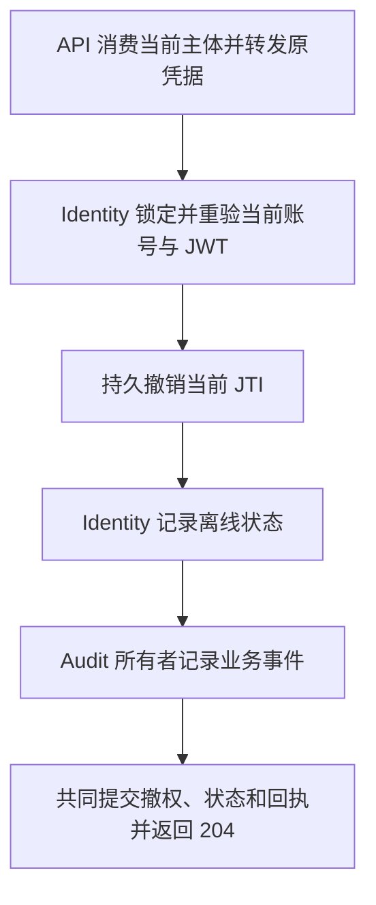

# How-to：新增 API 端点

以当前 `POST /auth/logout` 为例。真实处理器位于 `apps/api/app/api/v1/auth.py::logout`，账号命令位于 `app/services/identity_commands.py`，争用回归位于 `apps/api/tests/test_identity_command_contention.py`。这里说明职责与验证方法，不复制一份会漂移的完整处理器或虚构可运行的测试。

## 完整流程（标准版）

1. 确定公开请求、响应、状态码、当前权限和业务不变量。
2. 路由处理传输；应用层组合跨域操作；领域所有者持有业务写入。
3. 更新能捕获真实消费者风险的测试，并在隔离运行环境实际调用变更路径。
4. 核对 OpenAPI；只有合同实际变化时才生成并提交受影响类型。
5. 更新前端已有 wrapper/调用方及相关文档，复核完整 diff 后提交。

## 1. 路由

认证不等于资源授权。使用 `get_current_user` 取得主体后，项目操作复用 `project_access`，任务操作复用 `task_access`，不得在路由另写一套角色矩阵。预览或历史 Scope DTO 也不能替代最终写入时的当前权限。

`logout` 声明 `status_code=204`，接收原 Bearer 凭据和当前主体，通过 Identity 会话命令端口组合撤权、在线状态和审计。它的实际顺序是：



账号锁繁忙时返回 409；不能先吊销 token，再发现无法更新账号。会话状态由 Identity 原生命令写入，业务审计与撤权同事务提交，API 不直接修改 ORM。显式远程故障不会回退到另一条本地写路径。

请求和响应复用已有 Pydantic schema。对新路由明确声明适用的 `response_model`、成功状态和非默认错误语义；对既有路由迁移则保留公开路径、字段、状态码和错误代码，不为内部改名重写外部合同。

## 2. Service / Core helper

根据所有权选择现有模块，不为每个端点再造 service、repository 或通用工作流基类：

| 职责                   | 当前示例                            |
| ---------------------- | ----------------------------------- |
| HTTP 认证与传输适配    | `app/api/v1/auth.py`、`app/deps.py` |
| 账号状态与账号锁       | `IdentityCommandService`            |
| token 黑名单与账号代际 | `app/core/token_blacklist.py`       |
| 业务审计               | `AuditService`                      |
| 跨域命令组合           | `app/application/` 中相应工作流     |

公开边界优先传递 UUID、明确的命令/结果值和稳定引用；不把 Request、Celery 对象或二进制正文放进通用领域 DTO。读取当前权限和取得最终锁的所有者要明确，不能把缓存 ORM 或先前许可当成授权令牌。

事务由工作流的不变量决定。新组合通常由调用方统一提交，领域方法只 flush；迁移既有路径时必须保留其真实提交、分块提交及提交后派发时点，不能机械删除已有 commit，也不能把共同成败的写入拆成多个独立 commit。

账号状态与业务审计可在同一 SQL 事务提交；Redis 黑名单不是该 SQL 事务的一部分，SQL 后续失败不会自动撤销已经完成的 Redis 写入。不能宣称跨存储原子性或 exactly-once。Redis 客户端仍需可靠关闭，非正 TTL 不应产生黑名单条目。

更多边界约束见[后端分层](../concepts/backend-layers)和[任务锁](../concepts/task-locking)。

## 3. 测试

沿用当前仓库中的 fixture 和真实测试文件，不复制示意函数名、空实现或仅验证转发参数的断言。退出登录至少要证明这些消费者行为：

- 成功退出后，旧 token 不能继续访问需要认证的接口。
- 当前账号离线状态与对应业务审计正确持久化。
- 账号锁争用时返回冲突，而且 token 尚未被提前吊销。
- 账号停用或权限变化不能靠旧请求对象绕过当前准入。

其他写命令按自身风险覆盖范围、版本、状态转换、并发冲突和失败后不变量；不要测试源码文本、私有导入位置、复制值、固定文案或 mock 参数回显。

数据库测试必须使用确认可丢弃的测试环境。例如在仓库根目录运行：

```bash
pnpm dev:worktree -- init --mode test
pnpm dev:worktree -- exec --mode test -- sh -c 'cd apps/api && .venv/bin/python -m pytest tests/test_identity_command_contention.py -q'
```

替换为本次改动对应的实际用例；不要把日常开发数据库当作测试库。测试之外还应实际调用变更的 HTTP、命令或 worker 路径，观察状态和产物。worker 改动要刷新所验证环境的实际消费者，而不是只导入新模块后就声称运行时已切换。

## 4. snapshot 与前端类型

在仓库根目录使用既有脚本：

```bash
pnpm openapi:export
pnpm openapi:check
pnpm codegen
```

公开 API 有变化时生成并提交受影响 snapshot/类型；只有内部所有者或导入路径改变且精确合同不变时，不制造无关生成文件变更。WebSocket、ML/训练和导出格式等独立合同仍需各自验证，不能用 OpenAPI 通过代替。

## 5. 前端 wrapper

优先迁移已有 `apps/web/src/api/auth.ts` 或对应业务 API 模块及其真实调用方。生成客户端负责请求合同；业务 wrapper 组合原有凭据清理、会话状态和导航行为，组件只触发操作，不复制一份请求或直接拼业务 URL。

API 错误必须保留可观察语义。前端不能把锁繁忙、失去权限或陈旧版本当作成功，也不能把收到历史通知视为仍有资源访问权。

## 6. PR 检查清单

- [ ] 路由、应用组合、领域写入和持久化/执行适配器有明确所有者。
- [ ] 当前权限、资源范围、版本、锁及提交时点与目标不变量一致。
- [ ] 相关行为测试和实际调用 smoke 均通过，证据范围与交付声明一致。
- [ ] 精确公开合同已核对；所有受影响调用方和必要生成文件已同步。
- [ ] 文档与用户可见变更记录已更新，无过期处理器副本或兼容转发。
- [ ] 完整 diff 已复核，`git diff --check` 通过。
