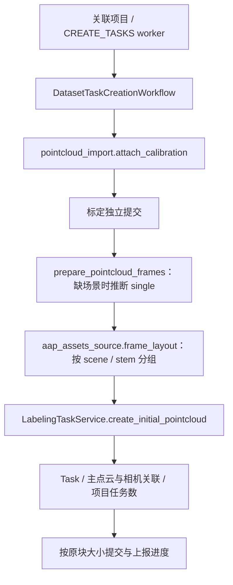

# 点云联合标注 · 后端数据模型

本文定义支持「LiDAR 点云 + 多路相机图像联合标注工作台」的后端核心数据原语、传感器标定版本管理、跨模态 `SceneTrack` 身份契约以及 3D 质量检查闭环。

## 概览

点云与多路相机图像联合标注依赖以下五个核心原语：

| 核心原语                | 落地模型 / Schema                                      | 代码位置                                            |
| ----------------------- | ------------------------------------------------------ | --------------------------------------------------- |
| G1 任务-数据项 1:N 关联 | `TaskDatasetItemLink` 中间表                           | `app/db/models/task_dataset_item_link.py`           |
| G2 标定存储与修订历史   | `SensorCalibration`（`DatasetItem.metadata_`）+ 修订表 | `_jsonb_types.py` / `services/pointcloud_import.py` |
| G3 3D 几何类型          | `Box3DGeometry` / `PointMaskGeometry`                  | `app/schemas/_jsonb_types.py`                       |
| G4 工具单位与文件类型   | `lidar_box_3d` / `point_mask_3d`；点云扩展名识别       | `_jsonb_types.py` / `services/dataset.py`           |
| G6 跨模态身份闭环       | 共享 `Annotation.scene_track_id + track_id`            | 见下文「G6 · SceneTrack 多模态成员」                |

---

## G1 · 多文件关联：`TaskDatasetItemLink`

一个 3D 标注任务（对应单帧多传感器观测）同时关联多个数据项：一份主点云 + N 路相机图像。该关联表与 2D 单文件任务的 `task.dataset_item_id`（1:1 关联）并存：

```text
task_dataset_item_links
  id              uuid  PK
  task_id         uuid  FK→tasks.id            (ON DELETE CASCADE, indexed)
  dataset_item_id uuid  FK→dataset_items.id    (ON DELETE CASCADE, indexed)
  role            str   not null               # primary_lidar | camera_<name>
  sensor_name     str   nullable               # 传感器物理名称（可选）
  created_at      timestamptz
  UNIQUE (task_id, role)                        # 单个任务下每个 role 槽位至多绑定一个数据项
```

- **`role` 命名约定**：`primary_lidar`（主激光雷达点云）或 `camera_<name>`（如 `camera_front`、`camera_rear_left`）。
- **服务层校验**：由 `services/task_dataset_link.py` 中的 `_validate_role` 校验 `role == "primary_lidar"` 或 `role.startswith("camera_")`。因 `camera_<name>` 属于开放后缀，约束放在应用层而非数据库枚举。
- **双轨共存策略**：2D 单文件任务继续使用 `task.dataset_item_id`；3D 多文件任务将 `task.dataset_item_id` 指向主点云数据项（保证列表、导出、缩略图等单数据项消费方无缝兼容），同时通过 `task_dataset_item_links` 维护完整的传感器关联集合。

服务层调用示例（`app/services/task_dataset_link.py`）：

```python
await link_items(
    session,
    task_id,
    [
        (item_id, "primary_lidar", None),
        (item_id2, "camera_front", "cam0"),
    ],
)
links = await get_linked_items(session, task_id)
```

---

## G2 · 标定当前值与版本历史

相机标定按相机数据项存储，当前读模型保存在相机 `DatasetItem.metadata_["calibration"]` 中；`sensor_calibration_revisions` 表以 `(dataset_item_id, revision)` 记录仅追加（append-only）的标定快照、SHA-256 摘要、操作者与时间戳。

```python
class SensorCalibration(BaseModel):
    extrinsic: list[float]    # 长度 16，行主序 4x4 雷达到相机外参矩阵
    intrinsic: list[float]    # 长度 9，行主序 3x3 相机内参矩阵
    rect: list[float] | None  # 长度 16，KITTI 可选矫正矩阵


class DatasetItemMetadata(BaseModel):  # extra="allow" 保留其它元数据键
    calibration: SensorCalibration | None = None
```

### 标定读写与并发乐观锁

标定管理复用任务可见性边界与相机 `role` 解析：

```text
GET   /tasks/{task_id}/point-cloud/cameras/{camera_role}/calibration
PATCH /tasks/{task_id}/point-cloud/cameras/{camera_role}/calibration
```

- **读取与基线物化**：`GET` 返回当前 `revision`、`digest` 及按时间降序排列的历史快照。若历史表尚无记录，则将 `metadata_` 中的存量标定作为虚拟 `revision=1` 返回（并在首次修改前自动物化该基线）。
- **权限与防篡改门禁**：`PATCH` 仅允许项目 Owner 或超级管理员调用，且请求体必须携带当前预期的 `revision` 与 `digest`（版本不匹配返回 `409`）。当同一相机 `DatasetItem` 被跨项目共享复用时，仅允许超级管理员修改标定，防止单个项目 Owner 篡改其它项目的共享真值。
- **原始坐标真值隔离**：工作台标定管理面板始终读写未经 ISO 轴向转换的原始传感器标定；渲染侧的坐标系归一化仅在前端派生投影链中计算，绝不回写覆盖数据集原始标定。

---

## scene 导入与任务创建数据流

素材入库仍由资产服务持有；`application/dataset_task_creation.py` 按 `project.data_type == "lidar"` 分流，标注所有者只消费不可变帧事实。



Scene 目录入库时，`<ds>/lidar/<frame>.pcd` 记为 `point_cloud`、`<ds>/camera/<cam>/<frame>.jpg` 记为 `image`、`<ds>/calib/camera/<cam>.json` 记为 `other` 数据项，标定经 `SensorCalibration` 归一化校验后写入各相机帧的 `DatasetItem.metadata_["calibration"]`。

角色匹配仍取路径中最后一次命中的 lidar/camera/calib 段；每个主点云帧建一个 Task，并关联实际存在的 `primary_lidar` 和 `camera_<cam>`。缺相机可只关联主点云；缺主点云的分组才跳过并警告。按已有主点云任务跳过已建帧，不新增并发唯一性约束或残缺关联补建。

入库后的追加仍按 DatasetItem 建题，不改成初始帧聚合。标定修改后重放即使没有新任务也会先提交标定；解绑/删除的跨域写入尚未迁移，不能把当前边界视为可直接拆成远程事务。

## G3 · 3D 几何类型

---

## G3 · 3D 几何类型

`Geometry` 判别联合类型（`Field(discriminator="type")`）存储在 `annotations.geometry` JSONB 列中：

| `type`          | Schema 模型         | 核心字段                                | 说明                                                      |
| --------------- | ------------------- | --------------------------------------- | --------------------------------------------------------- |
| `box_3d`        | `Box3DGeometry`     | `center[3]` / `size[3]` / `rotation[3]` | 单位：米（位置与长宽高）、弧度（欧拉角）；`extra="allow"` |
| `point_mask_3d` | `PointMaskGeometry` | `point_indices: list[int]`              | 指向当前点云的非负整数点索引数组；`extra="forbid"`        |

前端 TypeScript 类型由 `pnpm api:gen` 从 `apps/api/openapi.snapshot.json` 本地生成至 `apps/web/src/api/generated/`（构建期产物，不提交 Git）。

---

## G4 · 工具单位与文件类型

- **工具单位（`ToolUnitId`）**：提供 `lidar_box_3d`（3D 边界框）与 `point_mask_3d`（3D 逐点语义掩码）。
- **文件类型识别**：`services/dataset.py` 的 `_infer_file_type_from_ext` 将 `.pcd`、`.bin`、`.las`、`.ply` 识别为 `file_type = "point_cloud"`（对应 `DatasetDataType.POINT_CLOUD`）。

---

## G6 · SceneTrack 多模态成员

同一物理目标在单帧内的“主點云 3D 框 + 各路相机人工 2D 边界框”共享 `Annotation.scene_track_id + track_id`，聚合为一个逻辑跨模态对象：

- **主从成员结构**：3D 框是该帧的主成员；每个相机 `sensor_role` 最多拥有一个活跃的 2D `bbox` 成员（由部分唯一索引 `(task_id, scene_track_id, sensor_role)` 约束）。
- **传感器关联字段**：2D 相机成员是一等 `Annotation` 行，完整记录 `sensor_dataset_item_id`、`sensor_role`、`sensor_visibility`、`calibration_revision` 与 `calibration_digest`（五个传感器上下文字段必须全有或全无）。
- **并发与过期判定**：`SceneTrack` revision 是跨模态成员集合的并发锁边界。3D→2D 几何投影仅作为前端实时计算的派生参考，不会自动覆写人工精修过的 2D 相机框；若相机标定后续发生变更（`calibration_digest` 不一致），关联状态标记为 `stale`。
- **轨迹级联动**：`SceneTrack` 的拆分、合并、缺席标记、恢复与终止会原子处理全部模态成员；主标注列表与任务完成度统计仅计入主成员（非传感器附属成员）。

---

## 点云查看器 Manifest 与前端 3D 渲染管线

前端 3D 工作台通过单个 Manifest 端点获取当前帧所需的全部点云与多路相机资源：

```text
GET /tasks/{id}/point-cloud/manifest   （要求 project.data_type == "lidar"）
  → {
      point_cloud_url,                 # 主点云预签名 URL（datasets 桶）
      point_cloud_format: "pcd",
      cameras: [{ name, role, image_url, calibration: SensorCalibration | null }],
      expires_in
    }
```

### 双画布与四视图渲染架构（`ThreeDWorkbench`）

- **按需分包与单上下文多视口**：当 `project.type_key === "lidar"` 时，`WorkbenchStageHost` 动态加载独立的 `ThreeDWorkbench`（位于 `apps/web/src/pages/Workbench/stages/three-d/`，打包为独立 `vendor-three` chunk）。底层 `PointCloudScene` 由持久 Web Worker 解析 PCD、归一化轴向并生成高度着色；主透视视图与 Top / Side / Front 三正交视图共享同一个渲染器、Canvas 与图形上下文，通过 `viewport / scissor` 分 Pass 绘制并由事件驱动调度器按需提交。
- **WebGL2 默认路径与 WebGPU 实验路径**：默认使用稳定的 Legacy WebGL2 渲染器；工作台设置中可开启本地实验性异步 WebGPU 渲染器（支持实例化点精灵、固定六路相机纹理直采样与 8 MiB LRU 深度遮挡栅格预取，设备丢失或初始化失败时自动无感回退至 Legacy WebGL2）。
- **nuScenes 确定性导入与预取**：nuScenes 导入器将 5 通道 `.pcd.bin` 转换为小端序二进制 XYZ PCD（`pcd_encoding=binary_xyz_f32`），同时保留原始 `.pcd.bin`、相机图与地图指纹以支撑可信导出（详见[点云导出格式](./lidar-export-formats.md)）。点击时间轴切帧时立即发起任务导航，PCD 与相机位图在后台并行预取且不阻塞切帧。

`app/services/point_cloud_quality/execution.py::execute_run` 持有逐框/轨迹规则、skip/issue 写入和 Run 终态；`app/application/quality_execution.py` 将服务端 `QualityJobLifecycle` 绑定到通用作业状态及终态通知。原 Celery worker 的注册名、单个 Run ID 参数与 `media` 路由不变；领域 `Run`、`Issue` 和 `AsyncJob` 的本地事务检查点也不因此转成远程接口。

`PointCloudQualityIssue` 持久化规则 code/version、class、severity/status、frame 区间、metric/threshold/evidence、标注版本、SceneTrack revision、稳定 dedupe key 和可恢复 locator。locator 可同时指向 Scene、帧、任务、标注、SceneTrack、相机与辅助层。人工决策由 `services/point_cloud_quality/service.py::decide_issue` 校验当前 Task 绑定与源新鲜度，再更新状态、trim 后的 reason/note、resolver 和 verdict/reviewer 字段；重开清除 resolution 与 review 字段。API 保留当前范围/角色检查、锁定获取、审计、提交与响应 refresh 顺序。Issue 和源身份仍归点云质检，不由反馈锚接管；处置不执行 `suggested_command`。

### 会话态测量辅助层（Measurement Overlay）

点云三维测量属于纯前端会话态辅助层（非持久化 `Annotation`）：

- 锚点由 `PointCloudScene.pickPoint` 严格射线命中当前渲染点后获取源点索引与 ISO 世界坐标（绝不回退到地面平面或自由空间），由纯函数累计各段三维空间距离、水平距离与首尾高差（`Δz`）。
- 测量状态仅在当前任务会话内有效，不调用标注 API、不进入撤销历史或导出包；切换任务时自动清空，只读模式下亦可正常使用。

---

## 3D 框标注与相机投影联动

### 1. 3D 框持久化载荷（`box_3d`）

3D 框复用标准标注 CRUD 端点持久化：

```jsonc
POST /tasks/{id}/annotations            // 创建；PATCH .../{aid} 更新，DELETE 软删除
{
  "annotation_type": "box_3d",
  "tool_unit_id": "lidar_box_3d",
  "class_name": "car",
  "geometry": {
    "type": "box_3d",
    "center": [x, y, z],                 // 单位：米，ISO Z-up 坐标系
    "size": [length, width, height],     // 长、宽、高（米，下限 0.05m）
    "rotation": [0, 0, yaw]              // 7-DoF：仅编辑绕 Z 轴偏航角 yaw（弧度）
  }
}
```

前端选中 3D 框后，可通过主视图 `TransformControls`（`W` 平移 / `E` 旋转 / `R` 缩放）与右上角 PSR 数值面板双向同步编辑；新建框时通过射线与地面高度估计平面（`z = groundZ`）交点落位。

### 2. 3D→2D 相机实时投影链（`three-d/geometry/projection.ts`）

3D 框通过相机标定矩阵实时投影至各路相机视图（`CameraProjectionView.tsx`），计算公式与 SUSTechPOINTS 严格对齐：

```text
p_cam   = extrinsic · [x, y, z, 1]ᵀ      // 行主序 4x4 雷达到相机外参
p_cam   = rect · p_cam                   // 可选行主序 4x4 矫正矩阵（KITTI）
[u,v,w] = intrinsic · p_cam.xyz          // 行主序 3x3 相机内参
pixel   = [u/w, v/w]                     // 透视除法（像素原点左上：u 向右、v 向下）
visible = w > 0                          // 仅保留位于相机前方的角点
```

- **双向选中与跨模态高亮**：在 3D 视口选中框会使各相机投影线框同步高亮，状态栏提示「投影可见于 N 相机 · 正对 X」；在相机视图中点击投影框或人工 2D 框也会反向选中对应的 3D 框及同一 `track_id` 下的全部跨模态成员。

---

## Scene 跨帧传播与 3D 质量闭环

### 1. Scene 跨帧传播任务（`point_cloud_cross_frame`）

长区间 `box_3d` 跨帧传播使用统一 `AsyncJob`（`kind="point_cloud_cross_frame"`）异步执行。每个目标任务作为独立事务边界：写入前复核用户权限、任务可编辑性与源标注版本；若目标帧已存在同 `track_id` 的活跃框则按 `skip_existing` 跳过；若源标注在传播中途被外部修改，后续未执行帧自动标记为 `stale`。`point_mask_3d` 因跨帧点索引不可复用，不参与跨帧几何传播。

### 2. 3D 质量检查与配置晋级（`PointCloudQualityRun` / `Issue` / `Evaluation`）

3D 质量检查拥有独立的领域模型，不与 2D Mask QC 混用：

```text
Project / Scene / Task / Annotation 作用域
  → 冻结规则配置 + 标注版本 + SceneTrack revisions + 点云哈希
  → PointCloudQualityRun + AsyncJob
  → 确定性规则内核（框内点数、局部地面贴合、尺寸异常、轨迹时序跳变）
  → PointCloudQualityIssue（open / resolved / wont_fix / stale）
  → 时间轴标记 / 工作台定位器（locator）/ point_cloud 反馈锚点
```

- **作用域隔离**：Project / Scene 级扫描冻结完整 Scene 成员，同时执行单框规则与跨帧轨迹规则；Task / Annotation 级扫描仅执行单框规则，轨迹规则记录 `track_rules:scope_incomplete` 跳过。
- **评估快照与配置晋级（`PointCloudQualityEvaluation`）**：将已有明确人工复核结论（`confirmed` / `false_positive` / `accepted_exception` / `uncertain`）且未过期的 Issue 冻结为样本快照（上限 20,000 条），对比 baseline 与 candidate 阈值配置的误报率及已确认问题保留率；满足门禁后在项目行锁保护下递增项目质量配置修订号。
