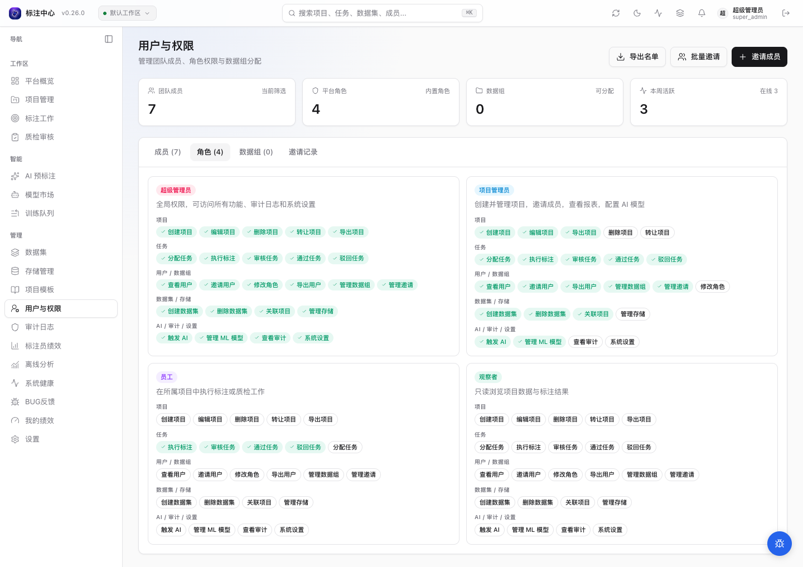
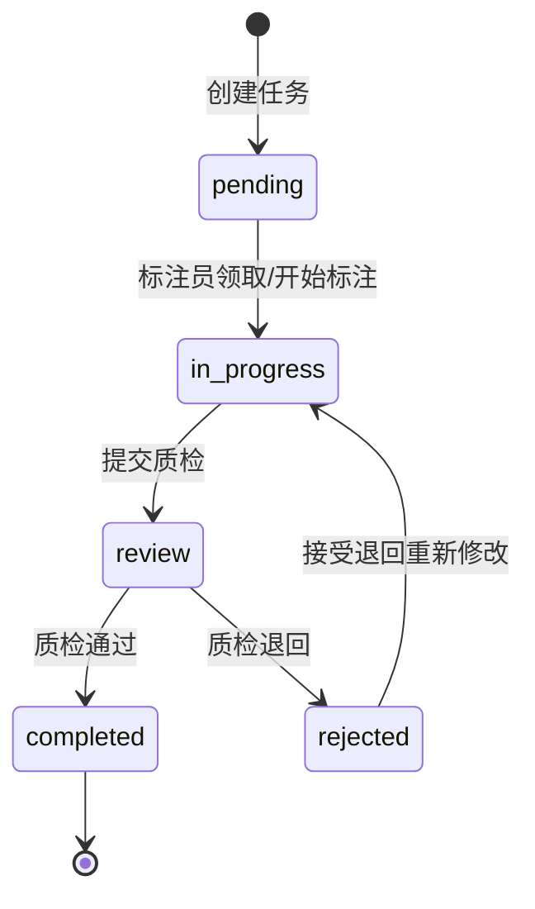
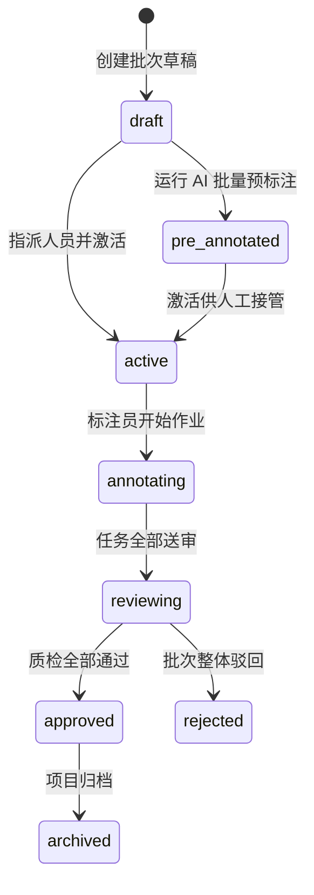
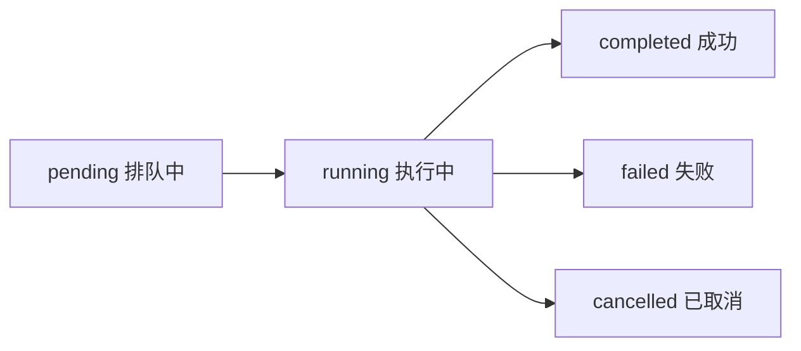

# 平台概念与术语

本页统一定义平台中常见的核心名词，避免在不同章节出现歧义。

## 核心实体

| 名词               | 英文                             | 含义                                                                                                                                                   |
| ------------------ | -------------------------------- | ------------------------------------------------------------------------------------------------------------------------------------------------------ |
| **项目**           | Project                          | 一次标注任务的顶级容器，包含数据集配置、标注类型、分配规则等。一个项目对应一种标注目标（如「行人检测」）。                                             |
| **数据集**         | Dataset / DatasetItem / Scene    | 原始多媒体资产（图片、视频、点云）的组织容器与样本索引；连续时序帧可按 `Scene` 聚合成组，同一份数据集可关联到多个项目。详见[数据集与存储](datasets/)。 |
| **存储位置与来源** | Storage Location / DatasetSource | 承载托管原件、预览或训练产物的受控存储位置，以及持续向数据集提供原地引用或托管同步的外部目录来源。                                                     |
| **批次**           | Batch                            | 项目内的一组任务切片，通常按时间或数据来源划分。标注员以批次为单位领取工作。                                                                           |
| **任务**           | Task                             | 单条待标注数据（一张图像 / 一段视频 / 一段文本）。任务状态流转：未开始 → 进行中 → 待审核 → 已完成 / 待重做。                                           |
| **标注**           | Annotation                       | 标注员在某个任务上产出的具体结果，可包含多个标注对象（Bbox、Polygon 等）。                                                                             |
| **预测**           | Prediction                       | 模型对某个任务生成的候选标注，供标注员修正或直接采用。与 Annotation 的区别：Prediction 由模型生成，Annotation 由标注员确认。                           |
| **标注对象**       | Label / Result                   | 单个几何形状 + 分类属性的组合（如一个 Bbox + 类别 "person"）。一个 Annotation 可含多个 Label。                                                         |
| **在线学习**       | Online Learning                  | 从已审核标注中抽取冻结的数据版本，排入独立执行器训练新模型，再将新模型回流到项目用于预标注与辅助标注的闭环。详见[在线学习](online-learning/)。         |
| **训练数据版本**   | Training Dataset Version         | 按规范任务（检测/分割）独立演进的冻结数据集快照，包含正负样本、明确的训练/验证集划分与素材校验摘要。                                                   |
| **训练实验**       | Training Run                     | 在独立 GPU 执行器上执行的一次受控模型训练过程，记录指标曲线、资源消耗、脱敏日志和最佳权重最终评估。                                                    |
| **候选模型与发布** | Trained Model & Release          | 从成功实验产物中注册的模型版本，经样本试用核验后发布为项目当前预标注模型，支持多代回退与谱系追溯。                                                     |
| **主动学习**       | Active Learning                  | 基于模型预测置信度与启发式规则，从大量待标图片中筛选最具标注价值的样本，经人工审核后进入标注流水线。                                                   |

## 视频标注术语

| 名词       | 英文               | 含义                                                                                   |
| ---------- | ------------------ | -------------------------------------------------------------------------------------- |
| **轨迹**   | Track              | 视频里同一个对象跨多个帧的标注结果。一条轨迹保存为一条 `video_track_bbox` annotation。 |
| **关键帧** | Keyframe           | 用户手工确认或模型预测出的轨迹控制点，包含 `frame_index` 和 bbox。                     |
| **插值帧** | Interpolated frame | 两个有效关键帧之间由前端线性计算出的显示结果，不会逐帧写入数据库。                     |
| **消失**   | Outside            | 目标在某帧或某段中不存在，用闭区间 `outside` 段表达；插值不会跨过消失段。              |
| **遮挡**   | Occluded           | 目标仍存在但可见性差，用于提醒审核和后续质检。                                         |

## 角色

平台把**账号身份**与**项目职责**分开：账号有一个平台角色，在**每个项目**另有一个项目角色。同一个账号可以在 A 项目做标注、在 B 项目做质检、在 C 项目只读观察，不需要切换账号或重新登录。

### 平台角色（账号级）

| 角色值          | 显示名                  | 权限范围                                                                                                                         |
| --------------- | ----------------------- | -------------------------------------------------------------------------------------------------------------------------------- |
| `super_admin`   | 超级管理员              | 全平台用户管理、存储位置与站点 Agent 治理、九用途映射切换、ML Backend 注册、系统监控；可见全部项目与数据集                       |
| `project_admin` | 项目管理员 / 数据管理员 | 创建并管理自己负责的项目与数据集；对自建数据集及获授权的受控存储位置承担**数据管理员（Data Manager）**职责，可执行来源同步与质检 |
| `employee`      | 员工                    | 参与项目工作；具体是标注、质检还是只读，由该账号在各项目的项目角色决定                                                           |
| `viewer`        | 观察者                  | 只读，无法操作任务或项目；开放注册默认角色，需管理员调整成员身份才可参与标注                                                     |

### 项目角色（成员级）

| 角色值      | 显示名 | 权限范围                                       |
| ----------- | ------ | ---------------------------------------------- |
| `annotator` | 标注员 | 查看并完成分配给自己的任务                     |
| `reviewer`  | 质检员 | 审核已提交任务，通过或回退；享有全项目导出能力 |
| `viewer`    | 观察者 | 只读；不能标注、质检或导出                     |

项目设置里分配的是**项目角色**，可以在不同项目不同；账号管理里看到的**平台角色**是全账号统一的身份。平台 `viewer` 账号加入项目时只能是只读项目角色，不会自动升级为员工；员工可以身兼标注与质检，但**同一项目内只能有一个项目角色**。

> 上图是账号平台角色的权限矩阵；项目内的职责以项目设置为准，二者不要混用。

具备 `project_admin` 平台角色的用户在创建数据集或被超级管理员授予特定存储位置使用权限后，同时作为该数据集的**数据管理员（Data Manager）**：负责登记与同步数据来源、运行图片质量检测与人工复核、维护数据集筛选视图，以及将数据集关联到标注项目或冻结为训练数据版本。

## 数据集与存储核心术语

| 术语                                                                                                                 | 含义与边界                                                                                                                                                                                                                                                                                      |
| -------------------------------------------------------------------------------------------------------------------- | ----------------------------------------------------------------------------------------------------------------------------------------------------------------------------------------------------------------------------------------------------------------------------------------------- |
| **托管原件（Managed Original）vs 原地引用（In-Place Reference）**                                                    | **托管原件**由平台将源文件复制到受控对象存储并按内容寻址长期保管；**原地引用**保持源文件留在外部 S3 / SFTP / 受控目录或远端站点原位，平台只保存元数据、内容摘要与缩略预览，按需回源读取原图。                                                                                                   |
| **内容身份（Content Identity / SHA-256）与样本可用性状态**                                                           | 平台以完整字节的 SHA-256 校验值作为原件内容身份，驱动去重、回源核验与跨版本比对。样本可用性区分五种状态：**已索引**（元数据已入库）、**原图可读**（原件经校验可读取）、**仅预览可用**（原件暂不可达但缩略图可用）、**来源异常**（文件缺失或内容被篡改）、**已冻结版本**（已生成独立训练副本）。 |
| **存储连接器（Connection）vs 受控存储位置（Location）vs 九用途映射（Purpose Binding）vs 已保存目标（Saved Target）** | **连接器**保存外部 S3 / SFTP 凭据与端点；**受控存储位置**是平台统一纳管的物理存储单元（对象存储桶、受控服务器目录、站点 Agent 目录）；**九用途映射**指定托管原件、派生预览、训练产物等 9 类新写入默认落往哪个位置；**已保存目标**是快捷复用的常用连接与前缀模板。                               |
| **只读站点 Agent 与显式备用来源（Reference Replica）**                                                               | **只读站点 Agent** 部署在跨网络机房或内网文件服务器旁，通过出站连接或受控网关向平台提供只读目录扫描与原件传输；当主来源离线或迁移时，可为数据集绑定同内容的**显式备用来源（Reference Replica）**，在严格校验 SHA-256 一致后无感接管原图读取。                                                   |
| **数据集归档（Archive）vs 托管原件保留（Retention）与受控回收（Reclaim）**                                           | **数据集归档**仅冻结业务入口（禁止新增导入或关联新项目），不会删除物理原件；**托管原件保留与受控回收**则依据保留策略检查引用计数，仅当原件不再被任何活动数据集、未归档任务或训练版本引用且满足保留期后，才由超管执行物理空间回收。                                                              |

## AI 相关

| 名词                       | 含义                                                                                                                         |
| -------------------------- | ---------------------------------------------------------------------------------------------------------------------------- |
| **ML Backend**             | 外部模型服务，通过标准协议与平台对接，提供预测或批量预标注能力。详见 [ML Backend 协议](/dev/reference/ml-backend-protocol)。 |
| **预标注（Pre-annotate）** | 在标注员介入前，先让模型对一批任务生成 Prediction，降低手工标注工作量。                                                      |
| **Job**                    | 一次后台任务请求，覆盖多种异步流程（见下方 kind 列表）。状态：pending → running → completed / failed / cancelled。           |

Job 的 `kind` 完整列表：

| kind                               | 中文含义                   |
| ---------------------------------- | -------------------------- |
| `batch_predict`                    | 批量预标                   |
| `video_tracker`                    | 视频追踪                   |
| `predictions_import`               | 预测导入                   |
| `prediction_retry`                 | 失败预测重试               |
| `export`                           | 标注导出                   |
| `dataset_import`                   | 数据集（连接器）导入       |
| `dataset_scan`                     | 数据集目录来源扫描         |
| `dataset_registration`             | 数据集样本登记与增量同步   |
| `dataset_quality`                  | 数据集图片质量检测         |
| `dataset_quality_review`           | 数据集质量批量人工复核     |
| `create_tasks`                     | 建任务（大数据集关联）     |
| `training_dataset`                 | 训练数据版本构建           |
| `training_run`                     | 在线学习模型训练执行       |
| `training_preview`                 | 训练数据增强预览生成       |
| `sample_evaluation`                | 模型逐样本评估             |
| `active_learning_round`            | 主动学习选样轮次           |
| `storage_usage`                    | 存储位置容量与账目盘点     |
| `storage_migration_inventory`      | 对象存储迁移清单盘点       |
| `storage_migration_copy`           | 对象存储迁移增量复制与校验 |
| `managed_original_verification`    | 托管原件完整性核验         |
| `managed_original_reclaim`         | 托管原件到期受控回收       |
| `managed_reference_reconciliation` | 原件引用关系对账           |
| `video_asset_retry`                | 视频探测与派生资产重试     |
| `video_correction`                 | 视频轨迹智能纠错           |
| `video_track_quality`              | 视频轨迹质量检测           |
| `point_cross_frame`                | 点云跨帧传播与跟踪         |
| `audit_archive`                    | 审计日志月分区归档         |
| `mask_qc`                          | Mask 质检                  |
| `mask_repair`                      | Mask 批量修复              |
| `mask_repair_rollback`             | Mask 修复回滚              |
| `mask_format_import`               | Mask 格式导入              |

## 状态流转速查

### Task 状态（单任务生命周期）

> - `rejected`（待重做）：任务被审核员退回后的运行时状态，在工作台任务队列中显示为「待重做」，附带结构化退回原因。
> - `uploading`：仅在直接通过文件上传创建任务时短暂出现，上传完成后自动转为 `pending`。

### Batch 状态（批次整体阶段）

Batch 状态描述一组任务切片的整体推进进度，独立于单题 Task 状态：

> - `pre_annotated`：表示批次内已生成模型候选预测，等待管理员分派或标注员开始作业。
> - 完整状态流转与所有者重激活规则参见 [批次与分配 · 批次状态机](./projects/batch)。

### Job 状态（异步后台任务）

## 常见概念混淆速查

| 易混淆概念组                           | 关键区别                                                                                                                                                                                                                | 常见误区纠偏                                                                                           |
| :------------------------------------- | :---------------------------------------------------------------------------------------------------------------------------------------------------------------------------------------------------------------------- | :----------------------------------------------------------------------------------------------------- |
| **Annotation vs Prediction**           | **Annotation** 是人工确认或创建的真实标注； **Prediction** 是算法模型输出的候选预测。                                                                                                                                | 预测结果（Prediction）不直接计入最终导出成果，必须经标注员采纳或修正为标注（Annotation）。             |
| **Task vs Batch**                      | **Task** 是单条作业数据（1 张图 / 1 段视频）； **Batch** 是为多人分工划分的任务切片集合。                                                                                                                            | 标注员按批次（Batch）领取工作包，在工作台中逐题（Task）进行标注与提交。                                |
| **Project vs Dataset**                 | **Dataset** 是原始多媒体文件的物理存储与索引； **Project** 是关联了数据集并配置了标注类别的工作域。                                                                                                                  | 同一个数据集可关联到多个不同项目（如同一批街景图分别做车辆检测项目和道路分割项目）。                   |
| **训练数据版本 vs 原始数据集**         | **训练数据版本 (Training Dataset Version)** 是从项目审核标注中抽取、冻结、完成正负样本校验与训练/验证集划分的不可变训练快照； **原始数据集 (Dataset)** 是原始多媒体文件（图片/点云/视频）的物理存储与元数据集合。    | 模型训练不能直接读取可变的源数据集，必须冻结为确切的数据版本以确保可复现性与数据血统。                 |
| **训练实验 vs 预标注作业**             | **训练实验 (Training Run)** 在独立 GPU 执行器上从训练数据包学习并生成新模型权重； **预标注作业 (Batch Predict Job)** 调用已部署的模型服务对任务生成候选预测。                                                        | 训练实验耗时较长、独占物理 GPU 且产物是模型权重；预标注作业将模型输出写入待审候选（Prediction）。      |
| **平台角色 vs 项目角色**               | **平台角色**（账号级）决定全站管理权限； **项目角色**（成员级）决定在特定项目内是标注、质检还是只读。                                                                                                                | 同一员工可在 A 项目做标注员，在 B 项目做质检员，系统会依项目上下文自动切换权限视图。                   |
| **个人筛选视图 vs 训练数据版本**       | **个人筛选视图 (Saved View)** 是数据集工作台中保存的动态查询条件，随新样本导入或质检状态变化实时变化； **训练数据版本 (Training Dataset Version)** 是将某一时刻的合格图片、标注和训练/验证划分物理冻结的不可变快照。 | 保存筛选视图不会冻结原图或标注；用于训练前必须点击「冻结当前筛选」或「准备新版本」生成独立的数据版本。 |
| **存储位置切换新分配 vs 历史对象迁移** | **切换用途映射 (Purpose Binding)** 仅改变后续新上传原件、新派生预览或新训练实验的默认写入位置； **历史对象迁移 (Storage Migration)** 是通过盘点、增量复制与校验将存量对象搬迁到目标桶的受控运维流程。                | 切换九用途映射不会自动搬迁既有文件，历史样本和已冻结训练版本继续按各自已保存的位置读取。               |
| **数据集归档 vs 原件物理回收**         | **数据集归档 (Archive)** 是将数据集设为只读封存状态，随时可恢复； **原件物理回收 (Reclaim)** 是核验无任何活动数据集、任务或训练版本引用后，从对象存储中删除托管原件并释放容量。                                      | 归档数据集不会立即释放底层对象存储空间；需结合保留策略与受控回收作业清理无引用的孤立或到期原件。       |
