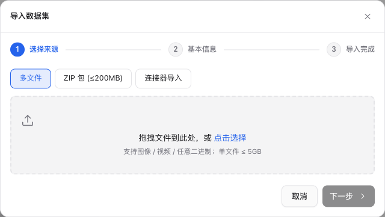

# 导入图像与托管数据

本页说明如何将**图像文件上传或复制进平台托管存储**：四种导入方式（A–D）、ZIP 目录结构、内容去重、支持的格式与大图金字塔切片，以及数据集关联项目后如何自动生成标注任务。

- 若原图已在服务器共享目录、外部 S3、只读 SFTP 或跨网络站点中，希望**不复制原图**直接原地引用并跟踪增量变化，见[数据来源与增量同步](./sources)。
- 点云 / 多模态（lidar + 相机）导入见[导入点云 / 多模态](./import-formats)。
- 将**外部模型预测**（COCO / YOLO / AAP JSON）导入已有任务，见[导入 / 导出外部预测](./prediction-import-export)。

> **区分数据导入与预测导入**：
> 本页的「图像导入」将原始图片放入数据集（`dataset_items` + 存储对象）；「预测导入」是向已有项目任务写入候选标注。必须先有数据集样本并生成任务，才能导入外部预测。

## 打开导入向导

进入顶部菜单「数据集」，在数据集列表点击「上传」（已有数据集可在独立详情页点击「上传」继续追加文件），打开导入向导。新建数据集时，第一步「选择来源」选择多文件、ZIP 包或连接器并配置来源；第二步「基本信息」填写数据集名称、说明并选择数据类型（图像）。已有数据集继续上传时直接从来源步骤开始。

- **方式 A · 多文件** — 在浏览器中直接选择或拖入若干图片文件，预签名直传。
- **方式 B · ZIP 包（≤ 200 MB）** — 上传单个 ZIP 归档，后端解压并保留子目录结构。
- **方式 C · 连接器导入** — 从已配置的 S3 / OSS / SFTP 连接器按路径与通配符批量拉取到平台托管存储。
- **方式 D · 扫描导入** — 对已写入平台对象存储固定前缀的对象触发扫描补建索引。



## 方式 A · 浏览器多文件上传

「多文件」标签里拖入或点击选择图片。每个文件走**预签名直传**:前端逐个向后端申请上传地址(`uploadInit`),直接 PUT 到对象存储,再回调 `uploadComplete` 入库;默认并发 3。

- **支持图像 / 视频 / 任意二进制**,单文件 ≤ 5 GiB（完成上传时由后端核验实际字节；文件类型按 MIME 推断:`image/*` → image、`video/*` → video、其余 → other）。
- 适合几十到几百个文件的零散上传。文件很多时改用 ZIP 或连接器导入。

## 方式 B · ZIP 上传(向导)

把一批图片打成 ZIP 上传,后端解压、逐个写对象存储并入库。这是图像数据集最常用的方式。

### 目录结构:顶层即图片,或保留子目录

ZIP 上传**保留 ZIP 内的子目录结构**；图片列表与导出沿用这些相对目录。同一逻辑路径已有不同内容时，文件名追加序号，避免遮盖旧样本。数据集改名不移动原图。两种布局都行:

顶层平铺:

```
images.zip
├── 001.jpg
├── 002.jpg
└── 003.png
```

按类别 / 来源分子目录(相对路径会保留):

```
animals.zip
├── cat/
│   ├── 001.jpg
│   └── 002.jpg
├── dog/
│   ├── 001.jpg          # 与 cat/001.jpg 同名,不冲突(见去重)
│   └── 003.jpg
└── bird/
    └── 010.png
```

解压时自动跳过:macOS 元数据目录 `__MACOSX/`、任意以 `.` 开头的隐藏文件(如 `.DS_Store`);拒绝绝对路径和含 `..` 的路径(zip-slip 防护)。这些被跳过的条目计入响应里的 `skipped`。

### 上限

| 限制项       | 值       |
| ------------ | -------- |
| 整个 ZIP 包  | ≤ 200 MB |
| 单个文件     | ≤ 100 MB |
| ZIP 内条目数 | ≤ 5000   |

超过整包上限返回 `413`,超过条目数也返回 `413`;单文件超限不阻断整包,该文件计入 `errors`(其余照常入库)。需要更大批量(数万文件 / 几百 GB)走**连接器导入**。

### 去重:按内容,不按文件名

去重以实际文件内容的校验结果为准，**不以文件名、路径或存储 ETag 认定重复**。因此:

- 跨子目录的**同名**文件(`cat/001.jpg` 与 `dog/001.jpg`)只要内容不同,都会入库——同名不冲突。
- **内容相同**的文件(无论文件名是否相同、是否在不同子目录)只保留第一个,其余计入 `deduped`。
- 已核验的同数据集文件支持重复内容识别；旧 hash 只作为候选，读取原件确认相同内容后才跳过。旧原件无法读取或证据不足时会保留新文件，不冒险丢弃。

### 看懂响应

上传完成后向导汇总后端响应,字段含义:

```json
{
  "added": 142, // 新入库的文件数
  "deduped": 6, // 内容重复、被跳过的文件数
  "skipped": 2, // 隐藏文件 / __MACOSX 等被规范化跳过的数
  "errors": [
    // 逐条失败明细
    { "name": "huge.tiff", "error": "超过单文件 100MB 上限" }
  ],
  "total_in_zip": 150, // ZIP 内非目录条目总数
  "linked_tasks": 142, // 若数据集已关联项目,本次顺带建的 task 数
  "scene_inference_notes": [] // scene 识别提示(图像普通导入一般为空)
}
```

判断成功:`added` 是真正入库数;`total_in_zip = added + deduped + skipped + errors.length`。`errors` 非空时逐条看 `name` / `error` 定位(常见是单文件超 100MB)。`scene_inference_notes` 只在识别 scene 时有内容(时序 / 多场景目录),纯图像平铺导入通常为空。

## 方式 C · 连接器导入(大批量)

数据量大(数万文件 / 几百 GB)或图片已在云存储 / SFTP 上时,用「连接器导入」:

1. 选一个可见连接器(普通项目管理员可用全局连接器 + 本人创建的个人连接器,超管可用全部)。
2. 填 `source_path`(连接器内的起始路径),勾选**递归扫描**(默认开),可用逗号分隔填 `include_globs` 过滤(如 `*.jpg, *.png`)。
3. 提交后导入作为**后台任务**运行,向导显示进度、成功数、跳过数和失败明细。

连接器导入使用独立的枚举预算，代码默认值如下：

| 限制项     | 默认值  | 覆盖用环境变量                   |
| ---------- | ------- | -------------------------------- |
| 最大文件数 | 50000   | `DATASET_IMPORT_MAX_FILES`       |
| 最大总字节 | 200 GiB | `DATASET_IMPORT_MAX_TOTAL_BYTES` |

超级管理员可在「设置 → 系统设置 → 数据导入」查看部署有效值并保存覆盖。作业受理时固定预算，枚举超限会**整体失败，不产生本次部分导入**；修改设置不会改变已排队或重试作业的预算。连接器的创建、主机白名单、密钥加密等配置见 [数据源连接器](./storage-connections)。

## 方式 D · 扫描导入(命令行 / 已有对象)

如果文件已由外部流程直接写进平台对象存储的固定扫描根，可对该数据集调用扫描接口补建索引条目。升级前的数据集保留升级时的名称根；新建数据集使用独立存储根，具体写入约定与调用方式见[数据集 API](/api/guides/datasets#扫描)。数据集改名不改变扫描范围，重复扫描不会重复登记。扫描仅建立索引记录，不将对象存储 ETag 当作已核验内容。

<details>
<summary>扫描导入接口端点（供命令行或脚本调用）</summary>

```text
POST /api/v1/datasets/{id}/items/scan
```

</details>

## 支持的图片格式

ZIP 与多文件上传不维护硬编码扩展名白名单，而是按 MIME 推断类型：`image/*` 归为 `image`、`video/*` 归为 `video`、其余归为 `other`。常见图片格式（`.jpg` / `.jpeg` / `.png` / `.bmp` / `.gif` / `.webp` / `.tiff` 等）均可入库，入库时异步读取宽高并生成缩略图。能否在标注工作台直接渲染取决于浏览器原生支持（JPEG / PNG / WebP 兼容性最佳）。

## 托管大图与派生预览

托管大图的高清金字塔切片从已登记并完整核验的原件生成。原件缺失、内容变化、读取权限撤回或存储维护期间，生成任务会明确失败，原有样本和标注保留。仅有扫描索引、旧摘要或对象元数据不足以生成切片，需先完成原件核验。

每次生成保存独立的切片位置，重试不会覆盖或清除另一轮正在生成的结果。历史金字塔缺少可核实的存储归属时，不直接用于预览；原件核验完成后可重试生成新切片。样本列表、批次封面与标注工作台共用已就绪的派生结果，缺失或不可用时不猜测其他存储位置。删除样本或数据集后，派生文件由后台在确认不再使用后回收。浏览与重试方式见[超大图片的当前行为](../workbench/index.md#超大图片的当前行为)。

### 历史原件补算、独立任务上传与用途切换边界

- **旧托管原件补算**：升级后，若历史托管图片仅有位置回填但尚未确认原件字节，可由运维先预览当前原件的 SHA-256 与大小，核对后显式应用补算清单，保留原样本、任务和标注；详见[旧托管原件补算](/dev/concepts/storage-connections#显式补算旧托管原件)。补算仅建立当前内容基线，原件缺失或前后变化时不会自动接纳，也不应通过重新导入替代旧任务身份。
- **用途位置切换隔离**：原件已分配后，切换头像或报告附件等其他用途的存储位置不会中断数据集导入和独立任务的原件封存；若原件目标或暂存区配置本身变化，则会拒绝继续，旧上传地址不会改向其他位置。
- **独立任务原件上传与认证读取**：集成程序若直接使用独立 Task 上传接口，仍按初始化、PUT、完成三步调用（单文件 ≤ 5 GiB），由原发起者在项目管理权限下完成封存，详见[独立任务原件上传](/api/guides/tasks-and-annotations#独立任务原件上传)。读取已封存独立图片 Task 时使用[认证内容接口](/api/guides/verified-content#图片任务)（单张读取上限 64 MiB）。

## 导入后:自动建任务

数据集**关联到项目后**，每个数据条目自动生成一个标注任务（初始状态 `pending`）：

- **首次关联**（`link`）：条目数 ≤ `TASK_CREATE_SYNC_THRESHOLD`（默认 **2000**）时在请求内**同步**建任务；超过阈值则转为**后台异步**建任务，关联界面显示进度条，完成前工作台暂不显示这批任务。
- **关联后继续追加**：已关联项目的数据集继续上传多文件、上传 ZIP、扫描导入、连接器导入或确认登记新增来源样本时，**新增条目自动补建任务**，无需重新关联。

超级管理员可在「系统设置 → 数据导入」调整首次关联的同步阈值（设为 `0` 时所有非空数据集首次关联均转后台，已排队作业保持原方式）。

## 原地引用与增量同步入口

若不希望将原图复制到平台托管桶，而是直接引用受控服务器目录、外部 S3 或合格只读 SFTP 中的原件并按周期跟踪增量变化，请阅读完整指南[数据来源与增量同步](./sources)。以下保留各常用操作的快速跳转入口：

## 服务器目录原地引用

超级管理员在「存储管理 → 受控目录位置」登记已挂载目录并授权后，管理员可在数据集「来源与同步」页签配置只读目录来源，选择 `原地引用`（默认零原图复制）或 `托管复制` 以及独立预览/原图缓存策略，经只读预扫描与接入预检后批量或逐条核验登记。完整操作步骤、按需原图缓存额度与 AI 预标/掩码支持边界见[数据来源与增量同步 · 服务器目录原地引用](./sources#服务器目录原地引用)。

### 外部 S3 原地引用

基于数据源连接器配置的只读 S3 位置，按原始对象键枚举并通过不可变对象版本（或 ETag 条件请求 + SHA-256 全量校验）严格读取原图，无需挂载宿主机目录。详见[外部 S3 原地引用](./sources#外部-s3-原地引用)。

### SFTP 原地引用

基于运维预先核验并固定主机公钥与只读 jail（Base path `/`）的专用 SFTP 位置，在指定扫描节点完成只读枚举与 SHA-256 核验登记。详见[SFTP 原地引用](./sources#sftp-原地引用)。

### 周期扫描与差异核对

为来源启用 15–10080 分钟固定间隔的周期扫描（支持配置 IANA 显示时区），默认等待人工核对增量差异，也可选「纯新增轮次自动登记」。详见[周期扫描与差异核对](./sources#周期扫描与差异核对)。

### 接受内容为新修订

当同路径图片的实际字节发生变化（SHA-256 不同）时，可在完整预检的增量差异中逐项「接受为新修订」，创建带修订号的新样本与空白项目任务，同时完整保留前驱样本与旧标注。详见[接受内容为新修订](./sources#接受内容为新修订)。

### 重新核验并保留样本

当图片内容摘要未变但文件 `mtime` 或 `inode` 等观测身份更新时，可执行「重新核验并保留样本」，在不新建空白任务、不复制原图的前提下追加核验记录并恢复原任务读取。详见[重新核验并保留样本](./sources#重新核验并保留样本)。

### 移动后继续原任务

当文件在同一来源内移动到新相对路径时，可在旧路径「本轮未见」行从相同 SHA-256 的新增候选中显式选择移动目标，保留原样本、原任务与原标注并切换读取路径。详见[移动后继续原任务](./sources#移动后继续原任务)。

### 调整扫描范围

修改来源的子目录递归、包含或排除规则前可先预览受影响的已接纳路径；移出扫描范围不会删除已有样本、任务或标注。详见[调整扫描范围](./sources#调整扫描范围)。

### 扫描历史与存储位置入口

在数据集来源页分页查看最近完整扫描与增量差异历史，或从「存储管理」位置详情反查关联来源与后台任务，以及将原地引用样本冻结为独立训练数据版本。详见[扫描历史与存储位置入口](./sources#扫描历史与存储位置入口)。
