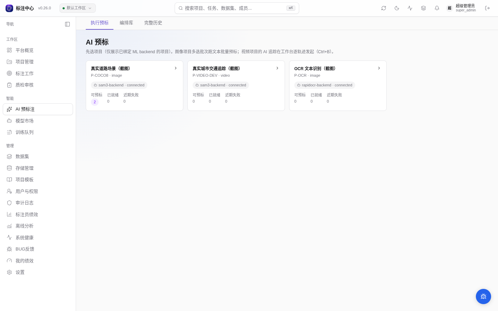
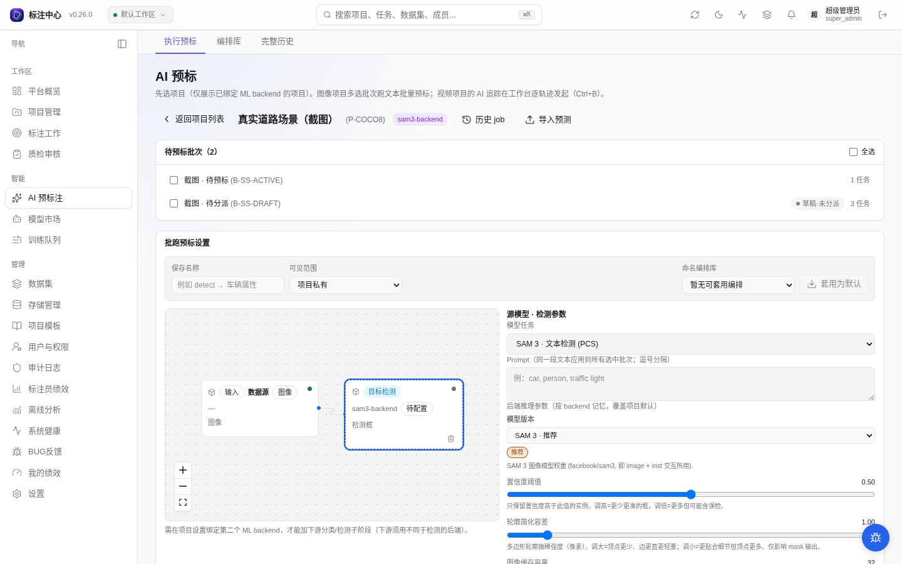
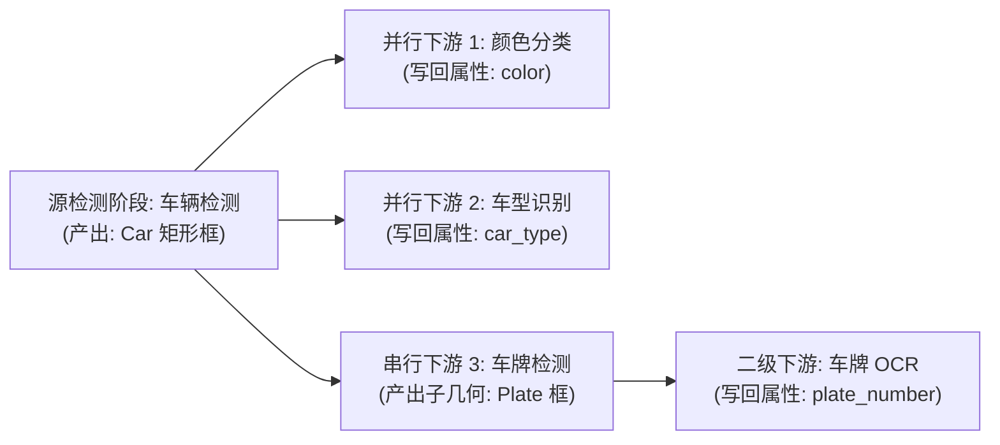
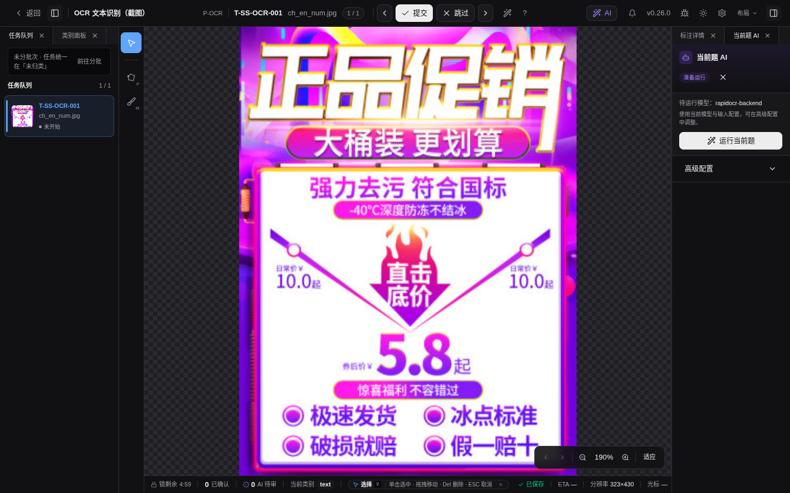
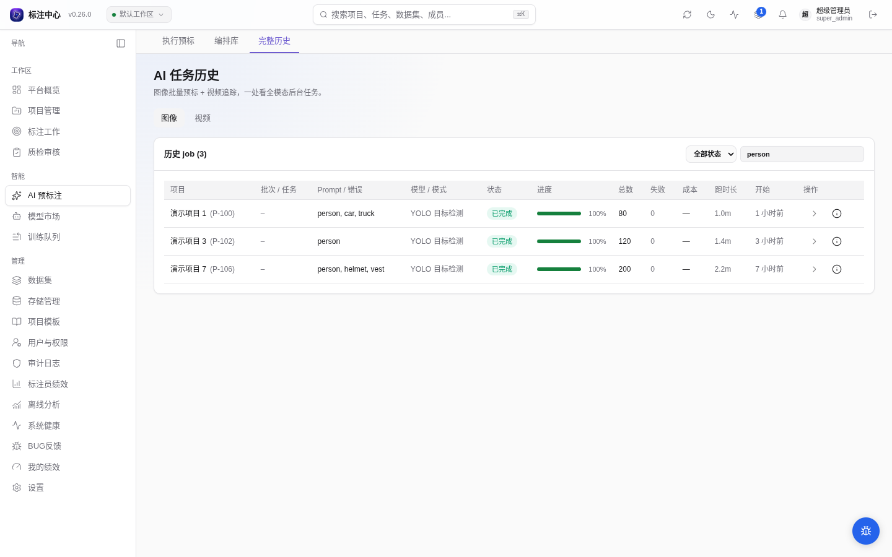

# AI 预标

面向项目管理员的自动化预标注指南。介绍如何使用机器学习模型对批量数据进行预先推理，生成候选标注供标注员接管，大幅降低人工拉框与属性标注成本。

> 适用角色：项目管理员、超级管理员 
> 核心机制：模型推理产物作为「候选预测（Prediction）」写入任务，标注员在工作台中审阅、修正或一键采纳。

## 入口与前置条件

- **入口路径**：主导航 →「**AI 预标**」（`/ai-pre`）。
- **页面导航**：标题下方可切换「执行预标」「编排库」「完整历史」，分别用于项目批跑、复用流程和查看任务记录。
- **前置条件**：
  1. **模型绑定**：项目在「项目设置 → ML 模型」中已启用至少一个健康的 ML Backend，并设定为主后端。
  2. **批次状态**：待预标批次处于 `active` 状态；或者批次仍为 `draft`（草稿）且尚未指派人员（支持“先跑 AI、再分派人工”模式）。
  3. **类别对应**：项目已配置类别名称或英文 Alias（供自然语言 Prompt 匹配召回）。

## 选择项目

进入 `/ai-pre` 后展示已接入推理服务的项目。可按项目名称、项目编号或推理服务名称搜索，并查看匹配数量；打开项目后返回列表会保留当前搜索。列表右侧可手动刷新，加载失败时可点击「重新加载」。

点击项目行进入配置，行末箭头提示此入口；项目名称、推理服务状态与批次统计在同一行展示，窄屏时分行排列。

每张项目卡片显示：

- 当前绑定的 ML Backend 健康状态；
- 可预标批次计数（含 `active` 批次与未分派人员的 `draft` 批次）、已就绪任务数与近期失败数；
- 最近后台运行时间戳。

没有接入服务的项目时，页面提示先在「项目设置 → AI 配置」中启用推理服务；搜索无匹配结果时，可点击「清除搜索」恢复完整列表。

打开项目后：

- **图像项目**：进入详情列表，勾选可执行批次（带「草稿·未分派」或「进行中」徽标）；
- **视频项目**：进入编排画布，按输入节点选择执行单位（「整段序列」跨帧追踪落轨迹，或「逐帧」独立运行图像检测）。

项目已人工发布的 YOLO11n 实例分割模型可在模型目录中用于图片整图预标，保留逐实例孔洞和断连部件；暂不用于裁剪阶段、交互提示或视频。模型预测需要人工接受、修正和审核后才能进入下一轮训练，具体步骤见[模型回流与默认预标](../online-learning/models)。

## 批量预标图像批次

1. **勾选批次**：在列表中选择一个或多个待执行批次。
2. **选择 ML Backend**：若项目启用了多个模型，可直接在下拉菜单中切换。
3. **输入 Prompt**：输入英文提示词（如 `person`、`car, truck`），多类别使用英文逗号 `,` 分隔。
4. **选择输出形态**：
   - `□ 框`：仅生成 Bbox，吞吐最快；
   - `○ 掩膜`：生成 Mask/Polygon，适合分割任务；
   - `⊕ 全部`：同一实例同时产出 Bbox 与 Polygon。
5. **设定幂等模式（已预标任务处理方式）**：
   - **跳过已预标**（默认推荐）：仅推理尚无预测的任务，避免重复计算与叠加；
   - **覆盖**：图片先推理，结果与权限检查通过后逐题替换已有 AI 预测；失败或在提交前取消时保留旧候选和已采纳 AI 标注，手工标注始终保留；
   - **追加**：在已有预测基础上叠加新模型结果。
6. **点击运行**：触发 Celery 后台作业，支持多批次串行或受并发保护的并行执行。

图片预标可在任务中心取消。后台刚接单、尚未读取原图时取消，作业也会结束为已取消。取消先于当前题结果提交时，该题新结果不会保存；已经提交的题目保留，尚未处理的题目跳过。每题的候选、元信息、覆盖清理及统计一起提交，不会在一次写入失败后留下半题结果。视频逐帧预标由独立流程处理，仍在派发前清理旧预测，不适用图片的逐题替换规则。

图片预标在提交时固定任务、模型配置和原图来源。整图与多阶段裁剪使用同一份完整核验的图片，不会因存储用途配置变化而改读另一个桶。单次批量请求最多实际选择1000题；图片须有已登记原件，单图不超过64MiB或3200万像素。超过范围时请拆分批次，原件未登记时先完成上传或导入核验。

失败列表和作业详情的重试会保留原模型与原图片，同时检查当前操作权限。历史失败若提示缺少可信原件或执行配置，请重新发起预标；直接重试不会改用当前同名文件。临时整图和裁剪副本由平台登记并清理，遇到存储删除失败时保留后台处理责任。

<DocsVideo
  src="/media/ai/preannotate.mp4"
  poster="/media/ai/preannotate-poster.webp"
  alt="选择项目和批次、运行 AI 预标、查看任务历史并返回工作台核对候选"
  caption="实操演示：选择批次 → 设定模型与 Prompt → 提交后台运行 → 工作台核对候选。"
/>

## 使用项目发布的检测模型

配置区的「项目检测模型」可选择检测任务的默认预标模型（界面项「项目当前发布」）或明确的已发布版本，也可保留当前后端配置。训练候选须先由负责人[加载、试用并发布](../online-learning/models)，成员不能通过普通推理绕过这一步。目录中的不可用项会给出原因，不会自动回退到另一个权重。

工作台「当前题 AI → 高级配置」共用这一选择器。标注员只能对自己当前可编辑的任务运行，仍受分派、批次管理员锁、他人编辑锁和终态限制；批量预标仍要求项目管理权限。

多阶段流程和失败重试使用的临时裁剪图会在单题处理结束后主动回收；删除失败或执行进程失联时，后台继续重试清理。无需手动管理这些临时图。原地引用图片支持批量预标和工作台“当前题 AI”的后台图片执行，包括单阶段及 geometry/ROI 多阶段流程。排队时固定任务与内容，执行节点核验原图后投递临时输入，各阶段共用同份图片；原 Key、来源或任务资格变化时不保存新候选。原地引用的失败项可从失败列表或作业详情重试，保留原模型和原图片，重新核验本次发起权限；已有可信内容溯源的普通几何候选可在工作台逐条或整组采纳，正常分派和激活后的任务仍可使用。旧候选或失败记录缺少内容证明时，需重新提交预标。引用图片也可在工作台使用交互式提示和原生掩码创建/精修，并在当前权限下核验采纳；模型设置中的预测测试同样核验原图。候选凭证与续点会话绑定原图内容。引用图片还支持[确定性批量掩码修复与局部 SAM 重跑](../workbench/mask-brush.md)，修复候选经当前权限与原图核验后可采纳，也可驳回。已发布且部署就绪的受控实例分割模型可对引用图片生成整图原生 Mask，失败项沿用原模型与原图重试，采纳时复核当前权限、原图及生成记录。项目须开启原生 Mask 编辑与 region 工具，部署须允许读取和创建 Mask；孔洞及断连区域保持原样。

**原生类别过滤**按所选模型索引选类；检测输出映射到项目类别后，下游的**父框类别过滤**使用项目名称。每个检测阶段有独立参数和过滤器，裁剪检测可配置 ROI 扩展。项目模型不能进入组织／公共管线模板。

受控实例分割只能作为图片整图源阶段。它的原生掩码可按真实像素外接框供后续阶段裁剪或生成框提示；父类过滤使用映射后的项目名称，属性写回原掩码，洞和分离部分保持不变。模型不能作为裁剪分割子阶段；旧配置或服务意外返回下游原生掩码时，会明确记录阶段失败，并按配置保留或丢弃父对象。原生候选在工作台按真实像素显示与拾取，支持采纳、驳回和失败加载重试；引用图片沿用整图源阶段的专用资格。

## 参数与模型变体

<DocsVideo
  src="/media/projects/ai-pre-variant-selector.mp4"
  poster="/media/projects/ai-pre-variant-selector-poster.webp"
  alt="切换 AI 预标变体的尺寸与速度精度选项并查看推荐标识"
  caption="变体选择器会联动显存、速度与精度信息，并在当前项目可用的选项上显示推荐标识。"
/>

参数面板来自当前 backend 的 `/setup.params`，常见字段包括 `box_threshold`、`text_threshold`、`score_threshold` 等。选择值按「用户 + backend」记忆，下次进入同一 backend 会自动恢复。

如果 backend 上报 `supported_variants`，页面会显示 SAM / DINO 变体选择器，选项带显存估算、速度/精度档位和推荐标识。触发预标时，模型规格通过 `model_variants` 发送，推理阈值保留在 `params`。目录选择的是具体模型规格，不另显示一套可相互覆盖的变体选择。

## 多阶段预标（检测 → 分类 → 写属性）

当单个检测器只能定位物体，而业务需要进一步判断细分属性（如“先检出车辆，再识别颜色与车型”）时，可在「批跑预标设置」中构建 **多阶段流水线（Pipeline DAG）**。

### 画布交互与编排规则

编排区采用左右双列布局：左侧为可视化的 **DAG 节点拓扑图**，右侧为 **当前选中节点的配置面板**。

- **添加下游阶段**：将鼠标移至产出几何的父节点（源检测或子检测节点），点击节点上的 **`+`** 按钮（或从右侧连接圆点向空白处拖出连线），即新建下游阶段。
- **调整连接关系**：拖动连线可在合法父节点之间重新挂载；非法连线（如成环、跨度超 3 层、父节点不产几何）将被系统实时拦截提示。
- **配置属性写回**：
  - **父框类别过滤**：多选指定生效类别（如仅对 `Car` 框运行颜色分类，其他类别直接跳过）。
  - **写回属性键**：勾选本阶段负责写入的属性字段；若多个并行阶段写入同一属性键，配置区将红字预警拦截，避免数据覆写。
  - **ROI 扩展 Pad**：针对框边缘微调裁剪边界（0–0.5），为分类器提供适度上下文。
- **纯分类模型自动优化**：若下游模型支持纯分类（`task=classification`），系统直接裁剪 ROI 小图送检，无需重复运行检测器。

::: warning 编排约束与前置条件

1. **兼容模型**：项目须启用能接收裁剪图或几何提示的下游模型。同一 YOLO 实例可执行多个检测阶段，无需为了加阶段重复注册后端。
2. **最大嵌套深度**：流水线支持最深 3 层拓扑（`源检测 → 子物体检测 → 叶子分类`），第 3 层叶子节点不再允许派生子节点。
   :::

### 嵌套阶段（在子物体上继续跑）

流水线不止「检测 → 分类」两层，最深可串到**三层**：当一个阶段**产出新几何**（框→分割出 mask，或在父框 crop 上检测出子物体），它就能再作为下游阶段的父，对它产出的每个框继续跑。

- **谁能当父**：只有产几何的阶段（选中**框→分割**或**检测**类下游模型）的节点才有出向连接点、才能加子；纯分类阶段（只写属性）是叶子，节点上没有 **+**、也连不出子。链路最深 3 层（源检测 + 两层下游），到第 3 层的节点不再提供加子。
- **加子阶段**：在产几何的节点上点 **+**（或拖其连接点到空白），新节点出现在它右侧一列，表示「对该阶段产出的每个框」运行。整棵树就是画布本身（`检测(源) → 子 → 孙`），层级与并行关系所见即所得。
- **典型链路**：`person 检测 → 在每个 person 框 crop 上检测 hat → 给每个 hat 框分类 color`。hat 检测器在裁出的 person 小图上跑，检出的 hat 框**自动回映回原图坐标**并作为新框出现；color 分类阶段再裁 hat 框跑分类。
- **子物体命名**：给分类阶段填「子物体命名」（如 `hat`），它写回的属性键会加前缀（`color` → `hat_color`），避免不同子物体的同名属性互相覆盖；留空 = 写原始键。
- **可达性**：产几何的子阶段，其模型必须能吃「框提示」或「裁剪图」之一（见模型市场卡片「可接受输入」）；选了不兼容的模型，运行时会被拒绝并提示原因。

### 保存为项目编排

配好流水线（单阶段或多阶段）后，点设置区底部的 **保存为项目编排**，把当前这套配置存到项目（一项目一条「当前编排」）。保存后按钮旁出现「已保存编排 · N 阶段」标识，并多出 **清除** 按钮。

存了项目编排后，标注工作台“单图 AI”高级配置中会多出一个 **运行当前图片（项目编排 · N 阶段）** 入口，对正在标的这一张图按该编排跑完整流水线；当前题执行与候选审阅见[单图 AI 与二次推理](../ai/current-task-inference)。无需回到本页、无需选批次。本页是**项目内**定义和保存编排的主要入口，工作台只执行、不编辑编排；重新保存即覆盖，点“清除”即移除。若想把一套编排跨项目复用，可在[**全局编排库**](./pipeline-library)（`/ai-pre/pipelines`）里维护公共 / 组织命名模板，再套用到具体项目；项目私有副本仍在项目内维护。

## OCR / 文档版面预标

OCR 与文档版面预标走和几何检测（YOLO）、文本检测（gsam2/sam3）**完全相同的 model-first 配置**：「模型任务」下拉列出 backend 自报的所有可批量预标的模型，OCR 端到端 / 检测模型与几何检测器并列出现，按选中模型自动决定要不要文本 prompt、要不要变体面板。

<DocsVideo
  src="/media/ai/ocr-current-task.mp4"
  poster="/media/ai/ocr-current-task-poster.webp"
  alt="真实 OCR 图片在工作台运行当前题推理并生成文本候选"
/>

<noscript></noscript>

同一能力也可从工作台「单图 AI」面板对正在标注的图片直接运行；项目必须先绑定支持 OCR 输出契约的 ML Backend。

<!-- 历史：曾有 OCR / 文档版面专属的「任务类型」tab 层，since v0.20.5 取消并与几何 / 文本检测的 model-first 配置对齐。-->

- **选 OCR 端到端模型**（默认值 `ocr-e2e`）：整图直接出文本 polygon + `text` / `orientation` / `language` 属性，不需要文本 prompt；变体面板按模型自报的轴展开 PP-OCRv5/v6 × 尺寸档 × 通用(中英)/英文，调档实际下发后端。
- **选纯检测模型**（如 `ocr-det`）：只出文本 polygon 框、不写文本属性，适合先批量出框、再走多阶段下游识别。
- **识别文本去向**：识别出的文本写入 annotation 属性。**项目需先在「类别与属性」配置 `text` 属性，否则文本不会入库** —— 面板给出静态提示，并提供「从 ML Backend 预填配置」入口一键导入 backend 自报的属性 schema。

### OCR 识别原子作下游 stage（跨 backend）

OCR 识别原子（`task=ocr`、`composition=atom`、吃 `crop` 输入,如 rapidocr 的 `ocr-rec`）可在多阶段编排里作下游识别阶段:**上游任意 backend 出框 → 裁 crop → 下游 rec 认字并写回 `text` / `orientation` / `language`**。下游卡角色徽标显「识别」,选中识别原子时收起与之冗余的整图「模型任务」下拉。典型链路:`YOLO 检测车牌框 → rapidocr ocr-rec 认字写回 text`。

## Alias chips

项目类别配置英文 alias 后，prompt 输入框附近会出现可点击 chip。点击 chip 会把 alias 填入 prompt；高频 alias 会排在前面，并显示历史预测次数。alias 保存时会自动小写化、折叠空格和逗号。

如果没有看到 chip，进入项目设置的「类别与属性」补充英文 alias。

## 进度与取消

批量预标会创建后台任务，并在 `/ai-pre/jobs`、右上角后台任务铃和通知中心中显示进度。任务铃会把预标、预测导入和导出放在同一个面板中：运行中的预标与导入可直接取消，已完成导出会显示格式、ZIP 文件数与大小，并提供下载入口。不支持取消的任务类型不会显示取消按钮；任务铃的本地隐藏不影响 Jobs 页面中的完整历史。

点击任务条目可查看该次运行的项目或数据集、当前阶段、结果计数和失败原因。离开页面后，可以在任务铃中点「加载更早任务」找回历史结果。仅支持恢复的批量预标失败项会显示重试入口；导出链接过期时，详情会引导返回项目列表重新导出。

<DocsVideo
  src="/media/jobs/jobs-bell-active.mp4"
  poster="/media/jobs/jobs-bell-active-poster.webp"
  alt="后台任务铃同时展示进行中的批量预标和预测导入，以及已完成双格式导出的 ZIP 摘要与下载入口"
/>

取消、部分结果、失败项重试与升级给运维的边界统一见[AI 任务与失败恢复](../workflows/failed-prediction-recovery)。

历史队列的搜索或排序变化会回到首页，结果缩减后页码会自动落回有效范围。已明确勾选的条目跨搜索和翻页保留，批量操作前可核对显示的已选数量。

## 人工接管

批量预标完成后，已激活的批次会进入 `pre_annotated` 状态。项目管理员或标注员可以点击「打开标注工作台」进入对应批次。

如果预标的是未分派人员的 `draft` 批次，批次会保持 `draft`：AI 结果作为候选预测挂在任务上保留，批次不会自动激活或分派任何人。在项目批次页签正常分派标注员与质检员并激活批次（`draft` → `active`）后，标注员在工作台即可看到这批候选。

工作台 Topbar 会显示「AI 预标已就绪」徽章；右侧 AI 面板列出候选预测，标注员逐条接受、修改或拒绝。当批次内第一个任务进入 `in_progress` 状态时，批次自动转为 `annotating`（由后端 `check_auto_transitions` 事件驱动，不需要手动触发）。

## 重置已预标批次

已就绪批次可以批量重激活或重置到草稿：

- **重激活**：清理预测并把批次退回 `active`；
- **重置到草稿**：清理预测、失败预测、相关后台任务和 task lock，让批次回到 `draft`。

这类操作需要输入原因并写入审计日志。

## 导入外部预测

除了通过 ML Backend 批量预标，也可以把客户自训模型的推理结果以 AAP JSON / COCO Detection / YOLO zip 形式直接导入为候选预测。详见 [导入 / 导出外部预测](../datasets/prediction-import-export.md)。

## 3D 点云项目

3D 点云（lidar）项目暂不支持 AI 预标。在 `/ai-pre` 详情面板中，lidar 项目会显示「点云（lidar）项目暂不支持 AI 预标」提示，运行按钮不可用。

## 常见问题

- **跑预标按钮灰**：检查项目是否已启用 backend 并设了主后端、批次是否可预标（`active` 批次，或未分派人员的 `draft` 批次）、以及当前 backend 是否为文本预标模式（文本模式下 prompt 不能为空；几何 backend 或 OCR/文档版面模式不需要文本 prompt）。
- **某些 task 失败**：打开 `/ai-pre/jobs` 查看失败原因，可在 job 详情里重试可恢复项。
- **跑完批次状态没变**：刷新页面；偶发 WebSocket 延迟可能让前端进度滞后，后端状态通常已经更新。
- **视频项目整段序列 vs 逐帧怎么选**：整段序列用 tracker 跨帧连成轨迹（`VideoTrackGeometry`），适合运动目标持续跟踪；逐帧让图像检测在每帧独立跑、每帧落框（`VideoBboxGeometry`），适合逐帧全量检测、帧间不要求同一目标连贯。工作台内选中单条轨迹发起的 `Ctrl+B` 追踪是另一条交互式路径，与批量编排互不影响。
