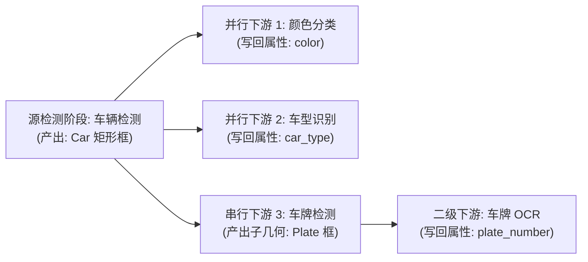

# AI 预标

面向项目管理员的自动化预标注指南。介绍如何使用机器学习模型对批量数据进行预先推理，生成候选标注供标注员接管，大幅降低人工拉框与属性标注成本。

> 适用角色：项目管理员、超级管理员 
> 核心机制：模型推理产物作为「候选预测（Prediction）」写入任务，标注员在工作台中审阅、修正或一键采纳。

## 入口与前置条件

- **入口路径**：主导航 →「**AI 预标**」（`/ai-pre`）。
- **前置条件**：
  1. **模型绑定**：项目在「项目设置 → ML 模型」中已启用至少一个健康的 ML Backend，并设定为主后端。
  2. **批次状态**：待预标批次处于 `active` 状态；或者批次仍为 `draft`（草稿）且尚未指派人员（支持“先跑 AI、再分派人工”模式）。
  3. **类别对应**：项目已配置类别名称或英文 Alias（供自然语言 Prompt 匹配召回）。

## 选择项目

进入 `/ai-pre` 后展示项目卡片网格。项目管理员仅可查看其负责项目的卡片、可执行批次与运行历史；超级管理员可见全平台已绑定 backend 的项目。每张卡片直观显示：

- 当前绑定的 ML Backend 健康状态（项目模型预热会验证目标 Backend 已启用于该项目）；
- 可预标批次计数（含 `active` 批次与未分派人员的 `draft` 批次）、已就绪任务数与近期失败数；
- 最近后台运行时间戳。

打开项目后：

- **图像项目**：进入详情列表，勾选可执行批次（带「草稿·未分派」或「进行中」徽标）；
- **视频项目**：进入编排画布，按输入节点选择执行单位（「整段序列」跨帧追踪落轨迹，或「逐帧」独立运行图像检测）。

逐帧检测目前只支持一个模型阶段；带下游阶段的逐帧请求会提示不支持，需要先简化编排。

逐帧检测保存结果时若遇写入繁忙，会保留已推理的结果并自动等待重试，无需重新推理；等待中的帧不会仅因锁竞争计为失败，作业会等保存完成后再收尾。若期间任务已改派、进入人工处理或权限变化，旧结果会被拒绝。取消请求会在下一次段执行或恢复时生效，已保存结果保留，作业最终显示为已取消。

逐帧批量预标会固定原视频及帧计划，准备完成后才开始覆盖。原视频准备失败的任务保留旧预测；来源变更或保留副本缺失时明确停止，不改用当前视频。单帧模型失败会登记可重试项，恢复时仍使用原视频的同一帧。

## 批量预标图像批次

1. **勾选批次**：在列表中选择一个或多个待执行批次。
2. **选择 ML Backend**：若项目启用了多个模型，可直接在下拉菜单中切换。
3. **输入 Prompt**：输入英文提示词（如 `person`、`car, truck`），多类别使用英文逗号 `,` 分隔。
4. **选择输出形态**：
   - `□ 框`：仅生成 Bbox，吞吐最快；
   - `○ 掩膜`：生成 Mask/Polygon，适合分割任务；
   - `⊕ 全部`：同一实例同时产出 Bbox 与 Polygon。
5. **设定幂等模式（已预标任务处理方式）**：
   - **跳过已预标**（默认推荐）：仅推理尚无预测的任务，避免重复计算与叠加；
   - **覆盖**：清除已有 AI 预测后重新推理（保留人工标注）；
   - **追加**：在已有预测基础上叠加新模型结果。
6. **点击运行**：创建可立即查询的后台作业，支持多批次串行或受并发保护的并行执行。工作进程尚未启动时可在任务历史中查看等待状态；派发失败会保留尚未启动作业的失败记录，已开始的作业继续报告执行结果。

普通图片批量运行（包括 Scene 模式中按单张任务执行的图片）会在提交时固定任务与来源，排队后新增的任务留给下一次运行。后台先准备原图，再开始模型推理；同一请求重试继续使用原清单。准备失败或来源已变化的图片会明确报错，不用新图片替代原输入，也不会为这些失败项先清空旧预测。

普通批量结果会先保存检查点。保存时写入繁忙或存储暂不可用，作业会等待续写；工作进程重启后继续使用已保存的结果，已完成的题目、覆盖清理和费用不会重复执行。无需为等待中的作业重新发起一次运行。取消会停止下一道题，当前已开始处理的题目可能先完成保存；此前已提交的候选会保留。

启用持久派发恢复的部署会在受理提交时保存完整后台请求及执行身份。若进程在提交后、发布或回绑前中断，后台可继续交接原作业，无需再新建一次；逐帧恢复也复用原分段身份，重复回执不会使作业提前完成。该恢复不重启已明确失败或取消的作业，也不表示取消请求已经停止了所有后台执行。

任务资格也会在结果保存时复核：推理期间账号被停用、项目管理权限变化、任务已送审/改派、批次被锁定或有人开始编辑，都可能使本条迟到结果被拒绝。先刷新任务与批次状态，恢复合适的权限和编辑范围后再重新运行；不应反复提交旧请求来绕过冲突。取消意图仍等待后台在处理边界确认，不会撤回此前已提交的候选。

<DocsVideo
  src="/media/ai/preannotate.mp4"
  poster="/media/ai/preannotate-poster.webp"
  alt="选择项目和批次、运行 AI 预标、查看任务历史并返回工作台核对候选"
  caption="实操演示：选择批次 → 设定模型与 Prompt → 提交后台运行 → 工作台核对候选。"
/>

## 参数与模型变体

<DocsVideo
  src="/media/projects/ai-pre-variant-selector.mp4"
  poster="/media/projects/ai-pre-variant-selector-poster.webp"
  alt="切换 AI 预标变体的尺寸与速度精度选项并查看推荐标识"
  caption="变体选择器会联动显存、速度与精度信息，并在当前项目可用的选项上显示推荐标识。"
/>

参数面板来自当前 backend 的 `/setup.params`，常见字段包括 `box_threshold`、`text_threshold`、`score_threshold` 等。选择值按「用户 + backend」记忆，下次进入同一 backend 会自动恢复。

如果 backend 上报 `supported_variants`，页面会显示 SAM / DINO 变体选择器，选项带显存估算、速度/精度档位和推荐标识。触发预标时，这些值会并入请求 `params` 并透传给 ML Backend。

## 多阶段预标（检测 → 分类 → 写属性）

当单个检测器只能定位物体，而业务需要进一步判断细分属性（如“先检出车辆，再识别颜色与车型”）时，可在「批跑预标设置」中构建 **多阶段流水线（Pipeline DAG）**。

### 画布交互与编排规则

编排区采用左右双列布局：左侧为可视化的 **DAG 节点拓扑图**，右侧为 **当前选中节点的配置面板**。

- **添加下游阶段**：将鼠标移至产出几何的父节点（源检测或子检测节点），点击节点上的 **`+`** 按钮（或从右侧连接圆点向空白处拖出连线），即新建下游阶段。
- **调整连接关系**：拖动连线可在合法父节点之间重新挂载；非法连线（如成环、跨度超 3 层、父节点不产几何）将被系统实时拦截提示。
- **配置属性写回**：
  - **父框类别过滤**：多选指定生效类别（如仅对 `Car` 框运行颜色分类，其他类别直接跳过）。
  - **写回属性键**：勾选本阶段负责写入的属性字段；若多个并行阶段写入同一属性键，配置区将红字预警拦截，避免数据覆写。
  - **ROI 扩展 Pad**：针对框边缘微调裁剪边界（0–0.5），为分类器提供适度上下文。
- **纯分类模型自动优化**：若下游模型支持纯分类（`task=classification`），系统直接裁剪 ROI 小图送检，无需重复运行检测器。

::: warning 编排约束与前置条件

1. **多后端绑定**：编排检测与分类混合流水线前，项目必须至少绑定两个不同能力的 ML Backend。
2. **最大嵌套深度**：流水线支持最深 3 层拓扑（`源检测 → 子物体检测 → 叶子分类`），第 3 层叶子节点不再允许派生子节点。
   :::

### 嵌套阶段（在子物体上继续跑）

流水线不止「检测 → 分类」两层，最深可串到**三层**：当一个阶段**产出新几何**（框→分割出 mask，或在父框 crop 上检测出子物体），它就能再作为下游阶段的父，对它产出的每个框继续跑。

- **谁能当父**：只有产几何的阶段（选中**框→分割**或**检测**类下游模型）的节点才有出向连接点、才能加子；纯分类阶段（只写属性）是叶子，节点上没有 **+**、也连不出子。链路最深 3 层（源检测 + 两层下游），到第 3 层的节点不再提供加子。
- **加子阶段**：在产几何的节点上点 **+**（或拖其连接点到空白），新节点出现在它右侧一列，表示「对该阶段产出的每个框」运行。整棵树就是画布本身（`检测(源) → 子 → 孙`），层级与并行关系所见即所得。
- **典型链路**：`person 检测 → 在每个 person 框 crop 上检测 hat → 给每个 hat 框分类 color`。hat 检测器在裁出的 person 小图上跑，检出的 hat 框**自动回映回原图坐标**并作为新框出现；color 分类阶段再裁 hat 框跑分类。
- **子物体命名**：给分类阶段填「子物体命名」（如 `hat`），它写回的属性键会加前缀（`color` → `hat_color`），避免不同子物体的同名属性互相覆盖；留空 = 写原始键。
- **可达性**：产几何的子阶段，其模型必须能吃「框提示」或「裁剪图」之一（见模型市场卡片「可接受输入」）；选了不兼容的模型，运行时会被拒绝并提示原因。

### 保存为项目编排

配好流水线（单阶段或多阶段）后，点设置区底部的 **保存为项目编排**，把当前这套配置存到项目（一项目一条「当前编排」）。保存后按钮旁出现「已保存编排 · N 阶段」标识，并多出 **清除** 按钮。

存了项目编排后，标注工作台“当前题 AI”高级配置中会多出一个 **运行当前题（项目编排 · N 阶段）** 入口，对正在标的这一张图按该编排跑完整流水线；当前题执行与候选审阅见[当前题 AI 与二次推理](../ai/current-task-inference)。无需回到本页、无需选批次。本页是**项目内**定义和保存编排的主要入口，工作台只执行、不编辑编排；重新保存即覆盖，点“清除”即移除。若想把一套编排跨项目复用，可在[**全局编排库**](./pipeline-library)（`/ai-pre/pipelines`）里维护公共 / 组织命名模板，再套用到具体项目；项目私有副本仍在项目内维护。

## OCR / 文档版面预标

OCR 与文档版面预标走和几何检测（YOLO）、文本检测（gsam2/sam3）**完全相同的 model-first 配置**：「模型任务」下拉列出 backend 自报的所有可批量预标的模型，OCR 端到端 / 检测模型与几何检测器并列出现，按选中模型自动决定要不要文本 prompt、要不要变体面板。

<DocsVideo
  src="/media/ai/ocr-current-task.mp4"
  poster="/media/ai/ocr-current-task-poster.webp"
  alt="真实 OCR 图片在工作台运行当前题推理并生成文本候选"
/>

<noscript></noscript>

同一能力也可从工作台「当前题 AI」面板对正在标注的图片直接运行；项目必须先绑定支持 OCR 输出契约的 ML Backend。

<!-- 历史：曾有 OCR / 文档版面专属的「任务类型」tab 层，since v0.20.5 取消并与几何 / 文本检测的 model-first 配置对齐。-->

- **选 OCR 端到端模型**（默认值 `ocr-e2e`）：整图直接出文本 polygon + `text` / `orientation` / `language` 属性，不需要文本 prompt；变体面板按模型自报的轴展开 PP-OCRv5/v6 × 尺寸档 × 通用(中英)/英文，调档实际下发后端。
- **选纯检测模型**（如 `ocr-det`）：只出文本 polygon 框、不写文本属性，适合先批量出框、再走多阶段下游识别。
- **识别文本去向**：识别出的文本写入 annotation 属性。**项目需先在「类别与属性」配置 `text` 属性，否则文本不会入库** —— 面板给出静态提示，并提供「从 ML Backend 预填配置」入口一键导入 backend 自报的属性 schema。

### OCR 识别原子作下游 stage（跨 backend）

OCR 识别原子（`task=ocr`、`composition=atom`、吃 `crop` 输入,如 rapidocr 的 `ocr-rec`）可在多阶段编排里作下游识别阶段:**上游任意 backend 出框 → 裁 crop → 下游 rec 认字并写回 `text` / `orientation` / `language`**。下游卡角色徽标显「识别」,选中识别原子时收起与之冗余的整图「模型任务」下拉。典型链路:`YOLO 检测车牌框 → rapidocr ocr-rec 认字写回 text`。

## Alias chips

项目类别配置英文 alias 后，prompt 输入框附近会出现可点击 chip。点击 chip 会把 alias 填入 prompt；高频 alias 会排在前面，并显示历史预测次数。alias 保存时会自动小写化、折叠空格和逗号。

如果没有看到 chip，进入项目设置的「类别与属性」补充英文 alias。

## 进度与取消

批量预标会创建后台任务，并在 `/ai-pre/jobs`、右上角后台任务铃和通知中心中显示进度。任务铃会把预标、预测导入和导出放在同一个面板中：运行中的预标与导入可直接取消，已完成导出会显示格式、ZIP 文件数与大小，并提供下载入口。不支持取消的任务类型不会显示取消按钮；任务铃的本地隐藏不影响 Jobs 页面中的完整历史。

点击任务条目可查看该次运行的项目或数据集、当前阶段、结果计数和失败原因。离开页面后，可以在任务铃中点「加载更早任务」找回历史结果。仅支持恢复的批量预标失败项会显示重试入口；导出链接过期时，详情会引导返回项目列表重新导出。

<DocsVideo
  src="/media/jobs/jobs-bell-active.mp4"
  poster="/media/jobs/jobs-bell-active-poster.webp"
  alt="后台任务铃同时展示进行中的批量预标和预测导入，以及已完成双格式导出的 ZIP 摘要与下载入口"
/>

取消、部分结果、失败项重试与升级给运维的边界统一见[AI 任务与失败恢复](../workflows/failed-prediction-recovery)。

历史队列的搜索或排序变化会回到首页，结果缩减后页码会自动落回有效范围。已明确勾选的条目跨搜索和翻页保留，批量操作前可核对显示的已选数量。

## 人工接管

批量预标完成后，已激活的批次会进入 `pre_annotated` 状态。项目管理员或标注员可以点击「打开标注工作台」进入对应批次。

如果预标的是未分派人员的 `draft` 批次，批次会保持 `draft`：AI 结果作为候选预测挂在任务上保留，批次不会自动激活或分派任何人。在项目批次页签正常分派标注员与质检员并激活批次（`draft` → `active`）后，标注员在工作台即可看到这批候选。

工作台 Topbar 会显示「AI 预标已就绪」徽章；右侧 AI 面板列出候选预测，标注员逐条接受、修改或拒绝。当批次内第一个任务进入 `in_progress` 状态时，批次自动转为 `annotating`（由后端 `check_auto_transitions` 事件驱动，不需要手动触发）。

## 重置已预标批次

已就绪批次可以批量重激活或重置到草稿：

- **重激活**：清理候选预测并把已就绪批次退回 `active`；保留任务进度、人工标注、已采纳 AI 标注及编辑锁。
- **重置到草稿**：清理预测、失败预测、相关预标后台任务和编辑锁，让任务回到待标、批次回到 `draft`。人工标注保留，已采纳 AI 标注停用，计数按剩余有效标注重算。

这类操作需要输入原因并写入审计日志。项目管理员只能清理当前负责的项目；项目转移或账号变更与操作冲突时，等待任一操作完成后再重试，已转移后的旧负责人不能继续清理。数据库写入使事务失败或提交失败时，本次清空整体回滚。

## 导入外部预测

除了通过 ML Backend 批量预标，也可以把客户自训模型的推理结果以 AAP JSON / COCO Detection / YOLO zip 形式直接导入为候选预测。详见 [导入 / 导出外部预测](../datasets/prediction-import-export.md)。

## 3D 点云项目

3D 点云（lidar）项目暂不支持 AI 预标。在 `/ai-pre` 详情面板中，lidar 项目会显示「点云（lidar）项目暂不支持 AI 预标」提示，运行按钮不可用。

## 常见问题

- **跑预标按钮灰**：检查项目是否已启用 backend 并设了主后端、批次是否可预标（`active` 批次，或未分派人员的 `draft` 批次）、以及当前 backend 是否为文本预标模式（文本模式下 prompt 不能为空；几何 backend 或 OCR/文档版面模式不需要文本 prompt）。
- **某些 task 失败**：打开 `/ai-pre/jobs` 查看失败原因，可在 job 详情里重试可恢复项。
- **素材变化后旧结果未写入**：推理期间更改任务来源路径、文件类型或关联素材，会拒绝换源前的结果；路径随后改回原值也一样。确认当前素材后重新发起预标。
- **跑完批次状态没变**：刷新页面；偶发 WebSocket 延迟可能让前端进度滞后，后端状态通常已经更新。
- **视频项目整段序列 vs 逐帧怎么选**：整段序列用 tracker 跨帧连成轨迹（`VideoTrackGeometry`），适合运动目标持续跟踪；逐帧让图像检测在每帧独立跑、每帧落框（`VideoBboxGeometry`），适合逐帧全量检测、帧间不要求同一目标连贯。工作台内选中单条轨迹发起的 `Ctrl+B` 追踪是另一条交互式路径，与批量编排互不影响。
