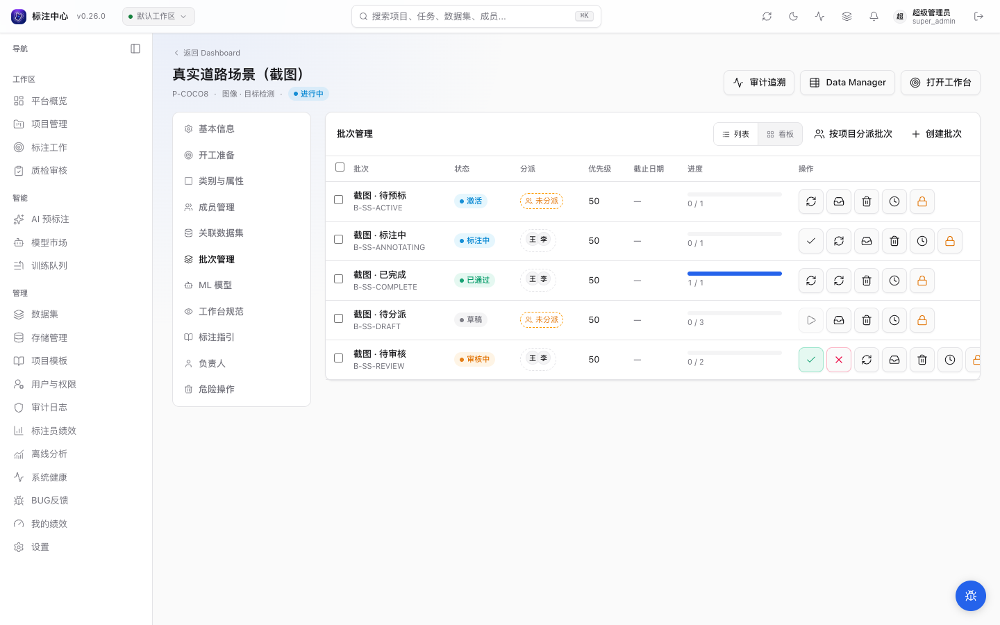

# 批次与分配

随机／顺序切批的份数不能超过当前未归类或默认批次中的可切任务数，超出会直接拒绝。项目和批次导出都要求导出能力，普通标注员与观察者不能仅凭项目可见性下载整批标注。脚本分派的预览版本、部分结果、送审与审计规则见 [项目、批次与数据运维](../../dev/sdk/project-workflows)。

批次（Batch）是项目内一组任务的业务分组，也是分配、推进、审核和归档的基本单位。

常见用途：

- 按数据来源分批：不同供应商、采集批次、数据域
- 按运营节奏分批：周批、月批、活动批
- 按难度或人员分批：新手批、高优先级批、复审批

## 创建批次与分包

关联数据集后，尚未划分到批次的任务称为**未归类任务**，会在批次页顶部以横带提示。**非 scene 模式项目**把未归类任务分到批次有三种入口：

- 批次页右上角 **创建批次**（走「创建批次」对话框）
- 未归类任务横带上的 **去分包**（走「创建批次」对话框）
- 未归类任务横带上的 **一键全量建包**：跳过对话框，直接把全部未归类任务分到一个新批次。大数据集导入后可用它快速建包。

> scene 模式项目分包只能按 scene：上述随机/顺序入口会统一替换为单个 **按 scene 建包** 按钮（横带与右上角「创建批次」均直接按 scene 分包，不弹对话框）。详见下方 [按 scene 分包](#按-scene-分包)。

> 横带上的 **浏览未归类** 可分页查看当前未归类任务清单。
>
> 关联数据集时，条目数超过当前同步阈值才转后台建任务，界面会显示进度条；建完后未归类任务才出现在横带。阈值默认 2000，超级管理员可在系统设置中调整；等于阈值仍同步，设为 0 时所有非空数据集都转后台。

前两个入口的对话框参数：

对话框参数：

- **批次数量**：把未归类任务切分到几个批次（1–100）。
  - 填 **1** 时，等于「把全部未归类任务分到一个新批次」，此时第二个输入是该批次的**完整名称**。
  - 填 **≥2** 时，按数量平均切分，第二个输入是各批次的**名称前缀**（生成 `前缀 1`、`前缀 2` …）。
- **顺序 / 打乱**：
  - **顺序切分**：按任务导入顺序分配，不打乱（结果稳定、可预期）。
  - **打乱切分**：随机打乱后再切分。
- **优先级**：新批次的优先级（0–100）。

切分只作用于**未归类任务**，不会动已经归属其它批次的任务。新建批次处于「草稿」，通常需分派标注员并激活后开展工作。

> 注意：批次创建后目前没有「往已有批次追加任务」的入口；要把未归类任务放进批次，请通过上面的切分流程（可一次只切 1 个批次）。

### 按 scene 分包

scene 模式项目在关联数据集时（经新建项目向导）会**自动**按 scene 分包，无需手动操作。该策略会把同一个 scene 的所有帧放进同一个批次，避免连续帧被分给不同标注员或进入不同审核批次。

若之后又出现未归类任务（例如删除批次后任务回归、或事后追加 scene 数据集），横带与右上角「创建批次」会提供唯一入口 **按 scene 建包**，按同一策略一键重分；scene 模式下不提供随机/顺序切分。

按 scene 分包的结果：

- 一个 scene 生成一个批次。
- 批次内任务按 `frame_index` 升序排列。
- 任务的 `sequence_order` 会写成对应帧号，便于顺序派题。
- 没有 scene 信息的未归类任务会进入单独的“无 scene”批次，便于管理员发现并补数据。

如果项目不是 scene 模式，通常继续使用顺序/随机切分。

## 批次状态机

列表的「操作」列默认只显示图标，将光标移到某个按钮上时会展开该按钮的名称，移开后收起。使用 Tab 键聚焦按钮也能显示名称；触屏设备直接显示名称。停留在按钮上可查看详细提示，包括按钮不可用的原因。

批次状态机如下：

<ExcalidrawDiagram
  src="/diagrams/shared/state-machines/batch-lifecycle.svg"
  alt="批次从草稿激活，可经 AI 预标或人工标注进入审核，审核后通过、退回或归档，并支持项目负责人恢复"
  caption="批次状态：自动推进、人工操作与项目负责人恢复路径"
/>

说明：

- `active → pre_annotated` 由 AI 批量预标成功结束后自动触发
- `active → annotating`、`pre_annotated → annotating` 有自动路径，不需要管理员手工点状态
- `annotating → reviewing` 既可能由“全量完成”自动触发，也可能由标注员主动整批送审触发；整批送审会先把批次内所有 `pending / in_progress` 任务提交质检，再推进批次状态
- 项目负责人可锁定或解锁批次。锁定是软暂停：阻止调度器派出新任务并暂停自动状态推进，但不会撤销已有任务和任务锁，也不会把已有任务变成只读。
- 「重置到草稿」是正常迁移图之外的管理操作；它会重置任务状态、释放任务锁并清除 AI 预标成果，详见 [重置到草稿](#重置到草稿)。

## 状态语义

| 状态            | 含义                                               | 典型进入方式                                                                         | 下一步                                                                             |
| --------------- | -------------------------------------------------- | ------------------------------------------------------------------------------------ | ---------------------------------------------------------------------------------- |
| `draft`         | 批次已建好，但还未正式投入生产                     | 新建批次、`reset → draft`                                                            | owner 激活                                                                         |
| `active`        | 已准备好，可开始分派或开始标注，但尚未进入“进行中” | `draft → active`、`archived → active`、`rejected → active`、`pre_annotated → active` | 标注员开始后自动转 `annotating`，或 owner 归档，或 AI 预标完成后转 `pre_annotated` |
| `pre_annotated` | AI 预标已跑完，等待人工接管                        | AI 文本批量预标完成                                                                  | 标注员接管后自动转 `annotating`，owner 也可丢弃预标结果退回 `active`               |
| `annotating`    | 批次处于标注进行中                                 | 任一 task 进入 `in_progress` 或 `rejected`                                           | 全部任务完成后进 `reviewing`，或 owner 归档                                        |
| `reviewing`     | 审核员开始整批复核                                 | 标注员送审或系统自动推进                                                             | reviewer 通过到 `approved`，退回到 `rejected`                                      |
| `approved`      | 审核完成，业务上通过                               | reviewer approve                                                                     | owner 可归档，也可重开审核                                                         |
| `rejected`      | 审核退回，批次需要返工                             | reviewer reject                                                                      | 标注员重做，或 owner 直接重新激活 / 重开审核 / 归档                                |
| `archived`      | 批次结束，不再作为工作中的生产批次使用             | owner archive                                                                        | owner 可撤销归档回 `active`                                                        |

## 自动迁移与手工迁移

### 自动迁移

以下状态变化由系统自动驱动：

- `active → pre_annotated`
  触发条件：AI 批量预标成功结束且不是全量失败
- `active → annotating`
  触发条件：批次内有任务进入 `in_progress` 或 `rejected`
- `pre_annotated → annotating`
  触发条件：人工接管后，批次内有任务进入 `in_progress` 或 `rejected`
- `annotating → reviewing`
  触发条件：批次内不再存在 `pending / in_progress / rejected` 任务

### 手工迁移

以下状态变化依赖用户操作：

- owner：`draft → active`
- 标注员：整批送审，把自己批次内未送审的 `pending / in_progress` 任务提交质检并进入 `reviewing`
- reviewer：`reviewing → approved`；整批退回可对 `active / annotating / reviewing` 批次执行（部分送审的批次也能打回重做）
- owner 重新激活返工：`rejected → active`
- owner 需填写理由的逆向迁移：
  `archived → active`、`approved → reviewing`、`rejected → reviewing`、`pre_annotated → active`
- owner 可从 `active / pre_annotated / annotating / approved / rejected` 归档；`draft / reviewing` 不能直接归档

## 角色分工

| 角色                    | 主要动作                                       |
| ----------------------- | ---------------------------------------------- |
| 项目负责人 / 超级管理员 | 创建批次、分配人员、激活、归档、恢复或重置批次 |
| 标注员                  | 在自己负责的批次上开始标注，把批次送审         |
| 审核员                  | 审核批次，决定通过或退回                       |

标注员不能直接将批次改为「已通过」或「已归档」；审核员不负责激活、归档或重置到草稿。

## 分配人员

批次的标注和审核职责各有一位主要负责人。可以只选择其中一种职责分派；未选择人员的职责保持不变。

批次创建后通常先做两件事：

1. 指定标注员 / 审核员
2. 将草稿批次激活

草稿批次不会进入正常的批次工作流；任务的直接分配不会仅因批次状态改变而被撤销。

单批次分派、多选后的「重新分配」和「按项目分派批次」都会先展示预览：逐批次的当前与目标负责人、实际任务数、每位接收人的新增待办及已有待办。项目分派将批次依次分配给所选人员，默认只填补未分派职责；选择「覆盖全部批次」后会列出已有负责人被替换的影响。已归档批次不参与项目分派。单批次清除负责人也会先预览。

标注待办包括待开始、进行中和退回任务，审核待办只计入审核中任务，已通过任务不计入待办。已有待办汇总该成员各项目的分派；这些数字只表示条数，不代表媒体难度或工时。确认时重新校验预览，批次或负载改变后需重新预览；大批量明细可展开查看全部。

## 批量操作

<DocsVideo
  src="/media/projects/batch-bulk-actions.mp4"
  poster="/media/projects/batch-bulk-actions-poster.webp"
  alt="多选批次后显示批量通过和批量驳回工具栏"
  caption="勾选多个批次后，批量操作栏会显示可用动作，并在执行后保留结果摘要。"
/>

已实现的多选批量操作是：

- 激活（owner）
- 归档（owner）
- 重新分配（owner）
- 删除（owner）
- **批量通过**（reviewer）：把多个 `reviewing` 批次一次性置为 `approved`
- **批量驳回**（reviewer）：把多个 `reviewing` 批次一次性置为 `rejected`，同时填写驳回反馈

说明：

- 批量激活只适用于 `draft` 批次，且批次须**已分配标注员**且**有任务**（`total_tasks > 0`）；不满足条件的批次会在结果摘要中标记为失败（`no annotator assigned` / `batch has no tasks`）
- 批量通过 / 批量驳回只适用于 `reviewing` 批次，操作角色为 reviewer（含 super_admin）
- 批量归档、删除、改派都受当前状态和权限约束，部分批次可能成功，部分批次会被跳过或失败

## 删除批次

**默认保护**：删除一个含**非 `pending` task**（进行中 / 审核中 / 已完成）或**被 AI 预标过的 task** 的批次会被拒绝，提示你改用「归档」或确认**强制删除**。纯草稿 / 全 `pending` 且无预标的批次可直接删除。

确认强制删除（或删除无成果批次）时，批次内 task 的处理：

- **所有非 `pending` task 重置回 `pending`**，再解绑（task 变为「未归类」，可重新分包）。
- **人工标注保留**：`source=manual` 的标注不丢，task 回到待标注入口可继续。
- **AI 预标清除**：该批次 task 上的 AI 预测结果与已采纳的 AI 标注（`source=prediction_based`）会被清掉，`total_predictions` 归零。这样重新分包并再次预标时不会与旧预测叠加出重复标注。
- **审核结论丢失**：`review` / `completed`（已通过）/ `rejected` 的 task 一并回到 `pending`——删除意味着这批工作要重新走流程，但已标注的几何不丢。

> 因此删除批次不会留下看不见的孤儿任务，也不会污染后续新批次的计数。批量删除时，含成果的批次会被跳过（标记「未删除」），可对它们单独强制删除。`B-DEFAULT` 默认批次不可删除。

## 锁定和解锁批次

<!-- history: ADR-0008 implemented the current soft-hold semantics. -->

项目负责人可以在批次行上点击锁定，为批次写入锁定原因。锁定后：

- 调度器不会再从该批次派出新任务；
- 自动状态推进会跳过该批次；
- 批次卡片显示锁定状态与原因；
- 已经可见的任务与已有任务锁不会被强制撤销；
- 解锁后恢复正常派题与自动推进。

这不是严格只读冻结。需要彻底重来时，用「重置到草稿」；需要结束生产时，用「归档」。

## 批次导出

<!-- TODO IMAGE_CHECKLIST: images/projects/batch-export-dialog.png — 导出格式选择面板 [manual] -->

项目管理员可以按批次导出当前批次内的任务标注。支持格式按项目数据类型如下：

| 数据类型 | 可选导出格式                                                                                                                                                          |
| -------- | --------------------------------------------------------------------------------------------------------------------------------------------------------------------- |
| 图片     | `coco`、`yolo`（= `yolo-det`）、`yolo-obb`（旋转框）、`yolo-seg`（实例分割）、`native_json`、`voc`（仅单独导出，同步下载）                                            |
| 视频     | `video_json`、`native_json`、`mot`、`kitti`（tracking label）、`yolo-frames-det`、`yolo-frames-seg`、`coco-frames-seg`、`davis`（palette PNG）、`youtube-vos`、`mots` |
| 3D 点云  | `native_json`、`coco-multicamera`（合并人工相机 bbox）、`kitti`（3D label）、`nuscenes`、`pointmask`                                                                  |

图片异步导出也会固定本次任务、标注和格式输入。托管原图完整核验后生成独立副本，ZIP 和媒体共用七天截止；引用原图继续核验后嵌入 ZIP。下载脚本核对真实大小和摘要，旧未完成任务缺少新合同需重新导出。单次最多20000题，托管单件256MiB、所有图片原字节累计20GiB；Data Manager 选中任务仍最多200题。

KITTI、Point Mask、Multi-camera COCO 与 NuScenes 会冻结本次输入，并在后台完整核验登记原件、保存独立媒体副本。ZIP 与媒体共用请求时起七天的截止，缓存复用不延期；路径重名、原件变化或点掩码记录数不符会拒绝交付。

点云 `native_json` 支持 `axis_frame` 参数（`iso`（默认，平台内部坐标系）或 `source`（数据集原始传感器坐标系））。Multi-camera COCO 会合并批次内全部相机 role 的持久化人工 bbox，并保留无框图作为负样本；媒体、bbox 与 SceneTrack 关系不可信时会在入队前拒绝。KITTI 必须显式选择相机通道，并通过逐帧标定与图像尺寸预检。nuScenes 只接受由 nuScenes 以 ego 坐标导入、包含完整 Scene 且保留原始媒体、地图、位姿和传感器合同的数据；批次只覆盖部分 Scene 时会在入队前拒绝。NuScenes 的原始二进制点云、全部关联相机及地图来自已登记位置，下载的是固定期限内的独立副本；缺归属的历史数据需使用原始数据显式重导。

视频轨迹批次支持两种帧模式：

- **关键帧**：默认模式，只导出人工 / 预测关键帧。
- **所有帧**：按关键帧插值展开逐帧 bbox。

如果要把视频标注导成传统检测训练集，选择 **YOLO 逐帧**：系统会按项目采样网格生成 label，并附 `fetch_frames.py` 用本地 ffmpeg 抽出对应帧图。要导成分割训练集则选 **YOLO 逐帧分割**：同样按采样网格抽帧，但保留多边形顶点（bbox / polyline 跳过）。若下游用 COCO 工具链（pycocotools / Detectron2 / MMDetection），选 **COCO 逐帧分割**：同样按采样网格抽帧、保留多边形顶点，但产出标准 COCO `annotations.json`。

如果关闭“包含属性”，导出文件不会包含项目属性 schema，也不会包含标注属性。

> 大项目 / 大批次导出（十万级任务）由后台 worker 分块读取、ZIP 落盘后流式上传，内存占用与任务量解耦，不会因体量过大而内存超限失败。导出方式与小项目一致：异步生成、完成后给下载链接。

## 退回与重做

整批退回会将批次置为「已退回」并影响任务：

- 「激活」「标注中」或「审核中」的批次均可整批退回，部分送审的批次也可以。
- 仅已提交质检或已通过的任务回到待标注；其他任务状态不变。
- 现有标注历史和批次的退回反馈保留，已分派的标注员会收到通知。

整批退回不是清空重做。看板上的普通状态迁移只改变批次状态；只有专用的整批退回入口会写反馈并重置任务。

## 重置到草稿

项目负责人可以将批次重置到草稿。填写至少 10 个字的原因，确认后原因会写入审计日志。

重置会：

- 将批次恢复到「草稿」，批次内任务回到待标注，批次负责人保留；不再具有项目对应职责的非单独指定任务负责人会被清除；
- 释放任务锁，清空批次审核反馈、审核人和审核时间；
- 保留人工标注，清除 AI 预标结果并停用已采纳的 AI 标注。

适用场景：

- 批次切错了，想彻底重新来一遍
- AI 预标结果要整批作废
- 运营流程需要把批次回滚到“未启动”阶段

## 项目管理员日常操作建议

分派和改派时，接收账号必须启用，并在当前项目中具有对应的标注员或审核员职责。确认时会重新检查资格；若账号已停用、角色变化或成员关系被移除，请刷新成员列表后重新选择。

推荐节奏：

1. 先按业务维度切出批次
2. 再做标注员 / 审核员分派
3. 确认有任务后再激活
4. 标注完成进入审核
5. 通过后归档

不推荐的做法：

- 把所有任务都塞进一个超大批次再靠任务列表硬筛
- 在 `annotating` 中频繁手工做状态折返
- 把“归档”当成“临时暂停”使用

## 当前未实现能力

以下能力在 ADR / Roadmap 中有规划，但尚未上线：

- 批量锁定 / 批量解锁
- 锁定后严格禁止已持锁用户继续编辑
- 批次级共识 / IAA 与智能切批
