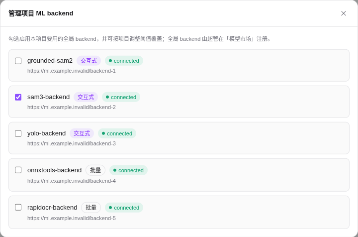

# 启用模型服务 {#启用-ml-后端}

> 适用角色：项目管理员 / 超级管理员

每个项目从**全局模型服务注册表**里勾选启用一个或多个模型服务，用于工作台交互式 AI 工具（智能点 / 智能框 / Exemplar，均为画布手势驱动）和批量预标注（文本「找全图」/ 几何 / OCR / 版面）。本页解释项目侧的**启用、设置主模型服务**两件事。物理服务实例的全局注册（新增 / 编辑 / 删除）是超管在[模型市场](../superadmin/model-market.md)的职责；项目侧只做启用，不复制实例。推理参数（如检测阈值）不在项目设置预设，而是在工作台 / 预标**运行时**按服务自报的 `/setup.params` 调整（详见下）。

> **项目绑定的是服务池**：项目启用与主模型服务下拉在底层绑定的是**服务池**（`ml_backend_pool_id`，ADR-0050 的逻辑路由边界），不再是单个物理实例。每个全局模型服务注册后自动得到一个 singleton 服务池，off 模式下项目体验与单实例完全一致；当超管把多个等价实例加入同一池并切到 `observe|enforce` 模式时，平台会在池内自动选择实例，项目侧无需改动。`/projects/:id/ml-backends/pools/available` 与 `/pools/:pool_id/enablement` 是项目侧的服务池启用 API；旧 `ml_backend_id`（实例 id）字段仍被公共 schema 接受以兼容老前端 / SDK，内部解析回 singleton 池。

> **交互线 / 批量线分流**：启用多个模型服务时，工作台 AI 按角色与能力路由：交互工具（智能点 / 智能框 / Exemplar）选择支持相应提示类型的交互服务，批量预标使用批量服务。启用只建立项目使用关系，并不保证服务健康、模型已加载或两条路径均可执行；运行前请检查连接、能力和模型状态。例如项目主服务为 YOLO、并启用支持智能点的 SAM 时，可分别用于批量几何预标和智能点工具。文本「找全图」属批量线（不在工具栏）。详见 [AI 工具组 § 交互后端选择](../workbench/sam-tool.md#交互后端选择多后端)。

<DocsVideo
  src="/media/projects/ml-routing.mp4"
  poster="/media/projects/ml-routing-poster.webp"
  alt="项目启用 YOLO 并设为主模型服务后，工作台单图 AI 使用 YOLO，而 Smart Point 自动选择 SAM3"
  caption="同一项目的两条 AI 路由：YOLO 作为当前题批量主服务，Smart Point 按 point 能力自动命中 SAM3。"
/>

## 启用一个全局模型服务 {#启用一个全局-backend}

进入 **项目设置 → 模型服务** 标签。页面上方是 AI 预标注设置，下方是**全局模型服务启用清单**——列出注册表里全部服务（含 env 自动注册项），点「管理模型服务」在悬浮面板里逐个勾选「启用」：

- **启用开关**：勾选后允许本项目使用该模型服务；能否选择和运行还取决于服务健康、模型状态与对应操作的能力要求。取消勾选即对本项目停用，不影响其它项目，也不删除全局注册项。

> **推理参数不在此预设**：检测阈值（如 `box_threshold` / `text_threshold`）因模型服务而异（由协议 `/setup.params` 自描述），在工作台「单图／单帧 AI」面板与 `/ai-pre` 跑批配置里按所选服务动态调整；项目级 `box_threshold`（默认 0.35）仅作 `/setup` 拉取失败时的兜底。

每行还展示全局注册项自带的能力快照（`supported_prompts` / `supported_trackers`）、URL、鉴权方式与 `max_concurrency` 并发闸——这些由超管在全局注册时设定，项目侧只读。

> **没有可启用的模型服务？** 说明超管还没在全局注册表注册任何物理服务实例。env 配置的服务启动后会自动成为全局注册项（`source=env`），无需手动注册即可在清单里看到并启用；其余服务由超管在[模型市场 → 注册管理](../superadmin/model-market.md)注册。

独立推理插件即使已由超管安装，也不会自动对新项目或现有项目启用；请在此显式勾选对应服务池。安装身份、排空和安全停容器由超管管理，项目停用不等于物理实例安全退役。见[插件安装](/user-guide/superadmin/ml-backend-registry#可安装推理插件)。

训练产物先注册为候选，再部署到已验证的兼容插件、核对类别顺序和安装收据并试用；项目负责人须人工发布，安装或试用不会自动切换默认模型。回滚历史版本也要在已验证的新插件上重新部署该版本并人工发布，不能重新激活已经退役的旧 CPU 实例。既有预测与历史收据保留。

> **交互能力 / 支持模态自动探测**：平台在健康检查时读取模型服务的 `/setup`，获取是否交互式、图像提示类型和视频追踪能力（`is_interactive` / `supported_prompts` / `supported_trackers`）。项目启用清单只读展示能力快照；快照不代表服务当前健康或模型已就绪。

## 配置 AI 预标注与项目主模型服务 {#配置-ai-预标注与项目主后端}

在页面上方的 **AI 预标注设置** 中：

- 在 **项目主模型服务** 下拉中选择——下拉只列**本项目已启用**的模型服务。**设置主模型服务即启用 AI 预标注；选择「不设置」则不启用**（无需单独的启用开关）。
- 可设置 **AI 框去重阈值**。
- **交互式 AI 工具** 总开关：控制标注员能否在工作台使用交互式 AI 工具（智能点 / 智能框 / Exemplar / Magic Box）。**默认开启**，关闭后工作台不再显示这些工具（不影响批量预标注）。底层字段 `ai_interactive_enabled`。
- 主模型服务、去重阈值和交互式工具开关均**即时生效**；页面没有额外的保存按钮。

这些字段统一收口到 **模型服务** 页。

## 从列表快捷设置项目主模型服务 {#从列表快捷设为项目主后端}

> **启用 ≠ 主服务**：项目可启用多个模型服务，但启用不保证它们当前可执行；「项目主模型服务」由 `ml_backend_id` 指针记录，用作工作台 AI 与新建预标配置的初始选择和回退，只能从已启用的服务里选。多阶段预标中显式选择的服务和模型仍独立生效。

在启用清单某行点 **「设为主服务」**：

- 会同时把项目 `ml_backend_id` 设为该服务、`ai_enabled` 置 true。
- 作为主模型服务的行显示 `主服务` 角标，其他已启用行仍可点 **「设为主服务」** 调整。
- 工作台进入时会拉该服务的 `/setup`，按返回的 `supported_prompts` 决定工具栏哪些 AI 工具置灰。
- **模态校验**：设置主模型服务时平台会按项目数据类型校验——视频项目只能选择自报 `supported_trackers`（支持视频追踪）的服务，否则拒绝。若服务此刻不可达、探测失败，则放行（不因瞬时宕机卡住操作）。

## 能力列

清单的「能力」列展示各模型服务的 `supported_prompts` 与 `supported_trackers`（视频追踪），例如：

- `grounded-sam2`：`point` `interactive_box` `text` `sam2_video`（最后一项为视频追踪能力徽标）
- `sam3-backend`：`point` `interactive_box` `text` `exemplar`，以及 `sam3_video` / `sam3_video_interactive` 视频追踪能力
- `yolo-backend`：`none` `text` `exemplar`（闭集检测/分割/关键点/旋转框走批量线；YOLOE 视觉提示走 Exemplar）

数据来自模型服务的 `GET /setup`（详见 [开发文档 § ML Backend Protocol](../../dev/reference/ml-backend-protocol.md)）。能力显示为 `—` 时，可能是 `/setup` 不可达或协议信息不完整。

模型市场会展示更完整的模型粒度能力，包括「可接受输入」（整图 / 裁剪图 / 框提示 / 点提示）、「输出几何」、「输出属性」、资源画像和变体轴。多阶段预标会用「可接受输入」判断下游阶段能否消费上游框：分类器通常接收裁剪图，框提示分割模型通常接收框提示。

## 视频 tracker 如何选择 backend

视频工作台不是把所有追踪请求都发送给项目主模型服务。发起追踪时，平台会从本项目**所有已启用模型服务**中查找 `supported_trackers` 包含所选 `model_key` 的实例：

1. 项目主模型服务支持所选追踪模型时优先使用。
2. 主模型服务不支持时，改用其它声明该模型且已连接的服务。
3. 没有任何已启用服务声明该模型时，模型在追踪面板中置灰或提交时报不支持。

因此 SAM2 框追踪、SAM3 文本检测追踪和 SAM3 点框交互追踪可以由不同模型服务承载。项目主模型服务只是初始选择与同能力优先项，不是视频追踪的唯一执行服务。排查置灰模型时，先确认对应服务已对项目启用，再做一次健康检查刷新 `supported_trackers` 能力快照；启用和能力声明不保证运行时可达。

## 停用与切换

| 操作                             | 影响                                                                                                                                          |
| -------------------------------- | --------------------------------------------------------------------------------------------------------------------------------------------- |
| **停用模型服务**（取消勾选启用） | 该服务对本项目不再可用。如果它是当前项目主模型服务，项目 `ml_backend_id` 自动置 null、`ai_enabled` 不变。不影响其它项目，也不删除全局注册项。 |
| **切换主模型服务**               | 切换 `ml_backend_id` 并同步 `ai_model` 展示名，原服务仍保持启用。                                                                             |

> 物理删除全局模型服务是超管职责，在[模型市场 → 注册管理](../superadmin/model-market.md)操作。

## 常见问题

**Q: 已经生成的预标注会受切换模型服务影响吗？**
不会。已写入的标注不会被回滚；后续调用按当次选择及能力路由使用模型服务，显式指定的多阶段服务不随主服务切换。

**Q: 我直接改 DB 改启用状态可以吗？**
可以，但工作台侧仍应通过启用清单和页面下拉显式操作。绕过 UI 直接改 DB 容易造成路由不清晰，运维纪律上不建议这么做。`max_concurrency` 限制请求并发；显存预算与驱逐由 GPU 资源声明和仲裁门禁负责，二者都不再依赖项目级 backend 数量上限。

**Q: 工具栏某个 AI 工具是灰的怎么办？**
工具栏按已启用交互服务的 `supported_prompts` 判断支持的交互模式，不再只看项目主模型服务。鼠标移到灰色按钮可查看原因；请确认对应服务已启用、支持该模式且当前可用。

## 相关文档

- 协议契约：[ML Backend Protocol](../../dev/reference/ml-backend-protocol.md)
- 架构决策：[ADR-0019 Prompt-first ToolDock + 1:N 架构](../../dev/adr/archive/0019-prompt-first-tooldock-1n-arch.md)、[ADR-0020 Capability 协商](../../dev/adr/archive/0020-ml-backend-capability-negotiation.md)
- 工作台侧使用：[AI 工具组](../workbench/sam-tool.md)
