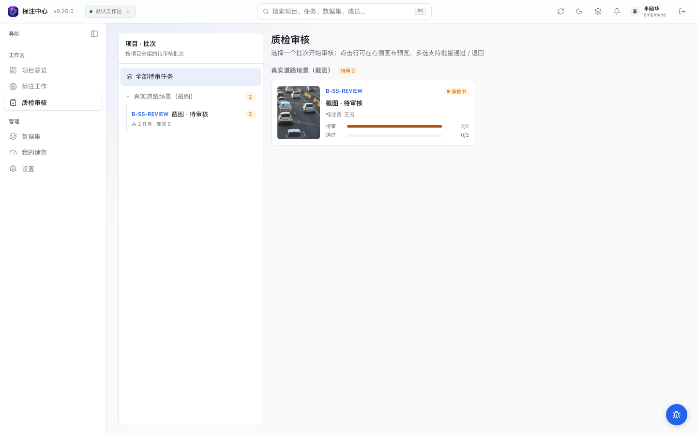
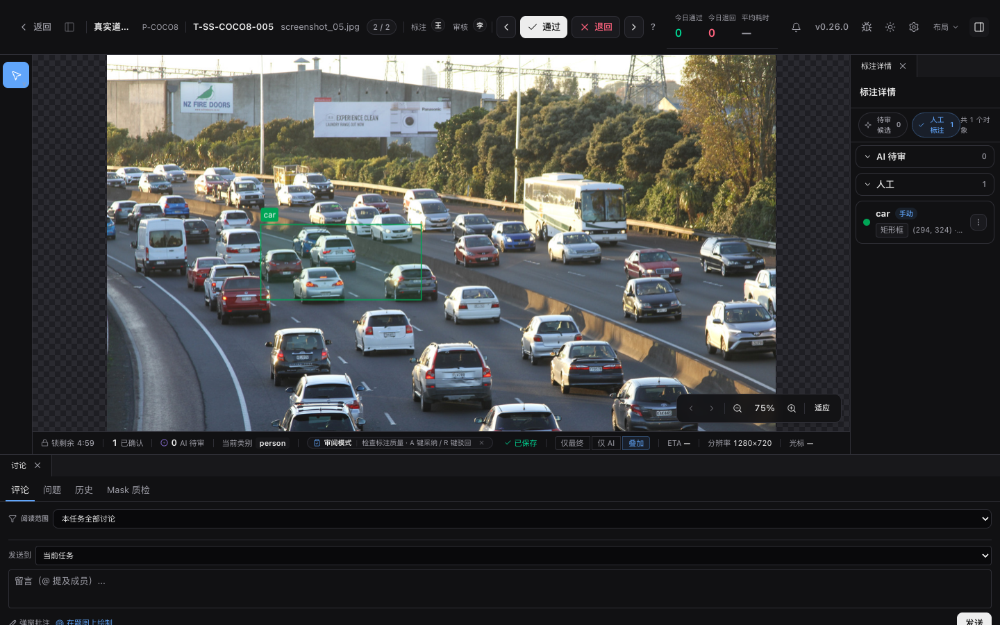
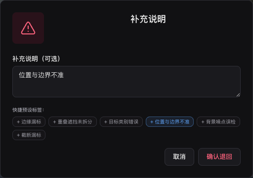

# 审核流程

面向审核员与项目管理员的质检把控指南。介绍审核入口、通过与退回决策、四类结构化退回判定标准以及视频时序核验规范。

> 适用角色：审核员、项目管理员<br>
> 核心原则：**提交者不能审核自己提交的内容，也不能审核自己参与编辑过的任务**（基于系统记录的贡献者证据自动校验）。

## 快速速查：四类退回判定标准

退回任务时系统强制要求选择以下结构化原因之一，便于后续质量分析与统计：

| 原因类型 (`RejectReasonType`) | 中文标签           | 核心判定依据                 | 典型返工场景示例                      |
| :---------------------------- | :----------------- | :--------------------------- | :------------------------------------ |
| `missing`                     | **漏标**           | 目标清晰存在，但未建立标注   | 画面边缘行人遗漏、漏画背景车辆        |
| `extra`                       | **多标**           | 标了非目标物体或噪声         | 将路灯倒影误标为车辆、虚假检测框      |
| `wrong_label`                 | **类别错误**       | 几何形状贴合，但分类属性选错 | 将面包车标为轿车、分类属性未勾选      |
| `wrong_geometry`              | **位置或尺寸不准** | 类别正确，但框体松散或漂移   | Bbox 严重未贴边、视频关键帧间插值漂移 |

## 审核工作台

平台提供两个互补的审核入口：

<div class="doc-card-grid">
  <DocLinkCard title="ReviewPage（批次概览与列表）" desc="访问 /review：按项目查看批次卡片网格、审核进度条，适合批量核对与快速通过/退回单题" href="#reviewpage-入口" />
  <DocLinkCard title="Workbench 全屏审核工作台" desc="访问 /projects/:id/review：沉浸式画布/时间轴与 diff 视图，进行逐帧精细质检与画布落点" href="#workbench-全屏审核工作台" />
</div>

<span id="reviewpage-入口" aria-hidden="true"></span>
<span id="workbench-全屏审核工作台" aria-hidden="true"></span>





- **ReviewPage**（`/review`）：
  - **卡片网格**：未选批次时展示批次封面、标注员姓名与待审/通过进度条。
  - **任务队列**：选中批次后展示缩略图列表，可在列表右侧直接点击通过或退回。
  - **范围筛选**：支持按项目、批次或指派标注员筛选；点击标题栏「返回全部批次」一键重置筛选。
- **Workbench review 模式**（`/projects/:id/review`）：
  - 与标注工作台共用统一外壳，替换为质检专用顶部横幅、任务锁与 diff 视图。
  - 图片任务展示高精度画布与属性详情，视频任务展示完整时间轴与轨迹列表。

## 审核操作

审核员在核对任务后，执行以下核心裁决动作：

| 决策操作           | 业务含义       | 任务状态流转           | 后续影响                                 |
| :----------------- | :------------- | :--------------------- | :--------------------------------------- |
| **通过 (Approve)** | 标注质量合格   | `review` → `completed` | 任务计入合格交付，不可再由普通标注员修改 |
| **退回 (Reject)**  | 存在瑕疵需返工 | `review` → `rejected`  | 任务回到原标注员重做队列，附带结构化原因 |

### 单任务退回流程

1. 在工作台顶部操作区或列表侧点击 **「退回」** 按钮。
2. 在弹出表单中选择上述四类结构化原因之一（必选）。
3. 填写 **「补充说明」**（可选自由文本，建议写明对象 ID 或具体问题帧，如 `trk_person_01 frame 128: 车辆消失后仍有插值框`）。
4. 确认提交后，任务立即移出待审队列并通知标注员。

> 原标注员在任务队列中打开退回任务后，可点击「接受退回开始重做」进行修改并重新提交。

### 整批退回操作

在 ReviewPage 选中批次后，标题区提供 **「整批退回」** 选项：

- 适用于整体质量不达标的批次；
- 填写入批反馈后，已送审与已通过的任务整体打回待重做，批次状态变为 `rejected`；
- 批次树与进度统计即时刷新。



<DocsVideo
  src="/media/review/reject-flow.mp4"
  poster="/media/review/reject-flow-poster.webp"
  alt="从质检批次卡片进入审核工作台，核对错误车辆框并填写结构化原因退回任务"
  caption="实操演示：定位待审任务 → 核对几何边界 → 填写结构化原因退回 → 队列进度实时联动。"
/>

<span id="退回接口请求体" aria-hidden="true"></span>

<details>
<summary>🛠️ 开发者参考：退回 API 接口请求定义</summary>

外部自动化脚本或质检工具调用 `POST /api/v1/tasks/{task_id}/review/reject` 时的请求格式：

```json
{
  "reason_type": "missing",
  "reason": "trk_person_01 frame 128: 车辆消失后仍有插值框"
}
```

- `reason_type`：必填，取 `missing` / `extra` / `wrong_label` / `wrong_geometry` 之一。
- `reason`：可选文本，最长 2000 字符。
</details>

## 视频任务审核

视频任务会在审核工作台切到视频时间轴视图。审核时重点看：

- 轨迹列表里的类别和 `track_id` 是否能对应同一个对象。
- 第 1 帧、中间帧、最后一帧等关键位置的 bbox 是否贴合目标。
- 两个关键帧之间的虚线插值框是否发生明显漂移。
- 目标消失段是否标记了「消失」，避免插值框穿过不存在的对象。
- 被遮挡目标是否标记了「遮挡」，且框体仍覆盖可判断的目标区域。

退回视频任务时，建议在原因里写清楚 `track_id + frame_index`，例如：

```text
trk_person_01 frame 128: 车辆消失后仍有插值框，请标记为消失。
```

这样标注员重做时可以直接定位到问题轨迹和帧。

### 在视频画面标记问题

将鼠标移到工作台右下角，点击十字落点按钮，再单击视频画面中的问题位置；也可从「讨论 → 问题」选择「在画布选点」。进入落点模式会暂停播放并保留当前源帧，不吸附到采样网格；如果画面还在准备，会先显示准备状态，实际帧绘制完成后才打开表单。表单显示捕获的位置和源帧，提交时保存该帧与相对坐标。无需位置的问题应从同页的任务问题入口创建，不必等待视频画面就绪，也不提供像素坐标。阅读范围、状态筛选和草稿边界见[评论与问题](../workbench/discussion)。

创建时会一并记录当前画布视图和时间窗；若已选中正式对象，还会记录对象与当时的版本。表单显示关联对象，可取消关联并保留源帧和画布位置。勾选「记录源帧范围」可用一条问题描述一段视频，例如 F120–F160。起止帧从 0 开始，必须包含落点源帧，并位于视频范围内，不受采样网格影响。

视频和图片的问题图钉保持相同的屏幕尺寸。未解决问题按提示、警告、阻断分别显示蓝色、黄色、红色，已解决显示绿色，搁置显示灰色。这里的阻断是普通讨论问题的严重度；任务提交和 Mask 质检审核仍按原有流程规则执行。

保存后，图钉显示在对应源帧，时间轴同时出现问题标记。点击问题标题只打开详情，可阅读和回复，不改变当前画面；点击「定位」、图钉或时间轴的问题标记，才会在目标帧画面就绪后恢复对象、画布视图和时间窗。讨论面板可切换到「整个项目」，定位其它视频任务中的问题；未完成的绘制和 Mask 草稿仍会先走保护流程。刷新页面或改变画布尺寸后，视图会按当前画布大小恢复。

Issue 列表的状态筛选作用于服务端查询，切换范围或状态会从第一页加载。列表的“已加载”只统计当前取得的记录，继续加载可查看后续问题；“待处理”使用服务端返回的当前范围完整统计。图钉入口显示当前任务的完整未解决数，画布图钉会自动继续加载，未加载完或失败时另行提示。

对象已删除或版本已变化时，仍会定位原问题的帧和位置，并提示「对象已变化」。无权访问目标任务时保留当前位置。旧问题继续使用原来的帧与像素位置定位。

定位成功以实际画面就绪为准，准备状态和重试提示显示在画布内，可继续定位讨论面板中的其他问题。超时、取消或视频暂不可用时会保留原锚点，点击「重试」继续定位；快速定位多个问题只响应最后一次请求，切题会取消旧任务尚未完成的定位或创建。

在详情中解决问题后，可用「上一条」「下一条」继续处理未解决项；详情切换与画布定位是独立操作。完整对话、回复草稿和列表范围的规则见[评论与问题](../workbench/discussion#打开问题与回复)。

### 分段边界与 Track 质量

启用分段协同的视频会在右侧显示「Track 边界质量」。每张边界卡比较相邻 segment 的 overlap：

切换视频任务后，质量面板会清除上一任务的报告、边界配对和 fragment 选择，再读取当前任务的数据。

- HOTA 同时反映检测和关联一致性；IDF1 反映跨帧身份保持。
- MOTA L / MOTA R 分别把左侧或右侧当作参考，二者不是人工真值准确率。
- 按 Track、分段和章节的汇总显示异常帧数量；issue 列表提供 FP、FN、identity switch、fragmentation
  和几何不一致的连续帧范围。

点击 issue 会跳到首个问题帧，并排显示两侧 fragment。逐条确认系统建议的「同一轨迹 / 不同轨迹」；系统未匹配
但确属同一对象时，可从同类别、同几何类型的未匹配 fragment 手工补 pair。全部确认后点击「接受边界对账」。

输入发生变化时报告会标为 stale，不能接受，也不能通过任务或导出跨边界全轨。可重新运行质量检查，或先「返工左分段」
或「返工右分段」；标注员重新提交后会生成新报告。只有所有相关边界都已接受，系统才会裁掉 overlap 重复部分并派生
canonical 全视频轨迹。

## 审核员绩效

待审核队列只显示当前可见项目中批次仍可见、可以领取或已由本人领取的任务，其他审核员已领取的任务不会进入该队列（项目负责人和超管可管理项目任务）。通过率根据当前可见项目中本人审核过且仍处于通过或退回状态的任务计算，待审核任务不进入分母。

审核员仪表板（`ReviewerDashboard`）显示以下 `ReviewerDashboardStats` 指标：

| 指标         | 字段                        | 说明                             |
| ------------ | --------------------------- | -------------------------------- |
| 待审队列     | `pending_review_count`      | 当前仍在 `review` 状态的任务数   |
| 今日已审     | `today_reviewed`            | 当日通过 + 退回合计              |
| 平均审核耗时 | `median_review_duration_ms` | 审核耗时中位数                   |
| 累计审核     | `total_reviewed`            | 历史总审核数                     |
| 24h 通过率   | `approval_rate_24h`         | 过去 24 小时通过 / (通过 + 退回) |
| 历史通过率   | `approval_rate`             | 全量通过率                       |
| 二次返修率   | `reopen_after_approve_rate` | 通过后被标注员 reopen 的比例     |
