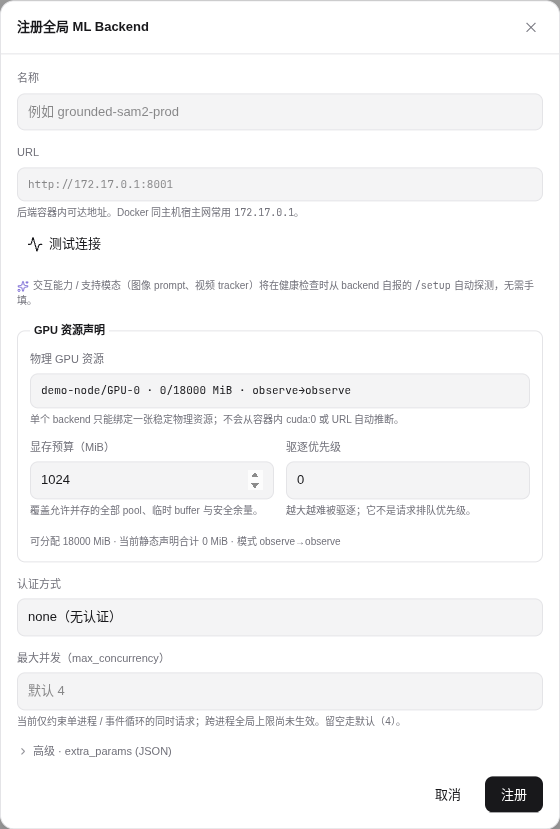

# ML Backend 注册（全局注册表）

ML Backend 是平台调用的推理服务。注册表是**全局**的：一个物理 backend 对应一行 `ml_backend_registry` 记录，同一 URL 只注册一次，所有项目共享该记录。项目侧从全局注册表里**勾选启用**，详见 [启用 ML 后端](../projects/ml-backends)。模型权重、服务实例和服务池的区别，以及 Token 的基本用途，见[模型服务接入、路由与认证](../../dev/concepts/ml-backend-routing-and-auth)。

## 入口

- 全局注册（新增 / 编辑 / 删除 / 健康检查，仅超管）：`/model-market` → **注册管理** tab
- 项目启用（勾选已注册 backend + 项目级覆盖，项目管理员 / 超级管理员）：项目设置 → **ML 模型** tab

## 表单字段



| 字段         | 含义                         | 约束                                                                                                                       |
| ------------ | ---------------------------- | -------------------------------------------------------------------------------------------------------------------------- |
| 名称         | 显示名                       | 名称无全局唯一性约束，同名服务仍由实例 ID 和 URL 区分；`ml_backends` 表无 UNIQUE 索引                                      |
| URL          | Backend HTTP 入口            | **全局唯一**（同一 URL 只能注册一次）；**不能填 loopback**（详见下）                                                       |
| 交互能力     | 是否支持工作台交互式推理     | 健康检查时从 `/setup` 自动探测，无需手填                                                                                   |
| 认证方式     | 系统托管、手动 Token 或 None | 内置可信地址默认使用对应的系统托管方式；None 不发送凭据                                                                    |
| 手动 Token   | 调用该服务的访问凭据         | 与服务端配置一致；编辑留空保留原值，首次设置或从系统托管切回手动时必须填写                                                 |
| GPU 物理资源 | 稳定 `gpu_resource_id`       | 从运维显式配置的逐卡资源中选择；留空不等于已确认 CPU                                                                       |
| 显存预算     | `vram_budget_mb`             | 与 GPU 资源成对填写，正整数 MiB，不得超过该卡 `allocatable_mb`                                                             |
| 驱逐优先级   | `eviction_priority`          | 数值越大越难被驱逐，可为负数，不是请求队列优先级                                                                           |
| 最大并发     | `max_concurrency`            | 1 至 32；始终作为单进程 / 事件循环的本地背压；`ML_BACKEND_ROUTER_MODE=enforce` 时还作为 Redis route lease 的跨进程实例上限 |
| 额外参数     | JSON 扩展字段                | 不得与上述强类型字段冲突                                                                                                   |

> **已删除的虚构字段**：`type`（类型选择器）、默认 prompt、默认阈值均**不是**注册表单的真实字段。backend 类型由 backend 自身通过 `/setup` 声明，不在注册时指定。`max_concurrency` 由表单单独填写后保存到 `extra_params` JSONB；其他扩展参数仍在高级 JSON 中编辑。

## URL 校验：拒绝 loopback

后端 Pydantic `field_validator` 会直接拒绝以下 host（`apps/api/app/schemas/ml_backend.py:8`）：

- `localhost`
- `127.0.0.1`（精确匹配，**不**拒绝整个 `127.x.x.x` 段）
- `0.0.0.0`
- `::1`

错误消息会指引你填正确的地址。背后原因：容器内 `localhost` 指向容器自身，不可能连到宿主机的 ML Backend。详见 [容器网络与 loopback](../../dev/troubleshooting/container-networking)。

**正确填法：**

| 场景                            | URL                                                                                          |
| ------------------------------- | -------------------------------------------------------------------------------------------- |
| Backend 在同一个 docker-compose | `http://grounded-sam2-backend:8001`                                                          |
| Backend 在宿主机 / 局域网       | `http://172.17.0.1:8001`（Linux 默认 bridge）/ `http://host.docker.internal:8001`（mac/win） |
| Backend 在另一台机器            | LAN IP / 域名                                                                                |

dev 环境 placeholder 已默认填 `172.17.0.1:8001`。

## 认证方式与凭据

编辑已有实例时，可直接切换认证方式或更换 Token，包括已经受 GPU 管理的实例，无需先退役。认证属于全局实例，保存后所有引用它的项目共用新凭据；请与服务端配置保持一致。平台会清除该实例原有的健康结果，执行健康检查通过后再使用。URL、GPU 资源、显存预算、驱逐优先级与运行参数的变更仍受 GPU 退役保护。

五个内置推理服务（Grounded SAM 2、SAM 3、YOLO、ONNXTools、RapidOCR）默认使用各自独立的系统托管凭据。注册内置地址时表单默认选择对应的系统托管方式；保存会生成或复用私有凭据，并验证部署指定的服务身份。无需复制令牌或修改 `.env`。超管也可进入「设置 → 系统设置 → ML 服务认证与维护」，为单个或全部服务初始化并同步已有的无认证实例；已有手动 Token 不会被自动覆盖，未注册服务不会因此自动注册或在项目中启用。

旧容器首次升级需重建镜像并应用共享目录挂载，之后凭据初始化与同步无需重建。凭据已保存只表示本地文件可用；普通 `/health` 不证明认证就绪。系统托管保存会额外验证 `/managed-auth`，失败时保留本地文件供重试，实例原认证不变。保存成功后执行实例健康检查更新状态。

远程或自行配置的服务继续使用手动 Token。YOLO 的手动 `YOLO_MANAGED_MODELS_TOKEN` 优先；模型回流要求至少 32 个字符。手动 Token 留空编辑只保留原值；从系统托管切回手动 Token 必须重新填写。`none` 始终不发送凭据。

这里的 Token 是平台调用 Backend 的凭据，与个人 API 密钥分别管理。选择系统托管时不填写 Token，但认证方式仍需选择对应服务的「系统托管」。内置服务的手动 Token 环境变量留空时会读取默认私有文件，缺少有效凭据会拒绝受保护请求，不会自动关闭认证。再次初始化只复用并同步已有值，不会轮换凭据。

## 健康检查

<!-- TODO(v0.14.18) IMAGE_CHECKLIST: images/superadmin/ml-backend/health-state-badges.png — connected/error/disconnected 三状态徽章对比 [manual] -->

通过认证设置校验后，注册会自动调用 `GET <url>/health`。普通健康检查失败不阻断创建，但列表会显示错误状态，`state` 取值为 `disconnected`、`connected` 或 `error`。系统托管的认证握手失败会阻止保存，不能用公开健康端点成功代替认证验证。

**注册前连通性测试**：手动 Token 或 None 方式可通过表单「测试连接」调用 `POST /admin/ml-integrations/probe`，只探测 `/health`，不写数据库。系统托管在保存时验证受认证端点，表单会禁用普通「测试连接」。连接成功只证明健康端点可达。

探测和试启动保留管理员对内网与新后端地址的诊断能力，URL 须为有效 HTTP(S) base URL，不含内嵌凭据、查询参数或 fragment；认证 token 单独填写。网络失败只回报安全的错误类别。项目 warmup 还要求 backend 已启用于该项目；共享 reload/unload 继续按超级管理员全局权限执行。

## 全局注册 CRUD（超管）

注册管理 tab 对全局注册表做增删改查，对应后端端点：

```http
POST   /admin/ml-integrations/registry                  # 新增全局 backend
PUT    /admin/ml-integrations/registry/:registry_id     # 编辑
DELETE /admin/ml-integrations/registry/:registry_id     # 删除
POST   /admin/ml-integrations/registry/:registry_id/health   # 健康检查（探 /setup 派生能力）
GET    /admin/ml-integrations/all                        # 全局列表（新建项目向导复用）
```

每个全局 backend 注册后会自动得到一个 singleton 服务池（ADR-0050），池内含一个 active 成员指向该实例。off／observe 模式沿用 legacy 实例选择，enforce 模式在合格成员中分配请求；停止接流和执行安全检查始终生效。详见 [ADR-0050 服务池与请求路由](../../dev/adr/archive/0050-ml-backend-service-pools-and-request-routing)。

## 可安装推理插件

插件由超级管理员在可访问 Docker 的部署机用 `aap plugins` 安装，不自动发现插件；平台 API 不访问 Docker socket。当前本机安装器仅支持 LibreYOLO CUDA 插件和一张明确授权的 NVIDIA 物理 GPU，需要 NVIDIA Container Toolkit、非 host Docker 网络和已加载的固定 OCI 摘要镜像。服务运行在隔离 Docker 进程，不挂载核心数据库、Redis 或 GPU 签发私钥。业务 Bearer Token 与 GPU 验签公钥是不同凭据。

使用 Python 3.11 及以上，从可信来源取得包含 SDK、`plugins` extra 及其完整依赖的 wheelhouse，或使用包含这些 wheel 的私有索引；不要假定包已发布到 PyPI。SDK 独立于平台仓库分发，部署 extra 不包含 Torch 或模型框架：

```bash
python -m venv .venv
source .venv/bin/activate
python -m pip install --no-index --find-links /path/to/wheelhouse 'ai-annotation-sdk[plugins]'
export AAP_BASE_URL="https://platform.example"
export AAP_API_KEY="<超级管理员 API 密钥>"
```

API 密钥使用私密方式注入，不要提交或写入镜像。以可访问 Docker 的非 root 用户运行安装器；每个安装使用独立私有状态目录，保存原始收据、随机业务 Token、配置、公钥文件和资产以便故障恢复，不要共享、提交或删除。以下是完整 `deployment.json` **结构示例，不是可部署的真实制品**：将占位摘要、公钥、资源、来源和主机替换为经审核的真实值；`manifest` 以作者生成并经管理员审批的完整 manifest 为准。

```json
{
  "name": "LibreYOLO detection",
  "url": "http://172.17.0.1:18000",
  "manifest": {
    "plugin_id": "libreyolo",
    "version": "0.1.0",
    "publisher": "实际发布者",
    "license": "实际制品许可证",
    "artifact": "registry.example/libreyolo@sha256:aaaaaaaaaaaaaaaaaaaaaaaaaaaaaaaaaaaaaaaaaaaaaaaaaaaaaaaaaaaaaaaa",
    "sdk_compatibility": "0.1.0",
    "entrypoint": ["my-libreyolo-plugin", "serve", "--host", "0.0.0.0", "--port", "8000"],
    "capabilities": ["inference", "detection", "managed_models"],
    "resource": { "device": "cuda", "memory_mb": 16384, "gpu_memory_mb": 8192 },
    "asset_manifest_sha256": "bbbbbbbbbbbbbbbbbbbbbbbbbbbbbbbbbbbbbbbbbbbbbbbbbbbbbbbbbbbbbbbb",
    "managed_model_compatibility": [
      {
        "framework": "libreyolo",
        "format": "libreyolo-native-state-dict-1.0",
        "runtime_device": "cuda"
      }
    ],
    "allowed_asset_sources": ["https://assets.example"]
  },
  "gpu_resource_id": "gpu-worker-1",
  "physical_gpu_uuid": "GPU-12345678-1234-1234-1234-123456789abc",
  "network": "aap-plugins",
  "host_port": 18000,
  "cpus": 4,
  "gpu_verify_keyring": { "key-1": "AAAAAAAAAAAAAAAAAAAAAAAAAAAAAAAAAAAAAAAAAAA" },
  "image_hosts": ["media.example"]
}
```

`gpu_resource_id` 必须是平台配置的实际逐卡资源，`physical_gpu_uuid` 是该卡完整 UUID；安装器只将该卡暴露给容器，并绑定容器内逻辑 `cuda:0`，不按宿主机 ordinal 猜测。`memory_mb` 和 `gpu_memory_mb` 分别为 RAM 与显存预算（MiB），显存不得超过资源可分配量；`cpus` 为 CPU 上限。URL 必须从平台容器可达、指向该宿主端口，不能用 loopback；示例 bridge 地址须按实际网络替换。`image_hosts` 是可获取推理图片的主机名，`allowed_asset_sources` 是受控资产下载实际使用且获授权的完整 HTTP(S) origin，可含多个；二者不是同一白名单。公钥是 key ID 到 Ed25519 公钥的 unpadded base64url 映射，不能使用示例零值。安装器将其写入私有 `data/gpu-keyring.json`，并在可写数据目录之上独立只读挂载该文件；资格报告同样只读挂载。不要将签发私钥放入配置或状态目录。

```bash
aap plugins prepare --config deployment.json --state-dir ./plugin-state --json
aap plugins prepare-assets --state-dir ./plugin-state --json
# 管理员先审核与该安装身份、镜像和 GPU 绑定的完整共享生命周期报告
aap plugins install --state-dir ./plugin-state --qualification gpu-report.json --yes --json
aap plugins status --state-dir ./plugin-state --json
```

`prepare` 预留不可接流的安装身份、Registry 和资源绑定；`prepare-assets` 显式准备固定资产。使用相同状态目录和配置重试，勿另造身份。安装器检查真实 Docker 镜像摘要、镜像和容器 ID、启动身份及 GPU 绑定，再提交可信管理员的启动收据；这不是远程密码学证明。CUDA 必须另提交管理员审核通过的完整共享生命周期报告及摘要，绑定此次预留的 Registry、镜像、资产、实际 GPU、驱动、运行时和池拓扑，包含真实推理、取消和两次冷态释放。`--yes` 表示管理员批准提交报告，不替代审核；本地 `aap-plugin check --qualify-local` 的报告不等于平台托管资格报告。平台还会验证实际受认证端点。安装完成不会自动为任何项目启用或发布模型；项目负责人须显式启用该服务，部署候选模型、加载试用并人工发布，详见[模型回流与默认预标](../online-learning/models)。模型注册本身不会自动发布。

托管 CUDA 实例应使用目标资源的 `enforce` GPU 准入配置；这与服务池 router 的 off／observe／enforce 模式是两套控制。签名初始化和排空可能等待旧控制 Token 的有效期结束，SDK 为激活和排空使用 300 秒请求超时。网络中断或超时不代表平台操作已回滚：先读取安装状态，再用原状态目录恢复，不能另建身份或直接停止容器。

安装器等待健康端点就绪时，启动中的短暂断连或 503 不算启动成功；60 秒内仍未就绪便停止提交激活，保留启动身份供原目录恢复。平台激活会先完成受认证的持久路由控制绑定，再建立 GPU 准入并将安装标记为 active；绑定未确认时不会先开放接流。路由控制使用安装器配置的私有凭据文件，不要求插件作者另写鉴权或绑定逻辑。停用和卸载沿用已记录的启动文件，不为退出重写运行配置。

安装 API 以 `/api/v1/admin/ml-integrations/plugins/installations` 为集合：`POST` 到**集合本身**预留；`GET` 和 `GET /{installation_id}` 查看；`POST /{installation_id}/activate`、`disable`、`quiesce`、`retire` 执行状态变更。动作需要当前 `expected_revision`；并发冲突时先重新读取，勿覆盖其他管理员操作。预留的安装 UUID 是重试幂等键，重复请求必须匹配原意图和凭据。

停用阻止新工作，但 **disabled 不等于 `safe_to_stop`**。必须完成 quiesce 并使用当前证明修订，只有 `safe_to_stop` 收据才允许停止对应容器；超时、未知状态、HTTP 断开或 Jobs 已结束都不是排空证明。下列命令由安装器执行停用、排空证明、停止拥有的容器，以及依赖检查与退役：

真实请求断连后，不确定工作租约仍占用显存承诺。安装 owner 只有在相关许可有效期与租约硬期限均过去，并取得当前实例的新鲜空闲证明后，才能结清这些租约并继续签名排空；原生请求、构建或模型借用未退出时不会提前释放。等待超时应保留原状态目录，按结构化错误及重试信息恢复同一安装操作，不删除 Redis 租约或退出围栏。

```bash
aap plugins disable --state-dir ./plugin-state --yes --json
aap plugins uninstall --state-dir ./plugin-state --yes --json
```

失败保留私有状态并查状态后重试，勿手工停止未知身份。活动发布或冻结的重试依赖会阻止退役；退役保留 Registry、部署和历史发布快照。对于仅预留且从未尝试启动的安装，直接执行上述 `uninstall`：仅在无启动尝试或启动收据、且确认本地不存在对应容器时，安装器才会使用 `cancel-prepared` 取消预留；未知容器或启动历史不能假定未执行。排空证明绑定完整容器 ID，同名替代实例不得使用旧证明；恢复检查拒绝共享或未知 PID 命名空间。无效资格报告和镜像检查失败不会固定候选，可修正后重试。

需要保留同一安装及模型目录、仅替换运行进程时，使用 `aap plugins restart --state-dir ./plugin-state --yes --json`。它先完成上述终止证明及停止，再用原制品和资格创建新的容器与启动身份；历史证明保留。GPU 激活须等待既有签名许可有效期，reset 与 enforce 各自保留完整等待窗口；结构化超时不表示候选可以改换身份。中断后继续同一命令，不手工启动候选或替换容器。重启不会自动恢复已排空的服务池成员，须由管理员显式恢复。意外退出或外部重启不等于终止证明，无法核验原进程身份时拒绝自动接管；执行安装器期间应独占该安装的 Docker 管理操作。

新进程的路由 incarnation 不能直接沿用旧进程。宿主只有在原终止证明已结算、旧容器与 boot 已记为停止，且新容器、boot、端点、资格和安装修订均匹配时，才授权这一次替换握手；存在未结束或不确定的路由执行时拒绝。失败重试保留原控制 ID、挑战和 epoch，完整握手后才能继续 GPU 初始化及激活，不把“新进程空闲”单独当作旧进程已退出。

路由绑定失败留下的管理围栏不会因 GPU 排空而消失。GPU owner 可依据持久化安装终止意图取得仅用于签名终止排空的端点许可；此许可不能执行预测或普通生命周期请求。完成实际排空、账本结算和安装证明后可以退役并停止对应进程，未确认的路由控制及历史尝试仍保留，不宣称路由已恢复。

升级须在新状态目录用新制品重新 `prepare`、`prepare-assets` 和审核报告，再使用 `aap plugins upgrade --from-state ./old-state --state-dir ./new-state --qualification new-report.json --yes --json`。升级创建新的安装及 Registry 身份，旧身份保持不变。项目负责人显式启用新服务并完成模型部署、试用及人工发布；旧安装须满足依赖和排空条件才能退役。历史版本回滚也须在已验证的新插件部署上重新部署并人工发布，不能重新激活退役的旧 CPU 实例。

## 服务池管理（超管）

<!-- TODO IMAGE_CHECKLIST: images/superadmin/model-market/registry-service-pools.png — 注册管理服务池主视图（结构化 tab + 展开成员 + 维护操作） [auto] -->

服务池是路由选择的逻辑边界，实例是可定位到物理 URL 的 registry 记录。一个池可含多个等价实例（同模型 / 同 schema，capability 指纹 exact match）。注册管理 tab 的「服务池」视图对池做增删改查 + drain / resume：

```http
GET    /admin/ml-integrations/service-pools                       # 列表（含成员）
POST   /admin/ml-integrations/service-pools                       # 新建池
GET    /admin/ml-integrations/service-pools/:pool_id              # 单池详情
PATCH  /admin/ml-integrations/service-pools/:pool_id              # 改名 / 启停
DELETE /admin/ml-integrations/service-pools/:pool_id              # 删除池
PUT    /admin/ml-integrations/service-pools/:pool_id/members/:registry_id   # 加入/改权重
DELETE /admin/ml-integrations/service-pools/:pool_id/members/:registry_id   # 移除成员
POST   /admin/ml-integrations/service-pools/:pool_id/members/:registry_id/drain    # active→draining
POST   /admin/ml-integrations/service-pools/:pool_id/members/:registry_id/resume   # draining→active
GET    /admin/ml-integrations/service-pools/:pool_id/members/:registry_id/capability-drift          # 预览能力差异
POST   /admin/ml-integrations/service-pools/:pool_id/members/:registry_id/capability-drift/accept   # 接受新基线
```

**drain / resume 语义**：

- **drain**：成员 `traffic_state` 从 `active` 切到 `draining`，停止接收新的执行；已在飞的请求继续完成。幂等。
- **resume**：`draining` 切回 `active`，恢复接流。幂等。`disabled` 成员不能直接 resume；这类状态需要先审核能力变更。
- drain / resume **只影响路由接流**，不触发模型权重卸载（那是 GPU 仲裁的 residency drain，独立）。
- off／observe 模式仍使用 legacy 实例，但该成员进入 `draining` 后也不再接受新的执行。已经开始并固定实例的跟踪作业可以完成既有工作。

**加入成员**：被加入的实例必须与池内现有成员 capability 指纹 exact match（同 `models[]` 模型目录、请求 schema、variant 组合和 tracker 等稳定能力，排除 URL/GPU/VRAM/residency 等运行态字段）。不匹配返回 `HTTP 409` 并附结构化 diff。对已在池内的成员再次 PUT 会更新权重，不会重置已有的 traffic state。同一实例不能同时属于两个服务池。

**审核能力变更**：健康刷新发现 `/setup` 的路由合同与服务池基线不一致时，平台会自动把成员设为 `disabled`；若它是 legacy 实例，还会关闭服务池。超管可在「服务池」展开成员或「实例」操作菜单中选择「审核能力变更」，查看旧/新指纹与 canonical 字段差异。确认时平台会重新执行健康与 `/setup` 探测，并校验候选指纹没有在审核期间再次变化；池内若仍有能力不一致的 active / draining 成员则拒绝。验证通过后，新基线、成员 `active` 状态、路由代际和可选的服务池启用在同一事务中提交。若实例已经回滚到原基线，则只恢复成员与服务池，不改写基线。该操作只接受明确审核过的合同，不会自动放行 capability superset。

**卸载 / 移除成员 / 删除**：纳管实例必须先进入 `draining`。新鲜的零在途观测只允许提交卸载请求，服务端还会核验后台执行和控制状态；超时、通信中断、缓存清空或租约过期均不能证明任务已经结束。管理结果未确认时保持阻塞。升级后需先由运维完成[后端控制绑定](../../api/guides/inference-runtime#持久路由执行权)，再管理实例；无法确认时返回冲突或服务不可用。删除服务池前必须逐一安全移除所有成员，空池才可删除。

GPU 自动驱逐在卸载回包丢失后仍会复查健康状态。只有新鲜且匹配的实际卸载证据才能回收预算；检查失败或状态无法确认时，继续保留未决状态与预算。

移除成员或删除实例时，若安全检查后成员被恢复接流、移到其他池或路由代次改变，返回409；请重新读取状态、drain 并重试。删除清理项目主绑定遇到正在保存的项目配置时，也返回409并回滚整个删除。项目配置等待服务池期间所选实例被删除或移走，同样拒绝本次保存；刷新清单后重新选择。

加入、移除、drain 和 resume 成功后返回已提交的最新服务池状态。若连接中断、没有收到结果，先读取服务池详情核对成员和路由代际，再决定下一步；再次移除已不存在的成员会返回404。

## 项目启用

注册仅是创建可选项。真正生效需要项目把它启用：

1. 项目设置 → **ML 模型** → 点「管理 backend」在全局 backend 清单里**勾选启用**该 backend（推理参数运行时按 backend 自报的 `/setup.params` 调，不在此预设）
2. 同一页在 **项目主后端** 下拉里选一个**已启用**的 backend（设了主后端即视为启用 AI 预标注）
3. 保存 AI 设置

未设项目主后端直接跑预标会报错，并在前端给出配置引导。详见 [启用 ML 后端](../projects/ml-backends)。

## 引用全局注册项（不复制）

新建项目 wizard step 4 提供下拉选已注册的全局 backend；选中即为新项目**启用**该全局注册项（**引用同一全局 id，不再复制一份**）。这样所有项目共享同一物理 backend 记录，能力快照与健康状态一处维护、处处一致。

后端：`GET /admin/ml-integrations/all` 返回全局注册表列表。

## 删除

物理删除全局 backend 是**超管职责**（`DELETE /admin/ml-integrations/registry/:registry_id`）。删除前若有正在运行的预测 job、未完成 GPU retirement，或者管理安全检查尚未确认停止接流和后台任务结束，都会返回冲突或服务不可用错误并保留数据。条件全部满足后，删除会解除该实例的服务池成员关系；若它是 legacy 实例，所属池会停用并清除项目主绑定。历史预测仍按外键策略保留可追溯性。

从未纳管 GPU 的普通后端可在上述检查通过后正常删除；具有 GPU 历史的实例仍须完成相应退役与回收流程。

项目管理员不能物理删除全局 backend，只能在项目设置里**取消勾选启用**让它对本项目停用（不影响其它项目）。

## 审计

以下事件写入 `audit_logs`：

- `ml_registry.created` / `ml_registry.updated` / `ml_registry.deleted`（全局注册 CRUD）
- `ml_plugin_installation.prepared` / `launch_recorded` / `qualification_approved` / `activated` / `disabled` / `quiesced` / `retired`（插件身份与生命周期动作；不记录实例 Token）
- `ml_registry.managed_auth_initialized`（默认凭据初始化与同步）
- `ml_backend.rebuild_requested`（系统设置提交指定服务的镜像与容器重建）
- `ml_service_pool.created` / `updated` / `deleted`（服务池 CRUD）
- `ml_service_pool.member_upserted` / `member_removed` / `member_drained` / `member_resumed`（成员与接流状态）
- `ml_service_pool.capability_drift_accepted`（审核并接受新的池能力基线）
- `ml_backend.created` / `updated` / `deleted` / `enablement`（项目兼容端点）
- `ml_backend.reloaded` / `ml_backend.unloaded` / `ml_backend.warmup`（生命周期动作）
- `ml_backend.smoke_tested`（模型市场试启动）

详见 [审计日志](./audit-logs)。

## 相关操作

- **观测（observe）**：`GET /admin/ml-integrations/observe` 直连 env 配的 ML Backend 容器，不需要项目注册即可看健康 / 变体目录。
- **试启动（smoke-test）**：`POST /admin/ml-integrations/observe/smoke-test`，只有新协议 residency 能严格证明所有 pool / builder / borrower 已空时才预热指定变体并自动还原；旧协议会同时保守检查图像池、视频池与活跃会话。
- **GPU 资源诊断**：超管可查看逐卡容量、静态预算、desired → effective mode 及配置 blocker。`observe` 仅记录影子决策，不会拒绝、排队或驱逐请求。
- **`max_concurrency`**：写入 `extra_params.max_concurrency`；本地 semaphore 始终生效，`ML_BACKEND_ROUTER_MODE=enforce` 时再由持久路由 owner 把 API 与多个 Celery worker 收口到同一实例上限。GPU 仲裁的逐资源 effective mode 管显存准入与驱逐，是另一条独立门禁。

训练完成后的候选注册、加载试用和人工发布见[模型回流与默认预标](../online-learning/models)。全局服务注册不会自动把权重加入项目模型。

## 相关

- [ADR 0015 — ML Backend URL 验证](../../dev/adr/archive/0015-ml-backend-url-validation)
- [模型市场](./model-market)
- [ML Backend 协议](../../dev/reference/ml-backend-protocol)
- [模型服务接入、路由与认证](../../dev/concepts/ml-backend-routing-and-auth)
- [本机 ML 服务维护](../../ops/deploy/ml-backend-maintenance)
