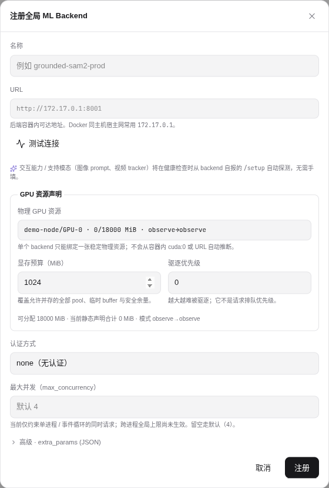

# 模型服务注册（全局注册表） {#ml-backend-注册-全局注册表}

模型服务是平台调用的推理服务。注册表是**全局**的：一个物理服务实例对应一行 `ml_backend_registry` 记录，同一 URL 只注册一次，所有项目共享该记录。项目侧从全局注册表里**勾选启用**，详见 [启用模型服务](../projects/ml-backends)。模型权重、服务实例和服务池的区别，以及 Token 的基本用途，见[模型服务接入、路由与认证](../../dev/concepts/ml-backend-routing-and-auth)。

## 入口

- 全局注册（新增 / 编辑 / 删除 / 健康检查，仅超管）：`/model-market` → **注册管理** tab
- 项目启用（勾选已注册模型服务 + 项目级覆盖，项目管理员 / 超级管理员）：项目设置 → **模型服务** tab

## 表单字段



| 字段         | 含义                         | 约束                                                                                                                       |
| ------------ | ---------------------------- | -------------------------------------------------------------------------------------------------------------------------- |
| 名称         | 显示名                       | 名称无全局唯一性约束，同名服务仍由实例 ID 和 URL 区分；`ml_backends` 表无 UNIQUE 索引                                      |
| URL          | 模型服务 HTTP 入口           | **全局唯一**（同一 URL 只能注册一次）；**不能填 loopback**（详见下）                                                       |
| 交互能力     | 是否支持工作台交互式推理     | 健康检查时从 `/setup` 自动探测，无需手填                                                                                   |
| 认证方式     | 系统托管、手动 Token 或 None | 新注册的地址匹配部署可信地址时默认选择对应的系统托管方式；None 不发送凭据                                                  |
| 手动 Token   | 调用该服务的访问凭据         | 与服务端配置一致；编辑留空保留原值，首次设置或从系统托管切回手动时必须填写                                                 |
| GPU 物理资源 | 稳定 `gpu_resource_id`       | 从运维显式配置的逐卡资源中选择；留空不等于已确认 CPU                                                                       |
| 显存预算     | `vram_budget_mb`             | 与 GPU 资源成对填写，正整数 MiB，不得超过该卡 `allocatable_mb`                                                             |
| 驱逐优先级   | `eviction_priority`          | 数值越大越难被驱逐，可为负数，不是请求队列优先级                                                                           |
| 最大并发     | `max_concurrency`            | 1 至 32；始终作为单进程 / 事件循环的本地背压；`ML_BACKEND_ROUTER_MODE=enforce` 时还作为 Redis route lease 的跨进程实例上限 |
| 额外参数     | JSON 扩展字段                | 不得与上述强类型字段冲突                                                                                                   |

表单不提供类型选择器、默认提示或默认阈值。服务能力由服务自身通过 `/setup` 声明；交互式标注、图像输入提示和视频追踪等能力在健康检查时读取，无需手填。`max_concurrency` 由表单单独填写后保存到 `extra_params` JSONB；其他扩展参数仍在高级 JSON 中编辑。

## URL 校验：拒绝 loopback

后端 Pydantic `field_validator` 会直接拒绝以下 host（`apps/api/app/schemas/ml_backend.py:8`）：

- `localhost`
- `127.0.0.1`（精确匹配，**不**拒绝整个 `127.x.x.x` 段）
- `0.0.0.0`
- `::1`

错误消息会指引你填正确的地址。背后原因：容器内 `localhost` 指向容器自身，不可能连到宿主机的模型服务。详见 [容器网络与 loopback](../../dev/troubleshooting/container-networking)。

**正确填法：**

| 场景                            | URL                                                                                          |
| ------------------------------- | -------------------------------------------------------------------------------------------- |
| 模型服务在同一个 docker-compose | `http://grounded-sam2-backend:8001`                                                          |
| 模型服务在宿主机 / 局域网       | `http://172.17.0.1:8001`（Linux 默认 bridge）/ `http://host.docker.internal:8001`（mac/win） |
| 模型服务在另一台机器            | LAN IP / 域名                                                                                |

dev 环境 placeholder 已默认填 `172.17.0.1:8001`。

## 认证方式与凭据

编辑已有实例时，可直接切换认证方式或更换 Token，包括已经受 GPU 管理的实例，无需先退役。认证属于全局实例，保存后所有引用它的项目共用新凭据；请与服务端配置保持一致。平台会清除该实例原有的健康结果，执行健康检查通过后再使用。URL、GPU 资源、显存预算、驱逐优先级与运行参数的变更仍受 GPU 退役保护：先停止接收新工作，等待活动工作实际结束并卸载模型；停止接流或在途计数归零本身不能证明工作已经结束。

系统托管按部署配置的可信地址区分服务，不按插件名称或是否在本机运行判断。默认配置包含 YOLO、ONNXTools、RapidOCR；Grounded SAM 2 与 SAM 3 需由部署管理员显式加入。表单只允许选择已配置地址的托管方式。保存时平台生成或复用该服务的私有凭据，并在指定地址验证服务身份。超管也可在「设置 → 系统设置 → ML 服务认证与维护」初始化并同步已有的无认证或托管实例；手动 Token 不会被覆盖，未注册服务不会因此自动注册或在项目中启用。

旧部署首次接入需升级到支持共享凭据的固定镜像，并重新创建容器以应用只读挂载。之后初始化与同步凭据无需重建容器。凭据已保存只表示本地文件可用；普通 `/health` 不证明认证就绪。系统托管保存会额外验证 `/managed-auth`，失败时保留本地文件供重试，实例原认证不变。保存成功后执行实例健康检查更新状态。

若握手期间另一个操作修改了实例地址或认证，保存返回冲突，保留后一个操作已保存的配置；请刷新实例后再决定是否更新。握手不会经由环境代理或跟随重定向发送凭据。

服务端要求 Bearer 且不使用系统托管时，选择手动 Token，不以服务在本机还是远程判断。YOLO 的手动 `YOLO_MANAGED_MODELS_TOKEN` 优先；模型回流要求至少 32 个字符。编辑已有手动 Token 时留空保留原值；从系统托管切回手动 Token 必须重新填写。`none` 始终不发送凭据。

这里的 Token 是平台调用模型服务的凭据，与个人 API 密钥分别管理。使用系统托管时不填写 Token；使用共享凭据目录的服务若未设置手动 Token，则从自己的私有文件读取凭据。缺少有效凭据时拒绝受保护请求，不会自动关闭认证。再次初始化只复用并同步已有值，不会轮换凭据。

## 健康检查

<!-- TODO(v0.14.18) IMAGE_CHECKLIST: images/superadmin/ml-backend/health-state-badges.png — connected/error/disconnected 三状态徽章对比 [manual] -->

通过认证设置校验后，注册会自动调用 `GET <url>/health`。普通健康检查失败不阻断创建，但列表会显示错误状态，`state` 取值为 `disconnected`、`connected` 或 `error`。系统托管的认证握手失败会阻止保存，不能用公开健康端点成功代替认证验证。

**注册前连通性测试**：手动 Token 或 None 方式可通过表单「测试连接」调用 `POST /admin/ml-integrations/probe`，只探测 `/health`，不写数据库。系统托管在保存时验证受认证端点，表单会禁用普通「测试连接」。连接成功只证明健康端点可达。

探测和试启动保留管理员对内网与新服务地址的诊断能力，URL 须为有效 HTTP(S) base URL，不含内嵌凭据、查询参数或 fragment；认证 token 单独填写。网络失败只回报安全的错误类别。项目预热还要求模型服务已启用于该项目；共享的重新加载和卸载继续按超级管理员全局权限执行。服务声明支持预热不代表模型已经加载，预热结果和健康检查各自提供不同的状态证据。

运行观测按规范化地址识别已注册实例，并使用该实例当前的认证方式；显式选择 `None` 时不会回退读取本地托管凭据。同址出现多个候选实例时返回冲突，需要先处理重复记录，而不是任选一份凭据。

## 全局注册 CRUD（超管）

注册管理 tab 对全局注册表做增删改查，对应后端端点：

```http
POST   /admin/ml-integrations/registry                  # 新增全局模型服务实例
PUT    /admin/ml-integrations/registry/:registry_id     # 编辑
DELETE /admin/ml-integrations/registry/:registry_id     # 删除
POST   /admin/ml-integrations/registry/:registry_id/health   # 健康检查（探 /setup 派生能力）
GET    /admin/ml-integrations/all                        # 全局列表（新建项目向导复用）
```

每个全局模型服务实例注册后会自动得到一个单成员服务池（ADR-0050），池内含一个接流成员指向该实例。off／observe 模式沿用原有实例选择，enforce 模式在合格成员中分配请求；停止接流和执行安全检查始终生效。详见 [ADR-0050 服务池与请求路由](../../dev/adr/archive/0050-ml-backend-service-pools-and-request-routing)。

## 可安装推理插件

插件由超级管理员在可访问 Docker 的部署机用 `yoao plugins` 安装，不自动发现插件；平台 API 不访问 Docker socket。安装器支持显式 CPU 和单卡 CUDA 配置、多个模型及命名模型池，不再限定为检测服务。需要非 host Docker 网络和已加载的固定 OCI 摘要镜像；CUDA 另需 NVIDIA Container Toolkit 和明确授权的物理 GPU。服务运行在隔离 Docker 进程，不挂载核心数据库、Redis 或 GPU 签发私钥。

部署命令须由非 root Docker 管理员执行；托管容器沿用操作者的 UID/GID，不强制使用镜像的默认 `USER`。私有状态目录须由该操作者持有并保持 `0700`，不要为匹配镜像默认 UID 而放宽权限或添加共享 ACL。

使用 Python 3.11 及以上，从可信来源取得包含 SDK、`plugins` extra 及其完整依赖的 wheelhouse（包括 `yoao-inference-contract`、`yoao-task-contract`、`yoao-lifecycle-contract` 和训练契约），或使用包含这些 wheel 的私有索引；不要假定包已发布到 PyPI。SDK 独立于平台仓库分发，部署 extra 不包含 backend runtime、FastAPI、Torch 或模型框架；仅安装核心 SDK 或 `cli` extra 不会隐式安装插件管理依赖。

必要的第一方便携契约应从可信渠道按显式 manifest 与 SHA256 核验取得，契约源码仍由平台维护；历史公开制品不代表新发行名已经发布。[Plugin-SDK](https://github.com/YOAO-Labs/Plugin-SDK) 提供自定义插件作者抽象与能力工具，[YOAO-Plugins](https://github.com/YOAO-Labs/YOAO-Plugins) 只维护官方插件、模型专属适配和预训练目录。插件开发 SDK 与管理员使用的 API SDK 分包，安装管理无需安装模型开发运行时。第一方 wheel 不是完整离线依赖包，也不包含模型权重或 OCI 镜像，更不自动授予托管 GPU 资格。

```bash
python -m venv .venv
source .venv/bin/activate
python -m pip install --no-index --find-links /path/to/wheelhouse 'yoao-sdk[plugins]'
export YOAO_BASE_URL="https://platform.example"
export YOAO_API_KEY="<超级管理员 API 密钥>"
```

API 密钥使用私密方式注入，不要提交或写入镜像。以可访问 Docker 的非 root 用户运行安装器；每个安装使用独立私有状态目录，保存原始收据、随机业务 Token、配置、公钥文件和资产以便故障恢复，不要共享、提交或删除。以下是完整 `deployment.json` **结构示例，不是可部署的真实制品**：将占位摘要、公钥、资源、来源和主机替换为经审核的真实值；`manifest` 以作者生成并经管理员审批的完整 manifest 为准。

```json
{
  "name": "LibreYOLO detection",
  "url": "http://172.17.0.1:18000",
  "manifest": {
    "plugin_id": "libreyolo",
    "version": "0.1.0",
    "publisher": "实际发布者",
    "license": "实际制品许可证",
    "artifact": "registry.example/libreyolo@sha256:aaaaaaaaaaaaaaaaaaaaaaaaaaaaaaaaaaaaaaaaaaaaaaaaaaaaaaaaaaaaaaaa",
    "sdk_compatibility": "0.1.0",
    "entrypoint": ["my-libreyolo-plugin", "serve", "--host", "0.0.0.0", "--port", "8000"],
    "capabilities": ["inference", "detection", "managed_models"],
    "models": [
      {
        "id": "detect",
        "task": "detect",
        "is_interactive": false,
        "supported_prompts": ["none"],
        "supported_inputs": ["full_image", "crop"],
        "supported_geometric_outputs": ["bbox"]
      }
    ],
    "pools": { "models": { "cap": 1 } },
    "resource": { "device": "cuda", "memory_mb": 16384, "gpu_memory_mb": 8192 },
    "asset_manifest_sha256": "bbbbbbbbbbbbbbbbbbbbbbbbbbbbbbbbbbbbbbbbbbbbbbbbbbbbbbbbbbbbbbbb",
    "managed_model_compatibility": [
      {
        "framework": "libreyolo",
        "format": "libreyolo-native-state-dict-1.0",
        "runtime_device": "cuda"
      }
    ],
    "allowed_asset_sources": ["https://assets.example"]
  },
  "gpu_resource_id": "gpu-worker-1",
  "physical_gpu_uuid": "GPU-12345678-1234-1234-1234-123456789abc",
  "network": "aap-plugins",
  "host_port": 18000,
  "container_port": 8000,
  "cpus": 4,
  "gpu_verify_keyring": { "key-1": "AAAAAAAAAAAAAAAAAAAAAAAAAAAAAAAAAAAAAAAAAAA" },
  "image_hosts": ["media.example"]
}
```

`gpu_resource_id` 必须是平台配置的实际逐卡资源，`physical_gpu_uuid` 是该卡完整 UUID；安装器只将该卡暴露给容器，并绑定容器内逻辑 `cuda:0`，不按宿主机 ordinal 猜测。`memory_mb` 和 `gpu_memory_mb` 分别为 RAM 与显存预算（MiB），显存不得超过资源可分配量；`cpus` 为 CPU 上限。URL 必须从平台容器可达、指向该宿主端口，不能用 loopback；示例 bridge 地址须按实际网络替换。`image_hosts` 是可获取推理图片的主机名，`allowed_asset_sources` 是受控资产下载实际使用且获授权的完整 HTTP(S) origin，可含多个；二者不是同一白名单。公钥是 key ID 到 Ed25519 公钥的 unpadded base64url 映射，不能使用示例零值。安装器将其写入私有 `data/gpu-keyring.json`，并在可写数据目录之上独立只读挂载该文件；资格报告同样只读挂载。不要将签发私钥放入配置或状态目录。

`models` 是获准能力的最小投影，不是第二份完整模型目录：模型 ID、任务、交互性、提示、输入和几何输出必须与实际 `/setup.models` 一致；分类可具有空的几何输出列表。`pools` 是命名池及正整数容量，须与 `/setup`、带新鲜挑战的 `/health` 和 CUDA 报告一致。未知能力、多报或漏报模型／池都会拒绝激活。

需要加载用户训练 checkpoint 的插件，还须显式声明受控模型兼容性。原生 Ultralytics 权重使用 `format: null`；具名导出格式使用对应的非空字符串。这里的 `null` 不是任意格式通配符，缺字段也不能代替它。平台只接受批准清单、实际观测和模型回执一致的框架、格式及 CPU／CUDA 运行设备。

| 运行配置 | 安装配置与证明                                                                                                                                                                                                                |
| -------- | ----------------------------------------------------------------------------------------------------------------------------------------------------------------------------------------------------------------------------- |
| CPU      | `resource.device` 为 `cpu`，`gpu_memory_mb` 为 `0`；不配置 GPU 资源、UUID 或公钥，不提交 GPU 报告，也不申请 GPU 设备。安装器为所有 CPU 插件设置 `NVIDIA_VISIBLE_DEVICES=void` 和空的 `CUDA_VISIBLE_DEVICES`，不按插件名豁免。 |
| CUDA     | 显式绑定一张物理卡、显存预算和验签公钥；提交与实际镜像、资产、驱动、运行时及全部命名池相符的报告。容器内设备为 `cuda:0`。                                                                                                     |

ORT 报告还须记录每轮每个实际业务 session 的完整 provider 链，并使数量与 factory 拓扑及新鲜运行观测一致；两轮都漏报同一 session 也不能通过。严格 CUDA 插件拒绝整条 session 回退到 CPU，并关闭 ORT 的运行时整 session 重试回退；这不等于承诺所有算子都在 GPU 执行，合法的 CPU 算子分区仍可存在。Torch 报告不需要伪造 ORT session 字段。

```bash
yoao plugins prepare --config deployment.json --state-dir ./plugin-state --json
# 仅 LibreYOLO 提供此安装器资产准备命令；其他插件按自己的获准资产流程准备
yoao plugins prepare-assets --state-dir ./plugin-state --json
# 管理员先审核与该安装身份、镜像和 GPU 绑定的完整共享生命周期报告
yoao plugins install --state-dir ./plugin-state --qualification gpu-report.json --yes --json
yoao plugins status --state-dir ./plugin-state --json
```

`prepare` 预留不可接流的安装身份、Registry 和资源绑定；`prepare-assets` 只执行 LibreYOLO 提供的显式资产准备流程，不是所有插件的通用下载器。使用相同状态目录和配置重试，勿另造身份。安装器检查真实 Docker 镜像摘要、镜像和容器 ID、启动身份及资源绑定，再提交可信管理员的启动收据；这不是远程密码学证明。CUDA 必须另提交管理员审核通过的完整共享生命周期报告及摘要，绑定此次预留的 Registry、镜像、资产、实际 GPU、驱动、运行时和全部池，包含真实推理、取消和两次冷态释放。`--yes` 表示管理员批准安装及所提供的报告，不替代审核；本地 `yoao-plugin check --qualify-local` 的报告不等于平台托管资格报告。平台还会验证实际受认证端点。安装完成不会自动为任何项目启用或发布模型；项目负责人须显式启用该服务，受控模型另行部署、加载试用并人工发布，详见[模型回流与默认预标](../online-learning/models)。

RapidOCR CPU 镜像使用独立 CPU ORT 依赖，不安装 GPU ORT 或 NVIDIA wheel。按 [RapidOCR 插件说明](https://github.com/YOAO-Labs/YOAO-Plugins/tree/main/plugins/inference/rapidocr)中的资产流程核验并准备所需权重，用作者工具生成 manifest；该工具当前要求默认 `RAPIDOCR_POOL_CAP=3`，不默默为其他容量生成固定值。将 `container_port` 设为镜像实际监听的 `8005`，准备后直接执行 `yoao plugins install --state-dir ./rapidocr-state --yes --json`，不传 `--qualification`。服务保留 det／rec／e2e 完整目录；未获准准备的变体明确失败，不自动下载其他权重。其 headless OpenCV 替代仍有上游 `pip check` metadata 不匹配，不能把真实运行通过描述为普通 pip 依赖检查全绿。

托管 CUDA 实例应使用目标资源的 `enforce` GPU 准入配置；这与服务池 router 的 off／observe／enforce 模式是两套控制。签名初始化和排空可能等待旧控制 Token 的有效期结束，SDK 为激活和排空使用 300 秒请求超时。网络中断或超时不代表平台操作已回滚：先读取安装状态，再用原状态目录恢复，不能另建身份或直接停止容器。

安装器等待健康端点就绪时，启动中的短暂断连或 503 不算启动成功；60 秒内仍未就绪便停止提交激活，保留启动身份供原目录恢复。平台激活会先完成受认证的持久路由控制绑定；CUDA 再建立 GPU 准入，随后才将安装标记为 active。绑定未确认时不会先开放接流。路由控制和业务请求各自验证所属凭据，不能拿业务 Bearer 绕过控制权限。停用和卸载沿用已记录的启动文件，不为退出重写运行配置。

安装 API 以 `/api/v1/admin/ml-integrations/plugins/installations` 为集合：`POST` 到**集合本身**预留；`GET` 和 `GET /{installation_id}` 查看；`POST /{installation_id}/activate`、`disable`、`quiesce`、`retire` 执行状态变更。动作需要当前 `expected_revision`；并发冲突时先重新读取，勿覆盖其他管理员操作。预留的安装 UUID 是重试幂等键，重复请求必须匹配原意图和凭据。

安装和项目启用不授予预训练模型权利。超级管理员须审核插件发布的 selection descriptor，按该安装的制品、资产清单和每个完整变体明确批准；目录中未批准或本地资产不可用的规格仍可查看，但不可用于推理。既有安装不会自动获得批准，历史 GPU 报告也不能替代这一步。受控训练模型仍遵循原有部署和发布规则。

对已经激活的安装，使用原私有状态目录和插件提供的 descriptor 文件。`choices.json` 是含 `approved` 数组的 JSON 对象，每项为 `{"model_id":"...","variants":{...}}`；只列出实际批准的完整规格，空数组撤销全部批准。先读取修订，再以该修订提交，冲突时重新读取并审核：

```bash
yoao plugins asset-approvals --state-dir ./plugin-state --json
yoao plugins approve-assets --state-dir ./plugin-state --descriptor selections.json \
  --choices choices.json --expected-revision 0 --yes --json
```

首次决策修订为 `0`；后续提交使用读取到的修订。安装器核对原安装收据和运行容器身份，在该容器内执行固定的 Python 标准库测量程序，逐文件核验实际挂载数据的 SHA256 与大小；不会改为读取可能已被替换的宿主机同名目录。镜像须提供 `python3`，不需要安装平台 SDK，测量程序不会导入模型或初始化 CUDA。测量固定目录描述符并拒绝符号链接，缺失或不匹配的资产不会被标记为可用。测量结果是提交时的管理员本地观测，不会持续重新计算文件摘要；须保护数据目录，并在文件变化后重新测量提交。批准和可用是不同状态；准备或更换文件后须重新测量提交，重启后的新容器身份也须重新测量。该流程不下载权重，也不要求 CPU 安装具备 CUDA；发布者的资源描述和软件许可本身不构成管理员批准。

已有 LibreYOLO 安装同样需要此批准：使用该插件发布的预训练描述与对应安装身份生成 selection descriptor，审核完整规格和每个资产后，用原状态目录执行上述读取与提交。对于当前版本已支持的安装，不要新建安装、改写原 manifest 或重新制作旧 GPU 资格报告；原容器和收据无法核验时先恢复安装所有权，不能把历史报告当作本地资产清单。如果历史 manifest 尚无 `models` 和 `pools`，必须先完成下面的[历史清单与本地收据迁移](#历史清单与本地收据迁移)；旧版隔离运行环境在迁移前保持原状，不能由本批准流程自动补齐能力。

同一服务池中各实例的批准和本地资产可用状态可能不同；平台只在符合该规格的可接流成员中按原有权重路由，未批准或不可用的成员不会参与选择。执行前会再次检查实际选中的实例，因此撤销批准后已排队但尚未派发的工作不能继续使用该规格。

旧文本预标请求未指定模型时，平台按模型声明的文本输出形态确定唯一规格：`box` 对应检测，`mask`／`both` 对应支持该输出的分割模型。若声明不能唯一确定模型，仍拒绝派发；确定后仍逐实例检查完整变体的资产批准和可用性。

停用阻止新工作，但 **disabled 不等于 `safe_to_stop`**。必须完成 quiesce 并使用当前证明修订，只有 `safe_to_stop` 收据才允许停止对应容器；超时、未知状态、HTTP 断开或 Jobs 已结束都不是排空证明。下列命令由安装器执行停用、排空证明、停止拥有的容器，以及依赖检查与退役：

存在 Tracker 范围时，`disable` 之前必须在后端仍可达、原配置仍有效时取得该范围的实际退役证明。任务显示已完成／失败／取消、逻辑 scope 已关闭或 inflight 为零都不能替代证明；否则停用返回 409 并保留原状态。先停止新的业务提交，等待任务正常结束或通过既有取消流程处置，再由执行 owner 完成范围退役后重试同一安装操作。`quiesce`、退役和已有 `safe_to_stop` 收据的重放也会再次核对，不能先停止容器再补证明。

真实请求断连后，不确定工作租约仍占用显存承诺。安装 owner 只有在相关许可有效期与租约硬期限均过去，并取得当前实例的新鲜空闲证明后，才能结清这些租约并继续签名排空；原生请求、构建或模型借用未退出时不会提前释放。等待超时应保留原状态目录，按结构化错误及重试信息恢复同一安装操作，不删除 Redis 租约或退出围栏。

```bash
yoao plugins disable --state-dir ./plugin-state --yes --json
yoao plugins uninstall --state-dir ./plugin-state --yes --json
```

失败保留私有状态并查状态后重试，勿手工停止未知身份。活动发布或冻结的重试依赖会阻止退役；退役保留 Registry、部署和历史发布快照。对于仅预留且从未尝试启动的安装，直接执行上述 `uninstall`：仅在无启动尝试或启动收据、且确认本地不存在对应容器时，安装器才会使用 `cancel-prepared` 取消预留；未知容器或启动历史不能假定未执行。排空证明绑定完整容器 ID，同名替代实例不得使用旧证明；恢复检查拒绝共享或未知 PID 命名空间。无效资格报告和镜像检查失败不会固定候选，可修正后重试。

GPU 资源修复任务可依据 owner 核验的“从未启动”闭合证明回收已取消的预留，不要求不存在的进程提供健康响应。真正启动过的实例仍须完成终止证明，并等待相关 Token 时限后收口；不要通过清空账本或重命名资源绕过等待。多池终止回执必须包含全部且不重复的获准池，顺序可以不同，其他身份、代际与卸载字段仍须匹配。

需要保留同一安装及模型目录、仅替换运行进程时，使用 `yoao plugins restart --state-dir ./plugin-state --yes --json`。它先完成上述终止证明及停止，再用原制品和资格创建新的容器与启动身份；历史证明保留。GPU 激活须等待既有签名许可有效期，reset 与 enforce 各自保留完整等待窗口；结构化超时不表示候选可以改换身份。中断后继续同一命令，不手工启动候选或替换容器。重启不会自动恢复已排空的服务池成员，须由管理员显式恢复。意外退出或外部重启不等于终止证明，无法核验原进程身份时拒绝自动接管；执行安装器期间应独占该安装的 Docker 管理操作。

重启返回 active 只确认安装已激活，不代表新容器的预训练资产已重新测量，也不代表服务池已恢复接流或项目策略已启用。用同一私有状态目录读取当前批准修订，重新执行 `approve-assets`，在新容器内测量并提交经过审核的规格；确认成员和能力后，再通过服务池管理显式 resume 已排空的成员。项目启用仍由项目负责人单独管理。CUDA 资源可能仍在等待许可时限及其后的新鲜健康证明；查看 GPU 资源的 owner 就绪状态，不能仅凭进程或物理 GPU 空闲判断可接流，也不要清空账本缩短等待。

新进程的路由 incarnation 不能直接沿用旧进程。宿主只有在原终止证明已结算、旧容器与 boot 已记为停止，且新容器、boot、端点、资格和安装修订均匹配时，才授权这一次替换握手；存在未结束或不确定的路由执行时拒绝。失败重试保留原控制 ID、挑战和 epoch，完整握手后才能继续 GPU 初始化及激活，不把“新进程空闲”单独当作旧进程已退出。

路由绑定失败留下的管理围栏不会因 GPU 排空而消失。GPU owner 可依据持久化安装终止意图取得仅用于签名终止排空的端点许可；此许可不能执行预测或普通生命周期请求。完成实际排空、账本结算和安装证明后可以退役并停止对应进程，未确认的路由控制及历史尝试仍保留，不宣称路由已恢复。

升级须在新状态目录用新制品重新 `prepare`，按该插件自己的流程准备资产；CUDA 另需审核新报告。之后使用 `yoao plugins upgrade --from-state ./old-state --state-dir ./new-state --qualification new-report.json --yes --json`，CPU 不传报告参数。升级创建新的安装及 Registry 身份，旧身份保持不变。项目负责人显式启用新服务并完成模型部署、试用及人工发布；旧安装须满足依赖和排空条件才能退役。历史模型版本回滚也须在已验证的新插件部署上重新部署并人工发布，不能重新激活退役的旧 CPU 实例。

### 历史清单与本地收据迁移

旧 manifest 没有完整的获准模型能力和池容量，不能根据插件名、已有文件或新的默认值自动补齐。迁移 `bo0401` 要求管理员逐项核对不可变镜像并批准 inventory；有未知、缺失或不匹配的历史记录时整次升级拒绝，不会先把它们改为无效记录。

1. 在维护窗口停止旧版 API、Inference owner 和相关 worker，保存数据库及私有安装状态的受控备份；先安排仍依赖旧镜像的执行与恢复路径。
2. 准备绝对路径 JSON 文件，顶层为 `{"schema":1,"installations":[...]}`。每项包含 `installation_id`、`registry_id`、`artifact`、`image_id`、完整 `old_manifest`、`old_manifest_sha256`、`asset_manifest_sha256`、获准 `models`、`pools` 和可追溯的 `approval_ref`。UUID、原 manifest、OCI 制品、资产摘要及已有启动镜像必须精确相符，清单须完整覆盖历史安装。
3. `old_manifest_sha256` 使用 `json.dumps(old_manifest, sort_keys=True, separators=(",", ":"), ensure_ascii=True, allow_nan=False)` 的 ASCII 字节计算 SHA-256。通过部署原有的、已确认目标数据库的迁移入口执行 `alembic -x plugin_capabilities_inventory=/absolute/path/inventory.json upgrade head`。没有历史安装时不需要填造 inventory。
4. Registry 迁移完成后，对每个本地状态目录显式执行 `yoao plugins migrate-state --state-dir ./plugin-state --manifest approved-manifest.json --image-id sha256:<已核验镜像ID> --yes --json`。命令重新核验权威 Registry、镜像及已有容器／启动身份，只更新获准能力投影；不改 Docker 所有权标签、资源绑定、旧资格或数据目录。

迁移保留原 manifest 及批准来源；本地收据只在同一私有文件内保存不含 Token 的旧状态快照，供协调回退核验，不生成第二份永久凭据。数据库降级遇到新增、删除或已改变的安装会拒绝，不能通过丢弃记录强行回退。

**收据迁移不等于旧镜像取得新资格。** 旧不可变镜像缺少新运行声明时，仍可凭精确身份、新鲜挑战和完整 residency 安全停用／退役；新激活（包括重新创建进程后的激活）仍须满足当前声明和资格门禁。不要先停止仍需恢复的旧实例，再假定 `migrate-state` 能使旧镜像重新激活；应先完成经批准的新制品交接，或保留原先匹配的隔离宿主恢复环境。

旧 CPU 状态目录若保存了未限制 GPU 可见性的环境文件，查询与按原身份排空不会改写该文件；重新创建进程则会拒绝配置不一致。完成受控退役后，使用新状态目录与安装身份部署，不手改旧文件来维持标签或启动摘要。

## 服务池管理（超管）

<!-- TODO IMAGE_CHECKLIST: images/superadmin/model-market/registry-service-pools.png — 注册管理服务池主视图（结构化 tab + 展开成员 + 维护操作） [auto] -->

服务池是路由选择的逻辑边界，实例是可定位到物理 URL 的 registry 记录。一个池可含多个等价实例（同模型 / 同 schema，capability 指纹 exact match）。注册管理 tab 的「服务池」视图对池做增删改查 + drain / resume：

```http
GET    /admin/ml-integrations/service-pools                       # 列表（含成员）
POST   /admin/ml-integrations/service-pools                       # 新建池
GET    /admin/ml-integrations/service-pools/:pool_id              # 单池详情
PATCH  /admin/ml-integrations/service-pools/:pool_id              # 改名 / 启停
DELETE /admin/ml-integrations/service-pools/:pool_id              # 删除池
PUT    /admin/ml-integrations/service-pools/:pool_id/members/:registry_id   # 加入/改权重
DELETE /admin/ml-integrations/service-pools/:pool_id/members/:registry_id   # 移除成员
POST   /admin/ml-integrations/service-pools/:pool_id/members/:registry_id/drain    # active→draining
POST   /admin/ml-integrations/service-pools/:pool_id/members/:registry_id/resume   # draining→active
GET    /admin/ml-integrations/service-pools/:pool_id/members/:registry_id/capability-drift          # 预览能力差异
POST   /admin/ml-integrations/service-pools/:pool_id/members/:registry_id/capability-drift/accept   # 接受新基线
```

**drain / resume 语义**：

- **drain**：成员 `traffic_state` 从 `active` 切到 `draining`，停止接收新的执行；已在飞的请求继续完成。幂等。
- **resume**：`draining` 切回 `active`，恢复接流。幂等。`disabled` 成员不能直接 resume；这类状态需要先审核能力变更。
- drain / resume **只影响路由接流**，不触发模型权重卸载（那是 GPU 仲裁的 residency drain，独立）。
- off／observe 模式仍使用 legacy 实例，但该成员进入 `draining` 后也不再接受新的执行。已经开始并固定实例的跟踪作业可以完成既有工作。

**加入成员**：被加入的实例必须与池内现有成员 capability 指纹 exact match（同 `models[]` 模型目录、请求 schema、variant 组合和 tracker 等稳定能力，排除 URL/GPU/VRAM/residency 等运行态字段）。不匹配返回 `HTTP 409` 并附结构化 diff。对已在池内的成员再次 PUT 会更新权重，不会重置已有的 traffic state。同一实例不能同时属于两个服务池。

**审核能力变更**：健康刷新发现 `/setup` 的路由合同与服务池基线不一致时，平台会自动把成员设为 `disabled`；若它是 legacy 实例，还会关闭服务池。超管可在「服务池」展开成员或「实例」操作菜单中选择「审核能力变更」，查看旧/新指纹与 canonical 字段差异。确认时平台会重新执行健康与 `/setup` 探测，并校验候选指纹没有在审核期间再次变化；池内若仍有能力不一致的 active / draining 成员则拒绝。验证通过后，新基线、成员 `active` 状态、路由代际和可选的服务池启用在同一事务中提交。若实例已经回滚到原基线，则只恢复成员与服务池，不改写基线。该操作只接受明确审核过的合同，不会自动放行 capability superset。

**卸载 / 移除成员 / 删除**：纳管实例必须先进入 `draining`。新鲜的零在途观测只允许提交卸载请求，服务端还会核验后台执行和控制状态；超时、通信中断、缓存清空或租约过期均不能证明任务已经结束。管理结果未确认时保持阻塞。升级后需先由运维完成[后端控制绑定](../../api/guides/inference-runtime#持久路由执行权)，再管理实例；无法确认时返回冲突或服务不可用。删除服务池前必须逐一安全移除所有成员，空池才可删除。

GPU 自动驱逐在卸载回包丢失后仍会复查健康状态。只有新鲜且匹配的实际卸载证据才能回收预算；检查失败或状态无法确认时，继续保留未决状态与预算。

移除成员或删除实例时，若安全检查后成员被恢复接流、移到其他池或路由代次改变，返回409；请重新读取状态、drain 并重试。删除清理项目主绑定遇到正在保存的项目配置时，也返回409并回滚整个删除。项目配置等待服务池期间所选实例被删除或移走，同样拒绝本次保存；刷新清单后重新选择。

加入、移除、drain 和 resume 成功后返回已提交的最新服务池状态。若连接中断、没有收到结果，先读取服务池详情核对成员和路由代际，再决定下一步；再次移除已不存在的成员会返回404。

## 项目启用

注册仅是创建可选项，不代表服务当前已连接，也不会自动为项目启用。目录可能使用缓存，不能用目录可见性证明当前连通性；检查服务健康状态后，还需要项目启用：

1. 项目设置 → **模型服务** → 点「管理模型服务」在全局模型服务清单里**勾选启用**该服务（推理参数运行时按服务自报的 `/setup.params` 调，不在此预设）
2. 同一页在 **项目主模型服务** 下拉里选一个**已启用**的模型服务（设置后即启用 AI 预标注）
3. 选择后即时生效，无需额外保存。

未设项目主模型服务直接跑预标会报错，并在前端给出配置引导。详见 [启用模型服务](../projects/ml-backends)。

## 引用全局注册项（不复制）

新建项目向导提供下拉框选择已注册的全局模型服务；选中即为新项目**启用**该全局注册项（**引用同一全局 ID，不再复制一份**）。这样所有项目共享同一服务实例记录，能力快照与健康状态一处维护、处处一致。

后端：`GET /admin/ml-integrations/all` 返回全局注册表列表。

## 删除

物理删除全局模型服务实例是**超管职责**（`DELETE /admin/ml-integrations/registry/:registry_id`）。删除前若有正在运行的预测任务、未完成 GPU 退役，或者管理安全检查尚未确认停止接流和后台任务结束，都会返回冲突或服务不可用错误并保留数据。条件全部满足后，删除会解除该实例的服务池成员关系；若它是原有的兼容实例，所属池会停用并清除项目主绑定。历史预测仍按外键策略保留可追溯性。

从未纳管 GPU 的普通模型服务实例可在上述检查通过后正常删除；具有 GPU 历史的实例仍须完成相应退役与回收流程。

项目管理员不能物理删除全局模型服务实例，只能在项目设置里**取消勾选启用**让它对本项目停用（不影响其它项目）。

## 审计

以下事件写入 `audit_logs`：

- `ml_registry.created` / `ml_registry.updated` / `ml_registry.deleted`（全局注册 CRUD）
- `ml_plugin_installation.prepared` / `launch_recorded` / `qualification_approved` / `activated` / `disabled` / `quiesced` / `retired` / `assets_updated`（插件身份、生命周期和资产批准动作；不记录实例 Token）
- `ml_registry.managed_auth_initialized`（默认凭据初始化与同步）
- `ml_backend.maintenance_requested`（系统设置提交指定服务的镜像与容器维护）
- `ml_service_pool.created` / `updated` / `deleted`（服务池 CRUD）
- `ml_service_pool.member_upserted` / `member_removed` / `member_drained` / `member_resumed`（成员与接流状态）
- `ml_service_pool.capability_drift_accepted`（审核并接受新的池能力基线）
- `ml_backend.created` / `updated` / `deleted` / `enablement`（项目兼容端点）
- `ml_backend.reloaded` / `ml_backend.unloaded` / `ml_backend.warmup`（生命周期动作）
- `ml_backend.smoke_tested`（模型市场试启动）

详见 [审计日志](./audit-logs)。

## 相关操作

- **观测（observe）**：`GET /admin/ml-integrations/observe` 直连 env 配的模型服务容器，不需要项目注册即可看健康 / 变体目录。
- **试启动（smoke-test）**：`POST /admin/ml-integrations/observe/smoke-test`，只有新协议 residency 能严格证明所有 pool / builder / borrower 已空时才预热指定变体并自动还原；旧协议会同时保守检查图像池、视频池与活跃会话。
- **GPU 资源诊断**：超管可查看逐卡容量、静态预算、desired → effective mode 及配置 blocker。`observe` 仅记录影子决策，不会拒绝、排队或驱逐请求。
- **`max_concurrency`**：写入 `extra_params.max_concurrency`；本地 semaphore 始终生效，`ML_BACKEND_ROUTER_MODE=enforce` 时再由持久路由 owner 把 API 与多个 Celery worker 收口到同一实例上限。GPU 仲裁的逐资源 effective mode 管显存准入与驱逐，是另一条独立门禁。

训练完成后的候选注册、加载试用和人工发布见[模型回流与默认预标](../online-learning/models)。全局服务注册不会自动把权重加入项目模型。

## 相关

- [ADR 0015 — ML Backend URL 验证](../../dev/adr/archive/0015-ml-backend-url-validation)
- [模型市场](./model-market)
- [ML Backend 协议](../../dev/reference/ml-backend-protocol)
- [模型服务接入、路由与认证](../../dev/concepts/ml-backend-routing-and-auth)
- [本机 ML 服务维护](../../ops/deploy/ml-backend-maintenance)
