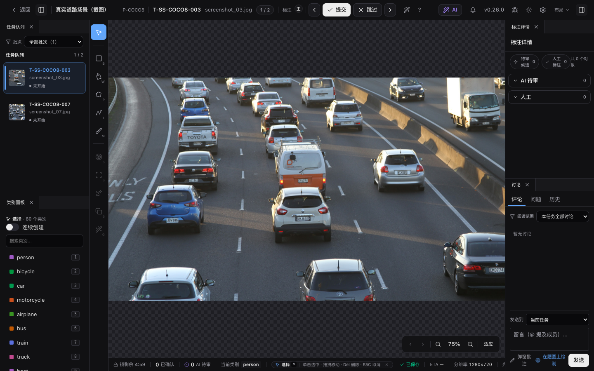

# 标注工作台 — 界面与快捷键

工作台是标注员与审核员日常作业的核心交互空间，采用适配图像、视频时间轴与 3D 点云的多模态统一外壳。本篇介绍工作台区域划分、高频快捷键速查、超大图机制以及面板自由停靠定制。

> 适用角色：标注员、审核员 
> 快速通道：完整快捷键列表参见下方自动同步表；工作台个性化配置参见 [工作台设置](./settings)。

## 图片原件与预览

> 本节说明**标注画布工作台**内的单题原件与金字塔预览加载行为；若需在数据集层面按目录、质量指标或状态批量浏览样本、保存筛选视图或检查来源状态，请前往[数据集工作台](../datasets/workbench)。

托管图片会在当前登录会话内核验原件后显示；审核页与数据管理预览使用同一读取方式。切换任务或退出登录会取消旧读取并释放图像地址，相邻图片预取不会改变当前任务。同一项目切题等待读图时，连续创建的工具与类别选择会保留，图片就绪前暂停绘制和保存；更换登录会话、退出项目或失去编辑权限时结束该意图。超大图优先使用已有金字塔预览，不会为了显示缩略图下载整个原件。

缺失、内容变化或历史归属未核实的原件会显示读取错误，可在问题解决后刷新重试；已有缩略图不代表原件仍可读取。完整原件下载上限为512MiB，图片能否解码还取决于浏览器格式和内存预算，TIFF等格式可能需要下载后查看。SVG保留原始内容并使用隔离地址显示。数据集详情中的非视频原件下载也需要当前数据集管理权限。

## 常用快捷键速查 (Cheat Sheet)

| 按键                        | 功能操作              | 适用场景                                           |
| :-------------------------- | :-------------------- | :------------------------------------------------- |
| `V` / `Esc`                 | **选择工具 (Select)** | 选中、平移或调整已有标注图形及 AI 候选（默认工具） |
| `B`                         | **矩形框 (Bbox)**     | 轴对齐矩形拉框（拖拽或按住 `Alt` 从中心展开）      |
| `W`                         | **旋转框 (OBB)**      | 适用于倾斜目标检测（带旋转手柄）                   |
| `P`                         | **多边形 (Polygon)**  | 闭合轮廓分割标注（单击落点，双击或闭合点结束）     |
| `L`                         | **折线 (Polyline)**   | 开放线条标注（车道线、边缘线等）                   |
| `F`                         | **关键点 (Keypoint)** | 人体骨骼或关键节点标注                             |
| `M`                         | **Mask 笔刷**         | 像素级分割涂擦与擦除                               |
| `Space` + 拖拽 / 右键拖拽   | **平移画布**          | 在任意缩放比例下拖动画布视野                       |
| `Ctrl` + 滚轮               | **缩放画布**          | 以光标为中心放大或缩小视图                         |
| `Ctrl` + `Z` / `Ctrl` + `Y` | **撤销 / 重做**       | 回退或恢复最近的编辑草稿                           |
| `Ctrl` + `Enter`            | **提交任务**          | 提交当前任务进入审核队列                           |

## 界面组成与多模态支持

工作台由五个核心区域组成：

1. **顶部导航栏**：显示任务序号、批次名称、上一题/下一题切换、状态指示灯、主题与设置菜单，以及核心的 **「提交质检」** 按钮。
2. **左侧主工具栏**：提供几何绘制工具、交互式 AI 触发器。高度受限时，次要工具自动收纳进底部“更多工具”。
3. **中央主画布**：
   - **图像任务**：2D 图像视口，支持矢量图形、像素 Mask 与 SAM 候选快速交互；
   - **视频任务**：联动底部视频时间轴，展示跨帧时序轨迹（Tracks）、关键帧与插值控制；
   - **3D 点云任务**：Three.js 3D 视图，支持 3D 立体框 gizmo 编辑、三视图投影与多相机 RGB 联动。
4. **右侧属性与讨论区**：承载类别选择面板、标注对象列表、属性表单，以及任务评论与 Issue 追踪。对象列表包含**粘性表头（Sticky Header）**，常驻展示「待审候选」与「人工标注」实时计数并支持点击锚点平滑跳转；对象行中的「更多操作」支持点击固定展开，在触屏或无悬停环境下也能便捷采纳候选、调整类别。
5. **底部状态栏**：单行显示当前任务锁状态、同步队列、光标坐标、缩放比例与撤销/重做控制，并集成**当前激活工具手势操作提示胶囊（`ToolGestureHintPill`）**，动态呈现当前工具（2D 图像、单帧/连续视频、点云 3D 与审阅模式）的名称、快捷键与鼠标高频手势指南，杜绝遮挡画布内容并支持一键折叠与展开。

版本信息与更新内容可从主界面顶栏查看。

## 超大图片的当前行为

<!-- TODO IMAGE_CHECKLIST: images/workbench/large-image-pyramid-status.png — required 超大图生成中与失败/重试状态 [auto] -->

<DocsVideo
  src="/media/large-image/progressive.mp4"
  poster="/media/large-image/progressive-poster.webp"
  alt="超大图从概览随缩放与平移渐进恢复局部高清切片"
  caption="超大图浏览：随视口缩放与平移，渐进加载金字塔切片，无需独立 GPU。"
/>

图片背景浏览不要求 WebGPU；没有独立 GPU 的浏览器仍可顺畅缩放和平移。已生成高清切片的超大图会先显示 overview，再按当前视口与缩放级别渐进加载清晰 tile。标注、Mask、Issue 图钉与 Minimap 始终绑定原图坐标，不受分辨率层级影响。
缩放或平移期间淘汰旧切片不会冻结画布，新的可视区域继续加载并绘制。

- **切片生成中**：画布显示“高清切片生成中”和安全预览；
- **必需切片缺失或失效**：保留安全预览并显示重建或重试状态；即使还没有生成代次，也不会自动加载超大原图；
- **请求失败与重试**：网络偶发失败时保留 overview 并自动重试；
- **Mask 编辑限制**：背景大图浏览与 Mask 像素编辑是两条独立边界，超限时建议使用 Bbox/Polygon 矢量工具。

## 布局偏好与浮窗定制

工作台支持将外围面板自由拖拽停靠、多标签合并或弹出为独立浮窗。布局偏好自动按工作类型分桶保存在账号中，跨任务、刷新页面后均可自动恢复。

### 面板手势操作速查

| 操作目标     | 交互手势                       | 界面反馈                             |
| :----------- | :----------------------------- | :----------------------------------- |
| **边缘停靠** | 拖动面板标签至画布左/右/下边缘 | 边缘出现高亮吸附蓝线，松手即完成分屏 |
| **标签合并** | 拖动面板标签至另一面板标签栏   | 两个面板合并为选项卡组，点击切换     |
| **独立浮窗** | 按住 `Shift` 拖动面板标签      | 脱离主栅格，成为自由移动浮窗         |
| **隐藏面板** | 点击面板标签旁的 **`×`**       | 面板收起，可在设置菜单中一键找回     |

<DocsVideo
  src="/media/workbench/layout-basics.mp4"
  poster="/media/workbench/layout-basics-poster.webp"
  alt="调整分隔条、合并标签、隐藏并找回讨论面板，再专注画布与恢复布局"
  caption="布局定制演示：拖动分隔条调整宽度、合并面板选项卡以及隐藏/恢复侧栏。"
/>

🎥 查看进阶演示：布局跨会话持久化与视频追踪面板联动

<DocsVideo
  src="/media/workbench/layout-persistence.mp4"
  poster="/media/workbench/layout-persistence-poster.webp"
  alt="布局偏好跨图像与视频任务、刷新和紧凑视口后恢复"
  caption="跨会话持久化演示：切换任务或调整窗口大小时，界面布局自动恢复。"
/>

<DocsVideo
  src="/media/video/ai-tracker-panel.mp4"
  poster="/media/video/ai-tracker-panel-poster.webp"
  alt="打开视频追踪面板，浮动、停靠、隐藏后恢复，再与单帧 AI 合并为标签"
  caption="视频追踪面板：自由停靠在侧栏或与单帧 AI 合并展示。"
/>

画布通过布局设置换位或最大化 / 恢复，不能隐藏、浮动、关闭或与其他面板组成标签。换位会移动现有画布实例，当前任务、工具、图片视口、视频帧与播放状态、点云视角和未提交草稿都会保留。窄窗口下这些命令暂时禁用。

浮窗只在当前工作区内移动，可拖动标题栏和边缘调整位置与尺寸。浮窗内可以组合标签，但不能继续切分出上下或左右区域；工作台不提供独立浏览器窗口或跨屏拖出。

通过拖放或找回面板生成新列时，初始列宽为工作区宽度的 15%，拖拽示意框同步显示该宽度（受面板最小宽度约束），之后仍可拖动分隔条调整。停靠、拖放、合并标签、浮动或隐藏面板时，其他停靠区域会保留原有尺寸，腾出或新增占用的空间由画布所在区域吸收。将两列拖成上下排列时沿用目标列宽，将两行拖成左右排列时沿用目标行高。窗口空间不足或面板内容要求更大的最小尺寸时，布局会按最小尺寸约束调整。

最大化画布和专注画布布局会保留各停靠区域的尺寸；恢复画布后继续使用这些尺寸。在最大化状态保存布局、刷新页面或切换到紧凑布局，也会保留恢复时所需的尺寸。

顶部「布局」弹层提供标准、专注／恢复，也可输入名称保存当前布局，或直接应用当前工作类型下的已存预设。完整预设与跨工作类型管理位于「工作台设置 → 界面布局」，配有按真实分栏比例绘制的 16:9 示意图，并按当前工作类型显示：

| 预设         | 布局                                                         |
| ------------ | ------------------------------------------------------------ |
| 标准标注     | 左侧任务与类别上下各半、中心画布、右侧标注详情与讨论上下各半 |
| 专注画布     | 最大化画布，退出专注时恢复原布局                             |
| 审核协作     | 画布右侧保留标注详情，底部通栏显示讨论                       |
| 图片 AI 审阅 | 单图 AI 与标注详情成组，画布保持可见                         |
| 视频追踪     | 视频追踪与标注详情成组，画布保持可见                         |

应用预设后，每个左右侧栏的宽度均为工作区的 **15%**：标准标注、图片 AI 审阅和视频追踪为左右各 15%，审核协作仅保留 15% 的右栏。底部讨论按预设分配高度；之后仍可拖动分隔条或在设置中调整宽度。

点云任务的完整布局设置还提供三种工作方式：“框体精修”显示三视图并隐藏相机，“传感器融合”显示相机并隐藏三视图，“点级分割”隐藏两者。它们保留画布及其他工作台面板的位置；相机显示时沿用上次悬浮或停靠模式。

预设卡片以高亮边框和勾选标记显示当前布局；面板排列、显隐或浮窗不匹配预设时，自动高亮“自定义布局”。仅调整分隔条尺寸不会改变预设归属。“面板与高级布局”显示每个面板的当前状态，点击可显示或隐藏。

顶部「布局」弹层与「工作台设置 → 界面布局 → 我的预设」共用同一份命名布局清单，可以把当前排列另存为预设，随账号保存，最多 5 组。填写名称后保存；使用已有名称保存即为更新该预设，不额外占用名额。顶部弹层只列出当前工作类型可直接应用的预设；每条预设仍记录保存时的工作类型，跨类型查看、重命名和删除请进入完整设置。紧凑布局、布局只读或账号布局尚未读取完成时，保存与应用暂时禁用。若另一设备先修改了预设，本次操作不会覆盖其结果；界面会刷新最新清单并提示重新操作。

应用预设只改变布局，不改变当前工具、选中对象、任务、视频进度或标注草稿。提示中的撤销可恢复上一次替换前的布局；应用下一个预设或刷新页面后，不再保留此前的撤销点。标准标注、审核协作、图片 AI 审阅和视频追踪均按示意图应用完整排列，不保留此前的画布靠边位置或面板显隐；专注画布退出时恢复进入前的布局。“重置为标准布局”恢复左侧任务与类别、中心画布、右侧标注详情与讨论。

隐藏面板后，可从「工作台设置 → 界面布局 → 面板与高级布局」的面板列表找回；选择已经显示的面板会将其聚焦。恢复时优先回到原来的位置，原位置不可用时放到默认区域。顶部左右两个按钮分别收起或展开画布左侧、右侧的所有停靠面板，跟随实际位置，不绑定面板名称。收起会保留分栏、标签顺序、列宽和上下比例，刷新后仍可原位展开；浮窗及画布上方、下方的面板不受影响。某侧没有面板时，对应按钮禁用。通过面板列表找回收起侧的内容时会展开该侧并聚焦目标。单独隐藏面板可用标签旁的 ×。进入评论或 Issue 时，讨论面板会先显示再切换到相应内容；隐藏讨论面板会保留尚未发送的输入。

布局按账号保存，标注与审核模式分别记忆，图片、视频、点云任务也各用自己的布局。图像与视频任务分别记忆面板位置，切换任务或刷新页面后会恢复各自布局。进入工作台时先显示本机缓存，账号布局读取完成前暂时不能拖动或切换面板。读取失败会显示提示；保存失败时保留当前调整，再次调整时会重试保存。布局损坏时显示只读标准布局，可在桌面宽度下显式重置；提示布局来自新版时，需要刷新到新版，不能用重置覆盖它。

窗口宽度不超过 1024px 时进入紧凑布局，面板菜单每次只显示一个临时浮层，停靠、缩放、预设、重置与布局撤销暂时禁用。重新放宽窗口后恢复桌面布局，临时浮层不会覆盖账号保存的桌面位置；进入紧凑布局会清除已有的预设撤销提示。

单图／单帧 AI 与视频追踪属于布局面板：顶部入口会显示或聚焦同一实例，二者可同时显示；隐藏面板不会取消运行或清空表单草稿。三视图及相机停靠组件也随点云布局保存；逐路相机的悬浮位置和折叠态单独记忆，切换模式不会清空。相机的整组切换与排列恢复见[点云视图与上色](./pointcloud-view#相机面板)。选中信息卡保留原有浮层行为。标注详情中的“AI 待审”和“人工”分组保持原有折叠方式，空分组也会显示标题与数量。画布视觉和操作偏好见[工作台设置](./settings)。

## 图片连续创建

在类别面板开启“连续创建”，选择创建工具单元，再点一次类别。顶部显示“连续创建 · 类别 · 工具”；此后完成每个矩形框、旋转框、多边形、折线或模板关键点时，会沿用该单元的类别。Mask 和 AI 候选仍使用各自的保存流程；从区域类别进入连续创建时使用多边形工具。

每个新对象重新读取项目的属性默认值，不继承上一对象的属性。缺少必填项时，几何保留在画布上，只需补齐字段并保存；保存中暂停下一对象，失败时保留草稿供重试。断网时须先保存到本机离线队列，才能继续；恢复联网后自动同步。连续模式下画布手势用于新对象，即使与已有几何重叠也可绘制；调整已有几何时先退出连续创建。

切类别只影响下一对象，已保存的选中对象保持原类；有未完成草稿时先完成或取消它。Esc 先取消当前弹层或绘制草稿，没有草稿时退出连续创建并回到选择工具，也可点顶部“退出连续创建”。同项目切题保留合法的工具和类别，清空几何与属性草稿；切项目、媒体类型、进入审核或失去写权限会退出。模式不会随刷新保留，也不会跨设备同步。关闭模式后继续使用原有的绘制后选类设置。

## 任务队列里的状态标签

<!-- TODO(v0.14.18) IMAGE_CHECKLIST: images/workbench/task-status-labels.png — 六种状态标签竖列 -->

左侧任务队列每条任务会显示一个状态标签，反映这条任务标到了哪一步：

| 标签      | 含义                                       |
| --------- | ------------------------------------------ |
| 未开始    | 还没有任何人工标注，也没有 AI 预标结果     |
| AI 已预标 | 有 AI 预标候选待你确认，但还没开始人工标注 |
| 进行中    | 已经有人工标注，尚未提交审核               |
| 待审核    | 已提交，等待审核员复核                     |
| 待重做    | 审核被退回，需要修改后重新提交             |
| 已完成    | 审核通过                                   |

“未开始 / AI 已预标 / 进行中”反映的是当前标注进度（有没有标注、有没有 AI 候选）；“待审核 / 待重做 / 已完成”反映的是审核流程所处的阶段。

## 选择与批量操作

- 图片任务：`Shift + 点击`画布里的人工框，或右侧「人工」列表条目，可叠加多选；`Ctrl + A` 会全选当前帧人工框。AI 待审候选保持单选，需要先采纳后才会进入人工框批量选择。
- 视频任务：右侧轨迹列表支持 `Shift` / `Cmd` / `Ctrl + 点击`多选轨迹，批量改类、删除、显隐和锁定都只作用于轨迹列表里的多选结果。

## 审阅键盘流转

<!-- TODO IMAGE_CHECKLIST: images/workbench/review-two-level-cycle.png — 两级循环示意 [manual] -->

<DocsVideo
  src="/media/ai/candidate-keyboard-review.mp4"
  poster="/media/ai/candidate-keyboard-review-poster.webp"
  alt="使用 Tab 选中 AI 候选，按 A 接受或 D 拒绝后自动前进到下一项"
  caption="示例候选来自 SAM3 车辆分割。Tab / Shift+Tab 在候选之间切换；按 A 接受或 D 拒绝后，焦点自动前进到下一项，适合连续处理 AI 候选。"
/>

从 AI 结果接管、逐个采纳 / 拒绝时可全程键盘操作（图片与视频 2D 工作台通用）：

- **两级循环**：`Tab` / `Shift+Tab` 在**同类**对象间流转（AI 待审 / 人工 / 轨迹，按当前选中类循环）；`` ` `` / ``Shift+` `` **跨类**跳到下 / 上一类的首个对象（AI 待审 → 人工 → 轨迹）。
- **决策后自动前进**（设置项，默认开）：`A` / `D` 采纳 / 拒绝 AI 候选后，选中自动推进到下一个待决对象，连续审阅无需重新点选。
- **选中自动聚焦**（设置项，默认关）：键盘循环或点选时，若对象在画布外或过小，自动平移居中并适度放大；关闭则只移动选中、不动视口。

两项开关都在设置窗口，见[工作台设置](./settings)。

## 右键菜单

- 图片任务：选中人工标注后，右键轻点 bbox、旋转框、多边形、折线或关键点实例，可直接改类、锁定 / 隐藏、调整层级、复制 / 粘贴或删除；同类别 polygon / multi_polygon 多选时可合并。（遮挡不再是内置状态位，改为属性 schema 的「遮挡样式」开关，详见[项目设置 · 工具维度类别 / 属性](../projects/#工具维度类别-属性)。）
- 视频任务：右键轻点当前帧的轨迹框可打开轨迹菜单；右键轻点单帧 `video_bbox` 可直接改类、删除。若当前已多选多个同类单帧框，还可从右键菜单直接聚合为轨迹。
- 右键按住拖拽仍然是平移画布，不会弹出菜单。关键点**绘制中**右键仍是「跳过当前节点」，只有实例已经提交并被选中后，右键才会打开通用菜单。

## 完整快捷键

> 真值来源：`apps/web/src/pages/Workbench/state/hotkeys.ts`。下表由 `docs-site/scripts/generate-hotkeys.mjs` 在每次 docs build 前自动重生成。面板中的「固定」条目由对应功能直接监听，展示以实际监听方为准；可编辑命令以面板内显示的生效组合为准。

在工作台内按 `?` 随时打开「快捷键」面板：左侧按用途分类（常用、绘制与工具、选择与编辑、画布与视角、AI 与审核、播放与轨迹、任务与系统、鼠标操作），顶部可搜索动作 / 按键 / 生效条件，并在「当前工作台」与「全部类型」之间切换。可编辑命令支持改绑、备用组合、停用与恢复默认，冲突会被拦截并说明原因：

点击组合后按下新键，再按 Enter 或点击“确认”保存；录制时按 Esc 取消，切换分类、筛选条件或聚焦搜索框也会结束录制。浏览器保留键、审核操作和其他固定动作占用的组合不能分配。搜索可查找自定义后的组合及项目属性快捷键。

面板会显示“正在保存…”或“保存失败”。保存失败时可重试或放弃，画布继续使用已保存的组合；连续编辑会保留尚未完成的修改，并把它们纳入冲突检查。启用命令、恢复单项或重置一类快捷键也会检查冲突。图片和视频的专用组合只在对应工作台生效，点云工作台仅使用通用改绑和原有本地快捷键。

<DocsVideo
  src="/media/workbench/hotkey-cheatsheet.mp4"
  poster="/media/workbench/hotkey-cheatsheet-poster.webp"
  alt="按问号打开工作台快捷键面板并搜索命令"
  caption="按 ? 打开快捷键面板，按分类浏览或搜索命令，再关闭面板回到工作台。"
/>

<!--@include: ./hotkeys.generated.md-->

## 数据持久化与离线队列

工作台在新增、编辑或删除标注后立即尝试保存。底部状态栏区分以下结果：

- **保存中**：请求尚未完成，或仍有需要保存的草稿，暂时不能提交任务。
- **已保存**：服务端已确认，且当前账号没有待同步操作。
- **仅保存在本机**：操作已保留在当前浏览器中，恢复连接后自动同步。
- **同步失败**：待同步记录仍被保留；展开离线队列，查看失败操作并重试。

断网或服务暂时不可用时，新建、修改和删除操作都可进入本机队列。只有浏览器确认记录已写入后，才会显示本机保存成功；本机保存失败时保留草稿并提示重试。刷新或切换任务不会删除已经接收的记录，新建操作重试也不会重复创建对象。

队列按账号隔离。退出时若仍有记录，可以留下并继续同步，或明确选择保留在本机后退出；之后需要在同一浏览器用原账号登录才能继续同步。其他标签页切换登录账号时，当前页面同步更新身份。任务已交接、权限变化或请求校验失败时，不会强行写入；先处理提示中的原因，再重试或明确删除不再需要的队列记录。

离线队列可查看当前任务或全部任务。当前没有任务时，“当前任务”显示空范围，不会自动扩大为全部任务；切换筛选不会删除队列记录。

撤销/重做记录也按账号和任务隔离。重做创建会产生新的对象；如果该次重做失败，保留记录供重试，不会重复创建或直接复用已经撤销的对象。

**讨论草稿**不使用标注离线队列。同一次登录、同一浏览器标签页内，文字、附件和画布批注随原任务与目标保留，切题或站内离开后返回可恢复；刷新或重新登录不保证恢复文字或弹窗绘图。题图上直接绘制的活动批注还保留五分钟的本标签页恢复记录，按用户、项目、任务和发送目标隔离。有未发送内容时，浏览器会在支持的情况下提示离开风险。详见[草稿保留到什么时候](./discussion#草稿保留到什么时候)。

## AI 预标注

如果项目开启 AI 预标注，进入任务时已有候选框：

- 候选标签会显示来源：`模型` 表示 ML backend 预标，`导入` 表示外部文件导入的预测。
- 右侧「AI 待审」列表的「来源」开关可隐藏 / 恢复 `模型`、`导入` 两类候选；隐藏后画布和列表都会同步过滤。「采纳已加载候选（数量）」处理当前题已加载、符合来源和置信度条件且未与人工标注重复的候选，视频可能包含其他帧。切换任务时恢复「当前帧」和默认来源可见性，置信度阈值继续保留当前会话设置。
- 选中候选 → 修正位置/类别 → `A` 采纳。
- 误识别 → `D` 驳回。
- 漏标 → 切换工具自行标注。

人工标注仍在「人工」分组中展示；采纳预测后会进入人工标注列表，并保留 AI 采纳来源标识。

选中单个 AI 候选时，画布旁会浮出**选中信息卡**：顶部按置信度阈值着色显示大置信度条与模型来源 / 候选序号（识别到 OCR 文本也会一并列出），下方是结构化几何指标，底部直接提供采纳 / 精修 / 忽略动作，无需回到右侧列表。选中人工框时卡片同样浮出，承载改类 / 锁定 / 隐藏 / 删除与几何指标（人工框不显示置信度）。

顶部**单图**（图片任务）或**单帧**（视频任务）按钮打开对应的 AI 面板，对当前图片或视频当前帧运行模型，结果仍进入“AI 待审”。保存过项目编排时，图片任务可按这条编排运行当前题；单图／单帧 AI、二次推理和属性溯源的步骤与数据边界见[单图／单帧 AI 与二次推理](../ai/current-task-inference)。视频任务会在它左侧显示 **追踪**入口；两个面板可同时停靠、组成标签或浮动，并随当前账号与工作类型恢复。

图片任务的「项目检测模型」可选择检测任务的默认预标模型（界面项「项目当前发布」）或曾发布且仍可用的 Ultralytics 检测模型。原生类别白名单按权重索引过滤，返回候选按版本绑定显示项目类别；失败重试保留原版本，不随默认选择变化。此入口需要当前题编辑权限，候选注册、加载和发布仍由项目管理员操作。视频与交互式工具沿用各自入口。详见[模型回流](../online-learning/models)。

交互式分割（SAM 点/框/Exemplar）的详细说明见 [AI 工具组](./sam-tool)；项目级 AI 预标（批量预标注与批次管理）见 [AI 预标注](../projects/#ai-预标注)。

## 二次推理（选中框 → 补属性 / 产子框）

选中一个**已落库的人工或已采纳标注**（非 AI 待审候选、非交互工具态、图片任务）时，可以用左上方的 **二次推理** 胶囊补写属性或检测子框，通过**更多**打开完整设置。它直接更新已确认标注；适用条件、结果边界和面板开关见[单图／单帧 AI 与二次推理](../ai/current-task-inference#对已确认标注做二次推理)。

## 属性溯源（✦ AI 徽标）

标注的属性表单里，来自预标、二次推理或多阶段编排的字段旁边会显示 `✦ AI` 徽标；人工编辑该键后徽标消失。具体溯源规则见[单图／单帧 AI 与二次推理](../ai/current-task-inference#ai-属性溯源)。

## 父子标注（画布联动）

一层父子关系（如「车 → 车牌 / 车灯」）会在画布上给出两种呈现：

- **同胞高亮**：选中父框，它的所有直接子框在画布上以异色描边一起亮起，一眼看清归属；选中普通框（无子）无高亮。
- **Alt 拖动联动**：按住 `Alt` 拖父框主体时，子框按同样位移一起搬，一次撤销回到原位；不按 `Alt` 只搬父框（保留旧行为）。作用面限父框主体拖动，不与折线 / 关键点的 `Alt` 顶点交互冲突。当前 scope 为图片任务的 bbox 父框，视频 / 3D 与多边形父暂不联动。

## 阅读项目指引

项目发布指引后，工作台顶栏的设置按钮旁会显示「标注指引」入口，未读时带有提示。点击按钮打开与工作台设置相同大小的阅读窗口，正文独立滚动，底部始终保留阅读确认。点击窗口外部、点击「关闭指引」或按 Esc 返回标注界面；打开和关闭指引都不会自动确认阅读。

阅读正文后点击「确认已阅读」，保存成功才会同步到首页开工清单；指南更新后需重新确认。若保存失败，可保留页面并点击「重试」。

指引正文支持标题、表格、列表、代码和图片。宽表格与长代码块在正文内横向滚动，代码可复制，图片可点击放大；图片加载失败时可重试。工作台、首页和项目设置预览使用相同的阅读排版。

图片加载按当前项目权限核验。旧图片若提示需要重新上传，请联系项目负责人处理；重试不会自动认领旧文件。切换账号、登录会话或项目后，上一范围的图片读取与预览会结束。
