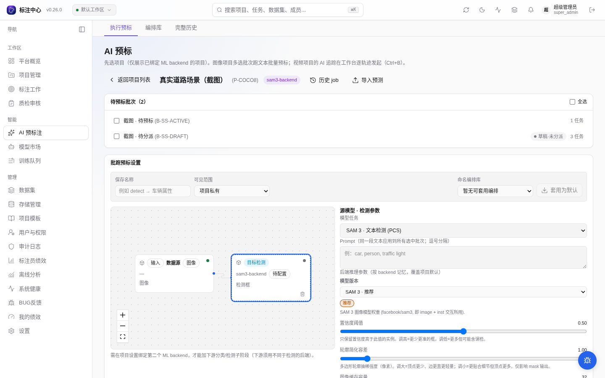

# AI 预标注流水线

本文描述 AI 预标注的完整流程：从全局注册模型服务 → 项目启用 → 触发预标注 Job → 标注员采用结果。

## 前提条件

- 已有可用模型服务（自部署或使用平台内置 Grounded-SAM-2）
- 超管已在 **模型市场**（`/model-market`）的**全局注册表**完成模型服务注册（env 配置的模型服务启动后自动注册）
- 项目已创建并上传数据

## 流程概览

```
超管注册模型服务 → 项目启用模型服务 → 触发批量 Job → 在 Jobs 核对结果与失败项 → 标注员审阅候选
```

## Step 1：全局注册模型服务（超管） {#step-1-全局注册-ml-backend-超管}

1. 主导航 → **模型市场**（`/model-market`）→ **注册管理** tab
2. 注册模型服务，填写服务 URL（如 `http://sam-backend:8001`，全局唯一）并点击**测试连接**。测试请求服务的 `/health`：成功表示收到 HTTP 200 和 JSON 对象，且响应中的 `ok` 为真值或未提供；它不验证协议版本、认证、项目启用状态或实际推理。
3. 保存后该模型服务进入全局注册表，可在**模型目录**中看到具体模型；**协议能力**解释支持的操作

详见[模型服务注册](/user-guide/superadmin/ml-backend-registry)与 [ML Backend 协议](/dev/reference/ml-backend-protocol)。

## Step 2：项目启用模型服务（项目管理员操作） {#step-2-项目启用-backend-项目管理员操作}

1. 项目详情 → **设置** → **模型服务** → 点「管理模型服务」在全局模型服务启用清单里**勾选启用**（推理阈值在运行时跑批配置里调，不在此预设）
2. 在 **项目主模型服务** 下拉里选一个已启用的模型服务（不影响现有 Task 和 Prediction）。详见[启用模型服务](../projects/ml-backends)。

## 使用已发布的训练模型

Ultralytics 图片检测训练完成后，在项目「模型与发布」注册成功尝试、绑定类别、加载试用并发布。随后可从「模型市场 → 模型目录 → 用于预标注 / 管线」进入项目配置，或在「项目检测模型」中选择当前发布／具体已发布版本，无需增加一个 YOLO 服务。

管线的整图根阶段和父框裁剪检测阶段均可独立选择已发布模型，同一 YOLO 实例可执行多个阶段。原生类别过滤使用各自权重的索引；父框类别使用直接父阶段返回的项目类名。下游失败时，系统保存原配置和部分结果；失败项重试会重跑这一题的完整原管线，完整成功后替代旧部分候选。视频、交互和其他训练任务不属于这条回流链路。

## Step 3：触发批量预标注



1. 主导航 → **AI 预标**（`/ai-pre`）→ 选择项目卡片，进入 ProjectDetailPanel
2. 勾选一个或多个可预标批次：`active`，或标注员和审核员均未分派的 `draft`。尚无批次时先到项目设置创建；草稿批次运行后仍需分派并激活，才进入人工流程。
3. 选择模型服务和所需配置，再选择幂等模式（`跳过已预标` / `覆盖` / `追加`，默认跳过已预标）。
4. 点击**跑预标**（单批次）或选择串行 / 并行后批量触发。系统为每个批次创建一个 Job，通常由 `pending` 进入 `running`。
5. 在 `/ai-pre/jobs` 或右上角后台任务铃查看进度；打开 Jobs 行的**详情**，核对终态和结果摘要。不要只看「已完成」或只使用失败状态筛选。

图片批量 Job 的终态与每题是否产生候选不是一回事：

| 状态或结果            | 含义与下一步                                                                                                                                        |
| --------------------- | --------------------------------------------------------------------------------------------------------------------------------------------------- |
| `completed`（已完成） | 批量处理结束，但可以同时有成功项和失败项。检查列表的「失败」列及详情中显示的成功、失败、跳过数；`failed_count` 大于零时仍需处理失败项。             |
| `failed`（失败）      | 没有成功项而有失败项时会失败；准备、权限或执行等作业级错误也可能导致失败。查看详情中的错误和结果摘要。                                              |
| 空结果或跳过          | 成功处理的题目也可能返回空结果，没有生成候选；「跳过已预标」会跳过已有预测的题目。没有可处理项也可能以 `completed` 结束，不能据此认定每题都有候选。 |
| 多阶段部分失败        | 可用的部分候选与失败记录会一起保存，该题计入失败项；已有候选不代表整条管线成功，也不是正式标注。                                                    |
| `cancelled`（已取消） | `pending` 或 `running` 的批量任务可取消；运行中在安全边界协作停止，已提交的候选保留，不会自动回滚。                                                 |

失败状态筛选 `/ai-pre/jobs?status=failed` 不包含有失败项的 `completed` Job。在详情出现**重试失败项**时，可排队重试已记录的失败预测；具体的重试条件、原输入核验和取消后恢复见 [AI 任务与失败恢复](./failed-prediction-recovery#重试或重新运行)。

## Step 4：标注员采用预测结果

核对结果并处理失败项后，标注员打开工作台审阅可用候选：

- **紫色候选框** = AI 预测（Prediction）
- 点击选中某个 Prediction 框后：按 `A` 采纳选中框 / 按 `D` 驳回选中框
- 也可在右侧 AI 面板逐条点击接受 / 拒绝按钮

> **注意**：`A` / `D` 快捷键仅对**当前选中**的 Prediction 生效，不会操作全部候选框。

采纳的 Prediction 变为正式 Annotation（蓝色），可继续编辑。

## 错误处理

| 情况                                | 原因                                       | 处理                                                                                      |
| ----------------------------------- | ------------------------------------------ | ----------------------------------------------------------------------------------------- |
| Job 长期停在 `pending` 或 `running` | 队列、Worker 或模型服务可能未推进          | 查看任务详情；参考 [AI 任务与失败恢复](./failed-prediction-recovery#什么时候应升级给运维) |
| 部分 Task 无 Prediction             | 可能跳过已有预测、模型返回空结果或该题失败 | 核对 Job 摘要、失败项和任务已有候选；再检查模型配置与服务日志                             |
| 连接模型服务失败                    | URL 配置错误或网络隔离                     | 参考 [容器网络排查](/dev/troubleshooting/container-networking)                            |
