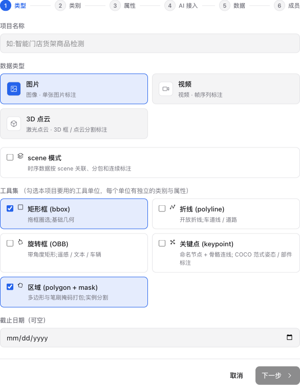

# 新项目端到端流程

本文描述一个完整标注项目从创建到导出的全流程，适合项目管理员作为操作手册使用。

## 角色分工

| 步骤                   | 执行角色   |
| ---------------------- | ---------- |
| 创建项目、上传数据     | 项目管理员 |
| 配置 AI 预标注（可选） | 项目管理员 |
| 创建批次、分配任务     | 项目管理员 |
| 完成标注               | 标注员     |
| 审核标注               | 审核员     |
| 导出数据               | 项目管理员 |

---

## Step 1：创建项目

1. 左侧菜单进入 **项目总览**（超级管理员为 **项目管理**）→ **新建项目**
2. 填写基本信息（向导 6 步）：
   - 项目名称
   - **数据类型**（图片 / 视频 / 3D 点云）+ **工具集**（矩形框 / 区域 / 折线 / 旋转框 / 关键点等，按启用的几何工具单位决定实际标注能力）
   - 类别、属性与 AI 接入在后续向导步骤配置；步骤 5 关联已导入数据集，步骤 6 选择已有标注员 / 审核员账号加入项目
3. 数据集关联后，系统才会为每个数据条目生成状态为 `pending` 的 Task；跳过数据集步骤时，可稍后在项目设置中关联。

交互式 AI 不是几何工具单位，不在工具集里单独勾选。项目创建后到「项目设置 → 模型服务」启用模型服务，并用「交互式 AI 工具」总开关控制智能点 / 智能框 / Exemplar / Magic Box 是否对标注员开放；AI 产物按几何归入 region 或 bbox 类别域。

> 关联大数据集（默认 > 2000 条）时建任务会转入后台异步进行，关联界面显示进度条，建完后任务才出现在未归类横带——详见 [项目管理 · 任务生成](../projects/)。

项目已经关联数据集后，后续在数据集页继续上传或扫描导入新增文件，也会自动追加对应 Task。

详见 [项目管理](../projects/)。

## Step 2：配置 AI 预标注（可选）

如有可用模型服务，可在项目创建后立即触发批量预标注，减少标注员工作量。

1. 主导航 → **AI 预标** → 选择项目 → 勾选批次 → 选择模型服务 → **跑预标**
2. 等待 Job 状态变为 `completed`（可在 `/ai-pre/jobs` 或右上角后台任务铃监控；失败任务在 `/ai-pre/jobs?status=failed` 查看）
3. 每个 Task 会生成 Prediction（紫色候选框），标注员可采用（A）或拒绝（D）

详见 [AI 预标注](../projects/ai-preannotate)。

## Step 3：创建批次与分配任务

<!-- TODO(v0.14.18) IMAGE_CHECKLIST: images/workflows/batch-assign-dialog.png — 批次分配对话框（标注员/审核员选择） -->

1. 项目设置 → **批次管理** → **创建批次**，把未归类任务按业务节奏切分；scene 模式项目按 scene 分包。
2. 每个批次分别选择 1 名标注员和 1 名审核员；需要把多个批次分给多人时，使用「按项目分派批次」。
3. 激活批次后，被分配的标注员可在「标注工作」中看到它；领取或开始编辑任务后，任务才转为 `in_progress`。

详见 [批次与分配](../projects/batch)。

## Step 4：标注员完成任务

标注员登录后：

1. 任务列表 → 选择待完成任务
2. 工作台完成标注 → **提交**
3. 任务状态变为 `review`（进入待审核队列）

详见 [工作台概览](../workbench/)。

## Step 5：审核员审核

审核员进入审核工作台：

1. 在「质检审核」中选择自己负责的批次和待审核任务
2. 审核操作：**通过**（→ `completed`）/ **回退**（→ `rejected`，标注员可修改后重提）
3. 项目完成率在 Dashboard 实时更新

详见 [审核流程](../review/)。

## Step 6：导出数据

所有任务 `completed` 后（或达到导出阈值）：

1. 在项目总览 / 项目管理的项目行或卡片打开 `⋮` → **导出标注数据** → 选择格式
2. 导出在后台异步生成，完成后到右上角任务铃下载 ZIP 包（7 天内可反复下载）

常用格式与项目类型对照：

| 格式              | 适用项目类型          | 说明                                  |
| ----------------- | --------------------- | ------------------------------------- |
| `aap_json`        | 图片 / 视频 / 3D 点云 | 平台原生格式，字段完整                |
| `coco`            | 图片                  | COCO Detection / Segmentation         |
| `yolo`            | 图片                  | YOLO 检测/分割标签 zip                |
| `voc`             | 图片                  | Pascal VOC，仅可单选同步下载          |
| `video_json`      | 视频                  | 视频轨迹 JSON                         |
| `yolo-frames-det` | 视频                  | 逐帧展开为 YOLO 检测                  |
| `mot`             | 视频                  | MOT 多目标跟踪格式                    |
| `kitti`           | 视频 / 3D 点云        | 视频为 tracking label，3D 为 3D label |
| `pointmask`       | 3D 点云               | 点云点级掩码                          |

详见 [数据导出格式](../reference/export-formats)。
