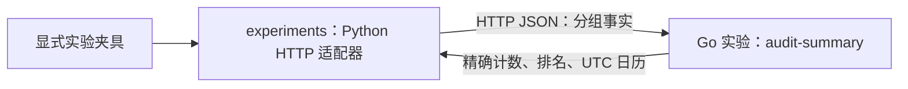

# 0090 — 按模块选择语言，以审计月报验证 Go 进程边界

- **Status**: Experimental
- **Date**: 2026-10-18
- **Deciders**: 项目维护者委托按功能评估并继续实施
- **Supersedes**: None

## Context

Python 依赖方向与写入所有权已完成一轮迁移，但 Session、ORM、共享 DTO 和跨领域事务仍存在。语言选择必须依据事务、计算负载、现有原生库和部署成本；语言本身不能解决权限撤销、在途作业或分布式一致性。

## Decision

维护者明确要求本切片仅作实验，目前不进入真实环境。正常月报继续本地 Python 计算；默认和生产部署没有 Go 服务依赖，也没有通过配置切换实验适配器的入口。下表中的 Go 是实验或后续候选，不代表生产采用决定。

| 功能模块                                 | 语言选择               | 理由与边界                                                                                    |
| ---------------------------------------- | ---------------------- | --------------------------------------------------------------------------------------------- |
| identity：账号、认证、凭据撤销           | Python                 | 保留现有认证与事务；远程权限快照不能替代最终准入                                              |
| workspace：项目、成员、配置              | Python                 | 交接、成员撤销及标注写入仍共享锁序和强事务                                                    |
| assets：入库、引用、媒体发布             | Python                 | 保留对象／SQL 发布、补偿与来源围栏                                                            |
| assets：独立媒体进程控制                 | Go 候选                | 适合有界 I/O 与 FFmpeg 子进程控制；迁移前固定素材授权、退出确认和产物协议，不重写原生编解码器 |
| labeling：任务、标注、审核、候选采纳     | Python                 | 保持原子聚合，避免因换语言拆开事务                                                            |
| labeling：几何、Mask、点云计算           | 现有 Python／原生库    | 先测量热点；仅在独立计算核和收益被证明后选择 Rust，本片不新增 Rust 工具链                     |
| inference：模型与 GPU 生命周期           | Python／既有原生运行时 | 保留模型生态、精确身份、设备仲裁及已有协议                                                    |
| learning：训练、评估、主动学习、发布     | Python                 | 保留执行器、冻结数据及 attempt／generation 围栏                                               |
| insights：数据库查询与物化视图           | SQL＋Python            | 聚合尽量留在 PostgreSQL／DuckDB，授权与取数由原所有者持有                                     |
| insights：独立可重建的结果归并           | Python；Go 实验候选    | 月报仅验证协议和独立进程，不进入真实执行路径                                                  |
| jobs：状态与现有 Celery 消费             | Python                 | 保留执行身份、取消、终态及在途消息合同                                                        |
| audit／notifications：持久事实与提交顺序 | Python                 | 保留不可变历史和事务内写入，派生月报不取得审计写入权                                          |
| Web／文档交互                            | TypeScript／既有框架   | 保持现有前端技术栈，不依赖浏览器运行时实现后端边界                                            |

Go 标准库的 HTTP/context 足以承载首片，无需 Web 框架；Rust 仅作为经测量后的计算核候选。依据：[Go HTTP](https://pkg.go.dev/net/http)、[Go context](https://pkg.go.dev/context)、[Rust](https://rust-lang.org/)、[PyTorch 前端](https://docs.pytorch.org/tutorials/advanced/cpp_frontend.html)。这些能力不是本系统性能资格证明。

### 实验职责

`apps/audit-summary` 只处理实验统计行，不连接数据库、Redis、对象存储，不接收账号凭据或原始 detail/IP/email，不保存结果。正常 API 固定调用 `app/services/audit_summary.py` 的本地算法；实验 HTTP 适配器与测试位于 `apps/api/experiments`，不进入正常应用镜像。实验与生产没有双写或自动切换。

Go 的 `/openapi.json` 是实验 wire 契约真值。`POST /v1/audit/monthly-summary` 接收月份、物化水位和分组行；event/error 计数使用十进制字符串。实验适配器验证并恢复整数，以对照 UTC 日历、空维度、4xx／5xx 统计和排名语义；生产公开 API 不依赖该协议。

实验请求和响应上限均为 64 MiB，调用超时十秒，错误明确失败而不截断或伪造零事件。这些限制不改变生产月报。规模与内存对照只使用明确的合成夹具，且实测 HTTP 路径增加了成本，没有证明生产采用收益。

固定的 10,000 行本地夹具中，Python 归并约 2.98 ms，Python 请求 JSON 编码约 14.87 ms，Go 解码约 25.17 ms、归并约 5.33 ms，完整调用约 46.93–50.79 ms。这些分项测量包含不同路径，不能相减推导纯网络成本。7.28 MB 单请求及采样 RSS 不是并发或生产容量资格；可复现脚本和完整限制见 `apps/api/experiments/bench_cost.py` 与 `apps/audit-summary/EXPERIMENT_COST.md`。当前决定是不采用该 Go 归并实现；生产基数、并发容量和维护成本在将来重新考虑采用时验证，不为结束实验访问真实环境。

### 隔离与恢复

仅独立的 `docker-compose.experiments.yml` 与 `audit-summary-experiment` profile、显式测试命令或手动 workflow 可启动 Go。默认／生产 Compose、工作树启动器及普通 CI 均不依赖 Go，应用配置移除 `AUDIT_SUMMARY_URL`。实验镜像为非 root scratch，无业务凭据和持久卷；常规应用镜像排除 Go 实验及 Python 实验目录。

只读实验的重复请求、丢响应及重启不产生业务写入。先前启动的本机开发 Go 容器已停止并移除，没有生产部署。未来是否采用，需要单独评估收益、运行成本和故障影响，并获得维护者新的实施指令。

### 本地追加验收

- 独立实验容器在 loopback、非 root、无业务挂载／凭据及 2 CPU / 512 MiB 的单独预算下完成 health、wire 与 golden 验证；正常 API 保持 Python。新增真实慢上传测试直接验证两名额占用、可重试 503、health 和取消释放。
- 维护者选择先验证既有作业的执行权交接。真实 TCP API、独立 PostgreSQL observer 与两个受控 Supervisor 进程验证重放、竞争、撤权／取消、硬退出后继承 flock、恢复、下一任务领取和提交回滚。API 仍是业务 SQL 写入者，受控 CPU child 不代表原生 GPU／训练资格或跨版本写入所有者迁移。
- 本地 Go 矩阵有 280 个精确成功、134 个真实 503 和 186 个 HTTPX ReadError；大上传超载的退避响应未通过。cgroup 高水位和零 OOM 不会抹去传输失败，也不构成生产容量资格。完整数据在 `apps/audit-summary/EXPERIMENT_COST.md`，此结果保持“不采用 Go 归并”的决定。

## Consequences

- 实验验证了 Go 进程无需加载 Python、FastAPI、Celery 或 ORM；先前的真实 API 验证属于实验记录，不代表生产采用。
- 网络序列化与额外运行单元有成本；生产月报已恢复本地路径，不承担此依赖。
- 其它模块继续按其语言与事务边界演进，本片不代表整个后端已能独立部署。
- 旧实现对照、精确计数、真实 API/SQL、非法协议、失败／重启／丢响应和资源清理的完成证据写入实施计划 Outcome。
