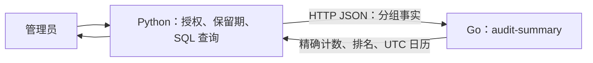

# 0090 — 按模块选择语言，以审计月报验证 Go 进程边界

- **Status**: Accepted
- **Date**: 2026-10-18
- **Deciders**: 项目维护者委托按功能评估并继续实施
- **Supersedes**: None

## Context

Python 依赖方向与写入所有权已完成一轮迁移，但 Session、ORM、共享 DTO 和跨领域事务仍存在。语言选择必须依据事务、计算负载、现有原生库和部署成本；语言本身不能解决权限撤销、在途作业或分布式一致性。

## Decision

| 功能模块                                 | 语言选择               | 理由与边界                                                                                    |
| ---------------------------------------- | ---------------------- | --------------------------------------------------------------------------------------------- |
| identity：账号、认证、凭据撤销           | Python                 | 保留现有认证与事务；远程权限快照不能替代最终准入                                              |
| workspace：项目、成员、配置              | Python                 | 交接、成员撤销及标注写入仍共享锁序和强事务                                                    |
| assets：入库、引用、媒体发布             | Python                 | 保留对象／SQL 发布、补偿与来源围栏                                                            |
| assets：独立媒体进程控制                 | Go 候选                | 适合有界 I/O 与 FFmpeg 子进程控制；迁移前固定素材授权、退出确认和产物协议，不重写原生编解码器 |
| labeling：任务、标注、审核、候选采纳     | Python                 | 保持原子聚合，避免因换语言拆开事务                                                            |
| labeling：几何、Mask、点云计算           | 现有 Python／原生库    | 先测量热点；仅在独立计算核和收益被证明后选择 Rust，本片不新增 Rust 工具链                     |
| inference：模型与 GPU 生命周期           | Python／既有原生运行时 | 保留模型生态、精确身份、设备仲裁及已有协议                                                    |
| learning：训练、评估、主动学习、发布     | Python                 | 保留执行器、冻结数据及 attempt／generation 围栏                                               |
| insights：数据库查询与物化视图           | SQL＋Python            | 聚合尽量留在 PostgreSQL／DuckDB，授权与取数由原所有者持有                                     |
| insights：独立可重建的结果归并           | Go                     | 首片为只读审计月报，输入输出明确且无需存储权限                                                |
| jobs：状态与现有 Celery 消费             | Python                 | 保留执行身份、取消、终态及在途消息合同                                                        |
| audit／notifications：持久事实与提交顺序 | Python                 | 保留不可变历史和事务内写入，派生月报不取得审计写入权                                          |
| Web／文档交互                            | TypeScript／既有框架   | 保持现有前端技术栈，不依赖浏览器运行时实现后端边界                                            |

Go 标准库的 HTTP/context 足以承载首片，无需 Web 框架；Rust 仅作为经测量后的计算核候选。依据：[Go HTTP](https://pkg.go.dev/net/http)、[Go context](https://pkg.go.dev/context)、[Rust](https://rust-lang.org/)、[PyTorch 前端](https://docs.pytorch.org/tutorials/advanced/cpp_frontend.html)。这些能力不是本系统性能资格证明。

### 首片职责

`apps/audit-summary` 只处理请求中的统计行，不连接数据库、Redis、对象存储，不接收账号凭据或原始 detail/IP/email，不保存结果。Python 仍持有超级管理员准入与 SQL 查询。原 Python 归并算法删除，不保留本地回退或双实现开关。

Go 的 `/openapi.json` 是内部 wire 契约真值。`POST /v1/audit/monthly-summary` 接收月份、物化水位和分组行；event/error 计数使用十进制字符串，避免浮点或 JSON 安全整数边界。Python 适配器验证并转换成既有公开 API 的整数，保留 UTC 自然日补零、空维度、4xx／5xx 统计及排名语义。

请求和响应上限均为 64 MiB，超限明确失败而不截断；API 调用超时十秒。服务不可用、非成功响应或协议错误返回 503，不能显示成零事件。该上限是新边界的容量限制，当前开发库没有可用审计表，规模与内存对照仅使用明确的合成夹具。

### 部署与恢复

Compose 提供独立 Go 服务，运行镜像不含 Python、数据库驱动、业务凭据或持久卷，只向宿主 loopback 发布端口。工作树启动器在自身保留端口启动当前 checkout 的 Go 进程，向 API／测试命令注入 `AUDIT_SUMMARY_URL`，退出时关闭自身进程组和释放端口。

只读归并的重复请求、执行后丢响应不会重复写入；恢复后可从原始事实重新查询。进程使用有界优雅关闭。回退需成对部署 API 与归并实现，但没有新增业务状态、租约或对象需要回迁。

## Consequences

- 首片具有真实生产消费者，Go 进程无需加载 Python、FastAPI、Celery 或 ORM。
- 新增运行单元和网络序列化，月报可用性依赖此进程，不据此宣称性能优化。
- 其它模块继续按其语言与事务边界演进，本片不代表整个后端已能独立部署。
- 旧实现对照、精确计数、真实 API/SQL、非法协议、失败／重启／丢响应和资源清理的完成证据写入实施计划 Outcome。
