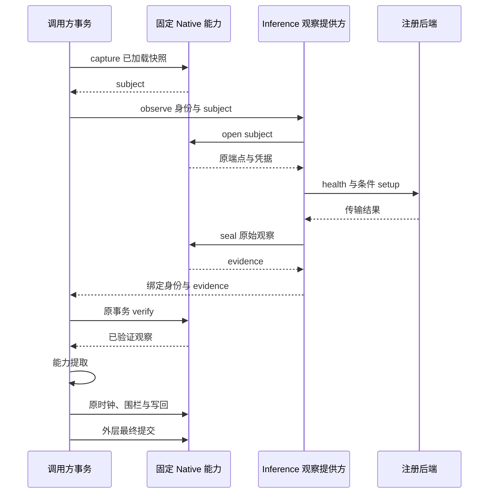

# 0152 — 凭据自持的健康观察与原事务写回

- Status: Accepted
- Date: 2026-10-21
- Deciders: AAP maintainers
- Supersedes: None; follows ADR-0150 and ADR-0151

## Context

健康协调器已经移入 Inference 包，但项目、管理员、周期 worker 和 GPU 刷新仍直接装配 API HTTP 客户端。直接让远端进程写入并提交健康数据，会拆开漂移接受、GPU 围栏及调用方 Audit 的事务，不能满足完整控制面的边界要求。只按 registry ID 在另一个连接重查端点，也不能复现关闭自动刷新时 ORM 对象中的未提交 URL 与凭据。

## Decision

既有健康入口使用同一个 credential-owning observation owner，提供嵌入调用方、专用只读 DSN 与独立 HTTP 三种绑定；显式配置失败不回退。只有实际 `/health`、其挑战兼容回退和条件 `/setup` 在观察提供方执行。能力提取仍在原协调器的 limits callback 之后、原数据库观察时钟之前；生命周期 digest/proof 在时钟之后。Registry／GPU／membership 围栏、健康写回、refresh、Pool 对账与最终提交继续使用原 Session。提供方没有健康业务表权限，不提交第二份健康事务。

原全行 ORM JSON 物化仍先于 membership/start/HTTP。API 在原客户端构造阶段先保留其错误行为，再冻结观察真正使用的端点、认证与身份；health/setup 不使用的 extra parameters 不传输。快照不强制刷新或重新读取，保留未落库值；之后的 `populate_existing` 读取仍覆盖同一个 ORM 对象，并决定旧结果是否可写回。数据库 UUID 子类在 wire 入口转为标准 UUID。

Native0276 持有数据库内 AES256-PGP 密钥，固定五个函数提供 policy、capture、open、seal、verify。Subject 和 evidence 使用不同协议头，绑定数据库、原事务 XID、registry/request UUID、正文长度与 subject digest。Open/seal 只在原事务仍运行时允许；verify 还要求当前连接的事务 XID 完全相同，其他并发事务不能消费。提交、回滚、错库、错请求、修改或换钥后拒绝。Crypto 证明观察来自持有受限能力的可信提供方，并非后端 GPU 硬件的加密证明。

观察专用 LOGIN 只执行 policy/open/seal，签发/验证 LOGIN 只执行 policy/capture/verify，二者均无表、密钥或跨域能力。嵌入模式继续在 API 的过渡角色内托管逻辑 owner，故不宣称整套 API 宽表权限已移除。快照签发接受可信装配已加载的字段，不自行证明当前端点或路由安全；是否应用由既有最终围栏决定。

私有 wire 为闭合、有界的标准 JSON 身份与不透明字符串，没有凭据或可伪造的 healthy/capabilities 布尔字段。提供方执行真实传输后才密封内部结果。内部结果保留历史 JSON 的 NaN/Infinity 文本扩展，不让 PostgreSQL JSONB 提前改变错误阶段；消费方在验证后还原。Setup 失败仍 fail-open；非法 health JSON 的原 TypeError／500 等错误以密封错误结果投影，保留时钟和写入之前的阶段，不混同为提供方不可用503。取消不转换为成功回执。

## Consequences

### 正向

外部观察可独立安装、运行和限制资源，凭据与私有原始结果不经过 HTTP 明文 body。事务签发与验证隔离了网络回执和业务写入，保留现有异步变化、GPU epoch、刷新与回滚行为。公开 API 和调用方权限不变。

### 负向

引入数据库 Crypto 与额外通信，专用 DSN／HTTP 还需要受限角色、独立 bearer 与原事务存活。请求/响应各最多24 MiB，内部正文有 Native 字节预算；提供方不可用或回执异常会使本次调用失败。HTTP 默认90秒是整个观察预算，不是单次后端超时；挑战兼容回退与 setup 最多发生三次请求。它不能替代长期租约、停流连续性或健康 Native apply。

## Notes

本次只推进完整健康控制面的观察阶段。健康读写 Native 合同、全部 Registry／Pool 写入、stats/GPU 及真实消费者的完整模块收口仍未完成；没有把“所有模块可部署／替换语言”的目标缩小为观察服务。本地验收与工件记录在 `.worktree/inference-health-observation-qualification.json`；不得将原有或重复检查累加为新案例。主开发与生产不切换，Go 仍为独立实验。

## Scoped local qualification

本轮176项去重选定检查通过，其中包含原40项健康／worker与25项拓扑并发兼容检查；部分为纯策略或适配器测试，不宣称176项全是数据库或真实设备场景。三条观察绑定各回放24组既有健康相位，六个冻结文件保持原字节。另覆盖关闭自动刷新时的未落库端点、原对象 refresh、无能力时保留未提交工作、非有限元数据及非法 health JSON 的原错误阶段、PostgreSQL UUID 子类、角色隔离、跨事务／跨库／过期与篡改回执。

Native276五阶段完整迁移通过；非空备份恢复保留密钥、五函数与 ACL，且在同密钥、源事务仍运行时拒绝另一数据库消费原 subject。恢复后实际观察和调用方提交可用。一次恢复测试的 XID 参数绑定类型错误已修正；失败回执保留，不计通过总数。

源码 Inference／共享合同198项通过；独立非 editable 安装的 Inference／Workspace 分别通过198／515项，55／277个包文件与源码一致。源2425f390d的 Inference／Workspace／API镜像通过无网络、只读、降权冷检查，API核对1,250项输入、OpenAPI及 Native head276。实际公开 API 使用1 CPU／256 MiB观察容器，重启后再次成功，停止后503且不回退。Docker临时宿主端口在重启时会重新分配，验收驱动重读映射；原失败回执和确认探针保留。16次、并发4的有限健康样本只证明限定本地链路，API、数据库和后端不在该容器预算内，不作为生产 SLO。

三个修改子工作树在确认提交等价、无未提交内容及只有 Ruff/Python 缓存后已移除，源分支仍保留。没有推送、日常／生产切换、真实 GPU、AMD64或 Go扩展。
