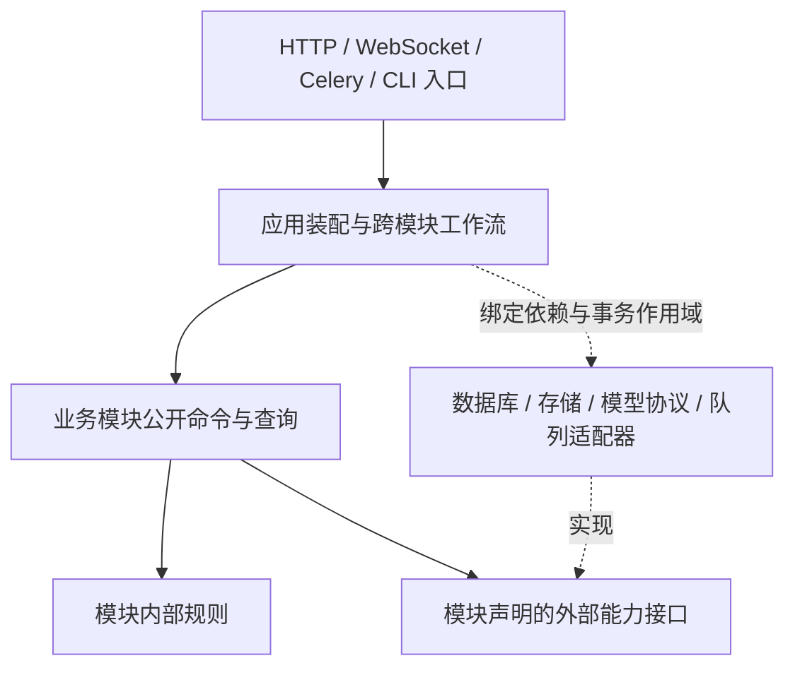

# 后端业务模块解耦与跨语言替换设计

> Status: 进行中。目标覆盖 identity、workspace、assets、labeling、inference、learning、insights、jobs、audit、notifications 及运行装配。协调视频恢复与 Identity 整模块已完成限定本地功能验收，当前继续收口 Workspace。唯一剩余工作台账见[模块部署与语言替换状态](../../docs-site/dev/concepts/module-deployment.md#剩余工作台账)，分开记录实现、消费者迁移、独立运行资格与阻塞。文末 Outcome 保留历史证据，不作为另一份待办。共享物理 PostgreSQL 可以保留，所有者能力、事务／撤权／取消／旧写者与恢复语义必须保持。Go 保持实验；不推送、不发布、不切生产，当前视频恢复切片也不切日常主环境。
>
> 创建日期：2026-10-16。
>
> 目标：让所有逻辑业务模块能独立构建、部署，并通过稳定的语言无关协议替换实现语言。模块按依赖和事务边界逐步提取，不把目录拆分、进程内端口或单个实验服务当作完成。

## 1. 决策与范围

采用**契约优先、逐模块提取运行边界**：

1. 完整盘点每个模块的入口、权威数据、调用方、外部状态和提交语义，再逐模块建立公开协议及写入所有权。
2. 保持现有用户可见 API、WebSocket、数据格式、权限、事务和作业行为；内部导入不是公共兼容承诺，迁移时更新全部仓内调用方并删除旧实现，不增加兼容 facade。
3. 进程内类型化端口是迁移途中的边界，不等于最终独立部署合同；每个模块还需语言无关 wire schema、独立运行单元及只访问自有数据的适配器。
4. 抽取前解决跨模块强事务、撤权串行化、幂等和作业交接。数据库可以继续共用物理实例，但服务不得依赖其他所有者的私有 ORM/SQL，也不得把原子事务要求留给未经定义的多次 RPC。
5. 保留已有五个推理服务和训练执行器的现有协议边界，作为已存在的独立子能力；不能把它们当作整个 inference 或 learning 模块已完成，也不将 Celery 注册名当作跨语言公共协议。

语言按模块的计算、运行和维护要求分别评估，不预设所有模块采用同一种语言。本设计不建立通用微服务框架、通用 repository/BaseService、全局领域事件总线或第二套 ML 协议。跨语言能力由可交换的数据契约、状态所有权和逐模块替换验收证明，不以目录数量或服务数量验收。

实施按第 9 节逐片推进。第 3–9 节仍是目标设计，不能被当作全后端已解耦的现状说明；实际落地范围和验证见文末 Outcome。首片决策记录在 ADR-0088，后续切片继续同步正式开发文档。

## 2. 设计基线（实施前）与约束

| 事实                                                           | 源码依据                                                                                                                                             | 对设计的约束                                                             |
| -------------------------------------------------------------- | ---------------------------------------------------------------------------------------------------------------------------------------------------- | ------------------------------------------------------------------------ |
| API 装配集中，但业务规则并未全部下沉到服务                     | [路由聚合](../../apps/api/app/api/v1/router.py)、[审核入口](../../apps/api/app/api/v1/tasks/review.py)                                               | 迁移对象包含路由内的规则和事务编排，不能只移动 services                  |
| 存在 service → API 和 service → worker 的函数内导入            | [最终写入守卫](../../apps/api/app/services/project_write_guard.py)、[Mask 修复派发](../../apps/api/app/services/mask_repair.py)                      | 门禁覆盖函数内与相对导入；通过公开业务接口和注入的派发适配器消除反向依赖 |
| 任务、标注、批次和审核存在紧密关系，标注还依赖源媒体与标定身份 | [任务模型](../../apps/api/app/db/models/task.py)、[标注模型](../../apps/api/app/db/models/annotation.py)                                             | 先保留标注生产聚合，不把任务、审核、轨迹机械拆成不同服务                 |
| 预标注在请求路径按设备动态选队列                               | [预标注入口](../../apps/api/app/api/v1/projects.py)、[Celery 配置](../../apps/api/app/workers/celery_app.py)、[消费者配置](../../docker-compose.yml) | 静态 task_routes 不是完整执行契约，迁移必须覆盖动态路由和实际消费者      |
| 通用作业终态回填直接了解多个领域账本                           | [终态协调](../../apps/api/app/services/async_job_terminal.py)                                                                                        | 作业控制面与领域状态机分开，不能将所有领域终态统一为 failed/cancelled    |
| 审核通知在事务提交后发布                                       | [审核入口](../../apps/api/app/api/v1/tasks/review.py)、[通知服务](../../apps/api/app/services/notification.py)                                       | 保存提交与投递顺序；现有仓库地图的相关描述需要随该路径实施时纠正         |
| 训练执行器是独立拉取进程，且并行执行 CPU 预览                  | [执行器入口](../../apps/training-executor/Dockerfile)、[执行循环](../../apps/training-executor/training_executor/worker.py)                          | 不将训练执行归入 Celery worker，不丢失预览、租约及子进程回收语义         |
| 已有领域 package 和局部架构门禁                                | [后端分层](../../docs-site/dev/concepts/backend-layers.md)、[现有守卫](../../apps/api/tests/test_domain_package_architecture.py)                     | 复用现有实现和 AST 检查能力，不重复拆 GPU、导出等已整理的模块            |

[旧领域化计划](archive/2026-07-15-v0.23.0-api-services-domain-modularization.md)是历史依据，不延续其中保留旧 facade 的迁移策略。

保留这些既有领域决策：

- [模型版本、部署和发布身份分离](../adr/archive/0076-controlled-trained-model-identity.md)：模型冻结身份及精确部署约束不能因服务切换失效。
- [项目任务数据集与冻结版本身份分离](../adr/archive/0087-project-task-dataset-streams.md)：管理关联、发行序号和高水位不能参与或改写训练包摘要。
- [Data Manager 只读模型](../adr/archive/0047-data-manager-entity-read-model.md)：查询视图不获得权威写入权。

## 3. 目标业务模块

下表是**建议的逻辑边界与数据所有者**，不是当前目录已经满足的事实。数据归属先表达写入责任，不要求本轮改表名、重建历史对象或拆数据库。

| 模块                          | 负责的业务与权威数据                                                                                                           | 不负责的内容                                                                  | 主要公开能力                                                              |
| ----------------------------- | ------------------------------------------------------------------------------------------------------------------------------ | ----------------------------------------------------------------------------- | ------------------------------------------------------------------------- |
| `identity` 身份               | 用户、组织/分组身份、认证、API key、账号有效性和身份撤销                                                                       | 不自行推断项目操作权限，不做任务派发                                          | 解析/验证主体、读取有效身份、管理账号与凭据                               |
| `workspace` 项目与授权        | 项目、成员、项目职责与能力、项目配置/工具绑定及配置模板                                                                        | 不修改任务/标注/训练状态；项目计数不是项目配置真值                            | 项目配置快照、项目访问决策、成员和配置变更                                |
| `assets` 源数据与媒体         | 原始 Dataset/DatasetItem、素材 Scene/帧组织、标定、连接器、源媒体及媒体派生资产                                                | 不拥有 SceneTrack 人工标注，不创建/修改 Task，不拥有冻结训练标签              | 查询媒体清单、授权读取引用、导入源素材、请求媒体派生任务                  |
| `labeling` 标注生产           | 批次、任务分配/锁/状态、标注、持久预测候选与采纳、审核证据/反馈、SceneTrack/视频标注片段、标注质量与修复账本                   | 不调度模型实例，不管理训练实验；不修改源媒体与项目成员                        | 建题、派题、标注写入、提交/审核、带版本条件的候选落库、冻结已审核数据     |
| `inference` 推理编排          | 后端 registry/启用、能力、服务池、GPU 仲裁、多阶段 pipeline/模板、推理运行记录和失败重试上下文                                 | 不直接写 Task/Annotation/Prediction，不重新决定模型发布，不拥有人工采纳规则   | 查询能力、执行/取消推理、返回结果产物与实际模型身份、管理实例生命周期     |
| `learning` 训练与模型生命周期 | ProjectTaskDataset 管理关联、TrainingDatasetVersion 冻结身份、训练/搜索/预览/观测、评估/主动学习、模型版本、部署回执和发布选择 | 不复制生产标注真值，不修改审核结论，不绕过 inference 的实例管理直接操作模型池 | 构建训练版本、管理执行器协议、训练/评估、冻结发布引用、验证和发布受控模型 |
| `insights` 跨域查询           | Data Manager、Dashboard、绩效与谱系组合读取、可重建统计/索引/分析投影                                                          | 不拥有业务真值，不因列表操作直接写其他模块的表                                | 分页/过滤/统计查询、投影刷新；批量写操作转交明确的领域命令                |

支撑能力各有窄边界，不合并成一个无所不包的 platform 模块：

| 能力            | 所有权                                                  | 限制                                                            |
| --------------- | ------------------------------------------------------- | --------------------------------------------------------------- |
| `jobs`          | 通用异步作业 ID、进度、执行关联、取消请求和通用执行状态 | 领域状态仍由所属模块解释；Celery task/result 不作为唯一业务账本 |
| `audit`         | 审计记录、查询与保留策略                                | 需要同事务保存的业务审计继续同事务保存，不默改为异步尽力而为    |
| `notifications` | 通知偏好、持久通知、投递与 WebSocket 通道适配           | 不决定审核或作业业务结果，不提前发布未提交的业务结果            |

问题反馈、系统设置、健康与运维入口按实际职责归到独立应用功能或支撑组件，不塞进业务 shared；在入口清单中逐项登记所属组件与依赖。

### 3.1 容易混淆的数据边界

- **预测与推理**：inference 负责算出候选；labeling 负责候选与任务版本、作用域和人工编辑规则的一致性落库。现有数据库中的 Prediction 归 labeling，避免采纳操作跨服务修改两套真值。
- **媒体与标注**：assets 拥有 Scene 的素材与标定，labeling 拥有 SceneTrack 及人工成员；跨边界只传稳定 ID、内容摘要和修订，不传 ORM relationship。
- **生产数据与训练数据**：learning 从 labeling 获得不可变、带版本的训练来源快照，从 assets 获得媒体引用；不在运行时 join 生产表自行重新解释审核资格。
- **项目与派生计数**：项目配置由 workspace 拥有，任务数量由 labeling 的事实派生。现有 `Project.total_tasks` 在迁移中登记为历史物理落点；切换读方前保留原事务语义，通过明确的同事务适配器维护，不允许多个模块各自决定计数。目标改为 labeling 提供的计数/insights 投影后，删除原写入路径；物理列删除另需迁移与消费者核对。
- **对象存储**：共享 S3/MinIO transport 不是共享数据所有权。源图由 assets 管理，Mask 由 labeling 管理，训练包/权重由 learning 管理，导出产物由其导出任务所有者管理。只有所有者决定保留、删除和引用校验。
- **模型部署**：learning 拥有模型版本及验证后的部署回执/发布事实；inference 拥有实例与安装执行状态。由应用工作流协调安装、验证和发布，两边不直接改对方表。

## 4. 公开接口与依赖方向

### 4.1 模块结构与装配

目标是在现有 `app/services` 下形成业务所有者，而不是新建平行的 `app/modules` 再维护两套实现。现有 gpu_arbitration、ml_routing、video_tracking、exporting、data_management 是迁移素材，不等于都成为独立业务模块。

每个模块包含明确的公开入口/契约、应用用例、规则及私有持久化/外部适配器。只在职责确实存在时分文件，不为每个模块生成空的四层模板。

具体规则：

1. 入口负责协议解析和主体获取，业务状态机不留在 router 或 Celery task body。
2. 跨模块只能调用公开命令/查询，不能导入私有服务、数据库模型、router 私有函数或 worker task 对象。
3. 函数内 import、动态导入字符串、测试 monkeypatch 路径和脚本调用也纳入迁移；移动导入到函数内不算消除依赖。
4. 双向业务流程放在应用工作流层协调，不让两个模块互相调用。例如“请求推理 → 返回产物 → 候选落库”由工作流串联 inference 与 labeling；“安装模型 → 试用 → 发布”由工作流串联 inference 与 learning。
5. 作业终态处理器在应用装配时显式绑定；jobs 不导入所有领域模型，领域也不导入 Celery。进程内协调仍能绑定到同一本地事务。
6. 规则层不依赖 FastAPI、Celery、全局 settings 或 ORM。模块公开接口不接受 Request、AsyncSession、ORM 实例或可任意访问其他模块的容器。
7. 项目写入准入仍使用 workspace 提供的权限能力，最终写入检查不退化为“入口检查过一次”；身份事实不能由客户端传入的角色字段代替。
8. insights 可以读取其他模块明确提供的快照或构建投影；其他模块不反向依赖 insights 来决定业务许可、审核或模型发布。

### 4.2 代表性接口

下列名称表达目标业务语义，不是宣称已经存在的新 API 路由，也不直接作为 Celery 注册名。迁移时补齐该切片的完整操作清单，并映射现有输入、错误及调用方。

| 所有者 / 操作                     | 输入                                                          | 输出                                             | 关键约束                                             |
| --------------------------------- | ------------------------------------------------------------- | ------------------------------------------------ | ---------------------------------------------------- |
| identity / ResolvePrincipal       | 认证材料、目标 audience                                       | 有效主体、凭据作用域、撤销状态                   | 无效身份明确失败；认证材料不进入业务事件             |
| workspace / ResolveWritePolicy    | 主体 ID、项目 ID、操作与资源范围                              | 当前访问决策、项目配置修订                       | 不把权限缓存/历史角色当最终写入许可                  |
| assets / GetMediaManifest         | 主体上下文、素材 ID 集、所需修订                              | 媒体种类、尺寸/时序/标定、内容摘要、受限读取引用 | 不暴露存储凭据；URL 时效不等于素材身份               |
| labeling / CreateTasks            | 项目与源素材引用、创建参数、操作身份                          | 已建任务/作业、重复请求的确定结果                | 建题和聚合计数由该用例维护，assets 不再代写          |
| labeling / ApplyAnnotationCommand | 主体、任务 ID、现有版本前置条件、变更                         | 已提交的版本、变更结果                           | 保留锁、成员撤销、审核阶段、Mask 幂等与冲突语义      |
| labeling / ApplyPredictionResult  | 冻结作用域、任务前置条件、候选产物引用、模型实际身份、操作 ID | 已应用/拒绝项及版本信息                          | 复核任务资格；过期或重复结果不得覆盖后续人工操作     |
| labeling / ExportReviewedSnapshot | 项目、任务种类、选取条件、资格规则修订                        | 不可变快照、来源修订/摘要、可分块读取句柄        | 固定一个一致切面，不用分页时不断变化的生产查询拼快照 |
| inference / ExecutePrediction     | 快照化配置、明确的执行范围、冻结模型引用、产物输入引用        | 运行 ID、产物引用、实际模型身份与每项结果        | 保留设备队列、pipeline 谱系和取消/部分失败语义       |
| learning / FreezeModelReference   | 项目、用途与当前发布选择                                      | 不可变版本、权重/类别摘要、许可的部署身份        | 后续发布变化不能改写已排队任务                       |
| learning / ExecutorOperation      | 既有 claim/heartbeat/upload/finish 等协议输入                 | 既有回执、租约和上传授权                         | 保留 attempt/fence、训练与 CPU 预览的独立所有权      |
| jobs / RequestCancellation        | 主体、作业 ID、操作身份                                       | 取消请求及当前已知执行状态                       | “已请求”不等于已停止；领域终态由所有者确认           |

### 4.3 语言无关的数据契约

- 进程内使用模块拥有的类型化 DTO；DTO 可以由现有 Pydantic 工具链描述，但不能继承或携带 SQLAlchemy 模型、session、异常对象或可调用对象。
- 跨进程的新命令/查询默认 HTTP + JSON/OpenAPI；现有 ML 协议和训练 pull 协议保持独立，不改造成统一万能 RPC。
- 必须共同成败且继续共用 PostgreSQL 的数据操作，可以使用 owner 发布的版本化 SQL 函数与 JSON Schema；调用方仅持有公开操作执行权，保留同一连接上的外层事务。该例外见 ADR-0092，不允许任意 SQL 网关，也不代表独立拆库。
- 契约不要求消费方运行 Python。对外依据为导出的 OpenAPI/JSON Schema 与语义说明，Python 类 identity 不是契约；保留既有 schema → 快照 → 生成消费者的单一来源流程，不手写一套同名 JSON Schema 制造第二真值。
- 真正替换服务实现时，先固定已导出的协议及契约用例，新实现按它实现；切换后由新的协议所有者提供同一产物，删除旧服务生成路径，禁止两种语言分别手维护规范。
- 新的内部跨进程边界才增加对应规范和生成接线；尚无远程消费者的进程内函数不提前网络化，不为每个函数生成 OpenAPI。
- DTO 显式定义字段缺失与 null、空集合与未读取、UUID/标识符文本、UTC 时间格式、数值精度/上限及几何单位。超过 JSON 安全整数的精确整数用十进制字符串；禁止 NaN/Infinity。不得仅凭语言默认类型推断跨语言语义。
- 任务名、几何、媒体、格式和训练身份沿用现有 task_contract、protocol_v2、training_contract 的词表与冻结规则；共享词表不允许携带模块数据库访问或高层编排。
- 新边界的错误必须有稳定 machine code、现有 HTTP 映射、必要冲突事实与是否可安全重试的语义。保持现有公开 API 错误体，不为了内部统一而修改前端、SDK 或 CLI 合同。
- 查询明确排序、分页游标、快照/新鲜度和 unknown/partial；批量命令明确逐项结果、原子范围和部分提交规则。
- 长作业返回操作/作业身份，明确成功、失败、部分成功、取消请求与取消完成，不把调用超时当作业务失败。
- 现有业务幂等规则原样迁移。首次新增远程写边界时必须补齐操作 ID、作用域、请求摘要、保留期和重复冲突规则，网络超时后可查询原操作；非幂等命令不得因 transport 自动重发。
- 大图片、Mask、视频、训练包和权重只传受限对象引用、格式与摘要，按需流式读取，不在模块间复制二进制或塞入大 JSON。
- 远程主体上下文由可信适配器验证，限定 audience/作用域，不能信任任意 actor_id 请求头；请求追踪标识不提供权限。URL/日志/事件不得携带长期凭据。

## 5. 数据所有权与一致性

### 5.1 先分写入责任，不先拆数据库

第一阶段保留 PostgreSQL、现有表、外键和统一 Alembic 迁移链。每张业务表、Redis key namespace 与对象前缀登记唯一所有者；一个共享物理实例不等于所有模块都有写权限。

目标规则：其他模块不能直接写所有者数据，也不能依赖其 ORM 关系或私有 SQL。现有跨域 join 逐项登记，在对应切片结束前替换为所有者的批量查询/一致快照或 insights 的只读投影；禁止用逐行 RPC 替换批量 SQL。

跨域外键可以先保留以维持当前完整性；它们不证明可以独立拆库。真正提取服务时，明确数据库角色、迁移执行者、删除/引用策略及跨域外键影响。换语言可以先继续使用受限的原数据库表，拆库是另外的决定。

### 5.2 事务边界不能被接口表掩盖

同进程下，应用装配创建事务作用域，将模块持久化适配器绑定到同一连接/事务；公开业务操作不传 AsyncSession。各模块通过自己的适配器写自己的数据，应用工作流决定需要共同提交的操作。

例如审核状态、批次流转、业务审计和持久通知仍可同事务提交，再执行需要提交后才能运行的通知发布。迁移时不能把现有 flush 改成模块内部各自 commit，也不能反过来删除既有分块提交语义。

追加建题开始采用版本化 PostgreSQL 数据能力：Workspace 公开项目引用锁，Assets 公开当前关联与最小素材快照，Labeling 在公开操作中写 Task、计数和冻结回执。持久化接口通过标准数据库协议组合在同一外层事务内；Python Session 只是当前调用端的连接管理器，不作为协议参数。函数所有者与调用角色分离，独立角色不得直接读写其他 owner 表。其他跨域强事务仍须逐条提取，不能因这一个操作通过就视为全模块完成。

**共享本地事务的工作流不能只把一个适配器换成 HTTP 就宣称等价。** 对每条跨模块写路径选择并记录：

| 不变量类型                            | 处理方式                                                                  | 远程提取条件                                                             |
| ------------------------------------- | ------------------------------------------------------------------------- | ------------------------------------------------------------------------ |
| 必须共同成败的标注/审核/证据更新      | 保留在 labeling 聚合及同一事务内                                          | 不把这一原子范围拆成多个服务                                             |
| 最终写入必须和项目成员/账号撤销串行化 | 保留现有权威读取、锁和写入事务边界                                        | 在等价并发协议被设计并验证前，相关命令不远程拆出；不能用过期权限快照替代 |
| 训练数据冻结                          | labeling 创建不可变来源快照，learning 消费固定句柄/摘要，构建可在其后完成 | 来源切面、项目配置修订、媒体引用和保留规则已固定，不边翻页边读取活数据   |
| 长耗时推理/训练/导出                  | 用显式状态、产物/执行回执和条件写入推进                                   | 重复、超时、迟到结果和取消后的写入有确定语义                             |
| 统计、列表和通知投递                  | 保持当前同步语义，或单独批准可观察的投影延迟/投递语义变更                 | 明确新鲜度/投递保证，并具有可核对的来源；不能悄悄改成最终一致            |

项目计数迁移、项目删除、成员交接、建题、模型部署/发布都要单独列出事务矩阵。跨域删除不能靠服务调用顺序模仿数据库级原子级联；拆出前必须定义引用保留、拒绝删除或已验证的删除流程。

### 5.3 作业、消息与投递

- Celery 作为 Python 执行适配器保留，公开接口表达“执行这个领域操作”，不暴露 pickle、任务 Python 路径、chord 对象或 Celery exception。
- jobs 维护通用作业状态；各领域维护自己的账本及 `partial`、`rollback_failed` 等语义，应用工作流绑定领域终态回填。
- 当前同步原子更新不因引入事件而拆开。只在某条已选定远程边界确需可靠异步交接时，为该边界实现同事务 durable outbox/操作收据以及明确的消费去重；不先建全平台消息基础设施。
- 不宣称 exactly-once。需要可靠交接的边界按可重投、去重、顺序范围、重复/迟到处理和失败后核对定义语义。
- 如果使用领域事件，至少固定事件 ID、类型/schema 修订、来源实体 ID/修订、发生时间、关联操作和最小必要数据；事件表达已提交事实，不作为任意写入命令或权限许可。
- 进程崩溃、断网和重投的验证属于首次远程提取的完成条件，不能只验证正常 HTTP 返回。

## 6. 关键工作流的目标职责

1. **导入 → 建题**：assets 完成素材导入并提供稳定引用；应用工作流调用 labeling 建题。建题进度和计数由 labeling 维护，导入完成不能等同于建题成功。
2. **标注 → 提交 → 审核**：labeling 拥有状态机，调用可信身份/项目能力接口，保存版本化证据并保持当前事务与锁；审计和持久通知参与所需本地事务，通知在允许的提交时序发布。
3. **预标注 → 候选落库**：工作流冻结作用域/模型身份，inference 执行并返回产物；labeling 在落库时复核版本、范围、权限和终态。工作台单题与批量预标注的资格规则保持区分，取消、重试及发布变化不能绕过冻结身份。
4. **审核数据 → 训练 → 发布**：labeling 冻结审核来源，assets 提供媒体身份，learning 管理版本/包、执行器与模型回流；安装与原生试用通过 inference，确认后由 learning 发布。项目任务流管理关联不能改写历史包身份。
5. **Data Manager 批量操作**：insights 负责选择与展示；写命令在领域模块重新验证最终目标和资格，不能相信查询时的列表权限或筛选结果永远有效。

## 7. 跨语言替换路径

每个模块按“契约冻结 → 独立实现与验证 → 明确切换 → 删除旧实现”执行；全模块目标仍在推进，不因先完成一个切片而缩小：

1. 从已迁移模块选择无未解决强事务依赖的边界，记录操作、数据所有者、同步/异步状态机和性能基线。
2. 固定语言无关协议、真实请求/结果 fixture 与契约用例；既有 HTTP/ML/训练合同不另起炉灶。
3. 新语言实现只获得其拥有的数据与所需外部能力；不得连接全部业务表绕过模块接口。新旧实现不能同时成为同一数据的独立写入者。
4. 在隔离数据上对比新旧行为。生产只读影子流量只适用于无副作用查询；命令回放不得写生产库或触发真实模型/媒体副作用。
5. 明确切换写入所有者，停止旧端派发并排空/确认旧执行，转交 durable operation/租约和结果收据；在途任务、迟到回调和 Celery 注册名逐项处理，不能因换路由直接丢弃。
6. 外部 API 适配层保持原合同，所有仓内调用方在该切片迁移。稳定后删除旧业务实现、旧派发入口、旧内部导入、临时切换逻辑及失效测试，不永久保留双写或兼容别名。
7. 回退以已验证的协议/数据可读性和执行所有权为前提，先冻结新写入再移交；不能在两边仍运行时只切回 URL。已经改变数据语义且不能反向读取的切换，不承诺应用级即时回退。

当前选定的首个真实独立服务切片是 assets 的视频探测能力：视频元数据、完整帧时间表和分块 packet 样本。它会先以独立 Python 服务建立运行与 wire 边界，再由第二种语言实现同一合同以验证替换。它只是 assets 的一个能力，不代表 assets 或全后端已完成。Go 月报实验不属于此切片，也不构成目标门槛。

## 8. 完成标准与验证方法

### 8.1 模块真正解耦的标准

- 每个入口和权威数据对象有明确所属模块；共享读模型与派生字段单独标明。
- 模块外只依赖公开契约，不导入私有 ORM/路由/worker；模块内外不存在依靠函数内导入掩盖的环。
- 每个模块有独立构建与部署的运行单元、依赖和配置，可不装配主 FastAPI/Celery 图而运行；模块之间只通过版本化语言无关契约交互。
- 每个模块的数据权限只覆盖其自有数据和明确授权的引用；迁移执行者、schema/表权限、对象前缀、凭据轮换和运维入口有归属。
- 关键用例的权限、版本前置条件、错误、锁、事务及作业终态与原行为一致；行为变化必须独立说明和验收。
- 所有跨域强事务均保留在单一权威边界内，或有经验证的原子提交/可靠交接方案；撤权、重复、丢响应、迟到结果、取消、重启和执行权移交均有故障恢复证据。
- 每个模块都有独立部署、完整合同互操作、领域 fixture 和真实消费者证据；消费方不依赖提供方语言运行时。实际选择更换语言的实现通过同合同用例、在途切换和回退验收；语言按功能选择，不要求每个模块永久维护两套业务代码。仅通过 JSON 序列化、编译或 Go 单项实验不算完成。

### 8.2 每个实施切片的验证

1. 改前记录真实调用路径和现有相关行为用例；只新增能捕获消费者可见风险的回归，不测试 re-export identity 或目录文本。
2. 扩展现有架构守卫：覆盖目标模块的函数内/相对导入、私有访问与循环依赖，并为已清除旧路径保持防回流规则。不把已有范围外问题伪装成本切片已解决。
3. 运行目标路由/服务/worker 测试及实际调用 smoke；涉及写库的验证使用已确认可丢弃的测试数据库。涉及 worker 变化时按 runtime 技能刷新实际消费者后再验证。
4. 冻结并对照外部 API/OpenAPI、WebSocket、ML/训练协议、导出格式、冻结摘要、状态码和错误语义；内部 Python identity 与私有 monkeypatch 路径不属于兼容目标。
5. 采样核对查询次数、队列、对象读取与峰值内存，防止跨模块改造引入 N+1、二进制复制或重复模型加载；性能预算由改前同场景测量定义，不凭空给出阈值。
6. 真正远程化时额外覆盖重复写、执行后丢响应、过期权限、取消后迟到结果、执行器退出不明、消费者重启和在途切换。

## 9. 实施任务与依赖

| 阶段                            | 当前状态                           | 工作与依赖                                                                                                                                                                                   | 完成证据                                                                                                                                           |
| ------------------------------- | ---------------------------------- | -------------------------------------------------------------------------------------------------------------------------------------------------------------------------------------------- | -------------------------------------------------------------------------------------------------------------------------------------------------- |
| A 入口、数据与事务盘点          | 已完成，随发现更新                 | 维护 HTTP/WS/Celery/CLI/执行器清单、110 张表的逻辑所有者、存储前缀及事务矩阵。每个新切片发现的新路径补回正式台账。                                                                           | 入口、schema、映射表与存储台账可互相核对；主清单见 `repository-map.md`、`backend-layers.md` 与 `storage-buckets.md`。                              |
| B Python 内部边界               | 已完成所列切片，不能替代 wire 契约 | 已识别的准入、写入、读值、派发与执行状态切片继续保持回归门禁。按目标模块把真实消费操作冻结成语言无关协议。                                                                                   | 现有值端口、所有权与架构检查通过；不能携带 `AsyncSession`、ORM、Pydantic/HTTPException 私有语义作为跨语言合同。                                    |
| C 已知依赖方向与写入所有权      | 已完成已识别项，随新提取复查       | 保持单一写入所有者，消除反向依赖；为每个独立运行单元确定 API/入口装配和最小数据权限。                                                                                                        | AST/SCC 守卫、owner table ledger、目标路径零私有 ORM/SQL 访问。                                                                                    |
| D 首个独立能力：assets 视频探测 | 所测本地部署与替换通过             | metadata、完整 frame timetable、chunk packet sampling 已有独立 Python 服务、流式输入和 JSON/NDJSON 合同；worker、重建 CLI、seed 复用统一客户端，结果完整后才写 assets。                      | 独立镜像与主 API 镜像构建通过；独立容器无业务凭据和 ORM/队列/存储依赖；Python/Node 真实媒体与调用端替换、断流/摘要拒绝、原索引保留及启停重放通过。 |
| E 逐模块独立运行和替换          | 未完成，依赖各模块事务/权限合同    | 按本页的身份/workspace、assets、labeling、inference、learning、insights、jobs/audit/notifications 范围逐模块确定操作合同、数据权限、运行单元、迁移和回退。先解决撤权与强事务，再迁移消费者。 | 每个模块独立运行、完整合同互操作及领域/故障恢复通过；实际选定的语言替换实现通过同合同与切换/回退验收。                                             |

B/C 已有成果服务于 D/E 的逐模块抽取，不能把流程状态相加解释成完成百分比。独立性按模块证据逐一确认；数据库仍可共用 PostgreSQL，但每个服务必须仅获得其所有权所需的表和外部能力。

模块状态和完成门槛见[模块部署与语言替换状态](../../docs-site/dev/concepts/module-deployment.md)。每个切片还要更新对应的仓库地图、后端分层和领域参考。纯结构迁移不虚构用户可见功能；若实际改变用户行为，则同时更新用户指南和 CHANGELOG。语言按模块证据选择，不预分配发布日期或版本。

## 10. 证据范围

- 设计基线来自源码抽查、既有架构决策和 Compose 配置解析；它不代表完整业务域的运行验证。
- 当前实施覆盖 Outcome 中逐片列出的依赖、准入/派发、领域写入、执行账本与跨域组合；最终源码复核包含生产 API/application/services/workers 和九个非夹具 CLI，新增发现的点云评估晋升与尺寸回填均已按独立里程碑迁移。完整入口/公开契约、映射数据/字段所有者、对象前缀与其他状态介质已分别写入正式开发文档；注册表与目录观察的具体口径见文末。
- 之前的实施切片未修改数据库 schema、依赖或受版本管理的运行配置，API schema 保持兼容；同库外键和强事务留在本地 Session/ORM。逻辑所有权、Python 内部值端口和既有独立 executor/backend 只能作为后续提取基础，不能当成全模块独立部署或跨语言替换证据。本计划的全模块目标仍在进行中。

## Outcome

### 任务访问与写入准入

- 已实施切片：`services/task_access.py` 统一持有上下文绑定、编辑阶段、有效分派、写能力、审核调整证据和单题/批量可见性。`project_write_guard` 不再导入 API；相关 HTTP、WebSocket、写入服务和跨帧 worker 已迁移，旧私有定义与 package 导出已移除，无兼容 facade。
- 本片门禁：现有 AST 架构守卫支持明确声明的单文件服务，覆盖 `task_access`、`project_write_guard` 的 API/worker 反向依赖及服务环。新增管理者上下文错配、完成态锁定的行为回归；既有审核证据、权限撤销和写入用例保持原行为。
- 本地回归：隔离测试库的 12 个相关测试文件，249 passed、5 skipped；5 项均为没有声明 lazy-root 规则的服务/领域，不是业务用例跳过。
- 实际运行：在隔离环境启动真实 Uvicorn 和普通/维护 Celery worker；标注创建 201、同幂等键返回同一标注，完成态写入 409。撤销成员后，HTTP 维持 404 隐藏资源存在，最终写入守卫维持 403 `permission_changed`。跨帧作业经实际队列完成，新增 1 条、跳过 1 条，并核对持久化结果。准入模块冷加载不装配 API/worker。
- 契约与静态检查：OpenAPI snapshot 与当前路由一致；本片 Python Ruff 检查通过。
- 正式开发文档：`docs-site/dev/concepts/backend-layers.md`、`repository-map.md`、`task-module.md`、`scheduler-and-task-dispatch.md`、`docs-site/dev/reference/ws-protocol.md`。
- ADR：[0088 — 任务可见性与写入准入由服务层统一持有](../adr/archive/0088-service-owned-task-admission.md)。
- 提交：`eb9fd7623`，实现、回归与正式文档在同一切片提交；发布里程碑：Not yet determined。纯内部结构迁移，未新增用户可见行为，未添加 CHANGELOG 条目。

### 质量执行派发

- 已实施切片：新增纯类型执行端口 `QualityJobDispatcher` 与具体 `CeleryQualityJobDispatcher`，由 `deps` 装配；五个服务派发入口要求显式注入，11 个 HTTP 处理入口全部迁移，业务服务不再导入这些 worker。没有增加默认实现、兼容 facade、通用字符串任务总线或本地 RPC。
- 保真范围：三类质检保留预分配执行 ID，Mask 修复/回滚保留 `media` 队列，格式导入保留原 task 的 `delay`；提交顺序、派发失败状态、通知及 HTTP 错误归属不变。架构守卫覆盖端口和五个服务文件，支持 package 内单文件所有者。
- 本地回归：主要相关回归 98 passed、11 skipped；视频轨迹真实数据库边界与派发失败回归另有 2 passed。11 项跳过均是未声明 lazy-root 规则的所有者；ZIP 重复成员夹具产生一条预期警告。Ruff 与 OpenAPI 检查通过。
- 实际运行：隔离测试库、真实 Uvicorn、普通/维护 Celery worker 及 MinIO 下，Mask QC、点云质检和视频轨迹质检完成并保留执行 ID；Mask 修复把面积从 4 改为 3，回滚恢复为 4。回滚夹具先补齐生产所需的原始 Mask 上传归属记录，未弱化生产校验。
- 导入验证最初暴露独立问题：真实导入已派发并记录执行 ID，但 Worker 以 `format_plan_digest_conflict` 失败。该问题已作为下一独立进度修复，未混入派发解耦；预检夹具暂存对象已纠正到 `import_bucket`。
- 提交：`70b9ec938`；正式文档为后端分层、仓库地图及 [ADR-0089](../adr/archive/0089-injected-quality-job-dispatch.md)。纯内部结构迁移，未添加 CHANGELOG 条目。

### 质检执行状态机装配

- 已实施切片：本地服务端口 `services/quality_job_lifecycle.py::QualityJobLifecycle` 定义通用作业生命周期操作；`application/quality_execution.py` 将其绑定到 `services.async_job` 状态写入和 `notify_job_terminal`。Mask QC / 点云质检的执行状态机分别归入 `services/mask_qc/execution.py`、`services/point_cloud_quality/execution.py`；视频轨迹质检继续由 `services/video_track_quality.py::execute_run` 持有。三个 worker 只保留原 task 注册名、单个 Run ID 参数和 Session 适配，仍路由到 `media`，服务端无 application/worker 反向依赖或新增 SCC。端口仍携带 `AsyncSession`，不是已可跨语言调用的 wire 契约。
- 保真范围：沿用各领域既有 Run/Issue、取消探针（仅 Mask QC 与点云质检有此执行合同）、AsyncJob 更新、事务检查点、失败/取消/陈旧终态和通知顺序。视频轨迹质检仍可得到 `completed`、`empty_overlap`、`stale`、`failed`，不添加视频取消合同；不改变公开 schema、task 参数或队列。
- 本地验证：相关行为与完整服务架构套件 275 项，201 passed、74 skipped、0 failed；跳过项均为该所有者未声明 lazy-root 规则。Ruff 0.15.22 与精确 OpenAPI 快照检查通过。
- 实际运行：独立 PostgreSQL/MinIO fixtures 与刷新后的真实 `media` Celery consumer 完成 Mask QC 两次合法扫描（3 个 Issue 稳定去重且第二次推进 `last_seen_run_id`）、真实 RLE issue-region 读取和已提交工作后的取消（3 个先前 Issue 保留）；缺失 RLE 的 Mask 失败保留前一任务 findings。点云实际 PCD/track/projection 扫描完成并写入 4 个 Issue，非数值 legacy box center 失败且保留先前 finding。相邻视频 segment/track fixture 分别得到 `completed`/`empty_overlap`；源变更得 `stale`，缺失 mask source 得 `failed` 且无部分 Issue。数据库 ledger 与原始 HTTP/worker 证据保留在 `/tmp/aap-boundary-quality-final-evidence/`。不声称浏览器、GPU、模型或自然年龄资格。
- 补充真实运行先提交独立 Issue-region，再仅删除来源 RLE 对象；实际 region-content 入口仍为 200，8×8 RLE 及解码像素与删除前完全相同，来源/region key 不同。这证明所测持久 Issue 读取不再依赖来源对象，不等同于自然年龄或全 GC 保留期验收。
- 取历史 `3b6d3cb1e` worker 与当前 worker 生命周期，在独立等形 PostgreSQL/MinIO 夹具上各直接执行一次；来源字节相同，每次开始前 region 对象都不存在，两侧均完成并持久化 3 个 Issue，SQL 顺序摘要一致：

| 采样指标                              |  历史实现 |  当前实现 |
| ------------------------------------- | --------: | --------: |
| SQL 语句数                            |        23 |        23 |
| S3 GetObject / HeadObject / PutObject | 1 / 3 / 1 | 1 / 3 / 1 |
| Python 堆峰值增量（字节）             | 1,504,486 | 1,063,132 |

- 该对照每侧仅一次，非预热后中位数；直接调用生命周期，不包含 broker 排队，堆指标不代表 RSS、原生内存或性能优化。原始 SQL/object-call/heap 数据在 `quality-probes/budget-pair-measurements.json`；追加探针完成后已停止并销毁唯一自有运行环境。
- 主线冷进程导入应用装配时未加载 API/worker；真实主线 PostgreSQL/MinIO 直接执行新装配，独立连接读到 Run/AsyncJob 均 completed/100、三类实际 Issue，且持久 region RLE 与来源一致。此探针不经过 broker 或模型，不重复隔离环境的消费者资格验收。
- 本片纯内部结构迁移，未新增用户可见行为，不添加 CHANGELOG 条目。

### 导入计划摘要一致性

- 根因：原 `_plan` 在模型规范化前计算摘要，而 API 持久化和 Worker 验算的是补齐字段并转换为 JSON 值的模型；合法计划因此被误判为冲突。
- 修复：先验证 `MaskFormatPlan`，再对排除顶层 `plan_digest` 的完整 JSON 表示计算摘要。保留 Worker 原有验算，不绕过冲突保护，也不改写旧收据或失败作业。
- 回归：在既有收据/执行场景中补上冻结计划可被消费者验算的断言，修复前明确失败；修复后图片及视频格式相关三文件共 26 passed，一条 ZIP 重复成员夹具警告。两个变更 Python 文件的 Ruff 检查通过。
- 实际运行：使用同一实际暂存文件重新预检、提交导入，真实 Uvicorn / Celery / PostgreSQL / MinIO 下作业完成；核对只新增一条有效标注，类别与 bbox 几何和原始文件一致。至此，质量切片六条执行路径均已实跑通过，未重跑已完成的质检和修复验收。
- 用户指南与 CHANGELOG 同步记录正确的计划校验和旧收据重新预检要求；本进度独立提交，不改变 OpenAPI schema、数据库 schema 或运行配置。

### 媒体执行派发

- 已实施切片：纯类型 `MediaJobDispatcher` 定义缩略图、视频元数据、分块及单帧执行请求，`CeleryMediaJobDispatcher` 保留四个既有 task 的 `delay` 与默认队列。数据集扫描、上传完成、ZIP、视频缓存双入口和媒体资产重试均由 HTTP 装配；连接器导入 worker 自行装配。`dataset` 与 `video_frame_service` 不再导入 worker，无默认实现或兼容路径。
- 门禁：端口、数据集及视频帧服务纳入反向依赖检查；端口和数据集纳入服务环检查。没有为既有视频服务环添加豁免规则，也未宣称该环已消除。
- 本地回归：视频帧、ZIP 入库、连接器导入、存储接口、视频工作台及架构六文件共 163 passed、14 skipped；跳过均为未声明 lazy-root 规则的所有者。变更 Python 文件的 Ruff 与 OpenAPI 检查通过。
- 真实 Uvicorn / Celery / PostgreSQL / MinIO：缩略图与 blurhash 落库，视频元数据及 180 帧时间表生成，主分块、单帧、JPEG 预取和强制重试完成；下载并解码实际缓存图片核对尺寸。端口冷加载不装配 API/worker/Celery。
- 实跑另外发现既有预热缺陷：新邻块创建为 `pending` 后，被预热的进行中排除条件跳过，未真正派发。该问题已作为后续独立修复完成，未混入本片纯结构迁移。
- 提交：`36b15c5e1`，正式文档同步。纯结构迁移不新增 CHANGELOG；沿用 ADR-0089 的端口注入模式，不引入通用任务总线或网络调用。

### 训练数据集执行派发

- 已实施切片：`TrainingDatasetDispatcher` 是纯类型异步端口，`CeleryTrainingDatasetDispatcher` 持有原 task、默认队列和线程卸载。创建/重试 API、学习策略手动检查、周期 worker 与策略内部派发全部显式传递端口；没有默认实现、API 依赖导入或旧服务派发补丁路径。
- 保真范围：先保存执行 ID 再发布，保留 version/job/attempt；broker 响应丢失后仅在同一 attempt 仍 pending 时落失败，不覆盖已 running/ready 的尝试。领域服务保留权限、事务、失败状态和通知职责。
- 门禁：端口、训练数据集及学习策略服务检查 API/worker 反向导入；端口和训练数据集检查服务环。既有学习策略/训练编排环没有新增豁免，也没有宣称已消除。
- 本地回归：训练数据集、学习策略、项目任务数据集、存储删除及架构五文件共 159 passed、17 skipped；跳过均为未声明 lazy-root 规则的所有者。变更 Python 文件的 Ruff 与 OpenAPI 检查通过。
- 实际运行：真实 API 预检并创建版本，经 Celery 物化为 ready；下载实际 ZIP，核对 SHA-256、三张图片、三份 bbox 标签及 train/val 划分，attempt 和执行 ID 保持不变。周期学习策略 task 的空扫描实跑完成；实际自动候选触发仍以回归测试为证，不扩展为线上资格结论。
- 提交：`6748cae79`；后端分层、仓库地图及实施证据同提交。纯结构迁移不新增 CHANGELOG，无存储迁移、worker task 签名或对外 schema 改动。

### 新邻块预热实际派发

- 根因：预热复用创建 pending 行的 helper，却把所有 pending 行视为此前进行中的作业，导致本次新建邻块没有发布任务；真实队列观察到主块 ready、邻块长期 pending。
- 修复：helper 同时返回本事务成功插入的 ID，只有 INSERT 的成功方记录新建身份；预热在提交后派发本次新建行及失败行，保留已有 ready/pending 的去重和原 SAVEPOINT 并发保护，全部 helper 消费者同步迁移。
- 回归：新增缺失/pending/ready/failed 四状态用例，修复前仅缺失邻块失败；修复后视频帧服务整文件 38 passed。并发插入回归同时验证四个请求只产生一个新建身份。Ruff 检查通过。
- 实际运行：只清理本次探针此前未派发的孤立邻块，重新制造缺失邻块；真实 API 请求已缓存主块后，新邻块通过真实 Celery 生成至 ready，下载产物并经 ffprobe 核对视频尺寸。既有缩略图、元数据、帧缓存及训练数据集验收未重跑。
- 用户指南、开发参考与 CHANGELOG 同提交。不改变分块粒度、采样、标注或对外 schema；不承诺恢复历史孤立 pending 或消除数据库/broker 间失败窗口。

### 视频上下文与审核快照边界

- 已实施切片：`video_context` 统一持有共享上下文及源帧采样，帧/片段/协作、导出、追踪、质检和测试全部迁移；帧服务旧导出已删除。`annotation_evidence` 接收原 API 的六个轮次、快照及首次审核事实函数，API/片段服务直接消费，无旧私有路径或兼容别名。
- 边界保真：采样舍入、绝对源帧网格、Task/片段锁顺序、贡献者冻结、审计缺失回退和首审仅记录一次均保持原实现。上下文仍绑定 ORM，不冒称已完成语言无关 DTO。
- 门禁：新所有者与片段/协作/证据加入反向依赖及环检查。原视频三模块 SCC 已消除；全仓 AST 导入检查没有发现已迁移旧符号，OpenAPI 未改变。
- 回归：16 个相关文件首次 341 passed、2 failed、21 skipped；两个失败分别来自独立连接测试未覆盖请求 DB 依赖、路由账本测试硬编码默认 Redis。修正为隔离 test engine 与权威账本工厂，仅复跑两项，均通过；最终该范围 343 passed、21 项 lazy-root 规则不适用。Python Ruff 检查通过。
- 真实 Uvicorn / Celery / PostgreSQL：视频 manifest、片段认领/提交完成，当前轮与贡献者证据冻结；贡献者即使为超级管理员也自审 403，独立审核成功并保持首次审核归属。另以没有提交审计的冻结 Task 行验证回退归属，未绕过审计不可变约束，也未宣称执行了审计归档任务。
- 提交：`dbb5b54b2`；正式后端分层、仓库地图、视频参考与实施记录同步。纯内部结构迁移，无新增 CHANGELOG、schema 或运行配置。

### 训练配置、领取与产物边界

- 已实施切片：资源标识、配置目录、参数解析和受控模板归入 `training_adapters`；项目事务锁与自动策略/参数搜索领取判定归入 `training_claims`；流式产物、观测摘要与有界 JSON 校验归入 `training_artifacts`。API、策略、搜索、配方、预览、初始化、观测、模型注册及测试均迁移到所有者，旧编排入口物理移除，无兼容导出。
- 边界保真：执行状态机与资源租约仍由 run 编排持有；项目锁保持原 PostgreSQL key/等待语义，领取回调不额外取得项目/策略锁。手动恢复、项目有效性、策略版本/模板/初始化约束、流式大小/digest/attempt 校验、关闭响应体与线程卸载不变；没有引入消息总线、远程调用或新状态机。
- 门禁：三个下层及初始化、run、策略、搜索、配方、观测所有者加入反向依赖与环检查。全仓 AST 导入图中原六模块 SCC 已消除；已迁移旧导入与旧导出检查、下层冷加载检查及 OpenAPI 检查通过。
- 回归：13 个相关文件首次 244 passed、5 failed、2 errors、29 skipped。修正共享 dispatcher fixture 的归属、并发测试完成后遗漏的空闲资源租约清理，以及迁移后漏改的产物读取补丁目标；失败项、修改的并发用例及策略文件复验共 33 passed，最终该范围 251 passed、29 项 lazy-root 规则不适用。并发用例使用唯一测试资源并按身份清理，不放宽资源隔离断言。
- 真实 Uvicorn / PostgreSQL / MinIO：项目 advisory lock 与原 key 互斥并按事务释放；禁用策略、停止搜索及手动覆盖前提符合原判定，持有项目锁时领取检查不阻塞。真实流式对象、观测摘要和初始化校验通过，digest、attempt、异属 run 拒绝；目录禁用模式保持关闭。未执行原生训练、GPU 资格验证或真实自动训练调度，控制面夹具不作为这些能力的证明。
- 提交：`ca28961fc`；后端分层、仓库地图与实施证据同步。纯内部结构迁移，无新增 CHANGELOG、schema、运行配置或存储迁移。下层仍依赖当前 ORM/配置/存储，不宣称已具备跨语言 wire 契约。

### 作业终态装配与领域回填

- 已实施切片：`async_job_terminal` 收敛为不可变 `JobTerminal` 事实，不再持有任何领域模型、回填函数或注册表。六类作业的回填规则迁入五个现有领域所有者，由 `application/job_terminal.py` 显式绑定；HTTP 三条共享硬取消路径和 Celery 信号全部迁移，无旧函数或兼容导出。
- 工作流保真：通用状态、领域行锁、领域终态、通知与提交的顺序不变。HTTP/worker 保留事务和连接所有权；样本评估与主动学习继续委托自身中断状态机，不把 `cancelling`/`lost`、旧 attempt 隔离或取消原因抹平。没有将普通 worker 正常完成改成统一事件分发，也未修改通知白名单或发布时点。
- 门禁：通用作业及终态事实加入依赖方向和 SCC 检查；前者应用内依赖只允许自身模型，后者不依赖其他应用模块。所有已声明领域禁止反向导入应用装配层，包含函数内和相对导入；没有增加环豁免或延迟导入规避。
- 回归：十个完整相关文件 174 passed、31 skipped；主动学习取消/旧 job 隔离及改为工作流入口的评估取消原因场景另有 2 passed，其中评估用例与整文件结果重叠，累计 175 个不同用例通过。新增三个修复取消状态用例覆盖已完成分片、空分片及已结束账本；跳过均为 lazy-root 规则不适用，一条 ZIP 重复成员夹具警告。变更 Python Ruff 与 OpenAPI 检查通过。
- 真实 Uvicorn / Celery / PostgreSQL：三类硬取消同步更新通用与领域账本；对现有 cleanup task 注入不支持的关键字触发真实失败信号，六类领域账本及无账本 kind 均按原规则落库。先确认 worker 收到 revoke 再发布的任务触发真实撤销信号，修复与导入保留 `partial`，回滚失败保留 `rollback_failed`，持久通知按原白名单生成。主动回滚调用方事务可同时撤销通用行、领域行和持久通知；终态事实冷加载不装配 ORM/API/worker/传输。
- 提交：`f72a461b5`；实跑使用最小控制面账本夹具，并未执行真实质检、导入、修复、推理或训练工作负载。上述状态标记不作为实际产物或 GPU 资格证明；正式后端分层、通知说明、仓库地图与本记录同步，纯内部结构迁移不新增 CHANGELOG、schema、配置或存储迁移。

### 剩余入口与数据写入盘点

- 已完成模块级源码盘点：HTTP 身份/工作区、素材、标注、推理、学习、统计及运维入口；WebSocket 的项目/全局作业/通知频道；Celery 常规与维护入口、beat 与 heartbeat；独立训练/CPU 预览执行器；后台 CLI/导入回填脚本；消费 HTTP 的 SDK/CLI/TUI。该清单不是“每个命令、每张表和每个对象前缀的所有权/事务台账”，不据此宣称阶段 A–D 全局完成。
- 切片开始时全源 AST 图实测仍有四个服务 SCC：`annotation_slice ↔ mask_slice_restore`、`pointcloud_import ↔ scene_inference`、`active_learning_pool → sample_evaluation_sources → sample_evaluations → active_learning_pool`，以及 `mask_formats` 的 package/registry/adapters/image/video 注册环。服务直接反向导入 worker 的剩余项为 `secondary_inference` 的上下文/图片/ROI 助手；讨论服务另有 `app.deps` 组合依赖，追踪派发还携带 Celery 与 worker 字符串任务名。这些不是已通过局部门禁便可忽略的范围。
- 本轮切片后的写入与事务缺口：素材入库与建题写入已有不同所有者，但追加仍依赖本地强事务，初始分块、追加 flush 和标定前置提交仍需分别保留。解绑/项目删除仍跨域原子删除；提交/审核组合状态、证据、批次、审计和通知；账号/成员变更与最终写入必须串行；推理结果仍直接写标注；训练快照依赖单语句一致切面；模型安装发布为带 check_id 的两事务工作流；Data Manager 仍包含任务分派命令。不能把这些差异统一成一种提交模式。

### 作业取消与当前管理能力边界

- 已实施切片：HTTP 取消入口只调用 `application/job_cancellation.py` 并提交。修复、格式导入、训练数据版本和评估各自拥有 `request_job_cancel`；批量预测和跨帧拥有自己的取消结果构建。`JobExecutionControl` 是无 ORM/broker 的执行端口，具体 Celery 适配器由 HTTP 依赖装配，保持非强制撤销；没有新取消状态机、默认实现或兼容导出。
- 授权收口：原训练数据集路由 `lock_owner` 迁入 `project_write_guard.lock_project_manager`，训练、模型、配方、搜索、预览、分析、评估、主动学习与谱系调用方全部迁移。保留账号→项目共享锁、当前管理能力及原错误文本；作业可见性迁入 `async_job_access`，旧私有函数移除，列表仍保持 SQL 范围查询而非逐行检查。
- 保真：所有既有 kind/状态准入和授权优先级、pending/running 分支、撤销前后时序、数据版本刷新/当前尝试、评估取消意图、结果计数、通知与调用方提交保持原行为。撤销发布失败不被伪装成已停止，也未改变其原状态处理；没有增加重试、outbox、校验或任务协议。
- 回归：21 个相关完整文件 391 passed、36 skipped；另增评估当前/被替代尝试的通用取消入口回归 2 passed，累计 393 个不同用例通过。修复/格式取消覆盖 pending/running 及 broker 成功/异常八种状态组合。跳过均为 lazy-root 规则不适用，一条 ZIP 重复成员夹具警告；变更 Python Ruff 与 OpenAPI 检查通过。
- 实跑：真实 Uvicorn/Celery/PostgreSQL 验证十二种取消场景，pending 立即终态、running 保留请求标记、领域账本和原通知白名单符合原行为。API 实际发布的非强制撤销可阻止后续任务体执行，结果确认为 REVOKED；账号/项目共享锁与所有权写入所需的 `FOR UPDATE` 锁互斥，回滚后可取得该锁。使用控制面账本夹具，未执行真实质检、修复、导入、推理或训练负载。
- 性能采样：直接执行提交前处理函数与新处理函数，对十二组相同状态夹具逐项计数，SQL 数全部相同，范围为每次 2–19 条，没有引入额外逐行查询。Python 峰值也已采样，但包含冷缓存/语句缓存差异，不作为内存优化或稳定性能预算结论。
- 提交：`cd87b98e4`；正式分层、仓库地图、通知说明与本记录同步。纯内部结构迁移，无新 CHANGELOG、API/schema、运行配置或存储迁移。领域持久化适配器仍接受本地会话/ORM，未宣称可直接换成远程服务。

### 失败预测重试准入、占用与执行边界

- 已实施切片：单项重试与按作业重试迁入 `application/prediction_retry.py`；领域 `prediction` 持有失败预测管理权限、行锁占用与释放，放弃/恢复同步迁移同一权限入口。`services/prediction_retry.py` 统一重试次数上限、UTF-8 JSON 上下文预算与纯执行端口，预标注 API/worker 和测试全部迁移；API 原常量、权限助手与 worker 旧上下文预算助手删除，无兼容导出。
- 保真：保留原角色/项目准入、错误优先级、放弃/次数/排队保护、失败 ID 解析和重复项计数。单项仍在占用提交前按设备及受控模型快照选队列，批量仍沿用原默认路由；先提交占用后发布，中途异常仅释放尚未返回派发成功的项，已返回成功项继续占用。补偿不增加执行计数，但 broker 回执不确定时不能证明原请求未入队/执行。未增加权限锁、自动重试、outbox、网络往返或新的作业状态机。
- 门禁与回归：重试策略/端口加入禁止反向依赖、应用依赖白名单与 SCC 检查；纯模块冷加载不引入 ORM、FastAPI、Celery、配置或入口。12 个相关完整文件合计 290 passed、37 skipped，跳过均为 lazy-root 规则不适用；新增发布前/中途失败及单项补偿回归，并强化 UTF-8 8 KiB 边界。仓库固定版本 Ruff 和 OpenAPI 快照检查通过。
- 实跑：真实 Uvicorn/Celery/PostgreSQL 下，普通与受控模型的两条单项 CPU 路径均由已注册的本工作树 worker 消费；缺失任务分支保留原错误和冻结上下文、增加一次执行计数、释放排队标记，并写入失败作业与原终态通知。批量真实发布两条消息至原 `ml` 队列，重复与超限记录保持 2 queued / 2 skipped，重复请求 409；broker 消息参数、队列及持久占用相符。
- 提交：`e72cabc11`；单项执行到真实缺失资源终态，批量验证真实 broker 入队而未启动 GPU 消费者；没有执行原生推理、加载模型或证明 GPU 资格。正式分层、仓库地图、流水线与失败预测说明同步，纯内部结构迁移无新 schema、配置、迁移或版本变更，仍不是跨语言 wire 协议。

### 素材准备与标注建题写入所有权

- 已实施切片：`application/dataset_task_creation.py` 组合管理关联、请求时同步/排队选择、素材准备与建题；`labeling_tasks` 持有初始泛型/点云任务、媒体关联、进度和项目任务数增量。资产服务保留入库、去重、尺寸、素材行/文件数、标定与帧准备；边界使用不可变 `dataset_task_facts`，场景推断和点云准备共用纯帧分组能力。API 上传完成/ZIP/扫描/关联、两个 worker、六个种子/导入脚本及测试全部迁移，旧建题函数和方法删除，无兼容导出。
- 保真：保留初始默认 5000 项及调用方指定的分块提交、泛型零任务不提交、追加只 flush、点云标定前置独立提交及无新任务重放、现有关联立即返回、请求时阈值和 queued 分支、逐文件导入提交/错误与提交后媒体派发。没有添加锁、唯一约束、upsert、SAVEPOINT 或新准入；解绑/删除仍在原资产/API 路径，不宣称整个模块已解耦。
- 集成风险修正：抽取草稿将泛型单语句 `NOT EXISTS` 改成全量 ID 的 `IN` 查询，实跑 33,000 项复现 asyncpg 32,767 参数上限。集成保留原单语句只读投影和排序，不引入额外预查询或全量既有素材物化；修正后真实创建 33,000 项、项目计数一致、重放新增 0，并保留大数据量行为回归。投影仍绑定本地数据库，不是远程查询契约。
- 门禁与回归：五个新/收敛所有者加入反向依赖和 SCC 检查，事实模块只依赖标准库，分组只允许事实与角色词表。21 个完整相关文件首次 299 passed、1 failed、42 skipped；新标定重放回归在 rollback 后读取过期 ORM 主键导致 MissingGreenlet，冻结主键后该项 1 passed，累计 300 个不同用例通过。空数据集改用真实调用方事务回滚证明，不保留 commit mock 次数断言。Ruff、OpenAPI 快照与旧调用 AST 检查通过；全服务 AST 图为 240 个模块、三个剩余 SCC，点云/场景反向环已消除。
- 实跑：真实 Uvicorn/Celery/PostgreSQL/MinIO 验证上传完成及重复 409、ZIP 新增/去重、扫描新增/重放和实际 WEBP 缩略图；默认队列暂停后受理阈值 0 的建题，再将配置改为 2000，原作业仍创建 2 项。真实 S3 连接器保留预算 3 而非执行时的 1，得到新增 1、重复 1、元数据错误 1；已提交素材/任务保留，错误项不增加计数。追加素材、任务和项目计数可在调用方一起回滚；点云关联生成主点云/相机角色，标定对象修改后零新增重放仍持久化新标定。
- 性能采样为同一两项数据集、同样预热项目的初始泛型建题，基线函数取自提交前源码。Python 峰值包含语句缓存差异，不作为内存优化或稳定预算结论：

| 实现       | SQL 数 | Python 峰值字节 |
| ---------- | ------ | --------------- |
| 提交前基线 | 4      | 361898          |
| 当前实现   | 4      | 297931          |

- 验证限制：独立 API 烟测将原签名 URL 的 `/minio` 代理前缀映射到原内部 MinIO 端点，未做浏览器/Vite/Nginx 反代验收。PCD ZIP 曾伴随 MinIO HTTP 头告警和 20 秒烟测客户端超时；独立 PCD PUT/GET 为 0.012 秒，延长烟测客户端等待后 ZIP 30.416 秒完成，延迟根因尚未确定，不给端到端延迟预算结论。生产传输、重试和超时配置未改；未执行 SFTP、视频、GPU 或原生推理资格验收。
- 提交：`22de9ecd1`；正式分层、仓库地图、计数、场景、点云和连接器说明同步。纯内部结构迁移，无新 schema、配置、数据库迁移、版本或 CHANGELOG；素材追加和建题仍需要本地强事务，不能直接替换为远程调用。

### 共享预测上下文、ROI 与进度所有权

- 已实施切片：`prediction_context` 持有上下文规范化、模型展示名和原图 RGB 读取；`prediction_roi` 持有原裁剪、索引、属性合并与几何回映；`prediction_progress` 持有原 Redis 消息。HTTP、同步二次推理、批量与逐帧 worker 及测试全部迁移，原 worker 助手和 ROI 路径删除，无兼容别名。`secondary_inference` 不再反向依赖 worker，逐帧执行也不再依赖批量 worker 的共享助手。
- 保真与门禁：保留 task/prompt 规范化、保留字段优先级、受控模型冻结上下文、类别索引校验、原图桶选择/RGB、JPEG 编码、父框索引、每父阶段缓存、几何坐标口径和孔洞，以及原项目/全局频道、消息元数据和节流调用点。队列、fan-out、根作业 ID、授权与提交未改。四个所有者加入反向依赖/SCC 门禁；ROI 不允许应用依赖，上下文只允许对象存储，进度只允许配置，退役 ROI 导入和动态调用受现有全仓 AST 扫描约束。
- 回归：15 个相关完整文件首次 346 passed、46 skipped，跳过为 lazy-root 规则不适用；最终审阅删除其中一条只验证 `on_failure` 转发 mock 的旧断言，保留 345 个已通过的行为/架构用例，不为助手搬迁重新钉死转发实现。固定版本 Ruff 与 OpenAPI 快照检查通过。合并保留上一切片的重试策略所有者及 UTF-8 预算，不恢复旧 worker 预算助手。
- 实跑：上下文与 ROI 冷加载不引入 ORM、FastAPI、Celery、配置或入口。真实 PostgreSQL Task 在两个桶使用同一 key 的不同 PNG，读取均为 RGB 且桶选择正确；真实 MinIO 裁剪上传为 200×120 JPEG，缓存重放只上传一次，保留父框下标 1，归一化框回映为 `(30,32,10,18)`，多连通多边形孔洞保持。属性合并使用合成返回体验证置信度、白名单、前缀与已有属性保留，不冒充模型推理。
- 实跑：真实 Redis 验证普通进度仅项目频道、带作业元数据的终态同时发布项目/全局频道，阶段统计保留且项目消息不混入作业元数据。已注册 Celery worker 实际消费 `batch_predict` 的缺失 backend 分支，作业持久化为失败，根执行 ID 不变，并收到新共享发布者发出的原项目错误消息。没有启动真实模型、执行 GPU/视频推理或进行浏览器验收；无新的远程协议、配置、存储或版本变更。
- 纯内存采样：基线取自 `22de9ecd1` 的原上下文函数和完整 ROI 模块，与当前实现输出一致。同一 800×400 RGB 图像热身后各执行 100 轮，每轮构建 32 个上下文并裁剪/缓存重放两次；不涉及数据库、网络、模型或额外二进制转运。单次 Python heap 峰值与耗时如下，不作为优化、RSS 或端到端稳定预算结论：

| 实现       | 100 轮累计毫秒 | Python 峰值字节 |
| ---------- | -------------- | --------------- |
| 提交前基线 | 34.444         | 95672           |
| 当前实现   | 34.285         | 99149           |

- 提交门禁曾被本地 ignored 的过期生成类型与缺失 Node 依赖阻断。确认依赖目录属于当前 checkout、生成文件未跟踪后，按现有锁文件执行 frozen install，并从当前快照运行 `pnpm codegen`；没有修改清单/锁文件或手写生成类型，`tsc -b --noEmit` 随后通过。前端本切片只有帮助函数引用注释变更，无 UI 行为变化。

### 本轮边界核对

- 实测服务图为 243 个模块、三个剩余 SCC：`active_learning_pool/sample_evaluation_sources/sample_evaluations`、`annotation_slice/mask_slice_restore` 和 `mask_formats` 的注册环。点云/场景环已去除，预测同步服务到 worker 的反向导入已去除；不能以局部守卫通过宣称全图无环。
- 该轮结束时，讨论服务仍依赖 `app.deps`，`video_tracking.jobs` 仍直接依赖 Celery 及执行任务名。后续完成情况见下方剩余边界切片记录；局部门禁不代表其他跨域写入已迁移。
- 当前只完成上述可独立提交的本地切片。完整命令/表/对象前缀台账、所有跨域写入归属、独立 wire DTO 和真实语言替换仍是计划验收项；本轮不选择语言，不把本地 ORM/session 端口冒充进程边界。

### 讨论可见性与通知接收人边界

- `task_discussion` 和 `discussion_notifications` 直接使用已有 `project_access.resolve_project_access_by_id`，保持项目检查先于任务检查；移除对 HTTP 依赖装配的反向导入，没有复制权限规则或新增兼容接口。HTTP 自身仍消费同一解析器，不改公开合同。
- 两个服务加入领域/SCC 门禁，服务禁用根扩展至 `app.deps`，覆盖函数内与相对导入。已有批次/分派、有效成员/账号、404 隐藏、接收人去重及提交后发布语义保持。
- 八个相关完整文件 148 passed、48 skipped，跳过均为 lazy-root 不适用。真实 ASGI HTTP/PostgreSQL/Redis 烟测确认成员 200、外部主体 404、成员移除后 404；原回复通知可从独立会话读取已提交行，成员移除后的新回复仍成功提交但不再通知该接收人。未使用模拟权限/存储/发布器，未进行浏览器验收。
- 提交：`227ffdd17`。纯内部调用方向切换，不新增查询、锁、提交、schema、配置或外部协议；正式分层和仓库地图同步。其余循环依赖与跨域事务仍按后续切片推进。

### 视频追踪执行派发边界

- `video_tracking.dispatch.VideoTrackerJobDispatcher` 定义同步 UUID → 执行 ID 端口，无 ORM、FastAPI、Celery、配置或入口依赖。HTTP 由 `deps.get_video_tracker_job_dispatcher()` 装配，Mask 修复由 worker 入口装配；所有创建/入队调用方显式传递，不提供默认适配器或旧兼容路径。
- 具体 `video_tracker_dispatch` 仍使用原任务注册名、一个字符串 UUID 和 `gpu` 队列。领域 `jobs` 保留执行 ID 提交/refresh、异常 rollback/relock、queued-only 失败和 staged_result 清理、fail-closed 503；不宣称数据库和 broker 原子提交或不确定发布未入队。追踪算法、审阅和候选写入未在本切片改变。
- 11 个相关完整文件 262 passed、49 skipped，跳过为 lazy-root 不适用；固定 Ruff 和精确 OpenAPI 检查通过。纯端口加入依赖白名单，整个追踪包纳入 SCC 保护，未增加豁免。
- 真实 Redis/Celery/PostgreSQL 烟测确认原始 broker 消息的注册名、`gpu`、唯一字符串 UUID 和执行 ID 与持久行一致。临时让本工作树宿主消费者订阅 `gpu`，原注册任务实际消费两条消息并在模型调用前将撤权主体的作业标为 `permission_revoked`，不改变执行身份；该控制面烟测不是 GPU/原生视频推理资格验收。
- 相同冻结夹具下，提交前 `227ffdd17` 函数与当前函数各用 3 条 SQL，未新增查询。没有新增 schema、配置、版本或外部协议；视频追踪、帧服务、正式分层和仓库地图同步。

### 主动学习与样本评估引用边界

- `active_learning_references` 持有 `retain_references` 和 `guard_source`；主动学习创建与反馈、评估清理、数据版本/素材/项目/任务删除调用方全部迁移，旧高层导出删除。评估源读取直接消费 `sample_evaluation_engine` 限制及原存储实例，不再反向导入评估编排；没有延迟导入、复制规则或环豁免。
- 引用保存、去重、摘要和删除保护、原图条件读取与身份校验、错误优先级、提交/清理顺序保持。四个服务加入领域门禁，相关服务加入 SCC 保护；全源图实测 245 个服务模块，仅剩标注切片恢复和 Mask 格式注册两组 SCC。
- 11 个相关文件累计 291 个不同用例通过、53 个 lazy-root 不适用跳过。新增独立 held-out 评估保留回归使用真实独立样本、完整清单和 ZIP 身份，不以训练样本冒充 held-out；固定 Ruff 和精确 OpenAPI 检查通过。
- 真实 PostgreSQL/MinIO 烟测验证同一引用重复保存仍为两条，六类被保留资源均返回原 409；与切换前函数对照，每种保护各 1 条 SQL。当前标注切面和 16×12 源图的字节、SHA-256、尺寸一致；被引用评估清理被阻止且数据库行/对象保留，释放引用后评估行和报告对象删除而源图保留。
- 实跑仅使用模型/部署控制面账本夹具，未执行训练、模型安装、推理或 GPU 负载；没有新增 schema、配置、外部协议或分布式事务，正式分层和仓库地图同步。

### 标注切片与 Mask 恢复边界

- `AnnotationSliceError`、规范摘要和 `SLICE_RESTORE_TTL` 移至只依赖标准库的 `annotation_slice_contracts`。切割、Mask mutation、恢复及 HTTP 错误映射全部直接消费新所有者；原编排不再导出旧错误/常量/摘要函数，没有兼容别名。
- 四个服务加入依赖/SCC 门禁，纯合同禁止应用内依赖。全源图实测 246 个服务模块，仅剩 Mask 格式注册环；没有循环豁免或函数内导入绕过。
- 四个相关完整文件 242 passed、57 个 lazy-root 不适用跳过；固定 Ruff、格式与精确 OpenAPI 检查通过。未新增只验证导入或转发的永久测试。
- 真实 ASGI HTTP/认证/PostgreSQL/Redis/MinIO 烟测完成 Polygon 和 Mask 的提交、同键重放、撤销与重做；旧完整版本集恢复返回原 `409 version_mismatch`。Mask 实际对象读取前后保留 6 个前景像素，原对象版本 1→2→3→4、新对象 1→2→3，截止不续期、revision 非缩短保护及 schema 2 引用账本均验证。与切换前摘要函数对照，Unicode、键序、标量结果及 NaN 拒绝不变。
- 没有新增 schema、存储迁移、配置或外部协议；未进行浏览器/渲染验收，正式分层与标注说明同步。

### Mask 格式目录与全服务循环守卫

- `mask_formats.catalog` 显式装配原 22 个描述符及具体 adapter；`registry` 只保留登记/查询原语，移除查询时隐式注册、adapter 反向注册和 package root 重导出。HTTP、格式导入、导出及测试调用方全部迁移；原包内函数导入也提升到可见的模块依赖，没有兼容别名。
- 全源 AST 图实测 247 个服务模块、零多节点 SCC。整个格式包加入依赖及 lazy-root 门禁，registry 采用窄应用依赖白名单；已无遗留环后删除原选域列表，SCC 守卫改为覆盖所有服务，而不是用新增豁免掩盖未知循环。
- 八个相关文件 215 passed、58 个 lazy-root 不适用跳过，另对加强后的全图守卫定向验证；该用例替换原范围用例，不重复累计。固定 Ruff、格式及精确 OpenAPI 检查通过；一条重复 ZIP 成员夹具警告。
- 真实 ASGI HTTP/PostgreSQL/Redis/MinIO/Celery 验证：22 项描述符的 ID、能力、选项及版本与切换前完全一致，项目格式列表相同；真实暂存 SHA、preflight/receipt 和同请求重放只派发一个 `media` 导入任务，落库一条 bbox；`export` 队列实际生成 AAP JSON 与 Binary PNG ZIP，真实对象读取验证 3×2 图像的 6 个前景像素。broker 任务名、队列及执行 ID 与持久账本一致，消费者运行当前源码并在验证后退出。
- 没有新增 schema、配置、外部协议或格式资格声明；未进行浏览器/GPU 验收。后续仍须完成跨域写入和全部入口/数据/对象前缀台账，不能从源码无环推出这些验收已完成。

### 素材解绑、项目删除与无源任务原子边界

- 三个应用用例组合素材、标注聚合、反馈、缺陷引用、学习保留和项目行所有者；HTTP 与两个开发种子脚本全部迁移，原 `project_delete` 模块删除。领域和全源 SCC 守卫保持，退役路径加入 Python 冷加载与仓库静态清单，没有旧别名。
- 解绑保留排序 Task 锁、原有限子集、关联存在性检查时点、全部批次重算和仅本次受影响非默认空批次删除；无关联返回 `None` 后仍由调用方回滚。项目保留检查顺序、缺陷引用解除、全局素材/registry 保留及调用方提交不变；无源清理保留原反连接与不同计数字段集。
- 13 个完整相关文件及三个退役路径用例累计 357 个不同用例通过、59 个 lazy-root 不适用跳过。新增保留已关联任务/计数回归捕获了抽取时原始子查询参数被推断成 VARCHAR 的缺陷，修复为 UUID 绑定后仅重跑该失败场景；原始批量 SQL 的无身份映射同步语义保留，未引入大批量 `RETURNING` ID 物化。
- 真实 ASGI HTTP/PostgreSQL/MinIO 烟测验证解绑落库与精确计数、无关联 404 回滚、调用方回滚恢复项目/任务/缺陷引用、成功删除后缺陷记录解除引用、保留版本在子删除前阻止操作，以及无源清理的七条批量写入无 `RETURNING`。对象删除事件中用独立数据库连接确认提交已可见，再实际清除派生金字塔前缀；原图字节保留。金字塔仅为空 lineage 和清理标记，不是渲染资格验收；保留版本仅为 pending 控制面账本，未执行训练。
- 相同冻结夹具对照切换前 `6619a765e` 与当前用例，SQL 次数保持：

| 用例           | 切换前 | 当前 |
| -------------- | -----: | ---: |
| 单任务素材解绑 |     15 |   15 |
| 项目跨域删除   |     23 |   23 |

- 固定 Ruff、格式、精确 OpenAPI 和 24 项退役路径静态检查通过。没有新增 schema、配置、远程事务或后台补偿；正式分层、项目说明、计数与仓库地图同步。

### 标注生命周期、审核与送审原子聚合

- `LabelingTaskService` 持有提交、跳过、撤回、重开、接受退回及领取/审核状态和对应项目计数写入；三个应用工作流组合贡献证据、首次审核事实、反馈镜像、计数、审计、持久通知与质检。HTTP 单题和批次入口均迁移，旧 `_shared.perform_task_submit` 删除，不保留别名。
- `AuditOriginContext` 只携带 method/path/IP，工作流不接收 FastAPI `Request`；其余审计入口保持原请求适配。抽取检查中修复审计 `target_id` 参数遗漏及重复不可达实现，真实持久化回归保留原始 HTTP 来源，未新增生产侧 INET 转换。
- 13 个相关完整文件累计 261 个不同用例通过、59 个 lazy-root 不适用跳过。两条新增来源断言最初错误地将 PostgreSQL INET 原生对象与字符串直接比较，改为断言其规范字符串后仅重跑两条失败场景；其他已通过场景未重复执行。固定 Ruff、格式与精确 OpenAPI 检查通过；公开 schema 仅七处说明同步，字段、路由、状态码不变。
- 真实 ASGI HTTP/认证/PostgreSQL/Redis 烟测完成标注创建、送审、撤回、重复领取、已领取撤回 409、通过、重开、再次领取/退回及接受退回、跳过。新轮次重建、退出 review 清空当前证据、首次通过事实不被后续退回覆盖、标注保留及退回反馈镜像均验证；十条状态审计的动作和原请求 method/path/IP 持久化正确。真实 `task.approved` Redis 消息到达时，独立数据库连接已能读取通知行及 completed task。
- 整批真实提交 202 个候选，另一个 rejected task 保持原状；实测两块及最终批次投影合计三次提交，202 条逐题审计完整、批次 review 计数 202，remaining 候选为零。初次原生场景在再次送审后未先领取，正确收到既有 409；补齐真实领取流程后通过，未修改审核准入。
- 保留原分块失败部分提交、提交后质检与审核通知顺序；批次自动迁移事件未改为统一提交后。未执行媒体解码、ML、QC 或浏览器验收，没有新增 schema、配置或远程协议。该切片不宣称已补齐最终写入锁与撤权串行化；后者继续独立验收。

### 推理产物与标注最终写入边界

- 所有真实候选写入、采纳/拒绝、二次推理和批次推进调用方迁移到不可变作用域；未知主体不降级为 system，也不借项目所有者补造身份。`PredictionService`、`AnnotationService` 与 `BatchService` 分别持有实际写入；二次推理只返回标准库不可变事实。普通采纳严格绑定实际 Prediction 的 task/project 与 URL，移除错题采纳路径。
- `project_access.lock_current_project_access()` 与原解析器共用同一角色策略，不复制权限矩阵；按账号→项目→成员读取并持有当前权威，再以最终 Task/批次、编辑 advisory、源 Annotation 版本和作业终态准入。Task 版本不被误当作所有标注的全局修订；实际 AI 属性变化推进 Annotation 版本。批量、工作台、外部导入资格保持区分，运行中协作取消不等同终态。
- 专用无主体夹具命令复核真实数据库、环境和显式开关，保持无 Meta/预测数投影；普通命令仍拒绝无主体。逐帧从 durable job 恢复范围，实际任务批次与请求批次分开验证；Celery 注册名、参数和队列不变。
- 28 个完整相关文件及两个原有单项累计 381 个不同用例通过，另 13 个最终范围/URL/版本、40 个流水线验证和 17 个失败预测用例通过，全服务循环/依赖门禁通过（64 个 lazy-root 不适用跳过）。错题同项目/跨项目两条回归修复前实际返回 200，修复后 404 且无标注写入。修复抽取时遗漏的 schema 工具单位导入；显式迁移测试主体、逐命令刷新 Scope，撤权/取消夹具按独立已提交事实模拟，删除旧版本不变及纯转发断言。失败场景修复后仅重跑失败项。
- 真实 ASGI HTTP/认证/PostgreSQL/Redis/Celery 烟测验证：候选、分区 Meta 时间键和计数落库；账号/项目/任务行及编辑 advisory 锁持续到提交，并拒绝独立会话抢占。已提交撤权 401、所有权转移 404、真实送审和编辑锁后的旧结果 409；普通员工跨项目错 URL 采纳 404 且不写其他项目任务。真实 HTTP 修改 ROI 后旧事实 409，成功 AI 属性写入后旧 If-Match 409。
- 当前源码 `gpu` 消费者实际注册并消费原 `app.workers.tasks.batch_predict`，执行 ID 与持久账本相同；撤权作业在模型调用前以原失败原因进入真实 Redis FAILURE 和数据库 failed。仅验证执行控制面，未执行媒体解码、模型推理、GPU、浏览器或渲染资格验收，消费者已退出。
- 最终复核发现重试工作流抽取时丢失结果投影，三个原有成功/失败场景先复现缺失计数，再由通用作业所有者的 `replace_result()` 恢复，终态仍由原 tracked workflow 推进。真实 `gpu` 消费者执行缺失目标的重试：Redis 任务 SUCCESS 返回既有业务失败，数据库账本 failed、原因和 0/1 计数完整，重试次数为 1；未调用模型，消费者已退出。
- 同一冻结任务、actor、running job 与 1000 个 bbox，预热语句后比较切换前 `73b054864` 和当前最终写入：

| 采样指标                  |    切换前 |      当前 |
| ------------------------- | --------: | --------: |
| SQL 条数                  |         8 |        11 |
| Python 命令堆峰值（字节） | 1,298,042 | 1,298,487 |

- 三条额外 SQL 用于新增最终资格/编辑/作业复核，不新增逐项 RPC；堆指标来自 tracemalloc，仅覆盖命令中新分配的 Python 堆，不含预构造输入、数据库、模型/媒体原生内存或进程 RSS。两次命令均回滚，不以该采样宣称大规模/GPU性能资格。固定 Ruff、格式和精确 OpenAPI 检查通过，无 schema、配置或远程事务变更；正式分层、流水线、标注、用户指南和技能所有者同步。

### 身份、责任交接与当前权威串行化

- 版本化离职/恢复、传统停用/删除、成员职责交接与项目转移迁入应用组合；身份状态/凭据、账号资料与偏好、数据组目录、成员行、任务/批次责任、workspace 所有权和 GDPR 审计历史分别由既有领域所有者写入。传统生命周期不混同离职，原 SQL/Redis 凭据代际与通知顺序保留，无兼容转发。
- 写入权限解析与管理命令统一复用当前账号→项目→成员锁；项目为 KEY SHARE，阻止显式 FOR UPDATE 的所有权转移/删除而不阻塞普通计数更新。最初 SHARE 在双写实测中产生 40P01；改用 KEY SHARE 和 SQL 原子计数后，两次提交均成功、完成/审核数为 2/0。传统生命周期的项目围栏同步使用 KEY SHARE。
- 任务生命周期/审核在命令边界重新取权，旧 `ProjectAccess` 只核对主体/资源绑定，不充当许可；审核显式核对当前 `review.write`。批次、任务以 NOWAIT 刷新并锁定，整批每 200 题提交后重新取权，保留部分提交与提交后质检/通知语义，不新增编辑者角色规则。
- 离职先锁项目再锁目标/接收人成员，并刷新 Project、批次、任务和编辑锁行后核对快照/CAS。真实保留会话的旧项目曾允许前负责人停用成员，修复后拒绝 403；职责降级后的直接审核领取曾被接受，修复后拒绝 403 且未认领。
- 旧 ORM 数据组路径的交叉改名/删除曾复现两种 40P01，再以操作者权威 KEY SHARE 保留撤权互斥、允许非授权字段投影；该组目录／指派路径现由下方 Identity owner slice 替换，当前 Group/User 与 Workspace scope 锁序以最新切片为准。退出冲突曾先吊销令牌，现先取得账号准入：409 不破坏令牌，随后可正常退出。新增账号权威围栏回归验证撤权锁提交前互斥、提交后停用阻断目录修改。
- 617 个不同测试通过，其中 149 项为架构检查；69 项 lazy-root 规则不适用跳过。初轮因原生夹具残留额外超管影响“最后超管”前置条件，并因偏好锁误改 NOWAIT 破坏原有并发合并而中断；重置已验证可丢弃环境，保留原等待式偏好/登录锁，仅补跑失败、未完成及新改动范围，未改写合并/CAS 断言掩盖回归。
- 真实 ASGI/JWT/PostgreSQL/Redis：写入持锁时离职/转移 409，提交后 200；旧凭据 401、恢复后旧题 404、前负责人写入 404，历史作者与标注保留、责任与编辑锁原子交接。数据组创建/重复/指派/改名/删除、临时密码登录、自助改密、旧密码拒绝和传统删除/GDPR 均验证，历史脱敏 2 条并记录同一计数。
- 真实 HTTP 同项目双题审核均 200，计数为 2/0；202 题整批送审实测三次提交和三次当前权威获取、202 条逐题审计，额外 rejected 题保持不变。随后撤回、重送、重开、接受退回均 200，重开后完成/审核数为 1/0。原生脚本的初次路由/响应字段错误按实际 schema 修正，分段继续验证，没有以脚本错误修改产品契约。
- 同一成员授权解析器 SQL 采样为切换前 3 条、当前 3 条；只代表解析器，不代表包含命令再次取权的完整 HTTP 路由预算，也未测本片完整进程内存。精确 OpenAPI 与固定 Ruff 检查通过；无 schema、配置或版本变更，未执行模型、媒体、质检 worker、浏览器或渲染资格验收。

### 训练来源快照与部署检查事务

- `labeling_assets` 用一个 PostgreSQL 语句固定生产审核/跳过资格、工具配置、媒体引用和活跃标签；`dataset_task_facts` 提供标准库深层不可变 DTO。learning 不再读取 Task/Annotation 或自行重算这些生产资格。目标工具几何在 SQL 聚合内过滤，其他工具保留计数及空样本约束；流式读取使用有界分块，不能改成跨语句分页拼快照。
- `application/trained_model_deployment` 组合两阶段检查，`trained_models` 持有 checking/check_id、回执及结果，`trained_model_backend` 持有原安装/固定样本试用 I/O。注册、检查、候选决策和发布复用 `training_claims.project_lock`，删除路由间锁助手导入；保留 ready 回执复查、临时错误、同检查条件回填、当前权限和提交时点，没有兼容入口、新模型协议或自动重试。
- 实际比较提交前实现与当前实现：检测、空选择和含其他工具标注的完整快照/报告逐项相同。真实 ASGI/JWT/PostgreSQL/Redis/MinIO/Celery export worker 完成预检 200、创建 202、ready 和同请求重放 202；下载 ZIP 核对持久 SHA-256、三张图片的完整解码尺寸及 train/val 划分，attempt 与冻结快照不变。
- 真实认证 MLBackendClient TCP 请求通过受控 503 故障端点验证：checking 在 I/O 回应前已提交，账号/项目/检查行和项目 advisory 可被独立会话取得；网络失败完成原两次提交并保存 failed。独立会话创建新检查后旧请求 409，I/O 期间停用/撤销主体后旧请求 401，二者仅保留前置提交，不发布旧回执/试用。该验证使用合成模型来源，只证明事务和最终围栏，不声称实际模型安装、样本推理、训练或 GPU 资格。
- 当前相关范围 293 项测试通过，其中 149 项架构检查；69 项 lazy-root 规则不适用跳过，不重复累计复跑。新增来源切面不可变/实时资格刷新回归，强化部署竞争用例，让数据库变化而请求 ORM 缓存保持旧值；提交前与当前 HTTP 处理器均拒绝旧检查 409，证明保留语义。冻结摘要、包桥接、模型、精确路由、策略、谱系及全服务门禁通过；复核移除路由锁助手时补迁候选决策调用方，并删除架构所有者的重复声明。固定 Ruff、Markdown 格式和精确 OpenAPI 检查通过。
- 同一 129 题混合工具数据，先预热并各采样三次 `freeze_selection`，快照与报告仍逐项相同：

| 采样指标                    |    切换前 |      当前 |
| --------------------------- | --------: | --------: |
| SQLAlchemy 语句数（每次）   |         1 |         1 |
| Python 堆峰值中位数（字节） | 6,800,827 | 1,325,789 |

- 采样包含真实 S3 HEAD 与同一调试日志配置；Python tracemalloc 不代表进程 RSS、数据库/驱动 fetch 往返或原生模型内存，不外推为所有几何规模的性能资格。真实消费者与临时源对象均已回收；无 schema、配置、版本或远程事务变化。

### Data Manager 选定分派写入所有权

- 预览/确认及原公开模型迁入 `labeling_assignment`；insights 保留查询、保存视图和异步操作幂等助手，不再写 Task 指派。批次接收人校验公开为 `BatchService.lock_and_validate_assignment_targets`，全部当前代码调用方同步切换，不留私有别名；保留明确 UUID、200 项上限、缺失/null、覆盖/继承、审核态限制、领取重置和逐项结果。
- 六项回归先复现：旧负责人/停用主体仍被允许，旧 ORM 缓存使完成态、批次锁定及移批绕过预览 CAS，编辑 advisory 繁忙则等待并报 SQL 锁超时。修复后六项均通过：公开命令重新取得当前管理权威，批次→任务锁刷新实际事实并重验归属，非阻塞编辑围栏保留本人/他人锁的逐项失败，不把其他错误吞成成功。
- 真实 ASGI/JWT/PostgreSQL/Redis 与独立行锁复现等待窗口：修复前转移项目 200，原分派请求仍 200 并在新 owner 下写入；修复后持锁分派使并发转移返回 409，分派提交后转移 200，旧 owner 下一请求 404。未选中任务保持不变，没有依赖覆盖、模型、队列、媒体或浏览器资格冒充。
- 16 个完整相关文件共 418 项测试通过；70 项 lazy-root 不适用，另 1 项权限负向参数矩阵的允许边由专门正向用例覆盖而跳过。OpenAPI 精确匹配，Ruff/格式检查通过。保留真实范围/产物行为断言，删除两条重复的派发参数回显断言；只 flush 的领域命令与 HTTP 同事务审计/提交保持。
- 同一个冻结的任务/项目/主体/接收人，预热后各取三次命令采样并回滚；复用同一已锁定计划，删除重复目标装载和重复编辑查询，未新增 RPC：

| 采样指标                    |  切换前 |    当前 |
| --------------------------- | ------: | ------: |
| SQL 语句数（每次命令）      |      14 |      12 |
| Python 堆峰值中位数（字节） | 366,577 | 324,076 |

- 该采样仅覆盖单题命令，不代表完整 HTTP、200 题吞吐、进程 RSS 或原生内存。历史角色计划中带明确基线提交的旧符号仅作当时证据保留，当前开发文档使用新所有者；无 schema/版本/配置或远程协议变化。

### 传统文件上传与媒体物化写入

- `LegacyFileUploadWorkflow` 组合项目管理、存储和 labeling；`LabelingTaskService` 持有任务创建、不可变上传目标及完成写入。初始化/完成保留原提交点，完成提交后才派发；回填通过 `MediaJobDispatcher`，不新增 outbox、重试或双写。确认的存储 I/O 不持有权威/目标行锁，之后复用当前账号→项目→批次→任务围栏，重新检查管理资格、上传状态及来源绑定。
- 真实 ASGI/JWT/PostgreSQL/Redis/MinIO 先复现四个项目外请求均 200，其中私有原图实际下载且 SHA-256 与源文件相同；收口后四者均 404，当前成员但非管理者的三类管理操作 403。保留标注员读取自己可见任务的 200，并拒绝同项目隐藏任务，不错误收紧为只有管理者能读取。
- 独立任务行锁与真实项目转移复现旧完成请求：原转移 200 后旧请求仍 200，任务被写为 pending；当前争用完成 409，状态仍 uploading，转移 200 后旧 owner 下一请求 404。缓存中的旧权限、旧任务状态亦有失败前/通过后回归，不只在路由入口增加一次检查。
- `MediaMaterializationWriter` 只传值与 JSON/时间表；SQL 适配器绑定 assets/labeling 写入素材、任务缩略图与持久帧索引。视频尺寸/帧索引在海报 I/O 前提交、最终元信息/海报提交和图片金字塔失效语义保留。审查发现隔离检查点漏传 blurhash，提交前以真实图像、公开读取及占位色回归补齐，并删除参数回显、固定文案和只证明派发接线的断言，不把检查点缺陷记成已发布产品问题。
- 16 个完整相关测试文件通过 365 项，随后追加的存储验证后来源换绑回归通过，共 366 个不同用例通过；71 项 lazy-root 不适用。当前范围含 13 项新增行为回归及全服务依赖门禁，不重复累计复跑。OpenAPI 精确匹配，无 schema、配置、版本或消息参数变化。认证/scope 仅按既有策略补管理与任务准入，不把不一致的历史 API-key scope 约定暗改为新的统一策略。
- 实际刷新独立 `media` Celery 消费者，执行合法传统上传的缩略图、项目回填、数据集图片缩略图与视频元信息。验证源图完整 SHA、两类缩略图 256×192 与像素、占位色、视频 64×48、两帧时间表 0/500ms、ready 海报及保留元数据。海报宽度 512 是请求上限，小源实际仍 64×48；修正了验证程序的放大假设，仅补验该断言及尚未执行的预算，没有重复成功消费。消费者已停止；不声称浏览器、精确播放、GPU 或真实模型资格。
- 同一个已知尺寸的冻结图片条目，用提交前历史 `_generate_thumbnail` 函数及当前实现，依赖相同未变更 codec/storage，预热后各采样三次；产物完整 SHA-256 相同：

| 采样指标                    | 历史实现 | 当前实现 |
| --------------------------- | -------: | -------: |
| SQL 语句数（每次 worker）   |        2 |        2 |
| 对象 HEAD 次数              |        2 |        2 |
| 对象 GET 次数               |        1 |        1 |
| 对象 PUT 次数               |        1 |        1 |
| 桶 HEAD 次数                |        1 |        1 |
| Python 堆峰值中位数（字节） |  976,749 |  973,993 |

- 内存差值不作为优化结论；采样不代表未知尺寸分支、完整 HTTP、视频/大图吞吐、进程 RSS 或原生 codec 内存。原图 URL 仍为既有短期签名授权；已签发 URL 不因后续撤权立即失效，完成提交与 broker 派发也不具备分布式原子性。持久化及权威适配器仍依赖本地 Session，不冒充语言替换完成。
- 文档预构建门禁与 VitePress 全站打包/渲染通过。构建暴露既有 logout 处理器副本及两条 ADR 对非站内计划的相对链接：教程改为当前所有权/时序与真实源码入口，删除过期副本和虚构测试；ADR 沿用仓库已有的源文件引用方式。未关闭死链检查；剩余提示仅为既有 promql/env 高亮回退和大 chunk 警告。

### 类别重命名与指南资产边界

- 类别绑定修改由 workspace 持有，存量名称迁移由 `AnnotationService` 持有，应用命令在当前管理权威和排他项目围栏下组合，HTTP 保留同事务提交。可选工具只限制配置；标注仍按项目/名称迁移全部活跃与非活跃记录，不改版本、预测、alias/color 或其他类别的 `alias_to`，非空同名请求仍为成功无操作。
- 指南图片工作流显式注入存储 transport，workspace 只持有 key/MIME/登记规则，大小和 MIME 词表移至标准库叶模块。HEAD 不持有权威行锁，返回后重取当前账号与管理权限并排他锁定最新项目 JSON；无效对象清理在最终取权之后。显式删除持有围栏直至 I/O 和调用方提交，不引入 outbox 或新的重试策略。
- 三项行为回归先失败：存储校验后转移项目或停用账号仍返回 200，并发登记被旧 JSON 覆盖；修复后通过。16 个完整相关文件累计 298 个不同用例通过，72 项 lazy-root 规则不适用，不重复累计补跑。测试保留权限、范围和持久化行为，移除参数回显、TTL 默认值与固定错误文案断言。
- 真实 ASGI/JWT/PostgreSQL/Redis/MinIO 先复现 HEAD 期间项目转移 200 后旧完成请求仍 200；修复后转移仍可在 HEAD 期间完成，但旧登记返回 404，资源登记为空。受控签名 HEAD 故障端点只证明窗口/围栏，不声称是实际 MinIO 故障。
- 当前真实对象上传、完整 SHA 与 24×16 RGB 图像解码一致；重复完成保留两条登记，成员读取 200、成员删除 403、移出成员后读取 404。负责人删除移除全部重复登记且真实对象 404；零字节对象完成返回 400，真实对象已删除。
- 受控签名 DELETE 返回 503，实际 SDK 发出既有五次尝试；期间项目转移 409，删除请求仍按原策略 200 并清空登记，原始 MinIO 对象保留。请求完成后转移 200，残留夹具对象已清除。另一超限 HEAD 窗口转移 200、旧请求 404，未发出任何 DELETE，原始对象保留；没有将故障端点等同真实存储宕机。
- 持有标注写入所用项目 KEY SHARE 时，重命名由原 200 改为 409；释放后成功，选定绑定改变、禁用的其他绑定不变，而跨工具存量标注一并迁移，版本/活跃状态与预测均保留。
- 同一持久项目、主体、任务及标注预热后各采样三次完整重命名 HTTP 请求：

| 采样指标                    |  切换前 |    当前 |
| --------------------------- | ------: | ------: |
| SQL 语句数（每次请求）      |      10 |      13 |
| Python 堆峰值中位数（字节） | 387,474 | 387,163 |

- 额外三条 SQL 用于当前权威及项目围栏；堆差不作为优化结论，不代表大项目吞吐、进程 RSS、原生内存或远程提取资格。普通项目 PATCH/配置模板仍须独立完成，不以本片命令的锁证明所有 workspace 写入已闭合。
- 精确 OpenAPI 最初因抽取时丢失现有路由说明失败；恢复原公开说明后仅补跑该项并通过，公开字段与路由不变。固定 Ruff、Markdown 格式及 VitePress 预构建/全站打包渲染通过；无配置或版本变更，未进行浏览器、模型或 GPU 资格验收。原生程序、夹具与故障端点已回收。

### 标注评论、反馈、审计与通知事务

- `AnnotationCommentWorkflow` 组合原评论、独立反馈镜像、审计和延迟通知，评论所有者只持有提及校验及行修改；反馈四类写入迁入 `AnnotationFeedbackWorkflow`，`FeedbackService` 仍写自己的行。真实任务/项目优先于反规范化字段，当前权威与资源围栏后重算动作及内容支持，不引入标注可编辑/编辑锁策略、双向镜像、outbox 或新的重试。
- 真实 ASGI/JWT/PostgreSQL 独立行锁先复现两条旧路径：评论和反馈 PATCH 等待目标行时项目转移 200，释放行后旧请求仍 200 且正文持久改变。当前两者对繁忙行返回 409、正文保持原值，之后转移 200，旧 owner 再请求 404；原评论与反馈镜像继续独立。
- 原评论两项回归先失败：缓存中仍有效的已删评论继续更新，已移除的附件支持错误允许清空正文；当前均拒绝。追加附件后的正向清空最初仍被重复预检拒绝 422，改为仅依据最终锁定记录校验后通过。六项当前账号/项目否定场景在加锁前已通过，不把它们宣称为新修复；非活跃/取消来源标注上的现有评论仍可依法编辑/删除。
- 真实 PostgreSQL 延迟约束触发器阻塞提交时，独立连接看不到原评论、镜像、业务审计或通知，Redis 无帧；解除后实际消息到达时四者已持久，审计 POST/path/IP 正确。镜像、审计、通知插入及提交四处真实 SQL 故障均返回 500，四类业务行全部回滚且无消息。
- 独立 Redis 实际 ACL 拒绝 PUBLISH 时，评论仍返回 201，四类业务行保留，通知 REST 仍可读取；恢复原发布权限。只改变本工作树已验证可丢弃的 Redis，未模拟发布函数或修改主环境。
- 原生任务留言实际创建 200、编辑后旧提及被清除且不增通知；问题、回复及多层回复 200，审核员带显式 `body:null` 的混合状态请求 403，状态修改/重开及 resolver 设置/清空、同状态无额外审计/通知、删除 403/204 均验证。项目级无任务问题创建/回复/删除为 200/200/204，失效根回复 404；真实反馈提交故障保留原行/审计/通知数量。
- 实际提及、回复及状态 Redis 消息均能在独立数据库连接读取持久目标。原生程序曾错误等待根作者回复通知参与者；现有策略只通知根作者并排除操作人，因此该回复不发送自通知。确认实际无通知行后，只续验尚未执行的状态、项目级和提交失败步骤，未重跑已成功写入或更改产品通知策略。
- 锚点 JSON 编码归 `schemas/annotation_feedback.py::serialize_feedback_anchor`，创建与父锚比较调用方统一迁移，无私有 API/helper 别名。保留键名、遗漏/null、旧 pixel 与 point-cloud 字段、未知历史视频上下文及严格输入约束；移除 SQL 文本断言、模拟依赖抛错的路由接线和重复模型复制测试，保留真实 HTTP 隐藏任务与持久化覆盖。
- 同一冻结原评论、任务、项目及主体，预热后各采样三次完整评论 PATCH：

| 采样指标                    |  切换前 |    当前 |
| --------------------------- | ------: | ------: |
| SQL 语句数（每次请求）      |      16 |      22 |
| Python 堆峰值中位数（字节） | 388,980 | 391,312 |

- 额外查询用于当前权威及 Task/Annotation/Comment 资源围栏，不新增逐项 RPC。该预算仅代表原评论单题 PATCH，不代表全部反馈路径、深线程、大项目吞吐、进程 RSS 或原生内存；未进行浏览器、渲染、模型或 GPU 验收。应用编排仍是本地 Session/ORM 适配器，不宣称语言替换完成。
- 当前 17 个相关测试文件累计 341 个不同用例通过，73 项 lazy-root 规则不适用，不重复累计补跑。初轮发现旧测试仍调用已移除的路由私有编码器及构造无 HTTP scope 的 Mock Request：编码契约迁入公开 schema 值适配器并补验，删除依赖抛错回显和重复模拟复制用例，未增加旧符号兼容入口。实际隐藏任务的 HTTP 创建/列表/回复与视频 JSON 持久读取保持；精确 OpenAPI 通过，无 schema 字段、配置、版本或消息参数变更。
- 固定 Ruff、Markdown 格式及 VitePress 预构建/全站打包渲染通过。临时程序、SQL 故障/延迟触发器、Redis ACL 变更与原生夹具已回收，未保留测试入口或业务兼容别名。

### 视频章节命令与来源围栏

- `VideoChapterWorkflow` 复用当前权威与批次→任务围栏，再以共享素材锁和排他章节锁刷新真实来源；章节所有者不再用传入 Task/User 作为授权，并保留原 flush/rollback。HTTP 保留审计、更新 refresh、响应构造和提交，原素材级章节数据不复制到项目或任务，也不引入编辑锁或 segment 领取要求。
- 真实 ASGI/JWT/PostgreSQL 独立章节行锁复现原更新：等待行时项目转移 200，释放行后旧请求 200 并持久修改。当前更新遇繁忙行 409，原标题保持；之后转移 200，旧 owner 下一请求 404。
- 实际负责人创建 201、已分派成员读取 200，成员三类写入均 403；typed 字段覆盖元数据约定键、显式 null 保留、步长合并和 `{}` 替换、范围更新 200、非法范围 422、重复区间 409、跨素材删除 404 及成功删除 204 均落库验证。六条业务审计的 method/path/IP、空修改及删除前范围快照一致。
- 真实 PostgreSQL 延迟约束在提交时失败，章节内容和业务审计均回滚。原生程序初次误把非映射的 `assigned_to` 当任务分派字段，成员读取正确被拒绝；按实际 `assignee_id` 修正已提交夹具，只续验失败与未执行步骤，没有放宽产品任务可见性或重复创建章节。
- 同一冻结章节、任务、项目、素材及主体，预热后各采样三次完整 PATCH：

| 采样指标                    |  切换前 |    当前 |
| --------------------------- | ------: | ------: |
| SQL 语句数（每次请求）      |      13 |      18 |
| Python 堆峰值中位数（字节） | 387,504 | 393,974 |

- 额外查询用于当前权威、来源及章节围栏；仅代表单章节 HTTP，不是大素材/大章节列表、进程 RSS 或原生内存资格。验证使用持久视频元数据但没有实际源视频字节，不声称解码、精确播放、浏览器、模型或 GPU 验收。公开 schema、配置、版本与派发参数不变。
- 九个完整相关测试文件累计 334 个不同用例通过，74 项 lazy-root 规则不适用，精确 OpenAPI 匹配。固定 Ruff、Markdown 与 VitePress 预构建/全站构建通过；保留真实作用域、范围与持久化断言，移除固定错误文案、缓存状态和时间戳非空断言。临时程序、故障触发器和原生夹具已回收。

### Raster Mask 保留与物理清理

- `RasterMaskRetentionWorkflow` 组合四类领域过期命令及八类本地引用投影；采纳、追踪、转换和 revision 的写入分别归原领域，`raster_mask_storage` 持有对象筛选、reservation 与物理删除。引用复查显式注入，不建立 service→application/worker 反向导入；Celery 只创建 job-local Session，原任务名、`cleanup` 路由、03:20 UTC 周期及结果字段不变。
- 真实 PostgreSQL/MinIO 为八类根各存一个独立内容对象，实际执行八个存在查询，逐键证明只有对应家族保护；普通 JSON 与 gzip 均真实存取。另一个无根对象在 dry-run 保留、强制未来截止下物理删除，八个有根对象的原始 RLE 全部可读。对象均为新建，未来截止和生命周期夹具的强制旧时间只证明物理清理路径，不冒充自然经过 24 小时的资格。
- 同一 PostgreSQL 事务时间下验证 55 个根/状态/期限场景：截止前后各一微秒与相等、追踪完成时间缺失、取消状态保留、质检终态/问题与修复回滚期限；真实删除 2 个 revision、2 个转换计划并过期 7 个追踪候选。修正轨迹的活动唯一索引先返回 23505，过期后允许同轨迹新 queued 作业；不是释放 TaskLock。有限恢复保留只延长，真正 PostgreSQL infinity 保持。
- 期限探针使用与 worker 相同的空 ORM 身份映射；初次保留 seeder 已加载的 infinity 实例触发 SQLAlchemy 的 naive/aware `evaluate` 比较错误，改正夹具会话形态后续验，没有改写领域谓词，也不宣称任意预加载 Session 的兼容性。
- 独立连接实际观察 PostgreSQL advisory 等待：初筛后在首锁前提交的新预测根使对象保留；首提交后通过真实上传 API 写入的新 reservation 阻止重锁后的删除。反向次序中上传等待 GC 第二把内容锁，GC 物理删除并提交后，上传 200 重建同摘要内容，字节与 reservation 均恢复。探针初次把首事务 PID 当成重锁事务 PID，连接池换连接后观测失败；改为在第二锁内取实际 PID，仅续验未完成场景。
- 真实 SQL 删除拒绝使 `errors=1/deleted=0`，reservation 回滚且字节保留。任务专属未监听端点导致实际 SDK 五次 `ConnectTimeoutError` 后同样返回对象错误，但此前 reservation 删除已提交、原始 MinIO 字节仍可读且内容摘要有效；列表故障则直接传播，dry-run 已提交的过期回执没有恢复。未将受控传输故障等同真实 MinIO 宕机或权限拒绝，未新增重试。
- 1005 个真实有效内容对象验证每次候选处理上限：dry-run 列出 1029 个对象、选中 1000 个但不删；首次物理删除 1000 个，下一次删除余下 5 个，原有 24 个受保护对象不变。该上限不是根扫描或 S3 分页列表的内存上限。
- 真实 ASGI/JWT、独立 PostgreSQL 与 MinIO 执行图片 Mask 上传→创建→切割→撤销→强制旧时间 GC→重做。源 PNG 实际解码为 64×48 且像素/完整 SHA 一致；两个结果各 1536 像素，全部 3072 像素恰好保留一次，JSON/gzip 内容、对象 ID 和原恢复期限一致；孤儿对象实际删除。没有浏览器、GPU 或渲染资格声明。
- 刷新并运行真实只消费 `cleanup` 的 Celery worker，核对注册任务及活动队列，派发时不显式指定队列。dry-run `137bd05a-57aa-4acd-b11f-a203d466a920` 和普通任务 `76f18345-5b11-4722-b6a9-41b2ffc8a5c8` 均为 SUCCESS、零对象错误；新建过期回执/计划/revision 从独立连接不可见，追踪 discarded 且 revision 为 13，新鲜无根对象按宽限保留。首个计数断言误假定只有新建候选：三个既有 cancelled/JSON null 行再次参与更新，实际计数为 4，下一次为 3；按真实行与结果后续验，没有重跑成功 dry-run 或改变既有计数策略。消费者已停止。
- 同一组 27 个根和 28 个新鲜对象，加载提交前完整清理函数并去掉任务装饰器，保留实际领域依赖；预热后各采样三次完整 dry-run，结果字段完全一致：

| 采样指标                    | 历史实现 | 当前实现 |
| --------------------------- | -------: | -------: |
| SQL 语句数（每次清理）      |       14 |       14 |
| S3 ListObjectsV2 次数       |        1 |        1 |
| Python 堆峰值中位数（字节） |  521,463 |  500,294 |

- 堆差不作为优化结论；该预算不代表物理删除吞吐、大根集合、进程 RSS、原生内存或远程提取。两阶段协议也不是通用新上传 TTL：在强制旧时间条件下，首锁之前已提交的同 key 去重上传 reservation 仍可被删除，已实际观察并在存储参考中明确；不把本次抽取宣称为该旧窗口的修复。
- 集成前补齐检查点遗漏的 `asyncio`、`ContextVar` 与测试 RLE builder 导入，并保留 Main 已完成的交互采纳最终写入 scope。删除 4 个仅检查 SQL 文本、mock 回显或调用顺序的测试，而非重钉假设；永久宽限用例补充截止相等和未知时间必须保留的边界。纯结构迁移没有新增用户功能，README、用户指南与 CHANGELOG 不虚构功能条目。
- 21 个相关测试文件累计 445 个不同用例通过，74 项 lazy-root 规则不适用；只对补充了相等/未知时间输入的宽限用例补跑，不重复累计。精确 OpenAPI 匹配，公开 schema、配置、版本与消息参数不变；临时 SQL 触发器、故障路由、消费者、原生程序与夹具已回收。

### 跨帧与连接器导入的通用作业写入

- 通用行写入由 `services/async_job.py` 持有：payload 浅合并、进度裁剪、显式 result 整体替换，保留 Main 的结果专用 `replace_result`。取消默认仍只接受 pending/running；跨帧显式无条件覆盖并推进到 100，导入显式接受 pending/running/已经 cancelled 并保留进度。领域不新加 flush、提交或通知，worker 原事务和发布时点不变。
- 真正独立的 PostgreSQL 会话验证 15 个取消状态/策略组合、浅合并而非深合并、结果替换、进度上下界、旧错误保留、调用方提交前不可见及回滚恢复；仅装配通用所有者、模型和存储，不加载 API/worker 模块。原生程序在回滚后读取过期 ORM 的 ID 导致 MissingGreenlet，后续从独立连接核对已提交投影，没有重跑成功命令或改变生产事务。
- 刷新真实 `default/media/audit` Celery 消费者并核对注册与队列。跨帧实际完成一个新建、一个已有轨迹跳过；新增标注、贡献者和 SceneTrack 创建人归请求者，源标注仍归原作者，终态通知一条。该路径使用实际数据库几何但未提供 PCD 字节，不宣称解码、运动补偿、浏览器、渲染或 GPU 资格。
- 跨帧协作取消的独立 SQL gate 观察首帧及 33% 进度已提交；请求取消后当前帧仍可完成，最终保留两个成功、一个取消，创建数 2、进度 100。延迟提交 gate 下真实 Redis `job.cancelled` 已到达，而独立连接仍见 running/67%、零通知行；释放后 cancelled 与单条通知持久，证明原提交前发布合同未被改成提交后发布。pending 请求实际 REVOKED，进度保留 0、目标零新增。
- 首个跨帧探针在 solo worker 执行 SQL gate 时等待控制 ping，误把忙碌当成未就绪；释放 gate 后原任务成功完成。仅续验原结果与后续取消，未重投成功任务，也不声称观察到了该任务的中间 50%；后续 33%/67% 由真实独立连接验证。
- 连接器通过实际私有 IPv4 白名单和加密凭据访问独立 import 桶，三张真实 PNG 加一份字节重复文件导入。受理预算为 4，交付前 live 配置降为 1，仍按原快照完成 3 新增/1 跳过、3 条关联任务和项目计数；原图完整 SHA 一致，真实媒体任务生成 256×192 WebP，像素/blurhash 与元信息落库。初次误假定小图缩略图不放大，按实际 codec 的最长边 256 规则续验产物，没有重跑成功导入或缩略图。
- 历史无快照作业在 collecting 更新 gate 前，独立连接已经读到锁内捕获并提交的快照和未覆盖的无关 payload；真实四对象源超过其新捕获的 1 文件预算，作业/Celery 按原策略 failed/FAILURE，零素材。不是把故障当成功，也没有添加自动重试。
- 运行中导入在首文件、任务及计数提交后，真实 HTTP 取消保留 27%；在途第二文件完成，最终 cancelled、2 新增/2 跳过、2 条任务，进度保留 50 而非强制 100。pending 导入取消后仍枚举 4 个对象，最终 skipped=4、零素材、进度 5。两者只保留原单条通知，未承诺已发布通知的计数重新刷新。
- 同一持久作业与已预热系统预算，使用提交前两个命令体及当前依赖，预热后各采样三次。进度命令复用强引用的已装载作业，历史快照命令每次先恢复为缺少快照的相同 payload：

| 命令         | 采样指标                    | 历史实现 | 当前实现 |
| ------------ | --------------------------- | -------: | -------: |
| 跨帧进度     | SQL 语句数                  |        1 |        1 |
| 跨帧进度     | Python 堆峰值中位数（字节） |  290,648 |  290,272 |
| 历史导入快照 | SQL 语句数                  |        3 |        3 |
| 历史导入快照 | Python 堆峰值中位数（字节） |  310,011 |  310,301 |

- 堆差不作为优化结论；该预算只覆盖已装载身份的进度命令与预算捕获，不代表完整 HTTP/导入吞吐、对象 I/O、进程 RSS、原生内存或远程替换资格。没有改变注册名、参数、队列、schema、配置或版本；内部 Session/ORM 仍是本地适配器。
- 修正隔离检查点新测试在未 flush 时 refresh 丢弃自身修改的问题，显式 flush 只属于测试，不转移生产提交所有权。保留结果替换、终态优先级、旧错误及范围/计数行为回归；删除时间戳非空、模拟执行 ID、固定文案和注入发布错误文本断言，不重钉接线。开发与 API 文档同步当前取消、快照及发布语义，纯结构迁移不虚构新用户功能。
- 8 个相关测试文件累计 310 个不同用例通过；74 项 lazy-root 不适用，另 4 项是已删除 facade 对应的空参数矩阵，不是业务跳过。精确 OpenAPI、固定 Ruff、Markdown 与 VitePress 预构建/全站渲染通过。原生消费者、SQL gate/触发器、临时加密密钥、连接器白名单/预算覆盖和夹具已回收，未保留测试入口或兼容别名。

### 预标注批量清空与级联写入

- `application/bulk_clear_preannotate.py` 组合模式、逐项结果、汇总审计与唯一最终提交；标注行清理归 `annotation_cleanup`，分区预测/失败预测与 Meta 删除归 `PredictionService`，批次预标作业删除归通用 `async_job`，批次及任务生命周期仍归 `BatchService`。移除检查点引入的 Batch→Annotation 高层反向调用，以标注所属的下层清理命令避免形成 SCC；没有兼容别名、逐项 savepoint、新派发或远程 RPC。
- 缓存负责人回归先失败：项目已转移，旧对象仍授权清空并返回 succeeded。现在复用当前账号→项目围栏，管理命令保留原全局管理员/当前负责人策略；将“锁定行事实”与普通项目成员/能力解析分开，修正初轮复用可见性策略导致越权目标错误变成 `project_missing` 的问题，既有 `forbidden` 合同恢复。
- 真正独立的 PostgreSQL 会话运行标注解绑、预测/Meta、作业清理及接受 AI 软删命令；提交前观察者仍见原行，rollback 完整恢复，执行时未加载 API/worker。真实 ASGI/JWT 验证两次重复 ID、外项目及缺失批次的有序结果，真实删除计数只计一次，汇总审计 method/path/IP 正确。
- `predictions_only` 实际保留两条人工/已采纳 AI 标注的有效性、几何与版本、任务进度/物化计数、贡献/审核证据、分派及编辑锁，仅解绑父预测并删除候选、失败、Meta 与 `batch_predict` 行；其他种类作业保留。重置模式实际停用已采纳 AI、保留人工、任务回 pending、计数 0/1、记录删除者、清审核/编辑锁与失效继承分派，显式审核分派覆盖保留；普通单批次 reset HTTP 调用方同样通过。
- 实际 PostgreSQL 延迟约束拒绝最终审计提交，两批次全部业务行与汇总业务审计回滚；第二批预测 DELETE 的真实 SQL 拒绝也使第一批删除回滚，HTTP 500，不把内存中的 succeeded 或失败列表冒充逐项事务隔离。没有新增 savepoint，SQL 事务失效保持整次失败语义。
- 实际标注行锁让清空停在 DML，提交前旧路由允许项目转移 200，释放后旧清空仍 200 并删除；当前围栏使并发转移 409，清空完成后转移 200，旧负责人下一请求进入 forbidden 且原预测保留。首个原生探针误把平台管理员当作可接收负责人，现有策略正确拒绝 400；改为真实 project_admin 接收人，只续验未完成的竞态及预算，未重复已通过的清空/重置/故障步骤。
- 最终审阅发现下层任务内容锁可主动回滚整个事务，逐项 catch 不能再沿用此前权限围栏和成功列表。真实已提交夹具、不同 PostgreSQL backend PID 持有第二批 pending Task 锁，修改前返回 500、第一批已处理行实际回滚；现在立即保留 `task_evidence_busy` 409，两批预测/作业及原状态全部保留、业务审计为零。移除无法形成独立锁竞争的同 bind/savepoint 夹具测试，以真实原生场景作为回归证据，未把伪竞争计入通过数。
- 同一冻结批次、任务、预测、标注、作业与主体，预热后各三次完整 HTTP：

| 采样指标                    | 历史实现 | 当前实现 |
| --------------------------- | -------: | -------: |
| SQL 语句数（每次请求）      |       10 |       11 |
| Python 堆峰值中位数（字节） |  460,888 |  425,443 |

- 增加一条 SQL 用于当前账号/项目事实围栏；堆差不作优化结论，不代表大批量吞吐、进程 RSS、原生内存或远程提取资格。使用真实数据库几何但没有素材字节或模型执行，不声称浏览器、解码、渲染、Celery 或 GPU 验收；清理本身不触发对象 I/O。
- 十个相关测试文件累计 246 个不同用例通过，75 项 lazy-root 规则不适用。精确 OpenAPI 初轮发现检查点改写了原路由说明，恢复公开说明后补验通过，未改字段、路由或配置/版本。
- 固定 Ruff、Markdown 格式及 VitePress 预构建/全站渲染通过；用户指南、API 管理清空说明与 Security 变更记录已同步。原生夹具、SQL 触发器和临时程序已回收；独立 Redis 在 reset 时遇宿主 bind 目录的 appendonlydir 启动失败，核对 owner/挂载/退出日志后由本槽 init 恢复，没有改动产品重试或清空策略。

### 保存流水线命令与预标注 schema

- `services/pipeline_template.py` 统一持有已保存流水线的创建、更新、删除、apply、默认项切换及共享 `validate_saved_pipeline`；项目内嵌配置和命名模板共用结构校验。backend 存在 / 项目启用只在 apply 路径核验。`application/project_pipeline.py::apply_saved_pipeline` 组合当前项目管理权威、backend 启用检查与模板 owner；HTTP 层保留提交/响应时序。
- `PipelineStage` / `PreannotateRequest` 的唯一权威定义迁至 `schemas/preannotate.py`，API、项目配置和测试调用方均直接使用该 schema。字段缺失与显式 null、阶段次序、task/task_type 归一化及原有 options 校验不变；项目 `preannotate_pipeline` 缺省不改、显式 null 清除。
- 在自有 `aap_wt_6d01ee8f9f063d6a_test` PostgreSQL 上以真实 FastAPI ASGI/JWT 和默认 DB 依赖跑完流水线创建、读取、更新、删除、apply/default 切换与非法 stage/options/backend/reference、owner manager/非成员 outsider 路径。独立 SQLAlchemy 会话核验非法操作不增 usage、不创建副本且不更改旧默认；成功 apply 的副本、来源 usage_count 和唯一默认选择均已持久化验证。原始输出：`/tmp/aap-pipeline-evidence/pipeline-smoke-final.log`；runtime owner/Redis/nine-bucket 校验：`/tmp/aap-pipeline-evidence/doctor-test.log`。
- 同一项目/默认/公开模板夹具、每次事务回滚后，各三次命令级采样：

| 采样指标                    | 历史 inline 命令 | 当前应用命令 |
| --------------------------- | ---------------: | -----------: |
| SQL 语句数                  |                9 |           11 |
| Python 堆峰值中位数（字节） |          289,128 |      294,261 |

- 当前命令增加的两条查询用于持锁复核当前账号/项目管理权威；采样不含 HTTP 认证依赖与响应序列化，也不代表吞吐或进程 RSS。
- request schema 接受 `task_type=ocr`、`prompt_type=text`、`output_mode=both` 与 `predict_mode=append` 并归一化为 `task=ocr`；`test_preannotate_text.py` 仍验证真实 HTTP caller 到任务入参的文本/OCR 转发，但 Celery 派发在测试中替身，不声称运行真实 ML。
- 5 个相关行为/架构测试文件均已执行；改动的 `test_project_pipelines.py` 与 `test_preannotate_text.py` 合计 22 项复验通过，其余项目配置、验证器与架构套件在合跑中通过（含预期跳过项）。精确 OpenAPI snapshot、Ruff 0.15.22、Markdown 格式检查与 VitePress 全站构建通过；构建保留现有 promql/env 高亮 fallback 与 chunk-size 提示。原始证据保存在 `/tmp/aap-pipeline-evidence/` 的测试、OpenAPI、Ruff、Prettier 与 docs-build 日志中。
- 主线集成后从冷进程加载领域/schema，无 API/worker 导入；真实主线 ASGI/JWT 创建与 apply 均为 201，独立连接核对源与副本的规范阶段一致、来源 usage=1、旧默认取消及唯一新默认。该探针覆盖当前主线账号/项目锁适配器与已迁移请求 schema 的组合，不重复隔离环境完整验收，不接触模型端点。

### 全局 ML registry 删除与项目主绑定事务

- `application/ml_registry_deletion.py::delete_registry` 编排 `validate_delete`、实际路由静默检查、pool 查询与 `MLBackendService.delete`。registry 删除 flush 成功后，才调用 workspace 清除指向该 pool 的全部项目主绑定；应用命令不提交，HTTP 保留既有审计后 commit。`MLBackendService.delete` 不直接 UPDATE `Project`，删除、绑定清理、审计和最终提交处于同一调用者事务，外键/SQL/提交失败不会留下半完成状态。
- `services/project_workspace.py` 持有稳定绑定 helper：`set_primary_backend_binding(*, project: Project, pool_id: UUID | None) -> None` 与 `async clear_primary_backend_binding_for_pool(db: AsyncSession, pool_id: UUID) -> None`。原项目 owner transfer、类别重命名和 guide asset helpers 保留。删除路由重读并以账号 `FOR UPDATE` 锁定当前活跃超管，角色/停用变化分别仍返回 403/401，锁持有至调用者提交。
- 真实隔离 PostgreSQL/Redis 上执行 ASGI/JWT 删除，未覆盖 `get_db` 或认证依赖：204 后 registry 消失，两条指向目标 pool 的项目主绑定都清空，其他 registry 与其项目主绑定不变，`ProjectMLBackendPool` 启用关系保留。当前数据库已降权 actor 的有效 JWT 返回 403 且 registry/绑定保留；集成套件另以同一身份映射的陈旧对象验证角色降权与停用分别拒绝为 403/401。
- 失败路径保留原策略：缺失 registry 404、GPU fence 非可删 409、运行中预标 job 409、活动 member 未 drain 409、真实隔离 Redis route lease 未清空 409，均不删 registry 或清主绑定。后者用实际路由账本 lease，不调用或假装调用模型/GPU endpoint。真实 ASGI/PostgreSQL 延迟约束在 commit 时拒绝主绑定 UPDATE，返回 500；独立连接确认 registry 行及原绑定仍在，证明两者同事务回滚。
- 补充同夹具预算取历史 `3b6d3cb1e` 的删除方法及原 validate→quiescent→delete 次序；两侧统一使用真实 JWT/角色检查、当前账号行锁、实际 Redis 静默检查与业务审计 flush，只比较元数据删除/解绑所有权的变化。每次 flush 后 rollback，保留完全相同的 registry、两条目标项目绑定及无关绑定；各预热一次后交错采样三次：

| 采样指标                    | 历史删除命令 | 当前删除命令 |
| --------------------------- | -----------: | -----------: |
| SQL 语句数                  |           22 |           22 |
| Python 堆峰值中位数（字节） |      365,390 |      353,999 |

- 该预算不含 HTTP 传输/中间件、夹具创建和事后读取，也不代表旧授权策略整体、吞吐或进程 RSS；首个历史堆样本为 528,815 字节，离散明显，不把堆差宣称为优化。完整样本及方法摘要在 `artifact://1499`，补充探针自身先修正夹具未 flush 的外键错误后才完成有效采样；未改生产代码或重跑已通过用例。
- registry 管理、项目绑定和精确 OpenAPI 三个既有测试文件累计 47 个不同用例通过；首次运行的两个夹具错误修正后只重跑受影响用例，去重计数不重复累加。`test_domain_package_architecture.py` 另有 159 passed、74 skipped。删除只回显 mock unload 成功响应的测试及运行中作业/撤权拒绝的固定解释文案断言，保留资源不变、消费者可见的 GPU 错误字段与 `Retry-After` 边界；三个受影响用例在主线补验通过，不重复累计。路由/公开 schema 与精确 OpenAPI snapshot 不变。此切片没有调用真实模型或 GPU，不声明推理/硬件资格。
- 主线冷进程导入应用删除命令时未加载 API/worker；实际主线路由在成员 drain 及真实 Redis 静默检查后返回 204，两条目标主绑定清空、无关绑定及独立启用关系保留。随后同 JWT 的主体降为 project_admin，再删无关 registry 返回 403，registry/绑定均保留；不以此冒充 GPU 卸载或模型资格。

### 质检问题人工决策

- 已实施切片：`services/mask_qc/service.py::decide_issue` 与 `services/point_cloud_quality/service.py::decide_issue` 分别持有 Mask QC、点云质检 issue 的人工状态决策。两者都校验冻结 Task 绑定和源新鲜度；Mask 写入状态及 resolver/time，重开清空 resolver/time。点云额外 trim reason/note，维护 verdict、reviewer 与时间，重开清空解析和复核字段。没有改变角色判定、评审许可、锁策略或 issue/source 所有权。
- API 继续保留现有 scope/角色与任务可见性判断、成员/Task/issue 锁和刷新、点云审计、提交及响应 refresh 顺序。公开请求、响应、缺失/null/default 语义和 OpenAPI 快照不变；审计仍随本地事务提交，不转为异步或 outbox。
- 真实 Uvicorn TCP、JWT、PostgreSQL 实跑使用隔离库 `aap_wt_f9f8b83bf8f18b51_dev`，`app.dependency_overrides` 为 0。用真实 Mask annotation 和 point-cloud Scene/DatasetItem/Task/SceneTrack/Annotation 持久图直接建题，无 expensive scan；super_admin 当前 actor 的 resolve/reopen、点云 wont_fix/resolved、trim 后 reason/note、verdict、resolver/reviewer 及重开清空均按实际 HTTP/持久行核对。无项目成员权限的 outsider 对两类 issue 均为 404；缺 wont_fix reason 为 422。
- 两类 annotation version 改变后的旧 issue 决策均返回 409；Mask 仍为 open，点云原解析/复核字段仍存储且无拒绝审计，证明路由 Session 关闭回滚 stale refresh 的未提交更改。另在真实 Task `FOR UPDATE` 已取得、issue `FOR UPDATE NOWAIT` 尚未取得的同步窗口，由独立 PostgreSQL session 改写 issue.task_id；两类请求都按原 expected Task 拒绝 409，数据库保留并发写入的 task 绑定，issue 决策字段不变。
- 同一持久来源图下，为样本创建独立等形 issue 行；历史命令来自 `3b6d3cb1e` API 路由，历史 handler 仅临时挂在同一 Uvicorn app 的隔离 `/api/v1/__baseline` 前缀。两侧各预热一次并采样三次真实 HTTP PATCH，所测为等形问题行而非同一主键原地回滚；SQL 数不变，堆峰值中位数如下，不作为优化结论：

  | 领域     | SQL / 请求（历史 → 当前） | Python 堆峰值中位数（字节，历史 → 当前） |
  | -------- | ------------------------: | ---------------------------------------: |
  | Mask QC  |                   13 → 13 |                        372,287 → 372,872 |
  | 点云质检 |                   19 → 19 |                        401,959 → 401,883 |

- 完整原始样本在 `artifact://1254` 的 `QUALITY_DECISION_SMOKE`；该预算仅代表 issue PATCH，不推断其它列表、并发规模、RSS、ML、GPU、浏览器或点云渲染能力。
- 本地回归：Mask QC、点云质检和领域架构三套测试共 253 项，179 passed、74 skipped、无失败/错误；精确 OpenAPI snapshot 匹配；固定 Ruff `0.15.22` 对变更 Python 文件检查及格式检查通过。
- 正式开发文档：后端分层、仓库地图、标注模块与点云数据模型。纯结构切片不增加 CHANGELOG；未修改 DB schema、API schema、依赖、配置或版本。
- 主线集成后以真实 ASGI/JWT 和独立 PostgreSQL 连接验证 Mask resolve/reopen 为 200/200，来源版本改变后为原 reason-only 409，拒绝决定未持久化，重开完整清空 resolver/time。最初夹具遗漏 RLE encoding 被现有校验拒绝，补齐合法输入后才验上述路径；未改生产校验。此主线探针没有执行扫描、对象 I/O 或模型。

### Schema 孤儿标注清理

- 公开的 `class-usage` / `cleanup-orphans` 路径、默认 `dry_run=true`、响应字段均不变。`application/project_task_cleanup.py` 先重读并持有账号与当前项目管理权，再排他锁定项目并从锁内 schema 派生目标；`AnnotationService` 独占孤儿标注软删、有效类别属性 key 修剪、贡献证据和任务统计 DML。写锁顺序为账号 → 项目 → 批次 → 任务 → 标注，逐层刷新并校验当前 project / batch / task / annotation 身份；忙锁和目标改向返回 `409`。默认预览无 DML、审计或事务提交；真实标注、证据、统计与 HTTP 审计同事务提交。
- 保留 manual / AI 来源、几何和 `_` 元数据；仅软删类别孤儿、仅从有效类别标注摘除 schema 外用户属性 key，维持未知 `None` 贡献者语义。无对象存储删除，也未扩宽清理范围。
- `pnpm dev:worktree -- exec --mode test -- sh -c 'cd apps/api && .venv/bin/python -m pytest tests/test_project_orphan_cleanup.py tests/test_project_orphan_cleanup_transactions.py tests/test_domain_package_architecture.py -q'` 退出码 0；该选择集 242 项，168 通过、74 项因没有 lazy-root 规则而按现有测试声明跳过。覆盖默认预览无 SQL DML / commit 且行和审计不变、执行内容 / counts / evidence / audit、禁用账号和转移 owner 后重新授权、annotation/task 改向、真实 task NOWAIT 冲突，以及延迟约束触发器造成的 commit 故障原子回滚。
- 精确契约检查 `pnpm dev:worktree -- exec --mode test -- sh -c 'cd apps/api && .venv/bin/python ../../scripts/export_openapi.py --check'` 通过，snapshot 与当前路由一致。新鲜 Python 进程仅导入 `app.services.annotation` 后确认 `sys.modules` 无 `app.api*` / `app.workers*`；架构套件内 forbidden imports、模块内局部环、SCC 检测均通过。固定 Ruff `0.15.22` 对四个变更 Python 文件格式化（3 个重排，1 个未改），对应 `ruff check` 全过。
- 由 `dev:worktree` 启动隔离 test-mode Uvicorn，真实 JWT HTTP 对 `/api/v1/projects/{id}/cleanup-orphans` 的预览 / 执行均返回 `200` 和相同 `{orphan_annotations: 1, orphan_attribute_keys: {legacy: 1}}`。独立 PG 会话核对：有效 manual 标注、几何、`_mask_root` 保留，legacy key 删除；AI 类别孤儿只软删并保留来源 / `_model_run`；task 数量 `2 → 1`、未知贡献者 `None` 原样，只有一条相同响应的审计。证据：`/tmp/aap-schema-cleanup-evidence/live_http_evidence.json`、`live_evidence.json`。健康端点报告 degraded / `503` 的唯一详情是没有启动 Celery worker；此切片不改 worker，实际 cleanup HTTP 路径已通过。
- 同一冻结 PostgreSQL 的 2,048 个 active annotations、同一 schema，各预热一次后采样五次，对比旧 owner 的只读扫描/计数算法参考与当前 `AnnotationService` dry-run；两侧返回均为 128 个类别孤儿及 128 个有效类别 `legacy` key：

| 采样指标                    | 历史算法参考 | 当前 owner |
| --------------------------- | -----------: | ---------: |
| SQL 语句数（每次）          |            1 |          1 |
| Python 堆峰值中位数（字节） |    9,091,658 |  9,074,946 |

- 初次预算仅保存中位数，补充采样保留十组原始 SQL/heap/result，见 `/tmp/aap-schema-cleanup-evidence/schema_cleanup_budget_samples.json`；没有重跑已接受的测试或 HTTP 清理。该窄预算只包含只读扫描、SQLAlchemy 行物化及方法内 Python 分配，不包含 HTTP/认证、管理权与写锁、commit、PG 原生内存或进程 RSS，不据此宣称优化或修改命令吞吐。
- 实际 HTTP smoke 的不可变审计行拒绝了 fixture `DELETE`，未修改该记录；先清理项目/任务/标注，按审计外键保留 actor，再由 `doctor` 确认无活动会话并以专属确认销毁 `480ade4267685159:test` 的 test DB/Redis/九个桶。补充预算使用同一自有槽并再次销毁，临时程序已移除。公开字段、OpenAPI 与版本不变；当前管理权/目标围栏的用户影响记录于 Security。
- 主线冷进程导入标注 owner 未加载 API/worker；默认数据库依赖的真实 ASGI/JWT 预览与执行均为 200。独立连接确认预览不更改行/审计，执行软删类别孤儿、修剪有效标注 legacy key 并保留 `_proof`，任务计数为 1、已知贡献者记录当前 actor，业务审计恰好一条。该主线探针没有对象 I/O、worker 或模型执行。

### 项目配置与模板行命令

- `services/project_workspace.py` 统一持有项目配置规范化/创建/更新、ProjectTemplate 行创建/更新/删除/复制与 usage 计数，及主 backend 绑定 helper；类别读投影仍由 `services/project.py` 提供，模板可见性/scope/payload helper 仍在 `services/project_template.py`。`application/project_workspace_configuration.py` 复核当前 actor、项目与模板权威，组合项目 kind/协作/模板和 source 项目处理、backend 启用及主绑定；模板先在无锁读取后执行可见性与操作准入，再取得 NOWAIT 行锁，并在锁后保留原可见性/权限复核；项目内嵌流水线结构调用 `services/pipeline_template.py::validate_saved_pipeline`。HTTP 保留 commit、refresh 和响应。
- `test_project_templates.py` 的默认 ASGI/JWT 路径不覆盖 `get_db`，在自有 PostgreSQL 中实际创建、更新、应用并删除模板；独立 session 观察 template usage、项目配置、显式 null/空 JSONB 与省略字段保留。真实 PATCH 的 kind 不一致返回 422 且独立 session 确认旧行不变；延迟约束触发器使真实 commit 返回 500，独立 session 确认更新回滚，触发器、函数及测试行均在 `finally` 清理。权限测试另覆盖当前 owner、转移后的旧 owner、outsider 与降权 JWT。
- 16 个相关测试文件累计 344 passed、74 skipped；精确 OpenAPI snapshot 匹配。固定 Ruff `0.15.22` 对改动 Python 文件 format，`ruff check` 全部通过。补充锁回归单独一项通过，未重跑此前套件，也不重复累计同一回归的后续补验。原始日志见 `/tmp/aap-workspace-config-evidence/` 的 `focused-tests-final.log`、`template-openapi-tests.log`、`ruff-format.log` 与 `ruff-check-final.log`。
- 同一私有模板与 project_admin 预先装载后，取历史 `891f4e344` API 的 update-template 变更/校验体及其历史 policy/coalesce helpers，与当前 workspace owner 的 update 命令配对。每侧预热一次后交错采样三次命令及显式 flush，每次新 session 随后 rollback，独立观察者确认同一冻结模板不变：

| 采样指标                    | 历史命令体 | 当前 owner |
| --------------------------- | ---------: | ---------: |
| SQL 语句数（每次）          |          1 |          1 |
| Python 堆峰值中位数（字节） |    283,796 |    283,828 |

- 原始六组 SQL/current-heap/peak-heap 在 `/tmp/aap-workspace-config-evidence/workspace-template-budget.log`；预算不含 HTTP/JWT、当前管理权加载/锁、预装载、序列化、rollback、RSS/原生内存或 GPU/浏览器，不以此比较整个历史授权策略或宣称优化。补充预算未改生产代码或重复已验套件，自有 `06d959c2d32212dd:test` 已销毁。
- 主线冷进程导入新装配未加载 API/worker；默认 DB 依赖的真实 ASGI/JWT 创建模板 201、更新 200、应用建项目 200、修改项目 200、删除模板 204。独立连接确认来源 usage=1、项目 owner 与规范绑定一致，省略 description 保留、显式 guide null 与空绑定保留，随后 truck 类别和新指南持久化；不接触存储、worker 或模型。
- 以独立 owner 事务持有真实模板 `FOR UPDATE` 并从默认 ASGI/JWT 路径以 outsider 请求：修复前私有模板 PATCH/DELETE/duplicate 均返回 `409 template_busy`，随机缺失 ID 返回 404；修复后 PATCH/DELETE/duplicate 及 apply 私有模板均为 404。新独立 PG 回归同时验证公开模板对非创建者的编辑/删除仍为 403、允许的 duplicate/apply 遇锁仍为 409，且所有模板和项目行无副作用。原始脱敏响应分别见 `/tmp/aap-workspace-config-evidence/template-lock-before.log` 与 `template-lock-after.log`；回归用例为 `test_locked_private_template_operations_remain_concealed`。
- 项目配置路由移除无 Python 调用方的 `_CLONEABLE_PROJECT_FIELDS` 重导出；其他模板和项目 helper 调用保持现有服务归属。

### Mask 修复与格式导入执行

- 修复与导入的实际工作流现由 `application/mask_repair_execution.py::run_mask_repair`、`application/mask_format_import.py::run_mask_format_import` 持有；services 留在批次/分片/回滚和格式导入 ledger、准入、派发补偿及数据/对象存储 helper 所有权。worker 保持原注册名、参数、`media` 队列及应用入口调用方式。
- 修复路径恢复项目特权检查依赖及 SAM RLE 引用构建。SAM 在预测与候选对象持久化后、登记批次候选前提交预测事务，释放 AsyncJob 行锁后才竞争 Batch 锁，消除取消方 job→batch 与 worker batch←job 的锁序反转；其它提交/发布时点不变。
- 回滚失败将 `MaskRepairBatch.rollback_failed` 与通用 AsyncJob failed 同事务提交。API 派发失败补偿在 rollback 前缓存 batch/job ID，rollback 后用稳定 ID 持久化失败并返回原 HTTP 错误。
- 格式导入在应用工作流逐项执行，保留现有账本提交/取消点。Celery broker 发布与数据库不是原子操作；受理提交后、任务 ID 登记前进程崩溃的窗口仍存在。本次未新增 outbox、自动重试或 exactly-once。
- 真实 test-mode PostgreSQL/MinIO/`media` Celery 消费者曾执行修复成功及完整回滚、版本冲突的部分回滚、SAM 候选持久化/取消锁序、格式导入成功/部分失败/取消和 HTTP 503 派发补偿重试。组合 JUnit 当次 330 项、78 项跳过、1 项失败；唯一失败是视频 fixture 漏设 `region_mask_ref`，返回 `region_unavailable`，已补齐 fixture 并仅重跑该视频 case，最终 1 项通过（`/tmp/aap-mask-video-final.xml`）。组合 JUnit 原件为 `/tmp/aap-mask-boundary-runtime.xml`，其中格式 schema-only test 后来删除，故不把组合运行宣称为删除后的全套最终通过。组合运行的 exact OpenAPI、架构与 facade 用例未失败。
- 组合命令（运行时还包含后来删除的 schema-only migration test）：`pnpm dev:worktree -- exec --mode test --with-worker -- sh -c 'cd apps/api && .venv/bin/python -m pytest -q -o junit_family=legacy --junitxml=/tmp/aap-mask-boundary-runtime.xml tests/test_mask_execution_runtime.py tests/test_mask_repair_m5.py tests/test_mask_formats_m6.py tests/test_mask_formats_m7.py tests/test_mask_formats_m8.py tests/test_migration_0147_mask_format_imports.py tests/test_domain_package_architecture.py tests/test_compat_facades.py tests/test_openapi_contract.py'`；其 XML 为失败修复前记录，未重跑删除后的组合套件。
- 修复后只重跑视频 case：`pnpm dev:worktree -- exec --mode test -- sh -c 'cd apps/api && .venv/bin/python -m pytest -q --junitxml=/tmp/aap-mask-video-final.xml tests/test_mask_execution_runtime.py::test_video_dry_run_reaches_privileged_segment_authorization'`；预算命令：`pnpm dev:worktree -- exec --mode test -- sh -c 'cd apps/api && .venv/bin/python -m pytest -q -s tests/test_mask_budget_tmp.py'`（临时 probe 已删除，原始结果保存在 JSON）。
- 组合运行记录的实际 AsyncJob IDs：修复批次 `50d8e4ce-1e75-44f8-b392-591279115270` / 作业 `19a9d4fa-3ec7-4c2e-a99f-57bff3c02e7f` / 回滚 `daf58138-28c8-43e2-b896-c9029847d131`；部分回滚 `93b64e9b-3d63-45e6-bdb7-936a3a268237` / 执行 `07a114ca-dcd9-4851-b741-51a89330eb5f` / 回滚 `6f7ed32b-bf4f-4852-87e7-008b226c83ed`；SAM 控制面 `2b833cbf-3b1f-4de4-a9ef-b5c8216ac5e0` / 作业 `e02f9154-4256-41df-a8e8-3ffeb17ee4bc`；格式成功 `fd52f52c-fb6d-4877-85c2-3c57ea8ce911` / `d41d4f96-81a6-4506-930f-3ba8ec3e629e`，部分失败 `6cc4d833-aa09-413d-8135-016ef80306a9` / `4cd17f69-dcbd-4dcf-aaf1-7e580d70a3d3`，取消 `bc28f7cc-830a-4bab-bcfe-9b8a920508cd` / `1fa6207d-8618-4c01-a93d-b3fc0373a2d5`；派发失败/重试批次 `672b5518-793b-4ba0-b497-5597d4c4ba4b`，修复作业 `96e9aa97-d5f6-4398-8d9d-7e4be7dc9add`→`6cc5a12e-6843-4762-a0fa-b996bd7a6ba6`，格式批次 `434ef888-99f2-4ac8-a0b0-5b3c9f2ba220`，作业 `493198b5-e3f4-4a6d-aa42-6496183347c2`→`06b8cf92-b288-435f-a276-c3bbf2dd009a`。这些是 AsyncJob UUID，不冒充 Celery task ID。SAM 用本地协议 HTTP fixture，真实数据库 Prediction/PredictionMeta 与 RLE 对象已写入；仅证明控制面/持久化及锁序，不证明模型或 GPU。
- 窄预算使用冻结的一项 AAP JSON mask、同 shape/RLE 与独立任务，先分别对 checkpoint `538268465` 的原 worker 函数和当前应用函数各做一次未计样本预热，再各采一条样本；SQL 事件计数、对真实 MinIO client 的 HEAD/GET/PUT 包装计数与 `tracemalloc` 只包围单个 worker 函数调用：

| 单项导入采样（预热后，单样本） | checkpoint 538268465 |      当前 |
| ------------------------------ | -------------------: | --------: |
| SQL statements                 |                   39 |        39 |
| MinIO HEAD / GET / PUT         |            2 / 2 / 0 | 2 / 2 / 0 |
| Python 堆峰值（字节）          |              440,123 |   439,229 |

- 原始预算证据为 `/tmp/aap-mask-boundary-budget.json`。此采样在同一进程、同一数据库/对象存储客户端中执行，预热为每版本一项且测量顺序为旧后新；仅一条样本，不是中位数、统计显著性或优化结论。`tracemalloc` 只覆盖应用函数的 Python 分配，不包括 worker 进程、进程 RSS、驱动/原生内存、GPU、并发吞吐或完整 HTTP/派发路径；MinIO 调用计数不覆盖网络重试或服务端工作量。
- 主线冷进程导入格式导入装配未加载 API/worker；默认 DB 依赖的 ASGI/JWT 上传初始化/预检为 200，执行受理为 202。启动消费者前读取真实 Redis `media` 消息，注册名为 `app.workers.mask_format_import.run_mask_format_import`、唯一位置参数为 batch UUID，执行 ID 与持久 AsyncJob 一致；随后启动本工作树真实 Celery solo 消费者并核对注册与 `media` 订阅。作业和批次均 completed、Celery SUCCESS，独立连接读到 committed item，MinIO 的 5×3 RLE 及解码像素与来源完全一致。原始执行 ID 为 `a0ab649d-a009-4945-b519-bb36e27e7ecb`；消费者已温和关闭，不包含模型或 GPU。为采集消息而先入队后开消费者，不据此宣称消除了已记录的发布/登记窗口。

### Scene 元数据 PATCH 写入

- `Scene` owner 承担 PATCH 的名称冲突检查及 `name` / `source_format` / `source_metadata` 更新，只 flush；API route 保留有效身份认证、事务 commit、refresh 和响应装配。此切片不新增 project-owner 检查，null、字段省略、空字典和 404 语义保持不变；不把导入器的替换/清空语义合并进此 PATCH 命令。
- 修复前以本 worktree 的真实 Uvicorn API 和独立测试 PostgreSQL 复现：PATCH 返回 200 并回显新名称/来源，但新的 HTTP GET 与独立数据库会话都仍读到 `before` / `manual` / `{"before": true}`。原因是请求只 flush/refresh，`get_db` 关闭 session 时回滚。
- 修改后真实 Uvicorn PATCH 返回 200；新 HTTP GET 和独立 PostgreSQL 会话都读到 `committed-rename` / `nuscenes` / `{"source": "committed"}`。随后 `source_metadata: {}` 经 PATCH 和新会话 GET 均为空对象。省略/null 请求不变；同 dataset 重名返回原 `409` 且没有写入同请求的其他字段；目标不存在继续 `404`。
- 在同一独立 PostgreSQL 测试库安装临时延迟约束触发器，让 UPDATE 在真实 commit 时失败；Uvicorn 返回 500，新的数据库会话仍读到提交前的名称、来源和 metadata。触发器/函数之后移除；没有捕获或压制 SQL 错误。
- 聚焦 `test_scene_model.py`、领域架构与精确 OpenAPI 检查：167 passed、74 skipped；固定 Ruff 0.15.22 的 lint/format 检查、173 个文档 frontmatter 检查、changelog 检查及完整 VitePress 文档构建通过。计划新鲜度检查仅提示另外 3 份既有旧计划缺少 Outcome。
- 冻结单 Scene 的变更/响应体，分别采样三次旧路由体和当前 owner + route commit：

| 采样指标                    | 旧路由体 | 当前 owner + commit |
| --------------------------- | -------: | ------------------: |
| SQL 语句数（每次）          |        4 |                   4 |
| Python 堆峰值中位数（字节） |  296,807 |             296,550 |

- 三组原始 SQL/heap 样本在 `/tmp/aap-scene-patch-evidence.json`。该窄预算排除 HTTP/认证、API 启动、存储、worker 与进程 RSS；旧路径缺少持久化提交，两侧持久化保证不同，不把 SQL 数或堆差当成等价事务成本、吞吐或优化结论。
- 主线冷进程导入 Scene owner 未加载 API/worker；默认 DB 依赖的 ASGI/JWT 使用非项目负责人的 employee 身份，PATCH 与新 GET 均为 200，独立 PostgreSQL 连接读到已提交的名称/来源/metadata。随后空 metadata 持久化，显式 null 保留现值；没有新增项目角色策略或存储/worker/模型调用。移除响应键全集与固定解释文案断言后，仅补验受影响的持久化回归，行为断言仍通过。

### 通知偏好命令

- `services/notification_preferences.py` 保持标准库专用 catalog；`notification_preferences_command.py` 持有新行默认构造与 PostgreSQL `channels || patch` 原子 upsert，不提交事务。偏好路由继续绑定 JWT 当前用户，保留缺失/null/未知类型错误、调用方 commit 与成功后发布 `notifications.sync reason=preferences` 的既有顺序；email 与未知扩展键不丢失，不创建 Notification 行、不增加重试/outbox，也不改变公开 schema 或用户行为。
- 在自有隔离测试模式用 ASGI/JWT、PostgreSQL 和实际 Redis Pub/Sub 验证只提交 `in_app` 的新行使用目录 toast 默认、更新/默认 GET 与提交可见性；独立连接确认两个并发会话的 PostgreSQL backend PID 不同，写入 `in_app` / `toast` 后仍恰好一行且保留 email/扩展键。真实 Redis 订阅收到同步事件后立即从另一 PostgreSQL 会话读到提交值；实际延迟约束提交失败未持久化且无事件，连接拒绝时请求仍成功并保留已提交偏好。新旧通知类型/空请求与显式 null 验证保持原 HTTP 合同。
- 窄范围全路径预算：相同用户/环境预热后各采样三次真实 JWT-ASGI PUT（包含用户查找、偏好 upsert 和 Redis 发布），SQLAlchemy `before_cursor_execute` 每请求均 2 句；`tracemalloc` Python heap 峰值中位数如下：

  | 指标                           |  抽取前 |  抽取后 |
  | ------------------------------ | ------: | ------: |
  | SQL 语句数 / 请求              |       2 |       2 |
  | Python heap 峰值中位数（字节） | 396,100 | 395,819 |

- 原始采样值（SQL 次数 / Python heap 峰值字节）：抽取前 `[2, 2, 2]` / `[398724, 396100, 395198]`，抽取后 `[2, 2, 2]` / `[399406, 395819, 395197]`。原始数据保留在此计划，而非会随测试模式清理的运行目录。
- SQL/heap 仅描述该冻结单请求与其 Python 分配，不代表进程 RSS、原生内存、并发吞吐或优化收益；该路径不执行对象存储、worker 或模型。
- 相关 API、命令、架构回归共 261 项：186 passed、75 skipped、无失败；真实数据库/Redis 用例来自 `tests/test_notification_preference_commands.py`。固定 Ruff 0.15.22 检查及格式检查均通过，`scripts/export_openapi.py --check` 精确匹配快照。原临时预算探针与因中断产生的 PostgreSQL 触发器/账号已移除。
- 主线默认 DB 依赖的 ASGI/JWT PUT/PUT/GET 均为 200，并行订阅真实 Redis，在同步事件到达时以独立 PostgreSQL 连接读到新行已提交的频道值；后续单键更新保留其他频道，未创建 Notification 行。命令冷导入未加载 API/worker。删除 catalog 非空断言，延迟失败触发器限制到当前测试账号，保留纯标准库隔离与真实提交失败的行为检查；不影响其他测试账号。

### 运维导入、数据库重置与开发种子清理

- `DatasetService` 持有图片/nuScenes 素材创建、来源 metadata、尺寸回填、内容摘要、文件数与数据库重置；`project_workspace` 持有导入项目命令。`seed_pointcloud.py` 和 nuScenes importer 经调用方事务适配器委托 Identity provisioning owner 检查 exact-email admin，保留原生产拒绝与回滚语义，不直接读取或写入 User ORM。Scene 导入来源采用独立替换入口，保留 null 清空语义，不复用 PATCH 的 null 忽略。
- `NuScenesImportWorkflow` 组合 workspace、关联、标定与任务，明确关闭标定和分块提交，让入口统一提交同一个 SQL 事务；普通建题保留原默认提交点。`DatasetResetWorkflow` 组合任务素材引用解除和素材行删除，仍只清数据库、不删除 MinIO；CLI 保留参数及数据集/owner 报告。
- 隔离实际图片 CLI 使用 `--name` / `--folder` / `--limit` 导入真实 JPEG；nuScenes CLI 导入一场景两帧，独立连接核对 5 个素材、2 个 pose、2 个点云任务及标定/相机链接，重放不新增。真实延迟约束拒绝最后提交后无导入数据库行，7 个已上传对象仍保留；实际重置删除数据集/素材/场景/关联并解除任务来源，但不删除源字节。
- 统一 SQL 事务暴露旧开发种子提前删对象的问题：真实旧 `P-PC-DEV` 夹具在提交失败后恢复数据库行，但旧 PCD 已丢失。改为返回旧 key 清理计划，`seed_pointcloud.main` 与 `seed.py` 都在成功提交后才物理删除。实际 `seed_pointcloud.main` 失败时旧行和旧对象均保留；成功时提交前后旧对象都存在，显式提交后清理才删除，新对象不受影响。新上传在 SQL 回滚后仍可能成为孤儿；提交后删除失败只告警，不宣称跨存储原子性。
- 原始 CLI、独立数据库/MinIO 读回及修复前后证据在 `/tmp/aap-boundary-operational-final/.worktree/evidence/operational-ingest/`。旧数据/上传/触发器与临时程序已清理；主线复核实际 owner、9 桶标签、停止状态及零数据库会话后销毁该隔离测试资源，没有操作其余工作树。
- 同一一场景两帧/单 JPEG 夹具，各版本预热一次、交错采样三次；指标为 SQL 语句数和相对采样开始已存活内存的 Python 堆峰值增量：

| 路径     | 指标                            | 历史实现 | 当前实现 |
| -------- | ------------------------------- | -------: | -------: |
| 图片导入 | SQL 语句数                      |        4 |        4 |
| 图片导入 | Python 堆峰值增量中位数（字节） |  808,749 |  810,749 |
| nuScenes | SQL 语句数                      |       32 |       35 |
| nuScenes | Python 堆峰值增量中位数（字节） |  457,918 |  458,284 |

- 原始样本见上述目录 `warmed/interleaved-warm-budget.json`。范围为导入函数体，图片包含 S3 与每次 engine 重连，nuScenes 包含最终提交；不含 Python 导入、CLI 启动/参数解析或首次身份引导。当前 nuScenes 多 3 条 SQL，且事务提交粒度不同，不将堆差当成吞吐、网络往返、RSS、原生内存或优化结论；未重跑此前已经接受的冷启动单样本。
- 隔离检查点聚焦回归为 216 passed、74 项 lazy-root 不适用；主线删除 AST/导入与 mock 转发检查、提交调用计数和文案/复制值断言，保留数据库回滚、延迟素材计数、引用解除、身份不被重置等行为。5 个受影响用例定向通过，不重复累计隔离阶段用例。
- 主线冷导入导入装配未加载 API/worker；两个真实 CLI 在默认运行配置、PostgreSQL/MinIO 上成功。独立连接读到图片素材 1 个、原嵌套 key，3×2 PNG 的完整 SHA 与来源一致；nuScenes 5 个素材、1 个场景、2 个 pose、2 个任务和 1 个项目关联，相机字节实际解码为 1×1。未启动消费者/模型，也不声明浏览器、GPU、全量官方数据集或 PCD 渲染资格。

### 软删评论附件清理

- `AnnotationCommentService` 持有软删评论的候选选择与附件行清空命令：只选 inactive 且 `updated_at` 严格早于当前时刻减 7 天的最多 500 条评论，空附件也占候选名额；不增加排序或二次补充批次。worker 保留非空附件判断、legacy `storage_key` 的原样解释、MinIO 调用与唯一一次最终提交。
- 对象删除异常仍记录日志并清空该评论附件行；成功对象数只计 SDK 调用成功。数据库提交失败可以回滚附件行，但不能恢复此前已物理删除的字节。未增加重试或 outbox，也未改变跨资源非原子性。
- 真实隔离运行时以默认路由投递 Celery 任务，worker 已注册且订阅 `cleanup`。实际 MinIO 字节验证了仅匹配的两把 `storage_key` 被删，任务返回 `comments=2, objects=2`；active、近截止、camelCase 和无关 key 保留，空附件跳过。真实 boto3 SDK 的单对象 403 由本地 S3 兼容代理控制，验证字节保留、附件行仍清空且 `objects=0`；PostgreSQL 延迟约束触发真实提交失败，附件行回滚而此前对象删除不回滚。完整原始证据：`/tmp/aap-boundary-comment-attachments-final-live-evidence.log`。
- 冻结 DB-only 投影含 64 条过期评论，每版本采样 5 次：

| 采样指标                    | 旧 worker 直写 | 当前服务所有者 |
| --------------------------- | -------------: | -------------: |
| SQL 语句数（每次）          |             65 |             65 |
| Python 堆峰值中位数（字节） |        485,242 |        476,588 |

- SQL 为一次选择及逐行清空；该窄范围仅含 SQL 选择/行清空与 Python 分配，是预算记录而非内存优化结论，不包含 MinIO、Celery、网络 I/O 或全进程 RSS；完整样本见 `/tmp/aap-boundary-comment-attachments-final-budget-evidence.log`。
- 所选验收集（新增清理测试、服务架构守卫、OpenAPI contract）163 passed、74 skipped；OpenAPI snapshot `--check` 通过，Ruff 0.15.22 `check` 与三份 Python 文件 `format --check` 通过。无既有 `purge_soft_deleted_attachments` / `_purge_async` 测试需要删除或重钉；新增测试验证真实数据库候选、时间边界及 500 条总行上限。
- 主线冷导入评论 owner 未加载 API/worker；未覆盖队列的派发在真实 Redis `cleanup` 中读到原注册名及任务 ID，随后启动新进程并核对已注册且只订阅 `cleanup`。真实任务 `5d943679-aa4c-4d9f-9b5c-10c5b3d1e7fc` 为 SUCCESS、`comments=1, objects=1`；独立 PostgreSQL 连接确认过期行清空、active 行不变，MinIO 确认过期对象不存在而 active 对象字节完整保留。消费者已温和退出，退出码 0；未请求模型或 GPU。

### 训练数据创建与配方命令

- `services/training_datasets.create_version` 接管手动训练数据版本写入；HTTP 只传递当前项目/负责人、API Key 身份与派发端口，并映射既有领域错误。命令复用 `freeze_selection`、`project_task_dataset.ensure_membership` 与 `lock_project_manager`，保留项目 advisory→当前管理权威的锁序、请求摘要重放、预检摘要校验、父版本/名称/冻结配置、成员修复及派发前原子创建/入队提交；随后仍按原时序派发、刷新和附加读元数据。
- `services/training_recipes.write_revision` 接管新建配方与追加修订，HTTP 保留原路由权限、scope 和状态码。请求摘要重放优先于 head/来源检查，继续校验项目/当前管理权威、预期 head、归档状态、来源范围和完整配置；失败请求事务回滚已 flush 的新配方身份，不留下 revision 或 head。
- 集成复核另发现配方归档仍由 API 直写；补入 `services/training_recipes.archive_recipe`，保持项目锁、当前管理权威、配方行锁、head CAS、既有冲突及已归档重放语义。领域只暂存归档，HTTP 仍在原位置提交后构造响应；没有把同模块的遗漏直写留给最终台账。
- 行为回归覆盖训练数据有效创建/重放、同请求不同内容 409、陈旧预检及无效选择无版本/作业/流/成员写入；配方覆盖创建/重放、第二修订与 head CAS、改变已用请求内容 409，以及首修订来源失败后的事务回滚。冷进程分别导入两个 owner，均未装载 API 或 worker。固定 Ruff `0.15.22` format/check 通过；五个相关测试文件（训练数据集、项目任务数据集、配方、领域包架构与 OpenAPI）合跑成功，包含服务 SCC 门禁及精确 OpenAPI snapshot 比较。运行使用 `pytest -q` 的 quiet 配置，终端仅输出进度和跳过标记，未记录通过/跳过总数。
- 真实运行使用自有 `aap_wt_19cc8c279ff04497_dev`，真实 Uvicorn TCP、默认 DB/JWT 依赖和普通 Celery worker；数据库健康 200，独立 PostgreSQL session 后验确认持久状态。训练数据有效创建/普通重放/成员缺失修复重放均为 202，改变请求内容 409；陈旧预检 409、未知任务选择 404，二者均无版本/作业/流/成员写入。成员序号由 1 修复到 2，最终只有 1 个版本、1 个作业、1 个成员关系；真实准备任务到 `ready`，下载 ZIP 为 2,346 字节，SHA-256 `5712a92f13f8511b3945edfce9211db1d6367f7160acef382063e59b2ddb7a0a`，manifest 含两张完整解码的 32×24 图片。配方创建/同请求重放、第二修订/重放均为 201，修改已用请求内容与过期 head 均为 409；无效首修订返回 404，独立查询确认失败前后均为 1 个配方、2 个修订，head 保持 2。未调用或声称验证模型/GPU。
- 同一已提交项目、预检摘要和两张源图下，各侧预热一次后交错执行三次 inline 旧路由/当前命令：

| 采样指标                        | 旧 inline | 当前命令 |
| ------------------------------- | --------: | -------: |
| SQL 语句数（每次）              |        21 |       21 |
| S3 HeadObject 调用数（每次）    |         2 |        2 |
| Python 堆峰值增量中位数（字节） |   611,427 |  611,101 |

- 采样仅含 create admission（预载项目/用户后重验命令锁）、真实源对象 HEAD、冻结、写事务/命令提交、无操作 dispatch adapter、refresh 与读元数据；不含 HTTP/JWT 依赖、预检请求、broker/worker、fixture、RSS/native memory 或 latency。预热样本不计中位数；该命令级采样不代表优化、端到端或吞吐预算。完整样本在 `/tmp/aap-boundary-learning-data-final-evidence/owner-budget.json`，真实 ASGI/持久化与包校验摘要在同目录 `runtime-smoke.json`。
- 开发参考、后端分层与仓库地图同步记录命令所有权。路径、响应 schema、数据库 schema 和受版本管理配置不变；这仍是本地 Session/ORM/HTTPException 边界，不是远程协议或语言替换。
- 主线默认 DB 的 ASGI/JWT 使用明确的进程内受控训练目录元数据夹具，不启动执行器/worker/模型。首次夹具遗漏目录要求的临时 executor 凭据，原门禁返回 409，独立连接确认零配方；补全夹具后创建/重放为 201/201，过期 head 归档为 409 且未写入，匹配 head 归档为 200，独立 PostgreSQL 连接确认归档已提交而 head 和修订数仍为 1。删除固定预检文案断言，并补充过期 head 不能归档的行为分支，两个受影响回归通过；没有改生产校验或声明原生训练/GPU 可用。
- 配方归档额外采用提交前真实 API 函数 AST 与当前适配器 AST，各预热一次后交错采样三次，包含预载 owner/project 后的领域围栏、提交和响应，不含 HTTP/JWT、中间件、夹具加载/重置、RSS、原生内存或延迟：

| 归档采样指标                    | 历史适配器 | 当前 owner |
| ------------------------------- | ---------: | ---------: |
| SQL 语句数（每次）              |          6 |          6 |
| S3 SDK 调用数（每次）           |          0 |          0 |
| Python 堆峰值增量中位数（字节） |    466,706 |    466,615 |

- 主线归档原始堆增量为历史 `[466706, 467237, 466645]`、当前 `[466615, 466255, 466789]`，每次均为 6 SQL / 0 S3；预热排除。原始观测为运行输出 `LEARNING_MAIN_ARCHIVE_BUDGET`，仅记录命令预算，不代表优化、吞吐、真实模型权重或执行器资格。两个 owner 的主线冷导入均未加载 API/worker；精确 OpenAPI、六个 Python 文件的固定 Ruff 检查通过。

### 评估与主动学习命令

- `services/sample_evaluations.create_run` 统一持有 Run、确定性 UUID5 Sample ID 与首个 attempt 的持久化；`retry_run` 持有 claim 清理、失联 attempt/job 终结、仅失败样本复位及新 attempt。`services/active_learning.retry_round` 持有旧 attempt claim/完成状态、仅失败 Candidate 复位及新 attempt。API 保留模型/数据冻结身份、请求 digest/idempotency、授权/过期/删除门禁与锁，并在提交后派发、按原顺序生成输出。
- 独立 PostgreSQL Session 核对真实 Uvicorn TCP ASGI/JWT 请求：sample create/replay/conflict 为 202/202/409，invalid create 为 422 且无写入，invalid retry 为 409 且数据库快照不变，retry 为 202；generation 增一、冻结 spec/digest 与确定性 sample IDs 不变，仅 failed sample 复位，inflight 保留，旧 lost attempt claim 清除并完成、旧 AsyncJob 失败。真实延迟约束在 commit 失败时返回 500，独立 Session 确认 Run/Job 与派发队列无变化。
- 主动学习 preview/create/retry/invalid retry 为 200/202/202/409；独立 Session 确认仅 failed candidate 复位、inflight 保留、冻结 spec/request ID 不变，旧 attempt claim 清除并完成，拒绝路径无持久化变化。证据 JSON：`/tmp/aap-boundary-evaluation-evidence/real_http_smoke.json`。资格协议只用本地 HTTP fixture 回答 profile GET；Celery worker 未启动、队列任务未执行，没有假 ML 结果、推理或 GPU 工作。
- 在同库冻结输入上各预热一次、交错测量三次，命令 + flush 期间的 SQL 数与 Python 堆峰值增量中位数：

  | 命令                  | SQL 历史 | SQL 当前 | 堆增量历史（字节） | 堆增量当前（字节） |
  | --------------------- | -------: | -------: | -----------------: | -----------------: |
  | Sample create         |        8 |        8 |            362,051 |            362,051 |
  | Sample retry          |       12 |       12 |            308,422 |            308,366 |
  | Active-learning retry |        8 |        8 |            303,612 |            303,495 |

- 历史 inline 与当前 owner command 使用同样夹具和 AsyncSession，flush 后 savepoint rollback；SQL 计数含命令/flush，不含 fixture 读取和 savepoint，堆测量排除 HTTP/auth/派发。差值仅描述采样，不宣称性能优化；完整方法与样本在 `/tmp/aap-boundary-evaluation-evidence/boundary_budget.json`。
- 主线以受控训练/模型/部署/profile 元数据和真实 MinIO 输入装配新 create owner；独立 PostgreSQL 连接读到已提交的 Run、两个 UUID5 样本及首尝试。两张 PNG 从 MinIO 实际读回、解码为 16×12，完整 SHA 与来源一致。显式提交 lost/failed/inflight 夹具后，默认 DB 的 JWT-ASGI retry 返回 202；新连接确认 generation 为 2、只重置 failed、原 spec/请求不变、旧 job failed。实际 Redis `ml.cpu` 消息为 `app.workers.sample_evaluations.run_sample_evaluation`，执行 ID `91b710dd-3974-4208-802a-c7f727979cb7` 与新 job 持久记录一致；没有启动消费者或执行推理/GPU。
- 移除 mock 资格调用计数和时间戳非空断言，保留重放身份、确定性请求、旧 claim 释放、冻结收据、状态转移与终态作业行为；仅补验三个受影响回归，均通过，不与原验收集重复累计。
- 本地 `test_sample_evaluations.py`、`test_active_learning.py`、`test_domain_package_architecture.py` 与精确 OpenAPI contract 共 202 passed、75 skipped；冷进程导入两领域服务未加载 API/worker。Ruff 0.15.22 对变更 Python 文件的 check 与 format --check 通过；开放 API schema 未变。

- 本切片迁移评估/主动学习 Run、Sample、Attempt、Candidate 命令 DML；通用 execution-ID 绑定所有权单独收拢。这里观测实际派发，但没有执行排队任务，不把种子训练状态或 profile 协议夹具当作真实模型、推理或 GPU 资格。

### 训练控制命令所有权

- `services/training_runs` 现在持有运行 admission、排队取消和执行器 recovery；`services/training_studies` 持有 Study/Trial 创建与取消；`services/learning_policies` 持有策略保存、禁用、删除及显式检查/触发编排。跨所有者的续训与运行删除由 `application/training_control.py` 组合。HTTP 保留授权依赖、调用方 commit 和响应顺序；准入返回是否新建，成功重放不新增原入口没有执行的提交。
- 保留请求/预检摘要、来源和 API-key 授权快照、项目与管理者锁、Study 预算 reservation、终态/取消优先级、GPU lease 与执行器 attempt/boot fence、恢复回执和删除引用保护；不改变训练协议、状态机、重试或策略语义。无 API/worker 反向导入。
- 策略触发候选版本、任务数据集成员和异步作业的同事务 staging 由 `training_datasets.create_policy_candidate_version` 持有；所有策略验证完成后的自动触发 run/首个 attempt 持久化由 `training_runs.create_policy_triggered_run` 持有。`learning_policies` 保留策略和 trigger 状态机/ledger；委托不加 commit、不改响应或 dispatch 顺序。
- 早期 focused `test_training_runs.py` + `test_learning_policies.py` 41 项通过，`test_training_studies.py` 首轮通过；新增 policy candidate/run owner 命令后复跑 `test_learning_policies.py` + `test_domain_package_architecture.py` 至 100% 且无失败（保留显式 skip）。冷进程导入三项 learning service 与 application 后没有载入 API/worker；新增 3 个 owner 模块的 Ruff check/format check 通过。`pnpm openapi:check` 在 API 路径改造后精确匹配，未变更公开合同。
- 隔离开发库 `aap_wt_444f0eca0344e257_dev` 的真实 Uvicorn TCP + JWT / 默认 `get_db`：预检 200、准入和相同 request-id 重放均 202 且只有同一条持久 run（独立 PG session 观测 queued），排队取消 200 且 run/attempt 均为 cancelled。配置变化后的旧预检摘要为 409、独立 observer 行数为 0；临时 deferred constraint trigger 注入提交失败为 500、独立 observer 行数为 0，trigger/function 已清理。该受控 fixture 未启动 worker、真实训练或 GPU。
- 同一开发库补充真实 Uvicorn TCP/JWT / 默认 `get_db` 与独立 PG observer：受控 executor claim 进入 preparing→heartbeat 后 training→cancel 后 cancelling 且保留 lease；旧 boot recovery 为 409 且状态不变，有效 recovery 为 200、run/attempt cancelled、`execution_lost` receipt 和 lease 释放，旧 heartbeat 为 409。另一个失败 attempt 使用 owned MinIO 中的受控占位字节/摘要验证 resume 202、第二 attempt queued 且 `resume_from_id` 指向旧 attempt、旧 heartbeat 409；不代表真实训练 checkpoint 或 GPU。Study preview/create/同 request 重放为 200/202/202 且同 ID，独立 observer 见 2 Trials、首个 10 秒 reservation，cancel 后 Study/queued child 为 cancelled。自动策略真实源图片 `/check` 为 200，独立 observer 见 building trigger、pending version/job 和 1 个 task-dataset membership；受控无 worker dispatcher 记录 dispatch，关闭策略取消候选 version/job，disable 历史状态及 delete trigger/policy 为 200/204。原始观察 `/tmp/aap-training-control-evidence/remaining-controls.json`；全程无 worker、真实训练或 GPU。
- 主线用默认 `get_db`、真实 ASGI/JWT 与提交后的新 PG 事务补验运行和 Study 新建/重放：身份保持一致，分别只有一个运行/首个 attempt，以及一个 Study/两个 Trial。现场执行历史函数发现隔离检查点把成功重放带入了提交；准入命令现返回新建标记，HTTP 恢复原有检查点，而不是无条件提交。真实 Session 提交事件对照如下：

| 成功重放路径 | 原入口直接函数 | 隔离检查点直接函数 | 主线默认 DB / ASGI |
| ------------ | -------------: | -----------------: | -----------------: |
| 运行         |              0 |                  1 |                  0 |
| Study        |         未采样 |                  1 |                  0 |

- 主线补齐受控就绪候选的实际 `/check` → 自动运行/首个 attempt/`training_run` 作业提交 → 新 PG observer → executor claim：两次检查只产生同一运行，领取进入 preparing 且资源 lease 指向该 attempt；随后真实 cancel/finish 请求使运行 cancelled 并释放 lease。拥有的 MinIO ZIP 已完整回读校验 SHA，并解码其中 train/val 两张 16×12 PNG；目录、就绪状态和 manifest 仍是明确的控制面元数据夹具，不是数据构建器、模型或训练/GPU 资格。首个探针误把既有 claim 的 `assignment` envelope 当成扁平响应；只修正探针并从已提交状态继续，没有重复已验路径或改生产响应。原始观察与主线 admission 预算保留于 `.worktree/training-control-main-smoke.json`。

- 主线 admission 直接路由函数与隔离 policy-check 实际 ASGI 请求分别记录预热后的交错预算：

| 路径         | 采样指标                    | 历史实现 | 当前实现 |
| ------------ | --------------------------- | -------: | -------: |
| admission    | SQL 语句数（每次）          |       10 |       10 |
| admission    | Python 堆峰值中位数（字节） |  384,805 |  385,021 |
| policy-check | SQL 语句数（每次）          |       39 |       39 |
| policy-check | 源对象 HEAD 次数（每次）    |        2 |        2 |
| policy-check | Python 堆峰值中位数（字节） |  487,667 |  486,586 |

- admission 范围为预载身份后的直接路由命令与 rollback-only 外事务中的调用方提交，不含网络、JWT 依赖、预检和响应序列化，也不是独立连接或并发锁证明；policy-check 包含实际 ASGI/JWT、commit 与受控 dispatch transport，排除夹具、策略保存、observer、worker、训练与 GPU。两侧预热不入中位数，均采样三次；它们不是同一范围的两个端到端性能指标，也不代表优化。原始样本分别为 `.worktree/training-control-main-smoke.json` 的 `final_admission_budget` 与 `/tmp/aap-training-control-evidence/policy-check-budget.json`。
- 主线仅补验六个受影响行为：运行/Study 幂等准入、有效目录镜像变化后的旧预检拒绝、排队取消、Study 预算再保留与禁用策略的显式续训，均通过。初次从仓库根目录调用 pytest 未找到相对 `alembic.ini`，六项都停在 setup；改用 `uv --directory apps/api` 后完成，不与隔离验收重复累计。删除在假 commit 内主动 rollback 的循环论证用例；提交失败原子性仍以真实 deferred constraint / 新 PG 事务证据为准。Ruff 0.15.22 对十个变更 Python 文件通过，精确 OpenAPI 检查通过；两个临时主线探针已移除，原始观察保留。
- 正式开发说明更新在 `docs-site/dev/concepts/backend-layers.md`。纯边界迁移未改 schema、公开 API/OpenAPI、依赖、配置或版本，不增加 CHANGELOG；仍未做语言替换。

### 视频素材重试与金字塔任务投影

- `storage` 保留角色/项目准入、校验、错误状态与提交后派发，将 VideoChunk / VideoFrameCache 重置委托给 `video_frame_service`。分块清空生成模式和诊断，帧只重置状态/错误；两者都保留既有 locator 与缓存字节数。`LabelingTaskService.set_task_thumbnail` 改为调用方事务内暂存，普通媒体 worker 在原位置显式提交；金字塔在 generation lease 核对后经 `MediaMaterializationWriter` 投影 Task overview，并与代次状态一起提交。DatasetItem 投影仍归 assets，不增协议、队列或重试。
- 隔离四文件首轮出现新增夹具未设主键的 setup error；修正后只重跑该用例，未把两次结果累计为全量通过。隔离 Ruff 0.15.22 对十一个 Python 文件的格式/check、精确 OpenAPI 和冷导入/任务注册检查通过；原始细分在 `/tmp/aap-assets-evidence/backend-assets-boundary-runtime.json` 的 `checks`。
- 隔离实际 ASGI/JWT 与新 PG 事务：非管理员拒绝后行不变，授权分块/帧重试提交 reset 与保留字段；停止其拥有的 Redis 后入队失败，reset 仍可见。新构建的真实 Celery consumer 通过其拥有的 Redis/PostgreSQL/MinIO 生成下列产物，均回读校验；金字塔 manifest 和十四个 tiles 已解码/核对摘要，旧 lease 不改 Task 投影，也没有 generation 2 对象。

| 验证入口           | 产物             | 格式 |  字节 | 尺寸    |
| ------------------ | ---------------- | ---- | ----: | ------- |
| 隔离 Celery worker | 视频分块         | H264 | 7,947 | 160×120 |
| 隔离 Celery worker | 视频帧           | WEBP |   758 | 64×48   |
| 隔离 Celery worker | 金字塔 overview  | WEBP | 1,614 | 512×384 |
| 主线实际缩略图例程 | 普通 Task 缩略图 | WEBP |   168 | 256×192 |

- 主线默认 `get_db` / ASGI/JWT 重试两类缓存，提交后的新 PG 事务读到完整 reset 和保留字段；实际 Redis 消息维持 `app.workers.media.ensure_video_chunks` / `extract_video_frames` 名称。只移除探针新建且已核对目标 UUID 的两条消息，不消费或清空原队列。新 Python 进程执行实际 `_generate_task_thumbnail`，独立事务和 MinIO 回读确认其显式提交没有丢失；未启动宽队列 consumer。
- 主线发布命令使用明确的代次事务元数据夹具：匹配 lease 的 publication 暂存成功后调用方 rollback，Task 路径/blurhash 与 asset/generation 状态均在新 PG 事务中保持原值；错误 lease 拒绝且不改投影。这不代表主线重跑完整金字塔生成。原始观察保留于 `.worktree/media-boundary-main-smoke.json`，临时脚本已移除。
- 命令预算各侧预热后交错采样三次；before 是原内联字段/Task 投影的临时复现，current 是实际 helper/writer，包含行加载、flush、commit 与样本间状态恢复，不是历史函数 AST 对照：

| 命令             | SQL 每次（前） | SQL 每次（后） | 堆峰值中位数（前，字节） | 堆峰值中位数（后，字节） |
| ---------------- | -------------: | -------------: | -----------------------: | -----------------------: |
| 分块 reset       |              2 |              2 |                  292,451 |                  292,571 |
| 帧 reset         |              2 |              2 |                  285,630 |                  285,494 |
| Task publication |              6 |              6 |                  297,163 |                  298,667 |

- 所有预算样本的范围内对象 API 调用为零，不含 HTTP/JWT、队列、codec 或对象 I/O；不据此声称整请求性能或优化。原始样本与范围在 `/tmp/aap-assets-evidence/backend-assets-boundary-budget.json`。正式说明同步后端分层、图片金字塔和视频帧服务文档；未改公开 schema、依赖、配置或版本，纯边界迁移不增加 CHANGELOG。
- 主线五个受影响回归通过，新增调用方 rollback 后 Task/代次状态整体保持的断言，并保留有效发布、失效 lease、缓存身份与权限边界。移除 mock 派发参数回声、自由错误文案和异常文案固定断言；实际队列名称以原生消息观察验证。主线十一个 Python 文件的 Ruff 格式/check 与精确 OpenAPI 均通过。

### 运维 CLI 的身份、任务数据集与视频时间表写入

- `application/bootstrap_admin.py` 调用 Identity provisioning owner；用户创建、口令哈希、既有邮箱判断和固定 bootstrap Audit 在同一外层事务内由 Identity/Audit owners 协作，CLI 保留最终提交与旧 boolean 返回。`application/task_dataset_backfill.py` 持有有界枚举、核查与报告，membership 继续由 `project_task_dataset` 写入；CLI 保留只读模式、逐批提交和 JSON Lines 输出，不改冻结内容。
- `VideoTimetableRebuildWorkflow` 组合原来源对象读取、纯 ffprobe 与稀疏锚点，`DatasetService` 写索引、总帧数与时间表错误字段。按项提交、失败项回滚、其它视频 metadata 保留；源 key 和既有桶前缀路由未改。探测实现迁到 canonical `services/media_probe.py`，旧 worker 模块与解析重导出不保留。
- 隔离真实 CLI / owned PostgreSQL、MinIO、Redis worker 已观察 bootstrap 创建与重放、backfill 只读/逐批应用/第二批 SQL 失败回滚与后续恢复，以及真实 H264 的稀疏时间表、只读探测和触发器失败后的旧索引保持。普通 metadata Celery 任务实际持久化十二行索引；它不是浏览器或精确视频 renderer 资格。原始 CLI 输出与新连接观察保留在 `/tmp/aap-ops-evidence/ops-smoke.json`、`ops-smoke-commands.json`。
- 主线双视频原生复现确认：首项源对象缺失后的 rollback 使整批已选 ORM 行过期，只缓存当前项 ID 仍会在下一项抛 `MissingGreenlet`。CLI 现先保存选择项 UUID，并在发生 rollback 后显式刷新后续项，不吞异常、不添加重试。修正后仍以非零退出码报告首项失败，但第二项完成；新 PG 事务见失败项旧索引保持、后续锚点为 `[0, 3, 6, 9, 11]`、源总帧数十二，原有 metadata 保留。该用户可见修复已记入 Unreleased。
- 主线还复现了遗漏 packet-sample 消费者的实际 `ImportError`；现直接导入 canonical service，旧模块不可导入，历史 Markdown 路径也已迁移。没有通过恢复旧别名掩盖未迁移调用方。
- 主线真实 bootstrap CLI 创建后，将其自有夹具设为停用普通账号再重放：角色、活动状态、名字和口令哈希均不变，bootstrap 审计不重复。回填真实 dry-run 没有新 membership，按批应用与重放后的关联序号及冻结快照保持正确；这些是版本元数据夹具，不是数据构建器执行。双视频、bootstrap 和回填的完整主线观察保留于 `.worktree/ops-boundary-main-smoke.json`，两个临时脚本已移除。
- 冻结一项目/一版本，以 `cb2051461` 历史脚本函数和当前 application helper 对照，各预热一次后交错采样三次：

| 采样指标                    | 历史 CLI helper | 当前 application helper |
| --------------------------- | --------------: | ----------------------: |
| SQL 语句数                  |               9 |                       9 |
| Python 堆峰值中位数（字节） |         440,883 |                 440,844 |

- 预算包含 helper、owner 锁/查询、membership 写入和 flush，排除提交/回滚、夹具、session checkout、CLI 报告、MinIO、auth 和 HTTP；不代表整条 CLI、故障路径、吞吐或 RSS 优化。完整样本在 `/tmp/aap-ops-evidence/ops-budget.json`。隔离九个定向文件合跑及冷导入已通过；未与本轮主线补验重复累计。未改数据库/API schema、依赖、配置或版本，保留 Main 已验的 seed SQL 提交后旧对象清理。
- 主线十六个定向消费者回归通过，覆盖凭据重放保持、时间表只读/稀疏替换、双项失败后继续，以及 packet/codec 样本行为；十七个变更 Python 文件的 Ruff 格式/check 和精确 OpenAPI 通过。移除初始化状态/时间戳/字段回声及固定错误文案断言，保留身份、审计、索引、metadata 合并和事务状态不变量。

### 标注创建收据

- `application/annotation_create.py` 承接 HTTP 锁定 Task、核验当前权限和视频写入范围之后的创建编排；工作流 trim 并校验 key，`AnnotationService` 独占创建收据查找和写入。actor + task + key 范围、canonical 请求摘要、409 reason 与原 operation ID 均不变；没有新增通用幂等框架或重试策略。后续数据命令契约的收口见文末对应记录。
- 首次创建仍按标注/任务统计 flush → heartbeat → refresh/冻结收据 → 审计 → commit → 最终 refresh。精确重放直接返回冻结响应，后续编辑不会改变历史响应，也不重复贡献、历史、审计或心跳工作；未带 key 的路径仍非幂等。保留 Main 已完成的 Schema 孤儿标注清理所有权。
- 隔离真实 Uvicorn TCP/JWT/default `get_db` 已观察创建/重放 201、改 payload 409、不同 actor/task/key 隔离及 PATCH 后冻结响应。不同 PostgreSQL PID 的并发请求实际观察到 `PgSleep` 和 `transactionid` 锁等待，两个 201 读取同一响应，新连接只有一条标注/收据/审计。仅本地 deferred audit constraint 使真实 commit 失败为 500，新连接三类记录均为零；探针触发器已移除。
- 主线默认依赖 ASGI/JWT 和实际 PostgreSQL 另验 trim-key 创建/重放、payload 冲突、编辑后历史重放：201/201、409、200/201。新事务观察到标注仍为已编辑的 `person`，冻结响应仍为 `car`；一条标注、一条收据、两条审计、贡献者及设为 2100 年的锁期限在重放前后完全相同。夹具是非协作图片 Task；通用心跳 helper 对其适用，但不据此宣称视频 scope、RasterMask 对象或 renderer 资格。完整主线观察在 `.worktree/annotation-receipt-main-smoke.json`，临时脚本已移除。
- 主线标注幂等文件、SCC 边界守卫与精确 OpenAPI 组合运行到 `[100%]` 并正常结束；终端未保留计数摘要，不累计为虚构测试总数。回归保留 key 顺序/长度、actor/task/key 隔离、冲突身份、冻结历史与无重复副作用，移除自由错误文案固定断言。四个 Python 文件的固定 Ruff 格式/check 通过。
- 隔离命令预算以历史直接路由块与当前工作流对照，各预热一次、三轮交错采样，包含 flush、commit、refresh，排除相同 Task 锁/actor 装载、授权/视频 scope、夹具及 HTTP 传输；同一 owned-test 连接以外层 savepoint 重置，不是独立并发证明：

| 指标                        | 历史直接路由块 | 当前创建工作流 |
| --------------------------- | -------------: | -------------: |
| SQL 语句数                  |             17 |             17 |
| Python 堆峰值中位数（字节） |        369,516 |        370,076 |

- 六个原始预算样本及真实 HTTP/独立观察者证据分别在 `/tmp/aap-annotation-receipt-budget.json`、`/tmp/aap-annotation-receipt-smoke.json`。不据此推断吞吐、RSS 或性能优化。正式说明同步标注模块、后端分层与仓库地图；未改 schema、依赖、配置或版本，纯结构迁移不增加 CHANGELOG。本地 Session/ORM/HTTP 错误仍不是语言无关进程协议。

### 邀请接受与成员授予

- `application/invitation_acceptance.py` 组合身份邀请和 workspace 成员授予。邀请规则、原锁围栏、组名及接受状态由 Identity Invitation owner 持有，并在调用方事务中创建／接受账号；运维 bootstrap/import provisioning 是另一组固定语义，不被邀请流程复用。`project_membership.grant_invitation_membership` 独占成员 INSERT、`assigned_by` 和并发重复 409，不自行提交。HTTP 保留审计 → commit → refresh → 注册 JWT 的原顺序。
- 隔离真实 Uvicorn TCP/default 依赖已观察注册 201、返回 JWT 对 `/auth/me` 认证 200、已有账号接受 200、重放 410；独立 SQL 确认两个成员的邀请人归属及两条审计持久化，未投递 SMTP。原始记录在 `/tmp/aap-invitation-evidence/http-smoke.json`，其自有 dev/test 资源已销毁。
- 主线默认依赖 ASGI/JWT 复验相同成功路径，新 PostgreSQL 事务确认两个 invitation、正确的 annotator/reviewer 成员与邀请人、受邀 employee 账号及两条审计。首次探针误读不存在的 `AuditLog.detail` 后，只修正观察者为真实 `detail_json` 并恢复已提交夹具，没有重复注册/接受；完整说明在 `.worktree/invitation-main-smoke.json`。
- 仅对自有 invitation UUID 安装 deferred constraint trigger，使 PostgreSQL 在实际 commit 抛错；SQLAlchemy 错误观察者确认命中该触发器，而不是用任意 500 冒充。HTTP 500 后新事务见零新账号、零新审计、原有两个成员保持、目标邀请仍 pending；触发器和函数均已移除。
- 审查指出两项独立 Session 回归在测试事务之外提交夹具。主线原生复现后，三个用户、两个项目、三张邀请及一个成员确实残留；只按捕获 ID 清理，再为两项测试加 `finally` 清理。完整组合与随后第二次定向运行均通过，新连接读取四个固定夹具邮箱均无用户残留，没有用随机邮箱掩盖泄漏。
- 主线组合回归实际为 209 passed、77 skipped、零失败/错误，包含邀请权限/过期/撤销/角色/转移、同事务回滚、不同 PostgreSQL PID 的并发接受、SCC 和精确 OpenAPI；两项重复清理资格不叠加计数。移除 SQL 字符串/Mock 接线测试、自由错误文案和固定 token_type 回声，保留真实 JWT 认证与状态/身份断言；七个 Python 文件的固定 Ruff 格式/check 通过。
- 隔离冻结候选的命令预算以 `cb2051461` 历史方法为 before，各侧预热一次后交错采样三次，命令后 rollback，排除 HTTP/JWT、审计、夹具和事后读取：

| 路径         | SQL（前） | SQL（后） | Python 堆峰值中位数（前，字节） | Python 堆峰值中位数（后，字节） |
| ------------ | --------: | --------: | ------------------------------: | ------------------------------: |
| 已有账号接受 |        19 |        19 |                         298,145 |                         298,201 |
| 新账号注册   |        20 |        20 |                         311,014 |                         304,931 |

- 两份原始样本在 `/tmp/aap-invitation-evidence/{budget,register-budget}.json`；主线补充了账号所有者调用帧，不将该冻结候选的堆数字宣称为主线复测结果，也不推断优化、RSS 或吞吐。后端分层及仓库地图已同步；纯边界迁移不改 schema、依赖、配置、版本或 CHANGELOG，仍是本地 Session 事务而非远程协议。

### 通用 AsyncJob 剩余写入

- `services/async_job.py` 持有执行 ID、payload、进度、生命周期和删除命令。`bind_execution_id` 不查询、flush 或提交，允许 `None` 清空预分配 ID；调用方保留缺行判断、条件优先级、预分配/回传 ID 的选择和提交/派发顺序。批量预测浅合并 payload，帧进度仍为 `min(99, max(cur, pct))`，保留原提交点。
- 主线迁移训练数据、评估/主动学习、批量预测、导出、连接器导入、项目预标和跨帧绑定；保留此前迁入 Mask services 的两类派发命令，并补齐 `begin_repair_execution` 在取消判断之前的第三处条件绑定。未恢复旧 HTTP setter。终态删除仍是严格 cutoff、原状态集合及调用方提交，返回 UUID 只用于计数。
- 主线真实 PostgreSQL 两连接已断言 commit 可见性、未提交替换不可见与 rollback 保持；数值 PID 未在探针后段失败前保存，不补造 PID。实际 `_run_batch(None)` 到批次范围拒绝前已提交清空执行 ID，且未进入模型调用；浅合并保留其它键并整体替换嵌套对象。帧 helper 的真实序列为 40、40、99；六行旧时间夹具验证终态/严格截止选择及整体 rollback 后，再提交删除三行，保留 pending/running/等于截止三行，最后只清理夹具 ID。
- 默认依赖 ASGI/JWT 导出返回 202，真实 Redis 和新建 export-only Celery solo consumer 完成，持久 ID 与作业 UUID 不同、状态 completed/进度 100。MinIO 回读 3552 B ZIP，与已提交 size 完全相等，CRC 和四份 JSON 解析通过，保留规范媒体路径；实际 schema 不含原始 file_name 字面值，探针修正自身断言后只恢复观察，没有重跑已完成工作或改生产导出。独立 ml.cpu 队列中的未资格评估任务仍在。完整主线事实及局限在 `.worktree/generic-job-main-smoke.json`。
- 主线组合首次为 232 passed、77 skipped，两项需要外部 media consumer 的旧场景因本次未启动该消费者而超时，不能称整组全绿。随后把同两场景的现有 dispatcher 端口绑定到唯一测试队列，以真实 Redis/Celery/S3 新消费者完成派发失败后恢复及回滚版本冲突/已完成分片保留；预期冲突仍抛错并形成领域终态，没有吞异常。只移除首轮捕获到的两张自有 batch 对应孤儿消息，不消费其它 media 队列消息。该补验不是生产 media 路由复验，记录在 `.worktree/generic-mask-consumer-smoke.json`。
- 定向组合包含 SCC 和精确 OpenAPI；十五个 Python 文件的固定 Ruff 格式/check 通过。独立只读审查确认 nullable ID、进度上限、删除条件/提交与 Mask 前取消绑定不变；静态扫描未再发现 owner 外的生产 AsyncJob 写入。删除 setter 字段回声和 mock 派发计数断言；保留 payload 浅合并、保留边界和预分配身份行为。永久保留测试用固定旧年份，避免筛选其它现存作业。
- 隔离交付记录的命令预算各侧预热一次、三轮交错采样，范围内每次一条 SQL、零对象客户端调用；不是本轮主线重新采样：

| 命令     | SQL（前） | SQL（后） | Python 堆峰值中位数（前，字节） | Python 堆峰值中位数（后，字节） |
| -------- | --------: | --------: | ------------------------------: | ------------------------------: |
| 执行 ID  |         1 |         1 |                         281,201 |                         281,169 |
| payload  |         1 |         1 |                         281,609 |                         281,841 |
| progress |         1 |         1 |                         281,097 |                         281,385 |
| 终态删除 |         1 |         1 |                         296,836 |                         296,988 |

- 隔离记录在 `/tmp/aap-boundary-job-bindings-evidence/results.txt`，包含另一次真实 export consumer 与独立连接观察；其 363 passed、75 skipped 不与主线重复累计。不从小样本推断 RSS、吞吐或优化。未改公开/数据库 schema、依赖、配置或版本；纯所有权迁移不增加 CHANGELOG。

### 素材上传完成的内容与尺寸

- HTTP 上传完成不再直接写 `DatasetItem.file_size`、`content_hash` 或图片尺寸；独立内容观测由 `DatasetService.record_uploaded_item_content` 暂存，尺寸复用已有 `set_item_dimensions`。原长度 truthy、32 字符 ETag、去重查询/重复对象删除/占位删除、缺尺寸读取、追加建题、最终提交和派发顺序未改，不新增授权或上传校验规则。
- 主线默认 ASGI/JWT 与真实 MinIO/PG：上传实际 77 B、11×7 PNG 后完成返回 200，新事务读到精确大小、MD5 和尺寸；相同内容的另一对象为 409，指向原 item，只有重复占位及对象被删除；缺对象返回 400 并删除占位。夹具没有关联项目，因此 linked_tasks=0，不冒充本轮已完成建题/renderer 或缩略图消费资格。
- 实际 Redis 消息保留 `app.workers.media.generate_thumbnail` 名称；只核对并移除该自有 item 的一条消息，不启动宽 media consumer。完整事实在 `.worktree/dataset-upload-owner-smoke.json`，临时探针已移除。
- 原内联三字段写入的字面复现与当前 owner 路径各预热一次、三轮交错采样；范围是同一已加载 item 的内容/尺寸与 flush，尺寸 get 复用 identity map。不含 reset/rollback、授权/HTTP、S3 或派发，不称历史函数 AST、RSS 或吞吐优化：

| 指标                        | 原内联写入 | 当前 owner |
| --------------------------- | ---------: | ---------: |
| SQL 语句数                  |          1 |          1 |
| Python 堆峰值中位数（字节） |    277,137 |    277,369 |

- 五项定向回归通过，覆盖追加建题、批量建题、保留存储前缀拒绝与精确 OpenAPI；两个 Python 文件的固定 Ruff 格式/check 通过。未新增字段回声测试。后端分层及仓库地图已同步；不改 schema、依赖、配置、版本或 CHANGELOG。
- 本次真实小对象 PUT 再次出现 `MissingHeaderBodySeparatorDefect` 和未解析的第二条 200 状态行，随后请求仍完成；原始日志事件保留在 `.worktree/pcd-live-recurrence.json`。该现象已纳入独立 PCD/HTTP framing 诊断，未在本所有权切片中掩盖警告或调整超时/重试。

### 点云质检派发失败

- `point_cloud_quality.service.record_dispatch_failure` 持有运行 failed、错误截断至 4000 字符和完成时间写入，不提交事务；HTTP 保留原通用作业失败、共同 commit 和 503 映射。仍先提交受理再调用派发端口，未引入消息原子性、重试或新的状态保护。
- 主线默认 DB/JWT 的实际 ASGI 创建路径，只有外部派发端口注入受控异常，响应为 503；新 PostgreSQL 事务见运行与 AsyncJob 均 failed、错误相同、完成时间和冻结来源/配置摘要持久化。不是实际 broker 故障，也没有扫描点云、调用模型或验证 renderer。
- 长错误在真实 flush 后回滚，新事务保留原错误和完成时间；完整观察在 `.worktree/point-cloud-dispatch-main-smoke.json`。探针先补齐必需的用户 name；HTTP 成功完成后，观察者误读不存在的 AsyncJob.error，仅改为真实 error_message 并恢复已提交夹具，没有重复 HTTP。
- 原内联领域写入的字面复现与当前 owner 各预热一次、三轮交错采样，范围为同一预加载运行的写入和 flush，不含 preload、rollback、通用作业失败、commit、授权/HTTP、派发或对象 I/O：

| 指标                        | 原内联写入 | 当前 owner |
| --------------------------- | ---------: | ---------: |
| SQL 语句数                  |          1 |          1 |
| Python 堆峰值中位数（字节） |    277,933 |    277,901 |

- 范围内对象客户端调用均为零，不称历史 AST 对照、RSS、吞吐或优化。定向点云行为、SCC 与精确 OpenAPI 组合为 175 passed、77 skipped、零失败/错误；三文件固定 Ruff 格式/check 通过。移除 mock 派发非空与撤销参数回声断言，保留已提交取消状态和问题行为。正式分层与仓库地图已同步；纯边界迁移不改 schema、依赖、配置、版本或 CHANGELOG。

### Study 子运行与尝试写入所有权

- `training_studies` 保留冻结计划、Trial、预算/账本计算与协调；`training_runs.create_study_child` 持有 Study 子实验的 `TrainingRun`、首个 `TrainingAttempt` 和有效 `native_budget` 预留写入，`reserve_study_budget` 持有续训预留，`cancel_study_child` 持有 queued 立即终止与 active 进入 cancelling 的差异。`application/training_control.py` 的续训消费者已迁移；没有兼容别名。
- 保留 Study／项目／创建者／数据集／初始化模型、Trial request/config 摘要、origin/authorization、reservation ID、flush 和查询顺序、调用方事务与项目锁。Study 的 `trial.run_id` 与排程状态仍由 Study 编排更新；子运行持久化不提交、不派发，也不执行模型。
- 隔离自有 PostgreSQL test 环境 `aap_wt_622aaa2e2271a89c_test`（0189）以真实提交和不同 backend PID 的新事务观察 admission：一个 queued 子运行、首个 queued attempt 与 pending AsyncJob 持久化，预算 reservation、配置/request 摘要及 Study origin/authorization 匹配。独立 Study 实际提交 cancellation 后，Study/run/attempt 与 AsyncJob 均 cancelled、native accounting 为 not_started，调度关闭；身份与原始观察在 `/tmp/aap-study-run-1792240740/.worktree/study-run-control-plane.json`。没有启动 worker、领取模型权重或使用 GPU。
- 冻结 base `ebe9234c768ef92b02604a8f5cdc8fab6ca9d7bc` 的原协调路径与当前完整 `coordinate` 各预热一次、三轮交错采样。两侧使用等形元数据夹具而非同一项目/Study UUID，包含 coordinate 的 SELECT/flush，不含 fixture、调用方 commit、observer、HTTP、worker 或模型/GPU；不将堆差异归因于重构，也不据此宣称吞吐、RSS 或优化。全部样本及身份在 `/tmp/aap-study-run-1792240740/.worktree/study-run-budget.json`：

| 指标                        | 原协调路径 | 当前 owner |
| --------------------------- | ---------: | ---------: |
| SQL 语句数                  |         17 |         17 |
| 对象存储请求                |          0 |          0 |
| Python 堆峰值中位数（字节） |    568,751 |    643,904 |

- 隔离相关 Study/Run、领域 SCC 与 OpenAPI 测试组合中，新增 identity assertion 因测试解包遗漏 `project`/`dataset` 失败，其余用例完成且未报告失败；修正后仅重跑该行为用例通过，不把首次组合写成全绿。主线删除新增构造字段回声断言，保留原有幂等、取消、权威、预算及回执行为；六项定向消费者回归与四文件固定 Ruff 格式/check 通过，未重复隔离原生验收。纯所有权迁移不改 schema、公开合同、依赖、配置或 CHANGELOG。

### Mask 格式导入执行账本

- `application.mask_format_import.run_mask_format_import` 继续负责编排、格式适配器调用与 staged-object I/O；批次 running/terminal 状态、完成时间和逐项结果 journal 改由 `services.mask_formats.service` 的窄命令写入。命令不查询、不提交，调用方保留每项事务、失败回滚后重锁、提交后的进度更新、取消检查点与通用作业通知顺序。
- 保留 batch/job 身份围栏、分派 execution ID 绑定和原来的状态优先级；不改变 API/OpenAPI、schema、Celery task/队列、错误、对象/SQL 次序，也未恢复 worker/API setter。该里程碑仅完成领域 ledger 所有权，不代表其它剩余边界或语言替换已完成。

- 本隔离 worktree 的 `test` runtime 使用 root 派生 identity `84683bb06e1b1cde`、自有数据库 `aap_wt_84683bb06e1b1cde_test`、Redis 和九个带 owner 标签的 bucket，doctor 校验 healthy、迁移 head `0189` 且探测时 sessions 为 0。克隆来的 `10d326fc5132e320` 状态只保存在 worktree 外的隔离副本中；未使用、停止或销毁 Main 的数据库、Redis、bucket。
- 新建 solo Celery consumer 分别订阅唯一隔离队列，读取当前 worktree 文件并注册原任务名/`(batch_id: str) -> None` 签名；像素导入、部分失败和提交后取消三项真实消费者场景通过。其中像素导入实际回读 S3/RLE，4 个前景像素与期望一致；后两项分别观察 journal `committed, failed, committed`，以及保留 `partial`、item `0`、AsyncJob 结果 `{committed: 1, reason: cancelled_by_user}` 和 `job.cancelled` 通知。dispatch failure 后修复/导入重试也由独立队列真实消费完成。只隔离 probe 队列，不是生产 `media` 路由复验，也没有模型/GPU 资格。原始身份、像素摘要和消费记录在 `/tmp/aap-mask-ledger-1792240740-evidence/{runtime-identity,mask-import-consumer,mask-import-dispatch-retry}.json`。
- 独立唯一队列的真实 `mask_repair` 与 `rollback_mask_repair` consumer 复验 `test_repair_celery_consumer_commits_real_mask_and_rolls_back` 通过：S3/RLE 修复像素与预期一致，rollback 后恢复原始 RLE 且 ledger 为 `rolled_back`/`completed`，操作 kind 与 lineage 均保留。注册任务、签名、来源、队列、batch/job/rollback-job IDs 的原始 JSON 在 `/tmp/aap-mask-ledger-1792240740-evidence/mask-repair-rollback-consumer.json`；仍未复验生产 `media` queue、模型或 GPU。
- 真实取消通知信号回归 1 项通过；领域取消请求参数化场景 8 项通过。域架构/SCC 文件整体为 165 passed、77 skipped、0 failures/errors，`test_services_graph_has_no_cycle` 与 SCC 负向图检测通过。精确 `tests/test_openapi_contract.py` 为 2 passed；三个受影响 Python 文件的固定 Ruff 0.15.22 format/check 均通过。
- 收尾前 doctor 核实自有 owner 标签、全部九个 bucket 与数据库 sessions `0`；仅停止并以精确 confirmation `84683bb06e1b1cde:test` 销毁此 worktree `test` runtime。销毁成功；后置 doctor 检查的 database/Redis 与九个 bucket 均为 `null`，`healthy=false` 是资源已删除后的预期状态。前置及销毁后的原始 JSON 在 `/tmp/aap-mask-ledger-1792240740-evidence/runtime-post-tests.json` 和 `runtime-teardown.json`；保留 identity/lock 与隔离保存的克隆 `.worktree` 状态，不触及 Main 资源。
- 与冻结 base `ebe9234c768ef92b02604a8f5cdc8fab6ca9d7bc` 的原内联赋值路径对照，单次均为同一 `MaskFormatImport SELECT FOR UPDATE`、一次字段写入及 caller commit；两侧各预热一次并按三轮交错采样。各样本 SQL 均为 2、范围内对象 I/O 均为 0，堆峰值中位数如下：

| ledger 命令        | SQL（前） | SQL（后） | 堆峰值中位数（前，字节） | 堆峰值中位数（后，字节） |
| ------------------ | --------: | --------: | -----------------------: | -----------------------: |
| running            |         2 |         2 |                  290,467 |                  290,619 |
| item result        |         2 |         2 |                  290,192 |                  290,264 |
| cancellation       |         2 |         2 |                  290,212 |                  290,212 |
| partial terminal   |         2 |         2 |                  289,791 |                  289,951 |
| unexpected failure |         2 |         2 |                  289,951 |                  289,791 |

- 命令预算只覆盖单行读取、Mutation/owner command 与提交；不含 AsyncJob/通知、adapter、HTTP、S3 或整条导入性能，不据此推断吞吐、RSS 或优化。完整 before/current 原始 SQL、对象调用计数及堆峰值样本在 `/tmp/aap-mask-ledger-1792240740-evidence/mask-import-budget.json`；其它逐阶段 pytest JSON/JUnit 亦保留在同一目录。
- 主线移除新增 `record_property` 探针元数据与自由错误文案断言，保留真实像素、部分提交、取消结果及单次终态通知不变量；取消信号定向回归一项和三文件固定 Ruff 格式/check 通过。未重复已完成的隔离 S3/消费者资格，不将两侧记录累计成新测试总数。

### 失败预测处置与重试

- `services/prediction.py::PredictionService` 独占失败项 dismiss/restore 字段更新、重试成功后的失败行删除，以及失败计数、`last_retry_at`、`extra.retry_pending` 清除和可选 `last_gpu_arbiter_error` 保存。HTTP 保留原角色/项目管理准入；仅状态改变时记录相同审计并提交，已 dismiss/restored 的重复操作不刷新、不审计、不提交。worker 只保留队列与实际推理编排，预测产物和失败行在同一调用事务提交；移除 `_bump_retry_counter`，没有服务到 worker 反向依赖。
- 隔离 owned-dev 默认 Uvicorn app / `get_db` / JWT 实际 HTTP 与 PostgreSQL 观察见 `/tmp/aap-failed-prediction-1792240740/.worktree/failed-prediction-native-smoke.json`：重复 dismiss 的时间戳稳定、重复 restore 后新连接读到 `NULL`，分别只有一条 dismiss/restored 审计；成功重试的新连接见 FailedPrediction 已删除、单条 score `0.91` Prediction、一个 completed AsyncJob 和 Task 计数 1。受控本地 HTTP `/predict` fixture 的 503 路径持久化计数 1、`last_retry_at`、移除 `retry_pending` 并保留其他 `extra`；另一次提交观察确认可选仲裁错误记录写入，独立 rollback 观察则原样保留计数/时间/extra。fixture 仅验证传输与边界，不是模型、GPU 或真实推理资格。
- 命令预算来自冻结基线 `ebe9234c768ef92b02604a8f5cdc8fab6ca9d7bc` 的历史函数/赋值与当前 owner 命令，各侧预热一次、交错三次并回滚；范围仅含四项命令，不含连接、行准备、提交、审计/授权/HTTP/JWT、作业通知、推理、对象 I/O、结果写入或样本观察：

| 命令         | SQL（前/后） | Python 堆峰值中位数（前，字节） | Python 堆峰值中位数（后，字节） |
| ------------ | -----------: | ------------------------------: | ------------------------------: |
| dismiss      |        1 / 1 |                         277,579 |                         277,515 |
| restore      |        1 / 1 |                         276,841 |                         276,841 |
| 成功重试删除 |        2 / 2 |                         303,264 |                         303,480 |
| 失败重试计数 |        2 / 2 |                         305,071 |                         305,527 |

- 所有预算样本对象 API 调用为零；原始样本及范围在 `/tmp/aap-failed-prediction-1792240740/.worktree/failed-prediction-boundary-budget.json`。不据此推断整请求性能、吞吐、RSS 或优化。隔离四个受影响 Python 文件的 Ruff 0.15.22 check/format-check 通过；`test_failed_predictions.py`、`test_domain_package_architecture.py` SCC 守卫与 `test_openapi_contract.py` 精确 OpenAPI 在 owned-test 环境组合运行至 `[100%]`，进程退出码为 0；未保留计数摘要，不虚构测试总数。
- 后端分层、重试流程、仓库地图开发说明已同步；未改数据库/API schema、依赖、配置、版本或公开 OpenAPI，纯所有权迁移未增加 CHANGELOG。隔离运行时身份为 `56dc8583bc97f1bb`，dev/test 的 owner 校验均为本 worktree 且 session 数为 0 后，分别以精确确认 `56dc8583bc97f1bb:dev` / `56dc8583bc97f1bb:test` 销毁；未触碰 Main 的数据库、队列或对象桶。
- 主线六项定向消费者回归通过，覆盖重复 dismiss/restore 的单次审计、普通/受控设备成功重试、后端失败计数和仲裁错误保留；四文件固定 Ruff 格式/check 通过。另以只读 doctor 核对隔离 dev/test 的数据库、Redis 与各九个桶均已不存在，退出码 1 是销毁后的预期状态；未重新初始化或重复其已完成原生验收。

### 样本评估执行台账与删除意图

- `services/sample_evaluations.py` 现统一持有 Run、Attempt、Sample 执行台账命令及 HTTP 删除意图写入；worker 保留轮询、传输/模型 I/O、权限权威复核、当前 attempt/job/claim 围栏和原提交/派发窗口，通用 AsyncJob 字段仍由 `services.async_job` 命令持有。请求、状态、证据、`produced_attempt_id`、错误与时间戳均沿用既有身份和状态语义；没有服务反向导入 worker/Celery/API，也未保留旧 helper 别名。
- 隔离 owned PostgreSQL 及控制的 metadata/output 夹具观察了 claim、heartbeat、checkpoint、旧 claim stale attempt 拒写、取消、lost、冻结输入导致的 failed sample 部分状态，以及默认 ASGI/JWT DELETE 在对象清理失败时返回 503 并经新连接观察删除意图已提交；完整身份和字段快照见 `/tmp/aap-evaluation-ledger-evidence/postgresql-state-transitions.json`。该记录只含一次 HTTP 删除，不能据 setter 层时间保持推断 HTTP 重放；旧 attempt 拒写记录有效。未执行或宣称模型/GPU。
- 定向回归 `tests/test_sample_evaluations.py`、`tests/test_sample_evaluation_worker.py`、`tests/test_async_jobs.py`、`tests/test_domain_package_architecture.py`、`tests/test_openapi_contract.py`：243 passed、77 skipped；含 SCC 边界守卫及精确 OpenAPI snapshot。五个 Python 文件的 Ruff 0.15.22 check 和 format check 通过。
- 命令预算以冻结的 `ebe9234c7` 直接 worker claim 为旧路径、当前 service 命令为新路径，同项目/数据集、各侧预热一次后交错采样三次；包含权威复核、Run 锁/当前 Attempt 读取、通用 Job running 状态和 commit，不含夹具/独立观察。两侧每次均 14 条 SQL、0 次对象 I/O；Python 堆峰值增量中位数如下，不据此推断延迟、RSS、吞吐或优化：

| 指标                            | 冻结直接写入 | service 命令 |
| ------------------------------- | -----------: | -----------: |
| SQL 语句数                      |           14 |           14 |
| Python 堆峰值增量中位数（字节） |      349,536 |      349,455 |

- 样本原生 PostgreSQL 状态阶段和精确预算采样分别保存在 `/tmp/aap-evaluation-ledger-evidence/postgresql-state-transitions.json`、`/tmp/aap-evaluation-ledger-evidence/claim-budget.json`；运行时清理前的 owned 资源核验与 teardown 记录分别为 `/tmp/aap-evaluation-ledger-evidence/runtime-before-destroy.json`、`/tmp/aap-evaluation-ledger-evidence/runtime-destroy.json`。已销毁仅由本 worktree 创建的 test 资源 `1cfa7885b8be9f03:test`，未触碰继承的 Main 资源。
- 正式开发说明同步 `docs-site/dev/concepts/backend-layers.md` 与 `docs-site/dev/concepts/training-datasets.md`。未改变 OpenAPI/schema、依赖、配置或版本；纯结构迁移不增加 CHANGELOG。
- 主线审查修正抽取时多写的样本错误字段：普通 checkpoint 仍清错，取消收据恢复仍只写证据/状态/producer，明确保留原有诊断。实际 `settle_cancel`、受控完成收据与新 PG 事务已观察 cancelled 运行/作业、succeeded 样本及原 request/attempt/诊断保持；新增消费者回归保护此区别，不为纯 setter 回声建测试。
- 主线默认 ASGI/JWT/DB 的两次真实 DELETE 均为 503/cleanup_pending，各自的新 PG 事务读到相同删除时间和当前 attempt；恢复受控存储后通过既有 purge 命令完成 SQL 删除。原生观察在 `.worktree/evaluation-owner-main-smoke.json`，临时探针已移除。对象存储、收据和输出均为受控夹具，不声称 MinIO、模型、GPU 或 Celery consumer 资格。
- 主线两项受影响测试文件合跑为 43 passed、零失败/错误；五文件固定 Ruff 格式/check 通过。保留真实 claim/attempt、收据、部分报告、删除意图与新事务状态断言，删除新增 setter 重放回声和自由错误文案固定；不与隔离组合重复累计。

### 训练运行及数据版本删除组合事务

- 原通用存储 helper 的全部两类业务调用已切换：Run 删除由 `training_runs.stage_run_deletion`、数据版本删除由 `training_datasets.stage_version_deletion` 持有；`training_storage_cleanup.stage_deletion` 仅持有存储意图。应用/HTTP 编排保留原权限、执行锁、引用保护与同一次 commit，之后调用 `purge_committed`。旧 `delete_record` 及调用已移除，不保留任意 ORM 行删除的兼容入口。
- 默认 ASGI/JWT/get_db、owned PostgreSQL 与真实 MinIO 已分别实跑两类删除：精确前缀的 PostgreSQL 延迟约束触发器使真实 commit 失败，HTTP 500 后新事务仍见业务行、无意图，原对象字节保持；移除临时约束后注入存储端口故障，HTTP 204，独立 asyncpg 连接在对象端口调用前已见业务行删除、意图及 `last_attempted_at` 提交。后者是受控存储故障，不声称真实 MinIO 宕机。
- 恢复真实 MinIO 后，经既有 `purge_requested` 清理原桶对象及意图；临时把进程内训练桶指向另一个 owned 桶，仍只删除意图记录的原桶。同 key 的另一桶字节保持。两类精确 fixture、S3 对象和临时函数/触发器均已清理；未启动 worker、模型或 GPU，普通字节不是训练产物资格。原始观察与全部样本在 `.worktree/training-deletion-owner-main-smoke.json`。
- 预算只比较旧 helper 写入前半段的内联复现（意图 add、ORM delete、Session commit、读取意图 ID）与当前所有者命令加调用方 commit；同一已提交记录，各侧预热后交错三次，外层事务回滚复原夹具。这里 Session commit 释放 SAVEPOINT，不是网络 COMMIT；不含加载、权威/锁、外层回滚、purge、对象 I/O 或观察，不推断端到端延迟、RSS 或吞吐。每次均 3 条 SQL、0 次对象 I/O：

| Python 堆峰值增量中位数（字节） | 旧写入前半段 | 当前所有者组合 |
| ------------------------------- | -----------: | -------------: |
| 数据版本                        |      290,409 |        290,393 |
| 训练运行                        |      290,233 |        290,233 |

- 既有回归保留提交失败不删对象、两段清理提交故障保留可恢复意图，以及确切目标桶不随配置变化等消费者状态；删除日志文字、调用参数/次数回声和无意义返回值固定，维护测试直接运行存储所有者，不扫描或派发无关评估。正式分层和训练存储说明同步；无 API/schema、依赖、配置、版本或任务签名变更，纯结构迁移不增加 CHANGELOG。
- 主线定向存储故障/提交窗口、版本/运行/Study 删除保护、SCC 及精确 OpenAPI 合跑：179 passed、77 skipped、零失败/错误；JUnit 为 `/tmp/aap-training-deletion-owner-main.xml`。六个 Python 文件固定 Ruff 格式/check 通过；临时原生探针已移除。

### 训练预览过期写入归属

- `DELETE .../training-previews/{id}` 仍由 API 保留原项目/预览权威读取、行锁、单次提交和 `204` 响应；仅将 `expires_at` 写入移动到 `services.training_previews.expire`。该命令按原顺序先设置 `preview.expires_at = now()`，再委托现有 `cancel`，不把过期等同于清理或物理删除。
- 语义保持：排队中的预览仍与 AsyncJob 一起成为终态 `cancelled`；正在运行的预览变为 `cancelling`，作业保留 `running` 并记录协作取消请求，资源租约不释放。读取投影仍因 `expires_at` 返回 `expired`。增加的现有服务/路由回归分别覆盖这两条路径及终态取消和过期在事务回滚后的原子恢复。
- 本地回归：`tests/test_training_previews.py` 定向文件执行至 `[100%]`、零失败（pytest 输出未提供显式测试总数）。实际 Uvicorn HTTP smoke 使用默认 JWT、数据库和授权依赖：两条 DELETE 均返回 `204`，随后 GET 均投影为 `expired`。服务停止后，由新的 `async_session` 观察到排队行/作业均为 `cancelled` 并有 `completed_at`；运行中行是 `cancelling`、作业仍 `running` 且 `cancel_requested=true`，原资源租约仍持有该预览。数据库终态变更在 savepoint 内可见，rollback 后新连接读回原 `queued`/`pending`、未请求取消且原到期时间不变。
- 预算对照以 `4f3f26541` 路由内联写入的明确转录为历史侧，同等已加载排队预览各预热一次、三轮交错采样，测量命令到 flush；两侧中位数均为 3 条 SQL，Python `tracemalloc` 峰值分别为 290,589 B（历史）与 290,957 B（当前）。范围不含授权、HTTP、行读取、commit 或执行器工作，不据小样本声称性能变化；该预算进程的 S3 `before-call` 次数为 0。
- Ruff 0.15.22 `format --check`（3 个变更 Python 文件）与 `ruff check` 均通过。同步更新后端分层、仓库地图及训练数据集开发概念页；未改变 API schema、数据库 schema、依赖、运行配置或 CHANGELOG。
- 原始实际运行观察：`/tmp/aap-preview-expiry-evidence/http.json` 与 `/tmp/aap-preview-expiry-evidence/postgres.json`。活动租约是持久化夹具，没有启动 executor/worker；Smoke 不覆盖预览创建或原生 ML 执行，预算的零 S3 观测仅限其狭窄命令范围。
- 主线四项过期/取消、回滚和 PUT 清理窗口消费者回归通过，三文件固定 Ruff 格式/check 通过；未重复隔离 Uvicorn 验收。预算夹具的 Job 没有通知 owner，因此预算也不包含通知行和 Redis 发布；真实 HTTP 夹具有 owner，范围不同。隔离 dev/test 以精确 `5d15ac1bb2790770:dev` / `5d15ac1bb2790770:test` 确认销毁。

### 冻结分析成员媒体观测

- `training_dataset_analysis.record_media_observation` 持有 `media_state`、`media_checked_at` 和原 commit；API 保留授权、版本共享行锁、读取与错误映射，以及提交失败关闭已打开响应流的行为。冻结字节校验成功记 verified，`frozen_preview_unavailable` 同样记 verified，其他原媒体错误记 unavailable；不可变统计和版本摘要不回写。
- 隔离默认 JWT/get_db 的 ASGI HTTP、真实 PostgreSQL/MinIO 观察到：成功 200 字节摘要为 `6364f8ead64d0af153eb438f273d134302bef89538862c895a2286d107ac2a11` 且流关闭，新 Session 见 verified；预览解码失败 409 仍 verified；对象缺失 404 后 unavailable。提交端口在真实 flush 后注入故障，流关闭，rollback 后新 Session 见原 unavailable 状态及原时间。这里不是独立 PID 或真实数据库故障资格，不含模型、GPU 或 worker。
- 原始状态与六次交错预算在 `/tmp/aap-analysis-media-1792242095/evidence/native-analysis-media.json`。历史侧是 `4f3f26541` API 成功字段写入和 commit 的内联复现，当前侧使用同一已加载行，各侧预热一次；只含变更与 commit，排除授权、行读取、对象、串流及 HTTP，每次 1 条 SQL、0 次对象调用。堆峰值增量中位数为历史 288,415 字节、当前 288,775 字节，不推断整请求性能或优化。
- 隔离该测试文件为 31 passed（原始完成/退出码在 `evidence/analysis-media-tests.json`，不因外层等待超时重跑）；主线四项冻结媒体、预览、状态持久化和提交失败回滚/关闭消费者回归通过，三个 Python 文件固定 Ruff 格式/check 通过。正式分层和训练分析说明已同步；纯结构迁移不增加 CHANGELOG，无 API/schema、依赖、配置、版本变更。

### 金字塔访问元数据

- API 保留媒体授权、ready eligibility、缓存与代次身份；访问时间戳改由 `services/image_pyramid.py` 的 `touch_generation_access` 持有。保持原条件（未访问或严格早于 `utcnow() - 10 分钟`）、条件及更新时独立读取时钟（NULL 短路时只读一次）、building 查询后的同一提交点。它是 generation 元数据，不是 AsyncJob 或 Task 缩略图投影；304 仍在触达前返回。
- 定向 HTTP 回归验证初次触达、恰好十分钟不触达、十分钟加一微秒触达、304 不触达、未授权拒绝与源替换后不触达。独立 PostgreSQL session 验证 owner commit 对新连接可见，以及另一个 session 的未提交替换不可见、rollback 后已提交时间戳仍在。
- 实际 loopback Uvicorn 使用默认 DB/JWT 依赖和 owned test PostgreSQL/MinIO/Redis：无凭据 401；授权 ready generation 200 与 `private, max-age=60`、稳定 ETag/代次、signed URL 存在；立即第二次 200 不触达；条件请求 304 不触达。独立连接读到 commit，并观察到 rollback 保留已提交触达；Task thumbnail path/blurhash 和 generation identity 不变。首响应有 1 次 GetObject 与 2 次 HeadObject；signed URL 值未保留。清理自有数据库行、三件对象及 Uvicorn。完整原始记录：`/tmp/aap-pyramid-access-1792242095/.worktree/image-pyramid-access-smoke.json`。
- 命令预算以 `4f3f26541077743d88db7f55a298ac4d78b038bf` 的 API 原内联块作 frozen-before，和当前 owner 使用同一已提交 ready generation 行，各预热一次后交错三轮：

| 指标                        | 原内联块 | 当前 owner |
| --------------------------- | -------: | ---------: |
| SQL 语句数                  |        1 |          1 |
| Python 堆峰值中位数（字节） |  283,490 |    283,466 |

- 预算只含已加载 `ImagePyramidGeneration` 的访问触达与 commit，排除 SQL 预载/重置、HTTP/auth、源与对象校验及 URL 签名；每侧对象 API 调用为零。小样本不代表整请求性能、吞吐、RSS 或优化。原始样本与运行细节见 `/tmp/aap-pyramid-access-1792242095/.worktree/image-pyramid-access-smoke.json`。隔离金字塔/架构组合为 177 passed、77 skipped、零失败/错误；三个变更 Python 文件经固定 Ruff 0.15.22 format/check。未改 schema、OpenAPI、依赖、配置、版本或 CHANGELOG。
- 此记录是 metadata 所有权与实际访问/事务行为证明；没有运行 generation worker，也不构成 renderer/WebGPU、影像生成或缩略图消费资格。
- 主线三项 ready HTTP/严格十分钟边界、源替换拒绝和事务消费者回归通过；提交失败回归已改为真正调用访问所有者，在实际 flush 后注入 commit 故障并 rollback，以新 Session 确认保留上次触达，删除直接 setter 的 SQLAlchemy 回声。三文件固定 Ruff 格式/check 通过；未重复已完成的隔离 HTTP/MinIO 验收。

### 审计输出邮箱投影

- `api/v1/audit_logs.py::_row_to_out()` 先通过现有 `AuditLogOut.model_validate()` 转换，再只在 DTO 上写入关联用户当前邮箱；已存的历史邮箱仍优先，NULL 才回退当前邮箱。查询/导出过滤、导出元数据与 `audit.export` 的 flush/commit 均未改变；未添加 `AuditLog` setter、schema 或触发器豁免。
- 改前在隔离 worktree 的新鲜 PostgreSQL `aap_wt_7194133dc1dceeb7_dev`、真实 Uvicorn HTTP、JWT 和默认 DB 依赖下复现：历史邮箱与当前邮箱不同，列表返回 200 且正确展示已存历史值/NULL 行的当前邮箱回退；JSON 导出返回 500。日志证实 `AuditService.log().flush()` 尝试更新 NULL 历史行，append-only trigger 抛出 `audit_logs rows are immutable: UPDATE operation denied`。独立连接确认失败回滚后存储的历史邮箱和 NULL 未变更，未产生 `audit.export`。
- 修复后同一数据库、同一主体和同一过滤器下，列表及 JSON 导出均返回 200；导出仍含两行及相同 `filter_criteria`。新建独立 PostgreSQL engine/connection 观察到原历史邮箱仍旧值、原 NULL 仍为 NULL，且一条 `audit.export` 以 JSON、两行、原过滤器成功提交。证据含完整 HTTP 响应体和独立连接查询：`/tmp/aap-audit-projection-1792242095/.worktree/audit-projection-evidence.json`。
- 确定性回归验证历史值优先、NULL 行回退当前邮箱、列表/导出输出一致、历史列未改写及导出审计 detail 已提交。主线 `tests/test_audit_logs.py` 全部 7 项通过；固定 Ruff `0.15.22` format/check 两个变更 Python 文件均通过，不把隔离组合计数归到该单文件。
- 狭窄映射预算以前置读取源码的 `_row_to_out()` 原实现逐字内联为 frozen-before，对照当前函数；等形预加载 ORM fixture、每侧预热一次、三轮交错采样。每次只含 `AuditLog → AuditLogOut` 及邮箱回退，不含查询/路由/过滤/HTTP/审计提交/导出串流；SQL 以 SQLAlchemy execute 事件计数，对象存储客户端调用为 0：

| 指标（单次映射范围）        | Frozen before | 当前 |
| --------------------------- | ------------: | ---: |
| SQL 语句数                  |             0 |    0 |
| Python 堆峰值中位数（字节） |          1840 | 1848 |
| 对象存储客户端调用          |             0 |    0 |

- 峰值样本（字节）：before `1864 / 1840 / 1832`，当前 `1856 / 1848 / 1816`。此小样本仅说明映射没有新增 SQL 或对象存储 I/O，不据此声称性能优化；API lifespan 执行其既有桶存在性检查，但本路径不读取/写入对象内容。

### 在线状态维护

- `IdentityCommandService.mark_inactive_accounts_offline(cutoff)` 现在持有 Core User 的单条 bulk `UPDATE`；在线状态 worker 仍负责解析阈值、计算一次 UTC cutoff、提交、读取 rowcount 和日志。原 `status='online' AND (last_seen_at IS NULL OR last_seen_at < cutoff)` 条件、严格早于 cutoff 的边界及 NULL 选择均未改变；没有逐用户加载。
- 定向回归：`tests/test_presence.py`、`tests/test_operational_ingest_boundaries.py`、`tests/test_domain_package_architecture.py` 在自有测试库 exit 0；Pinned Ruff 0.15.22 format/check 通过。
- 原生 smoke 直接调用已注册 `app.workers.presence.mark_inactive_offline` Task entry，使用其真实 `task_session` 在独立 test PostgreSQL 执行，并用新 session 观察提交结果。阈值 5 分钟、固定 cutoff `2026-10-17T11:55:00Z` 下，stale 与 NULL 两行被选中；fresh、等于 cutoff 与已有 offline 保持不变，worker 返回 affected=2。先直接执行身份命令再 rollback，独立 observer 仍读到全部原状态；rollback 与 worker 各只有 1 条 SQL、0 次 `User` ORM load。没有通过 broker/beat 投递或启动 Celery consumer，未触碰 Redis/MinIO。
- 冻结前/current 对照：旧 worker lines 44–51 的明确 inline transcription 与当前身份命令各预热一次，100 个同形 stale-online 行，三轮交错采样。两侧每次均 1 条 SQL、影响 100 行、0 个 `User` ORM load；Python 堆峰值中位数分别为 287,933 / 288,357 字节。仅测命令构造、执行、rowcount、SQL 及 ORM load；排除配置读、cutoff、commit、日志、session 创建、夹具/rollback、外部服务及进程/原生内存。不据小样本声称吞吐、RSS 或性能改善。
- 原始运行及逐样本 JSON：`/tmp/aap-presence-owner-1792242095-evidence.json`。测试身份 `30bb69d5f05a6b13` 的 owned 数据库 `aap_wt_30bb69d5f05a6b13_test`；夹具已清理。
- 主线 presence 与身份运维回归合跑 10 passed，三文件固定 Ruff 格式/check 通过。新增永久回归缩为调用方 savepoint 内的 NULL、严格 cutoff、已离线保持及 rollback 状态验证，不依赖全库恰好只有两条命中，也不在该回归真实提交全库 presence 扫描；SQL/ORM load 仪表仅保留在原生预算证据，不固化实现次数。

### 训练数据构建状态字段所有权

- `training_datasets` 以四个窄命令独占构建过程中的版本状态、进度、manifest/package 元数据、完成时间及错误字段赋值；命令只修改已锁定 ORM 行，不查询、不提交。`_build_dataset` 保留 authority-before-row-lock、`async_job_id`/`attempt_id`/状态围栏与执行 advisory lock，调用 owner 命令但不再直接写这些字段。通用 `dispatch_dataset` 执行 ID 委派保持不变；service 不导入 worker/Celery，也没有新建通用生命周期抽象。
- 冻结 source snapshot 与 manifest digest、逐样本增量提交、MinIO 上传、发布前再核验权限/当前版本、`AsyncJob` 通知和终态提交顺序保持；仅提交完成后置 `published`，旧 attempt 仍拒绝，未发布 attempt 只清理自身对象前缀。回归补强既有已发布包在失败重试、stale attempt、上传后取消时的字段和 MinIO 对象保留/清理边界。
- 隔离 fresh dev 上实际通过 API preflight/create 与当前 Celery worker 完成三张 32×24 PNG reviewed 样本：首次创建观察到 202，同一版本随后 ready、进度 100、AsyncJob completed；探针恢复后读取该 ready 版本，并处理根相对下载地址取得同源 `/minio` 包，9 个 ZIP 条目 CRC 通过，3 张图均解码且 train/val 为 2/1。独立新 PG session/PID 重新读出 version/job/attempt/execution ID；MinIO 下载字节与 PostgreSQL package SHA-256、size、manifest 相等，且原始 source objects 各自 SHA-256/size 一致。原始初始化、夹具、HTTP/package 及独立 Postflight JSON 在 `/tmp/aap-training-dataset-builder-evidence/{dev-init.json,test-init.json,dataset-stage.json,dataset-api-smoke.json,dataset-postflight.json}`。
- `tests/test_training_datasets.py`、`tests/test_domain_package_architecture.py` 与 `tests/test_openapi_contract.py` 组合命令 exit 0 到 100%；pytest 终端未输出计数摘要，不补造通过/跳过计数。未做任何模型、GPU 或训练资格声称。
- 隔离命令预算以 ebe9234c7 冻结 worker 的直接字段赋值为 before，真实 owner 命令为 current；四类命令每侧预热一次、三轮交错，当前和历史每次均为 0 SQL、0 MinIO API 调用。tracemalloc 峰值两侧分别相等：running/progress 为 0 B，publish/failure 为 240 B。明确排除查询/围栏、commit/flush、S3/ZIP 与 HTTP/Celery，不代表吞吐、RSS、端到端延迟或优化；原始样本在 `/tmp/aap-training-dataset-builder-evidence/budget.json`。文档同步 backend layers 与 training-datasets；未改 schema、依赖、配置或版本，纯边界迁移不增加 CHANGELOG。
- 主线构建测试全文件 19 passed，三文件固定 Ruff 格式/check 通过；保留发布、失败重试、旧 attempt 和上传后取消的状态/对象断言，移除新增自由错误文案固定。隔离真实包为 2,946 字节，SHA-256 `78b435f2daf7c58c97810d7ceb986276bde9a4f0fe765f6e70497b0f48ae9d55`，已逐项核对原始 API/PG/MinIO 证据，未重复相同原生构建。

### 主动学习执行账本

- `services.active_learning` 现持有 Round／Attempt 的 claim、状态与错误、心跳／派发／维护时间戳和派发计数，以及 Candidate 请求、媒体引用、成功证据、产出 attempt 与错误清理。Worker 保留权威／当前尝试围栏、预算和冻结请求检查、模型／媒体 I/O、Celery 编排、提交窗口、进度、取消和收据协调；没有共享主动学习／样本评估状态机、服务到 worker 导入或额外提交。
- 实际隔离 PostgreSQL 控制面观察：claim 命中当前 attempt；一次 debit 将计数增至 1；checkpoint 的 spec/request digest、Candidate request ID、来源 SHA 与 produced attempt 身份一致，进度为 15。busy 取消收据保持 `cancelling`／job `running`，sealed 后按既有错误原因转失败并保留请求。失联 attempt 清 claim；新 attempt 获得当前身份后，旧 claim 的 checkpoint 被拒绝且不写证据。原始逐阶段 JSON：`/tmp/aap-active-ledger-1792240740/.worktree/active-learning-owner-observations.json`。
- 隔离阶段六个测试文件涵盖 active-learning worker／API／pool／engine、领域包 SCC 与精确 OpenAPI：JUnit 共 277 项，200 passed、77 skipped、0 failures/errors；报告为 `/tmp/aap-active-ledger-1792240740/.worktree/active-learning-regressions-final.xml`。该阶段四个变更 Python 文件经 Ruff 0.15.22 check 与 format --check。
- 冻结基线 `ebe9234c768ef92b02604a8f5cdc8fab6ca9d7bc` 的 inline assignment 与隔离抽取版本命令在同一 PostgreSQL fixture 上各预热一次、交错采样三次；只计 owner 字段变更及 flush，不含实体/夹具 SELECT、rollback、端到端 worker 运行或模型 I/O。下表记录该隔离版本；主线为保持信号通知顺序拆分 Lost 的 claim 释放，该路径已单独重测，见后文：

  | 命令路径           | SQL（基线／当前） | Python 堆峰值中位数（基线／当前，字节） |
  | ------------------ | ----------------: | --------------------------------------: |
  | Claim + AsyncJob   |              3／3 |                        281,375／281,419 |
  | Heartbeat          |              1／1 |                        277,573／277,573 |
  | 派发预算计数       |              1／1 |                        277,409／277,409 |
  | Candidate inflight |              1／1 |                        344,314／344,314 |
  | Candidate success  |              1／1 |                        277,781／277,781 |
  | Lost               |              2／2 |                        279,116／279,260 |
  | 派发时间戳 + 绑定  |              2／2 |                        279,264／279,264 |
  | 维护时间戳         |              1／1 |                        277,525／277,525 |

- 八条路径的每次采样均为零 fixture 对象存储 head/get/put；媒体路径没有在此基准内运行。所有原始 SQL、存储调用和堆峰值样本见 `/tmp/aap-active-ledger-1792240740/.worktree/active-learning-owner-budget.json`；这些窄范围采样不表示全 worker 的吞吐、RSS 或性能优化。checkpoint／收据使用受控预测与内存对象夹具，未执行真实模型、Celery consumer、GPU 或 MinIO 资格工作。
- 同步更新开发分层说明 `docs-site/dev/concepts/backend-layers.md`。未改变 API／OpenAPI、schema、依赖、配置或版本；纯所有权迁移不增加 CHANGELOG。
- 主线审查将 lost 字段命令与 `release_claim` 分开：worker 在通用 Job failed/通知前释放，`signal_interrupted` 在通知后释放，恢复抽取前的 SQL/autoflush 窗口。真实 PG smoke 运行实际 worker claim/lost 与信号入口，通知观察端口执行真实 flush 后仍读到原 claim，再调用真实通知；最终新事务见两类 lost、Job failed、claim 已清空，规格摘要不变。完整观察在 `.worktree/active-learning-owner-main-smoke.json`；同一事务内的通知前读数不冒充独立连接观察。
- 主线 Lost 对照是旧 worker 内联赋值与当前 `mark_lost + release_claim` 后 flush；同一已加载 running Round/Attempt，各侧预热后交错三次，每次 2 条 SQL、0 次 fixture 对象 head/get/put，堆峰值增量中位数两侧均为 283,972 字节。不含加载、rollback、通用作业/通知、commit、媒体/模型工作，不推断吞吐或优化；其余七条未改命令沿用隔离预算，不重复采样。
- 夹具保持独立的显式状态种子，不通过被验证的状态命令构造预期；删除新增 mock 参数/调用回声测试及既有自由错误文案固定，保留真实消费者的预算错误码、冻结规格/请求身份、取消、旧 claim 拒写与证据 producer 围栏。临时原生探针已移除，受控模型元信息、收据和内存 Objects 不是 broker/consumer、MinIO、模型或 GPU 资格。
- 主线正确选择 `tests/test_active_learning.py` 等六个消费者/SCC/精确 OpenAPI 文件，199 passed、77 skipped、零失败/错误；JUnit `/tmp/aap-active-learning-owner-main.xml`。首次误写不存在的 API 测试文件名导致未收集，不计入通过。三个实际变更 Python 文件固定 Ruff 格式/check 通过。

### 点云评估晋升的 workspace 配置所有权

- 最终源码复核发现 `services/point_cloud_quality/evaluation.py::promote_evaluation` 仍直接写 workspace 的 `Project.point_cloud_quality_config`。已删除该跨域写入口；唯一 HTTP 调用者迁移到既有 `WorkspaceConfigurationWorkflow.promote_point_cloud_quality_evaluation`，没有兼容别名或服务到 application 的反向依赖。
- 质量所有者分开准备晋升配置与记录晋升元数据；项目配置赋值由 `services/project_workspace.py::set_point_cloud_quality_config` 持有。工作流保留原项目阻塞式 `FOR UPDATE`、评估归属/已晋升/gate/基线 revision＋digest 检查、下一 revision 与 flush；HTTP 当前管理权威、审计、commit、refresh 顺序不变，没有把同事务组合改成 RPC。
- 主线真实 PostgreSQL/default ASGI JWT smoke：受控延迟提交错误返回 500，随后新事务仍见原项目配置、未晋升评估和零晋升审计；同 revision 的 digest 冲突返回 409 并保留当前配置；同一基线的两个并发请求恰好一个 200、一个 409，最终配置 revision 2、minimum_points 1、一个已晋升评估和一条晋升审计。重复晋升 409、跨项目评估 404，拒绝后状态不变。
- 完整 HTTP 与新事务观察在 `.worktree/point-cloud-promotion-main-smoke.json`。首次探针在清理账号时触发不可变审计的外键 UPDATE 保护，未计为成功；只读观察确认三个冻结评估尚未晋升后复用原夹具继续，按实际 Content-Type 记录普通文本 500。先前未落盘的 HTTP/堆样本不作为证据；未重复造数或堆采样循环。领域夹具和受控 SQL 对象已清理，历史审计及其账号保留到自有测试运行时整体销毁，不绕过审计保护。
- 为定位未保留的 SQL 计数关卡，旧函数与当前工作流各单次运行完整查找、赋值及 flush 后回滚；两侧均为 4 条 SQL。它不是 HTTP 总查询数或吞吐/堆优化结论。没有运行点云扫描、渲染器、模型、MinIO 或 Celery consumer。
- 已有 API 回归增加第二个同基线评估在首次晋升后被拒绝的消费者断言；开发分层说明同步。五个变更 Python 文件固定 Ruff 格式/check 通过；API/OpenAPI、schema、依赖、配置与版本不变，纯重构不增加 CHANGELOG。
- 主线四个消费者／完整领域图／精确 OpenAPI 文件 181 passed、77 skipped，零失败/错误；JUnit `/tmp/aap-point-cloud-promotion-owner-main.xml`。未将按既有声明跳过的项目当作执行通过。

### 存量图片尺寸回填所有权

- 最终 HTTP 源码复核发现 `backfill_dimensions` 仍直接赋值素材行宽高；现每个请求只创建一次 `DatasetService`，复用既有 `set_item_dimensions`。原 manager 准入、dataset/image/width-null 筛选、batch 限额、无排序、头部读取、计数及循环后单次 commit 全部保留，没有新校验或自动重试。
- 在同一自有 PostgreSQL/MinIO 夹具上先运行旧入口，再恢复同一待处理尺寸运行新入口；真实 PNG 与损坏图片共同覆盖成功/失败，已有 width 但缺 height、视频和另一数据集图片保持不变，所有 metadata 保留。目标素材 SQL 和真实 S3 GetObject 观察如下，不是 HTTP 总 SQL 或性能优化结论：

  | 请求场景               | HTTP 响应（旧／新一致）                          | 素材 SELECT（旧／新） | 素材 UPDATE（旧／新） | S3 GET（旧／新） |
  | ---------------------- | ------------------------------------------------ | --------------------: | --------------------: | ---------------: |
  | 成功与损坏图片混合批次 | 200；processed 1、failed 1、remaining_hint true  |                  1／1 |                  1／1 |             2／2 |
  | 再处理剩余损坏图片     | 200；processed 0、failed 1、remaining_hint false |                  1／1 |                  0／0 |             1／1 |

- 新入口的受控延迟提交故障返回普通文本 500；新事务看到两条成功读取的素材都保留原 width-null 与原 height，没有部分提交。移除受控故障后再次请求 200，两条尺寸均持久化为 32×24；未改变生产重试策略。
- 原始请求与 PostgreSQL 观察在 `.worktree/dataset-dimensions-owner-before.json`、`.worktree/dataset-dimensions-owner-after.json`。三个 Dataset/七个 Item、两个 MinIO 对象、测试账号和受控 SQL 对象已清理；没有执行 worker、模型或渲染器。临时探针已移除。
- 一个变更 Python 文件固定 Ruff 格式/check 通过；开发分层说明同步。没有改变公共 API/OpenAPI、schema、依赖、配置或版本，纯所有权重构不增加 CHANGELOG，也不添加 setter/转发回声测试。
- 主线既有上传/导入消费者两个文件 36 passed、零跳过/失败/错误；JUnit `/tmp/aap-dataset-dimensions-owner-main.xml`。本切片没有新增导入边或公共契约，不为扩大计数重跑已完成的完整领域图验收。

### 全入口、数据与存储台账

- 正式文档按职责分开：`repository-map.md` 的公开契约/HTTP/WS/Celery/CLI/独立执行器索引，`backend-layers.md` 的完整表/字段所有权与事务矩阵，`storage-buckets.md` 的桶配置、对象前缀、删除及 Redis/DuckDB/SQLite/文件系统责任。完整路由与任务身份仍由 canonical snapshot/注册源码持有，不复制成第二套运行时配置。
- 在自有 Main test 环境导入实际 FastAPI/OpenAPI、ORM metadata 与 first-party Celery 注册表，探针自身不连接数据库、不消费 broker、不执行 task/model 或对象 I/O；证据 `.worktree/backend-boundary-inventory.json`：

  | 核对对象             | 实际覆盖                                                                                                   |
  | -------------------- | ---------------------------------------------------------------------------------------------------------- |
  | 主 OpenAPI           | 485 paths、568 operations、57 tags、852 schemas，operationId 全部唯一                                      |
  | 独立入口             | 6 WS；两个应用隐藏 GET；开启 seed 的测试装配实际有 21 个受控 seed 操作；executor 的 10 POST 是公开快照子集 |
  | Celery Python 注册表 | 54 first-party tasks、34 task-bearing 模块、36 includes、50 exact routes、11 队列、24 beat 项              |
  | ORM                  | 66 个模型模块、110 张映射表                                                                                |
  | 源码辅助入口         | 9 个非夹具运维命令、15 个 fixture/恢复入口、6 个诊断/契约工具；另有独立训练执行器与五个 ML 应用            |

- 只读 PostgreSQL 目录核对匹配全部映射表，无缺失；普通 view 为 `v_annotation_feedback_unified`，物化 view 为 `mv_user_perf_daily`、`mv_audit_bi_daily`，不是新的权威写入表。原始 `.worktree/backend-boundary-catalog.json` 已保存查询；末尾探针错误地把 asyncpg internal-char 的 bytes 与 str 比较而退出 1，随后仅对保存值严格解码验证，未重复查询。规范化及原退出状态见 `.worktree/backend-boundary-catalog-qualified.json`，不把原失败进程冒充成功。
- 同一目录探针只读取九个已配置桶角色，不声称验证所有部署的桶可用性/lifecycle。补正存储文档遗漏的 `image-pyramids/` 路由前缀，记录训练包/运行/预览/评估/主动学习对象、外部连接器不授权删除源对象、SQL 删除不等于对象删除及既有 cache-prefix 命名歧义；不追加数据名称校验、GC、重试或配置变更。
- 最终三个只读复核分别覆盖入口/application、服务跨域写入、worker/CLI；除已另行修复的晋升/尺寸回填外，未再证实具体持久化跨所有者写入或可执行的服务到入口反向边。技术素材行、tracker 同域账本、审计自有写入和 labeling 的 Project 计数投影不是遗漏。该结论限定于源码搜索与调用/类型追踪，不是全系统独立性证明。
- 一次性台账核对将 19 个所有者分组与实际 ORM metadata 做集合/计数对照，全部映射表无遗漏、重复、未知名称或分组计数错误，HTTP 家族与 Celery/beat 汇总也与注册观察一致；`.worktree/backend-boundary-doc-ledger-check.json`。这是文档数据核对，不新增源码文本/转发回声永久测试。
- `pnpm docs:build` 的生成器、snippet、Excalidraw 引用检查及 VitePress 构建通过；实际页面发现前缀长 key 遮挡所有者列后，仅调整路径分段拼接表示，再次构建通过。保留 promql/env 高亮回退与大 chunk 提示，未压制警告或修改打包配置。
- 隔离真实 Chromium 在桌面 1440×1000 检查三页与跨页锚点链接，渲染中核对全部映射表、HTTP/WS/Celery/CLI 汇总及九桶/17 个前缀家族/11 类其他状态。最终前缀表不需桌面横向滚动即可看到所有者列，页面无整体横向溢出；截图已实际查看，仅为本地诊断证据，不发布媒体或制造 review 批准。
- 重建期间未重启的旧 preview 对实际存在的新 hash 资源返回 404，失败记录完整保留。仅停止自有旧预览并重启新进程，重新加载确认 Vue hydration；新请求窗口 76 条请求均为 200，页面错误、console 消息与 HTTP 错误为空。完整图像路径、布局、汇总与刷新前后观察在 `.worktree/backend-boundary-browser-evidence.json`。自有浏览器及两个预览进程均已关闭，不触碰用户会话。

### 模块语言选择与 Go 进程实验（历史验收记录）

以下是试验阶段的接线与验证记录。维护者随后明确限定为实验，默认／真实执行路径已撤除这些接线，当前状态见下一节。

- 维护者委托按每个功能模块选择合适语言并继续实施。ADR-0090 记录选择：身份、项目、标注、学习及现有作业事务继续 Python；数据库聚合继续 SQL；独立只读结果归并选择 Go；媒体进程控制可后续评估 Go；几何计算先复用已有原生库，只有独立热点测量支持时再选 Rust，不统一语言、不新增未使用的工具链。
- `apps/audit-summary` 以标准库 Go 实现原审计月报归并，唯一内部 OpenAPI 由 Go 所有。Python 路由继续超级管理员准入、月份/保留期、物化视图与实时分区查询，只通过 HTTP 发送分组事实；原 `_build_monthly_summary`/`_rank_buckets` 删除，无本地算法回退。公开返回仍为原整数与字段；内部十进制计数跨越 JSON 安全整数时保持精确。
- 新进程无数据库、Redis、存储凭据、用户 ID、邮箱、IP 或原始 detail，不拥有任何业务写入。工作树启动器使用当前 checkout 和独立保留端口，传递最小 Go build 环境、注入 API URL、探测就绪并在任一子进程异常时清理；Compose 为非 root scratch 服务，CI 明确安装 Go、测试并在无业务环境变量下启动服务。请求分块编码，内部请求/响应 64 MiB、API 十秒超时；故障和超限返回 503，不截断或伪造零事件。
- 真实契约验收：从提交 `39437e0` 提取原 Python 两函数，在原 schema 下执行冻结 fixture，结果与 Go fixture 完全一致。Go `-race` 的 28 项测试与 vet 通过；主线后端组合去重后 191 passed、78 skipped，跳过项保持原声明，不计为通过。SDK 原运维/契约 18 项、操作目录六项及生成检查通过；公开 OpenAPI 和随包目录同步新增的 503 描述，没有版本变更。
- 真正独立的 Go 二进制在空运行环境变量下执行；HTTP 丢失响应后重复查询仍相同，未读完的在途请求遇 SIGTERM 在有界时间内结束，停机时 Python 明确失败，同端口重新启动后精确恢复。实际 FastAPI 路由、PostgreSQL 分组查询与工作树 Go 进程保留原月份、业务范围、排名及非管理员拒绝；不可达服务返回 503。scratch 容器实际 build/HTTP/OpenAPI/healthcheck 通过，观察 user `65532:65532`、只读根、零挂载及仅标准 PATH 环境；不包含 Python 或数据库运行时。
- 容器首轮命令误用了根目录构建上下文，已中止，未计通过；改用服务目录约 40 KiB 上下文后完成。以下预算在同一固定输入、预热后各三次取中位数；只测原 Python reducer 与新 Python 适配器＋真实 Go 容器，不含 SQL、原始审计读取或 Go RSS，不是生产容量或性能优化结论：

  | 分组行 | 原计算 ms | HTTP 归并 ms | 原 Python 堆峰值 B | 新 Python 堆峰值 B |
  | -----: | --------: | -----------: | -----------------: | -----------------: |
  |      1 |     0.090 |        5.892 |             14,848 |            293,918 |
  |  1,000 |     1.312 |       24.519 |             36,872 |            291,317 |
  | 10,000 |    24.614 |      183.799 |             40,080 |            290,069 |

- 序列化与进程通信确实增加成本；这片验证独立可替换性，没有宣称 Go 令月报更快。当前开发库没有可用审计表，上述规模是明确的合成分组，不推断实际生产基数。SQL、对象存储及业务写入路径没有因归并而增加；完整分组查询仍由 Python 原查询物化，传输预算不等于整个查询的内存上界。

### Go 实验隔离与正常路径恢复

- 维护者明确要求 Go 切片仅作实验，目前不得进入真实环境。正常月报改由 `services.audit_summary.build_monthly_summary` 本地计算，保留权限、保留期、SQL 查询和精确整数；算法仍归服务所有者，不退回 router。公开端点移除实验引入的计算服务 503，原环境变量不能切换到 Go。
- HTTP 适配器及其测试移入 `apps/api/experiments`，默认测试不收集，普通 API/Web 镜像排除该目录与 Go 实验源码。默认／生产 Compose、工作树启动及普通 CI 移除 Go；仅独立项目的 `docker-compose.experiments.yml`、显式 profile、显式测试或纯手动 workflow 可运行实验。
- 先前由本次实施启动的本机开发 Go 容器已停止并移除；没有生产部署或业务状态回迁。ADR-0090 改为 Experimental，语言选型中的 Go 保留候选含义，后续采用需另行判断收益并取得维护者新的指令。
- 恢复后正常路径在无 Go 服务条件下通过后端/API/OpenAPI/领域门禁组合 179 passed、78 skipped；原环境变量指向不可达地址时月报仍为 200。独立实验适配器／进程测试 16 passed，保留此前 Go 契约与进程隔离证据；普通工作树 Node 测试 11 项通过。

### 质检生命周期公开契约

- `QualityJobLifecycle` 不再接收 `AsyncSession`，仅传 UUID、标量和 JSON 结果；应用入口为本次执行绑定原 Session。Mask QC、点云质检和视频轨迹质检全部迁移，无全局适配器或兼容调用。
- 状态命令、flush、提交及通知发布顺序保持原语义。新增数据库回归验证终态与持久通知共同回滚、共同提交；三个领域消费者与新回归共 23 passed，零跳过、失败或错误，目标为本 worktree 的一次性测试库。
- 纯契约模块的架构门禁补充 SQLAlchemy、FastAPI 与 Celery 导入限制，包括函数内导入；会话仍可由应用/持久化适配器持有。没有改变公共 API、数据库 schema、任务签名或运行配置。

### 标注响应丢失后的持久重放

- 新回归让真实标注创建路由使用独立 Session 提交，再丢弃已完成的 201 响应；新数据库事务读取已持久化的标注、任务计数、业务审计和幂等回执。新请求以原键重放获得相同冻结响应，项目转移后旧负责人重放为 404，四类副作用均没有重复。
- 自有一次性 PostgreSQL 下 1 passed，测试通过与请求不同的 Session 观察提交结果，清理仅处理测试生成的 ID。丢响应为 ASGI 包装层故障注入，不是 TCP 或跨语言服务切换证据；未改变 Celery 确认策略，也不声称硬崩溃后正在执行的任务可恢复。

### 训练来源的批量查询契约

- `ProjectTaskSourceRead` / `ProjectTaskSourceReader` 收敛进程内来源读取；学习服务不再接收 SQL reader 的 Session，也不再导入其实现。请求依赖与策略应用循环将原 Session 绑定给 labeling 适配器，策略循环已移到 `application.learning_policy_execution`，没有把 Session 工厂塞进新端口。
- 原单语句、流式分块、UUID 排序、20,001 上限及不可变事实形状不变。显式选择的缺失/异项目/异批次任务不会返回，由学习规则拒绝不完整选择；空选择仍表示项目/批次全量。新查询回归核对这些语义和每次一条 SQL，来源冻结/权限/媒体及策略组合 45 passed，零跳过、失败或错误。
- 对比 `cb2805542` 原查询，同一一次性 PostgreSQL、64 个任务/512 条 bbox、预热后交错三轮，两侧均一条 SQL；Python 堆峰值中位数分别 1,045,118 / 1,045,302 B，时间分别 16.115 / 14.468 ms。范围包含 reader 与 Session 开关，不含授权、媒体 HEAD、打包或派发；tracemalloc 不是 RSS，小样本不代表性能提升。原始记录 `.worktree/source-read-budget.json`，测试夹具已按生成 ID 清理。
- 没有新增远程消费者、网络适配器、对象 I/O 或公共 API 字段；保持本地来源快照，尚不提供远程持久快照句柄或授权媒体引用。

### 候选落库的进程内命令契约

- `ApplyPredictionResultRequest` / 精简 receipt / `ApplyPredictionResultPort` 不传 Session、ORM 或 API 响应模型。`PredictionService.apply_prediction_result` 是原持久化实现，所有生产调用点和测试已迁移，旧方法删除；回执只有 ID、时间与工具单位，不为每一帧额外序列化几何。
- 作用域、当前权限、Task/批次/编辑/作业围栏、Mask 校验/引用、Meta/模型谱系、计数和两次 flush 保留，调用方仍决定 commit。错误将原状态/detail 映射为纯异常事实，并区分暂态忙锁；逐帧 checkpoint 和 Celery 重试不丢原推理结果。AI Mask 仅使用自身不会重映射的 Mask 请求构造原响应，移除原多余 refresh；类型守卫阻止未来把轨迹框误作该响应。
- 相关 13 文件首轮 228 passed、1 个新增对照断言失败；该断言把 HTTP 已规范化的 shape 与原始存储 JSON 直接比较，已改用原 `PredictionOut` 投影。修正项与合同错误路由共 4 passed；没有重跑此前已通过的其余消费者。独立 Redis/PostgreSQL 和 Celery 的持续忙锁释放、取消、作用域变化三项 3 passed；此 consumer 仍为测试进程内 worker，不是 OS 崩溃恢复证明。领域架构组合 185 passed、80 skipped。
- `cb2805542` 原实现与当前实现对同一一次性库的 128 个 bbox，预热后交错三轮均执行 9 条 SQL，Meta/计数/候选随回滚共同恢复；Python 堆峰值中位数为 395,175 / 395,370 B，耗时 17.110 / 18.052 ms。只测最终写入及其权威/锁/flush，不含推理、API 编码、commit/rollback 或 RSS；不作为性能提升结论。原始记录 `.worktree/prediction-write-budget.json`，夹具已清理。
- 这是进程内写接口；通用 operation ID/跨进程重投、执行所有权移交及回退未由此交付，不能把类型化请求当成远程部署许可。
- 后续调用方复核发现批量 worker 仍只识别 `HTTPException` 的最终写入 401/403；现已同时识别端口错误，避免当前账号仍活跃但写入权限拒绝时错误地记作普通推理失败并继续。停用账号与独立写入拒绝两项回归通过，均立即终止作业并不落候选。

### Go 抽取收益评估收口

- 增加仅在显式实验目录运行的可复现成本脚本与 Go 原生 benchmark。固定 10,000 个合成分组、1,456,306 B 请求：Python 本地归并 2.975 ms，请求编码 14.873 ms，Go 解码/计算/编码 25.173 / 5.328 / 0.006 ms，响应解码与校验 0.042 ms；预编码 loopback 路径 34.089 ms，完整新建/复用客户端路径 50.788 / 46.933 ms。分项不是可相减的纯网络比例；前次 paired 结果方向相反，不宣称稳定的 client 复用收益。
- 50,000 行、7,281,306 B 的单次本地请求成功，精确 event/error 总数为原夹具五倍；50 ms RSS 采样五次，Python/Go 为 65,776 / 56,272 KiB，均非峰值或并发容量。Go server 在空环境中运行，build 仅取得允许的工具/缓存路径；未连接 SQL、Redis、对象存储或生产数据。
- 决定不采用该 Go 归并实现，普通运行路径保持 Python。生产基数/并发容量/运营收益是未来重开采用的条件，不是本轮实验的线上验收，也不因实验通过启动真实服务。代码与完整输入/限制在 `apps/api/experiments/bench_cost.py`、`apps/audit-summary/benchmark_test.go` 及 `EXPERIMENT_COST.md`。

### 现有执行器与取消 HTTP 响应契约

- 在既有训练内部协议中补齐 claim/assignment、heartbeat、upload grants、recover 的响应模型，保留响应扩展字段与原输出。空领取和无续训输入仍为显式 null，不适用的 native budget/initialization 和旧 checkpoint name 仍省略；未改变输入、路径、令牌、attempt/lease 围栏或当前权限。
- 通用取消响应固定 UUID 与 `cancelled | cancel_requested`，不将已受理停止当作进程退出。公开 OpenAPI、SDK 离线目录与本地 Web client 已从现有来源更新；SDK `jobs.cancel` 保持原返回 None 的兼容行为，不新增执行器用户能力。
- 隔离 PostgreSQL 的真实路由/训练领取、初始化和作业组合 64 passed。独立执行器两个消费者测试文件首轮 48 passed、6 个 mock 分支漏返回导致失败；恢复 heartbeat 的正常响应返回后，仅六项失败和改过的重放用例复验 7 passed。以临时 psutil 依赖运行控制面单测，没有安装原生训练框架或执行模型/GPU。
- SDK 契约/离线操作/运维组合 24 passed，OpenAPI 与操作目录 check、本地 Web 生成及 TypeScript 检查通过；文档生成与构建通过，原有高亮回退/大 chunk 提示保留。没有增加路由或能力，也未变更应用/SDK 版本。

### 建题关联结果去除 ORM

- `DatasetProjectAssociation` 与 `LinkProjectResult` 仅交付关联 UUID、已有标志/素材数或作业 UUID/创建数；不再把 `ProjectDataset` 行返回给应用消费者。全部仓内字段消费者同步迁移，无旧字段别名。
- 重复关联、空素材回滚后使用结果 ID、项目/素材类型与场景限制、同步/排队建题和 worker 回归 16 passed；原提交/分块/标定与任务计数逻辑不变，结果只读取已查询/flush 的主键，不增加 SQL 或对象操作。仍保留当前本地查询/事务装配，未把建题整体变为远程操作。

### 样本评估的当前来源读契约

- `CurrentTaskSourceRead` / `CurrentTaskSourceSnapshot` / reader Protocol 不接受 ORM 或 Session，`SqlAlchemyLabelingEvaluationSourceReader` 持有原联合查询；Learning 不再读取 Task/DatasetItem/Annotation。当前来源是可变、脱离 ORM 的 TypedDict 数据，不混同不可变训练事实或冻结评估真值。
- 保留项目/任务范围、按标注 ID 的数量投影、前读/提交→条件对象读取→重新授权/后读/提交及两切面比较；主动学习仍使用自己的候选资格和锁。查询范围/上限/排序/单语句刷新、新旧媒体/标签、删除与对象 I/O 后 API key 撤销组合 41 passed；架构 190 passed、82 skipped。
- 与 `fc5863454` 的原查询在同一一次性库比较：一个任务/128 个 bbox、预热后交错三轮均一条 SQL，Python 堆峰值中位数 449,920 / 442,112 B，时间 8.621 / 9.630 ms。仅含 SQL reader/Session 开关，不含授权、对象 I/O、API 编码或 RSS，不推断性能提升；原始记录 `.worktree/evaluation-source-budget.json`。夹具已清理，没有新增网络调用、Blob 复制或公共 API 字段。

### 批量推理的应用命令与派发边界

- `BatchPredictionRequest` 固定现有标量/JSON 参数及缺失/null/空列表语义，应用拥有 batch/stage 工作流，根 Celery task 保留原注册名、签名、失败钩子及路由。API 通过注入 producer，帧分支只把同 Session 读取的任务 ID/帧数交给 chord 端口；没有服务→应用反向依赖、旧函数 facade、第二套 ML 协议或本地 HTTP。
- 相对 `188c25a93`，八个阶段/作用域辅助函数 AST 完全相同；批量主流程在排除请求解包、资源生命周期与单独验收的帧边界后 AST 相同。应用的单个 finally 覆盖早退和异常，保留最终写入 401/403 终止与原作用域、模型引用、取消、逐题事务和失败记录。
- 路由/worker/阶段/模型/幂等/取消及信号组合 228 passed；架构 192 passed、82 skipped。新的帧应用回归验证同 Session 每任务只读一次元数据、有效帧事实派发、派发后不进入图片推理及无帧正常完成；独立 Redis/PostgreSQL 的三个 Celery 竞争/取消/作用域恢复场景再次通过。
- 有界前后预算只测实际源码提取的元数据/chord 边界：八个视频各 256 帧、上限 64、共 512 帧/32 段；每侧八次同 Session 元数据调用，发布内容与回执完全相同。预热后三轮 Python 堆峰值中位数 23,456 / 24,728 B，时间 0.177 / 0.200 ms；元数据、Redis/Celery 投递均为受控适配器，不含 SQL、媒体/模型、broker 网络、资源初始化或 RSS，也不称性能提升。原始记录 `.worktree/preannotation-frame-budget.json`。
- 补充管理端与项目级消费者 21 passed，公开 OpenAPI check、固定 Ruff、文档生成/构建及差异检查通过。当前没有日常 Celery 消费者需要刷新；真实验收的测试 consumer 从本 checkout 注册原任务名及 default/ml 队列。没有运行真实模型/GPU、生产部署或远程 CI。

### CPU 预览控制响应补齐

- 继续核对既有执行器控制面时发现 CPU 增强预览的四个成功响应仍为空 schema，现补齐 claim 的空闲/分配、heartbeat 的停止原因、按名称上传授权及结束回执。冻结规格、来源 URL、显式 null 与停止后空 URL 表保留原形状；不改请求、CPU 租约、boot/claim 围栏或发布校验。
- 真实 HTTP 回归覆盖空领取、分配响应丢失后的原身份重放、失联恢复、心跳、上传、取消后停止及结束重放，并通过真实完成路径校验成功报告。隔离 PostgreSQL 首轮 19 passed、1 个新增夹具把 UUID 直接传给 JSON 编码而失败；改用原 ExecutorFence JSON 投影后该项复验通过，20 项均获验证。独立预览执行器 31 passed，没有安装或运行原生训练框架。
- OpenAPI 一次性核对确认十个训练/预览私有操作均有非空成功响应 schema。SDK 契约/离线目录 35 passed，目录与本地 Web client 已重新生成；这些私有操作仍不属于普通 SDK 能力。未增加端点或变更版本，没有启动真实执行器或采用 Go。

### 模型冻结引用的进程内契约

- `FreezeModelReferencePort` 的 freeze/validate 只接受类型化 ID、当前类别事实和原冻结 JSON，返回原引用或精确部署实例 UUID；SQL 适配器绑定调用方原 Session。全部生产消费者与夹具已迁移，旧 `frozen_reference`、`resolve_reference`、`validate_frozen_reference` 公开入口移除；所有者内构建函数保持私有。
- 保留发布 ID/generation 的显式 null、LibreYOLO 专属资格事实、canonical 摘要、未知/缺失字段拒绝和三字段 ML wire。固定试用在原 checking 状态与原安装/固定样本顺序构建，不借 ready 解析器增加准入或查询。纯错误在原调用点还原 HTTPException/ValueError，当前绑定/后端/部署校验与排队后发布变化语义不变；嵌套 JSON 不额外复制。
- 同一隔离 PostgreSQL 的模型/部署/发布、推理路由、谱系、评估、主动学习及预标注消费者 116 passed，无跳过；新回归覆盖新发布后旧排队引用仍有效、显式 null/缺失/未知字段及 403 映射。合同冷加载不装配 FastAPI、SQLAlchemy 或 Celery；架构 195 passed、83 skipped，公开 OpenAPI check 通过。
- 与 `ca9f6262d` 实际旧函数对照，同一已加载请求 Session、一个模型/两个类别、无发布选择；预热后交错三轮，freeze 均八条 SQL，Python 堆峰值 314,295 / 314,719 B、9.625 / 11.052 ms；validate 均三条 SQL，292,526 / 294,068 B、4.699 / 4.347 ms。两侧每次 SQL 顺序完全相同，返回引用/实例一致；夹具同事务回滚。范围不含授权、HTTP/模型/对象 I/O、commit 或 RSS，不作为性能提升结论。原始记录 `.worktree/model-reference-budget.json`。

### Workspace 访问值与 SQL 适配分离

- `workspace_contract` 持有 `ProjectAccess`、`ProjectCapability`、能力矩阵和标量角色规则，54 个文件直接消费新所有者；原纯符号公开路径移除，无重导出 facade。现有角色枚举保持原共享来源，纯值冷加载不需要 FastAPI、SQLAlchemy 或 Celery。
- `project_access` 继续持有 SQL 解析、账号→项目→成员锁、原错误及读取已加载 User/Project 的管理者谓词；12 个保留函数体在只规范化私有导入别名后与 `e290815aa` AST 等价。未新增查询、JSON 复制或 I/O；未改 `get_current_user`、API key 的独立提交、JWT/WS、凭据撤销或 audience 规则。
- 隔离 PostgreSQL 的能力矩阵、identity-map 刷新、撤权串行、任务/worker 写入围栏、成员并发、聚合/角色入口及 API key 回归共 101 passed；架构 198 passed、84 skipped，公开 OpenAPI check 通过。这是访问值边界，不把仍接收本地 Session/ORM 的解析器宣称为远程授权协议。

### 主动学习候选的来源与围栏契约

- Labeling 的候选分页、选定来源及编辑围栏使用 Session-free 请求/结果/错误；Assets 单独持有素材批量共享 NOWAIT 锁。四个 API 用例绑定原 Session，学习侧保留资格后的历史排除、对象读取/重新授权/来源复核、项目/批次/任务锁及原提交顺序；旧 pool 查询/锁公开函数和全部调用点已迁移。
- 保留单条 Task/TaskBatch/DatasetItem 联合来源投影及独立 count/page 的两个到期时间切面；空请求、缺失/异项目/重复 ID、排序与原摘要字段不变。只深复制 tags/assigned_user_ids 两个可变 JSON 字段，防止来源值仍引用 ORM 数组；没有媒体复制、逐项网络调用或新的存储/模型请求。这个跨所有者只读 join 与强事务仍明确保留，不宣称独立数据库一致快照。
- 活跃标注但计数为零、草稿/锁、来源范围和 JSON 脱离、自己的编辑锁、素材竞争、媒体 I/O 后 API key 撤销等 39 项首轮 37 passed、2 个新增夹具失败。分别补齐无 relationship 模型的 FK flush 顺序、改用真正独立连接形成 advisory 竞争后，两项复验通过；生产锁实现未改。架构 208 passed、88 skipped，OpenAPI check 通过。
- `ca9f6262d` 原查询与当前端口在同一隔离 PostgreSQL 对照：32 个任务、16 个素材、一个默认批次、每题 16 个 tag，预热后交错三轮。分页均两条 SQL，Python 堆峰值 396,665 / 397,361 B、11.477 / 11.064 ms；选定来源均一条 SQL，486,683 / 488,443 B、8.689 / 9.585 ms，返回值一致。范围包含 reader/Session 开关，不含授权、编辑/素材围栏、历史、媒体 I/O、HTTP、派发或 RSS，不推断性能提升。原始记录 `.worktree/active-pool-budget.json`，夹具已按生成 ID 清理。

### 手工标注创建的数据命令

- `AnnotationCreateCommand` / `AnnotationCreatePort` 只传任务/actor UUID、原解析后的请求、幂等键及纯 method/path/IP，首次创建和重放统一返回 `AnnotationOut`。SQL 实现绑定 HTTP 已锁定的 Task、当前 actor 与原 Session；ID 不匹配在数据库访问前拒绝，没有为 DTO 新增身份查询。原有 HTTP 拒绝以纯 status/detail/headers 穿过命令边界，由入口还原，Mask 领域错误仍走原映射。
- Task 锁、当前权限/视频范围检查，创建/贡献/计数、heartbeat、收据、审计、commit/refresh 及 400/409/operation ID 语义保留。审计来源值移到独立纯合同，16 个既有 Request 捕获点全部迁移；旧公开工作流/审计值路径移除，没有兼容 facade、通用标注命令或新版本前置条件。
- 标注创建/响应丢失、写入与 Mask 围栏、评论/反馈、生命周期并发、审核权限和管理预标组合首轮 154 passed、2 个新增 INET 断言把数据库 IPv4Address 与文本直接比较而失败；改为规范文本比较后两项复验通过。补齐纯错误投影后相关 13 项复验通过，合计去重 157 个业务用例获验证；包括错绑定零 SQL/零副作用、原幂等响应与独立事务丢响应重放。合同冷加载不引入 API/ORM/worker 框架，架构 214 passed、90 skipped，OpenAPI check 通过。
- 与 `ca9f6262d` 实际旧工作流比较，同一 Session、单 bbox、预热后三次交错采样，SQL 顺序及除生成身份/时间外的响应相同：无 key 均八条 SQL，堆峰值 313,110 / 313,158 B、12.075 / 13.367 ms；有 key 均十一条 SQL，392,175 / 392,343 B、14.080 / 15.305 ms。包含最终 AnnotationOut 投影，排除外层 Task/身份加载和 HTTP 编码；Session commit 参与一个外层回滚事务，不含真实持久提交成本。夹具均回滚，tracemalloc 不是 RSS，不推断性能提升；原始记录 `.worktree/annotation-create-budget.json`。

### 只读权限值与锁后审核 actor

- `ProjectWritePolicyResolver` 只接收 actor/project UUID，SQL 实现绑定原 Session，复用既有行拥有者，返回 `ProjectAccess`；所有预期 HTTP 拒绝以纯 status/detail/headers 穿过端口。管理围栏、预测导入和传统上传的锁定分支已迁移，42 个管理围栏调用点只传 actor ID；原 manager 拒绝正文与 HTTP 捕获位置保留，没有新增查询、rollback、配置 revision、audience、scope 或 RPC。
- 审核三个公开方法接收 actor UUID；`_locked_task` 在原账号→项目→成员→批次/任务锁及能力/可见性检查后，从刚重读的账号构建纯 `IdentityActorFacts`。审计全局角色与通知姓名取该事实，项目授权仍取当前 ProjectAccess；共享行锁 helper、其他工作流、JWT/API key/profile 路径未改。共享 audit/binding helper 只拓宽实际输入类型，运行体不变。
- 写策略/权限、模型/训练/预览、策略、预测导入和传统上传组合 212 passed，真实独立连接证明返回后仍持有账号/项目/成员锁、提交后重新解析刷新已变更的成员职责。审核/证据、计数并发、绑定和创建组合 141 passed，新回归证明缓存仍为旧姓名/邮箱时，审计和通知使用锁定重读后的当前值；两组均无业务跳过。两次初始命令误写测试文件名而未运行，修正选择后才取得以上结果；架构 217 passed、91 skipped，纯事实 cold-import 与 OpenAPI check 通过。
- 12 个原 workspace 权威函数与 `a5e2850a6` AST 完全相同。审计/binding helper 运行体不变，三个审核状态转换在规范化 actor-ID 交接后也 AST 等价。相同一次性 PostgreSQL/已加载 Session、一个审核成员和任务，预热后三轮交错比较：策略均三条 SQL、语句顺序相同，Python 堆峰值 296,260 / 297,028 B、4.458 / 4.705 ms；审核目标准入/可见性/actor 投影均五条 SQL，303,021 / 303,053 B、8.023 / 6.762 ms，权限与标量事实一致。仅测权威读取/投影，不含 HTTP 认证、业务变更/审计/通知、commit、媒体/模型 I/O 或 RSS；夹具回滚，不推断性能提升。原始记录 `.worktree/authority-contract-budget.json`。

### 完整建题族的进程内契约

- `LabelingTaskCreationPort` 覆盖待建来源读取、初始泛型/点云建题和入库后追加；复用不可变素材/帧事实及原标量选项，`TaskCreationCounts` 仅给原 `created` / `total` 字典增加类型。应用不再导入 Task/DatasetItem；原单语句 `NOT EXISTS` 和 UUID 排序移入同 Session 的 Labeling SQL 所有者。API、worker、nuScenes 与种子/导入脚本继续走同一应用，没有额外结果转换或兼容 facade。
- 三种写方法运行体与 `5c59d6452` AST 相同：默认 5000 项分块提交、空初始集合不提交、追加只 flush、点云标定前置提交与零新增帧重放、nuScenes 外层事务均保留。隔离 PostgreSQL 的十二个相关文件 95 passed、零业务跳过，覆盖 33,000 项绑定上限、关联类型、点云/场景、导入与追加；新增反向插入素材后任务编号仍按 UUID 排序的行为回归。架构 220 passed、92 skipped，跳过为未声明 lazy-root 规则；契约冷加载不引入 ORM/FastAPI/Celery。
- 一次性成本探针首轮夹具误用 Dataset.owner_id，尚未进入采样即失败并回滚；改为模型实际的 created_by/display_id 后，仅续验预算。同库两个待建素材、新 Session、关闭分块提交，预热后三轮交错：前后均四条 SQL 且顺序/结果相同，Python 堆峰值 320,582 / 315,899 B、6.687 / 7.106 ms。排除待提交 Project 计数的最终 flush、认证、关联/设置/作业/标定、对象 I/O、持久 commit 和 RSS；夹具整体回滚，不推断性能提升。原始记录 `.worktree/task-creation-contract-budget.json`。

### 任务生命周期与送审的完整 actor 边界

- 生命周期四个公开操作及单题/整批送审两个操作传 actor UUID，和已迁移的审核入口一致。共享 task/batch 锁 helper 在原绑定和目标检查后返回已有五字段 `IdentityActorFacts`，审核不重复投影；评论、章节和上传的实际 helper 消费方同步迁移。Task/Project/Batch 与锁仍属本地事务，认证、profile 和 Workspace 权威 helper 未改。
- 十二个相关文件 147 passed、零跳过，包括生命周期、分派可见性、贡献证据、评论、章节和传统上传。新增分块回归在首块提交后以不刷新 identity map 的 SQL 改账号资料，确认缓存仍旧；后续块和最终批次审计使用重读后的邮箱，首块审计保留原值。这证明每次重授权都重新投影，不把该夹具宣称为外部并发账号更新资格。OpenAPI check 与架构 220 passed、92 skipped 通过。
- 九个业务方法在仅规范化 actor-ID 交接后与 `5c59d6452` AST 相同；两个锁 helper 除返回投影外的运行体、五个共享可见性/分派 helper 的运行体相同。同库已加载 Session、一个成员/批次/任务，预热后三轮交错：task target 均六条 SQL、堆峰值均 305,437 B、7.834 / 8.182 ms；batch target 均四条 SQL、299,749 B、5.100 / 4.931 ms，语句顺序及账号/权限值相同。排除用例可见性/状态变化、认证、审计/通知、分块提交、模型/对象 I/O 和 RSS，夹具回滚，不推断性能提升；原始记录 `.worktree/task-actor-contract-budget.json`。

### 点云多素材清单的读取契约

- HTTP 保留 Task 可见性与 LiDAR 项目检查，以 task UUID/回退文件键调用应用；Labeling 端口返回原查询顺序的素材 ID/role，Assets 端口分原批量素材、逐相机标定、相机签名后的主素材上下文三个阶段交付纯事实。SQL 适配器共享原 Session，原 DatasetItem 行只在 Assets 内保留；未把逐相机查询改成另一种错误/新鲜度语义。主点云回退、缺素材跳过、相机排序、缺失/无效 legacy 标定降级、坐标约定和条件 Scene/计数/位姿均保持。位姿的自由 metadata 单独复制，防止嵌套数组仍引用 ORM JSON；无对象 Get/Head。
- 五个相关文件 48 passed、零跳过，覆盖 manifest、nuScenes 有位姿响应、场景/时钟与标定消费者。新增相机标定降级、回退/404、签名桶/时效/对象键和嵌套位姿 JSON 脱离回归；集成审查在运行前纠正新增回退夹具超过 display_id 长度的问题，并删除无消费者的三个事实字段。架构 230 passed、96 skipped；契约和应用冷加载不引入 FastAPI/ORM/Celery。
- 相同隔离 PostgreSQL、已加载 Session/actor、一主点云两相机及一个有位姿 Scene，对照 `5c59d6452` 的实际旧路由函数。预热后三轮交错，前后均十条 SQL、三次受控签名，语句/签名顺序及完整 JSON 响应相同；Python 堆峰值 338,875 / 336,012 B、10.678 / 12.057 ms。包含当前可见性 SQL 和响应投影，签名为确定性适配器，排除 HTTP/JWT、真实对象 API/网络、commit 和 RSS；夹具回滚，不推断性能提升。原始记录 `.worktree/pointcloud-manifest-contract-budget.json`。视频 V1/V2、Task 媒体摘要和 VideoContext 不在这项完成声明内。

### 自有 API key 管理的完整值接口

- 五个管理入口只消费认证后的账号 UUID 和 `ApiKeyManagementPort`，不接收 User/ApiKey/Session。SQL 实现在原 Session 内持有列表/创建/修改/轮换/软吊销，返回既有响应 DTO；成功修改保留原 flush/refresh/commit/refresh，缺失/外来/已吊销目标保持原结果和 HTTP 404。到期时间仍在 owned-row 查询前计算；`model_fields_set` 保留字段省略与显式 null。只保留实际由端口和夹具共用的私有创建 helper，其余一次性行操作合入 SQL 方法，没有空包装或旧 CRUD facade。
- 十个相关文件 174 passed、零跳过，覆盖 API key、停用 guard、来源/训练/评估消费者及认证刷新。新用例用真实独立提交连接和默认 ASGI 依赖图，确认一请求一次 `resolve_token`、一个 get_db Session，另一个连接可见认证时已提交的 `last_used_at`；仅按生成的用户/key UUID 清理。架构 235 passed、98 skipped，纯契约冷加载、固定 Ruff、OpenAPI check 和文档全站构建通过。
- `deps.py` 除新增返回账号 ID 的依赖外，整个原模块 AST 相同；token 生成/识别/解析、owned-row 查询及过期转换 AST 相同，创建行体仅把 user.id 改为 UUID 入参。没有更改 JWT/API key 的解析、bcrypt、缓存、request.state、失效规则或认证提交，也不把这五条路径扩大为全 REST/WS Principal 已迁移。
- 与 `5c59d6452` 实际旧路由比较，一账号/一既有 key，预热后三轮交错：列表均一条业务 SQL，堆峰值 280,082 / 280,066 B、1.950 / 2.059 ms；创建均三条 SQL，300,954 / 301,026 B、182.781 / 181.526 ms；修改均四条 SQL，301,957 / 302,013 B、7.221 / 8.308 ms。创建保留真实 bcrypt hash；创建/修改两侧均另有两个 savepoint 控制语句，业务 SQL/控制顺序和除新建随机身份/时间/凭据外的响应一致。包含原 row refresh 与响应投影，commit 参与外层回滚而非持久 COMMIT；排除认证/guard、外部 HTTP/对象/broker I/O、轮换/吊销预算和 RSS。夹具回滚，不推断性能提升；原始记录 `.worktree/api-key-contract-budget.json`。

### 完整视频上下文的值边界

- `VideoContext` 不再携带 DatasetItem/Task：只含既有标量 VideoMetadata、素材 ID/源键/缩略图/顶层宽高及可选任务/项目 ID。两个 builder 投影原已读属性，所有媒体、片段、追踪、导出与 worker 消费者迁移；采样和当前已选 Task 的项目绑定不变。片段提交/重开显式接收原 Task，在 SQL 前检查匹配，保留 Task 证据锁→片段锁及原贡献/送审/重开写入；Task-less 路径保留。
- 首组十一个文件 270 passed；补齐实际缓存消费、质量及 Mask 来源回归后，相关四文件 73 passed，合计去重 289 个业务用例验证。覆盖错绑/漏传/过期 ID/无 ID 暂态对象零 SQL、真实 rollback 后值可用且实际 worker 只查一次帧缓存、来源 metadata 脱离、顶层宽高优先和不匹配来源拒绝。最初缓存 SQL 计数夹具把 SAVEPOINT 当成业务查询；先建立事务后复验通过。自动质检预算回归还暴露范围 helper 的来源查询，显式传递事实后复验通过，没有将额外查询重新计为允许预算。
- 完整逐帧 worker 与视频导出模块在仅规范化 ctx.item.id 读取后，与 `dedb554d6` AST 相同，重试/冻结结果/作用域/取消/队列实现不变。原生 Celery 重试资格沿用此前已完成记录，本次未重复；新 worker 缓存读取已用真实 PostgreSQL 验证。公开 OpenAPI 保持，值模块冷加载不引入 HTTP/ORM/worker 运行时。
- 成本审查确认原上下文强引用使重复 `db.get` 命中 identity map；纯值不能依靠该副作用。自动邻段质检将原 metadata 显式传入左右范围与采样，Mask 验证使用同源顶层尺寸，普通路径的来源查询保持。既有来源行仍加载和纯事实已脱离行两种质检路径的实际 SQL 顺序相同；未人为缓存历史重复 Task 之间的元数据，此类非规范重复来源不在预算样本中。
- 冷素材读取＋完整 V2 manifest，一视频九十帧、三个既有段，对照 `dedb554d6`、预热后三轮交错：前后均三条 SQL/两次受控签名，堆峰值 305,616 / 306,467 B、5.371 / 5.306 ms；构建上下文＋原生 Mask 来源校验均一条 SQL、零签名，288,733 / 285,549 B、1.778 / 1.787 ms，顶层 3×2 优先于 JSON 99×99，结果与语句顺序相同。Session commit 参与外层回滚，排除持久 COMMIT、HTTP/认证、真实存储签名/网络、队列/模型/codec 和 RSS；夹具回滚，不推断性能提升。原始记录 `.worktree/video-context-contract-budget.json`。

### Task 媒体摘要的完整读取族

- `TaskMediaSummaryReader` 以素材 UUID 提供单条、批量和帧数读取，返回原五元组；Task 列表/next/详情、Data Manager、视频 V1 清单/时间表和轨迹转框都经现有 HTTP helper 调用。素材 SQL 移到 Assets，原 Task 回退留在 HTTP 组合；不新增结果 DTO 或兼容 facade。单条 `db.get`、批量七列单 SQL、空输入跳过、未知视频字段/异常、非 video 行的帧数转换保留，只复制 video 子 JSON 以脱离 ORM。
- 五个相关文件 122 passed、零跳过，覆盖真实列表/视图/视频消费者及新增嵌套 JSON 脱离、损坏 metadata、unknown-only 对象和单条/批量回退差异。确认当前 FK 没有 ON DELETE SET NULL；回退夹具先合法清空数据库外键再删除源行，刻意保留已缓存 Task 的旧 ID，未绕过约束。架构 240 passed、100 skipped，契约仅标准库冷加载、固定 Ruff 与 OpenAPI check 通过。
- 同库三十二个视频/任务，含一个嵌套 future marker 的 metadata，对照 `4400dcee0` 实际旧 helper，预热后三轮交错：单条/批量/帧数均各一条 SQL，返回值与语句顺序相同。单条堆峰值 284,449 / 284,961 B、1.201 / 2.351 ms；批量 296,841 / 297,625 B、3.062 / 3.411 ms；帧数 284,441 / 284,905 B、1.746 / 1.830 ms。范围包括冷素材查询和 JSON 复制，排除已加载 Task、认证、金字塔、HTTP 编码、签名/对象/队列/模型、持久提交和 RSS；夹具回滚，不据短采样作性能结论。原始记录 `.worktree/media-summary-contract-budget.json`。

### 手工标注更新/删除的数据命令

- Task-scoped PATCH/DELETE 消费 `AnnotationMutationPort`：输入任务/标注/actor UUID、原更新 schema/If-Match 与纯审计来源，更新返回 `AnnotationOut`、删除保留内部 bool 与外部 204。HTTP 持有原 Task 锁/许可，私有实现绑定同 Session/当前行及 ProjectAccess，错绑在 SQL 前拒绝；标注预读、视频范围、锁定拒绝、Mask I/O 前版本检查、Annotation 锁后二次核验、属性来源、贡献/heartbeat、审计/提交/refresh 与 ETag 顺序保留。删除审计仍在 owner 修改前冻结类别。
- `AuditService.log_many` 增加与单条 log 相同的 pure origin 支持，仍一次 add_all/flush，原 Request 默认路径不变。预期 HTTP/Mask 拒绝通过纯 status/detail/headers 在入口恢复；新 HTTP 回归将实际 owner 拒绝正文与最终响应比较，避免另写一份错误文案。集成前迁移遗漏的 Mask I/O 测试补丁到新实际所有者，删除自由错误文案匹配，并用真实权限解析替代错绑测试里的伪造 access。
- 十二个相关文件 109 passed、零跳过，覆盖 Mask If-Match/I/O、贡献/属性审计、标签校验、轨迹/父子/多相机、写入围栏及角色审计；新增错绑零 SQL/零 Session 变化和来源一致性用例。架构 243 passed、101 skipped，契约冷加载、固定 Ruff 与 OpenAPI check 通过。
- 对照 `49d9f69e7` 实际旧路由，一题一框，属性 PATCH 与 DELETE 分别在同库预热后三轮交错：两侧均十条业务 SQL；PATCH 均另有两个 savepoint 控制语句、堆峰值 322,517 / 323,349 B、14.322 / 15.037 ms，DELETE 均另有一个控制语句、320,496 / 321,112 B、15.046 / 14.059 ms。完整响应/ETag、持久状态、贡献与审计事实和 SQL/控制顺序相同；包含响应投影，验证用重读不计入预算。commit 参与外层回滚，排除持久 COMMIT、HTTP/认证、Mask/3D/媒体/对象/队列/模型与 RSS，不推断性能提升；夹具回滚，原始记录 `.worktree/annotation-mutation-contract-budget.json`。批量编辑和专项预测/几何操作独立验收。

### 批量标注编辑的数据命令

- `AnnotationBulkUpdatePort` 接收 actor UUID、原 `AnnotationBulkUpdateRequest` 和纯审计来源，返回原响应 schema；HTTP 不再持有批量业务编排。私有实现绑定原 Session/actor，保留 ID 选取→唯一 Task FOR UPDATE→当前访问/证据/可见性/编辑检查→贡献记录→原 `AnnotationService.bulk_update`→审计→提交→原顺序结果。原 helper 整段迁移；不改 service body、字段/None 规则、SceneTrack/相机/锁定拒绝或失败时由请求事务回滚的语义。
- 十一个相关文件 105 个不同业务用例通过、零跳过；初次新用例把 PostgreSQL inet 对象当字符串比较，修正后补跑两项通过。新增覆盖错绑 actor 零 SQL、选取与 Task 锁顺序、空和显式 null 补丁均递增版本、重复/空 ID、跨 Task 拒绝及审计转发 IP。架构 243 passed、101 skipped；固定 Ruff 与 OpenAPI check 通过。
- 对照 `af8a0e9bc` 实际旧 helper/路由，一题两框、输入 ID 逆序，在同库预热后三轮交错：属性修改与空补丁均各十条业务 SQL、一个 savepoint 控制语句，完整响应、版本/属性来源/贡献/审计事实及语句顺序相同。属性修改堆峰值 330,602 / 331,399 B、12.644 / 14.881 ms；空补丁 332,066 / 332,666 B、15.103 / 15.153 ms。范围从已认证 actor 后开始，包含实际准入/锁、写入、审计、Session commit 和响应投影，验证重读不计入；提交参与外层回滚，排除持久 COMMIT、HTTP/认证、Mask/3D/轨迹/媒体/对象/队列/模型与 RSS，不据短采样推断性能；夹具回滚。原始记录 `.worktree/annotation-bulk-contract-budget.json`。

### 人工预测候选决策的完整接口族

- `CandidateDecisionPort` 以原 `LabelingWriteScope`、候选 UUID、形状下标和类别/属性覆盖及视频片段参数接受或驳回候选；原来没有跨候选 ID 的人工 bulk 接口，`shape_index=None` 保留候选内全形状语义。应用实现绑定原 Session/Task/actor，错绑在 SQL 前拒绝，HTTP 保留初始访问、可见性、编辑及接受前视频租约检查。原 SQL 方法仅改为私有名，AST 对照证明两段 body 未改；候选预读、最终权威/Task 锁、类映射、属性来源、Mask/SceneTrack、贡献/计数均沿原路径。
- 接受保留 post-video scope→legacy heartbeat→commit→本次新建 DTO 的顺序，None 不提交并由入口返回原 404；驳回保留下标去重、heartbeat→commit→204。HTTP status/detail/headers 通过纯错误恢复；没有新增 API key scope、审计、候选行锁、幂等或模型执行。全部直接调用测试迁移，旧公开方法删除；worker `ApplyPredictionResultPort` 未改。
- 十四个相关文件 187 个不同业务用例通过、零跳过；首轮两处测试迁移问题已修正并补跑：视频区间 DTO 按外部别名 `from` 比较，SDK 回归的 heartbeat 补丁迁到实际应用所有者。新增驳回单项/全项/重复、越界/跨 Task、GET 原下标过滤、204、真实编辑锁 heartbeat、错误头和错绑零 SQL。架构 246 passed、102 skipped；契约冷加载不装配 API/application/worker/ORM/传输。
- 对照 `72aff81df` 实际旧路由与 SQL 方法，一题一候选两框、自有编辑锁，预热后三轮交错：全接受均十六条业务 SQL、驳回单项/全项均十一条，各一个 savepoint 控制语句。响应、持久标注/来源/贡献/计数/拒绝下标、heartbeat 及 SQL 顺序相同；新建标注 UUID 和时间仅规范化为分配/存在事实。全接受堆峰值 351,404 / 351,788 B、20.303 / 21.262 ms；驳回单项 323,813 / 324,079 B、10.604 / 14.707 ms；驳回全项 323,824 / 324,500 B、10.283 / 14.178 ms。范围包含准入锁、原写入及提交/DTO 序列化，排除验证重读、持久 COMMIT、HTTP/认证、Mask/3D/轨迹/媒体/对象/队列/模型与 RSS；外层回滚，不推断性能收益。原始记录 `.worktree/candidate-decision-budget.json`。

### 训练数据构建取消的值接口

- 唯一实际消费者是中央取消用例的 training_dataset 分支，没有另一个数据版本取消路由。`TrainingDatasetCancellationPort.request_cancel` 仅接收 job/project/actor UUID、返回原 None；SQL 实现绑定同一 Session/执行控制，移除旧 Job/User 参数入口。保留管理权围栏→Version FOR UPDATE/populate_existing→同 Session Job 身份映射命中→原 refresh→当前状态/执行 ID→撤销→通用/领域取消及通知；不新增查询、提交或其他 kind 的策略。
- 两个相关文件 60 passed、零跳过。新增真实数据库回归用不同步 identity map 的 SQL 更新制造陈旧 Job/Version，验证刷新后的执行 ID、终态/缺版本拒绝、真实取消/通知持久状态；只捕获执行撤销和 Redis 发布传输。另验收停用账号的原 401/WWW-Authenticate 投影及未知异常原样透传；既有执行围栏仍阻止未停止构建的 retry/delete。架构门禁、纯标准库冷加载和固定 Ruff 通过。
- 对照 `af8a0e9bc` 实际旧 owner/中央用例/HTTP 取消入口，一题外的最小构建控制面 Job+Version 在同库预热后三轮交错，均十九条业务 SQL、一个 savepoint 控制语句，响应、领域/通用终态、通知事实、撤销/发布次数及 SQL 顺序相同。堆峰值 384,725 / 385,383 B、27.190 / 26.783 ms。包含原管理权、锁、refresh、账本/通知及入口提交/响应，验证重读不计入；撤销/Redis transport 捕获，提交参与外层回滚，排除持久 COMMIT、HTTP/认证、真实构建/训练/对象 I/O、broker/Redis 网络和 RSS，不推断性能收益。夹具回滚，原始记录 `.worktree/training-dataset-cancel-budget.json`。

### 任务状态 HTTP 的身份 ID 消费族

- 生命周期五个、审核三个、整批送审一个处理器复用现有 `get_current_user_id`，只取 UUID 并传给原工作流，不新增身份 helper/DTO。访问依赖、凭据解析与 API key 使用时间提交、原 Session、当前账号/项目/成员锁及分块重验均不变；AST 对照九个函数 body 在账号 ID 投影后相同。
- 十四个相关文件 203 个不同业务用例通过、零跳过；首轮发现两项较早审核迁移遗漏的时钟补丁，迁至实际 `application.task_review` 后补跑通过。新增真实 HTTP 提交与审核认领，断言每请求一次实际认证、一次 Session 依赖、工作流复用同一 Session，并核对持久操作者；既有停用、撤权、证据、批量分块和独立连接计数并发用例通过。OpenAPI 未变；不重复采样已验收且源码未改的工作流锁预算，不声明性能收益。反馈/评论和 WebSocket 仍需各自身份边界验收。

### 媒体执行接口复核

- At this checkpoint, `QualityJobLifecycle`, `MediaJobDispatcher` and `MediaMaterializationWriter` were value interfaces over the existing transaction. Later media extraction removed `MediaMaterializationWriter` and its local adapter; the qualified image/video owners now hold those writes. Earlier Session descriptions record historical checkpoints, not the current source.
- `MaskFormatAdapter` 仍是携带 Session/Project 的进程内插件 SPI，逐项导入与账本同事务；`TrackerContext` 仍携带 registry 行与 GPU 工厂，追踪到推理仍是本地适配组合。它们没有独立部署合同；后续若收敛，须覆盖实际来源/写入端口或实例/租约/会话/流式语义，不能只替换一个 DTO。本次复核只读，未重复业务资格或扩大 Go 实验。

### 并发驳回候选历史的独立修复

- 接口迁移审计发现旧流程在最终 Task 锁前读取 Prediction，两个会话可持有同一旧拒绝列表；后写入会覆盖前一项。修复在原最终 Task 围栏及形状下标检查之后，仅 refresh `rejected_shape_indexes` 再合并，沿用现有 Task 串行化，不增加 Prediction 行锁或改变初始错误优先级、接受流程、heartbeat/提交与去重语义。
- 新回归用两个实际 Session/连接及已提交的独立任务/候选夹具强制交错：第二会话先读到 `[]`，第一会话成功提交 reject(0)，再释放第二会话的原权威围栏完成 reject(1)。临时 pytest 插件加载 `79dea4db4` 的真实旧方法，在同一用例稳定复现只剩 `[1]` 的失败；当前实现保留 `[0, 1]` 并延长实际编辑锁。三个相关文件 12 passed、零跳过；会话在 finally 释放并按精确 fixture ID 清理。更新用户指南和 Unreleased Fixed，此修复与纯接口迁移分开提交。
- 在原一题一候选两框预算中，全接受仍十六条 SQL；有效驳回单项/全项由十一条变十二条，恰好增加一条在 Task 锁内读取拒绝字段的 SELECT，其余语句顺序和响应/持久事实相同。三轮交错中驳回单项堆峰值 323,762 / 327,176 B、12.493 / 15.545 ms，全项 324,061 / 327,258 B、11.200 / 17.947 ms；全接受 351,099 / 351,862 B、17.676 / 21.656 ms。基线来自 `72aff81df` 实际旧方法（已证明至 `79dea4db4` body 未变），范围及外层回滚/传输/RSS 排除项沿原预算，不作性能收益或容量结论。原始记录 `.worktree/candidate-rejection-race-budget.json`。

### WebSocket 会话内身份事实

- 活动账号、共享凭据 helper 和 ML stats 的独立 API key 分支在原 Session 内投影既有五字段 `IdentityActorFacts`，流消费者不再持有已关闭会话的 User ORM。各通道的 JWT/API key 握手差异、黑名单/代际与 Redis 异常规则、使用时间提交、token-sub 频道和通知门禁保持。集成保留共享 helper 的 commit 后 active 检查及 ML stats 的 commit 前 active 分支决定，再在会话内投影；没有另建认证框架或统一准入策略。
- 项目/任务重验继续本地读取当前权威；两项 workspace 访问解析器仅拓宽身份输入注解，body 的 AST 未变。两个文件合计 23 个不同业务用例通过、零跳过，含真实 Session 关闭后的事实、缺失/无效/停用主体、JWT 旧角色声明与凭据撤销/Redis 异常、真实 API key 单次持久 commit 和刻意保留的通道差异。新增两次真实连接间先取 active 事实再停用账号，实际任务流重验仍拒绝；传输循环使用替身，没有声称实时 Socket 网络资格。
- 同一账号/真实 API key，对照 `bf2e51a22` 原 helper，预热后三轮交错：活动账号/JWT 各一条业务 SQL，API key 三条；每次一 Session，各两条 savepoint 控制语句，JWT 两次 Redis 探针、零 commit，API key 一次 commit，事实与全部 SQL/控制顺序相同。堆峰值分别 299,704 / 297,304 B、298,732 / 299,090 B、308,007 / 307,975 B，中位 4.711 / 4.434 ms、4.434 / 4.645 ms、173.541 / 173.753 ms。包含真实 JWT 解码、bcrypt 和原认证提交；Redis 探针传输捕获，验证重读不计入，外层回滚排除持久 COMMIT、Socket/HTTP/Redis 网络、消息泵、通知与 RSS，不推断性能收益。另有独立连接测试验证实际使用时间提交；原始记录 `.worktree/ws-identity-facts-budget.json`。

### 跨帧传播与插值的完整调用族

- `AnnotationCrossFramePort` 覆盖单框/整批传播、区间插值，命名参数仅含源/目标关联 UUID、actor、原请求 schema 与纯 origin，返回原响应；未新增包装 DTO。HTTP 保留源 Task 准入，私有应用绑定原 Session/源 Task/actor/access，保留源标注归属→目标读取/权限→原 owner→heartbeat/审计/提交/refresh。插值中间帧回调仅存在于私有编排。集成审查恢复了批量和区间原有的“全部 refresh 后再 DTO 投影”次序，并删除无消费方的 target-access 返回值。
- 三个 SQL/几何 owner 方法仅改私有名，body AST 完全相同。实际另一消费者 `cross_frame_job` 经同 Session 的 `CrossFrameBatchStager` 只获得数量，不传 ORM；阶段只 flush，worker 保留源版本、逐帧取消/准入、部分失败、回滚/提交和进度。纯预期错误在 worker 原分类前恢复 HTTP 事实。全体 worker 函数/装饰器/签名 AST 在阶段调用/数量及错误映射归一化后相同，任务名和队列未改；未启动 broker 消费者或重复已有队列资格。
- 五个相关文件 62 passed、零跳过，覆盖真实 API、运动补偿/无位姿回退、Scene/轴约定、批量上下文读取不随框数放大、中间帧权限、源阶段拒绝和逐帧作业。SQL owner 单测保留为私有方法回归；新增三命令错绑零 SQL，以及实际暂存返回数量、调用者 savepoint 回滚后标注、Task 计数与源 track 变化撤销。架构 252 passed、104 skipped，纯契约冷加载、固定 Ruff 与 OpenAPI check 通过。
- 对照 `bf2e51a22` 实际旧 HTTP/SQL 方法，同库五帧位姿、两个源 box_3d 与同 track 终点、真实 SceneTrack/interval，预热后三轮交错：单框/整批/区间/暂存均分别 27/35/59/24 条业务 SQL；前三种各两条 savepoint 控制语句，暂存零条。响应、持久标注/Task/贡献/track/interval/审计及 SQL 顺序相同，新标注 UUID 按帧/track 映射、时间规范化为存在事实。堆峰值依次 350,486 / 351,322 B、360,110 / 360,825 B、402,468 / 402,575 B、348,815 / 349,487 B；中位 32.401 / 34.739 ms、44.150 / 45.011 ms、66.519 / 64.733 ms、30.016 / 33.261 ms。计入本地适配绑定、原几何/媒体/位姿 SQL、锁及对应提交/响应，验证重读不计入；HTTP 目标冷读取，暂存按 worker 预载 source rows/target，外层回滚排除持久 COMMIT、HTTP/认证、点云二进制、对象/队列/模型和 RSS，不推断性能收益。原始记录 `.worktree/annotation-cross-frame-budget.json`。

### 手工跨帧写入的最终围栏

- 单框/整批传播和区间插值在初始校验后，按稳定 UUID 顺序复用账号→项目→成员→批次→Task 当前权威锁，重新核对可见性、写能力、编辑状态、审核证据及编辑占用。插值只对未命中既有标注跳过规则的中间帧执行最终准入；跨项目错误先保留原拒绝。后台作业继续使用原作用域/源版本围栏，没有改任务或队列。
- 源标注在 Task 围栏后刷新：单框重新读取，批量和插值端点在原 SELECT 上开启 `populate_existing`，防止旧 identity map 沿用已删除框、覆盖新 track/version 或使用旧几何。保持原几何、心跳、审计、提交与响应顺序，未增加 Blob 或模型调用。
- 新增真实双 Session/提交竞态 17 项：源/目标送审、改派、其他编辑者占用、审核自审证据、源框新轨迹/几何/版本、软删除，以及插值需要写入/已存在跳过。缓存用例保留强引用并证明请求仍持有旧对象，源新轨迹通过实际 SceneTrack 绑定创建。恢复 `eb88fe80c` 实际适配器和 SQL 方法后，16 项出现原 201 越权成功或旧内容断言失败，既有框跳过一项保持成功；无错误或超时冒充复现。修复版及五个既有文件共 79 passed、零跳过；架构 252 passed、104 skipped（未声明 lazy-root 的项），固定 Ruff 和差异检查通过。
- 与实际旧实现使用同库五帧/两个源框/一个终点、原位姿与 SceneTrack 的相同夹具，正常响应和持久事实一致。单框/整批/区间/worker 暂存的业务 SQL 分别为 27→42、35→49、59→94、24→24；额外查询用于当前权威、Task/编辑围栏及单框源刷新，不包装为性能优化。预热后三轮交错的 Python 堆峰值中位数分别为 351,278 / 355,737 B、360,873 / 364,307 B、403,147 / 408,394 B、348,815 / 352,393 B，耗时 31.236 / 43.156 ms、40.934 / 55.507 ms、67.598 / 96.401 ms、26.759 / 25.405 ms。原始记录 `.worktree/annotation-cross-frame-fences-budget.json`；包含原 SQL/几何/审计/响应，不含 HTTP/认证、对象/模型/队列网络、持久 COMMIT 或 RSS，不代表容量或吞吐资格。

### 评论与历史的主体 ID 输入

- 十个评论处理器和两个历史处理器使用现有缓存的 `get_current_user_id`；评论的原角色依赖改为保留结果丢弃，活动账号 guard 与历史原角色策略不变。共享讨论读取和评论写入只接收 UUID，私有 SQL 组合在原 Session 取缓存 User 后仍执行原当前权限读取；没有兼容 User/UUID 重载或新身份框架。
- 评论创建返回原评论与锁后的 `IdentityActorFacts`，响应姓名与 mention 通知使用相同当前事实；其余 null 列表处理、资源锁、审计、提交、发布和 refresh 顺序保留。实际 HTTP 回归在锁前以 Core SQL 更新姓名且不刷新 identity map，验证锁后响应、原 ORM 缓存和持久通知均为当前姓名，不把原实现已有的原位刷新误称为姓名缺陷。
- 十二个相关业务文件共验证 102 个不同用例。常规夹具首轮的六项持久提交用例因专用库未启用而跳过；随后依原测试的不同库/命名约束，新建带本任务所有权的独立一次性库，六项实际 HTTP/新连接提交可见、提交后 Redis 失败与回滚不发布均通过，专用库已删除。没有把 savepoint 当作持久 COMMIT，也未把跳过计入成功；固定 Ruff、差异检查及 OpenAPI 提交门禁通过。

### Mask 与切割恢复的值接口

- 三个 HTTP 命令经 `MaskMutationPort` / `AnnotationSlicePort` 只传 UUID、原请求 schema 与纯审计来源，返回原响应；SQL 适配器绑定已有 Session/actor/access，错绑 task/actor/access 在 SQL 前拒绝。Mask 错误迁至纯合同，原公开服务 commit/restore 改私有，Mask Repair 两处真实内部调用与所有测试同步迁移，没有旧入口别名。
- 对 `eb88fe80c` 的两个完整 SQL owner 做 AST 对照，只归一化私有名称、错误符号及 request→origin，所有查询、几何、验证、锁、幂等、flush 和事务 body 相同。保持重放先于可编辑性和 legacy 视频锁；Task→RLE/上传→Annotation 的资源顺序、像素代数、revision/operation/lineage/贡献/审计和 HTTP 提交/回滚不变。没有新增 SQL、对象调用、RLE 复制或命令 DTO。
- 七个相关文件 164 passed、零跳过，含真实路由、像素运算、冲突、审核/贡献、恢复、GC、Repair 和九项零 SQL 错绑；补强真实 Mask/Polygon 提交和恢复的审计 method/path/IP，初轮新增断言误将整数 audit_id 转为 UUID，按原主键纠正后复验。架构 255 passed、105 skipped（未声明 lazy-root 的项），两个合同冷加载不装配 ORM、FastAPI、Celery、application 或 worker，固定 Ruff/差异与提交门禁通过。
- 本片只迁移接口；审计另发现 Mask Task 锁查询缺少 `populate_existing`，下方按独立缓存/并发正确性修复验收，不把结构迁移当作该风险的修复。

### 二次推理的最终写入与响应契约

- `SecondaryInferenceWritePort` 接收已有作用域和不可变产物、模型 UUID、原写入目标及纯审计来源，返回原 `SecondaryInferenceResponse`，不交付 ORM 或额外 ID 收据。私有应用适配器绑定原 Session/Task/Annotation/actor/ML 服务，旧 SQL owner 方法改私有，真实路由及直接内部回归一次迁移。
- `eb88fe80c` 实际 SQL 方法 body 与当前完全相同，真实路由的推理前 body AST 相同；后半段只归一化绑定接收者、参数名和 request→origin 后逐式相同。保留长推理前只读提交，最终作用域/源版本重验、写入→heartbeat→审计内模型池查询→commit→全部 refresh→DTO 顺序；没有新逐框 SQL、对象/模型请求或序列化中间产物。纯预期错误恢复原 status/detail/headers，未改类别回退策略。
- 五个相关文件 83 passed、零跳过，含 pipeline 能力校验与 stale scope 拒绝。新增真实 HTTP/独立提交 Session 覆盖属性版本/来源及审计共同提交、几何子框/任务计数共同提交、审计 flush 后注入故障时写入和审计整体回滚；四种真实绑定错配通过 SQL 事件计数证明拒绝前零查询。架构 258 passed、106 skipped（未声明 lazy-root 的项），合同冷加载无 ORM/HTTP/application/worker，固定 Ruff、差异及 OpenAPI 提交门禁通过。未运行模型/GPU，也未把引擎的本地媒体/ML I/O 组合宣称为远程合同。

### Mask Task 锁后的缓存刷新

- 原 Task `FOR UPDATE` 查询启用 `populate_existing=True`，复用同一条 SQL、相同等待/锁序与 Session；后续可见性、审核证据、幂等重放和可编辑性顺序不变，不新增 RLE/对象 I/O 或重试。
- 两个真实 Session 的回归强持有 A 的旧 Task，B 提交合法项目成员改派，或使用原任务服务送审并冻结审核轮次/贡献者；A 再对有效 Mask copy 请求执行原命令。恢复 `bc07076` 的实际旧锁查询时，两项均在预期拒绝处失败（旧命令成功 flush）；修复后分别返回原 404/409，RLE 未读取，新连接确认 Annotation/版本、operation、Mask 审计没有变化。证据是持久化服务在预载 ORM 的调用条件，不宣称每个普通请求都会保留强缓存。
- Mask 变更、切割与 Repair 三个完整文件 76 passed、零跳过，包含两项新竞态与既有重放。差异与固定 Ruff 检查、提交门禁通过；没有数据库 schema、API、队列或运行配置变化。

### 共享训练准入的原事务端口

- `TrainingAuthorityPort.assert_authority` 只接收项目/actor UUID、原 API key 字符串及原 scopes，返回 None；API 通过缓存的原 `get_db` 绑定，worker/application 在原 Session 内装配。删除旧 `assert_training_authority(db, ...)` / `assert_dataset_authority(db, version)`，数据版本、主动学习、评估、训练、预览、观测、Study 与策略的真实消费者全部显式传入端口，没有默认回退或兼容入口。
- 对 `be886d4` 实际 SQL 函数归一化 self/db 和临时 key 别名后逐式相同，默认 scopes 相同；保留当前账号/项目/成员和 API key 读取、锁、字符串解析位置、撤权及锁忙区分。执行器仍只将原数据错误投影为 403，策略仍只捕获原数据错误。五个 worker 文件的所有注册任务名、签名、装饰器/队列选项及 Session context AST 均相同，没有把端口序列化进 Celery 参数或增加提交/连接。
- 十四个业务文件首轮 208 passed、26 failed，失败为测试 import 别名漏参及旧 busy mock 签名；补齐 44 个真实调用点并按解析导入别名审计全仓 155 个消费者/24 个必需签名与 25 个端口调用后，原 26 项复验全部通过，累计 234 个不同用例通过、零业务跳过。四项新真实 PostgreSQL 用例覆盖撤销 key 的原错误、NOWAIT 的原 409，以及 User/Project/key 锁直到调用方 commit 或 rollback 前都阻止另一 Session，释放后可锁。
- 架构 261 passed、107 skipped（未声明 lazy-root 的项），端口在 `python -S` 下只依赖标准库；固定 Ruff、差异与 OpenAPI 提交门禁通过。查询/锁/提交位置由实际旧源码与数据库语义共同核对，未做模型/GPU、独立执行器或真实 broker 的重复资格；当前没有正在运行的日常 worker 需要刷新。

### VideoContext 构造的值读取接口

- `VideoContextReader` 的两个操作只接受任务的四个标量事实或 item/task/project UUID，返回既有纯 `VideoContext`；私有 SQL 实现绑定调用方原 Session，删除两个旧 Session/Task builder。26 个 task-backed 调用和九个素材视频 API 调用及其测试同步迁移，没有兼容函数、Task 重读或额外上下文复制。
- 共享素材投影保留原 `_ensure_video_item`、`_video_meta`/`VideoMetadata.model_validate`、对象键/缩略图及可选身份，顶层 source 宽高不被 JSON metadata 覆盖；无 Task 路径和原错误保留。新冷读取回归记录一条 DatasetItem SQL、零 Task SQL，分别核对两套尺寸。帧任务的四个注册名、签名和装饰器/队列选项 AST 与 `5add4d0` 相同，没有把 reader 放进 Celery 参数。
- 八个相关文件首轮 136 passed、1 failed，失败为 GPU 仲裁测试仍使用旧 builder mock 签名、未进入预期仲裁分支；按新标量关键字签名修正后该项复验通过，累计 137 个不同业务用例通过、零跳过。其中三项显式启用的真实 Redis/PostgreSQL/Celery consumer 再次验证持续忙锁释放、取消和作用域变化，fixture 推理/帧读取受控，未执行模型/GPU。其余原生媒体执行资格没有重复。
- 架构 264 passed、108 skipped（未声明 lazy-root 的项），合同冷加载无 ORM/HTTP/application/worker，固定 Ruff、差异与 OpenAPI 提交门禁通过。读取仍是原本地媒体 SQL 适配，不增加网络或新的存储授权语义。

### Image Pyramid 的 API 与列表值边界

- 批量摘要与三个任务操作通过 `ImagePyramidApiPort`，只接收四个已加载 Task 源字段及原请求，返回原 schema、304/ETag/缓存与重试/派发计划事实。SQL owner 私下查询和持有 Asset/Generation，原 Session 由应用绑定，API 保留授权、响应和实际 enqueue；不是将计划误当已投递回执。
- 原两个批量集合查询和尺寸投影保持，不新增 Task 查询。源/派生检查、签名顺序/边界/去重、失效、重试冷却、访问触达的十分钟节流与提交点、304 不触达均保留。worker 的生成/租约/发布/缩略图代码未改；集成时把 owner-kind 类型统一指向纯合同并删除旧重导出别名，注册任务参数、默认值和队列选项在类型名归一化后 AST 相同。
- 五个相关文件首轮 84 passed、1 failed，失败为原测试仍 monkeypatch 已移除的 API storage 别名；改为实际 SQL owner 的同一存储对象后该项通过，累计 85 个不同用例通过、零跳过。覆盖清单、304/签名 URL、源替换失效、ready 触达提交/回滚、pending 重试与新增冷却/Retry-After、列表/保存视图和轻量摘要。
- 架构 267 passed、109 skipped（未声明 lazy-root 的项），合同冷加载不装配 ORM/HTTP/application/worker，固定 Ruff、差异与 OpenAPI 提交门禁通过。没有运行新的原生图像处理、真实对象存储或独立 worker 资格，原技术执行边界保持本地。

### 作业访问、取消与失败重试的主体值边界

- `AsyncJobReadPort` / `JobCancellationPort` / `PredictionRetryPort` 只接收命名 UUID、原过滤/分页标量，返回原响应或取消状态；不返回 SQL 查询或 ORM。读取 owner 持有原谓词及投影，取消/重试 owner 绑定原 Session 与执行控制/派发器，旧自由取消/重试函数及 User 输入已迁移，驳回/恢复的实际失败预测权限消费者同步传 actor UUID。
- API 保留原认证/角色/作用域与最终取消提交。十一类取消、无项目作业、错误优先级、重试 claim/提交/派发补偿、分页/项目范围/标签和原 status/detail/headers 均沿用，未引入请求 DTO、默认回退或新队列协议。私有 SQL helper 可持有已加载的行，不为权限布尔判断构建完整响应或重复加载 Job。
- 五个相关文件 100 passed、零跳过，含范围谓词、列表/明细、项目访问、取消、失败预测及训练数据取消；与已完成训练准入的测试调用合并后通过。架构 268 passed、109 skipped（未声明 lazy-root 的项），应用合同冷加载无 ORM/HTTP/worker/services，固定 Ruff、差异和 OpenAPI 提交门禁通过。
- 本片保留原缓存角色分支，审计另确认旧超管身份在另一 Session 降权/停用后可能仍放行；下方按独立正确性修复验证，不把 ID 输入本身当成角色新鲜度保证。

### 作业高权限缓存的当前账号重读

- 列表先读当前账号，作业访问/失败预测的超管快捷分支及无项目重试在实际判断前刷新身份；普通非超管项目访问复用原解析器的当前读取。缺失/停用后的列表不交付行，资源读取/重试沿用原拒绝字段；取消分支另保持既有当前账号 401 与 Bearer 响应头，不将其变成资源 403。没有添加锁、改动事务/派发顺序或声称解决全部 TOCTOU。
- 八项真实双 Session 用例保留 A 的旧超管对象，B 提交降权/停用；验证列表/明细拒绝他人作业以及全局/单项重试不声明、不派发。恢复 `c90e90d05` 的实际 helper/适配器时，八项全部失败：两项列表实际返回两条他人记录，六项本应拒绝的访问/重试成功。修复与五个既有文件共 108 个不同用例通过；首轮 107 passed、1 项发现取消 401 被提前转为 403，修正后该项和 34 项通用作业回归通过，零业务跳过。断言只验证授权输出/副作用，保留强缓存前提，不要求特定 ORM 刷新实现。
- 有界普通成功路径对照实际旧实现：列表 SQL 3→4、明细 2→3、全局/单项重试各 3→4，均为缓存账号上的一次必要当前 User SELECT。输出、重试计数/pending 及受控派发相同；拒绝后继续项目判定的额外查询不混入这个口径。原始记录 `.worktree/async-job-actor-query-budget.json`，仅一个自有夹具、无 HTTP/认证、真实 broker/模型/存储、计时或 RSS，不能作为容量结论。
- 同时删除三个一次性私有转发层，将原 body 内联于端口的 HTTP 错误投影，AST 逐式核对 body 与异常映射不变。固定 Ruff、差异、公开 OpenAPI 与提交门禁通过；没有 API/schema、队列、版本或环境变化。

### 公共权限入口及本地编排的主体 UUID

- 项目解析器、任务可见性/编辑性/有效标注员/审核证据、项目可见依赖及调度 helper 统一接收 `actor_id` UUID；全部实际 API、WebSocket、应用、worker 与直接测试消费者同步迁移。反馈六个处理器及批量清理、训练恢复/删除、模型部署的主体输入也收敛为 UUID，保留原角色/活跃账号检查和认证缓存。删除未使用的 `visible_batch_statuses_for(User, ...)` 包装与 `assigned_user_ids_clause` 别名，没有 User/UUID 联合类型或兼容入口。
- 私有 SQL 仍持有实际当前/锁定 User、Project 和成员；scheduler 为原特权谓词复用请求缓存账号，批量清理为角色/审计保留锁后账号。初始 UUID 或身份事实不代替当前权限重读，原可选编辑性 sentinel、资源锁、提交/派发、部署 I/O 前后取权和错误顺序保持。对实际 `3264ed8c9` 的 30 个完整 helper、编排及反馈方法体，仅归一化主体参数和移除的别名后 AST 相同；三个 worker 注册任务的签名、默认值及装饰器完全相同。
- 独立按导入别名扫描 37 个迁移签名、86 个文件的 368 个直接调用，没有旧关键字、明显的 User 实参或省略的必需主体。除 FastAPI 依赖声明外，另有一处混合删除端点夹具的间接引用，已逐项迁移。49 个相关文件首轮 595 passed、7 failed；失败来自四处直接调用 HTTP 处理器的测试仍传旧 User/关键字，补齐后七项全部复验通过。另四个作业与训练准入文件 63 passed，累计 665 个不同业务用例通过、零跳过。真实请求另覆盖反馈角色拒绝，以及 API key 一次认证/一次 Session、业务 404 后使用时间仍在新连接可见。
- 三项真实 Redis/PostgreSQL/Celery consumer 用例在本片再次通过持续锁忙后的释放、取消和作用域变化，推理/媒体读取为受控夹具。架构 268 passed、109 skipped（未声明 lazy-root 的项），公开 OpenAPI 相同，93 个变更 Python 文件通过固定 Ruff，文档构建 12.98s 通过；没有模型/GPU 或生产运行资格。
- 受控查询预算对照实际旧实现：经典派题 SQL 10→10、候选筛选 1→1、批量清理 10→10、全部批次缺失的清理 2→2；每项三次采样，输出、占锁、审计与完整 SQL 顺序相同。Python heap 峰值中位数分别为 377144→376234、308997→309061、344135→344070、304575→304639 字节。原始记录 `.worktree/canonical-actor-budget.json`；只覆盖一个项目/账号/批次、两题及认证强持有账号的本地场景，设置/复查 SQL 和持久 COMMIT、HTTP、broker/模型/对象 I/O、并发容量及 RSS 不计入。没有认证缓存的内部 UUID 调用可能为原角色/审计读取账号，不把这些小样本当作性能提升或生产容量证明。
- 上一轮验收没有在运行的日常 Celery consumer，临时 consumer 已退出；当时常驻 API 的旧热重载子进程报缺少 `aap_task_contract`，默认开发库没有迁移版本，未将常驻服务算作成功证据。维护者随后明确要求本地修复与独立边界验收，结果记录如下。

### 常驻 API 恢复与本地独立边界验收

- 核实 API LaunchAgent 的 label、主 checkout、启动参数与 development 环境：旧 Uvicorn 父进程已运行十二天，契约 editable 路径在两天前安装；新解释器能导入 API，旧 spawn 子进程仍继承父进程的旧 `sys.path`。同时确认默认 `annotation` 是零表空开发库、没有现存用户数据，Redis 未运行。启动原开发 Compose 的 Redis，按原 LaunchAgent 入口重启并正常迁移空库至 `0189`，没有 stamp、降级或删除既有数据。
- 常驻 API 的 DB/Redis/MinIO 健康端点均为 200。再次触碰源码后确认实际服务子进程更换，三项健康仍为 200；真实 `/openapi.json` 的 485 个 path 和全部 schemas 与快照精确相同。没有为恢复 API 引入 Go 依赖。原始记录 `.worktree/local-api-recovery.json`，常驻服务保持运行。
- 独立 Go 实验用单独 Compose project 在 loopback 8091 构建启动，非 root `65532:65532`、无挂载和业务凭据；task-only override 固定 2 CPU / 512 MiB。容器 health、实验 OpenAPI 与 golden 结果精确一致；空环境独立二进制另通过丢响应、在途停止、同地址重启与精确重放。新真实 TCP 用例用两条 `Expect: 100-continue` 慢上传证明两名额确已占用，再验证第三请求可重试 503、health 200，以及关闭其中一条后在另一条仍挂起时恢复成功。17 个不同实验 Python 用例及 Go race/vet 通过。
- 按维护者选择，写入移交本次验收范围是**既有训练作业的执行权交接**。新增 opt-in 测试通过真实 Uvicorn TCP、原 `get_db`、独立 PostgreSQL observer 和两个不同执行器进程，复用原 Supervisor 的 claim/fence、fsync journal、finish receipt 与 recovery；硬件身份和微小 CPU child 是受控夹具，不执行模型/GPU。peer 实际环境没有 SQL、Redis、MinIO 凭据，也未加载 FastAPI、SQLAlchemy 或 Torch。SQL 写入权仍由 API 持有，不把这一结果当作跨语言业务数据库写入权迁移。
- 新增交接与控制面负载用例共五项通过，覆盖重复准入及 claim 响应丢失后的同身份重放只保留一个 attempt；竞争领取无 assignment；取消或管理权撤销后保持 lease 到 child 确认退出；finish 丢响应后持久 body 精确重放；SIGKILL 父进程后继承的 child flock 阻止接替者，终止该 child 后原 Supervisor 恢复为 execution_lost 并领取下一任务；延迟约束使真实 HTTP commit 失败时独立 observer 仍见原 attempt/lease，撤掉故障后同收据重试成功。旧心跳返回 409，同一终态收据仍可幂等重放。含相关既有权限/Hub 回归共 32 个不同 API 用例通过、零跳过。
- 竞争 claim 会刷新资源发现行的 executor 信息，本轮记录了该投影；实际执行权依据 `TrainingAttempt.executor_id/boot_id`、lease 的 attempt ID 与 token fence 判定，不能用发现投影代替。接替按“停止／确认退出／恢复／再领取”验收；没有声明原生训练无中断滚动升级或跨版本回退。
- 同一隔离 API、一个 lease 和受控 CPU child 上，额外发出 150 个有效 heartbeat：1/2/4/8 客户端、每组十轮，全部 200 且 stop=false，最终取消与释放正常。p95 分别为 10.884 / 20.737 / 30.253 / 66.452 ms，成功吞吐约 112.9 / 121.0 / 132.5 / 130.1 次/秒。计时包含 HTTP 和当前权限/SQL，四次预热不计入，原 peer 的周期心跳继续运行；API 没有指定 CPU 配额，这些数据不与 Go 容器直接比较，也不是训练/GPU 吞吐或生产 SLO。原始记录 `.worktree/local-training-control-capacity.json`。
- Go 的 1 万／5 万行、1/2/4/8 客户端、每组二十轮共 600 个请求：280 个成功且与 Python oracle 精确相同，134 个确实收到可重试 503，186 个为 HTTPX ReadError。允许的 1/2 并发共 120 请求零错误；5 万行、2 客户端的成功 p95 为 261.231 ms。Linux cgroup 实际高水位 162.75 MiB / 512 MiB，OOM、内存限额事件和 swap 使用均为零。不是仅采样 RSS，也没有把协议允许的 64 MiB 请求上限当作已测规模；最大实际请求为 7,281,306 字节。
- 超载错误在无 Docker 的独立进程也能复现。原始 socket 在上传完成前读到 503/Connection: close，同样满载时三次完整 HTTPX 大上传则在约 509–513 ms 报 ReadError；与 Go 关闭未读大 body 的 500 ms RST 避让及 HTTPX 先写完整 body 再读响应的顺序一致。不能证明每个失败都收到了完整 503，保留原错误分类和非零退出码。**大请求超载的退避响应验收未通过**，没有修改实验服务来掩盖结果或批准生产采用。完整表及复现命令见 `apps/audit-summary/EXPERIMENT_COST.md` 与 `README.md`。
- 去重后 49 个 Python 回归通过、零业务跳过；固定 Ruff、Go race/vet、差异和公开 OpenAPI 检查通过，最终文档构建 13.04s。故障 trigger/function、handoff 用户与 lease 行均为零，临时 API/peer 已退出；已按精确 owner 销毁自有 test 模式的数据库、Redis 和九个桶（含恢复实际上传的 manifest），并移除实验容器、镜像和临时依赖目录。常驻 API 与原基础设施保持运行，清理后三项健康仍为 200、公开 OpenAPI 仍与快照相同。摘要 `.worktree/local-boundary-validation.json` 保留通过项与非零退出的容量失败，不将后者计为成功。

### 独立素材探测与非 Python 替换

- 当前总目标按 identity、workspace、assets、labeling、inference、learning、insights、jobs、audit、notifications 及运行装配继续推进。新增正式状态页 `docs-site/dev/concepts/module-deployment.md`，逐模块记录完整协议、运行工件、数据权限、强事务与替换缺口；Go 实验的可用性不参与该目标完成判断。
- `apps/media-probe` 持有三个既有操作的唯一探测实现、严格类型模型、独立 OpenAPI、锁文件和非 root 镜像。原 `services/media_probe.py` 改为调用端装配；media worker、时间表重建 CLI、seed 和 WebCodecs 夹具复用同一公开客户端。`MEDIA_PROBE_URL` 为空时使用同包本地实现；显式选择远程后不自动回退，原超时分类与调用方提交位置保留。
- 文件字节按块上传到服务自有临时文件，不传对象 key、URL 或业务凭据。元数据是 JSON，frames/packets 是带 count 和 SHA-256 完成行的 NDJSON。调用端校验严格类型、源帧顺序、packet 解码顺序/展示排名、行上限、数量及摘要；真实 PostgreSQL 独立 observer 证明缺尾行或坏摘要后即使调用方提交，原索引和元数据仍保留，完整结果才替换。
- 独立 Python 服务与无第三方依赖的 Node 测试实现通过同一真实 CFR/B 帧媒体与纯解析 oracle，对照三个操作、摘要、正负中点舍入、上传上限、认证、重启重放及内嵌网络引用拒绝。另由同一个 API 客户端先调用 Python，再停止旧进程并改用 Node，结果完全一致；服务不可用时拒绝，未调用本地实现。Node 仅是替换验收夹具，没有新的生产语言采用。
- 本地独立 Compose 容器以 UID/GID 10001、loopback、2 CPU / 512 MiB 运行，无挂载和 SQL/Redis/MinIO 凭据，也未安装 SQLAlchemy、Celery、Boto3 或 Torch。实际 FFprobe 为 Debian 的 `5.1.9-0+deb12u1`；24 帧 H.264 文件的元数据、帧时间表和 packet 样本与提取前已提交 Python 实现相同，容器停服拒绝、同容器重启精确重放和服务 OpenAPI 结构一致均通过。
- API/Celery 通用镜像也完成实际构建和完整应用冷导入，默认本地装配可解析新包，公开 485 paths 和全部 schemas 与原快照相同。主 checkout 按锁文件同步 editable 包并重启已验证的 API LaunchAgent，再触发热重载确认真实子进程更换，DB/Redis/MinIO 仍全为 200；当前没有运行中的日常 Celery 容器需要刷新。主工作区新解释器另通过三操作真实 TCP 对照。
- 去重后 166 个业务/协议/消费者用例通过、零跳过：API 消费者 141、真实调用端语言切换 1、独立服务 21、跨运行时验收 3。架构为 268 passed、109 lazy-root 不适用跳过，不能将跳过算作通过。固定 Ruff、差异、锁文件、主 API 及独立服务 OpenAPI 检查通过。原始 JUnit 为 `/tmp/aap-module-media-*.xml`，本地构建/容器/运行记录汇总到 `.worktree/module-media-validation.json`。
- 主工作区整合后代码与已资格验证的隔离提交逐文件相同，文档生成与构建 14.03s 通过。自有 test 模式在零连接时精确销毁数据库、Redis 和九个桶；探测容器、网络、两个自有镜像及临时 token 已移除。公开 JUnit 和构建记录保留在主工作区 `.worktree`，常驻 API 与原基础设施保持运行且三项健康仍为 200。
- 默认输入上限 1 GiB、探测 30 秒及测试容器预算仅是明确的运行限制；完整 FFprobe 输出和结果列表仍为线性内存，每个操作会上传一次源文件。这里不授予长视频、全 codec、生产容量、GPU 或远程 CI 资格。assets 的其余操作和其余模块的强事务/撤权、独立写入与完整协议尚未完成，完整目标保持进行中。开发说明见 `DEV.md`、`docs-site/api/guides/media-probe.md` 和 ADR 0091。

### 同库事务数据能力：追加建题

- Workspace 的项目引用、Assets 的当前 dataset/关联/素材引用和 Labeling 的追加建题使用版本化 PostgreSQL 函数、冻结 SQL 安装工件与 JSON Schema。调用方拥有同一连接的外层提交权，不传递 Python Session/ORM；该例外及共享 PostgreSQL 约束见 ADR-0092。
- 上传完成、ZIP、扫描、连接器与原追加工作流使用同一命令；删除旧的 `linked_project_ids`、`prepare_task_items` 和 Labeling Python 追加实现。任务默认值与旧结果计数保持一致；旧入口每次使用新操作 ID，重复追加返回零。SQL 同操作 ID 重放冻结结果，换请求复用 ID 明确拒绝。
- Labeling 新增 `task_append_operations`，与 Task 和计数共同提交，无素材/项目级联外键、无自动保留期清理。当前映射表为 111 张；前文 110 张是前序所有权盘点的历史基线。
- dataset 父锁先于操作回执、项目/关联和素材引用；按 UUID 取得跨项目计数锁。补齐同步追加/解绑、不同 dataset 计数、上传完成/删除、已有来源写锁/并发重放的实际调用方回归。素材快照一次聚合，避免逐条扩充 JSONB；5,000 条素材只发送一个数据操作，不能据此将数据库内部工作量说成一个查询或宣称生产容量。
- 本地隔离验收为 100 passed、零跳过，含 5 个 Workspace 用例、7 个 SQL/合同用例、14 个实际消费者用例、4 个独立登录/原生调用权限用例，以及 70 个既有导入、ZIP、关联、删除、worker 和连接器回归。架构另为 268 passed、109 个不适用的 lazy-root 跳过；5 个纯客户端绑定用例已包含在上述 100 项中，不重复计数。资源 helper 的 7 个单测、固定 Ruff、OpenAPI 快照、差异与文档构建通过。
- 专属 PostgreSQL 容器上的真实 `NOLOGIN` owner 与独立登录调用方验收证明，该登录角色没有任何私有业务表列/表 CRUD、owner 继承或 schema CREATE 权限，仍能调用追加操作。原生 `psql` 独立调用和外层回滚通过。实际执行 Alembic 回退前序、冻结 SQL 原生安装/调用/回滚，再正常升级至 head；未 stamp 或修改日常 PostgreSQL 角色。验收脚本为 `scripts/verify_module_data_boundary.py`，本地记录保存为 `.worktree/module-data-boundary.json` 及 JUnit。
- 临时 PostgreSQL、Redis、九个隔离桶和模式数据均已销毁。主 API 仍使用现有宽权限运行账号；本片不把它改名当作已隔离服务。初次关联的分块创建、在途作业关联代次、当前主体/项目权限、项目级删除与其余模块继续推进，全模块目标保持进行中。Go 实验没有变化。
- 主 checkout 的已核实 API LaunchAgent 已加载新代码并迁移至 0191；空追加烟测的临时回执已回滚，DB/Redis/MinIO 均为 200。源码热重载在约三秒内更换服务子进程，公开 485 paths 与 872 schemas 和原快照完全一致；当前没有运行中的日常 Celery 容器需要刷新。服务管理器退出后残留的旧 reloader 已核实命令与 cwd，再单独结束；运行记录保存在 `.worktree/module-data-main-runtime.json`。

### 前序切片结果与当前目标状态

前序列出的 Python 进程内切片和本地运行恢复已经完成。本计划当前目标仍是让所有列出的业务与支撑模块独立部署并可按模块更换语言，不能把前序成果算作该目标完成。下表区分已有证据与仍需实际交付的边界：

| 项目             | 已有证据                                                                                                                                                      | 当前未完成项                                                                                                                               |
| ---------------- | ------------------------------------------------------------------------------------------------------------------------------------------------------------- | ------------------------------------------------------------------------------------------------------------------------------------------ |
| 内部模块边界     | 多个准入、建题、标注命令、快照读取、派发、作业访问、项目删除与项目数据集解绑已包含冻结 SQL owner 命令和进程内客户端。                                         | 所有模块仍需冻结完整 wire operation/schema、独立运行时和数据权限；进程内端口及同库命令不满足独立部署门槛。                                 |
| 入口与所有权清单 | 已核对主 API 485 paths/568 operations、6 WS、54 个 first-party Celery task、独立 executor、29 个运维脚本和 116 张 ORM 表；数据集路由有 20 项（6 读、14 写）。 | 所有入口仍需绑定到完整公开合同并完成消费者迁移；数据集解绑只覆盖预览/解绑用例，不代表其余数据集路由已迁移。                                |
| 运行单元         | 五个 ML backend 与 training executor 已可单独运行；executor 的真实租约/交接验收已通过。                                                                       | 这些只证明 inference/learning 子能力。identity、workspace、assets、labeling、insights 和 supporting 仍没有各自完整的可部署工件与凭据边界。 |
| 数据所有权       | 表、字段、对象前缀及 0201–0205 的项目解绑 owner 合同已登记；Workspace receipt 和 Assets storage-deletion outbox 纳入表权限清单。                              | API/worker 仍共享 SQLAlchemy、PostgreSQL、外键及宽凭据；独立运行时仍需逐项验证表权限、迁移职责和数据访问边界。                             |
| 强事务与撤权     | 项目删除与项目数据集解绑分别由 Workspace 原生命令协调 owner 写入、保留检查、Audit 和回执；外部对象清理只在事务提交后派发。                                    | 其他本地锁、AsyncSession 与派发时序仍不能跨服务使用；需逐路径选择事务 owner 或可靠交接协议，并验证断网、重复、迟到及恢复。                 |
| 首个资产能力     | 视频探测已有独立 Python 工件/Node 替换证据；项目解绑增加 Assets 代次检查、任务金字塔 outbox 和受限清理函数。                                                  | Assets 其余操作、整库 Dataset/Item 删除、长视频/大规模资源预算及完整模块部署资格仍未完成。                                                 |
| Go 月报实验      | 独立 Go 容器、协议 golden 与本地负载观察已记录；正常月报仍运行 Python。                                                                                       | Go 明确是一次多语言架构实验，不是目标模块、语言选择或容量门槛；其超载失败不阻塞或证明全模块目标。                                          |

全模块独立部署和语言替换仍是当前目标。之前列出的内部解耦工作已完成，但这与独立运行单元、语言中立契约及替换验收是不同交付。Go 实验只作参考，不要求上线或通过其负载验收；生产 SLO、真实 GPU/模型资格及发布授权另行验证。

### 初始关联建题：持久许可、分块回执与 Jobs 数据能力

- 接受阶段使用 Identity 当前账号、Workspace 当前管理权和 Assets 当前关联合同；原生授权锁阻止负责人或模式更新穿过接受事务。统一 dataset → 当前授权/项目引用 → 关联 → Jobs → 操作 → 来源 → 计数的锁序，保留外层原子提交。用户明确选择已接受操作在发起者停用或失去管理权后继续，逐块检查原关联代次及作业状态，解绑或显式取消停止后续块。
- Labeling 持有 `task_creation_operations` 与 `task_creation_chunks`；冻结来源计划、总数、游标及块回执，唯一初始泛型/点云 Task、媒体链接和计数写入迁入原生 SQL。Python 删除旧两套写入实现，只消费严格 UUID/JSON 合同；Jobs 持有创建、发现、领取、进度、完成、失败和取消能力。当前逻辑所有权台账为 113 张 ORM 表。
- 大数据集重复关联能找回同一活跃作业重新派发，持久化暂时失败持续重试。Celery 延迟确认、worker 丢失后重入队；同步点云保留标定前置提交，以关联 UUID 找回原操作，nuScenes 保留外层单事务。未版本化作业不推导当前负责人或关联，切换前须排空或重新接受；本地迁移前检查没有该类旧作业。
- 追加建题通过后续迁移恢复 ORM 原有的项目更新时间维护，不修改已部署的旧 SQL 工件；回执重放既不覆盖当前计数，也不改变当前更新时间。
- 本地独立 PostgreSQL、五个 NOLOGIN owner、受限 LOGIN 调用角色及旧宽权限 runtime 验收共 209 passed、零跳过。覆盖原生 psql 与无主 API/SQLAlchemy/Celery 导入的 asyncpg peer 交接、强制退出/重启、解绑重建、取消、失败提交、点云真实样例与 33,000 项建题。真实 Celery 用受限角色完成发起者停用后的已接受作业，重复投递不建重复 Task。全部冻结 SQL 独立安装/回滚及迁移回退/升级通过，隔离资源清理完成。证据为 `.worktree/task-creation-qualified.json` 与对应 JUnit。
- 架构守卫 273 passed、111 skipped；跳过均为未声明 lazy-root 规则，业务套件没有跳过。环境脚本单测 42 项通过，固定 Ruff 与 OpenAPI 快照检查通过。
- 前端类型检查、作业列表 15 项测试、文档构建及提交门禁通过。主 checkout 已应用至 0195，实际 API 的 485 paths/872 schemas 与快照完全一致；源码热重载在约 3.2 秒内更换服务子进程。DB/Redis/MinIO 检查均为 200；日常 Celery 原本未启动，总健康检查相应为 503，本次隔离 worker 已实际验证并清理。主库只运行只读/回滚烟测，未留下建题操作。运行证据保存在 `.worktree/task-creation-main-runtime.json`。
- 本片只建立选定授权、关联、建题与作业的数据接口；主 API 仍使用宽权限账号，共享 PostgreSQL 仍是前提。项目级删除、完整 owner 凭据/运行工件、对象存储权限和其余模块协议继续推进，总目标保持未完成。Go 月报仍仅为实验。决策见 [ADR-0093](../adr/0093-durable-task-creation-authority.md)。

### 项目删除：各所有者能力、审计与不可变回执

- Workspace 的版本化项目删除命令在当前账号、当前管理权和排他项目锁下协调 Learning 保留检查、Assets/Inference/Insights/Diagnostics/Export/Jobs/Labeling 的私有清理、Workspace 成员/模板引用与项目删除、Audit 写入及不可变回执。调用方同一 PostgreSQL 连接保留最终提交权；任一步失败或提交失败均回滚，不产生对象存储或 broker 副作用。项目删除不删除原始 Dataset、DatasetItem、来源金字塔或对象。
- `project_deletion_operations` 归 Workspace，使用调用前生成的 operation UUID 和 actor/project 规范请求；相同请求重放冻结回执，换请求复用 UUID 拒绝。审计请求来源不改变业务幂等身份；回执没有项目/账号级联外键，不随业务资源消失。当前映射表为 114 张，Workspace 为 4 张。
- 学习保留检查覆盖主动学习任务引用、冻结训练版本、实验/参数搜索、策略、候选/决策、评估以及合法的空模型选择/发布记录；不再以删除项目隐式清理这些保留证据。Python 删除旧重复项目清理与保留 helper，真实 HTTP、运维 seed 和直接消费者均显式传 actor UUID，公开 REST 响应保持不变。
- Jobs 在项目 FK 被置空时保存没有 FK 的权威项目范围，并拒绝 A→B、全局→项目与解绑后重绑。列表、明细及通知依据当前账号/项目权限判断；旧的范围缺失记录不从 payload 推导授权。旧版本化建题作业因范围不明而失败时可以持久化终态，保留已有结果而不恢复执行。
- 本片的独立安装将 owner 细化到十一个 NOLOGIN 角色；受限 LOGIN 仅能执行选定公开操作，不能读私有表、调用清理 helper 或读取 Identity 的审计私有事实。主 API 仍持有既有宽权限；这些 SQL 合同依赖共享 PostgreSQL，不代表全部模块独立部署。
- 真实独立 PostgreSQL 与十一个 NOLOGIN owner、受限 LOGIN 的整合回归为 432 passed、零跳过，覆盖 owner 清理、学习保留、当前权限、忙锁回滚、外层回滚/提交失败、冻结回执与审计、旧孤立作业持久终态、作业/通知范围、原生 psql 重放和既有建题 Celery/peer 交接。迁移回退、全部冻结 SQL 独立安装/回滚及正常升级通过，临时容器、数据库、Redis 与九个桶均已清理；证据在 `.worktree/project-deletion-qualified.json` 与对应 JUnit。
- 架构守卫 278 passed、113 个 lazy-root 不适用跳过；严格删除绑定另 11 项通过（已包含在 432 项整合回归中，不重复累计）。环境脚本 42 项通过，44 个变更 Python 文件的固定 Ruff、OpenAPI 快照与最终文档构建（13.55 秒）通过；最终只读复核没有新增具体问题。
- 主 checkout 本地提交并升级开发库 0195→0200，确认项目删除回执表和作业范围触发器可用；只读事务核对无效命令响应，回滚后新删除回执与保留作业范围均为零，没有播种测试数据。原 LaunchAgent 重启后再次触碰未改内容的源码，实际服务子进程 62433→63084，热重载与健康复核共 5.198 秒。DB/Redis/MinIO 均为 200，公开 OpenAPI 的 485 paths/872 schemas 与快照一致。日常 Celery 仍未启动，因此总健康及 Celery 端点保留原 503；真实隔离 worker 已在上述套件中验证并清理。证据 `.worktree/project-deletion-main-runtime.json`；不授予生产容量、模型/GPU 或远程 CI 资格。
- 项目删除是同库 owner 事务能力，不代表全模块独立部署；Go 仍仅为实验。项目范围语义见 [ADR-0094](../adr/0094-transactional-project-deletion.md)。

### 项目数据集解绑：Workspace 原生事务与派生清理 outbox

- `api/v1/datasets.py` 继续保留数据集路由表面（20 条路由，6 个读取含 POST sniff、14 个写入）。本片只将预览和“取消项目关联”写入迁入 Workspace 原生合同；素材导入、关联建题、整库 Dataset/Item 删除等路径仍是各自现有用例，不因新增命令而视为已独立化。
- `application/dataset_deletion.py` 构造严格 `DatasetUnlinkCommand` 并通过 `services/dataset_unlink_data.py` 调用冻结 SQL：0201 Learning 检查主动学习来源保留，0202 Labeling 固定主来源选择、反馈/谱系围栏、任务删除和计数投影，0203 Assets 按 exact association generation 移除关联并写任务金字塔 outbox、Diagnostics 只解除被删 Task 的缺陷引用，0204 Jobs 按 Dataset/Project/关联代次取消有效冻结 v1 `create_tasks` pending/running 作业并记录固定 Audit，0205 Workspace 负责当前身份/管理权、独占 Project 围栏、协调顺序、不可变回执和公开预览/解绑命令。
- API 数据集路由要求 `datasets:read`/`datasets:write` scope，项目解绑保留项目负责人预检，并在一次调用事务中绑定命令、提交 Audit 和回执。可选 `Idempotency-Key` 是 UUID，成功响应回传；SDK 调用方和 Web 确认窗在重试时沿用原 key。REST 保持既有五字段响应。Native receipt 可重放同一 actor/dataset/project/bucket 请求；REST 的项目负责人预检仍先于 native receipt 读取。
- Native 命令只在调用方事务中写 PostgreSQL，不调用 S3 或 broker；提交后 `MediaJobDispatcher` 尝试派发精确任务金字塔前缀，五分钟周期 Celery worker 补做未完成 outbox 项。Assets 凭据只需 `pending_storage_deletions` 与 `complete_storage_deletion` 两个 SECURITY DEFINER 函数，不直接读写 outbox；workflow LOGIN 不可领取或确认清理。原始 Dataset、DatasetItem、共享来源金字塔与文件保留。
- 这一阶段的对象映射共 116 张 ORM 表（Workspace 5、Assets 14）。Owner 安装目标仍是 11 个 NOLOGIN 代码角色和两个独立 LOGIN（workflow 与 Assets cleanup）；旧主 API / worker 角色在迁移期仍保留宽权限。共享 PostgreSQL 的冻结 SQL 和角色授权为同库边界，不等于一套完整的独立 Assets/Labeling 服务。
- 整库 Dataset 与 DatasetItem 删除的当前权限、外部引用检查和所有者事务仍待后续迁移；用户现有 whole-delete 操作继续走旧本地路径。全模块独立运行单元、完整 wire contracts、凭据隔离与跨语言替换目标保持进行中，本节不声称相关运行验收已完成。

- 本片真实 PostgreSQL 整合回归 516 passed、零跳过，含 11 个 NOLOGIN owner、workflow/cleanup 两个受限 LOGIN、原生 psql 回执重放、外层回滚与提交失败、当前权限/来源保留、金字塔 Asset/Generation 忙锁回滚及重试。真实 Celery 在隔离专用队列中以 cleanup LOGIN 启停两次，恢复待清理 outbox，精确删除 Task 金字塔并保留相邻前缀和 source sentinel；失败/撤销信号不访问 Jobs 表。迁移 0205→0189、冻结 SQL 独立安装/外层回滚及再升级通过；临时 PostgreSQL、Redis 与隔离桶均已清理。证据 `.worktree/dataset-unlink-qualified.json` 与对应 JUnit。
- 架构/兼容/OpenAPI 守卫 341 passed、121 skipped（117 条未声明 lazy-root 规则及 4 条空参数规则），不作为业务跳过；SDK/CLI/发现目录 112 项、前端相关 25 项及环境脚本 16 项（另 2 个 subtest）通过。固定 Ruff、TypeScript、前端 lint 和 OpenAPI 一致性检查通过；前端 lint 保留既有 5 个警告及 3 个 token 建议。
- CLI 支持 `--idempotency-key`，SDK 发现目录同步新的恢复参数；允许的跨域前端可读取成功回传的 key，production 默认请求头白名单包含它。Web 确认窗保留同次重试的 key；未新增自动重试策略。默认 Compose 仍由宽权限 worker 消费共享 cleanup 队列；受限角色仅在隔离专用队列验收，独立 worker 的队列/服务部署继续列为后续工作。
- 主 checkout 已提交并升级开发库 0200→0205；只读事务核对原生无效命令响应，回滚后解绑回执和清理 outbox 都为零，没有在日常库播种测试数据。原 API LaunchAgent 重启时遗留的 Uvicorn reloader 经 PID、命令、cwd 与端口归属核实后清除，原 LaunchAgent 已恢复；源码内容不变的热重载将实际服务子进程 25320→26968，连同健康复核共 8.932 秒。DB/Redis/MinIO 全为 200，公开 OpenAPI 485 paths/872 schemas 与快照一致，幂等键 CORS 预检为 200。日常 Celery 仍未启动，总健康/Celery 端点保留原有 503；隔离 worker 已在上述回归验证并清理。证据 `.worktree/dataset-unlink-main-runtime.json`。
- 所有 native 工件哈希与集成提交一致；提交钩子只将 0205 JSON Schema 重新排版，解析数据与此前资格验证相同，记录在 `.worktree/dataset-unlink-postchecks.json`。本任务 5 个临时工作树/分支均在补丁等价与干净状态确认后清理，清理时保留其余 11 个工作树。本片未推送、发布或授予生产容量/GPU 资格。

## Assets source deletion, staged publication and independent cleanup

- 已按确认规则实现：相机链接、场景轨迹、质量/视频执行及主来源、标注、主动学习证据仍引用时返回 409，先在对应项目/功能中解除，不借 FK 级联清理。新原生 Assets 删除命令组合当前素材库管理权、来源围栏、Learning/Labeling/Jobs、Audit、精确派生 outbox 与不可变回执；Dataset/Item REST 保持 204 和父子不匹配 404。
- 上传 intent 不创建占位 Item；staging HEAD/尺寸与条件拷贝使用同一 ETag，每次 pending publication 使用独立 UUID 目标。公开完成 SQL 原子登记 Item、Labeling append 与冻结结果；已完成重试不再拷贝。旧无 intent 记录不补造上传者、不因缺失/重复删除源文件。文件名同时满足字符与 UTF-8 对象 key 预算。
- `apps/assets-cleanup` 为独立 Python 工件，直接使用两个受限 PostgreSQL 能力与一个桶中 `image-pyramids/*` 的 List/Delete 身份；去掉 API/Celery/Redis/ORM 装配。outbox 捕获 building lease，pending 与确认都等待到期；writer 在每次对象写入前检查 deadline。旧清理 task/beat/派发已移除，独立 Compose 和切换/回退流程已给出。
- 630 个唯一数据库/消费者/真实对象存储/独立容器用例已有效通过，无业务跳过；这是整合结果加定向补验的去重集合，不是累加每次运行。独立包 29、deadline 2、架构 295（119 条不适用）、兼容 51（4 条空规则）、环境单元 42、SDK/CLI 65 与 Web 17 项检查通过。自有测试资源和限定 S3 身份已清理；原始证据在本地 `.worktree/assets-source-*.json/.junit.xml`。
- 当前表台账为 118 张，其中 Assets 16。主 API 仍是聚合装配和迁移期宽权限账号；独立清理只是 Assets 子能力。其余 CRUD、连接器/扫描/导入、媒体派生写入、完整 Blob/读取合同、身份/成员生命周期及其他模块运行工件继续推进；总目标保持进行中。Go 月报仍为独立实验，不上线真实环境。
- 原始文件保留包括不确定提交后的未引用拷贝，未完成 intent 也暂不自动回收；后续源回收需持久 publication 证据和迟到 I/O 围栏。本地验收不构成生产容量、模型/GPU 或远程 CI 资格。

### Local runtime qualification

- 实现已本地提交并合入主工作区 `0c31e7b67`，数据库从 0205 正常升级到 0210；新 intent/删除回执表计数均为零，未向日常库写入测试业务数据。两个新命令的缺参探针在只读事务中返回冻结错误并回滚。
- 常驻 LaunchAgent 的 PID、进程树、cwd 和端口持有者复核后安全停止，依赖同步/迁移后从原定义恢复；热重载子进程再次更换，源内容 hash 不变，耗时约 8.7 秒。实时 OpenAPI 与快照一致（485 paths、872 schemas），DB/Redis/MinIO 均为 200。
- 整体 `/health` 和 `/health/celery` 仍为原有 503，常规 Celery workers 未启动；未将 API 读取/热重载成功等同为队列就绪。独立清理进程使用自有临时资源验收后停止，不向真实环境部署 Go 或其他实验。
- 六个本任务工作树在提交等价性和干净状态核对后移除，原有其他工作树保留；限定标签的 API 验证镜像已移除。无 push、发布、生产/GPU 容量或远程 CI 声明；总目标继续进行。

## Independent Assets catalog control plane

- 目录列表、详情、文件分页及公开创建/更新已迁移到五项原生 Assets 能力；独立 `apps/assets-catalog` 使用专用 execute-only LOGIN、只读 S3 身份、独立依赖/镜像及健康入口。API 保留 JWT/API key 和 scope 检查，显式远程失败不自动回退；本地模式消费同一 SQL 合同。空目录标记没有应用消费者，普通创建改为纯 SQL。
- 创建/更新与不可变操作回执原子提交，当前账号与全局素材库管理权在原生命令中重新检查，成功 Identity 响应也核对 actor UUID 和字段类型。省略/清空 axis、未知 metadata、no-op 更新时间、来源 key 和空类型不筛选的语义保留。UUID 幂等键已贯穿 SDK/CLI/Web；实际创建向导和坐标系修改会在原请求重试时保留键，变更请求、关闭或成功后轮换。
- 本地资格覆盖 610 个唯一数据库/合同/真实容器/消费者用例，零有效业务跳过；它由首次整合与定向替换结果组成，不把多次运行重复相加。临时动态端口重启夹具和异常 Identity JSON 夹具修正后通过定向补验，缺失的点云场景夹具复用现有只读数据补验。原始结果与逐用例去重台账在 `.worktree/assets-catalog-verification.json` 和相关 JUnit/JSON。
- 真实独立容器验证专属 SQL/S3 身份、五项 API、提交后丢响应、原键重放、停服失败关闭、重启、切回本地与冻结快照；签名 URL 可读取旧来源和缩略图，S3 写入/删除/列桶/其他范围被拒绝。过宽数据库身份及反向角色成员授权拒绝启动。所有隔离数据库、Redis、桶、存储身份、容器和镜像均按精确归属清理。
- 独立包 37 项、客户端定向检查、TypeScript、架构/兼容检查、文档构建、固定 Ruff 及 API 镜像构建/冷导入通过；API 工件包含 119 张映射表，公开 485 paths / 872 schemas。重复与不适用测试单独记录，不累加进业务资格数量。
- 独立一次性 PostgreSQL 上的 fresh/reversible/forward/restore 四阶段迁移验证通过，衍生数据库和 dump 全部清理；完整 SQL 工件往返另由目录资格验证器重复确认。
- 当前 Assets 台账为 17 张表；新回执没有自动清理。目录服务只覆盖所选五项操作，关联项目的跨 owner 投影、连接器/扫描/导入、媒体派生、完整 Blob 协议、身份/成员生命周期及其他模块运行时仍未完成。主 API 暂保留聚合装配与宽权限；全目标继续推进，Go 月报保持隔离实验，未部署真实环境。

### Catalog local runtime qualification

- 实现已本地合入主工作区，日常开发库升级 0210→0211；目录回执为零，五项缺参能力在只读事务中返回冻结错误并回滚，未播种测试业务数据。
- 常驻 API 按已验证的 LaunchAgent/PID/cwd 停止并恢复，锁定依赖同步通过。补齐 API 锁文件中 path 包的 pytest-asyncio 开发元数据，解析版本不变；主解释器额外通过独立包 37 项测试。
- 实时 OpenAPI 与快照完全相同（485 paths / 872 schemas），DB/Redis/MinIO 均为 200；源码内容不变的热重载在 8.763 秒内更换实际服务子进程。日常 Celery 未启动，整体/Celery 健康保留原 503。
- 目录与清理独立进程只在隔离资源上验收，不向真实环境部署。证据 `.worktree/assets-catalog-main-runtime.json`、`.worktree/assets-catalog-verification.json`；无 push、发布或远程 CI/生产容量声明，总目标继续进行。

## Independent association reads and public Workspace projection

- Dataset→Project 与 Project→Dataset 两个真实公开路由已切到 Assets catalog；读取配置时不再依赖 Project 私有 ORM，纯 Workspace 配置快照及类别/属性 helper 已迁到独立 `aap-workspace-contract` 包，旧 `app.services.project` 已删除。
- 原生 0212 使用 Identity 活跃身份事实、Workspace 原始配置/当前可见性、Labeling 持久计数和直接 Task 来源聚合。各 owner 只授予版本化函数/视图权限，目录 LOGIN 执行清单为七项，不获得关系、外部 schema 或角色成员权限。无新增表，总计仍 119 张，Assets 17 张。
- Dataset 侧仍按全局素材库读取且缺失 Dataset 返回空数组；Project 侧保留现有当前成员可见性、不新增 Dataset scope。响应保留 ProjectOut 默认值/类别投影、直接来源 Task 计数及 UTC `+00:00` 时间字符串。PostgreSQL real 阈值先提升 double precision 再编码，保持旧 asyncpg/Python 的实际浮点值。
- 所有授权、关联、配置和计数在同一语句快照内读取，不持有阻止撤权或解绑的行锁。真实并发测试允许另一事务在读取中完成解绑重绑、增加素材/Task、移除成员并停用账号；原读取保持一致旧快照，下一条 READ COMMITTED 语句看到新状态并拒绝旧账号。
- 本片不迁移关联写入、导入、来源发布、媒体派生及其余模块运行时。共享 PostgreSQL 与主 API 迁移期宽权限仍存在；全模块独立部署与语言替换目标保持进行中。Go 实验不进入真实环境。
- 本轮全量隔离验收 660 项通过、零跳过；真实独立目录容器、SQL 最小角色、API scope/默认值、服务中断/重启、本地远程切换和语句快照并发均通过。冻结 SQL 独立安装/外层回滚与完整迁移四阶段验证通过，临时 PostgreSQL、Redis、九个桶、两组 S3 身份、容器和镜像均按归属清理。早先迁移/夹具/浮点不一致结果保留，以本次完整结果替换，不重复计数。
- 纯共享/目录包 51 项、SDK 73 项、架构 293 项通过；架构另有 119 个不适用的冷加载参数跳过。固定 Ruff、锁文件、TypeScript、OpenAPI/SDK 目录生成、文档构建和 API 镜像冷导入 119 表通过。证据 `.worktree/assets-associations-verification.json` 及同前缀 JSON/JUnit/log。
- 已本地合入主 checkout，日常数据库 0211→0212；无测试账号或目录回执写入。常驻 LaunchAgent 经核验后暂停、同步依赖和迁移，再使用原配置恢复。公开 OpenAPI 与当前快照一致（485 paths、873 schemas）；源码内容不变的热重载约 8.762 秒恢复。DB/Redis/MinIO 均 200，日常 Celery 未启动，`/health` 与 `/health/celery` 保持既有 503。证据 `.worktree/assets-associations-main-runtime.json`。未 push、发布或运行远程 CI。

## Independent Assets source control runtime

- 单文件 upload-init、upload-complete 及 Dataset/Item 删除四个真实公开入口已迁到独立 `apps/assets-source` SQL/S3 运行工件。公开 API 保留认证、scope、原响应和提交后的媒体派发；默认本地模式消费同一公开工作流和原生命令，选定远程后不自动回退。纯源码合同、Audit 上下文包、冻结 JSON Schema、专用九函数 LOGIN、S3 Get/Put 最小前缀、独立镜像和可选 Compose 均已提供。
- 0213 为无 intent 的旧条目增加来源围栏、Assets 终态回执及原子完成；不推导历史上传者，不补造 intent。元数据、Labeling Task/计数及两侧回执共同提交/回滚。重放检查当前账号、父子存在与来源路径/类型；不同规范请求复用 UUID 拒绝。当前台账 120 张 ORM 表，Assets 18 张，原始字节与引用保护规则保留。
- SDK/Web 保留不同上传阶段的 UUID；新增 SDK 显式阶段调用，便利上传沿用三步流程。读取后来源改变/删除返回 source_changed，权限/网络错误不冒充缺失；明确撤销的上传保持 upload_not_pending，不能按缺失继续。旧私有上传编排与两个私有合同模块已删除，实际消费者使用公开包。
- 全量与最后定向结果按用例替换去重后覆盖 693 个数据库/合同/实际消费者用例，零有效业务跳过；定向运行不是额外累计用例。独立进程真实上传/删除、SQL/S3 最小权限、响应丢失、当前权限、原始字节保留、本地远程切换及停服重启通过。复制后、SQL 完成前强制终止进程，重试只登记一份 Item/Task，使用新的 publication 路径并保留未登记旧拷贝。
- 共享/来源包 71 项、SDK 80 项、Web 27 项通过；架构 287 项通过，另 117 个不适用冷加载参数跳过。迁移四阶段及冻结 SQL 独立安装/回滚通过，四个受限 LOGIN、三组 S3 身份及隔离 PostgreSQL/Redis/桶/容器已清理。锁文件、Ruff、TypeScript、文档、wheel 和 API 镜像冷导入 120 表通过。证据归档使用 assets-source-controls 前缀，保留早先来源删除切片记录。
- 全模块目标仍进行中：其他导入/扫描/连接器、媒体派生与完整 Blob、身份/成员生命周期、各模块完整操作/凭据/运行工件尚未完成。API 仍负责提交后媒体派发，共享 PostgreSQL 与迁移期宽权限保留；未登记来源拷贝目前不自动回收。Go 保持隔离实验，无 push、发布、远程 CI 或生产容量声明。
- 已本地合入主 checkout，日常库 0212→0213；旧上传回执与测试账号均为零。核验原 LaunchAgent/PID/cwd 后暂停、同步锁定依赖与迁移，再按原配置恢复；公开 OpenAPI 匹配当前快照（485 paths、873 schemas），源码内容不变的热重载约 8.773 秒。DB/Redis/MinIO 200；日常 Celery 未启动，`/health` 与 `/health/celery` 保持既有 503。证据 `.worktree/assets-source-controls-main-runtime.json`、`.worktree/assets-source-controls-verification.json`。

## Assets synchronous ZIP and legacy bucket scan

- Existing public synchronous ZIP and scan operations now use the existing Assets Source workflow and 0215 native contract. ZIP retains authenticated `datasets:write` access without a manager-only restriction; scan retains the current `super_admin` / `project_admin` manager set plus the same scope.
- ZIP writes only immutable `dataset-sources/{dataset}/{item}/{publication}/{logical_relpath}` objects and records the logical relative path in `metadata.source_ingest`. Scan lists only the exact legacy `{Dataset.name}/` prefix in the configured datasets bucket; it does not adopt modern publications or infer Scenes.
- Item writes, Dataset counts, Labeling append receipts, ZIP Scene/frame updates, operation receipts and media delivery intents share one outer transaction. Completed requests retain their first receipt for the original actor, Dataset, operation kind and request identity. Raw source objects are never overwritten or deleted.
- The source LOGIN surface grows from nine existing functions to 14 with five ingest capabilities. The two media delivery claim/ack functions belong to the API maintenance relay. No new runtime environment variables are required.
- Local integration and follow-up results cover 775 distinct passing cases without business skips. The standalone package passes 221 cases, SDK/CLI and catalog checks 96, and focused Web checks 32. Real Source HTTP/SQL/S3 cases cover lost-response replay, process loss, whole-operation rollback, immutable object retention, media outbox retry, historical scene inputs, 1,003-object pagination and the declared 512 MiB/256 MiB resource profile. Frozen SQL install/rollback and all four migration phases pass.
- The larger goal remains active with other Assets CRUD, calibration, derived media, scripts and all remaining modules still to be extracted and qualified. These local slice results do not establish production capacity or full module deployment.

## Assets spatial state extraction — local qualification

- The spatial boundary covers persisted Scene, DatasetItem scene/frame assignment, poses, calibration history/CAS, axis inference, accepted point-cloud source preparation and nuScenes calibration provenance. Task, camera-link, annotation and track composition remains with Labeling.
- The existing Catalog runtime is reused. The frozen protocol publishes twenty-two native capabilities plus four complete owner workflows; Catalog LOGIN grows from seven to 29 functions, while Source remains fourteen. One immutable spatial receipt table raises the ownership ledger to 127 tables, with 25 owned by Assets.
- Caller-owned imports retain one SQL transaction through published native capabilities. Ordinary remote calls do not fall back. Materialized calibration digests remain opaque across JSONB round trips; virtual legacy state keeps exact historical normalization. Replay identity excludes derived current documents, plans and source snapshots.
- Local qualification covers 463 distinct passing API/native/consumer cases, with zero business failures or skips; later focused outcomes replace earlier outcomes for the same node. The standalone Catalog package passes 131 cases. SDK/CLI has 1,119 passing case outcomes across the full run and focused fixes; focused Web checks pass nine cases, TypeScript passes, and architecture checks pass 358 cases with 124 empty/lazy-rule exclusions. These local results do not establish remote CI or production capacity.
- Real restricted-role PostgreSQL and Catalog HTTP/S3 qualification covers source-version conflicts, lost-response replay, process restart, explicit local cutover, calibration CAS with one audit/history append, accepted-actor disable, cancellation/unlink fencing and initial remote task creation. A 1,050-pose trajectory produces a 17,993,790-byte public response through six bounded private pages. Under the declared 0.5 CPU / 256 MiB Catalog limit, the observed cgroup peak is 82,694,144 bytes; this is a local acceptance profile, not a production sizing claim.
- Caller-owned nuScenes preparation, task creation and provenance roll back together; the raw native binding cannot commit. Ordinary remote point-cloud creation first commits the accepted operation so the independent preparation owner can read it. Export reads exact Scene/frame pairs per chunk in one native snapshot, including sparse missing poses, rather than repeating full-trajectory reads; a provider that changes after each request cannot mix pose generations within a chunk.
- Camera-member creation, patch, delete and restore retain annotation-write authority for assigned annotators and shared sources. Their facts lock still fences inactive actors and changed camera links. Direct source calibration mutation retains manager and cross-project sharing restrictions. Core-only installed wheels import without the API, SQLAlchemy, Celery, asyncpg, FastAPI or boto3; server/object SDKs load only at their runtime boundary.
- Frozen SQL install/rollback, the four migration phases, lockfiles, OpenAPI artifacts, operation catalog, Ruff and documentation checks have passing local evidence. Primary-checkout migration and hot-reload verification are recorded separately after local integration. The whole-module goal remains active: non-spatial importer staging, media/Blob, storage-connection administration, remaining operator workflows and other modules still need extraction and qualification. Go remains an isolated experiment.
- The spatial implementation is locally committed and fast-forwarded into the primary checkout. The normal development database upgraded from 0215 to 0216 without seeded business rows or spatial receipts; all 22 invalid-argument native probes ran in a read-only transaction. The original LaunchAgent definition is unchanged, OpenAPI matches the current 485-path snapshot, and a same-content source touch reloads successfully. DB/Redis/MinIO return 200; the preexisting unstarted Celery remains 503. Runtime evidence is `.worktree/assets-spatial-main-runtime.json`; the current deduplicated qualification ledger is `.worktree/assets-spatial-verification.json`, with the original reports archived under `.worktree/assets-spatial-qualification-4d9df8e87/integration/`. No push, release or remote CI was performed.

## Assets connection administration — local qualification

- Reuse the existing Python Source runtime for the six storage-connection list/read/create/update/delete/test operations; portable config, crypto, host guard and bounded probes remain Assets-owned. Allowlist administration stays with Settings. The separate importer LOGIN keeps seven capabilities.
- The frozen `aap-assets-connections/v1` contract publishes nine native capabilities and six provider operations, current actor/owner rules, opaque source/policy snapshots and operation-bound credential-intent fingerprints. Migration 0217 adds one immutable receipt table without live-resource foreign keys; Source LOGIN has twenty-three functions, while importer keeps seven and Catalog keeps 29. The ownership ledger has 128 tables, with 26 owned by Assets. Existing migrations through 0216 remain unchanged.
- Null patch behavior, full config/credential replacement, SFTP auth inference, masked public records, source import fencing and atomic Audit are preserved. Name/null patches need neither a connector key nor network policy. Receipt replay rechecks current authority; creator ownership survives a platform role downgrade. Connector I/O runs without account/source/policy row locks, and final application fences actor disable, changed source and changed host policy. See [ADR-0103](../adr/0103-assets-connection-administration.md).
- Local qualification has 447 distinct passing API/native/consumer cases, zero business failures or skips, and 125 empty/lazy architecture-rule exclusions. The standalone Source package passes 285 cases and SDK/CLI passes 1,122. Later focused outcomes replace earlier attempts for the same case. Real Source HTTP/S3/SFTP covers lost-response replay with one Audit event, restart without a connector key, unknown-host rejection, delete replay, current-role visibility, concurrent source/policy/actor changes and explicit local cutover.
- The public list preserves complete results across byte- and count-bounded private pages, with one full-scope digest computation per page and checked ordering/count/cursor progress. A 1,033-record fixture, including near-request-limit config values, returns 42,139,197 public bytes through seven pages; the largest private reply is 15,206,907 bytes. Under the declared 0.5 CPU / 512 MiB Source limit, the observed cgroup peak is 149,778,432 bytes and the public list takes 6.24 seconds. These are local acceptance observations, not production capacity or remote CI evidence.
- Frozen SQL installation/rollback, the four migration phases, installed core wheels without API/server/object SDK dependencies, API image import, removed-facade checks, lockfiles, OpenAPI/catalog freshness and frontend type generation pass locally. Primary development migration and reload are verified separately after integration. Evidence is tracked under `.worktree/assets-connections-verification.json` and `.worktree/assets-connections-runtime-evidence.json` before archival.
- The implementation is locally committed and fast-forwarded into the primary checkout. The development database upgraded from 0216 to 0217 with unchanged business/Audit counts and zero connection receipts; all nine invalid native probes ran in a read-only transaction. The original LaunchAgent definition is unchanged, the served OpenAPI matches the 485-path snapshot and same-content hot reload completes in 9.50 seconds. DB/Redis/MinIO return 200; the preexisting unstarted Celery remains 503. Runtime evidence is `.worktree/assets-connections-main-runtime.json`, the current ledger is `.worktree/assets-connections-verification.json`, and original reports are archived under `.worktree/assets-connections-qualification-4736c283d/`.
- The connection slice is qualified locally; the whole-module goal remains active. Non-spatial operator ingestion, derived media/Blob operations, remaining Assets workflows and other modules still require extraction and qualification. Go remains an isolated experiment, disabled by default; no production deployment, push, release or remote CI is implied.

## Assets operator source registration — local qualification

- The existing image and nuScenes importers now register Dataset/item state through the frozen `aap-assets-operator/v1` protocol. Its six native capabilities cover image Dataset creation, nuScenes ensure/source metadata, ordered batched append, source-snapshot observation patches, recount and complete paged reads. Migration 0218 adds immutable `dataset_operator_operations` without live-resource foreign keys; existing migrations through 0217 are unchanged. The ownership ledger is 129 ORM tables, including 27 Assets tables. See [ADR-0104](../adr/0104-operator-source-registration.md).
- The separate `asset_operator_client` LOGIN can execute exactly six functions, with no direct table/column/sequence privileges, foreign owner-schema access, membership or DDL. Source, importer and Catalog remain 23/7/29 functions. Native `psql` executes all six without a Python owner runtime and rolls back Dataset, items, all five operator receipts and composed spatial receipts. Full importer scripts retain their existing composition connection; the source-only login cannot execute their other owners' steps.
- Shared operator ORM writers are removed from `DatasetService`. Image and nuScenes consumers use typed value results and retain their caller-owned outer transaction. Existing nuScenes Dataset name/kind/creator and unrelated metadata survive re-import, while legacy source-root fallback still follows the requested import name. Existing Dataset reuse retains the actor-before-Dataset Catalog eligibility fence; trusted attribution does not add an active-manager requirement to image registration.
- Local qualification covers 85 distinct passing native/consumer/gateway/role cases, zero business failures or skips, after replacing earlier outcomes with focused fixes for the same nodes. Source package tests pass 295 cases; architecture checks pass 297 with 122 empty/lazy-rule exclusions; 42 worktree unit checks pass. Frozen SQL independent install/rollback, all four migration phases, installed core wheel without API/ORM/server dependencies, API image cold import at 129 tables/head0218, lockfiles, OpenAPI/catalog freshness, Ruff and documentation build pass locally.
- Actual S3 image and nuScenes imports preserve relative paths, re-import without duplicate tasks, backfill missing camera dimensions and roll back all participating Source/spatial/Workspace/Labeling SQL after a late failure. Uploaded or overwritten object bytes remain outside SQL atomicity and are deliberately retained. A restricted-login fixture registers 523 sources, reads 20,032,234 record bytes through four pages (largest 15,307,681 bytes) and rejects an oversized legacy patch reply without committing its preceding observations or receipt. Its observed 2.585 seconds are a local fixture result, not production capacity evidence.
- The implementation is locally committed and fast-forwarded into the primary checkout. The normal development database upgrades from 0217 to 0218 with unchanged business/Audit counts and zero operator receipts; all six invalid native probes run in a read-only transaction. The original LaunchAgent is unchanged, served OpenAPI matches the 485-path snapshot and same-content hot reload completes in 8.807 seconds. DB/Redis/MinIO return 200; the preexisting unstarted Celery remains 503. Evidence is recorded in `.worktree/assets-operator-verification.json` and `.worktree/assets-operator-main-runtime.json`, with original reports archived under `.worktree/assets-operator-qualification-df3ee522e/`. No remote CI, push, release or production deployment was performed.
- The whole-module goal remains active. Derived media/Blob operations, broad operational reset and other Assets/module workflows still require extraction and qualification. The media audit carries forward item media projections, video caches/timetables, pyramid publication/leases, URL issuance, retry/backfill and reconciliation. Resolve sparse timetable interpolation and original-source/playback-codec selection before video execution extraction. Go stays an isolated experiment; normal source-reference protection and accepted background authority are unchanged.

## Assets video execution and Blob references — local qualification

- The video owner now covers metadata/timetables, playback/posters, lazy frames/chunks, signed references, retry/failure listing, backfill, TTL cleanup, seed/rebuild tools and frame-preannotation. Video REST, Task/Data Manager summaries, dashboard/Catalog references, exports and compatibility Celery registrations consume the owner contract. Accepted tracker/inference jobs still require frozen-source admission before their raw-source reads can move without retargeting accepted input. Image thumbnails/pyramids, general Blob operations, chapter commands and operational reset remain outside this video slice.
- `apps/assets-media` supplies the frozen `aap-assets-media/v1` schema, HTTP control process and independent polling executor. Its 28 native operations split into 18 control/system and 10 worker capabilities. Migration 0219 adds four Assets ledger tables, bringing the ownership inventory to 133 ORM tables, including 31 Assets tables. Existing migrations through 0218 remain unchanged. Neither restricted login has table/column/sequence, foreign-schema, membership or DDL privileges; the worker imports no API, ORM, Celery or Redis. Native selectors honor the schema defaults without requiring Python normalization. See [ADR-0105](../adr/0105-independent-video-media-owner.md).
- Source generation, object identity, job generation, attempt lease and timetable revision fence publication. First HEAD binds identity without changing generation; an unexpected later overwrite marks drift and prevents adoption. Missing cached objects are conditionally invalidated and durably rebuilt; posters have separate durable keys. Retained garbage responsibilities resweep abandoned prefixes to catch late writes. Accepted execution survives initiating-account changes; explicit cancellation and source changes fence subsequent work.
- Sparse VFR anchors remain UI timing estimates. Exact frame images and transcoded chunks now select original decoded frame ordinals, including CFR millisecond-rounding boundaries and VFR gaps; codec decisions describe original bytes. WebP encoding uses the existing Pillow dependency when host FFmpeg has no encoder. Metadata freshness does not require optional poster/playback/timetable success. Failed timetable probes retain the prior complete index; failed frame/chunk refreshes retain usable output and visible errors. Failed-only retries advance execution once, preserve fallback objects and serialize competing admissions. Frame-preannotation retains inferred results across persistence contention and defers materialization contention without counting a transient busy frame as failed.
- Local qualification covers 427 distinct API/native/consumer/real-process cases with zero failures or business skips, including three real Celery chord retry/cancel/scope-change cases. The media package passes 84 tests and the affected Catalog package passes 132; architecture/removed-facade checks pass 364 with 126 empty/lazy-rule exclusions. The 1,503-row timetable test rejects incomplete staging atomically and verifies four stable read pages. Frozen SQL install/rollback, migration fresh/reversible/forward/restore phases, dependency locks, OpenAPI artifacts, core-only wheel import, API image cold import and documentation checks pass locally.
- Real restricted HTTP/S3/FFmpeg processes cover metadata, playback/poster/frame/chunk reads, source/lease changes, process handoff, missing objects and late writers. Separate control/worker containers also pass with read-only root filesystems, UID 10005, dropped capabilities and explicit CPU/memory/PID budgets. Their two-second, 20-frame fixture records 95,670,272 and 88,903,680 bytes of peak cgroup memory. This is local deployment evidence; long-video decoding, sustained concurrency, GPU behavior and production capacity remain unqualified. Current exact-frame decoding starts at the beginning and retains the existing timeout.
- The implementation is locally committed and fast-forwarded into the primary checkout. Its local API dependencies are refreshed and the development database upgrades from 0218 to 0219 with unchanged business counts and zero media ledger rows. All 28 native probes run read-only and roll back. The original LaunchAgent definition is unchanged; the served OpenAPI matches 485 paths and same-content hot reload completes in 3.814 seconds. DB/Redis/MinIO return 200; the preexisting unstarted Celery remains 503. Evidence is consolidated in `.worktree/assets-media-verification.json` and `.worktree/assets-media-main-runtime.json`, with original reports retained under `.worktree/assets-media-qualification-c59e07580/`. No push, release, remote CI or production deployment was performed. The whole-module goal remains active, and Go stays an isolated experiment outside default and real-environment paths.

## Assets image execution and references — local qualification

- The integrated image owner now covers thumbnails, dimensions, immutable pyramids, current-source delivery, backfill and retained cleanup. The API delegates through typed owner projections; the former private ORM image executor and obsolete materialization facade are removed. The frozen image contract has 22 native operations and 20 HTTP paths, with separate control, image-worker and cleanup authorities. Source/import handoffs remain atomic and existing migrations through 0219 are unchanged.
- Restricted-role authority checks passed 15 cases. Native/API/live-process qualification passed 78 distinct cases after focused corrections for the same failed nodes; the initial failed reports remain retained. Container and consumer qualification passed 119 cases without business skips. Actual thumbnail pixels/blurhash, libvips grids, response-loss replay, expired lease takeover, actor disable, source overwrite, unlink cancellation and retained late-output cleanup are covered.
- The image-worker container completed thumbnail and 1024-square pyramid work under 2 CPU/2 GiB with 128,532,480 bytes peak cgroup memory. Separate control/video containers, read-only roots, non-root users, scoped SQL/S3 identities and source-read restrictions were also checked. This is local fixture qualification, not sustained or production capacity.
- Browser qualification in an owned e2e stack confirmed zero original requests for a missing required 7500-square pyramid, automatic recovery of unknown dimensions to a 32-by-24 image, and a terminal safe preview for invalid image bytes. Source/profile/actor cache keys, signed URL refresh and uncertain retry UUID reuse have focused UI coverage. The fixture SAM backend is intentionally unavailable; no ML or GPU acceptance is implied.
- Consecutive image/video Celery execution and bound gateway calls now use task-scoped engines instead of the API-global event-loop pool. Local reconciliation recovers missing wakeups and accepted image pool continuation stops when idle. Real PostgreSQL loop checks and migration guards pass; cutover rejects pending/building legacy pyramid writers and undelivered import/ingest thumbnails, while downgrade refuses retained Task source evidence.
- Automatic repair operation IDs include actor, explicit selector and complete accepted policy, preventing immutable receipt collisions between readers. Twenty native control checks and real HTTP reader replay cover two users of the same source; fifty-one runtime control checks cover deferred conflicting repairs. The Workbench reconciles a ready result after a competing worker completes before a retry click.
- Core wheels remain independent of API, ORM, Celery and optional CLI/TUI runtimes. SDK contracts and public API artifacts are updated without a release/version bump. The implementation is committed as `b75362795` and fast-forwarded into the primary checkout. Its development database upgrades from 0219 to 0220 with unchanged business counts and zero image/media ledger rows. All 22 image native probes run read-only and roll back; served OpenAPI matches 485 paths. The original API LaunchAgent definition is unchanged and same-content reload completes in 3.491 seconds. DB/Redis/MinIO return 200; preexisting unstarted Celery remains 503. Both owned test/e2e modes, four images, browser credentials, three stashes and all 26 image-task worktrees are removed; the original 14 worktrees and primary-test head 0218 are preserved. Evidence is consolidated in `.worktree/assets-images-verification.json` and `.worktree/assets-images-main-runtime.json`, with original reports under `.worktree/assets-images-qualification-b75362795/`. The whole-module goal remains active: frozen accepted inference/tracker/training/evaluation inputs, general Blob lifetimes, remaining Assets workflows and other module boundaries still need extraction and qualification. Go remains an isolated experiment; no production deployment, push, release or remote CI is implied.

## Accepted source inputs — audit and durable admission prerequisite

- The next extraction includes batch preannotation, image/ROI stages, video frame fan-out, tracker/correction, failed prediction retries, Learning's first source copy and the separate current-source comparison. The existing frozen training package, retained Training media, sample-evaluation truth and model provenance remain Learning-owned; they must not be retargeted to current Task URLs.
- At baseline `5c318a88`, ordinary unkeyed bulk preannotation publishes only a Celery message. Its response uses the broker execution ID; the worker subsequently creates a different AsyncJob primary key. Keyed, explicit Workbench and controlled-model branches create a durable job earlier, but none freezes a media manifest. A stable durable admission for every branch is the first implementation prerequisite, not completion of input freezing.
- The image pipeline signs the current Task path for the root model and independently downloads current bytes for ROI after that model responds. Frame children omit the accepted source snapshot when materializing frames. Tracker admission reads source facts but drops them from its job; failed prediction retry resolves the current Task again. Task/annotation versions and frozen model identity do not prove the media input identity.
- Learning currently captures source path, ETag, size and optional VersionId at version admission, conditionally reads them for the first copy, and then verifies/reuses its immutable media. Overwrite before the first copy fails rather than substituting new bytes. Its source reader still composes Labeling and Assets/Scene reads and lacks Assets generation/snapshot facts. Preserve Scene grouping, labels, attempt fences and current authority while extracting this boundary.
- Required delivery covers exact conditional reads for capable consumers and immutable/version-bound URLs for URI-only backends; a HEAD followed by an ordinary unversioned presigned URL is insufficient. Source input identity must survive response loss, worker restart, retry and frame fan-out; final Labeling writes retain current authority and source fences. See `docs-site/dev/concepts/accepted-media-inputs.md` for the lasting current-state record and full migration gates. The overall goal remains active and no source-input deployment qualification is claimed yet.

- The durable-admission prerequisite is implemented in isolated integration: every unkeyed preannotation branch commits its AsyncJob before publish, uses its UUID for execution, and returns that durable ID. Keyed replay and worker scope/authority behavior are preserved. The focused API/application/validation suite passed 54 cases; affected workbench/text/staged/worker consumers passed another 116 cases. Follow-up review added an atomic pending-only dispatch-failure command and project-wide pending cancellation counts, including skip-predicted and foreign/completed-task exclusions. The final service/route run passed 49 cases; the three reports contain 211 distinct passing cases with no skips. A committed-world HTTP probe verified the pending row through a separate database connection inside dispatch and read it before worker startup. Independent owner transactions then simulated worker claims/settlement before a lost broker acknowledgement: only pending became failed, running/completed/cancelled/failed retained their states and the running job subsequently completed. No worker or ML backend process was started for this probe.
- Current API/user/concept docs and both editable Excalidraw SVGs now describe durable acceptance before dispatch. Source-audit documentation explicitly retains the unresolved source identity, Scene consistency, retry and frame-transfer requirements. Browser checks cover both diagrams, light/dark documentation and a 390-pixel viewport with no page overflow or JavaScript errors. These results qualify admission identity, not frozen media or an independently deployable Inference module.
- The admission changes are committed as `ae79e301d` and `ac7f6449b` and fast-forwarded into the primary checkout. The existing API reloader replaces its worker while retaining the original supervisor, cwd and LaunchAgent definition. DB/Redis/MinIO remain healthy, served OpenAPI matches the snapshot and development business/ledger counts remain unchanged at migration 0220. Aggregate/Celery health retains its preexisting unstarted 503 state. The owned test database, Redis and all nine buckets are verified absent; primary-test remains at 0218. Reports, safe independent-connection probe and browser captures are archived under `.worktree/input-admission-qualification-ac7f6449b/`, with summaries in `.worktree/input-admission-verification.json` and `.worktree/input-admission-main-runtime.json`. The modifier worktree is removed; the integration worktree is retained without running resources for the next source-input slice. No production deployment or Go runtime was started.

## Task source binding fence — active source-input prerequisite

- `LabelingWriteScope` now captures Task source generation, DatasetItem association, path and type before inference. The final Labeling owner compares these values after acquiring its existing Task row lock; actor, project, batch/editor, annotation and job checks remain mandatory. A source change without a Task version increment, including A-to-B-to-A path changes, produces non-retryable `prediction_source_changed`. This reuses the source-generation triggers already committed in 0220 and introduces no migration or storage change.
- Frame persistence carries these immutable facts in its existing Kombu-serialized resume message. A resumed pending result cannot recapture current source facts. Old serialized scopes lacking the binding remain unknown and fail closed; deployment must drain or explicitly handle them. Scope rejection does not turn transient lock contention into frame failure.
- This is a Task binding fence at each inference item, not a complete admission media manifest. Changes to the linked Assets row itself, mutable object bytes, original failed-prediction input retention, tracker inputs and Learning source composition still need owner protocols. The overall independent-module/language-replacement goal remains active.
- The first frozen-input consumer slice is one Workbench image Task through root detection and ROI. It extends the existing Assets Media/Image process with an accepted-input receipt and a dedicated immutable Blob namespace, without adding a service or reusing derived-image cache receipts. The durable job and Task bind the source owner, generation/snapshot and conditional object identity; materialization records measured SHA and size. URI-only model requests and ROI consume the same opaque input ID and retained bytes. Labeling fences the accepted Task and linked Assets source in its final write transaction while retaining current authority. Overwrite cleanup follows input verification. This implementation and its migration 0221 are qualified in isolated resources as recorded below; the primary development runtime is now at 0221 after the local cutover recorded below.

- Local verification has 693 distinct passing cases after correcting and rerunning three legacy media fixture signature failures; 122 architecture lazy-root cases explicitly skip because those domains declare no lazy-root rule. Source/path/type/relink/generation and legacy-scope cases pass. Real independent-connection frame tests retain the original UUID/source facts across Kombu round-trip and reject replacement both after lock release and after deferred-result resumption, with one model call and no extra prediction/Meta/counter write. Existing Workbench/text/staged routes, failure retries, candidate/mask/secondary writes, imports, model provenance and media routes remain green in the selected checks. Ruff, formatting and whitespace checks pass. These checks do not qualify immutable Blob input or production capacity.
- The fixture correction is committed separately as `74df63d`; implementation/docs are committed as `f2e42b57f` and fast-forwarded into the primary checkout. Its API reloader replaces the worker without changing the supervisor, cwd or LaunchAgent definition. Served OpenAPI remains identical, development rows/ledgers and migration head 0220 remain unchanged, and no development jobs require legacy-scope draining. DB/Redis/MinIO stay healthy; the unstarted default Celery state stays 503. The owned test database, Redis and nine buckets are verified absent, the original 14 worktrees are preserved and primary-test stays at 0218. `.worktree/source-binding-verification.json`, `.worktree/source-binding-main-runtime.json` and `.worktree/source-binding-qualification-f2e42b57f/` retain qualification evidence. The integration worktree remains available without running resources; no production, Go runtime, push or release is involved.

## Accepted image input owner — local qualification

- The integrated portable `aap-assets-inputs/v1` contract has twelve native capabilities and five private authenticated HTTP control operations, strict scoped receipts and exact-version references. It reuses the Media control, image execution and Cleanup artifacts. Their exact SQL capability sets are 36, 10 and 6; restricted identities have no direct business-table or foreign-owner grants. Migration 0221 adds three Assets native ledgers and one Labeling evidence table outside the 136-table ORM inventory. Autogeneration excludes these explicitly managed tables without hiding unrelated unmapped-table drops. Existing migrations through 0220 remain unchanged; the implementation is locally committed and fast-forwarded into the primary development checkout.
- The dedicated input bucket requires real versioning, non-null VersionId, create-only PUT/multipart completion, measured SHA/size and read-back verification. Model URLs bind that exact version; ROI and private downloads verify it without current-key fallback or forwarding control credentials. Garbage handles individual object versions, deletion markers and multipart attempts in the exact recorded prefix, retaining tombstones for late-output rescans. The shared cache bucket remains non-versioned. See ADR-0107 for lifetime and provenance decisions.
- Workbench single-image root inference, ROI, failed-item recovery and candidate adoption now use the accepted input. Readiness/source verification happens before claiming work or overwrite cleanup. Temporary readiness, storage or persistence contention defers the same Celery identity without spending its ordinary retry budget or consuming a failed-prediction attempt; terminal source/blob errors still settle explicitly. Final Labeling writes retain current actor, project, Task/editor, annotation and Job checks. Annotation pins preserve input evidence after prediction and original Job deletion; derived slices copy pins.
- Restricted native/consumer/process qualification passes 43 cases. Real independent control/image-worker/cleanup processes exercise lost-response replay, version-bound model and ROI bytes, source replacement, missing accepted versions, multipart cleanup and late stale PUTs. A Node consumer executes all five HTTP operations without Python imports. The current authorized actor can adopt a real candidate after the original actor is disabled, the original Job is pruned and Task workflow version advances. A restricted cleanup container and a fresh Pydantic-only wheel environment also pass; the base wheel imports no API/SQLAlchemy/Celery/httpx/server/object SDK runtime.
- Real Workbench browser checks cover original-key/payload transport replay after editing next-run settings, new-key terminal-job reruns with captured parameters, and delayed responses after Task switching. All seven prediction submissions are intercepted; this browser evidence does not claim S3/Celery/model execution. Independent process tests supply that separate I/O evidence. Its owned e2e database, Redis, buckets, stub and named browser session are destroyed; unrelated sessions are preserved.
- The 193-case Mask/candidate/slice/idempotency regression set passes. Preflight preserves version, locked-annotation, rollout and segment eligibility errors before object I/O; final checks repeat under the existing locks. Preloaded content retains the synchronous pixel/run budgets, and final algebra/overlap cache misses reject instead of reading storage. Completed-operation receipt replay remains available after Task workflow termination. The 344-case architecture/pipeline/public-API/autogeneration set passes with 122 explicitly empty lazy-root exclusions; migration fresh, reversible, forward and backup/restore phases pass with no owned leftovers. Generated-object I/O in annotation conversion, Mask repair batches and remaining video Mask paths is deferred rather than represented as globally fixed. Ordinary batch, frame fan-out, tracking/correction and Learning first-copy/source composition still require manifests and owner qualification. Native input cancellation currently rechecks Job state without atomic cancel-and-finish; private references and final Labeling fences reject invalid writes. Existing Learning package/evaluation retention stays unchanged. The overall module goal remains active, and Go stays an isolated experiment. Local process results do not qualify sustained production capacity, remote CI, push or release.

- The current deduplicated native/API/consumer/process ledger has 755 passing cases and the same 122 empty lazy-root exclusions. Role checks run before object reads and again before final manual/candidate writes, including capability loss during the read. The image package has 327 passing cases and four optional-runtime skips; Cleanup has 62 passing cases, and focused Workbench UI checks have 79. Earlier failed reports remain retained, with later focused results replacing the same case outcomes. API/Catalog cold artifacts, the rebuilt Cleanup container, base wheel installation, OpenAPI and documentation build are qualified locally; primary promotion and resource cleanup are recorded separately below.

- Final image-mask eligibility refreshes DatasetItem dimensions from the database after preflight instead of reusing the earlier ORM cache. The SQL-backed regression changes dimensions while RLE is being read, leaves the cached object unchanged, and rejects the write without an Annotation or upload-link mutation.

- Local primary cutover is complete at implementation commit `d18c303c1`. The API-only controlled refresh installs the two updated local packages with the locked test extra, upgrades development database `annotation` from 0220 to 0221 and creates only the dedicated versioned `accepted-inputs` bucket without expiration. Business/media counts remain unchanged and all four new input/evidence ledgers are empty. Twelve invalid-argument native probes run read-only and roll back; the preserved primary-test database remains at 0218. The unchanged LaunchAgent starts the intended checkout; a same-content touch then replaces its API worker while retaining the new supervisor. Served OpenAPI matches 485 paths, DB/Redis/MinIO return 200, and the preexisting unstarted default Celery/aggregate state remains 503. Source/cache bucket versioning and lifecycle policies are unchanged.
- Both integration test/e2e modes, the native test mode, temporary process/container/IAM resources and six clean integrated modifier worktrees are removed. The original fourteen worktrees and four baseline infrastructure containers are preserved; the resource-free integration checkout remains for the next slice. The amended retry branch is proven identical on all three changed paths before removal. Canonical evidence is `.worktree/accepted-inputs-verification.json`, `.worktree/input-accepted-main-runtime.json` and `.worktree/accepted-inputs-qualification-d18c303c1/`. Original diagnostic reports remain in the retained integration checkout. The complete module goal remains active: ordinary batch/frame inputs, tracker/correction, Learning source composition, broader Labeling/Jobs and the remaining modules still need extraction and qualification. Go remains isolated; no production deployment, push, release or remote CI occurred.

## Bulk image input manifests — local qualification

- Ordinary non-Scene bulk image requests now capture complete ordered Task/source
  membership in the same transaction as their durable Job. Project/batch
  all-selection has no new total cap; explicit selection keeps the 200-ID limit.
  Candidate and selected counts follow current bulk eligibility and the existing
  prediction counter policy. Pending keyed replay reads the original selection
  without adding later Tasks or reapplying today's selectors.
- `aap-assets-input-manifest/v1` extends the existing Media artifact with five
  native operations, one workflow capture grant and four private control HTTP
  operations. Requests/replies are bounded at 64 KiB / 2 MiB. Pages return at
  most 100 members and stop earlier for the byte budget. Persisted selection and
  sealed digests avoid repeated full-scope JSON aggregation. Media control,
  image-worker and Cleanup have exact capability sets of 40, 10 and 6 with no
  direct business-table or foreign-owner access.
- Preparation attempts at most 100 unfinished members per delivery and defers
  the same pending Job before its claim, model work or overwrite. Known object
  identity must match; a previously unknown object's first successful HEAD is
  its byte-identity capture point. Fixed source failures remain per-member
  outcomes, including invalid legacy paths. Seal fixes ready/failed outcomes;
  later Input expiry cannot rewrite their historical digest.
- Real consumers use the sealed manifest, one member's local file at a time,
  and verify original bytes before overwrite. Current authority, Task/batch/editor
  eligibility, source facts and the actual Input origin Job remain final-write
  fences. Bundles preflight all Mask I/O before business locks and retry the
  complete original result set after rollback. Failure records carry manifest
  and original Input identity; missing original bytes never use a current URL.
  A later page failure ends the Job explicitly with processed/unprocessed facts.
- Local qualification passes 41 restricted SQL/S3, migration, API and real
  process cases with zero skips. Installed-wheel control/image workers cover
  dropped responses, source replacement, model/ROI identical versioned bytes,
  overwrite, partial failure, origin Job pruning and retained-input retry. Node
  consumes all four HTTP operations and 1503 ordered members. Native tests cover
  legal near-budget metadata pages and retained evidence after hard actor
  deletion. Temporary verifier containers, roles, identities, Redis and buckets
  are destroyed without cleanup errors. Evidence:
  `.worktree/bulk-inputs-role-and-process-final.json` and its JUnit sibling.
- The affected backend run passes 290 cases; three existing opt-in real Celery
  frame cases are skipped because their separate environment was not enabled.
  Portable manifest values/client pass 35 cases; image control/runtime source
  error checks pass 60. A cold Pydantic-only base wheel imports no API, ORM,
  HTTPX or server package; runtime processes import no API, ORM, Celery or Redis.
  Migration fresh, reversible, forward and backup/restore phases pass with no
  owned leftovers. All SQL through 0221 remains unchanged; 0222 restores the
  four replaced 0221 functions on downgrade.
- The public API, native autogeneration and architecture run passes 299 cases
  with 122 explicit lazy-root exclusions. Ruff check/format passes for all 42
  changed Python files. The documentation build passes in 13.24 seconds; public
  OpenAPI remains unchanged. Final read-only consumer and native reviews find
  no additional concrete gap.
- Local primary cutover is complete at implementation commit `cc3599e92`. Locked
  dependency sync rebuilds the existing Media package; only development database
  `annotation` advances 0221→0222. Business/media counts remain unchanged, all
  six input/manifest/evidence ledgers are empty, and 17 invalid-argument native
  probes return typed errors in read-only rolled-back transactions. The original
  primary-test database remains at 0218; the dedicated versioned input bucket
  and all nine protected source/cache bucket policies remain unchanged.
- The unchanged API LaunchAgent serves the intended primary checkout. A
  same-content touch preserves its supervisor and replaces its API child;
  DB/Redis/MinIO return 200 and public OpenAPI matches the snapshot. Default
  Celery remains unstarted, so its preexisting aggregate/Celery 503 is explicit.
  The installed Celery task signature includes all three manifest fields. No default worker or
  production process is started by this slice.
- Final cleanup removes only owned test mode `fce2359c2a7f6564:test`, including
  its database, Redis/port and ten buckets; original containers and the primary
  test database remain intact. All three clean modifier worktrees are removed
  after matching their original and integrated patch IDs, taking 18 registered
  worktrees to 15 and preserving every other checkout. Safe qualification and
  artifact evidence is retained under
  `.worktree/bulk-inputs-qualification-cc3599e92/`; runtime and cleanup summaries
  are `.worktree/bulk-inputs-primary-runtime.json` and
  `.worktree/bulk-inputs-resource-cleanup.json`.
- This completes the ordinary bulk image input slice, not the complete module
  goal. Scene, frame/video fan-out, tracking/correction and Learning first-source
  composition still require frozen owner facts. General Blob lifecycle,
  remaining locked object I/O and full Labeling/Inference/Jobs protocols remain.
  The inference recipe still travels in the existing request; this manifest
  does not add general execution leases, whole-process takeover or exactly-once
  external inference. Go stays isolated; no production, push or release follows
  from local qualification.

## Accepted video inputs — active implementation

- Frame consumer/native audits confirm late current-Task/item selection, mutable
  per-frame references, overwrite before preparation, source-blind frame-index
  deduplication and absent retained per-frame failure provenance. Existing image
  input and manifest contracts remain image-only; DatasetItem source snapshots
  also omit timetable revisions. The next slice captures Task/media/timebase
  facts, retains original video bytes and derives accepted frames from them.
- ADR-0109 defines the complete barrier, write/retry/evidence/GC requirements.
  The portable `aap_assets_video_inputs` values foundation is implemented in the
  integration checkout. It uses exact versions, measured video facts, bounded
  selected-ordinal/PTS pages and streamable timebase/plan digests. Its 40 cases
  and the existing portable Media/Image/Input/manifest values pass together:
  114 passed, zero skips. Node reproduces both digests for ordinary and maximum
  exact-JSON-integer frame counts; signed, repeated and nonmonotonic PTS remain
  evidence rather than being inferred from FPS. A cold base wheel imports
  without API, ORM, HTTP, database or task-runtime dependencies and contains the
  current value schema. Documentation builds in 12.99 seconds; locked dependency,
  Ruff, Node syntax and diff checks pass. Native/HTTP, worker and real consumer
  qualification remain required before promotion; the primary runtime stays
  unchanged at the qualified bulk-image implementation.
- The next committed authority contract defines three narrow Labeling/Jobs
  projections and explicit durable video Job/selection fields. Its 24 portable
  cases pass; the combined portable suite passes 138 cases. The optional video
  and frame object adapter reuses conditional exact-version transfer with a
  separate prefix allowlist; its 98-case focused storage/worker/value regression
  passes without broadening the image adapter's scope. A cold base wheel imports
  both authority/value artifacts and the optional storage module without API,
  ORM, HTTP, database or task-runtime dependencies.
- Native source/Job projections and migration 0223 pass 24 isolated PostgreSQL
  role/migration cases, zero skips. Proof includes source read/lock authorization,
  source ABA versus ordinary workflow versions, busy contention, strict selector
  and broker identity, cancellation, historical actor/project nulls and missing
  Jobs. The Assets owner calls them without direct foreign-owner table/column
  access. Frozen SQL install/rollback, downgrade to 0189 and re-upgrade to 0223
  pass; all temporary PG/Redis/bucket/storage identities are cleaned with zero
  errors. No primary runtime cutover follows from these source projections.
- The owner execution contract now fixes 21 operations and exact caller scopes:
  one workflow capture, eight control, nine worker, two Labeling fences and one
  system sweep. Raw missing-link capture stays separate from ready video
  bindings. Ready plans, terminal member counts, immutable page progress,
  original actor attribution versus current request authority, lease tokens,
  original-input overwrite fences and exact frame-object fences are validated.
- The control/materialization/frame libraries are implemented. The processor
  streams decoded rows and counts them independently of PTS, spools only bounded
  selected times, rejects selected PTS gaps and never substitutes DTS/FPS.
  Real FFmpeg JPEG/WebP bytes pass. Simulated persistence/storage tests cover
  dropped stage/finish responses, contention without recopies, replaced latest
  objects, missing original versions, wrong publication keys, source drift,
  resource limits and cancellation. Lease loss cancels and reaps active probe
  children. These libraries are not wired into the deployed Media process or
  prediction consumers yet.
- Migration 0224 adds complete Labeling video selection cursors and current
  member-scope locks. The combined native/role/migration run passes 38 cases,
  zero skips, including 205 implicit members read in batches of 100, strict
  explicit/batch/Workbench selectors, missing links, source ABA, ordinary Task
  versions, editor locks and authority before contention. Assets executes only
  the two public projections; all four private helpers stay with Labeling.
  Assets gains no SELECT on Task/batch/editor-lock/Job/User/Project data. Frozen
  SQL install/rollback, downgrade to 0189, re-upgrade to 0224 and grant
  reapplication pass. All owned PostgreSQL, Redis, bucket and storage-identity
  resources are cleaned with no errors.
- The execution draft now fixes 24 capabilities, including a private original
  work read and two video-only cleanup operations. Portable length-prefixed
  manifest digest chains match independent Node and PostgreSQL calculations.
  Seven new Assets state tables preserve immutable receipts without foreign
  owner FKs. The 12 native capture/control/Labeling procedures now cover complete
  membership, first object identity, replay without current-path replacement,
  fixed drift failures, sealing, bounded time reads and exact final frame fences.
  Owned PostgreSQL state/control checks pass seven cases with zero skips and
  clean up all their temporary resources. This SQL remains transactionally
  compiled draft state; migration 0225 installation and restricted-role worker,
  retention and process acceptance are still pending.
- Migration 0225 now installs all 24 execution capabilities, seven Assets state
  tables and one Labeling evidence table. Native worker publication independently
  verifies staged selected times and both digests, keeps generation/token CAS,
  rejects transient contention as a fixed failure and creates frame rows lazily.
  Original-Job history is distinct from the active Labeling execution/retry Job.
  Typed ready/failure evidence, same-project cross-Task lineage, source/frame
  pinning, 30-day grace and partitioned attempt GC preserve original metadata.
  Expiring an input terminalizes every unfinished frame and releases its lease.
  The owned PostgreSQL/role/migration/lifecycle suite passes 34 cases, zero skips;
  it includes existing image retention regression and native autogeneration.
  Install/rollback, downgrade to 0189, reinstall to 0225 and grant reapplication
  pass; all owned resources are cleaned. Control, video-worker and Cleanup exact
  permission sets are 49, 20 and 8; no direct foreign-owner data grants are added.
- The existing control process now serves ten private video-input operations;
  `VideoInputClient` and an independent Node caller validate source-bound
  scopes and both timebase/plan hashes. The video worker rotates technical,
  original-input and frame queues fairly through one pool/client pair and
  validates its SQL profile before object setup. Exclusive selectors preserve
  one-unit `--once` behavior. Video execution requires only Media configuration.
  Cleanup now has a fourth video lane, separate prefix validation and isolated
  failures/acknowledgement. Real local processes and versioned S3 prove original
  retention, decoded frame bytes, all HTTP operations, strict S3 denials,
  changed/latest/missing versions, exact-attempt multipart cleanup, preserved
  foreign uploads and late-version rescans. Migration 0226 terminalizes revoked
  requesters without poisoning global queues, preserving transient busy errors.
  Combined native/role/process/S3 acceptance passes 44 cases with zero skips;
  Media passes 626 cases with four existing optional-libvips skips, and Cleanup
  passes 69 cases. Worker and minimal Cleanup images build successfully; the
  latter imports the video collector without API/ORM/image-generation stacks.
  Both process and native qualification use only owned disposable resources;
  primary runtime promotion remains gated on business consumer qualification.
- Business video prediction/overwrite, per-frame failure/retry and Annotation
  evidence consumers remain next. Actual API/Celery fan-out, sustained contention,
  cancellation, replay and representative capacity qualification are still
  required before promotion. Current host-process and real S3 results do not
  establish sustained production capacity or complete application migration.
  The primary runtime remains on the qualified bulk-image implementation; the
  complete video slice and overall independent-module goal remain active.

### Native Mask collection fences and source auxiliary retention

- The local integration branch adds Labeling-owned persistent key epochs,
  deletion intents, producer grace, retained roots and fair scan cursors. Eight
  closed JSON operations keep three write gates in the caller transaction and
  give the cleanup login only five GC capabilities. Preflight captures the epoch
  before reading bytes; final linking rejects stale epochs and active fences.
  Generated QC, COCO import and tracker Mask writes renew producer grace.
- The byte cleanup process adds a separate scan/execute/status protocol and
  immutable S3 request/receipt journal. A stable operation can issue one payload
  deletion only. Missing receipts remain indeterminate across restart, even if
  the payload is absent; only an exact terminal receipt under the current claim
  can clear the native fence. Invalid timestamps, exhausted epochs, final-page
  replay, timezone-independent roots and cleared-lease token checks are covered.
- Local qualification includes 33 native/role/writer checks, three real-S3 and
  delayed-HTTP/restart cases, 31 coordinator/runtime package tests and 66 tracker,
  QC and frame-persistence regressions. The selected 152 consumer cases are
  green after correcting one legacy fake-key fixture and rerunning that case;
  its original combined JUnit remains a failed historical report. Installed
  wheels load outside the source tree with matching schemas and no API/ORM,
  Celery, Redis or S3 imports in the Labeling runtime. Architecture and focused
  bindings pass 313 cases with 122 existing lazy-root exclusions. The standalone
  runtime image and sustained capacity have not been qualified.
- The selected source-deletion policy is now additive native contract 0230:
  camera links, selected-item Scene history, video chapters, active video media
  work and live retained inputs return the existing 409 before deletion, audit,
  receipt or cleanup writes. Scene locks precede Item locks. Global backfill
  protection follows its frozen video selection/cutoff. Sixty-one source guard,
  deletion and HTTP regressions pass, plus three cutoff/type boundary cases.
  Unknown pyramid writer leases are rejected before cancellation can erase
  their building state. The independent image worker health check also matches
  its actual ten-function grant set; the corrected real-role cases pass.
- Migration installation, downgrade to 0189, frozen-SQL rollback/reinstallation
  and exact grants pass on verifier-owned resources; all attempts clean up their
  resources. Documentation builds and locked dependency checks pass. Primary
  development remains on the previous qualified Mask-byte checkpoint. The
  existing Celery collector retains its remote destructive guard. Durable
  ordinary-batch accepted-result handoff, remaining generated-Mask consumers,
  collector binding and installed runtime/image qualification remain before a
  business cutover. This is local integration, with no production or Go change;
  the all-module deployment/language-replacement goal remains active.

### Durable result recovery and Mask collector integration

- The ordinary-batch and retry result checkpoints now preserve accepted input,
  raw/prepared model output, exact Prediction identity and terminal receipts.
  Persistence contention and transient input failures do not consume model
  failure budgets. Running tracker outputs have explicit native roots before
  producer commit; final results transfer or release those roots atomically.
  Their previously qualified worker-loss, installed-runtime and source-fence
  results remain separate evidence, without repeating unchanged acceptance.
- The business Mask collector now uses the durable coordinator in every mode.
  Explicit HTTP owner selection never falls back. Domain expiration commits,
  metric transactions release, and each native GC operation owns a fresh
  transaction in the current task loop. The old request-local deletion loop
  and its collection-only write-gate bypass are removed.
- Native 0234 adds read-only page inspection without storage or locks. Preview
  continuation uses physical byte cursors; it never changes destructive sweep
  state, intents, epochs, permits or byte journals. The cleanup login has six
  functions; four producer gates stay outside it. Scan pages and delete claims
  have independent budgets, with strict counter and request validation.
- The installed standalone process and Node HTTP peer exercise the current
  contract. Integration found and fixed a missing authenticated byte readiness
  probe and aligned exact receipt checks with the inventory timestamp rather
  than HTTP HEAD rounding. Native ETag validation uses the byte contract's
  visible ASCII range. The focused native/process repair report has fourteen
  passing cases; the separately qualified preview and embedded consumer retain
  their original reports. Failed preliminary fixture reports remain historical.
- Both installed-only, nonroot/read-only images pass actual local execution:
  1001 retained objects plus seven orphans scan as1000+8; a delete budget of
  three yields3,3,1 exact deletions. The measured coordination work takes3.419s
  excluding startup/seeding; cgroup peaks are88,784,896 and67,403,776 bytes.
  Installed source hashes match16byte and23GC files. This is a bounded local
  qualification, not production capacity.
- Cold0228->0234 migration found that a bare to_jsonb(source) backfill reads the
  existing source column instead of the row. Explicit whole-row serialization
  fixes all branches. A three-type annotation/prediction/QC regression verifies
  timezone-stable identity and idempotency. Legacy-row preservation, read-only
  root inspection, refusal of destructive downgrade and additive preview
  rollback/roll-forward all pass. The raw cold report retains its later test
  collection failure from a corrected model-name fixture; the cold proof and
  three selected follow-up cases are separate passing evidence.
- Primary development remains unchanged. All new disposable resources are
  cleaned after acceptance. The complete module deployment/language-replacement
  goal remains active, with no production, release, remote CI, push or Go expansion.

### Local development cutover after durable-result and Mask qualification

- Primary `feat/backend-opt` is fast-forwarded to implementation `d76c3aedf`;
  development database `annotation` advances from 0228 to 0234. The actual private
  backup is restored and migrated in an owned disposable PostgreSQL first, with
  ten business-table counts and hashes unchanged. Daily core business tables
  are empty; populated legacy preservation remains isolated fixture evidence.
- The existing API LaunchAgent is unchanged. Locked dependency refresh loads
  the three updated result/Mask packages from primary. The actual embedded
  preview only lists S3 objects and leaves native state unchanged. A same-content
  source touch replaces the reload child; DB, Redis and MinIO return 200 and
  served OpenAPI matches its snapshot. The default unstarted Celery state still
  returns 503 on aggregate/Celery health.
- A clean installed API image qualifies 27 source/migration files, three package
  files, cleanup/retry signatures and scheduling. Eight regular development
  worker/beat images are rebuilt without acceptance labels and remain stopped.
  No test business rows are seeded in primary; shared infrastructure and the
  unrelated test database are preserved.
- The confirmed auxiliary-source policy is already implemented by 0230:
  camera links, scene history and video execution references reject deletion
  with 409, requiring project-side unreference first. Current installed function
  bodies are checked against that artifact; Task, annotation and Learning source
  evidence remain protected. Existing passing isolated regression reports are
  reused instead of introducing another deletion implementation.
- Canonical raw evidence is retained in `.worktree/durable-mask-primary-cutover/`,
  `.worktree/primary-snapshot-migration.json`, `.worktree/primary-durable-postflight.json`,
  `.worktree/primary-durable-api-image-qualified.json`,
  `.worktree/primary-durable-worker-images.json` and `.worktree/primary-durable-final.json`.
  The first preflight's evidence-directory mistake is recorded separately; it
  was blocked before primary code or database changes. This does not qualify
  complete module deployment, least privilege, or production capacity. Identity
  credential/principal extraction and the remaining module matrix stay active;
  no production, Go expansion, push, release or remote CI is involved.

### Source-retention public contract reconciliation

- The confirmed 409 policy needs no second native implementation: current 0230
  guards precede source writes and preserve Task, annotation, Learning and
  auxiliary evidence. Existing 61-case isolated source qualification is retained.
- Both public source DELETE operations now declare their existing 409 response
  in OpenAPI. Structural comparison verifies these are the only two snapshot
  changes. The API contract has two passing cases; SDK dataset/coverage checks
  have 54 passing cases. Web client generation and documentation build pass.
- The docs distinguish reference retention, transient busy locks and operation
  ID conflicts. Cancelled trackers, terminated tracks and soft-deleted camera
  annotations may still retain source references; several auxiliary owners lack
  a separate unreference command. Project unlink deletes Task/Annotation rows
  and cannot replace evidence-preserving unreference.
- The existing whole-database `reset_datasets.py` path still bypasses ordinary
  source-retention guards and may cascade auxiliary rows. Its scope is now
  explicit in the architecture and import guide; it is not qualified as an
  independent owner operation. No reset command or destructive primary test is
  run. These lifecycle/ops gaps remain part of the active full-module goal.

### Identity admission and durable session authority

- The full10module/7gate objective remains active. Identity admission is now a
  real extraction candidate: one portable Python verifier, closed principal
  protocol, independent private runtime/package/image and explicit local/remote
  assembly. Python reuses existing bcrypt/JOSE; the Go experiment is unchanged.
- Native0235 owns generation, retained JTI metadata and11functions. Auth,
  command, final-fence and operator LOGINS have4/5/1/1business capabilities with
  no direct tables, role membership or CREATE/TEMP. Lifecycle revocation uses
  the caller transaction; all REST/WS admissions use the common verifier.
- The issuer/key derivation cutoff rejects oldJWTs, requiring login again;
  SQL-backed APIkeys remain valid. No incomplete Redis import is used. Old
  issuers/verifiers must be drained; retained state blocks downgrade and recovery
  rolls forward. Credential admission alone does not fence every later write.
- Integration fixes include PostgreSQL-compatible UUID pagination, one command
  snapshot for current account/JTI facts, current-role hydration without stale
  overwrite, all Principal actor-id callers, strict scope validation for refresh,
  bounded secret files/HTTP responses and complete request deadlines. Existing
  current-platform-role fixtures replace ordinary historical-role fixtures.
- Preliminary isolated native/consumer/role/autogeneration checks have104unique
  passing cases. Earlier failed fixture/WS reports remain historical; all their
  owned PostgreSQL, Redis and storage resources were removed. The separate nine-case
  refresh run passes, including wrong-owner rejection. Package/runtime checks
  pass36cases and caller/audit units pass11cases in their own reports. A first
  image was built, with final source-hash/process,
  second-language and cutover qualification still pending.
- Daily development remains at the previous qualified implementation and
  migration0234. No Identity source, migration, signing-secret or environment
  cutover is made there yet. Login/registration, key management, password/email
  commands, profile hydration, cross-owner coordination and universal current
  credential write fences are still part of the full Identity work. Do not call
  this tranche full Identity or full-module independent deployment.

### Identity installed-process and recovery qualification

- The installed host package and independent nonroot image match every current
  Python/schema source hash. They import no API, SQLAlchemy, Redis, Celery, S3
  or ML dependency. The image runs with a read-only root, verified tmpfs, one CPU,
  256 MiB and 64 PIDs, with no source mounts.
- A real API process consumes the container over HTTP. JWT and API-key identity,
  scopes, rotation, last-use recording, logout, logout-all, credential revocation,
  notification socket handshake/per-message rejection and service-down 503 pass.
  A separately installed process retains revoked JTI state across restart and
  fails readiness when any required AUTH function grant is removed.
- A standalone Node client checks the complete actor/credential/role/generation
  binding and preserves exact signed 64-bit generation values. It is a protocol
  consumer fixture, not another language's provider implementation or a complete
  language-replacement proof. Thirty-two JWT requests at concurrency eight are
  a bounded local smoke, not sustained production capacity qualification.
- An ACL-preserving PostgreSQL backup restores generation, JTI, API keys and
  restricted AUTH function privileges into a second owned database. Authentication
  uses the restricted LOGIN after restore. Both populated-account and JTI-only
  downgrade attempts refuse without changing revision or retained state. The
  clone and its backup are removed using the acceptance's ownership checks.
- The current backend qualification has 537 distinct passing cases. Its 123
  explicit exclusions are 122 domains with no lazy-root rule and one allow edge
  covered by a dedicated case. Initial regression exposed a gateway/session
  adapter SCC; common failures now live in the existing pure Identity contract.
  An old employee fixture now makes its pending review Task visible so its
  unchanged 403 annotation-capability assertion is exercised. Docker tmpfs is
  verified through HostConfig and actual mountinfo rather than an empty Mounts
  list. Failed reports remain historical; selected follow-ups resolve all cases.
- SDK regression has 1131 distinct passing cases after regeneration of the
  offline operation catalog's two existing source-delete 409 responses. The
  selected discovery follow-up passes 21 cases; unrelated successful SDK tests
  are not rerun. Public API/SDK versions and public response models do not change.
- A rebuilt API image from the clean implementation commit matches 23 API,
  dependency and migration files plus all 10 installed Identity source/schema
  files. Network-disabled cold import verifies the real API, selected existing
  prediction-worker signatures, exact OpenAPI and migration head 0235. This
  artifact proof complements the separate host-API/container-Identity live run;
  it does not claim running daily workers or a daily environment cutover.
- The module-data verifier accepts explicit test files/node IDs, rejects targets
  outside the API test tree, records the selected suite and refuses a zero-pass
  all-skipped acceptance. Two focused CLI/reporting checks pass. Every owned live
  verifier reports zero cleanup errors; shared infrastructure is preserved.
- Daily development still uses migration 0234 and the earlier qualified source.
  This tranche does not switch its validator, signing secret, API or workers.
  Full Identity command ownership, least-privilege API assembly, selected provider
  replacement, the remaining module matrix and local cutover stay active. The
  Go experiment, production, push, release and remote CI are outside this work.

### Identity API-key command ownership and replay qualification

- The existing Identity package and private runtime now own list, create, update,
  rotate and revoke. The API command port carries values and validated principals;
  the former ORM key writer and token generator are removed. Public response
  shapes and scope rules are unchanged. Admission remains a separate call for
  failed-request attribution, followed by independent command authentication and
  the native commit fence.
- Migration 0236 adds one Identity-owned mutation receipt table and two native
  functions. The separate key LOGIN has exactly policy and command capabilities,
  without direct tables, DDL, memberships or AUTH functions. Current User and
  credential locks serialize writes with revocation, generation and key rotation;
  API-key hash equality rejects a key rotated after its password verification.
- Receipts and writes commit atomically. Explicit private operation replay returns
  frozen data after current authentication, without reapplying old state. HMAC
  derivation under a separate purpose domain reproduces issuance plaintext across
  response loss and restart; receipts store neither bearer plaintext nor hashes.
  Secret rotation conflicts with old issue operations while existing key hashes
  remain valid. Self-rotation requires another valid owner credential for replay.
  Public POSTs gain no automatic retry or idempotency header.
- A real API process uses the AUTH LOGIN, which cannot SELECT users or API keys,
  and completes all five commands through the independent owner container. Node
  exercises every operation with exact 64-bit generation values. Tests cover
  dropped rotation replies, provider restart, saved-operation replay, revoked
  credentials, omitted/null expiry, Unicode names, operation conflicts, missing
  capabilities and no fallback. This is cross-language consumption evidence,
  not a second-language provider replacement or sustained capacity qualification.
- ACL-preserving backup/restore retains key operation receipts as well as keys,
  generation and JTI state. Restricted AUTH and key LOGINS authenticate and replay
  after restore. Nonempty receipts block downgrade; after account-owned cascade,
  retained JTI state still blocks the entire downgrade transaction.
- Backend qualification has 524 distinct latest passing cases and 122 explicit
  domain lazy-root exclusions. Initial native integration failures were corrected
  for PostgreSQL JSON shape checks, fixture flush ordering, function signature
  inspection and the revoke reply DTO. A broader regression exposed a source
  test that assumed overwrites remove old versions; focused replacements prove
  preserved frozen-version reads and rejection when that version is unavailable.
  Reports retain earlier failures and their targeted successful replacements.
- The independent installed package passes all 62 tests from a temporary working
  directory with Python isolated mode. The current nonroot image matches all
  package/schema source hashes and passes real process/container acceptance.
  Focused SDK auth, API-key, discovery and OpenAPI checks pass 53 cases; the public
  OpenAPI snapshot is unchanged. Five owned verifier runs report zero cleanup
  errors and remove their PostgreSQL, Redis, buckets and storage identities.
- Daily development remains at migration 0234 with the earlier qualified source;
  no primary signing secret, source, configuration or workers are switched.
  Login/registration, password/email/account commands, profile hydration, multi-
  owner lifecycle, complete API least privilege, other modules, provider language
  replacement and daily cutover remain active. The final assembled API image is
  qualified separately from the live host-API/Identity-container acceptance.

### Identity API-key assembled artifact verification

- The API image built from clean implementation commit `128d1eb26` matches 29
  API, dependency, migration and snapshot files plus all 15 installed Identity
  source/schema files. A network-disabled, read-only cold import verifies the
  real API, current key command bindings, existing prediction worker signatures,
  exact public OpenAPI and migration head 0236. The proof container is removed;
  this does not claim running daily workers or an Identity daily cutover.
- Independent review found no concrete defect in the scoped extraction. Required
  commit hooks, Ruff, formatting, Compose configuration and documentation build
  pass. Two clean modifier worktrees are removed only after exact patch-identity
  comparison with their integrated commits; older and unrelated worktrees stay.
- Fresh read-only checks confirm the primary checkout remains clean at
  `856fa79c8`, its database remains at 0234, and the unrelated test database stays
  at 0218. The four original running containers are unchanged. The qualification
  ledger is `.worktree/identity-keys-verification-current.json`; the full module
  objective remains active with the limitations above.

### Identity core-session ownership and local qualification

- The existing Identity package/runtime now owns login, refresh, logout and
  logout-all through `aap-identity-sessions/v1`. API adapters carry values and
  Principal without User hydration or session ORM writes. The obsolete API login,
  seen/logout setters and password-by-email locking path are removed. Registration,
  invitation and the other account/password/email flows remain unfinished.
- Native 0237 adds a success receipt and three session-only capabilities under a
  separate LOGIN. Password verification precedes a current-hash/User fence;
  refresh has a grace-aware credential fence. User state, JTI/generation, success
  receipt and Audit-owned business event share the owner transaction. Valid failed
  logins also commit their Audit; malformed or wrongly bound replies cannot commit.
- The provider owns the Redis counter and rechecks the challenge threshold, while
  API retains HTTP rate limits and Turnstile verification. A scoped Redis LOGIN
  permits only login counter keys and the actual GET/INCRBY/EXPIRE/DEL commands,
  plus required connection commands. Positive counter operations and denied
  unrelated-cache/PubSub operations are exercised, with existing fail-open policy.
- Receipts freeze database-clock expiry, explicit operation JTI and exact signed
  64-bit generation. A fixed-claims signer recovers the same token after lost
  response and restart, without storing raw credentials. Replay reauthenticates,
  preserves historical claims and never rewinds current role/generation/presence,
  revives JTI, or repeats business Audit. Policy/signing-epoch changes conflict.
- Native/role/schema, API consumer and installed process/container/recovery
  qualification has 411 distinct latest passes. The 122 explicit exclusions are
  inapplicable domain lazy-root checks. Historical failures are retained with
  targeted replacements; no already-green broad suite is rerun just for counts.
  SQL 0237->0189, frozen independent installation/outer rollback and upgrade with
  exact grants pass. Every owned verifier removes its PG/Redis/buckets/identities
  with zero cleanup errors.
- Current installed-only Identity checks pass 106 cases from an isolated working
  directory. Wire validation rejects numeric aliases in issued JWS payloads and
  binds login email both before native commit and at the wire. Node's 18-case
  self-check and Python use one public test-only known answer for Unicode request
  fingerprints, derivation and exact JWT bytes. This proves cross-language client
  and primitive/serialization compatibility, not a second-language provider.
- Real API processes holding only AUTH database privileges complete all four
  commands through the independent owner, including API-key logout-all while
  API-key logout remains rejected. Wrong-password audit/count, CAPTCHA, expiry,
  service capability absence and no fallback pass. An actual independent login
  issues the JWT used by the existing REST/WS live acceptance. ACL-preserving
  backup/restore retains session receipts and reproduces issuance using restricted
  SESSION/AUTH roles; populated downgrade and retained-JTI guards remain intact.
- Integration corrected a PL/pgSQL CASE parsing boundary, audit-aware fixture
  cleanup, semantic timestamp comparison, privilege inspection without private
  schema lookup, and the API fixture's async SQLAlchemy DSN. Restricted-container
  counter acceptance exposed the client's INCRBY wire command; the ACL and runbook
  now match it. Refresh preserves account-update 409 separately from credential
  contention 503, JOSE decode versus decoded-claim errors, and Bearer header rules.
- Focused SDK auth/key/OpenAPI/discovery passes 53 cases. The public API models are
  unchanged; the refresh description and offline operation-catalog source digest
  are regenerated, as are local frontend API artifacts. Gateway compatibility and
  environment isolation checks pass. No application UI is changed in this tranche.
- Full Identity deployment remains incomplete: signup/invitation, password/email,
  profile and account/group/multi-owner lifecycle, remaining signers and least-
  privilege API assembly still need extraction. Web CAPTCHA rendering still has
  a threshold5 dependency that must be removed before changing the operator
  threshold. Other modules, universal final credential write fences, selected
  provider replacement, sustained capacity and daily cutover remain active. No
  production, Go expansion, push, release or remote CI work is performed.

### Identity core-session assembled artifact verification

- A clean-source API image from implementation commit `f7f3a5a65` matches 34 API,
  dependency, migration and snapshot files and all 21 installed Identity source/
  schema files. Network-disabled read-only cold import verifies the actual API,
  both key/session command bindings, existing prediction-worker signatures, exact
  OpenAPI and migration head 0237. The proof container is removed; this is distinct
  from the separate live host-API/Identity-container functional acceptance.
- Required commit hooks, schema export, Ruff/format, six-secret Compose policy
  configuration and docs build pass. Three clean modifier worktrees are removed
  only after patch-identity equivalence with their integrated commits, preserving
  older and unrelated worktrees. Current evidence is retained in
  `.worktree/identity-sessions-verification-current.json` with original failed
  reports and the targeted successful replacements.
- Fresh read-only checks keep primary source at `856fa79c8`, main database at
  0234 and the unrelated test database at 0218; the original four running
  containers remain. No primary Identity cutover, signer/configuration change or
  worker refresh is made. This tranche completes a core-session sub-boundary;
  complete Identity, the other module matrix and the seven-gate goal remain active.

### Identity login challenge consumer

- Web login renders CAPTCHA only after the existing HTTP 400
  `detail: "captcha_required"` response. The failure-count header is display
  metadata, not a second threshold implementation. A rejected attempt after a
  challenge clears the single-use proof and replaces the widget; success clears
  the local challenge. Pending form submits cannot duplicate the request.
- The focused LoginPage suite passes 23 tests. In an owned e2e runtime, the real
  Vite page, query hook and HTTP decoder also handle a count of 99 without a
  challenge, a challenge at count 2, stale-proof rejection and a new proof on the
  next attempt. Login HTTP responses and Turnstile are local fixtures; this
  qualifies the UI consumer, not Cloudflare or another backend deployment. No
  Cloudflare script loads and no uncaught browser error occurs. The browser and
  owned mode resources are removed after verification.
- This resolves the preceding threshold5 consumer limitation. Identity account
  reads/commands and lifecycle extraction remain active; no primary runtime,
  signing policy, production, Go, push or release change is made.

### Identity portable account preference policy

- Preference and workspace models, read normalization, sparse patch validation,
  atomic map replacement, deep merge, named-preset revision CAS, downgrade guards
  and opaque-value preservation now live in `apps/identity`. The API schemas
  re-export the same model objects, and the current handlers adapt safe policy
  errors without moving their User lock or write transaction. Response JSON is
  constructed before mutation/commit. No independent account endpoint or writer
  is claimed for this preparatory step.
- All 38 moved model classes have identical AST structure after removing
  docstrings. The public OpenAPI differs at 16 description values only; fields,
  validation structure and public paths are unchanged. SDK operation-catalog
  provenance and local frontend artifacts are regenerated. Read/write model
  schemas are distributed with the package; they do not replace the stateful
  patch policy or establish another-language provider compatibility.
- Owned PostgreSQL acceptance passes 125 tests: 111 preference route/policy
  cases, 12 model cases and 2 OpenAPI checks, including concurrent context merge
  and one-winner named-preset CAS. The installed-only package passes 22 tests
  from a temporary directory under its locked Pydantic environment, using the
  10 pure policy cases and 12 existing model cases with only their import changed.
  New portable cases cover browser numeric transport loss, newer engine
  retention/rejection, opaque shortcut buckets and explicit unknown-entry reset.
  Focused SDK account/OpenAPI/discovery checks pass 37 cases. Owned mode resources
  and the temporary directory are removed.
- The next account command group still needs native prepare/apply on one owner
  transaction, current credential revalidation, typed Audit capability and the
  existing presence scheduler. Avatar objects require commit/cleanup ownership;
  recovery/email and deactivation need their complete challenge and multi-owner
  lifecycle contracts. The full module goal remains active, without a primary
  cutover, Go expansion, production, push, release or remote CI change.

### Identity preference assembled artifact verification

- Clean-source Identity and API images from `b1a81cd14` both pass network-disabled,
  read-only cold verification. Each installed Identity package matches all 26
  source/schema files; the API image also matches 14 affected API/dependency/
  migration/snapshot files, imports the real preference handlers, confirms schema
  re-export identity, and matches the complete public OpenAPI at migration head 0237. The standalone package imports no application, FastAPI, SQLAlchemy,
  Celery or object-store module for preference policy use. Proof containers are
  removed; this is artifact verification, not a new live account-command service.
- Locked schema checks pass under both package/API Pydantic environments. Existing
  admission/key/session schema JSON is semantically unchanged. Required commit
  hooks, pinned Ruff/format, whitespace and docs build (13.36 seconds) pass.
  The modifier is removed after clean status, no runtime ownership state, and
  exact patch-identity equivalence with the integrated commit.
- Fresh read-only checks keep the primary checkout clean at `856fa79c8`, the
  main database at 0234 and the unrelated test database at 0218. Only the original
  four infrastructure containers remain. Both used Root test/e2e modes are
  destroyed; no task-owned browser, server, proof container or execution handle
  remains. Current evidence is retained under
  `.worktree/identity-preferences-verification-current.json`.

### Identity independent self-account command owner

- The existing Identity artifact now owns seven self-account commands: profile
  read, name, preference read/patch, heartbeat, password change and avatar pointer.
  Public handlers consume Principal and values without loading User rows. A
  caller-session adapter only synchronizes already-loaded legacy instances;
  obsolete ORM name/avatar/preference/heartbeat/offline setters are removed.
  At this checkpoint, registration, recovery/email, group/admin and multi-owner
  lifecycle remain open; the later group catalog/assignment owner slice is
  recorded separately below.
- Native0238 adds one account policy and prepare/apply functions, with a separate
  one-function presence operator. User precedes current JWT/key locks; preference
  patches wait for the latest row and execute the full portable policy on that
  same transaction. Apply independently authenticates and checks its base field.
  Audit uses existing owner capabilities, including the explicitly shared context
  validator; ACCOUNT/PRESENCE LOGINS have no table/TEMP/foreign-module access.
- Name/preference/password/avatar changes keep frozen successful receipts, no
  identity passwords/hashes/bearer tokens. Current credentials precede replay;
  historical outcomes never rewind newer state or repeat audit. Heartbeat has no
  per-poll receipt. Self password change retains JWT generation/API keys and clears
  the administrator-reset marker. Password validation strips raw input/context;
  API debug SQL hides bind values.
- Avatar bytes and normalization remain at their existing provider, outside remote
  SQL locks. Definite rejection removes the new staged object; unknown commit
  retains possibly referenced bytes. Old objects are cleaned only after confirmed
  pointer commit, and a no-op has no cleanup target. Known rejection and lost-reply
  cases are exercised, including replay without losing the committed object.
- Latest targeted/native/API/live qualification has230 distinct backend passes and
  zero unresolved failures/skips, including all111 current preference cases. The
  installed-only package passes187 tests and scoped SDK checks55. Node peer's21
  self-checks and actual seven-command/presence calls pass, preserving exact int64.
  Public OpenAPI changes only7 descriptions; schemas/catalog/frontend artifacts
  are regenerated. All11 owned verifier histories clean up without errors.
- Real installed process/restart/current-revocation and readonly nonroot container
  paths pass. A real API holding only AUTH privileges completes all seven commands
  and real avatar storage; dedicated account/presence DSNs also work. A healthy
  provider without account capability returns503 without selecting another writer.
  REST/notification WebSocket revalidation remains qualified after profile migration.
  Backup/restore preserves database/schema/function ACLs and account/key/session
  receipts, retains historical outcome/current principal separation, and refuses
  populated account/session/JTI downgrade while staying at238.
- Local1CPU/256MiB sampling completes32 reads at concurrency8 in0.197s (p95 .056s)
  and a16,777,217-byte preference value write/read in1.452s. After-load memory is
  65.45MiB, not a peak. There is no new65KiB/16MiB account ceiling; this bounded
  sample does not establish production capacity or an alternate-language provider.
- Earlier failures remain in raw reports: missing code-owner validator permission
  fixed with the existing Audit capability; protected cleanup/OID/SQL type-alias
  test assumptions corrected; HTTP validation fixture shapes and nonfinite-number
  diagnostics adapted. One accidental local DB selector failed before migration
  because annotation_test is absent; its real pass is the owned verifier. Live
  cleanup argument omissions were fixed before the successful backup/recovery run.
- Protocol and deployment decisions are recorded in ADR0118, DEV, private/public
  API guides and module matrix. Primary Identity cutover, full Identity/all other
  modules/seven-gate completion, production, Go expansion, push/release/remoteCI
  remain outside this completed self-account group. The original full goal stays
  active. Evidence: `.worktree/identity-accounts-verification-current.json`.

### Identity wire alias verification

- Final API image cold verification exposed a decoder gap: an envelope containing
  both the declared `schema` and the internal Python name `protocol` was accepted.
  Admission, key, session, account and presence decoders now reject that name at
  their envelope boundary; opaque preference objects keep their own same-name keys.
- The shared pre-JSON check preserves strict JSON date/UUID semantics. An initial
  model-before-validator approach rejected valid dates and was removed before
  commit. Both package/API Pydantic environments now pass 31 new alias/opaque cases,
  including the private API-key candidate page. The complete installed-only package
  has187 passes and the API closure/gateway selection has48. Native SQL and public
  OpenAPI shapes are unchanged.
- The module matrix now includes the completed seven self-account commands and
  separate presence operator, while retaining registration, recovery/email,
  group invitation/admin workflows, other-user hydration and multi-owner
  lifecycle as unfinished work at this checkpoint; the later group
  catalog/assignment slice is recorded separately below.

### Identity self-account assembled artifact verification

- Committed source `fa1c1a3a8` supplies the final independent Identity image and
  API image. The API's network-disabled/read-only cold proof matches all35
  installed Identity source/schema files and21 affected API/dependency/native
  migration/snapshot files. Its nine public self-account routes consume command
  values, the presence task has the real unchanged zero-argument signature, SQL
  bind values are hidden, public OpenAPI matches exactly and migration head is0238.
- All five live account cases pass again against the corrected installed process
  and nonroot/read-only provider image: Node seven-command/presence interoperability,
  lost-reply restart and current credential fences, an AUTH-only real API with
  actual avatar storage, explicit missing-capability503/no fallback, dedicated
  account/presence DSNs, and the updated1CPU/256MiB large-preference sample above.
  The first final-wire invocation used system Python and failed preflight without
  provisioning resources; the project Python rerun is the current passing result.
- Three clean modifier worktrees and branches are removed after exact stable
  patch-identity equivalence and absence of runtime state. All owned verifier
  resources and proof containers are removed. Fresh read-only checks keep the
  primary checkout clean at `856fa79c8`, its database at0234 and the unrelated
  test database at0218; only the original four infrastructure containers remain.
  This remains local qualification on the integration branch, with no upstream,
  push, release, remote CI, production or primary Identity cutover.

### Identity registration, recovery and durable credential mail

- The existing Identity artifact now owns open registration, password-reset
  request/consumption and email-verification resend/consumption. API handlers keep
  CAPTCHA, limits and public response translation, without User/challenge ORM
  reads. Registration creates the original viewer/offline-or-online projection;
  account, initial verification intent, business Audit and receipt commit together.
- Migration 0239 hashes old challenge values in place and freezes issued email,
  preserving valid legacy links and used/expiry metadata. Reset advances JWT
  generation and clears the administrator-reset marker while retaining API keys.
  Inactive resets consume their challenge without changing passwords; verification
  never reactivates an account. Successful receipts survive account deletion
  without retaining raw name/email/password/token/JWT fields.
- A separate process from the same installed package/image owns mail execution.
  MAIL has four functions and MAIL_SETTINGS one Settings snapshot function, with
  no table/sequence/TEMP/foreign-module rights, AUTH/control/JWT secret or Recovery
  DSN. The explicit producer/worker Fernet key is independent of signing authority.
  Embedded legacy composition keeps its scoped function allowlist.
- Claim commits before SMTP, renews during IO and fences completion with current
  database time after lock waits. Lost DATA acknowledgements, key mismatch and
  sender death retain the same challenge/ciphertext/Message-ID for retry. A second
  readonly nonroot container takes over the expired lease after the first sender
  is killed during DATA. SMTP remains at least once, with possible duplicate mail.
- The current group has 78 distinct backend passes, 241 installed-package passes,
  and 53 distinct worktree checks. Node has 30 self-checks and executes all five
  operations against the installed owner, including current role versus frozen
  claims and historical JWT generation failure on replay. Both package/API
  Pydantic environments pass frozen schema checks.
- A real API using AUTH-only database credentials completes registration,
  verification, uniform reset requests, reset and resend through its remote owner;
  an available owner missing Recovery returns 503 without fallback. Real SMTP
  observes committed User/Audit/outbox state and an unlocked User during DATA.
  Two actual Celery dispatches execute across separate event loops without pooled
  connection leakage; task-level factories hide SQL bind values.
- Backup/restore retains all prior Identity authority and new recovery receipts,
  hashes, mail ciphertext and exact role ACLs. Populated downgrade is refused;
  the independent empty clone round-trip preserves usable old non-hex links.
  A pre-existing long frontend URL still delivers without a new 2048-character cap.
- A local 1 CPU / 256 MiB sampling completes eight registrations at concurrency four in
  2.066s, with observed p95 1.168s. This bounded sample does not establish
  production capacity or an alternate-language provider. Go stays an experiment.
- Initial migration/grant syntax and ordering errors, a pre-lock lease timestamp,
  registration eligibility/Audit mismatch and the consume hash-envelope mismatch
  were fixed before qualification. Fixture cleanup respects the original token
  foreign keys. Historical failures remain in the scoped verifier reports.
- ADR-0119, API/deployment guides, Compose, environment references, OpenAPI and
  frontend generated artifacts describe the assembled group. Group/admin,
  invitations, other-user hydration, multi-owner lifecycle, final write fences,
  full Identity credentials/cutover and the other module gates remain unfinished.
  Current evidence is retained in
  `.worktree/identity-recovery-verification-current.json`; the full goal stays active.

### Identity recovery assembled artifact verification

- Committed source `b7957ba36` supplies the assembled recovery group. The
  independent image matches all 54 build-input fingerprints, and the API's
  network-disabled/read-only cold proof matches 49 installed Identity/mail source
  files and 25 API/dependency/native/snapshot files. All five public recovery
  routes consume command values; obsolete ORM token services are absent, OpenAPI
  matches, migration head is 0239, and the real scheduler task signature and SQL
  bind-value protection pass.
- All five live cases pass against the current installed package and readonly
  nonroot image, including a real AUTH-only API, SMTP after commit, sender death
  and container takeover, bounded registration load and two actual Celery
  dispatches across separate event loops. A final Node replay case additionally
  keeps frozen viewer claims while current role changes, and accepts the
  historical token's current generation failure without rejecting its valid
  recovery receipt. The latest package has 241 passes; 78 distinct backend cases,
  53 distinct worktree checks, 30 Node self-checks and both frozen-schema checks pass.
- Documentation builds in 13.79 seconds, with 194 frontmatter files and 119 ADRs
  passing their checks. Required source-commit hooks pass. A missing frontmatter
  block in the existing spatial API guide is corrected without changing behavior.
- Eight clean modifier worktrees are removed after all 15 commits match integrated
  stable patch identities and no runtime ownership state exists. Scoped verifier
  resources and proof containers are removed; the qualified local images remain
  available. Fresh read-only checks keep the primary checkout clean at 856fa79c8,
  annotation at 0234 and the unrelated test database at 0218, with the same four
  infrastructure containers running. There is no push, remote CI, production or
  primary Identity cutover; full module and provider-language gates remain active.

### Identity group catalog and assignment (current slice)

- The next Identity boundary is the global group catalog plus single/bulk
  account-group assignment. The closed `aap-identity-groups/v1` protocol contains
  eight operations; the API retains public routes and DTOs while an optional
  `identity_group_database_url` / `IDENTITY_GROUP_DATABASE_URL_FILE` selects the
  existing Identity process's two-function GROUP LOGIN. Shared PostgreSQL remains
  the transaction owner; this is not a separate-database or saga design.
- Native migration 0240 adds `aap_identity_groups_v1.group_policy()` and
  `execute_group_command(jsonb)`, the non-User-linked operation receipt and typed
  Audit. Workspace provides
  `aap_workspace_v1.lock_group_assignment_scope(uuid,uuid[],boolean)` instead of
  granting Identity Project or ProjectMember reads. Project locks precede
  membership locks; Group precedes actor/target User locks; mutation scopes remain
  held through the caller commit. Name trimming follows Python Unicode
  `str.strip()` exactly.
- Super-admin and project-admin can manage the global catalog. Project-admin
  assignment uses the requested self/owned-project/active-employee scope;
  batch preview/apply preserves the legacy mixed-scope behavior and per-item
  partial results. All group writes and receipts are atomic, while directory
  reads and preview do not create receipts.
- Invitation acceptance uses only a private `resolve_invitation_group(uuid,text)`
  helper inside its legacy coordinator; the GROUP LOGIN cannot call that helper.
  Invitation lifecycle, directory/admin workflows, other-user hydration and
  multi-owner transfers remain outstanding. The API group command/data adapters
  and portable Python group contract/manager/Postgres owner now have an
  implementation boundary; the assembled source and local qualification now
  cover all eight group operations.
  The full Identity module, other module rows, seven gates, production readiness
  and another-language provider remain active.

### Identity group local qualification

- The current group has 67 distinct database-backed and process acceptance passes,
  including the original management/invitation regressions, native receipts,
  exact two-function GROUP LOGIN, Workspace scope and cross-group manager locks.
  The independent installed package passes 272 tests; its 54 installed source
  files match the current source hashes. The Node consumer has 39 self-checks and
  consumes all eight operations, preserving int64 generation, current authority,
  partial/duplicate bulk inputs, response loss and restart replay. This is an
  independent consumer, not a replacement-language provider.
- A real API using only AUTH database privileges exercises all eight public routes
  through both the readonly owner container and a dedicated GROUP DSN. An
  otherwise healthy owner lacking Groups returns 503 without a local fallback.
  Group/actor/target locks and captured Workspace project IDs fence ownership and
  membership changes through commit; rename/delete synchronize both user fields.
- Backup/restore preserves the group catalog, frozen operation outcomes and exact
  role/function ACLs alongside prior Identity authority. Replaying a restored
  create does not rewind a newer name. Populated group downgrade is refused;
  empty group downgrade and the older challenge migration remain usable.
  Invitation helpers retain valid 64-character opaque Unicode tokens and roll
  back staged groups when registration does not commit.
- A bounded local run with a 1 CPU / 256 MiB provider completes 12 creates at
  concurrency four in 0.138 seconds, observed p95 0.050 seconds. PostgreSQL is a
  shared local service; this sample does not establish production capacity.
- The initial invitation regressions exposed missing row-lock column privilege
  and a missing SQL UUID default. Both are fixed, with native policy status casts,
  missing-group preview compatibility and installed wheel cache/source checks.
  An inadvertently selected database metadata case was moved from the static
  check into the owned verifier and passed. Historical failures remain in reports.
- The full goal remains active. At this group checkpoint, self-deactivation and
  the serialized final-super-admin invariant with durable deactivation-mail
  delivery were the next slice; the following deactivation section records that
  qualification. Complete invitation lifecycle and MailV2 are now the current
  slice. Management directory/role-admin commands, other-user hydration and
  cross-owner offboarding remain. Primary Identity cutover,
  production deployment, remote CI and Go expansion are not part of this group.

### Identity group assembled artifact verification

- Committed source `e9b3d9496` supplies the group assembly. The readonly nonroot
  runtime image matches 54 installed source files. The committed API image's
  network-disabled, readonly cold proof matches those same 54 package files and
  36 API/dependency/native/snapshot files; all eight public group routes avoid
  local User hydration. The five recovery routes, unchanged OpenAPI, migration
  head 0240, scheduler signature and hidden SQL parameters also pass.
- Documentation builds in 13.14 seconds; frontmatter 194, ADR 120, plan freshness,
  pinned Ruff across all 35 changed Python files and source commit hooks pass.
  The aggregate current evidence is retained in
  `.worktree/identity-groups-verification-current.json` and applies only to this
  group; the complete module goal remains active.
- Four clean modifier worktrees and their branches are removed after six original
  commits match integrated stable patch identities and no runtime state exists.
  Owned verifier resources and proof containers are removed; qualified local
  images remain available. Fresh read-only checks preserve primary `856fa79c8`,
  annotation at 0234, the unrelated test database at 0218 and all four original
  infrastructure containers. No push, remote CI, production or primary cutover
  was performed.

### Identity self-deactivation and Notifications delivery (current slice)

- Preserve the public POST/DELETE self-deactivation routes and `UserOut` while
  moving request/cancel and scheduled due processing to the existing portable
  Identity artifact. User commands use `aap-identity-deactivation/v1`; the
  control-only due page uses `aap-identity-deactivation-due/v1`. The due `limit`
  is a per-transaction page size (1–500, default 256), not a total processing
  ceiling.
- The new private Identity runtime modules are
  `apps/identity/src/aap_identity/deactivation_contract.py`,
  `deactivation_manager.py` and `deactivation_postgres.py`. API uses
  `app/api/v1/deactivation_commands.py` and
  `app/services/identity_deactivation_commands.py` with caller-transaction SQL
  adaptation in `identity_deactivation_data.py`; the existing Celery task name
  and daily 04:00 UTC schedule remain.
- The fixed global super-admin try-advisory fence is shared by new self requests
  and existing role/lifecycle reducers. Every reducing writer takes it before
  sorted User locks; a conflict stays a safe 409. An accepted self request
  survives admin suspend/reactivate. Due rechecks the actual active SA count
  immediately before disabling an SA; a final-SA candidate stays pending and
  increments `blocked_last_super_admin` rather than clearing its request.
- Due uses stable Celery run/page UUIDs and frozen page receipts. Worker retries
  replay the same page before continuing; pages drain until no progress, so there
  is no total cap. Self due keeps legacy soft-delete semantics and does not
  advance credential generation, revoke API keys or transfer tasks/projects.
- Approval Audit redaction only clears the existing actor email/role columns;
  historic `detail_json` and notification identity payloads remain. Do not call
  this complete GDPR erasure. Identity calls Notifications to create the two
  deactivation events and `notification_delivery_outbox` rows in the same
  transaction.
- Notifications portable publisher lives in
  `apps/identity/src/aap_identity/notification_delivery_contract.py` and
  `notification_delivery_postgres.py`; runtime config/entrypoint are
  `aap_identity_runtime/notification_config.py` and
  `notification_worker.py`. The default-queue relay task is
  `app.workers.notification_delivery.relay_identity_notifications`, scheduled
  every ten seconds. Its dedicated LOGIN has only policy/claim/finish
  functions and a Redis identity. The independent non-HTTP process and the
  every-ten-second default-queue relay use the same executor, committed leases
  and stable Notification ID; delivery remains at-least-once.
- Local qualification passes 68 distinct database/process cases: exact 2/2/3
  LOGIN surfaces, self/cancel receipts, legacy reducers and accepted-operation
  persistence, final-SA races, frozen due pages, a bounded read-only container,
  AUTH-only API database use with dedicated and remote owners, and two fresh
  event loops through each existing Celery task entry point. Celery entry-point
  checks use eager execution; they do not claim a new broker/prefork qualification.
- The real Notifications publisher commits leases before Redis, recovers a killed
  process with the same message ID, and needs no Identity authority credentials.
  Owned backup/restore preserves self/due receipts and delivery lease identities;
  populated downgrade is refused. Original failed runs are retained with their
  corrections (Audit inet conversion, native smallint policy overloads and a
  proof-only image identity environment variable). All owned run resources were
  removed; no unrelated development database or service was changed.
- The current noneditable Identity installation passes 323 package tests, and
  28 API/notification boundary tests pass. Current-source runtime image inputs
  are fingerprinted and match source commit `d5597b946`; the final committed API
  image assembly is qualified below.
  API/standalone Compose configuration and migration order are documented in DEV
  and ADR-0121. No production deployment, daily Identity cutover,
  alternate-language provider or Go expansion is included. The full module goal
  remains active, including invitations, directory/admin ownership and the
  remaining module matrix.

### Identity deactivation assembled artifact verification

- Source commit `d5597b946` binds the current runtime image inputs and all 66
  installed portable package source/schema files. The noneditable installation
  passes 323 tests; the API/notification boundary passes 28 cases. Architecture
  and OpenAPI checks pass 298 cases, with 122 explicitly empty lazy-root skips;
  all 53 worktree unit checks and 49 changed-file Ruff checks pass.
- Runtime image `aap-identity:deactivation-local-22bbf3337fef` is built from those
  exact inputs. The real read-only provider and independent notification process
  retain their function-only identities. Local database/process qualification
  passes 68 distinct cases, including the completed restore and lease checks.
- API image `aap-api:local-identity-deactivation-2fd479d97774` is built from that
  clean source commit and cold-verified with network disabled, a read-only root
  and a 512 MiB limit. All 66 installed package files and 50 API/native files
  match; the migration head is 0241 and the served OpenAPI equals the snapshot.
  Both public self-deactivation routes have Principal/value dependencies, with
  no local User hydration. Existing five recovery and eight group routes remain
  assembled, and due/publisher task names, signatures, default routing and beat
  registration match their committed consumers.
- Documentation builds in 13.65 seconds; frontmatter checks 194 pages, ADR index
  checks 121 decisions, and plan freshness has zero stale plans. The environment
  reference contains 436 variables. All source commit hooks pass.
- Seven modifier commits are patch-equivalent to their integrated commits; only
  those five clean task worktrees/branches are removed. Every owned PostgreSQL,
  Redis, storage scope and process/proof container is removed. The original
  primary checkout remains clean at `856fa79c8`; protected database heads remain
  0234 and 0218, and the original four infrastructure containers stay running.
- Canonical scoped evidence is
  `.worktree/identity-deactivation-verification-current.json`. No required work
  remains in this group. The full module goal remains active: invitation,
  directory/admin and multi-owner lifecycle ownership, remaining module
  extraction, complete credential closure and replacement-provider gates remain.
  No primary Identity cutover, production deployment, remote CI, push, release or
  Go expansion was performed.

### Identity complete invitation ownership and MailV2 (current slice)

- The next Identity owner boundary covers all 13 existing invitation operations:
  create, batch preview/apply, list/query/stats/export, revoke, resend, send
  current email, resolve proof, register and accept an existing account. Public
  API paths/schemas/SDK fields/statuses stay stable while the API replaces ORM
  work with `aap-identity-invitations/v1` value commands.
- Portable owner source is
  `apps/identity/src/aap_identity/{invitation_contract,invitation_manager,invitation_postgres}.py`;
  runtime API/config remains in `aap_identity_runtime`. API binds routes through
  `app/api/v1/invitation_commands.py`,
  `app/services/identity_invitation_commands.py` and
  `identity_invitation_data.py`. Invitation state and successful operation
  receipts have no live-User FK or plaintext second proof copy.
- User, Group, Invitation proof, Workspace project/membership, Settings policy,
  Labeling active-work hint and fixed Audit events are coordinated in one shared
  PostgreSQL transaction. Authority order is sorted Users → email advisory key
  → Project → Invitation/ProjectMember, with captured project-owner scope
  revalidated after locks. Batch preview fully rolls back; batch apply uses
  successful per-item savepoints. Existing manager scope, role compatibility,
  list/query/stats/export semantics, 500-item limits, no list total cap and
  all current validation/error/response rules remain.
- Invitation email uses a separate closed `aap-identity-mail-native/v2` schema
  and `identity_mail_v2_client`, while the existing v1 Recovery mail protocol,
  role and worker stay recovery-only. A successful send intent is durable before
  the API wait; public `send-email` still maps sent to 200 and failed/bounded
  pending to 502, never 202, and always keeps the current link valid. Explicit
  `resend` rotates proof without sending mail; SMTP failure does not rotate,
  revoke or invalidate the invitation.
- Migration 0242 load order is support → mail → invitation core:
  `0242_identity_invitations_support.sql`,
  `0242_invitation_mail.sql`, then `0242_identity_invitations.sql`. Dedicated
  invite and MAILv2 roles get only their exact function allowlists from
  `infra/docker/identity-invitations-grants.sql`. A `mail-v2` Compose profile
  provides an independent non-root worker with its own MAILV2 DSN and the
  already-scoped MAIL_SETTINGS/Fernet files; the Identity producer receives no
  SMTP credential. The V2 process can accept, send and audit invitation mail
  after short database transactions and may repeat an uncertain SMTP delivery
  with a stable Message-ID.
- This entry records the pre-qualification design checkpoint: the
  13-operation source, V2 sender, migration/role/image assembly, public API
  preservation, SMTP acceptance/uncertain delivery, sender takeover and
  backup/restore checks were then being implemented or awaited. The following
  invitation qualification section records the completed evidence. Platform-role
  administration, remaining offboarding, full Identity, other module gates,
  alternate-language provider, production capacity and Go experiment status
  remain outside that invitation slice; no primary cutover or production
  deployment is included.

### Identity invitation local and assembled artifact qualification

- Source integration `9a5b8e043` and corrective source `52856bc0b` complete the
  thirteen-operation invitation owner and durable MailV2 slice. The final owned
  verifier passes 68 cases with no skips: 58 native/role/existing-API cases and
  ten independent process/API/SMTP/restore/legacy-challenge cases. Migration
  head 0242/down 0189/frozen install and rollback/up head and runtime grants pass.
- Actual independent qualification found and fixed a long-email Audit target
  overflow, missing current target on register replay, and an overbroad replay
  `SELECT *` incompatible with column grants. Full invitation email remains
  authoritative; only the Audit target summary is truncated to 64 characters.
  Query pagination preserves int64 pages and clamps offset arithmetic; Node
  exercises `2**31` and `2**63-1` without truncation or overflow. Test fixtures
  now use an integer mail retry delay, await committed delivery after SMTP ACK
  and attribute registration Audit to the registrant. Temporary diagnostic
  fallback code never entered the product or a commit.
- Both remote-container and dedicated-DSN bindings run an API holding only AUTH
  database capabilities through all thirteen public operations. An external
  MailV2 process delivers without the API holding MAILV2 credentials. The real
  500-item preview rolls back completely; partial apply, receipts, current
  issuer/owner/credential races, registration/member/group atomicity and
  generation-retired replay refusal pass.
- Real SMTP loss of ACK repeats the same link and Message-ID; forced sender
  termination after DATA is recovered by the next process using an expired
  lease. V1 continues draining only recovery purposes; stale rotated, accepted
  and revoked links are suppressed. Restored PostgreSQL preserves original
  tokens/JWT, current authority, exact three/four-function ACLs, mail leases
  and no-repeat Audit. Epoch conflict and populated downgrade refusal pass.
- Independent noneditable Identity installation passes 375 checks; all 77 installed
  source/schema files match. Node 37 self-checks, SDK 36 checks and API assembly
  324 checks pass (the latter has 124 explicitly deferred architecture rules).
  The Identity image uses the same 77 source files and passes the live container
  proof. API image `sha256:5537983adef00c03cc15dc9e9f0cffc2ee9f4f76d22736e6334fa782bc4a2ef8`,
  built from 52856bc0b, passes network-disabled/read-only/512 MiB cold verification
  of 77 package files, 63 API/native inputs, 13 invitation routes, prior owner routes,
  head 0242, OpenAPI and the default-queue invitation relay registration.
- A 1 CPU/256 MiB/non-root/read-only Identity container returns 600 catalog rows
  (list 273907/export 274037 bytes). Twelve creates at concurrency 4 take 0.640s
  including 7 contention retries; observed p50/p95 = .107/.372s. These finite local
  samples establish no production throughput, latency, GPU or capacity SLO.
- Scoped JSON/JUnit/artifact evidence remains in the integration checkout's
  `.worktree/identity-invitations-*`. Owned verifier resources and cold-proof
  containers were removed. The protected primary checkout/runtime/databases
  stay unchanged. No push, release, remote CI, production, primary Identity cutover or
  Go expansion was performed.
- Invitation, Directory reads, administrator password-reset and platform-role
  owners are locally qualified in their separate sections. The Directory section
  records its four-operation evidence and the differences between legacy list
  visibility and query/stats/export visibility. These completed owner slices do
  not close cross-owner offboarding, remaining Identity authority or any of the
  other module/seven-gate work.

### Identity user-directory read owner local qualification

- 本 slice 只迁移 `GET /api/v1/users`、`/users/query`、`/users/stats` 和
  `/users/export` 四项读取，使用 `aap-identity-directory/v1`。公开路径、
  filters、defaults、`UserOut`／分页模型、状态码、SDK 调用与 CSV/JSON
  行为保持不变；平台角色预览／变更另由下方 Identity owner slice 迁移，管理员改密、
  deactivate/delete、offboarding/reactivation、bootstrap/import 与 dashboard analytics
  仍是独立 flows。
- 私有操作为 `list_users`、`query_users`、`user_stats`、`export_users`；请求
  精确包含 `schema/operation/operation_id/token/audit_context/payload`。Legacy
  list 的 project-admin active employee picker 与 query/stats/export 的
  active super-admin 只读 arm 分开保留。带 `project_id` 时，project-admin
  继续使用 self／owned-member 与所选项目成员的字面交集，不额外要求项目归
  当前 actor 所有。Lifecycle flags 延续 Workspace/Labeling 的历史、inactive、
  archived 和 TaskLock 引用范围。
- Workspace 以批量 capability 提供成员与 lifecycle-blocked 投影，Labeling
  对最多 500 个用户返回去重 project refs；用户、total 与 flags 在同一
  PostgreSQL snapshot 读取。`identity_directory_client` 精确只有
  `directory_policy()`、`execute_directory_command(jsonb)`，migration 0243
  安装 `aap_identity_directory_v1`，Identity 不获得 Workspace/Labeling 原表读权。
  Host Compose selector 是 `IDENTITY_RUNTIME_DIRECTORY_DATABASE_URL_FILE`；留空
  会关闭 Directory 并令私有路由返回 503，既有 Identity service 仍可启动。
- Reads 不建 receipt。Export 独自记录 `user.export`，成功 receipt 只冻结 8 个
  导出字段、metadata 和 Audit ID；重放需当前 actor/credential，并按当前 scope
  与原 `project_id` 重验冻结用户可见性。Search/group/status filters 不重算；
  删除或不可见用户返回 409，profile/context 变化本身仍可重放原内容。CSV
  header/BOM/公式转义、JSON `_export_meta`、文件名和 response byte 行为不变。
- Source `eeeaa16e48459a1357389723a6d99ec74e3c71d3` 通过 32 项 native/role、
  3 项 restore、3 项 live/API 检查，均零跳过；合计 38 个选定数据库／进程用例，
  restore/live 还含旧 invitation 与 legacy challenge 兼容，因此不把 38 项都算作
  新 Directory 用例。Live 覆盖一个 Node consumer，以及 remote 与 dedicated DSN
  两种 API binding。
- Noneditable Identity package 通过 398 项检查，82 个 installed source hashes
  一致，且无 application、SQLAlchemy、Celery、Boto3、Torch 依赖。Node 22 自检
  22 项；SDK 用户管理／CLI 31 项、OpenAPI contract 14 项、operation discovery/
  catalog 21 项；catalog `--check` 通过，只同步 7 个既有 Identity 描述，没有
  method/schema/version changes。API assembly 348 项通过，另有 125 条明确延期
  的 lazy architecture rules。
- Identity image `sha256:04cc403370bdccce6d84d89b6bc222997b9e4d77b976c0a547f0aff28805704e`
  安装与源一致的 82 个文件，live runtime/API proof 通过。API image
  `sha256:12eadf471566c1487a5830961928232e9abf4b01728912b03fb18fa70fc60479`
  在禁网、只读、512 MiB 环境冷启动 39.174 秒，核对 82 个 package 文件、70 个
  API/native inputs、四条 Directory routes、旧 owner routes、0243 head、OpenAPI
  与 relay。API 公开路径／字段／状态不变，仅 users/stats description 更新。
  冷启动证据为 `.worktree/identity-directory-api-artifact.json`。
- 540 个 synthetic users 验证 list/export 超过 500 行和 64 KiB；int64 大页、
  lifecycle reference families、stale-role 403、当前可见性 409、冻结 profile/
  context export、no-repeat Audit、credential-generation fence 与 restart 均通过。
  另一个 12 次 host-process 读取、并发 4 的样本耗时 0.232 秒（p50 0.077、p95
  0.081），含 Node process overhead；不适用 1 CPU/256 MiB remote Identity
  container 预算，也不构成生产容量/SLO。Node 保留输入数值 token 和宽整数；
  20 位十进制 fixture 只遵循既有 canonical `0.12345678901234568`，不宣称新的
  backend decimal precision。
- 环境文档核对 447 个变量／48 个分组，capability catalog、schema export 通过。
  PostgreSQL、Redis、S3 和 proof 资源已清理；primary checkout 与四个基础容器不变。
  本 slice 未做生产／primary cutover、push/release、remote CI 或 Go 扩展。此前邀请
  slice 仍单独维持 68 DB/process、375 installed-package、324 API-assembly checks；
  它们不计入 Directory。平台管理员写入、offboarding、其他用户 hydration、完整
  Identity、十模块／七门槛和 provider replacement 仍待完成。

### Identity administrator password-reset owner (locally qualified slice)

- 只把 `POST /api/v1/users/{user_id}/admin-reset-password` 迁入 Identity。公开
  UUID path、每分钟 3 次限流、成功状态与三个响应字段
  `temp_password/message/target_email`（含现有中文 message）保持不变。临时密码
  继续是固定大小写、数字、符号字符集中的 16 位 ASCII，并至少各含一位；明文只
  出现在原有 public success response 中。
- 私有协议 `aap-identity-admin-passwords/v1` 有一个
  `admin_reset_password` operation；request 精确为
  `schema/operation/operation_id/token/audit_context/payload`，payload 只有
  `target_user_id`。Native request 绑定已锁定 Principal、仅在 API key 时出现的
  key hash、request fingerprint/derivation 与 bcrypt-12 hash；不接受调用方 actor，
  不回传 hash。
- 平台 role rank 固定为 super-admin 0、project-admin 1、reviewer 2、
  employee/历史 annotator 3、viewer 4、未知历史 target role 99。Target 必须启用且
  rank 严格低于当前 actor。Project-admin 可重置任意 active employee，包括未分配或
  foreign-project employee；其余低等级 target 必须属于 actor 管理的项目。保留历史
  project/member status 参与，不把角色变更等其他 lifecycle policy 并入此命令。
- 按 UUID 顺序锁 actor 和 target User 后，才读取 Workspace 易变 scope。Workspace
  按 UUID 锁 Project 后锁 ProjectMember，并在持锁事务中复核 owner/membership；项目
  转移或成员移除不能越过重置授权。此路径不使用 Labeling scope、不转派任务，也不
  增加通用 User fence。
- Identity 同事务写入 password hash、`password_admin_reset_at`、typed Audit
  `user.password_admin_reset` 和 private receipt。Audit detail 精确为 target
  email/role、status 200、target ID 为 UUID，不含 password。成功重置不推进 JWT
  generation、不撤 API keys；自助改密仍会清 marker。
- HMAC domain `aap-identity-admin-passwords/v1` 将 operation UUID、actor 与
  canonical payload 绑定到确定性 16 位密码。每个 public call 新建 UUID，不新增公开
  idempotency header 或自动 retry；保留 UUID 的 private caller 可确认同一操作。
  Receipt 不存 plaintext 或 bcrypt 副本。Native 重放同时检查 reset timestamp 和
  operation-bound SHA-256 当前 bcrypt state fingerprint；自助改密、恢复 reset 或后续
  重置均导致旧操作返回 409，而不回传 superseded 密码。Profile/context 变化单独仍可
  还原冻结 email/timestamp。派生向量与 state fingerprint 见
  [ADR-0124](../adr/0124-independent-identity-admin-password-reset.md)。
- Migration 0244 创建 `aap_identity_admin_passwords_v1`。无继承
  `identity_admin_password_client` LOGIN 仅有 `admin_password_policy()` 与
  `execute_admin_password_command(jsonb)`。API/runtime 使用可选
  `IDENTITY_ADMIN_PASSWORD_DATABASE_URL(_FILE)`；Compose host selector
  `IDENTITY_RUNTIME_ADMIN_PASSWORD_DATABASE_URL_FILE` 默认空白，禁用该 capability
  但不影响现有 Identity startup；显式选择后的 DSN 错误必须 fail closed。
- 本地联合验收以 assembled source revision
  `540d80726f04a230105825dfac1915e9b4931e41` 完成：42 个选定 database/process
  cases 全部通过、零跳过。36 个 DB/restore cases 分为 native 6、roles 3、existing
  reset 5、existing visibility 18、admin restore 1、Directory restore 1、Invitation
  restore 1、legacy challenge 1；6 个 live cases 是 installed Python owner + Node consumer 1、admin
  API remote/dedicated 2、真实 limiter remote/dedicated 2、existing Directory
  dedicated 1。兼容性案例属于不同 slice，故 42 不等于 42 个新 admin-reset 行为。
- Portable source 与 installed package 各通过 420 项检查。非 editable Identity
  package 有 87 个逐文件 hash 匹配的源码文件，且不依赖 application、SQLAlchemy、
  Celery、Boto3 或 Torch；安装版 Pydantic 为 2.14.1。Node 22 self-checks 通过；
  API/architecture 467 项通过、126 条 lazy rules 明确延期；SDK user/CLI/OpenAPI
  35 项通过且 public OpenAPI 未变。Schema/codegen 和环境文档检查通过，后者覆盖
  450 个变量、48 个分组。
- Identity image `sha256:58e97125a477558db72e1f2e70a4c5cef0dd5bd53b08333e25e962ebc0292c9a`
  含 87 个 package files，并通过 nonroot/read-only runtime/API proof。API cold
  image `sha256:6aa45b1892cec307e334570745846e615d8c9647978d743c023f26d3901676f2`
  用时 38.223s，在 network-none/read-only/512 MiB 下核验 87 个 package files、
  80 个 API/native inputs、admin-reset route 与既有 4 Directory、13 Invitation、
  5 Recovery、8 Group、2 Deactivation routes，OpenAPI unchanged、migration head
  0244、obsolete writer/generator absent、SQL parameters hidden；临时容器已移除。
  Artifact 为 `.worktree/identity-admin-password-api-artifact.json`。
- 实际 Identity 容器使用 nonroot/read-only/1 CPU/256 MiB。另有 12 个 target、并发
  4 的 host-process sample：33 attempts/21 busy retries 用时 2.543434s，p50/p95
  1.703565/2.543272s；confirmation 34 attempts/22 retries 用时 2.640446s，p50/p95
  1.708559/2.640287s。包含 Node/HTTP/bcrypt 开销，不能当作 Identity 容器预算或
  production capacity/SLO。12 个 receipts 与 Audit 在 confirmation 后未增加；JWT
  generation 与 API-key rows 未变。
- 本地资格不代表 production/primary cutover、remote CI、push/release 或 Go 扩展。
  平台角色预览／变更已在下节独立限定验收；offboarding、other-user hydration、其他
  Identity owners、十模块／七门槛目标与 provider replacement 仍待完成。Directory 与
  Invitation/MailV2 的历史资格仍分别按其 own slice 统计。

### Identity platform-role preview and mutation owner (locally qualified slice)

- 只迁移超级管理员平台角色预览与变更：`GET
/api/v1/users/{user_id}/role/preview` 和 `PATCH
/api/v1/users/{user_id}/role`。Public path/method、既有请求／响应／错误与
  SDK/CLI 保持；preview 的 UUID path 和 required role string 校验不变，mutation
  继续以 string path 解析 UUID、body 忽略 extra fields，非法 UUID 保持 404。
  合法请求角色仅 `super_admin/project_admin/employee/viewer`，不 trim/lowercase，
  不加任意短长度限制；无 public CAS 或 idempotency header。
- 私有 endpoint `POST /v1/identity/platform-roles/execute` 使用
  `aap-identity-platform-roles/v1`，operations 为 `preview_role_change` 和
  `change_platform_role`。Wire request 精确为
  `schema/operation/operation_id/token/audit_context/payload`，payload 只有
  `target_user_id/role`；Native request 用已认证 Principal、可选 API-key
  `expected_key_hash`、fingerprint/epoch 与同一 payload。Migration 0245 创建
  `aap_identity_platform_roles_v1` 和
  `public.identity_platform_role_operation_receipts`；非继承
  `identity_platform_role_client` 只有 `platform_role_policy()` 与
  `execute_platform_role_command(jsonb)` 执行权。
- Preview 精确保留既有十二字段及项目行 DTO，当前 super-admin-only surface 的
  `other_project_count` 固定为 0。项目按成员关系和 Project.name/UUID 排序，展示
  所有状态的直接 batch/task counts；viewer blocker 单独计算 pending、in_progress、
  rejected、review 中的 effective assignee/reviewer，Task assignment 优先于 batch
  fallback，unbatched tasks 参加且 TaskLock 不参加。工作 blockers 分为非 viewer
  成员职责、目标拥有项目、viewer 未完成工作，依次判断。Preview 另先处理 self、
  same role、last super-admin；不拿 last-SA reservation fence，保持 advisory。
- Mutation 先锁 shared last-super-admin fence，再按 UUID 顺序 NOWAIT 锁 actor/target
  User 并重验 active super-admin、JWT/API key 当前 credential。同角色直接保存 no-op
  receipt，不锁 Project、不计算 blockers 或 last-SA、不写 Audit。真实变更先由 Workspace
  按 UUID 锁目标拥有项目，再计算 work blockers，最后才执行 last-SA transition check；
  账户/global fence contention 为 `account_busy` 409，project contention 为 `project_busy`
  409，work blockers 为带封闭 blocker list 的 `platform_role_change_blocked` 409。
  此写入不改成员、batch owner 或 Task。
- Workspace stable facts 返回 owned-project 数、raw non-viewer membership 数和加入
  Project 的成员项目；volatile owner lock 独立。Labeling 一次性接收已排序的成员
  project UUID，返回不按 ID 限制的 global unfinished-work count 和同序、含零项的四种
  direct project counts。两者使用封闭 versioned JSON schema；Identity 无外部原表读权，
  Labeling 不调用 Workspace。Audit 仅接受 typed `user.role_change` facts。
- 每个成功 mutation（包括 same-role no-op）冻结原 accepted 21-field User snapshot；
  真实 role change 同事务写一个 `user.role_change` Audit，no-op 无 Audit。Receipt 不带
  credential、hash、Principal 或 User FK。Replay 仍重验 active 当前 SA actor/target，
  但不重算 blocker/last-SA 写入检查、不重复执行或 Audit。A→B→A 后 replay 原 B operation
  返回 frozen B snapshot、数据库仍为 A；没有新 User version、supersession guard 或
  Audit scan。Public 新请求用新 UUID。
- API/runtime 可选 `IDENTITY_PLATFORM_ROLE_DATABASE_URL(_FILE)`，Compose host selector
  为 `IDENTITY_RUNTIME_PLATFORM_ROLE_DATABASE_URL_FILE`；selector 留空只关闭该
  capability、私有 route 503，不影响现有 Identity startup。API direct DSN 在调用前
  检查 `platform_role_policy()` readiness，明确配置失败不 fallback。
- 本地联合验收以 Root source `34800df85` 完成 56 个选定 database/process cases，零跳过：
  Native/旧 API 48、restore 5、live 3。Installed portable package 有 94 个 `.py`／`.json`
  文件 hash 精确匹配，source 与 installed suites 各 447 项通过。API/architecture 499 项
  通过、127 条 lazy rules 明确延期；Node 22 self-check 和 SDK user/CLI/OpenAPI 35 项通过。
- API cold image `sha256:a49450a0b203a3f05f68c6de058cd61d7d84d66cfd2b9384265ce3d8adbb6ca9`
  用时 38.894s，在 network-none/read-only/1 CPU/512 MiB 下核对 94 个 package files、
  89 个 API/native inputs、两个平台角色路由、既有 owner 路由数量、当前 OpenAPI、migration
  head 0245 和 retired helpers absent；cold container 已移除。Live cases 覆盖 installed
  Python owner 与 Node consumer、AUTH-only nonroot/read-only Identity remote container 与 dedicated API DSN。
- 12 个 target、并发 4 的 host-process sample：execute 34 attempts/22 busy retries，
  927.441ms（p50/p95 455.302/920.672ms）；replay 34 attempts/22 retries，907.557ms
  （p50/p95 446.324/907.389ms）。含 Node/HTTP host overhead，不构成生产容量/SLO；12 个
  receipts 与 12 个 Audit rows 在 replay 后不变。当前 role owner 已通过本地限定资格，
  但不代表 full Identity、production/primary cutover 或 language replacement。管理员改密
  的 42-case／420-package／467-architecture 证据及 Directory/Invitation 历史数字各按其
  ADR 独立统计；全十模块／七门槛、Go 扩展与 provider replacement 仍未完成。详见
  [ADR-0125](../adr/0125-independent-identity-platform-role-commands.md)。
- 平台角色 slice 后，本轮当前实施的 Identity 写入范围是管理员暂停／恢复账号：
  `POST /api/v1/users/{user_id}/deactivate` 与 `/reactivate`。该 slice 保留既有 inactive
  early-return、project-admin scope 差异、credential retirement 与自助注销保留围栏；
  这些入口不属于平台角色 owner。

### Identity administrator suspension and reactivation owner (locally qualified slice)

- 只迁移管理停用与恢复两项写入。两条 public `POST` route 保留路径、body、错误、
  `UserOut` 与 SDK/Web 行为。Deactivate 继续用 string path、无 body 和 malformed UUID
  404；reactivate 继续用 UUID path、可空 body、optional/null reason ≤500 与 extra-field
  ignore behavior。两者只允许 current super-admin/project-admin，不新增 public CAS。
- Private endpoint 为 `POST /v1/identity/suspensions/execute`，协议
  `aap-identity-suspensions/v1`、operations `suspend_account`／`reactivate_account`。
  Wire request 仅含 `schema/operation/operation_id/token/audit_context/payload`；Native
  request 替换 raw token 为认证 Principal 和可选 key hash。Wire reactivation 保留原 reason
  和 HMAC 输入；portable manager 只发送 `reason_present` strict boolean 给 Native，避免
  把公共模型允许的 U+0000 放进 PostgreSQL JSONB。Migration 0246 创建
  `aap_identity_suspensions_v1` 与 `public.identity_suspension_operation_receipts`；
  `identity_suspension_client` 仅有 `suspension_policy()` 与
  `execute_suspension_command(jsonb)` 函数执行权限。
- 两操作都先共享 last-super-admin fence，再按 UUID 锁 actor/target User 并重验当前身份
  与凭据。初次 public auth 对 inactive credential 仍返回 401；被 admission 接受后才
  inactive 的 actor 由 owner 返回 private `user_inactive`，适配为旧 public 403。
  Suspend 缺失目标与 self 错误在 inactive no-op 之前；已 inactive 目标立即返回
  原 21 字段 User，不做 role/project scope check、不写 Audit、不退休凭据。真实 suspend
  对 derived Projects 取 KEY SHARE NOWAIT；PA 仅限 employee target，全 derived set 必须
  归其管理但空 set 可通过，不增加 ProjectMember 要求。其后才执行 last-unreserved-SA
  围栏，停用字段与 retirement/Audit 一次提交。
- Reactivate 的 missing target 404 先于 fresh actor manager check，再检查 self。PA 只可
  恢复 employee；必须有非空 derived set 且全归其管理，仍只锁 actor-owned Project subset
  FOR SHARE NOWAIT 后比较 coverage。SA 跳过 project scope 与 Project 锁。Scope 在 active/
  kind checks 之前；只恢复 `suspended`／`emergency_suspended`。先退休凭据，再清停用 metadata
  并保持 `status=offline`。暂停／恢复都不清已接受的 self-deactivation reservation，或写
  Project/Member/Batch/Task/TaskLock。
- Derived scope 保留 legacy 连接语义：owner、所有 memberships、TaskBatch 直接 annotator/
  reviewer、Task 直接 assignee/reviewer、TaskLock→Task；all statuses、不用 batch fallback、
  unbatched Task 可参与、通过 Project join 排除孤儿。Workspace typed helper
  `lock_identity_suspension_scope(uuid,uuid,text)` 返回唯一一行
  `(has_projects,all_projects_owned)` 并在内部复用 Labeling 已有 bulk project-ref reader；
  不新增 Labeling protocol/grant 或 Labeling→Workspace 调用。Suspend 使用 KEY SHARE，PA
  reactivate 使用 FOR SHARE owned subset；没有 generalized lock system。Batch clear/reassignment
  没有锁旧 User 的历史 race 未被修复或视为资格通过。
- Audit 仅由 typed capability 接受 `user.deactivate {email}` 和
  `user.reactivate {reason_present}`；portable manager 用 Unicode `str.strip()` 计算 presence，
  Native 仅接收 strict `reason_present` boolean，不让合法 U+0000 原因进入 PostgreSQL JSONB；原文
  不保存。真实操作通过原 helper retirement generation +1、撤销当前 API keys、消费 unused
  reset links；旧凭据不能复活。成功 receipts 也包含 inactive-suspend no-op；回放重验当前
  manager 和 receipt binding，先校验 target generation/active flag，后续 lifecycle 变化先返回
  `operation_conflict`；状态匹配后仍检查 PA-reactivate 当前 scope，才返回冻结 User 且不重复副作用。
- 可选 API/runtime DSN 是 `IDENTITY_SUSPENSION_DATABASE_URL(_FILE)`，Compose host selector
  是 `IDENTITY_RUNTIME_SUSPENSION_DATABASE_URL_FILE`。Blank selector 只关闭此 capability、
  私有路由 503，不影响既有启动；explicit DSN 必须 readiness pass、失败不 fallback。
- 本地验收以 Root source `f8704f059` 汇总 77 个 distinct DB/process cases，零跳过：73 个
  唯一 database/restore cases 与 4 个 live cases。Aggregate 用最新 replay/role/suspension
  restore cases 替换重叠运行；live 覆盖两个 owner cases 和两个 API binding（AUTH-only
  remote Identity container、dedicated DSN），不是所有重跑的简单相加。Source 与 installed
  portable-package suites 各 468 项通过，99 个 installed package 文件 hash 精确匹配；API
  architecture 543 项通过并有 128 条 explicit deferred rules，Node 46、SDK user/CLI/OpenAPI
  35 项通过。42 项 gateway suite 与 API assembly 有重叠，不另加到总数。四个 client 的
  TEMP readiness matrix 包含本 owner；此前 Directory、admin-password、platform-role 资格仍按
  各自 ADR 独立计算。
- Nonroot、read-only Identity owner image
  `sha256:b6973fcb4ee2be0612bc0bb6232827c07e1e53b60c9fb6cfadea49bd943d6fa7` 通过真实 remote
  API binding，限制为 1 CPU/256 MiB。API cold image
  `sha256:01b29d8617f104be76eac817b14803605e733747c1e202df97ea2d58d173c63f` 在 43.555 秒内通过，
  使用禁网、只读文件系统及 1 CPU/512 MiB；核对 99 个 package files、96 个 API/native
  inputs、migration head 0246、两个 suspend/reactivate routes、既有 route counts、当前
  OpenAPI 与已退役 helper 缺席，随后移除临时容器。
- 有限 host-process 样本使用 12 个 targets、并发 4。Suspend 为 36 attempts/24 busy retries，
  共 1183.623 ms（p50 451.149 ms、p95 1180.700 ms）；replay 为 30 attempts/18 busy retries，
  共 883.116 ms（p50 388.201 ms、p95 882.940 ms）。数字包含 Node/HTTP host overhead，不是
  1 CPU 容器时延，也不构成生产容量或 SLO。确认后 12 个 receipts 和 12 条 Audit 不变，
  新签发 keys 与 reset links 保持有效。上一 platform-role 56-case、admin-reset 42-case 与
  Directory 38-case evidence 各属独立 slice，不合并计数。完整 Identity、十模块／七门槛、
  production/primary cutover 与 provider replacement 仍未完成；详见
  [ADR-0126](../adr/0126-independent-identity-suspension-commands.md)。

- S/R 之后单独推进的最小 Identity 范围是 `DELETE /api/v1/users/{id}`，本计划下节记录其已通过的限定资格。现有 DELETE 不退休凭据，且可能转移 Task assignee、释放 TaskLock；offboarding pair、registration-status settings 和 dashboard hydration 仍是后续独立范围。

### Identity account deletion owner (locally qualified slice)

- 本 slice 仅迁移 `DELETE /api/v1/users/{user_id}`。保留字符串 path、malformed UUID 404、
  可空 `DeleteUserPayload`／`transfer_to_user_id`、忽略 public extra fields、manager roles、
  public errors 与 21-field `UserOut`；每次公开调用生成新 private UUID，不加 CAS/idempotency
  header。HTTP composition 位于 `apps/api/app/api/v1/deletion_commands.py`，调用方选择器与
  本地数据 adapter 为 `services/identity_deletion_commands.py` 和
  `services/identity_deletion_data.py`，公开 route 仍在 `users.py`。
- Private endpoint 是 `POST /v1/identity/deletions/execute`，wire schema
  `aap-identity-deletions/v1`，native schema `aap-identity-deletions-native/v1`，policy schema/
  value 为 `aap-identity-deletions-policy/v1`／`aap-identity-deletions/v1`，唯一 operation
  `delete_account`。Wire payload 精确为 `{target_user_id,transfer_to_user_id}`，缺省 receiver
  正规化为 null；HMAC 使用独立 `aap-identity-deletions/v1` domain、规范 UUID 和 operation
  payload，不纳入 Audit context。Native/Wire reply 必须在事务内通过 closed-model validation。
- 精确锁序是 shared last-super-admin fence → UUID 排序 actor/target/可选 receiver User
  `FOR UPDATE NOWAIT` → current credential/manager。Current manager check 先于 target lookup；
  missing target 返回 404，self-delete 返回 400。之后 inactive target 返回完整 no-op record，跳过
  target role、project、receiver、work、Audit 和修改；要保存 receipt 以阻止旧重试后来变成新删除。
  Active target 先对全部 derived Projects 取 `FOR KEY SHARE NOWAIT`；PA 仅可删除 employee，空
  scope 允许，非空时全归 actor 管理，旧 active-employee manages-target helper 不增加成员关系要求。
  Scope 后保留 last-unreserved-SA 条件。准入时已 inactive 仍为 401；admission 后 owner 检出 actor
  inactive 映射为旧 public 403。
- Work blocker 只数 direct `Task.assignee_id` 且状态在 pending/in_progress/review/rejected 的行，
  不含 reviewer、TaskBatch fallback 或 finished work；target 的 TaskLocks 全计入，含 expired。
  无 receiver 且任一计数非零时 409 `has_pending_tasks` 返回 count 与最多 5 个按
  `created_at DESC` 排序的 sample UUID。Supplied receiver 即使计数为零也校验 active、not-target
  和 employee/project_admin role；PA 还须覆盖每个 pending direct task 的 distinct 非空 project，
  receiver 为 actor 时保留例外。只改 eligible Task assignee，并将 `assigned_at` 与 `updated_at` 设为当前时间（保留旧 ORM `onupdate`）；释放所有 target TaskLocks；不改 reviewer、TaskBatch 或 ProjectMember，不引入新 Task/Batch 锁序，excluded Task timestamps 保持不变。
- Soft delete 写 inactive/offline/deleted metadata，与任务转交、TaskLock release、Audit 和 receipt
  同事务提交；不退休凭据：generation、API-key `revoked_at`、reset-link `used_at` 与 JWT/JTI 均不变，
  已受理 self-deactivation 字段也不变。Audit owner 先清 target 历史 `actor_email/actor_role` 并捕获
  数量，再 INSERT 固定 `USER_DELETE` detail `email/role/transferred_to/transferred_count/released_locks`；
  仅当数量非零时在同一 INSERT 中加入 `redacted_audit_rows`，不扩大 `detail_json` UPDATE 权限。旧
  Audit 的 actor id、detail、IP 与 target 保留。该历史 actor redaction 是部分处理，不宣称完整擦除。
- Receipt 冻结 actor／operation／target／optional receiver、fingerprint／derivation、User snapshot、
  nullable Audit ID 和 post-target generation/active，不含凭据、hash、raw token、Principal 或 live
  User FK。Replay 重验当前 manager，先查 receipt binding 与 target generation/active；不匹配返回
  `operation_conflict`，匹配则因 target 已 inactive 返回冻结结果，不重做转交、释放锁、Audit 或脱敏，
  也不处理 acceptance 后新增的工作／Audit／credential。
- Migration 0247 建 `aap_identity_deletions_v1` 与
  `public.identity_deletion_operation_receipts`；LOGIN `identity_deletion_client` 只可执行
  `deletion_policy()` 后执行 `execute_deletion_command(jsonb)`。Owner-only typed helpers 为 Workspace
  `lock_identity_deletion_scope(actor_uuid,target_uuid)`，返回 exactly one nonnull row
  `(has_projects boolean,all_projects_owned boolean)`；Workspace
  `identity_deletion_transfer_covered(receiver_uuid,project_uuids[])` 返回 nonnull boolean；Labeling
  `identity_deletion_work(target_uuid)` 返回 exactly one nonnull row
  `(pending_task_count bigint,locked_task_count bigint,sample_task_ids uuid[],pending_project_ids uuid[])`，
  `transfer_identity_deletion_work(from_uuid,to_uuid)` 返回 nonnull bigint；Audit
  `record_identity_deletion_event(actor_json,target_uuid,detail_json,context_json)` 返回 AuditID bigint。
  无 raw cross-owner table grants；offboarding 的 lock release 由专用 Labeling capability 持有，旧 shared helper 已退役。
- API/runtime optional DSN 为 `IDENTITY_DELETION_DATABASE_URL(_FILE)`，Compose host selector 为
  `IDENTITY_RUNTIME_DELETION_DATABASE_URL_FILE`。Blank selector 仅关闭 DELETE capability 并返回
  503，不影响现有 Identity startup；explicit DSN 必须通过 readiness，失败不 fallback。
- Root final aggregate at source `edb213550c81439f5707f531f82bce31d236cbe2` passed 72 selected
  acceptance cases with zero skips: 71 database/process cases plus one static-artifact case. The
  aggregate uses the latest result per case; restore and dedicated-API passes replace earlier fixture
  failures, and reruns are not additive. Migration 0247 downgrade to 0189, frozen-SQL rollback and
  return to 0247 with grants passed; all owned resources were cleaned with no errors.
- Portable source and installed package suites each passed 502 tests; 104 installed package hashes
  match exactly. Installed Pydantic is 2.14.1 and the package has no API/SQLAlchemy/Celery/Boto3/Torch
  dependency. API assembly passed 576 checks with 129 architecture rules explicitly deferred; Node 21
  and SDK 35 checks passed. OpenAPI changed only the DELETE description; public paths/schemas/fields
  are unchanged. Codegen/catalog/schema checks passed; environment docs contain 459 variables across
  48 sections.
- Identity owner image `sha256:4e4d71b3a573fba29758b6a4563ad18a97c25fec0b283a4d115df1c4423a73c0` passed
  an actual remote API binding in a nonroot, read-only 1 CPU/256 MiB container. Cold API image
  `sha256:82aa52c6c31721c449b7fe9bcc1046a47956250a83b8284c798f265799dae997` passed offline, read-only,
  1 CPU/512 MiB verification: 104 package + 104 API/native hashes, migration head 0247, one DELETE
  route plus prior owner route counts, current OpenAPI and retired-helper absence. The temporary
  container was removed. Its 139.297 seconds are total build + offline verification, not startup.
- A finite host-process sample used 12 targets/concurrency 4: 34 attempts, 22 busy retries, 861.920 ms
  elapsed, p50 458.037 ms and p95 856.836 ms. It includes Node/HTTP host overhead and is not container
  CPU timing, production capacity or an SLO. Confirmation left 12 receipts and 12 Audit rows unchanged;
  work/locks/Audit/credentials added after acceptance remained untouched by replay. Details and the
  full closed error table are in [ADR-0127](../adr/0127-independent-identity-deletion-commands.md).
- DELETE 与 offboarding preview/commit owner 均已通过各自限定的本地资格；Registration-status settings、dashboard hydration 与其他跨 owner Identity lifecycle 仍是独立后续范围。十模块／七门槛目标保持 active；完整 Identity、生产切换／容量及 provider-language replacement 均未完成。

### Identity administrator offboarding preview and commit owner (locally qualified slice)

- 本 slice 仅迁移 `GET /api/v1/users/{user_id}/offboarding-preview` 与 `POST /api/v1/users/{user_id}/offboarding`，保留 UUID 422、public DTO／defaults／errors 和 callers。Preview 无 body；Commit 保留 required unbounded `preview_version`、reason 默认空/最大500、`mode=handoff|emergency_suspend` 默认 handoff、projects 默认空与 nullable role receiver mappings。No project-count cap；remote reader 不加 64 KiB body 上限。Duplicate project IDs 不能由 Pydantic 提前拒绝，仍在旧 scope/CAS/state 顺序后返回422。HTTP composition 为 `apps/api/app/api/v1/offboarding_commands.py`；caller port/data 是 `apps/api/app/services/identity_offboarding_commands.py` 和 `identity_offboarding_data.py`，public routes/DTO 继续留在 `users.py`/`schemas/user.py`。
- Preview 暴露固定七项 `user/preview_version/generated_at/projects/api_keys/blockers/can_commit`。摘要继续使用 legacy Python `json.dumps(resource_state, sort_keys=True, default=str)` 的 SHA-256；保留 Python `ensure_ascii`、默认空格、UTC datetime 空格格式、列表顺序、UUID 小写和 null `task.project_id` 字符串 `None`。不改成 HMAC、SQL JSONB hash 或 SQL/Python替代排序。Digest 覆盖所有 target refs、API key metadata 与 receiver name/email/role；不包括 reason、mode、generated_at、Project/Batch name 和 key last-used。具体 resource_state keys、receivers/options、role flags、task counters 与 blocker order 见 ADR-0128。
- Preview 为 advisory：current SA/PA、target存在、自身目标、last unreserved SA、PA employee/project ownership 及 inactive-empty scope 的旧顺序不变；active target 的 PA empty project set 可接受。三个 role option lists 即使 role absent 也计算；owner receiver 是所有 active global PA，annotator/reviewer receivers 是 matching ProjectMember active users，不按 global User role 限制，并由 SQL 当前 collation 按 name/email/id 排序。`can_commit` 不构成新的 commit gate。
- Commit 先 shared last-SA fence，再锁 actor/target/receivers User，Projects（含所有 payload project IDs）、relevant members、target assigned Batches（包括 archived）、target related Tasks、per-task edit advisory locks 与 target TaskLocks。完成全部锁后重新读取 facts；current scope 在 raw digest CAS 前。然后依旧顺序检查 target state、duplicate project mapping、receiver 与 blockers。All status batch/task/lock references 可影响 derived scope；仅 active direct Tasks参与 four-category counts。Emergency仍执行scope/CAS/state/duplicate checks，但跳过receiver/blocker并不转交。
- Handoff按原project order和owner→annotator→reviewer顺序；owner仅更新Project owner/updated_at；annotator/reviewer仅转移nonarchived target Batch与四种active-status direct Task。Annotator `assigned_at` 更新，reviewer保留；Task/Batch隐式 `updated_at` 变化和participant projection保持旧语义，完成Task与review evidence不改。Emergency每个present role返回固定 `emergency_suspension_requires_later_handoff`，unresolved计数使用旧scope/count规则。两模式均软停用为inactive/offline，disabled kind分别suspended/emergency_suspended，normalized reason写User，保留self-deactivation reservation；credentials retire发生在状态写之后，TaskLock释放在retirement之后。Audit只记 `mode/reason_present/transfers/unresolved/revoked_api_key_count`，不记raw reason。
- Native boundary为 `/v1/identity/offboarding/execute`、wire `aap-identity-offboarding/v1`、native prepare/apply `aap-identity-offboarding-native/v1` 与 policy `aap-identity-offboarding-policy/v1`。Identity portable files为 `offboarding_contract.py`、`offboarding_manager.py`、`offboarding_postgres.py` 及两份 canonical schemas。One `OffboardingPostgresData.transaction()` holds a single connection/transaction across prepare→portable digest/scope/CAS→apply→strict wire/native validation→commit；no transaction crosses HTTP, prepare ledger or saga。Raw version/pre-CAS reason不进入prepare JSONB；HMAC包括wire raw version/reason和normal UUIDs，不包括token/Audit context。Migration0248的`identity_offboarding_client`仅执行apply/policy/prepare三函数，owner helpers只提供typed facts/locks/transfers，禁止raw cross-owner grants。Config为 `IDENTITY_OFFBOARDING_DATABASE_URL(_FILE)` 与 Compose `IDENTITY_RUNTIME_OFFBOARDING_DATABASE_URL_FILE`；API 空 selector 保留 caller-transaction 路径，独立 Identity runtime 空 selector 才停用该 runtime capability，显式 DSN readiness failure 不 fallback。
- 最新 Root case union 包含 77 个 distinct selected cases：76 DB/process 与 1 static artifact，零跳过；其中 64 个 native/public cases（含两个 owner baseline fixture）和 13 个 live/restore cases。Focused reruns 覆盖了早先夹具失败的结果，不重复累加。Migration 0248 upgrade、frozen SQL install/rollback、downgrade 至 0189、runtime grants 与资源清理均通过，cleanup errors 为空。Source/installed suites 各 523 项通过、109 个安装文件 hash 精确匹配；API assembly 604 项通过、130 条 architecture rules 明确延期，Node 21、SDK 37 项通过。OpenAPI byte-identical；catalog 509 routes/93 modules、environment docs 462 variables/48 sections 通过。
- Identity owner image `sha256:88d89236acbabc78b660ab5c232dbe4e6d046747af15799014755d45f63e9586` 通过实际 remote API binding（nonroot/read-only、1 CPU/256 MiB）。Cold API image `sha256:ab7d0a5b0e2fc672d0cc8800343f945cb5cb01b5b87455efad9411e4b5940e2b` 在 network-none/read-only、1 CPU/512 MiB 下通过；验证 109 package files 与 46 API/native inputs、2 offboarding routes、18 user routes 无 ORM hydration、migration 0248、当前 OpenAPI、隐藏 SQL 参数与旧路径移除，容器已清理。40.662 秒是 build+offline verification 总时长，不是启动时延。精确构建源、scope 与 hashes 见 [ADR-0128](../adr/0128-independent-identity-offboarding-commands.md)。
- 两个相同场景形状、但独立生成 fixture 的样本将旧 API preview/commit 的 11/30 与 20/54 SQL calls 降为 owner 的 3/5 与 3/5。两轮 fixture 各自生成新 UUID、timestamps 和数据，因此 benchmark preview hashes 不作跨运行比较；两项固定 legacy state-vector hashes 已由 owner 在 source 与 installed-package tests 中按字节精确复现。单次 instrumented samples 的 peak Python bytes 与 host elapsed、固定 vectors 见 ADR-0128；host timings 不是容器 CPU 时延、生产容量或 SLO。删除、停用与 self-deactivation 仍保留不同副作用。Registration-status settings、dashboard hydration、other-user profile 与其他 Identity lifecycle 仍在后续范围；full Identity、ten modules/seven gates、Go provider、production cutover/capacity 均未完成。

### Identity batched UserBrief reads owner (locally qualified slice)

- 只抽取现有内部 helpers `app.services.user_brief.resolve_briefs` 与 `resolve_briefs_with_project_role`，保留所有 callers 的签名、返回 map 与公开 API 行为；不增加任意用户资料路由。每个 caller 仍先授权自己的 task/project/result rows，再批量获取显示用 UserBrief。
- 输入省略 `None`、UUID string 规范化、重复合法、invalid UUID 在 owner call 前保持 ValueError、missing User 省略；空集合直接返回 `{}` 且无 SQL/HTTP。无数量上限，不增加 active/status/role 过滤或 name/avatar 规范化。六字段固定为 `id/name/email/role/avatar_initial/avatar_ref`；name/email/avatar/global role 原样投影，project truthy membership role 覆盖，否则回退全局 role。Owners 与历史 assignee 无 membership 时仍返回 brief。Python initial 保留空白及 Unicode 扩展行为。
- 便携 Identity 包计划新增 `briefs_contract.py`、`briefs_manager.py`、`briefs_postgres.py` 及 wire/native schema；私有批量接口为 `POST /v1/identity/briefs/execute`，无用户 token、actor、nonce、operation ID 或 Audit context。Wire 按 UUID 排序，owner/user reply 必须是请求 ID 子集并且 project scope 精确；malformed/overbroad/wrong-scope reply 失败 closed，不返回 partial result。Native 只提供五个源字段，初始字母由 Python 计算。Existing runtime semaphore/timeout 沿用，不加 body-size cap。
- Migration 0249 依赖 0248，无 receipt/outbox/audit state；`aap_identity_briefs_v1` 只开放 `briefs_policy()`、`execute_briefs_command(jsonb)`。Identity 专用 LOGIN `identity_briefs_client` 只有这两个函数权限，Workspace 仅以 `identity_brief_project_roles(project_id,user_ids)` 批量投影 `(user_id,role)`，不授予原表访问。原生读使用稳定安全函数；无逐用户 RPC 或 cache。
- API optional DSN 为 `IDENTITY_BRIEFS_DATABASE_URL(_FILE)`，Compose selector 为 `IDENTITY_RUNTIME_BRIEFS_DATABASE_URL_FILE`。留空使用 caller Session，已有 `IDENTITY_URL` 时优先 private HTTP；独立 runtime 留空只停用 briefs capability。Embedded adapter 不提交/回滚调用方事务，并保留 SQLAlchemy autoflush 与 `no_autoflush` 行为；dedicated asyncpg 自有只读 transaction 并关闭连接，不在选定 remote/DSN 错误后回退。
- Root 的 latest-case union 通过 64 个 distinct cases（59 DB/process、5 pure/static），零跳过；包括 11 Native、39 caller/API 与 14 live/restore cases。partial caller fixtures 被最终通过结果替换，reruns 不重复计数；live/restore 还覆盖两个 installed owner bindings、三个实际 API bindings、一个 briefs restore 和八个既有 Identity restore/challenge cases。迁移 0249、frozen SQL/grants、downgrade/restore 与 PostgreSQL/Redis/S3/host/container cleanup 均通过，cleanup errors 为空。Source 和 noneditable installed package 各 549 项通过，114 个 hash 精确匹配；API assembly 625 项通过、132 条 architecture rules 显式延期，Node 21、SDK 43 通过。OpenAPI byte-identical；codegen、catalog 509 routes/93 modules、environment docs 464 variables/48 sections 通过。
- Identity owner image `sha256:c86eba7f5b49ef4424ba0a5eab9751d99f866b74e268f3190bfd06615dd89884` 通过实际 remote API binding（nonroot/read-only、1 CPU/256 MiB）。Cold API image `sha256:f7a80e3a2b41643d33044dfa5eff5fc49510f16fa3563241989262d5841652e7` 在 network-none/read-only、1 CPU/512 MiB 下通过，核对 114 package/45 API-native inputs、六字段 UserBrief、caller transaction 保留、native snapshot byte 相同、当前 OpenAPI/head0249、SQL params 隐藏；容器已清理。41.875 秒是 build+offline verification 总时长，不是启动 latency。Compose disabled/enabled selector 的 configuration-only checks 均通过且没有部署服务。精确 schema/image hashes、baseline 与边界见 [ADR-0129](../adr/0129-identity-batched-user-brief-reads.md)。
- 旧 helper baseline 在 owned 0248 DB 上通过并清理无误：六用户 fixture 覆盖 global/project 与 1,201 IDs，legacy queries 为 empty=0、global=1、project=2、large=1，记录在 `apps/api/tests/fixtures/identity_briefs_legacy.json`。这些数字只描述旧 caller behavior 和单次样本，不是新的性能或容量结论。全 Identity、十模块／七门槛、另一语言 provider、production cutover 与生产容量仍未完成。

### Projects member-list UserBrief consumer (locally qualified)

- `projects.list_members` keeps Workspace as the authority for membership authorization, row selection, `assigned_at DESC` ordering, project duty and membership metadata. After ACL checks, it calls the existing global `resolve_briefs` once for selected user IDs and maps the global role to the existing required `platform_role`; it does not use the project-role overlay. The public ten-field member DTO is unchanged and does not expose `avatar_initial`.
- Empty membership input does not call the profile owner. Missing UserBrief rows remain omitted to preserve the old inner-join result; inactive users are not filtered. Invalid historical global roles still fail the required four-value DTO validation, and `_member_out` retains its existing missing-target `ValidationError`. The single batch read replaces the former join; there is no per-member RPC. Embedded mode keeps the caller transaction, while remote Workspace and Identity reads do not share a snapshot.
- The focused acceptance union passed 21 selected cases with zero skips (18 database/process and three pure/static), including existing Native/role-write cases and extended remote/dedicated API assertions. SDK serialization passed 44 checks, including two new member-response assertions; no SDK production code changed. Legacy output is captured in `apps/api/tests/fixtures/project_member_profiles_legacy.json`. These results are separate from, and not added to, the prior 64-case UserBrief owner qualification. The wider Identity and ten-module/seven-gate objective remains active.

### Project-owner display UserBrief consumer (focused checks passed)

- `projects._serialize_project` and `_serialize_project_list` call the existing global `resolve_briefs` owner for only `name` and `avatar_ref`. `ProjectOut.owner_name` and `owner_avatar_ref` remain nullable; `owner_id` remains the required Workspace UUID. Missing profiles keep both display fields null. Names and avatar references are returned raw, and inactive/historical owners remain eligible. No project-role overlay, DTO/OpenAPI change, or workflow change is introduced.
- List/query routes complete existing authorization, filtering, ordering, count and pagination before sending the distinct non-null owner IDs on the returned page in one batch. Shared owners reuse one result, empty pages make no owner call, and a supplied empty lookup does not cause serializer fallback I/O. Single create/detail/patch/class-rename/transfer paths look up each non-null owner ID once at their existing authorization and commit/refresh positions. Dataset-linked `/datasets/{id}/projects` remains unchanged with null owner display defaults. Embedded reads retain their caller transaction; remote owners share no snapshot and selected failures do not fall back to local User reads.
- The old HTTP baseline passed one owned-database case and cleaned up successfully. Captured output at `apps/api/tests/fixtures/project_owner_profiles_legacy.json` covers four projects and three owners; old owner query counts were four for list, two for a page and one for detail. The focused suite passed 56 checks and three existing remote/dedicated/disabled API cases passed; the latest union is 59 affected selected cases (53 DB/process and six pure/static), zero skips. Coverage includes one Native profile call per list/page/detail, exact decoded responses, ACL/pagination-before-lookup, empty/missing/null cases, write regressions and unchanged dataset-linked defaults. SDK projects passed 23 checks including two captured list/detail serialization cases, with no SDK production change. Existing Identity package/image artifacts are reused, not recounted. The fresh API image and Root-owned OpenAPI/codegen/catalog checks also passed; the 59 cases do not add to the prior member-consumer or 64-case UserBrief owner qualification. One batched owner read removes the owner lookup N+1, while other per-project counter SQL remains. Full Workspace/Identity/provider qualification, production capacity and primary cutover are still incomplete.

### Identity post-admission actor context (locally qualified)

- `deps.get_current_user` uses the existing AUTH owner after JWT/API-key admission to read only the current actor facts needed for request context. The private route is `POST /v1/identity/actor-context`, using strict `aap-identity-actor/v1` request/reply envelopes. The request carries the admitted actor UUID and modern role, not the credential or caller-supplied profile. The reply is bound to the same ID/role and active account; its fields are `id/name/email/role/is_active/weekly_target_default`, with nullable int32 weekly target and raw name/email.
- Migration 0250 adds read-only `aap_identity_v1.read_actor_context(uuid,text)` to the existing `identity_auth_client` allowlist as its fifth function. The AUTH LOGIN gains no table, column or DDL privilege; only the NOLOGIN Identity owner adds SELECT on weekly_target_default. There is no new LOGIN, DSN, setting, dependency or public API/SDK schema. Remote AUTH runtime, explicit `IDENTITY_AUTH_DATABASE_URL(_FILE)` and caller-transaction bindings retain their existing selection and no-fallback behavior.
- Missing/inactive/role-changed actors keep the prior HTTP 401/Bearer-challenge and principal-state clearing behavior; malformed/unavailable/binding-invalid owner responses keep 503. Admission still owns signature, expiry, generation/revocation, scope and API-key last-used checks. Write-time account locks, target User queries and ORM mutation synchronization remain in their current transactions; actor context is not a project capability or write authorization ticket.
- The latest qualification union passed 114 distinct selected cases (92 database/process and 22 pure/static), with no skips. It covers the seven-scenario actual legacy HTTP baseline, account/role fences, retained caller work, immutable admitted scopes/last-used, actual fifth AUTH capability revocation/readiness, both Node/Python process directions, real remote-container/dedicated API bindings, eight existing Identity restores and malformed JSON against the final owner container. Focused retries replace fixture failures and are not added twice; the old capture itself is separate. Migration 0250, frozen SQL install/rollback, downgrade/upgrade, grants and owned resource cleanup passed. Source and noneditable installed packages each passed 579 checks with 117 exact installed-file hashes; the fresh restricted API image verifies those 117 package and 141 API/native files, public OpenAPI and migration head 0250. SDK auth/dashboard/projects passed 42 checks, Node self-checks 27, and architecture checks 316; 132 existing inapplicable architecture rules remain explicitly deferred. Public OpenAPI stays byte-identical; codegen and the 509-route/93-module catalog pass. The 97-file actor type migration retains executable AST/defaults. These counts are separate from prior UserBrief/member/owner-display qualifications. Full Identity/provider qualification, the ten-module/seven-gate target, production capacity and primary cutover remain unfinished.

### Identity transactional account locks (locally qualified slice)

- Identity provides only three typed Native account facts/lock functions: `aap_identity_v1.lock_accounts_share(uuid[],boolean)`, `lock_accounts_update(uuid[],boolean)` and `lock_accounts_key_share(uuid[],boolean)`. The portable `aap-identity-account-locks/v1` request contains UUIDs, lock mode and strict `nowait`; duplicate input is legal but the SQL lock/reply set is sorted and unique. Returned facts are only `id/name/email/role/is_active`; missing IDs are omitted, inactive accounts and historical role strings are not filtered. No HTTP lock endpoint, credential fields, operation ID, audit, direct table permission or artificial batch cap is added.
- `IdentityAccountLockData` must execute through the same caller connection and transaction as the subsequent business write. Locks remain held through that commit; lock order remains sorted account IDs, Project, membership, then caller resource. SHARE/UPDATE/KEY SHARE and each `nowait` choice remain per-caller. `nowait=false` waits for the current row version. Native lock SQLSTATEs `55P03`, `40001` and `40P01` propagate so the transaction aborts; the shared data port does not catch, retry, use savepoints, commit or rollback.
- Workspace owner may execute all three functions; Labeling and Learning use SHARE, Inference uses UPDATE, and the existing workflow LOGIN uses all three for same-transaction coordination. Grants add only required schema/function privileges. `application_role` receives EXECUTE only from the un-applied LAN production-grants source. AUTH and credential FENCE LOGIN permissions remain unchanged; the existing `read_actor_facts` function is reused for initial worker status checks where needed.
- `project_write_guard.lock_actor_account_facts` becomes the SHARE value adapter; `lock_actor_account` remains a `None` wrapper. Single-account busy, account/project busy, and project_access account/project/member contention retain their existing mappings. `UserLifecycleService.lock_accounts` uses the existing UPDATE/KEY SHARE paths and explicitly rolls back every DBAPIError; other wrappers retain their own raw-SQL abort behavior. Target User queries and mutation synchronization remain in scope only for their existing writes, not replaced by returned read facts.
- The cross-frame worker checks the job user's initial state through existing `read_actor_status`, then obtains fresh account facts for each eligible frame and rechecks current project/member/task authority. It retains per-frame transaction boundaries, cancellation, task locks, audit, result counts and failure states. Busy still means `permission_changed`; no new retry is added. Missing/deleted mid-job keeps `propagate_failed`, and inactive accounts keep `permission_changed`. Authority changes retain their existing phase-specific mappings, including `source_task_locked` and `target_task_locked`.
- Root's pre-change baseline passed one owned-state case across 15 scenarios and was captured in `identity-write-fences-legacy.json` and `identity-write-fences-legacy-samples.json`. It remains separate compatibility evidence and must not be rerun against the new implementation or added to qualification counts. The actor-context slice's already-closed 114 selected cases also remain separate.
- The latest union passed 231 distinct selected cases without effective skips: all three native lock modes, actual waiting/current row versions, raw SQLSTATE/explicit rollback differences, no-autoflush pending work, exact legacy outputs, execute-only Node consumption, both ownership-transfer/platform-role-change orders, eight Identity restores, current per-frame actor facts and error categories, registry-delete authority and rollback, and a fresh Celery process with exact source hashes and three real dispatches. Earlier harness failures/skips are retained and replaced by latest passes, not added again. Local compatibility runtime grants now include the three locks and existing actor status/context operations through the explicit worktree allowlist; AUTH/FENCE permissions remain unchanged.
- Source and noneditable installed suites each passed 595 checks, with 119 exact package file hashes. A fresh standalone owner image verifies the same installed files without API/heavy runtime dependencies; a fresh network-disabled/read-only API image verifies those 119 package files plus 150 application/native files and migration head 0251. OpenAPI stays byte-identical, codegen and the 509-route/93-module catalog match, and architecture checks pass 316 cases with 132 existing inapplicable rules deferred. Migration/frozen SQL roundtrip, grants and owned-state cleanup passed. Build/offline verification timings are not startup or production capacity measurements.
- Unlocked Workspace reads and bootstrap/import User writers remain future work. The full ten-module/seven-gate objective stays active, with no production/primary cutover or Go expansion claimed. See [ADR-0131](../adr/0131-identity-transactional-account-locks.md).

### Identity operational provisioning and authority reuse (locally qualified)

- The two mutable operational account operations move behind `aap-identity-provisioning/v1`: exact-email lookup and bootstrap/import create. `AccountProvisioningManager` returns UUID values, never User ORM rows or password hashes. Existing `application/bootstrap_admin.py` keeps its boolean result and caller-owned commit; `seed_pointcloud.py` and `import_nuscenes_scene.py` keep their import transaction. Invitation account construction remains within the Invitation owner and uses separate lifecycle policy.
- Bootstrap is per email, not a global empty-roster guard. Existing same-email rows of any role/status/name/hash are reused without hashing or Audit; distinct emails may bootstrap separate super-admins. For a missing email, CLI-only trim/lowercase rules remain unchanged. The owner creates the legacy `super_admin`/online/active defaults, applies caller `now` to email verification, initializes generation/preferences/lifecycle defaults, and atomically writes the fixed `system.bootstrap_admin` Audit in the same transaction. Duplicate races remain raw `23505` aborts, with no conflict handler/retry/savepoint/rollback.
- Import looks up exact `admin`, reuses any existing row untouched, and rejects a missing row only when `environment == "production"` exactly, before hashing. Other environments, including staging, keep the old admin/超级管理员/123456 offline-account defaults and no Audit. Import rollback removes a newly created account together with Assets, Workspace and Labeling rows.
- Migration 0252 adds `read_provisioning_account(text)` and `create_provisioning_account(jsonb)`, plus only the narrow operational `identity_provisioning_client` grants and the fixed Audit capability. The reader respects autoflush/no_autoflush; creates explicitly flush pending caller work even under no_autoflush. There is no new HTTP operation, runtime DSN/setting, credential permission, receipt or schema artifact change outside the additive provisioning schema. The new native functions, narrow grants, frozen SQL roundtrip and migration head 0252 passed in owned disposable databases; no primary or production grants were applied.
- Nonlocked `project_access.resolve_project_access` reads actor status through the existing `IdentityAccountLockData.read_actor_status`/`read_actor_facts` path; it preserves account → Project refresh → membership order, Project ORM refresh and existing status/error headers, adding no lock or role guard. `task_lock.py`, `batch.py` and `async_job_access.py` replace only authority-only User reads with existing status/lock capabilities, preserving their lock modes/waiting, missing/inactive semantics, return order and policy mapping. Active-only guards remain active-only without extra role checks. This adds no SQL or protocol capability and does not migrate member/task ownership.
- The account-lock slice's 231 selected cases and actor-context slice's 114 selected cases remain closed, separate qualifications and are not counted for provisioning. The new slice passed 236 distinct selected cases with no effective skips, including restricted Node calls, actual CLI, a fresh Celery worker, eight restores, current authority and caller-transaction checks. A separate actual legacy capture on head 0251 covered ten scenarios before implementation; focused retries replace failed fixture/probe attempts rather than increasing the distinct count. Source and noneditable installed suites each passed 619 checks; owner and restricted API images verify 122 package files, and the API image verifies 61 current-slice application/native inputs and head 0252. Public OpenAPI is byte-identical, codegen and the 509-route/93-module catalog match, and architecture passes 316 cases with 132 existing inapplicable rules explicitly deferred. Audit rejection preserves raw 23514 and aborted transaction state until explicit caller rollback, including unrelated pending work. Full Workspace project/member lifecycle ownership, other Identity consumers, full Identity and the ten-module/seven-gate goal remain open; no production/primary cutover or Go expansion is claimed. See [ADR-0132](../adr/0132-identity-operational-provisioning-and-authority-reads.md).

### Workspace project membership lifecycle owner (locally qualified slice)

- Existing public member-add, role-preview/change, and remove routes/DTOs stay in place. Their internal command set is `add_member`, `preview_role_change`, `change_role`, and `remove_member` under the closed `aap-workspace-membership/v1` protocol. `apps/workspace` owns the portable Python policy; Native `aap_workspace_membership_v1` owns the database fences and atomic writes. This owner does not take over project creation/transfer/configuration/templates/listing/mentions.
- Prepare → policy → apply shares one PostgreSQL transaction and retains current account → Project → membership → Labeling lock order, preview digest, blocker ordering, CAS, NOWAIT behavior and explicit rollback semantics. Native performs required Labeling responsibility handoff/release, member mutation, fixed Audit and immutable success receipt atomically. It returns contract values rather than API ORM objects; the public adapter keeps existing response hydration and commit ownership.
- `workspace_membership_client` LOGIN is limited to `membership_policy()`, `prepare_membership_command(jsonb)` and `apply_membership_command(jsonb)`; cross-owner facts/effects use narrow Identity, Labeling and Audit functions. Invitation acceptance continues using its existing Identity owner. No raw cross-owner table grants, public API/SDK schema changes or new idempotency header are introduced.
- API selection is optional `WORKSPACE_MEMBERSHIP_URL` plus `WORKSPACE_MEMBERSHIP_CONTROL_TOKEN(_FILE)`, optional caller data `WORKSPACE_MEMBERSHIP_DATABASE_URL(_FILE)`, or the default caller Session. The standalone runtime requires its membership database URL and control token. API timeout defaults to 30 seconds; runtime defaults to `0.0.0.0:8172`, 30 seconds and concurrency 8. Compose host selectors are `WORKSPACE_RUNTIME_MEMBERSHIP_DATABASE_URL_FILE` and `WORKSPACE_RUNTIME_CONTROL_TOKEN_FILE`. Explicit URL/DSN failures do not silently fall back.
- The captured pre-change legacy baseline passed 20 HTTP cases, eight frozen preview-digest vectors, and four Audit checks. It records the old behavior only and is separate from qualification of the new owner.
- The latest union passes 119 distinct selected cases (96 database/process and 23 pure/static), with no effective failures or skips. Source and noneditable installed suites each pass 51 checks. The standalone owner image matches nine package files; the fresh restricted API probe verifies 131 installed files, 65 current-slice application/Native inputs, public OpenAPI and head 0253. Each actual public binding covers the 20 legacy cases plus four NUL conflicts, four business Audits and 22 HTTP access Audits. Member-list timestamp ordering is checked separately from normalized row equality because the legacy capture shares one transaction timestamp; ordered snapshots retain UUID ordering. Caller pending work, concurrent handoff, raw Audit failures, process crash/restart, replay, restore and downgrade protection pass. Eight existing Identity restores are separately retained; focused retries replace earlier failures and gated attempts.
- Native `preview_token` and `reason` use canonical ASCII JSON string literals at the SQL boundary, preserving logical HTTP values and the legacy stale-version/snapshot-before-Audit precedence for NUL input. The required `opaque_text_codec` is checked in the execution transaction in both SQL adapters; missing metadata denies caller, dedicated and remote execution. Literal control/Unicode Audit values and receipt fingerprint binding pass. The Node consumer passes 37 self-checks including eight digest vectors and exercises one controlled native add; it is not an alternate provider. Architecture passes 318 cases with 133 inapplicable rules explicitly skipped, separate from the selected qualification. Local worktree grants now include the existing UserBrief schema and two RPCs so the default member-list path works under `legacy_runtime`.
- The prior Identity provisioning and authority-reuse qualification remains separately closed and is not added here. The API remains a transitional assembly; only the member command owner has the three-function restricted qualification. Project creation/transfer/configuration/templates/listing/mentions, full Workspace and Identity ownership, other modules, the ten-module/seven-gate objective, provider replacement, production capacity and primary cutover remain unfinished; Go remains an architecture experiment.

### Workspace project owner-transfer command (locally qualified slice)

- The direct public transfer route keeps its admission, DTO, errors and route-owned commit/refresh. Native `aap_workspace_owner_transfer_v1` and the portable `aap-workspace-owner-transfer/v1` contract replace the old property writer; caller-session binding never commits. Current actor/target locks, Project exclusive lock, error precedence, transaction-time updated_at and same-owner no-op behavior remain required.
- A separate exact-two-RPC LOGIN, immutable no-FK receipt, execution-time policy check and optional DSN/HTTP binding establish this single command's deployment boundary. Matching replay preserves accepted success after supersession without reapplying the owner write. The shared runtime supports membership-only, transfer-only or both; the separate Compose file reuses the control bearer without adding required membership secrets.
- Before extraction, 17 actual legacy HTTP calls and four caller transaction probes were captured at commit `1a0526a4fc7a67f3867c999465b9623b3dc9094f`. This baseline remains frozen and is not new-implementation qualification. Client SQL statement counts exclude Native internal SQL and do not measure production capacity.
- Source and noneditable installed suites each passed 85 cases; the installed 14 package files match source and import no API/ORM/Celery dependencies. All four public bindings match the 17 actual legacy responses; four caller transaction probes, restricted Native/role checks, replay/supersession, malformed replies, DML and deferred-commit errors, real transport-loss recovery, installed capability coexistence, and nine affected restore/migration checks have passed. The final union is 66 distinct selected cases (59 DB/process and seven pure/static), with no effective failures or skips; focused successful retries replace fixture/diagnostic failures rather than adding cases. Source and installed package suites remain separate from that union. Python and Node owner images passed actual restricted-role private/public round trips and restart replay. The Python image matches 14 package files; the Node image matches five runtime inputs, runs as UID 1000 and pins pg@8.16.3. A fresh API image matches 136 installed package files and 72 current application/Native inputs, public OpenAPI and head 0254. Its cold proof explicitly uses UID 10001, read-only filesystem, no network and fixed budgets; this does not change the API image default user. Architecture checks separately pass 318 cases with 133 existing inapplicable rules skipped. OpenAPI, codegen and the 509-route/93-module catalog remain unchanged. All three images are based on code commit `5c452b23508901b2317984da32b8d76c2897faab`. The Python owner image is `sha256:12c08b854e27db4ca54718774ea5d305b9b0440f85e94efe6f7b8ed55d4e1932`, Node owner is `sha256:8afc0d9d1b385856a040cb1c2a3c2213e0331d41b4f2ffb32320abe23ca93d67`, and API is `sha256:362072e714d44f69960c17027077a904258fe534f66adf5b0c1b1d4c64bfcd1b`. Node is a local single-command transport conformance provider; Native owns business policy. It is not a full Workspace replacement or production language decision. See [ADR-0134](../adr/0134-workspace-project-owner-transfer.md).
- The repository migration validator separately passed fresh head 0254 (254 upgrades), the reversible 0173-to-base path, the 80-step 0254-to-0174 reversible suffix, forward upgrade across irreversible 0174, and backup restore. All four derived databases and dump files were cleaned, with no owned databases left over. This orchestration check is not added to the 66-case feature union.
- Project creation/configuration/template mutations are the next coherent Workspace boundary because they share caller-owned transactions and template usage counters. Cross-owner authorization, linked dataset checks, Labeling/video blockers and configuration revisions must be captured before extraction. Lists, mentions, nuScenes project creation and remaining consumers follow. Full Workspace, Identity, all ten modules/seven gates, production capacity and primary cutover remain unfinished; Go stays optional experimentation.

### Workspace configuration values and dependencies: local foundation

- The full ten-module/seven-gate objective remains active. This checkpoint moves
  configuration values/pure policy and dependencies; it does not close the
  six-operation configuration mutation owner. Native wire/staged writes,
  receipts, function-only LOGIN, runtime selectors and independent owner gates
  remain next. Class rename, guide assets, nuScenes project creation, saved
  pipeline persistence, lists/mentions and remaining consumers retain their
  current boundaries. Go remains an optional local experiment.
- Actual old commit `35b558e5` was captured before extraction:106 real HTTP observations
  plus 17 caller success/error/atomicity records across three disposable runs.
  Frozen fixtures under `apps/api/tests/fixtures/workspace_configuration_legacy/`
  identify their original capture hashes. Current implementation matches all
  requests, responses, semantic SQL/probe order, committed-null facts and caller
  records. This preserves late source-backend authorization, constructor/setup
  fail-open behavior, revision/visibility precedence, video blockers/current
  media/sampling, JSON null committed before response 500, and deferred failure
  atomicity. API client statement counts do not measure total Native SQL or
  production capacity.
- Workspace owns Project/Template config DTOs, attribute/tool/render/video/QC
  values and pure kind/clone/template policy; API geometry/run/evaluation/read
  DTOs remain in place. Inference owns preannotate/ModelCapability values,
  registry, normalization and saved-pipeline validation. API callers import the
  actual owners and explicitly inject tracker limits; old API implementations
  and clone/preannotate/registry/normalization modules are removed. No old-symbol
  compatibility facade is retained. HTTP boundaries restore the old errors.
- Native 0255 adds typed Identity org visibility, Assets dataset kind/scene,
  Labeling video blocker/source facts and Inference pool enablement. Each has
  its domain NOLOGIN owner; only Workspace code can directly consume the helper
  (besides its domain owner), with no foreign raw-table grant or application-role
  execution. Missing pool is a no-DML sentinel pending coordinator error mapping.
  Pool-before-association writes match actual old trigger observations; no-op
  timestamps/generation and caller rollback are preserved.
- Six Native/role cases passed. Two Workspace protected restores passed; the
  seven initially skipped Identity restore cases were explicitly enabled and
  passed separately, yielding nine affected restore checks with no effective
  skip. The repository migration validator passed fresh 255, real 0173-to-base-to-
  head, suffix 255-to 0174-to-head (81 downgrades), irreversible forward and backup
  restore. All four derived DBs/dumps and verifier-owned resources were removed.
- The affected API regression group passed 118 cases. Source pure checks passed
  347; the policy/architecture suite passed 376 with 133 existing inapplicable
  architecture parameter skips. Suites overlap and are not additive. An initial
  overly broad pure selector included four DB cases without the owned launcher;
  it failed before database access on the missing Alembic script location, then
  exact pure selection and the owned full endpoint group passed. A pre-existing
  stale smoke test imports a removed users constant; no compatibility constant
  was reintroduced for it.
- Noneditable isolated installs passed Workspace 100 and Inference 27 tests.
  Nineteen and seven installed package files match source bytes; no API, SQLAlchemy,
  Celery, Boto3 or Torch is installed in either artifact. Inference's existing
  shared protocol dependency still brings FastAPI error helpers and lifecycle
  crypto; that dependency is documented, not described as framework-free.
  All three frozen Python locks use the API's existing Pydantic 2.13.3, preserving
  saved-pipeline validation detail URLs without upgrading the API. The API and
  Workspace Docker build inputs include their new local package dependencies.
- OpenAPI and capability registry checks pass with unchanged snapshots. Their
  pre-commit source matching now follows the portable owner paths. Image builds,
  final documentation checks and cleanup are still in progress at this source
  checkpoint; they must not be reported as completed until actual evidence is
  collected. See ADR-0135 for the frozen baseline and exact remaining boundary.

- Read-only final review caught a Root-only comment cleanup that swallowed the
  top-level text-output union. The field was restored, all four comment-edited
  module ASTs match the extracted implementation, and a standalone union
  regression was added. The affected core/API capability subset passed 64; the
  refreshed installed Inference suite passed 27 after this correction.

- Final packaging is qualified from source checkpoint
  `96a3c34a62a69aa43376cd7c8aaf08c5cf84ea70`. Workspace image
  `sha256:3d737300668ccae90bd30889458a90653002bba886b4d605cad5514d421f8836`
  passed an actual offline/read-only/nonroot 1 CPU/256 MiB proof: 19 package files,
  strict existing protocols and shared template projection. API image
  `sha256:8cb990e6d11d74db486444d019d346ac5ee0c127c9dd8e690f12b75b6816c40d`
  passed explicit UID 10001, offline/read-only 1 CPU/512 MiB proof: 162 package files,
  123 application/native inputs, unchanged OpenAPI and head 0255. Both proof
  containers were removed. Build+probe durations are not startup latency or
  production capacity. No new configuration runtime is claimed.
- Direct artifact checks, normal commit hooks and documentation build pass.
  Six clean patch-equivalent child worktrees/branches were removed; the primary
  checkout remains clean at `856fa79c87ef2668d0ed74eb570df0a3e529d49f`, shared
  dependency/configuration links are intact, and all four original containers
  remain running. Images and local qualification artifacts are retained. There
  was no push, release, remote CI, production deployment or primary cutover.
  The full goal stays active; continue with the six-operation configuration
  command owner using the frozen baseline and current transaction/IO contract.

### Workspace configuration command owner: public callers and transport parity

- The full ten-module objective remains active. This checkpoint implements six
  project/template configuration commands; it does not complete Workspace,
  another full-language provider, independent databases or production cutover.
- `aap-workspace-configuration/v1` carries a strict envelope and canonical opaque
  ASCII request JSON. Native owns fixed scoped steps, current authority fences,
  typed column writes, unfinished-draft guards and immutable success receipts.
  Workspace gets typed Identity/Assets/Labeling/Inference calls without foreign
  raw grants; a separate LOGIN has only policy and step functions.
- Six public callers now use the same portable owner through borrowed, dedicated
  DSN or HTTP selection. Removed the API configuration workflow and its moved
  ORM commands, with no compatibility facade. The API keeps commit, live raw-row
  hydration and public response validation after commit. Adjacent point-cloud
  quality promotion moved into its own API application function with identical
  statement AST except for the Session receiver; other adjacent writers remain.
- Default borrowed execution matches 106 frozen HTTP observations and 17 caller
  records. Dedicated DSN and independent HTTP each match the same 106 responses,
  external probe order and committed-null behavior. Caller probes are scoped to
  the borrowed connection; no cross-connection rollback of unrelated API work is
  claimed. The raw SQLAlchemy active flag on three conversion failures is not
  an internal compatibility promise. Old SQLAlchemy client traces cannot see
  Native SQL and are not reported as matched Native statement evidence.
- The response comparison caught a missing-pool success/clear fallback; the
  manager now restores the original ValueError for both create and patch.
  Public API regression passed 57 cases. Actual Native tests check REAL versus
  DOUBLE no-op/update counts with PostgreSQL NOTICE triggers, caller timestamps,
  NOT NULL and lock-aborted transactions, pending-work/autoflush behavior, and
  two real setup/revocation races with complete draft/pool/association rollback.
  The races also caught and corrected whitespace in the creator error detail.
- A valid nested configuration must not inherit the small envelope depth cap.
  Facts now receive separate strict JSON checks; a real 150-level configuration
  create/duplicate check passed. Video media reads keep 500-item batching and an
  empty shortcut; missing source precedence is checked before pending metadata.
- Actual DSN/HTTP process checks passed, including loss of a committed response,
  same-private-UUID retry, provider restart/replay, one receipt/no drafts, and
  unavailable-owner503 without local fallback. All owned resources were cleaned.
  A remote harness trial omitted the parametrized supplement fixture; it was
  not counted as remote proof. The corrected two-binding supplement run passed,
  completing all 106 observations per binding without repeating closed cases.
- Source/binding checkpoint ca23a7092f8b3a5220db6602056e811d3907f907 passed normal
  commit hooks and a docs build. Four clean child worktrees were removed only
  after exact-head and integrated patch-equivalence proof. The active test
  worktree is retained. Primary source/shared links and original running
  containers are preserved; no push, release or remote CI was requested.
- Four failure/recovery cases pass with real conversion errors, forged-finish
  rollback, the unfinished-command commit guard and receipt-preserving
  backup/restore/current revocation. Nine protected Workspace/Identity restores
  pass without skips. Full head0257 migration validation passes fresh creation,
  the173-revision reversible path,83-revision suffix, forward migration and
  restore; all four derived databases were cleaned without errors.
- Final noneditable packages, constrained images and bounded local concurrency
  evidence remain open. Public contracts and OpenAPI are unchanged. Current implementation
  and scope are documented in [ADR-0136](../adr/0136-workspace-configuration-command-owner.md).

### Workspace configuration command owner: bounded local qualification closed

- The six-command slice is locally qualified at code checkpoint
  `a82f83cc5cf9b02b3b62be4c16bcb2e1641b0565`. The full ten-module objective
  remains active; this does not complete Workspace or another language provider.
- Noneditable installation outside the source test tree passed132 Workspace and
  27 Inference cases. Installed25/7 package files plus14 shared dependency files
  match source, with no API/SQLAlchemy/Celery/Boto3/Torch installed. The standalone
  owner image verifies all46 files; the API image verifies168 installed files,
  131 application/Native inputs, unchanged public OpenAPI and migration head0257.
- Actual prebuilt-image acceptance passed private and public API configuration
  writes, restart/replay, deleted-template frozen replay without overwriting
  later edits, and current actor revocation. The owner runs as UID10004 with a
  read-only root, cap-drop ALL, no-new-privileges,64 PIDs,1 CPU,256 MiB,32 MiB
  tmpfs and exactly two read-only secret mounts. All containers, secret files
  and disposable database resources were cleaned. The API cold proof uses
  UID10001, no network, a read-only root,1 CPU and512 MiB.
- A bounded local profile completed16 updates to16 independent projects at
  concurrency4:16 successes, zero failures/OOM,420 ms elapsed, p50 103 ms and
  nearest-rank p95 114 ms. Shared PostgreSQL/caller resources are outside the
  owner budget. This is not a production capacity/SLO result. Existing
  shared-target NOWAIT conflicts are deliberately not replaced with retries.
- Architecture checks pass322 cases with135 inapplicable parameter cases
  explicitly skipped. Final read-only production review found no additional
  actionable issue. Normal source commit hooks, documentation build and
  whitespace checks pass. Earlier binding/oracle/transaction/restore/migration
  evidence stays separate and is not added to the package or architecture counts.
- Workspace image: `sha256:5de0eca63baa2109f8c0625f085ee73832b2d0c36189458420cfc11b758b0bba`.
  API image: `sha256:9dc72f68e3d995daeaa217f6727f326c08901fcf204d0c9f07e63e980cfbb3f8`.
  Primary source/shared links and its four original running containers remain
  unchanged. No primary/production cutover, push, release or remote CI occurred.
- The next coherent extraction is template list/detail and postcommit response
  projection, followed by the larger project read model. Freeze current scope,
  organization membership, creator display, filtering/ordering and committed-null
  response behavior before moving ownership. Member display already uses the
  separate Identity brief owner; it must not be described as an unmoved User JOIN.
  Guide assets, class rename, named pipelines, import creation and adjacent writers
  remain separate work. Full Workspace, Identity and all-module language replacement
  stay unfinished. Go remains an optional experiment.

### Workspace template query owner: frozen baseline and portable foundation

- The full all-module objective remains active. Public template reads still use
  the old API ORM path while this read/projection owner is being integrated.
- Before extraction, actual owned-database capture passed40 HTTP observations,
  two caller autoflush/no-autoflush probes and a caller-timezone probe. Runtime
  inputs match pre-port commit `a0317013841ca3aaf1b53b06ce051c6eb07ac798`; the
  capture itself ran at `bbfb47bf301a6390f788cc3edb736dad383fb71b` after test-only
  commits. Fixtures are immutable under `workspace_template_queries_legacy`.
- A separate actual scalar probe confirmed native JSON loses negative zero and
  formats timestamp zones differently from asyncpg binary reads. The contract
  now uses float text and fixed timestamp materialization, preserving UTC and
  naive extrema for timestamp infinities without changing the caller GUC.
- Portable list/detail/receipt-bound projection policy and strict wire/schema
  landed with37 new pure cases; the complete Workspace source suite passes169.
  Raw JSONB-null reaches the original postcommit public validation500. Actor
  facts are the trusted API's admitted Identity snapshot, with no new active/role
  recheck or caller-provided visibility booleans. Scope/filter/order/profile read
  phases are preserved. Stored illegal scope/null-organization cases are excluded
  because current CHECK constraints prevent them; no schema was weakened.
- Identity now owns the narrow current organization-ID list fact in0258. Its
  scoped native value/owner/privilege checks pass. The initial metadata assertion
  required an explicit internal-character-to-text cast; the failed attempt is
  retained and replaced only by its focused successful retry. All owned capture
  and fact-verification resources were cleaned without errors.
- Native query RPCs, independent/borrowed adapters and actual public routing
  integration continue. No independent-query deployment, alternate-language
  provider, production capacity or full-module qualification is claimed at this
  checkpoint. See [ADR-0137](../adr/0137-workspace-template-query-owner.md).

### Workspace template query owner: public integration

- Public list/detail and postcommit template response projection now use the
  portable owner. The old API template service was removed; actual named-pipeline
  consumers use the typed Identity organization-ID capability. Public API and
  SDK contracts are unchanged. The full all-module objective remains active.
- Borrowed, dedicated DSN and independent HTTP bindings each match the40 frozen
  HTTP observations and timezone probe. Borrowed execution also matches both
  caller autoflush probes. Native checks pass4 cases; real data bindings pass3.
  A caller `extra_float_digits=0` probe exposed rounding; function-local precision3
  fixes it while retaining the caller setting. Both focused caller cases pass.
- The affected public API suite passes43 cases, transport checks pass11, and the
  configuration-response regression matches its106 frozen HTTP observations and
  17 borrowed caller records. Architecture checks pass328 cases, with138
  inapplicable parameter cases skipped. These overlapping groups are not summed.
  OpenAPI is unchanged; final read-only integration review found no new issue.
- Query-only and configuration/query coexistence fault/restart tests, backup
  projection recovery and nine affected protected restore checks at0259 pass12
  cases without skips. Grant-loss503/recovery and owner outage without fallback
  pass; all disposable resources were removed without cleanup errors.
  Installed package, restricted owner/API images and full migration qualification
  remain open. No primary/production cutover, alternate-language provider,
  push, release or remote CI is claimed.

### Workspace template query owner: bounded local qualification closed

- The full all-module objective remains active. Template list/detail and
  receipt-bound response projection are locally qualified; Project reads and
  the remaining adjacent Workspace owners are the next work. Go remains an
  optional experiment, with no new language provider or production cutover.
- Full migration validation passes at0259: fresh259,173down/base,85suffixdown,
  forward and restore. All four derived databases were removed with no errors.
  The12 process/recovery cases already include the nine protected restores;
  no duplicate count is added for assertions within those tests.
- Noneditable installed suites pass169 Workspace and27 Inference cases outside
  source. Their29/7 runtime/schema files plus14 shared dependencies match source;
  no API, SQLAlchemy, Celery, Boto3 or Torch package is installed. A source-path test
  was corrected to use the installed schema resource; its earlier failure stays
  retained separately.
- The owner image matches50 runtime/schema files. Actual public creation uses
  committed request sessions before remote projection; detail and post-restart
  reads match. The first two test attempts exposed a missing type_key and an
  external SAVEPOINT fixture that hid commits and blocked cleanup. Their failed
  reports remain; the committed-session acceptance passes and all temporary
  containers, secrets and database resources are removed without cleanup errors.
- Restricted owner budget: UID10004/read-only/cap-drop ALL/no-new-privileges,
  64 PIDs,1 CPU,256 MiB,32 MiB tmpfs and exactly two read-only secret mounts.
  Sixteen detail reads at concurrency4 all succeed with no OOM: elapsed403 ms,
  p50 99 ms and p95 108 ms. PostgreSQL/caller are outside budget; this is a
  bounded local observation, not production capacity or an SLO.
- The offline API image matches172 installed and139 application/Native files,
  unchanged public OpenAPI and head0259 under UID10001/network-none/read-only,
  1 CPU/512 MiB. Its container was removed. Runtime checkpoint5136a448b and
  acceptance/API-image checkpoint6f0f44ceb differ only in acceptance tests;
  runtime file hashes remain equal. Final documentation changes no runtime code.
- Owner image: `sha256:0f5604c68b995d1e5da474bdfab9ac0e54bdfe4ab2b0aa9f23c70dd5f74d4eea`.
  API image: `sha256:aa082f7ce387a7df96822962235c77eab327fa26f4f047d3287d51fe3129b350`.
  Primary source, four shared links and four original running containers remain
  preserved. Four clean modifier worktrees/branches were removed after exact
  integrated-patch proof. No push, release, remote CI or primary/production
  runtime cutover occurred. See [ADR-0137](../adr/0137-workspace-template-query-owner.md).

### Project query foundation and portable Workspace access values

- The full all-module objective remains active. Project list/query/detail/stats/
  readiness/projection still execute their original API reads; no independent
  Project query runtime or full Workspace qualification is claimed here.
- Before moving authority values, actual committed-session capture freezes27
  HTTP observations and2caller autoflush probes. The driver checks28 sources
  against50fc1df9a, and a supplemental guard verifies1,100 existing runtime/schema/
  SQL inputs. Actual capture atc50835877 precedes changes to those runtime files.
  Far-past/future stats fixtures are stable; weekly boundaries have separate tests.
  A real codec probe records43 Project columns, ISO/SQL DateStyle behavior and
  binary date extrema versus native infinity strings. Immutable fixtures are
  under workspace_project_queries_legacy.
- Fixture attempts incorrectly assumed extra create fields were accepted and
  chose an unsupported PATCH field for JSONB-null. The corrected capture preserves
  actual ignored extras and supported rendering-config committed-null/public500.
  Initial catalog preflight lacked a definitions map and stopped before creating
  runtime resources. Failed attempts remain retained rather than counted green.
- Native0260 publishes15 fixed read capabilities across Labeling, Assets, Jobs
  and Inference. Workspace has14 executes; only Labeling can execute the Assets
  dataset-item relation. Raw foreign-table grants are not widened to Workspace.
  Captured dataset IDs survive later unlink, AI-cancelled count differences stay,
  and12bucket results use the original one36/24-FILTER aggregate scan shape.
  All6Native behavior/owner/grant cases pass, with scalar and legacy captures
  passing separately; disposable resources were removed without cleanup errors.
- Workspace access values/capabilities and scalar rules now live in the portable
  package. Actual callers use the new owner; the old API module is removed and
  the membership helper is canonicalized. Source checks pass519 cases (184
  Workspace,10API pure,325architecture);137 architecture parameters are inapplicable.
  The affected public/authority suite passes67 cases. OpenAPI remains unchanged.
  These groups overlap and are not a global distinct-case sum.
- Ten protected restore cases pass at0260, including the new counter capability
  executed as Workspace before/after real backup restore. Full migration260
  passes fresh260,173down/base,86suffixdown,forward and restore; its4derived
  databases are removed without cleanup errors or leftovers.
- Independent installation exposed a stale uv wheel; a warm-cache removal probe
  then exposed deleted modules retained by setuptools staging. Workspace now
  declares metadata/Python/schema cache keys and reuses the repository's
  Hatchling backend. Five consecutive warm-cache phases pass: initial install,
  Python addition/modification/removal and schema modification, with unchanged
  metadata and no forced refresh. Copied source, environment and cache are removed.
  Artifact gates now also reject unexpected Python/schema files.
- Noneditable installed artifacts pass 184 Workspace and 27 Inference cases outside
  the source tree; all 51 runtime/schema files match. Offline restricted Workspace
  and API images verify 51 and 173 package files respectively; API also verifies 183
  application/Native inputs, unchanged OpenAPI and head 0260. Proof containers are
  removed and local review artifacts retained. The API cold probe's initial
  argument-length failure is retained; stdin delivery passes on the same image.
  These are artifact checks, not a new independent Project query provider.
- Next: complete query wire/policy/data bindings with lazy Identity Briefs,
  search Workspace facts and scoped configuration/transfer/class-rename readback
  evidence, then perform provider/fault/package/image qualification. Current
  shared PostgreSQL and trusted coordinator constraints remain explicit.
  See [ADR-0138](../adr/0138-workspace-project-read-foundation.md).

### Project query owner: selected local qualification closed

- The complete ten-module/seven-gate objective remains active. Project list,
  pagination, detail, statistics, readiness, accepted-write projection and Project
  search now execute the Workspace query owner. The API's former serializers and
  Project list/visibility SQL helpers are removed; actual callers select borrowed,
  function-only DSN or HTTP bindings. Global Search still composes multiple domains.
- The portable contract has seven operations and24 typed actions. Requests/facts
  bind exact arguments; bigint facts are decimal strings, JSONB travels as raw
  JSON text, and float4 fields promote to float8 text before Python decoding.
  Date filters carry normalized exact epoch-microsecond bounds. Native0261 keeps
  the38 Workspace plus5 raw Labeling Project fields in one statement snapshot.
- Transfer retains BOTH original reads: the caller's no-autoflush precommit read
  and decode, followed by postcommit current-row hydration through the accepted
  receipt. The abandoned snapshot-forwarding path is removed. Receipt-backed
  configuration and raw locked class-rename evidence preserve accepted authority;
  missing/undecodable postcommit rows stay internal failures, not new denials.
- Fifty immutable HTTP observations (original27, supplemental15 consumers and8
  temporal cases) match each of the three bindings. Caller pending-work probes
  use only the default borrowed binding. Defined Search ordering is retained;
  tests normalize only seeded timestamp ties and unordered non-SA member groups.
  Thirty-five Native/API regressions, two installed process fault cases and four
  actual transfer-phase cases pass without skips. Source Workspace214 and
  noneditable Workspace214/Inference27/Identity-Briefs-client16 cases pass.
- Source manifests match Workspace36, Identity121, Inference7 and shared14 files.
  Restricted owner/API cold images match178/180 package files; the API also checks
  190 application/Native inputs, exact OpenAPI and head0261. Nonroot/read-only,
  no-network and explicit capability/PID/CPU/memory restrictions are verified.
  The live owner uses only3 read-only secret files and loopback publication;
  public create/readback, restart and16 requests at concurrency4 pass at1CPU/256MiB.
  The database/API caller are outside that budget; this is no production SLO.
- A real backup restore preserves all seven Project query operations through
  separate function-only Project and Identity Briefs credentials, readonly
  transactions and accepted configuration projection after actor deactivation.
  Full migration261 passes fresh261,173down/base/up,87suffixdown/up, authentic
  historical forward conversion and pre-conversion restore. Four derived
  databases/dump are removed; all owned acceptance resources are cleaned.
- This closes only the selected Project query capability. Directory reads
  (members/mention/access), class rename command ownership, guide assets, named
  pipeline persistence, import/registry/promotion writes and other cross-domain
  Project consumers remain. Full Workspace, other modules, provider replacement,
  production capacity and primary cutover are unfinished; Go stays experimental.
  See [ADR-0139](../adr/0139-workspace-project-query-owner.md).

### Next Workspace boundary: directory reads

- Proceed with member-list and mention-candidate owner projections. Preserve the
  member order, one batched profile lookup, empty/missing profile behavior and
  final public DTO validation. Capture actual mention groups/order/precedence,
  duplicates, inactive users and early404 before extraction.
- Active owner/superadmin/member user facts belong to Identity; expose narrow
  owned facts instead of giving Workspace raw User access. Keep accepted current
  visibility phases and caller transaction/I/O boundaries intact.
- Project access response has repeated resolution phases and stays separate until
  captured. Class usage belongs to Labeling; named pipeline persistence is already
  Inference-owned and still needs its persistence boundary extracted. Do not hide
  those remaining surfaces behind the completed query slice.

### Directory owner implementation and current local checks

- The actual member/mention baseline is frozen as13 HTTP responses and2 caller
  autoflush probes. API directory selectors now invoke the existing Workspace
  package through the closed `aap-workspace-directory-query/v1` protocol. Old
  API member-list and mention SQL is removed; member write projections retain
  their actual helper. Project and Directory share one current-authority helper.
- Additive0262 fixes a verified omission: the legacy authority read decoded both
  membership timestamps, while0261 accepted out-of-range values. Two failures
  were reproduced first; all3 temporal cases now pass. Deployed ACL downgrade
  and upgrade run twice, preserving owner, runtime/client EXECUTE and grant
  options while hiding the private implementation. Historical0261 stays frozen.
- Native0263 and its restricted Directory role expose exactly2 RPCs. The owned
  native/migration/temporal union has10 passing cases; the first run's fixture
  argument error is retained separately and its corrected case passes. Actual
  inactive membership joins, closed operation/parameter bindings and no raw
  User/Project/member or TEMP access are verified.
- All13 HTTP samples match borrowed, dedicated DSN and installed HTTP bindings;
  caller probes remain borrowed. The same run includes2 installed fault/restart
  cases and existing member/mention API regressions:15 tests pass, no skips.
  Missing profiles retain their503; mentions/empty sets remain usable without
  Briefs. Explicit remote failures never invoke the local manager.
- Workspace source and noneditable suites each pass226 cases; all42 Workspace
  files and the Identity/Inference/shared manifests match installed bytes.
  Nine transport cases, exact OpenAPI and documentation build pass. The initial
  omitted route description was restored before the passing OpenAPI check.
- Directory-specific restricted owner/API images and backup/restore remain next
  gates. No primary cutover, production capacity, full Workspace, other-module
  completion or another-language provider is claimed. Go remains experimental.
  See [ADR-0140](../adr/0140-workspace-directory-query-owner.md).

### Directory owner: selected local qualification closed

- The complete ten-module/seven-gate goal remains active. Only member-list and
  mention-candidate reads are qualified here. Their13 immutable HTTP samples
  match each borrowed/DSN/installed-HTTP binding; the two default caller probes
  keep their own transaction and autoflush semantics. The fixture hash remains
  `a18b31c5a229b8d06690a7ef6788a5a036059974216097cf37059087f1562de0`.
- The strengthened0262 migration test first reproduces failure for a valid
  client grant-option chain. The correction copies every grantee's effective
  privilege before revoking dependent old-function grants; wrapper access and
  grant options survive, and no non-owner can execute the implementation.
  Two downgrade/upgrade cycles now pass, without changing the frozen0261 body.
- Owner image184 and API image186 package files match source; the API also
  checks198 application/Native inputs, unchanged OpenAPI and head0263. Nonroot,
  read-only, offline proof containers pass and are removed. A live Directory
  image performs public reads,16 requests at concurrency4 and restart within
  1CPU/256MiB. The first restart test used Docker's old ephemeral host port;
  actual inspection confirms reassignment and refreshing the address passes.
- Ten current-schema restore cases pass across Workspace/Identity. The
  configuration restore additionally compares both Directory operations through
  independent function-only Directory/Briefs credentials, readonly transactions
  and subsequent inactive-actor denial. Seven initial opt-in skips are replaced
  by seven explicit passing follow-ups. Initial cleanup refused; a verified
  zero-session retry through the same ownership guard removes only that run's
  database, Redis, buckets, container and temporary root. Failed and retry
  reports remain separate.
- Full263 migration validation passes fresh263,173down/base/up,89suffixdown/up,
  authentic historical forward conversion and pre-conversion restore. Four
  derived databases and the dump are removed. Five clean, patch-equivalent
  Directory child worktrees/branches are removed after integration.
- The final selected-check union has37 distinct passing cases, with all earlier
  failures/skips covered by matching successful follow-ups. Source/installed
  package suites and transport/OpenAPI evidence stay separate; repeated runs
  are not accumulated. Aggregate evidence is
  `.worktree/workspace-directory-owner-qualification.json`.
- Remaining Workspace work includes the actual repeated-phase `/access` read,
  Labeling-owned class usage, class rename, guide object I/O, Inference-owned
  named pipeline persistence and other cross-owner writes/consumers. Next capture
  targets `/access` without changing its production behavior. Full Workspace,
  other modules, another-language provider, primary cutover and production
  capacity remain open. Go stays experimental.

### Project access response: implementation and current checks

- Actual legacy capture freezes16 HTTP observations and2 direct resolver probes.
  The first stale-role-token401 assumption is corrected to actual404 without
  production edits. The fixture SHA is
  `d5d579a4ac384bc04891d9d7378eebdf01a01397351c7aa2d33d23154270603d`.
- `get_project_access` extends the existing Project Query owner and selectors;
  there is no new secret/runtime family. The initial visibility phase and final
  status/Project/member phase stay distinct. `access_member_rows` returns full9
  scoped columns; final role/id/version come from the same final read. It never
  initializes display profiles. Old actions and Directory behavior retain their
  former read phases.
- Manager/member policy is canonical in Workspace and reused by the API's
  existing locked/nonlocked resolver. Old pure API manager construction is
  removed; account/Project/member I/O, NOWAIT and lock order remain unchanged.
  The complete member codec moves to a shared leaf with domain error translation.
- Native0264 replaces the existing function body without changing signature,
  OID, owner or privilege chains. Downgrade reuses the frozen0262 wrapper body.
  Full facts, malformed binds and deployed-ACL cycles pass3 selected DB cases.
  Paired real legacy/new phase changes and authority/lock regressions pass49.
  Initial fault-test adapter argument errors are retained separately and fixed.
- Project50 + Directory13 + Access16 frozen HTTP observations match every
  borrowed/DSN/installed-HTTP binding. The19-test run also exercises four process
  fault/restart cases; default resolver probes are separate. Source/installed
  suites each pass239, all43 Workspace files match, and nine transport checks plus exact OpenAPI
  remain green. Three private role/kind inconsistency failures are
  reproduced and corrected before the passing source/installed suites.
- Real restore preserves both manager/member access, member version37 and all
  prior query/Directory operations; the old0262 grant-chain regression passes.
  Full264 migration passes fresh264,173down/base/up,90suffixdown/up, authentic
  conversion and pre-conversion restore; four derived databases and dump are
  removed. Current restricted images and container execution remain next gates.
  Complete Workspace, other modules, language replacement, primary
  cutover and production capacity remain open; Go stays experimental.
  See [ADR-0141](../adr/0141-workspace-project-access-query.md).

### Project access response: selected local qualification closed

- The selected-case union has 84 distinct passing cases, with no skips or
  unresolved failures. Earlier adapter failures retain separate reports and
  matching successful follow-ups. Source and noneditable suites each pass 239;
  all 43 Workspace files match installed bytes. The three bindings each match 79
  frozen HTTP observations; direct resolver/caller probes remain separate.
- Current owner/API images match 185/187 package files and 201 API/Native inputs,
  unchanged OpenAPI and head 0264. Restricted offline proofs pass. The live owner
  needs two read-only secrets and no Briefs dependency; the API observes member
  reviewer version37 changing to viewer version38, including after restart. Sixteen reads at
  concurrency 4 pass within 1 CPU/256 MiB; API/database resources are outside that
  budget. These are Mac ARM64/linux-arm64 checks, not production capacity.
- Ten current-schema Workspace/Identity restore cases pass; full 264 migration
  validation also passes. All owned databases, Redis, storage identities,
  buckets, dump and containers are removed without cleanup errors. Aggregate
  evidence is `.worktree/workspace-project-access-owner-qualification.json`.
- The whole-module goal remains active. Next inspect Labeling-owned class usage
  and freeze its existing authorization, aggregation and two-query visibility
  before extraction. Class rename, guide object I/O, Inference-owned named
  pipeline persistence, cross-owner consumers and remaining modules are still
  open. No primary cutover or alternate-language provider is claimed; Go stays
  experimental.

### Labeling class usage: actual legacy baseline frozen

- Freeze 16 actual HTTP responses from the unchanged `class-usage` route at
  migration head 0264. The immutable fixture SHA is
  `c2e4517d3f103156c20c0eda0f52f804601073bf3e73d0c91e62c8b7176e647e`.
  Source guards include the route, current Workspace policy, dependencies,
  models and database decoder configuration.
- Both statements scope active Annotation.project_id, including canceled/AI
  rows and a target Annotation attached to a foreign Task. Complete JSONB
  attributes decode precedes Python top-level key counting; a stored 5000-digit
  numeric actually fails the second read with plain 500. An independent commit
  between the two reads is visible in the attribute map. Request-session DML
  and commit remain absent throughout.
- Manager/member/outsider, physical employee owners, inactive and stale-role
  credentials, unknown roles, missing and empty projects retain their actual
  status/response behavior. The owned capture passes and removes its database,
  Redis, buckets and containers without cleanup errors.
- API will remain the trusted coordinator: a single-phase manager-only
  Workspace read precedes a Labeling-owned projection. This avoids a new
  Labeling-to-Workspace runtime dependency and never trusts an `is_manager`
  request flag. Isolated core/Native guard extensions are prepared; no public
  route or production aggregation has switched yet. Full owner implementation,
  three-path replay and runtime/artifact/recovery gates remain open.

### Labeling class usage: portable owner implementation

- API now coordinates one `require_project_manager` operation on the existing
  Workspace Project Query owner, followed by Labeling's independent
  `get_project_class_usage` projection. Native0265 keeps the existing function
  signature/OID/ACL and extends its closed operation set; Native0266 exposes
  exactly three Labeling read functions. Public route, DTO and OpenAPI remain
  unchanged. Labeling does not import Workspace, Identity, API or ORM packages.
- The portable manager retains two sequential active-only Annotation reads,
  complete Python JSON decoding and plain500 on a stored oversized numeric.
  No Task join, partial result, extra lock, cache or shared remote snapshot is
  introduced. Borrowed adapters retain caller autoflush/no_autoflush and rollback;
  explicit providers use read-only READ COMMITTED with fail-closed selection.
  Empty selected secret files are rejected before a local fallback can occur.
- Move the existing function-only credential verifier into the dependency-free
  `aap-owner-data` leaf and remove its old private Workspace implementation.
  Workspace callers use the leaf directly. Labeling receives its own package,
  frozen lockfile, Dockerfile and optional localhost-only Compose entry; API
  packaging includes both new local packages without editable source.
- Source and noneditable installed Workspace/Labeling suites pass 244/27 cases,
  with 42/8 package files and two neutral files byte-identical. All16 frozen HTTP
  samples match borrowed/dedicated/installed-HTTP bindings. Three real gated
  statement-gap cases observe old class counts and newly committed attributes;
  semantic replay is reported separately. Nine existing selected cases, three
  new narrow-role/codec cases and the borrowed transaction case pass on0266.
- Full migration validation passes fresh266, the173-step reversible prefix,
  the92-step suffix, authentic forward conversion and pre-conversion restoration;
  cleanup reports no retained owned databases. Static API checks pass354
  applicable cases, with143 inapplicable architecture rules recorded separately.
  Initial schema-preflight, missing owner-column grants, codec-ordering and empty
  selected-file failures retain their reports and passing focused follow-ups.
- Current-schema restore passes all16 frozen samples through each binding on
  both source and clone, preserving function ownership/ACLs and narrow-client
  denial. Borrowed statement-gap probes agree; clone-only account deactivation
  is denied while source remains active. Exact dump/clone cleanup passes. Initial
  harness state/URL-selection errors are retained and corrected without weakening
  safety guards or changing the baseline.
- The updated Workspace package passes nine old Project/Directory/Access
  compatibility cases, preserving79 frozen public observations per binding on
  the current noneditable artifact. These are compatibility checks for the new
  manager operation and shared utility move, not repeated qualification totals.
- Current restricted Labeling/Workspace/API images qualify committed production
  inputs `d3a3a25212f7ba9a87b0e24b3593ae85ec6b1576`, matching10/186/196 installed
  package files and209 API/Native inputs. API retains exact public OpenAPI and
  head0266. An initial cold probe compared different transport/row-set schemas;
  corrected checks pass on the same image, with the failed attempt retained.
- The actual nonroot, read-only Labeling container uses1CPU/256MiB, two read-only
  secrets and its own temporary PG network. Both HTTP owners preserve16 frozen
  public samples and raw500. New committed attributes are immediately visible;
  16 requests at concurrency4 match, without OOM. Restart changes the ephemeral
  port; the test discovers the new origin and verifies the same public result.
  Database/API resources are outside the owner budget. The final union passes41
  distinct selected database/process cases, including ten old current-schema
  restores, with no unresolved failures/skips. Earlier attempts remain separate;
  retry counts are not added twice. All task-owned live resources are removed
  without cleanup errors. Aggregate evidence is
  `.worktree/labeling-class-query-owner-qualification.json`.
- This selected query owner does not close complete Labeling, Workspace, ten
  modules/seven gates, another-language replacement or production capacity. Primary
  runtime and Go experiment remain unchanged. Next freeze actual Project class
  rename behavior before moving its Workspace configuration and Labeling writes
  into a shared transactional command. Guide object I/O, named pipelines,
  remaining cross-owner consumers and other modules remain open.

### Project class rename: actual legacy baseline frozen

- Freeze21 actual HTTP samples and one direct caller rollback probe before moving
  the rename writer. Immutable SHA is
  `976b5b1d7c0508c17e7102b0d712db8e8dacdacb0876a2189ca60d3055335ea7`;
  fixture path is `apps/api/tests/fixtures/project_class_rename_legacy/samples.json`.
  All31 guarded runtime files match the unchanged pre-extraction source.
- A specified tool unit limits binding updates; Annotation class updates still
  span every tool unit, active/inactive/canceled/AI row. Omitted unit selection
  includes disabled stored bindings. Annotation version and timestamp remain
  unchanged. Conflicts/missing/blank values and actual authority errors retain
  their original phases. A valid stale JWT role claim uses current actor facts.
- Trimmed equal names bypass old-class and unit existence checks, use the current
  nonexclusive authority path and do not commit. A changed rename commits before
  Project projection; actual connection failure produces503 with both domains
  already changed. The direct workflow leaves a dirty Project until a caller
  flush, preserves the open transaction, hides changes from another connection,
  and permits rollback of binding and Annotation changes together.
- Five additional real held-row-lock samples are frozen as `locks.json`, SHA
  `6e7abbf1a55c48a8eab27e1ec864e9f63a9065c5b9fcd2779b9f05d4a6a763ef`.
  User UPDATE rejects changed/no-op with409 account_busy; Project UPDATE or a
  real rename's upgrade against held KEY SHARE returns409 project_busy. Four
  actual55P03 errors commit nothing. KEY SHARE permits the equal-name no-op.
  All snapshots remain unchanged, with no fake SQL or lock timing relaxation.
- Both captures pass on owned0266 databases with exact resource cleanup. This is
  old behavior evidence, separate from the class-query owner's closed41-case
  qualification. No rename production implementation has moved yet. Extend the
  existing Workspace configuration owner with a narrow Labeling write capability;
  replay the frozen lock cases before qualification. Do not split writes across
  independent HTTP transactions or add update-project side effects.

### Project guide assets: actual object-I/O baseline frozen

- Freeze11 actual HTTP/storage scenarios, SHA
  `88c7a43398c5562d64ba081cf541dd36cb296135486737375c1100aa9039bb0d`, at
  `apps/api/tests/fixtures/project_guide_assets_legacy/samples.json`. All19
  affected source files match the unchanged route/workflow base. Presigned PUT,
  HEAD, signing and deletion use real task-owned MinIO objects; signed query,
  token and DSN secrets are excluded from the artifact.
- Completion retains key/type validation and unlocked HEAD before current
  authority/exclusive Project lock, metadata SQL and commit. Missing objects
  fail before that exclusive lock. Wrong-project completion rejects before
  HEAD; wrong-project deletion and an unregistered reference reject after the
  Project lock but before storage. A visible member can sign a registered asset;
  a nonowner project-admin member cannot delete it.
- Deletion mutates the in-memory metadata under its current fence, performs S3
  deletion, then flushes Project metadata and commits. A real MinIO AccessDenied
  using the existing catalog GET-only identity still yields200 and commits the
  metadata removal, leaving the object/version state intact. No credential or
  policy privileges are expanded. Preserve this order and failure behavior during
  extraction instead of silently substituting an outbox or earlier SQL commit.
- The owned capture passes on0266 with a versioned bucket; exact row/key/version
  cleanup and verifier resource/credential destruction report no errors. This is
  separate legacy evidence, not an independent guide owner. Production guide code
  remains unchanged while the class-rename command boundary is designed.

### Project class rename: implementation boundary agreed

- Extend the existing Workspace Configuration owner with a dedicated
  `rename_project_class` branch, preserving the six old operation/reply shapes.
  Do not use generic begin/finish or update_project: they add state/receipt writes
  and unrelated validation. Stateless rename must disable the API selector's
  automatic two-attempt HTTP retry; other operations keep receipt-backed retries.
- Preserve account/project/member shares and the changed-only Project UPDATE
  upgrade. Annotation mutation precedes Project metadata SQL in one caller
  transaction. Pure binding policy and Native0267 Labeling effect are prepared;
  public callers have not switched. Workspace receives typed EXECUTE rather than
  raw Annotation UPDATE; Labeling's extra privilege is class_name UPDATE only.
- In independent NoOp mode, return a fully bound Project Query reply generated
  inside the Configuration transaction's lock span. A callback reuses the
  already-assembled query manager/profiles (HTTP owner) or API query selector
  (direct DSN). Missing capabilities fail closed; the gateway skips its second
  unlocked query. Default borrowed NoOp keeps the caller's existing projection
  and transaction ownership; changed operations retain commit-before-projection.
  NoOp rolls back only an independent owner's own transaction.
- Scope, data shape and remaining gates are in
  [ADR-0143](../adr/0143-workspace-project-class-rename-owner.md). Native268,
  Configuration/API integration, removal of the old writer, three bindings,
  revocation/lock-duration checks and current artifact/recovery gates remain open.
- Primitive local validation at head 0267: seven pure binding-policy source cases,
  four actual Labeling effect/ACL/transaction/null-argument cases, and eleven old
  Identity/Workspace/Labeling current-head restore cases passed. A PostgreSQL
  internal `"char"` catalog comparison was corrected in the new test only, then
  all four new cases were rerun successfully; failed-attempt evidence is retained.
  Both disposable acceptance runs report empty cleanup errors. The API route and
  the previously qualified head-0266 images have not switched to the new command.

### Project class rename: command integrated, artifact/recovery gates pending

- Native 0268, the stateless portable branch, strict bound NoOp projection callback,
  existing API selector and public route are integrated. Removed the old API
  workflow, binding helper and Annotation method; no forwarding facade remains.
  Both business writes share the transaction and Labeling executes first.
- The latest database/process union is 33 distinct selected passing cases. Each of
  borrowed, dedicated and fresh installed HTTP modes matches the 21 frozen HTTP
  responses and five actual competing locks. Actual blocked callback/revocation,
  default caller rollback, Labeling-before-Project failure rollback, full-row
  temporal precedence, OID/ACL replacement and original six-command regressions
  pass. Both owned runs destroyed resources with empty cleanup errors.
- The first run retained four successful Native cases and three failed test-driver
  cases: temporal seeds required text-first casts, and internal annotation
  snapshots required stable seed-alias sorting rather than random UUID order.
  The latter changes no public response ordering or frozen fixture content.
- Source Workspace and fresh noneditable installation each pass 273 tests with
  exact installed bytes across eight packages. API pure/architecture/OpenAPI
  checks have 364 passing cases and 143 existing inapplicable skips. The accidentally
  selected DB autogeneration test failed on absent annotation_test in that static
  command, then passed only in the owned DB runner and is counted there.
- Current owner/API images, current-head restore and full 268 migration validation
  remain pending. Earlier primitive and class-query evidence is separate; this
  does not complete Workspace, Labeling or the ten-module/seven-gate objective.

### Project class rename: selected local qualification closed

- Current production inputs are committed at 54cd17288. Workspace source and fresh
  noneditable installation each pass 273 tests; API pure/architecture/exact OpenAPI
  checks have 364 passes and 143 existing inapplicable skips. No public DTO or SDK
  change, production facade, push, release or primary cutover was introduced.
- The latest selected database/process union is 47 distinct passing cases with no
  unresolved failure/skip: the earlier 33 plus one full migration validator, eleven
  existing current-head restores, one new source/clone restore and one current
  restricted-container case. Earlier primitive 15 and class-query 41 counts remain
  separate; the 21 HTTP samples/five lock scenarios are sample inventories inside
  those cases, not extra test totals.
- The source and restored clone each match 21 frozen HTTP responses through three
  bindings, including borrowed rollback. Four Native function owner/ACL/security/
  definition sets survive; the client retains exactly its two Configuration RPCs.
  Clone-only disable returns 401 while source remains active and accepts NoOp.
- Current Workspace/API linux/arm64 offline immutable non-root proofs match 187
  Workspace files, 197 API package files and 214 API/Native inputs, exact OpenAPI and
  head 0268. The real owner uses four read-only secrets, private PG + owner bridge, one CPU / 256 MiB,
  capability drop / no new privileges / read-only root. Full 21 / five-lock replay, restart with freshly
  inspected port (50309->50439), persisted rename and NoOp projection pass. Sixteen
  distinct-project NoOps at concurrency four all succeed with zero API commits and no OOM; API
  and PG are outside this budget, with no production capacity/SLO claim.
- Full 268 migration validation passes fresh 268, 173-prefix down/base/up, 94-suffix
  down/up, forward conversion and authentic preconversion restore; no owned derived
  database remains. Both final actual tests passed after test-only corrections:
  the profile wrongly omitted public DTO null defaults, and the clone name exceeded
  PG's 63-byte identifier limit. Every concurrent request now settles before test
  cleanup; the shorter clone retains an ownership comment and exact drop guard.
  Images and production bytes were unchanged; failed attempts remain archived.
- All owned acceptance runs report empty cleanup errors and destroyed runtime
  resources. Canonical evidence is `.worktree/project-class-rename-owner-qualification.json`;
  current artifact manifests and runtime observation are retained for inspection.
  The full ten-module/seven-gate objective remains active. Guide Assets baseline 11
  remains frozen for the next write/byte-owner slice; full Workspace/Labeling,
  language replacement and production capacity are still incomplete. Go stays an
  optional experiment, and the protected primary/shared runtime is unchanged.

### Project guide assets: byte primitive qualified; Workspace command pending

- The existing Assets Source binary now has a closed guide-object contract,
  fixed-bucket storage adapter, bounded one-attempt client and optional
  `guide-only` / `source-and-guide` modes. Guide-only starts without PostgreSQL
  or source credentials. Workspace receives no raw S3 credentials; public Guide
  routes still use their old workflow until command integration is complete.
- Source checks pass 449 cases (439 Source plus ten Workspace pure-policy
  cases); a fresh noneditable Source installation independently passes 439.
  All fifteen package manifests match 154 source Python/JSON files, with no
  API/ORM/Celery/Redis/ML dependencies. Source/API locks retain every prior
  third-party version; only the new client-extra metadata is synchronized.
- Two distinct selected actual runtime cases pass: installed processes and
  restricted Source containers with real owned S3 operations, history preservation,
  namespace/list/version denial and actual denied HEAD/DELETE error classification.
  The first process driver incorrectly expected Guide HEAD access from the old
  Catalog identity; the corrected test verifies denial without broadening it.
  An initial isolated pytest collection failure was a sibling-test import path,
  corrected without enabling imports from Source src. Failed evidence is kept.
- The current linux/arm64 image matches the same 154 files in an offline,
  network-disabled non-root proof. Real one-CPU/256-MiB containers use three
  read-only secrets, read-only root, dropped capabilities and no database
  credentials. Actual restart port 56903->56987 is re-inspected; uploaded content
  survives. Sixteen parallel HEADs yield five successes/eleven expected busy
  responses in 0.112 seconds, no other failure/OOM. This local bound excludes
  the API/test driver and S3, with no production capacity/SLO claim.
- Canonical evidence is `.worktree/project-guide-object-primitive-qualification.json`.
  Runtime resources and exact object versions are removed; review artifacts remain.
  The earlier eleven Guide HTTP samples remain immutable old-behavior evidence,
  and the class-rename 47-case qualification is closed separately. Next are
  Native/Workspace command integration, actual public callers/removal, three
  bindings, revocation/lock/error-phase parity and command artifact/recovery
  gates under [ADR-0144](../adr/0144-workspace-guide-assets-owner.md). Full module
  extraction and the ten-module/seven-gate objective remain active; primary,
  production and Go are unchanged.

### Project guide assets: command integrated, owner qualification in progress

- Native0269 extends the existing Configuration RPCs with stateless Guide phases,
  two private unlocked full-row readers and only guide_assets UPDATE. Project
  counters remain behind the typed Labeling capability. One-pass visible preflight
  uses the existing Project Query protocol; both original query/client RPC sets
  stay unchanged. The public API delegates to Workspace and the old Guide workflow,
  ORM helpers, unused User read and constant file are removed without facades.
- API/default DSN byte composition reuses the existing S3 client. An actual default
  boto3 no-network check proves its legacy SigV2 presign query and GET alignment;
  the independent Source runtime retains its explicit separate signer. Workspace
  runtime consumes only the Guide HTTP bearer and no S3 credentials, through the
  optional existing Configuration service override.
- Workspace pure checks pass 314 cases. Four Native and 26 existing public Guide
  cases pass on owned PostgreSQL; focused API transport, adapter and exact OpenAPI
  checks pass 36 cases. Architecture checks pass with existing inapplicable skips.
  Failed Native attempts were driver-only: a stale0268 verifier head pin, UUID
  re-wrapping and an assertion against a nonexistent top-level Query operation
  instead of its nested request. Failed evidence is retained; all owned resources
  were destroyed with no cleanup errors, and no production SQL fix was needed.
- Three-binding replay of the unchanged eleven-response/S3 oracle, actual
  revocation/lock-duration checks, current installed/image artifacts and command
  recovery/migration gates remain active under ADR0144. The byte primitive's two
  cases and class-rename's closed47 remain separate, with no sample/request-count
  inflation. This is not a full Workspace/Assets or ten-module/seven-gate finish;
  primary, production and Go remain unchanged.

### Project guide assets: selected local command owner qualification complete

- The current command union has 53 distinct passing DB/process cases, including
  twelve existing Identity/Workspace/Labeling restore compatibility cases. No
  selected case remains skipped or unresolved. Each of three binding replay
  cases matches the immutable eleven HTTP/S3 samples; sample and request counts
  are not added as cases. The byte primitive's two cases and class rename's
  closed 47 remain separate.
- Five real PostgreSQL interleavings cover revocation after unlocked HEAD,
  account/Project/member lock spans, read-only rollback, best-effort deletion and
  a failed full-row refresh after committed metadata. Actual dump/restore starts
  with nonempty Guide registration and object bytes: source/clone read through
  all three bindings, clone-only write/delete cycles preserve source data and
  versions, and clone-only deactivation leaves the source active. Definitions,
  owners, ACLs, GUCs and each client's original two-RPC restriction survive.
- Full migration validation at 0269 passes fresh, reversible prefix/suffix, authentic
  forward conversion and pre-conversion snapshot restore; the frozen installer
  now includes 0269 SQL/schema. Current-head assertions and test-driver installed
  environment/source-clone switching were corrected without changing production
  policy or SQL. All failed/incomplete evidence and exact cleanup results remain.
- Workspace source and fresh noneditable suites each pass 314; thirteen packages
  match 251 files without API/ORM/Celery/Redis/ML/boto3. Focused API checks pass 36.
  Current Workspace and API images pass read-only, nonroot, network-disabled byte
  proofs; API matches 261 package files and 1227 application/Native inputs. A live
  Workspace using one CPU and 256 MiB plus separately restricted Source replays all
  eleven samples, survives a real restart with re-inspected port, and returns 200
  for all sixteen concurrent signs in 0.689s. API/DB/S3 remain outside the owner budget;
  this is not production capacity, AMD64, browser/Vite/CORS or an SLO.
- Canonical evidence: `.worktree/project-guide-owner-command-qualification.json`;
  decision and limits: ADR0144. Source runtime bytes remain unchanged from its
  qualified image; its older full build-input manifest has README-only drift.
  Primary/production remain unchanged and Go remains an experiment. Complete
  Workspace/Assets and non-Python provider replacement remain unfinished. The
  next bounded slice freezes named-pipeline HTTP/data behavior before extracting
  its Inference-owned persistence; Project embedded configuration stays Workspace.

### Named pipelines: actual legacy lock baseline frozen

- The existing eight public endpoint cases pass on owned PostgreSQL at current
  Native head. Production pipeline code remains unchanged; the full six-entry
  HTTP/data matrix is being captured before extraction. These are old-behavior
  checks, not qualification of an independent Inference owner.
- One additional actual HTTP/PostgreSQL capture contains two observations in
  `apps/api/tests/fixtures/named_pipeline_legacy/locks.json`. While apply holds its
  final Project fence, a separate FOR UPDATE NOWAIT fails with SQLSTATE 55P03, but an
  ordinary counter UPDATE and source-pipeline deletion both commit. The original
  request still returns 201 and copies its already-read source snapshot; the
  source usage UPDATE matching zero rows does not reject that copy. A separate
  insertion fault returns 500 and leaves the source usage, previous default and
  copied-row set exactly unchanged. The two observations count as one test case.
- Native 0192's older `lock_project_manager` uses Project SHARE, while this path
  uses KEY SHARE and complete Project/member decoding. Reusing that function
  unchanged would alter concurrency; the next owner must preserve the actual
  lock/decode phases. `project_pipelines` stays Inference-owned, and embedded
  `projects.preannotate_pipeline` stays Workspace-owned. No public API, worker,
  production runtime or language provider has been switched by this baseline.

### Named pipelines: full old HTTP/data matrix frozen and replayed

- Seventy actual HTTP/database observations cover all six public entries,
  private/organization/public visibility, create-only role restrictions, scope
  and stage error precedence, explicit null versus omission, default moves,
  same-value updates, source/copy independence, backend enablement and retained
  inactive-creator names. They are preserved unchanged in
  `apps/api/tests/fixtures/named_pipeline_legacy/samples.json`, SHA-256
  `ad101350892c423af8041151bbab1b56a52e2023c088474761903f35e48a2db0`.
  A fresh owned run independently replays all seventy. The existing lock oracle
  remains unchanged at SHA-256
  `4317025325d702dfa56bc0c1b07e359da325fc5f3844b71f82aab7d8cea0e511`.
- Actual sampling corrected two driver assumptions without production changes:
  a visible nonmanager needs a seeded Project membership to exercise 403, and
  JSONB `stages=None` writes JSON null, commits and only then returns 500 from
  response validation. Scalar name/default null failures roll back instead.
  The fixture records the committed null before restoring only that seeded row
  for the following independent cases. Future raw-row contracts must permit this
  value through visibility and preserve the existing response/commit phases.
- Diagnostic database snapshots use random UUID tie-breakers when equal names
  are copied. Replay compares those snapshot rows by stable logical aliases;
  public response array order remains exact. Frozen bytes are not rewritten.
  The exact capture driver is retained separately at its recorded hash, and this
  fixture directory joins the existing immutable-history formatter exclusions.
- Eleven distinct selected old-behavior DB cases pass with no valid skips: eight
  existing API cases, one lock capture, one seventy-sample capture and one
  separate replay. The 72 observations are not 72 test cases, and no Guide cases
  are added. Canonical evidence is
  `.worktree/named-pipeline-legacy-baseline-qualification.json`; failed attempts
  and cleanup reports remain. Inference runtime, new data capabilities,
  independent artifacts, recovery and language replacement are still pending.

### Named pipelines: shared access contracts and same-transaction facts

- The byte-identical Workspace access policy, Project Query wire, complete
  Project/member codecs and read-authority sequence now belong to the existing
  `aap_workspace_contract` package. Actual consumers moved and the old module
  paths were removed. The unchanged query schema is explicit package data;
  there is no Inference-to-Workspace runtime dependency cycle.
- Native0270 publishes only the three fixed locked-fact phases for Inference:
  Account SHARE, Project KEY SHARE and optional Member SHARE. Workspace reuses
  its private implementations internally. Inference gets no private-helper or
  raw foreign-table privileges. The caller decodes each fact at the original
  phase and keeps the same connection/transaction through its eventual write.
- Fifteen distinct selected database cases pass without skips: ten compatibility
  cases, three Native cases, one full migration-validation wrapper and one
  nonempty source/clone dump-and-restore case. The seventy frozen HTTP samples
  and two frozen lock observations remain byte-identical and are replayed as
  observations within those cases, not counted again. All five migration phases
  pass at 0270; recovery preserves function metadata/ACLs and clone-only account
  or membership changes leave source facts unchanged. The initial recovery test
  needed an internal-char-to-text catalog cast; its failed receipt and cleanup
  remain separate from the successful run.
- Workspace/shared source checks pass 299/21 cases; a fresh noneditable install
  passes the same checks and matches thirteen packages/252 files. Cold imports
  prove the shared contract does not import Workspace runtime, API or ORM and
  can read the unchanged 49,025-byte schema resource. Focused API/architecture
  checks separately pass 372 cases with 142 existing inapplicable-rule skips;
  two verifier-selection checks pass. The corrected owned compatibility run
  replaces the earlier mixed pure selection's unavailable-default-database error.
- Canonical evidence is
  `.worktree/workspace-project-access-facts-qualification.json`; design and exact
  limitations are in [ADR-0145](../adr/0145-workspace-project-access-facts.md).
  Existing Guide images remain historical artifacts at their qualification
  commit, rather than current-image evidence after package relocation. The
  independent named-pipeline manager, receipt/status protocol, Native writes,
  private runtime, API assembly and complete three-binding qualification remain
  the next coherent slice. Full ten-module/seven-gate completion, production
  capacity and language replacement remain open; Go stays experimental.

### Named pipelines: independent owner integrated, qualification in progress

- All six public named-pipeline entries now use the portable Inference manager,
  closed command/query/status contract and Native0271. The old ORM workflow and
  application command module are removed, with no forwarding facade. Project
  embedded pipeline configuration remains Workspace-owned. API admission and
  creator-profile assembly retain their existing owners.
- Borrowed caller transactions retain their commit boundary; dedicated DSN and
  independent HTTP owners commit their own transaction. The public API commits
  before reading the receipt-bound current row. A projection itself makes no
  global-commit claim, so caller-owned outer transactions/savepoints still work.
  Status excludes a receipt created in the same uncommitted transaction.
- Final apply locks compose the published Workspace facts on the same connection.
  Backend registry, first pool and project association remain separate statement
  snapshots. JSONB null commits before public response validation; scalar SQL
  constraint failures roll back. Concurrent disappearance after a visible DELETE
  snapshot remains successful, while a dirty UPDATE still requires its row.
- The three actual API bindings independently replay all seventy immutable old
  HTTP/database observations. These are three selected cases, not 210 cases;
  failed setup attempts and corrected test-only ORM-cache assumptions remain in
  separate evidence. Native receipt/status and concurrent deletion cases pass.
- A fresh noneditable Inference artifact passes ninety tests with no skips and
  matches five packages/thirty-nine files. Its 37,887-byte wire schema is installed
  as package data. A cold import first exposed stale uv wheel reuse after the
  shared timestamp helper rename; explicit source/schema cache keys now rebuild
  the shared contract. The current artifact has no API/ORM/Celery/Workspace-runtime
  dependencies; the existing protocol package still brings FastAPI transitively.
- Qualification is still in progress for real lock observations across bindings,
  lost acknowledgments and restart, nonempty dump/restore, current restricted
  containers and Native0271 full migration validation. No primary or production
  runtime has been switched. Full ten-module/seven-gate work and replacement
  language qualification remain open; Go stays an experiment.

### Named pipelines: scoped local qualification closed

- The final ledger selects 33 distinct passing DB/process cases: 24 owner
  capability cases and nine existing API compatibility cases. Observations,
  retries, source/installed repetitions and prior Guide/access-facts cases are
  not added to this count. Mixed failed runs retain their failed status; only
  explicitly named passing cases are selected, and the one failed compatibility
  observer case has a later successful actual-SQL assertion.
- All three bindings match the seventy immutable public HTTP/data observations.
  Six frozen lock cases preserve KEY SHARE concurrency, deleted-source snapshot
  copy and atomic insert failure; nine actual final authority conflicts retain
  account/project/member-specific 409 outcomes, rollback and absence of receipts.
- One nonempty dump/restore case compares data, all receipt/transient tables,
  function definitions, ACLs and policy, then performs CRUD/status/replay through
  all three bindings on source and clone. Clone-only mutation leaves the source
  unchanged. One real HTTP case discards a successful response after commit,
  recovers with one status request and no write repost, restarts the installed
  owner and verifies exact replay plus conflicting request binding.
- The current noneditable artifact passes ninety tests and matches five packages
  and thirty-nine files, including the formatted 37,887-byte protocol resource.
  Source Inference also passes ninety; Workspace/shared consumers separately
  pass 320. API gateway checks pass twelve and focused architecture checks five;
  public OpenAPI is unchanged. Source/cache qualification failures remain recorded.
- Committed owner/API images use source revision 24c27bd452ca6bfbd98a971e9527de09629c87b9;
  subsequent tracked changes are tests and documentation. The owner inventory
  matches all thirty-nine package files. The offline, read-only, network-disabled
  API image matches those files and 1,232 API/Native inputs, removed ORM paths,
  current OpenAPI and head0271. Native full validation passes all five phases.
- The actual owner container completes the frozen API replay and sixteen reads
  at concurrency four under one CPU/256 MiB, no OOM, local p95 about120 ms.
  Restart re-inspects Docker's ephemeral host port before checking committed
  status, replay and a fresh projection reflecting a later update. Its first
  attempt used the stale host port; that failed receipt remains, with owned
  resources removed. API/PostgreSQL are outside this owner budget.
- Canonical evidence is `.worktree/inference-pipeline-owner-qualification.json`;
  scope and limitations are in ADR0146. This closes the named-pipeline slice,
  not the full Inference module, independent database, non-Python replacement,
  AMD64, production capacity/SLO, primary cutover or ten-module/seven-gate goal.
  Go remains experimental. Registry/pool routing, GPU coordination and job
  control still require their own owner boundaries and consumer qualification.

### Next Inference boundary: complete Backend control ownership

- The preceding goal turn made authoritative progress: the named-pipeline slice
  closed at653b4e142 with33 distinct selected DB/process cases and scoped artifact,
  migration, recovery and cleanup evidence. That does not close full Inference
  or the ten-module/seven-gate objective. Primary/production and the Go experiment
  remain unchanged.
- Current-source audits reject a registry-query-only facade. The next coherent
  owner covers registry and service-pool topology, project enablement, health and
  capability coordination, routing/Redis leases, backend HTTP and credentials,
  together with every actual consumer. Its four central tables are
  ml_backend_registry, ml_backend_service_pools, ml_backend_pool_members and
  project_ml_backend_pool; GPU lifecycle state is part of the remaining Inference
  boundary, not a reason to publish backend credentials to other modules.
- API keeps public admission, Project/Task authorization, frame/object preparation,
  annotation/prediction persistence and response composition. Workspace retains
  projects.ml_backend_pool_id. Jobs running-work counts, Learning evaluation and
  deployment references, Identity current-admin locks, Workspace binding cleanup
  and Audit append must use their owners' fixed capabilities, with the original
  failure order and transaction boundary. The pipeline client's two existing RPC
  permissions must not expand to backend administration.
- A remote owner committing independently cannot silently replace transaction-
  coupled model publication, project configuration or registry deletion. Those
  workflows need a language-neutral owner contract that keeps their single
  coordinator transaction or an explicitly qualified durable protocol. Reusing
  private provider Python policy inside each consumer remains transitional;
  moving DTOs or exposing raw SQL does not satisfy the final contract gate.
- Before extraction, the existing registry/pool/admin/project binding suite passes
  71 distinct selected database cases, no skips, against owned Native head0271.
  Evidence is .worktree/inference-registry-pool-legacy-existing-first.json; this is
  a pre-change baseline, not qualification of a new backend control runtime.
- Fifteen actual legacy pool-capability normalization/fingerprint vectors and
  five diff vectors are frozen from source653b4e142 in
  apps/inference/tests/fixtures/pool_capability_legacy.json, SHA-256
  730b35f389152f0cefab8871c2a6e6ab26170e694c3f86340fe4b2d645d62d6d.
  Inputs cover persisted flat/modern snapshots, ordering, defaults, schema/variant
  fields, presentation/runtime exclusions and established odd-input behavior.
  The pure policy will move into the existing Inference package without an API
  forwarding facade. This prerequisite does not replace the full control owner.
- Actual HTTP/database/business-Audit capture is being implemented for registry
  and project configuration plus the complete admin pool lifecycle. Probe timing,
  live Redis quiescence, revocation, generation/lease completion and cross-owner
  transaction producers remain separate gates. No new module completion or
  language-replacement qualification is claimed by this baseline work.

### Backend control: immutable legacy HTTP/data baseline

- The old implementation now has two frozen corpora from source653b4e142: 58
  registry/project observations and 38 pool/member observations. Both independently
  replay against fresh owned PostgreSQL/Redis resources using real ASGI routes,
  the verified legacy runtime role and separate owner-session data/Audit observers.
  These are two selected replay cases, not 96 test cases. Public array order stays
  significant. Only transport artifacts, exact synthetic identities and the three
  generated missing-target UUIDs are normalized; missing-target responses must
  remain404 and the UUID must be absent from both data snapshots.
- Registry corpus SHA-256 is
  5f3032f5212d8434078821e004cf802af77685ba67810b310f1efb6f548f93fd;
  pool corpus SHA-256 is
  fcb2381b82ce0f2cbebbf97aef501f34d770c01bf290ef4bcca7f753f01c29f7.
  Accepted evidence is .worktree/inference-pool-replay-and-registry-capture.json
  and .worktree/inference-registry-legacy-replay-missing-alias-fixed.json. Capture
  retries and failed setup/normalization receipts remain separate and unchanged.
- The pool baseline exposes an existing postcommit response defect: removing a
  quiescent legacy member commits the deletion, generation and business Audit,
  then returns500 while projecting an expired updated_at field. A fresh GET200
  confirms the commit. The immutable sample preserves this behavior; the later
  explicit fix must qualify the intended500-to200 response delta without changing
  committed data/Audit or retrying an ambiguous write. Four member-mutation routes
  share the missing-refresh risk.
- Null registry updates also retain their actual failure phases: invalid SQL
  constraints roll back, while nullable fields may commit before public DTO
  validation returns500. Controlled health probes and synthetic GPU guard setup
  are explicit fixture boundaries, not backend/GPU runtime qualification.

### Backend control: policy and binding prerequisites qualified locally

- Pure capability policy now belongs to `aap_inference.pool_capability`; the old
  API module is removed and every live import uses the canonical owner. Original
  function/class AST and the15 normalization/fingerprint plus five diff vectors
  are unchanged. Source and fresh noneditable installation each pass92 tests.
  Five packages/forty source and protocol files match the current source manifest;
  API/ORM/Celery/Workspace runtime are absent from the installed owner. The existing
  protocol dependency still brings FastAPI transitively.
- Native0272 adds one fixed Workspace command to clear matching Project primary
  backend-pool bindings in the caller transaction. It preserves transaction-time
  timestamps, autoflush/no-autoflush and outer rollback. Workspace retains function
  ownership; Inference gets only exact EXECUTE, with no Project raw grants. The
  transitional API coordinator's actual role gets the same fixed execution right.
  General Alembic remains deployment-role agnostic. No LOGIN, URL/DSN or pipeline
  client permission was added. The old ORM cleanup implementation is removed.
- Forty-two distinct selected acceptance cases pass:15 named cases from the mixed
  prerequisite run,26 pool lifecycle/regression cases, and one full-migration
  validator case. These include41 DB/process cases and one static schema case.
  The first mixed run remains failed because pool removal returned
  the success response instead of the frozen intermittent error; it is not relabeled
  green. The later pool replay explicitly permits exactly the intended500-to200
  response delta, retaining all38 old table/Audit/probe/lease observations. Registry
  replay matches all58 old observations. Counts do not add observations, retries,
  source/installed repetitions or older named-pipeline qualification.
- The response defect is now fixed separately atafd864341: four member mutation
  routes explicitly refresh the committed pool before projection. A retained
  identity-map object reproduces MissingGreenlet before the fix and succeeds for
  upsert/drain/resume/remove afterward. Each mutation has one business Audit and
  one generation change; repeated removal returns404 without another mutation or
  business Audit. Neither production write retries nor public idempotency were added.
- Native match/no-match, owner/ACL/raw denial, caller rollback, real API deletion
  compatibility and nonempty dump/restore pass. Migration0272 passes all five full
  validation phases; temporary databases are removed. API policy/architecture has
  34 passing selected cases; one parameterized lazy-root rule is structurally
  inapplicable to this single-file adapter and is recorded separately.
- New owner/API images are built fromafd864341, with40 package files in each and
  1,235 API/Native inputs verified in the API image. Both pass offline, read-only,
  no-network cold imports with exact UID/resource/security restrictions and removed
  legacy paths; public OpenAPI remains unchanged. These are artifact checks, not
  full Backend control runtime or load qualification. Earlier pipeline images
  remain historical artifacts of their own closed slice.
- Four clean patch-equivalent children are removed; their source branches remain.
  Canonical current evidence is
  `.worktree/inference-backend-prerequisites-qualification.json`; scope is ADR0147.
  Complete registry/pool command ownership, health observations, routing/Redis leases,
  GPU lifecycle and all actual consumers remain open. Do not count these prerequisites
  as a completed Inference module or ten-module/seven-gate goal; primary/production
  stay unchanged and Go remains experimental.

### Backend control: real HTTP execution and cross-owner deletion reads

- Previous goal turn changed authoritative state: policy and binding prerequisites
  plus the explicit pool response fix were qualified at8993b28cb. The complete
  ten-module/seven-gate objective remains active. This turn moves actual execution
  code rather than exposing a registry query facade.
- The full registered-client HTTP implementation now lives in
  aap_inference.backend_transport.BackendTransport. API MLBackendClient contains
  only its constructor and existing GPU dispatch/observer methods. Both GPU
  methods retain the original AST; all23 existing result/constant/helper and
  transport-test callers use the canonical owner definitions. Runtime timeouts,
  metrics and framework errors are explicit injected ports. Missing GPU dispatch
  callback is not silently bypassed. No public HTTP contract or new retry was added.
- Native0273 replaces the real deletion caller's raw Learning evaluation/deployment
  join and Jobs prediction-ID scan with two exact fixed owner reads. Their role
  grants, SQL-null behavior, same-transaction reads/rollback and caller autoflush
  are covered. Learning receives only its needed own columns; Inference gets no
  foreign raw tables. Existing delete guard order, GPU/Redis quiescence, Workspace
  cleanup, Audit and caller commit remain unchanged.
- The pre-change archive and77 transport/GPU API tests are retained. Integrated
  transport/GPU/interaction checks pass197. Inference source initially passes98;
  later keyword-only error-factory contract verification covers the integration
  change without adding another test case. Package installation, loopback HTTP,
  current image manifests and final cleanup have their own qualification receipts.
- The mixed119-case owned run remains failed because two pre-existing frame-wiring
  tests patched removed raw-frame helpers. Both now exercise a real accepted-video
  manifest and persistence/failure aggregation through the current worker. Targeted
  later results, including the corrected factory identity observer, remain separate;
  the original mixed receipt is not relabeled green. Frozen registry/pool corpora
  retain58+38 observations and the previously declared pool response delta.
- Nonempty restore seeds two real deployment-linked evaluation rows and nine Jobs
  in a marked source clone, restores a second marked clone, compares function
  definitions/ACL/owner/GUC/head and actual answers, then changes only the target
  inside an outer transaction, rolls back and verifies both clones unchanged.
  A test-only reserved SQL column required quoting; the failed receipt is retained.
- The next complete boundary still includes registry/pool commands, health apply,
  route acquire/heartbeat/finish/cancel and long-video ownership, GPU admission and
  retirement, trained-model receipt/install/trial and all actual producers. Health
  must preserve unlocked configuration/membership reads and external probes before
  database observation time, registry/resource/promotion/membership locks and current
  state/order rechecks. Canonical fingerprints cannot become jsonb text hashing or
  an unchecked caller match flag.
- Current Native closure has an additional credential dependency: Workspace create/
  update receives URL/auth/token/extra_params only to GET setup and derive modalities.
  Replace this with a credential-owning Inference probe keyed by registry ID, at both
  API/borrowed/direct-DSN and standalone Workspace manager assembly, preserving each
  configured timeout/CapabilityLimits and fail-open modality behavior. Do not keep
  a credential fallback. Startup sync, capability catalog fallback, unregistered
  admin probe/observe/smoke-test and stats publishing also have direct HTTP paths.
- An independent service cannot silently split the transaction-coupled publication,
  Workspace configuration and registry deletion workflows. The fixed Native phase
  contract must preserve those boundaries and real observation provenance; a new
  callback or DTO alone does not satisfy the final cross-language gate. Prediction
  transport also has no single qualified body budget, so the pipeline16 MiB control
  limit must not be reused blindly. Go remains experimental; primary/production
  cutover and full module completion are not claimed.

### Backend transport and deletion dependencies: scoped local qualification

- Canonical current ledger is .worktree/inference-backend-transport-qualification.json.
  It selects121 distinct passing acceptance cases from owned verifier runs. The
  initial119-case mixed run stays failed;116 named passing cases are selected,
  with the two stale frame cases and updated static schema case selected from
  later targeted runs. One nonempty restore and one full migration validator
  complete the count. Observations, retries, source/installed repetitions and
  older named-pipeline/prerequisite cases are not added.
- Source and fresh noneditable Inference each pass99, including one actual TCP
  backend flow covering health challenge, no-cache setup, grant/auth headers,
  bounded prediction, upstream503/Retry-After and no write repost. This controlled
  server uses synthetic credentials/grants; it is not GPU or production capacity
  qualification. API transport/GPU/interaction passes197. Focused architecture has
  three selected passing cases; initial helper-root assertion failure is retained.
- Five packages/forty-one files match current source, installation and new owner/
  API images. Images are built fromf7713584f; the API additionally matches1,238
  API/Native inputs, public OpenAPI and head0273. Both cold imports run offline,
  without network/mounts, read-only, with exact UIDs and resource/security limits.
  Inference has no API/ORM/Celery/Workspace runtime; the existing shared protocol
  still retains transitive FastAPI. These artifacts supersede older file-count
  manifests only for current code, not their separate historical qualification.
- Twenty-two transport methods match the old AST after only the declared injected
  port names/types and docstrings are normalized. PredictionResult and both GPU
  assembly methods match the original AST exactly. Current API methods delegate
  to the installed portable transport, with no duplicate HTTP implementation.
- Native273 full validation passes allfive phases; nonempty restore compares
  source/restored retained evaluations and Jobs, definitions/ACL/owner/GUCs and
  answers, then verifies target-only changes roll back and source data is intact.
  Owned DB/Redis/clones are removed. Four clean patch-equivalent child worktrees
  are removed while source branches remain; primary checkout and shared runtime
  are preserved. Documentation/OpenAPI/static and diff checks pass.
- This closes the local transport/deletion-dependency work, not complete Backend
  control, Inference, ten modules/seven gates, an independent database, non-Python
  replacement, AMD64, production capacity or primary/production cutover. The next
  work is the real credential-owning Workspace probe and full registry/pool/health/
  routing/GPU/consumer contract closure described above. Go stays experimental.

### Durable routing: API and local runtime checkpoint

- The API now uses independent durable routing transactions for ordinary HTTP,
  all three pool modes, and pinned video scopes. Public unload/reload and the
  registered smoke flow obtain persistent management holds. Actual response
  completion determines settlement; Redis hints never prove quiescence.
- The runtime observation endpoint preserves unresolved counts after Redis reset
  or outage and reports unknown when the selected owner fails. Its focused
  endpoint/pipeline run passes48. The consumer run passes108 named cases; its one
  response-only fixture failure is corrected and passes a separate targeted run.
  These repetitions are not summed into a new whole-module qualification count.
- Fresh noneditable Inference installation passes351, with72 package files
  matching source. A stale shared-protocol wheel was caught and fixed with source
  cache keys. The actual installed entrypoint survives stop/restart and replays
  committed receipts; API selection does not fall back when it stops.
- Sixteen admission/close commands at concurrency4 first exposed NOWAIT retry
  exhaustion. Bounded250ms pool lock queues now preserve caller FK compatibility
  and lock settings, with nine process/Native/pending-Prediction cases passing.
  The sample measures control commands only, not inference or production capacity.
- One real video case uses versioned source bytes, actual Media processes and
  HTTP backend requests, authenticated binding, a pinned scope across windows,
  durable heartbeat and cooperative cancellation. The backend is a deterministic
  CPU fixture. Thirteen clean patch-equivalent child worktrees are removed;
  their source branches and all failed acceptance receipts remain available.
- This is a checkpoint, not full Inference or ten-module/seven-gate completion.
  GPU eviction control and proven-not-sent settlement, durable video execution
  handoff/window checkpoints, restore rebind, complete control/health/stats
  consumers, current restricted images and cross-language qualification remain.
  Primary/production cutover is not performed; Go remains a separate experiment.

### GPU routing composition and unsent-request accounting checkpoint

- The transport reports `not_sent` only when its final request admission hook
  rejects before any send can start. A grant fences request start and cannot be
  reused after start or settlement; redirect failure cannot erase an earlier
  send. Public exceptions are preserved; ambiguous sends stay unresolved.
  Bounded batch/interactive responses settle GPU work only after the body is
  consumed; size-limit and interrupted-stream checks pass 73 plus2 positive
  completion checks, with no release from response headers alone.
- Resident leases release by exact lease/owner/generation after proven no-send.
  Cold loading uses the existing exact reservation rollback, keeping grant
  exposure and network-send facts distinct. The existing Redis CAS enforces
  ownership; no SQL action or broader credential is added.
- GPU eviction's explicit internal request marker obtains a separate
  `gpu:unload` scope. The route controller requires the exact unload path, paired
  GPU headers and zero other active requests; the real lifecycle still verifies
  its signature, identity, generation, transition owner and drain state. It does
  not acquire an administrative service-pool drain hold.
- Eviction, busy-drain cancellation, membership activation and rollout clients
  receive their explicit current session source. Tests retain the injected
  one-argument client factory contract, and the default path is also exercised.
- The combined API/Native/Redis/HTTP run passes227. Focused source transport and
  controller checks pass33; later targeted cold, grant-reuse and default-client
  checks pass 7/15/2. These overlapping runs are not added together. Fresh
  noneditable Inference plus shared routing-protocol checks pass 375, with72
  package files matching current source and API/ORM/Celery absent.
- The actual TCP composition uses the real YOLO lifecycle with an in-memory
  model and test-issued GPU signatures. A wrong signature cannot unload; a valid
  one unloads while the service-pool member remains active and no admin unload
  hold is invented. This does not qualify physical GPU, the full GPU arbiter
  owner, production capacity, restricted images or a replacement language.
- Persistent recovery after an eviction deadline is still open: the database
  fence may already have advanced, so local rollback or budget clearing from a
  no-send outcome is unsafe. Durable video handoff/window checkpoints, restore
  rebind and the other ten-module/seven-gate requirements remain active. No
  primary/production cutover, push or Go expansion is performed.
- A follow-up removes the response-receipt prerequisite for fresh unload health
  observation. Both lost replies can now converge through the existing strict
  proof classifier; unavailable health still finalizes Unknown and retains the
  budget. The91-case dispatch suite passes, including those positive/negative
  regressions. This is live-call reconciliation, not expired-owner recovery; it
  does not extend token deadlines, add sends or change frozen eviction branches.

### Scoped route retirement: video handoff prerequisite

- The full ten-module/seven-gate goal stays active. Current video execution still
  lacks a durable Jobs claim, pre-acquire identity, private scope binding, window
  checkpoints and generation checks on every Labeling writer. This change closes
  the scoped retirement prerequisite and does not relabel the runner resumable.
- Native0280 records exact admission-token exp high-water, conservatively bounds
  pre-migration tokens and persists a realm/transport/epoch/incarnation-bound
  retirement intent. It closes the old scope before external I/O; only the exact
  backend retirement proof reconciles that scope's active/uncertain attempts.
  Response history, other scopes, GPU allocations and budgets are preserved.
- The existing backend controller counts requests and registered futures by
  scope, rejects delayed old tokens and lets unrelated scopes continue. Observed
  accounting violations block admission, retirement and global drain/status;
  the original epoch protocol does not publish a false zero. Providers must
  register background work before handler completion. Arbitrary unseen work is
  not proved and disqualifies a provider; model-specific conformance remains a
  separate gate.
- One adjacent fixed RPC adds policy/prepare/status/finish to the same narrow
  routing LOGIN; the two core functions and nineteen core actions retain their
  contract. No raw-table permissions, new selector, public API/SDK change or
  primary/production action is introduced. Private status has no context or
  credentials; ambiguous commits recover through one status read without a
  model repost.
- Four real TCP cases cover handler/future lifetimes, two live scopes, expired
  ordinary TTL, lost backend replies, delayed-token refusal and a replacement
  scope while the unrelated request remains active. API embedded, dedicated DSN
  and HTTP bindings each run that actual flow. A fresh installed entrypoint
  stops/restarts and reads the same completed intent without another control.
- Nonempty backup restores cover both the prior management hold and the new
  prepared retirement; private row/function/ACL fingerprints survive, copied
  capabilities are rejected and neither source nor clone is mutated. Owned
  migration checks cover downgrade0189, frozen SQL install/rollback and head0280
  upgrade/grants. No safe restore rebind is implied.
- Fresh noneditable Inference passes413 checks with77 exact package files and
  API/ORM/Celery absent. Focused source, backend and API checks are overlapping
  receipts, not additive qualification counts. Early fixture/codec/head failures
  remain retained; selected passing cases are identified in the current ledger.
- The service-cycle check found authority/safety depending on each other's error
  definitions. The unchanged error class and mapping now live in the existing
  pure contracts module; consumers import that owner and no cycle exemption is
  added. Complete control/health/stats ownership, GPU deadline recovery, Jobs
  handoff, restore rebind, restricted images and language replacement still
  require their own evidence. Go remains experimental and unchanged.

### Video execution claims and atomic route binding

- Native0281 adds a Jobs-owned logical run, rotating worker/generation/token and
  immutable encrypted video-acquire intent. Reservation, current execution binding
  and command receipt share one transaction. Current claim validation precedes
  successful receipt replay; core routing actions and legacy acquire stay frozen.
- The current runner checks execution authority in its business transaction before
  start, progress, candidate staging, Mask-root registration and failure. Known
  contention retries without discarding held output; stale workers stop writing.
  The current cancelled worker can heartbeat/finalize partial results while new
  model attempts are refused. Stable summaries project canonical terminal facts;
  broker errors do not independently terminalize managed summaries.
- The selected owned database run passes32 cases, including actual video through
  embedded, dedicated DSN and HTTP owner bindings; replay creates no additional
  scope/model request, cancellation retains the first window, and migration
  roundtrip/grants plus exact LOGIN and transaction checks pass. Failed diagnostic
  attempts remain separate evidence; owned resources are cleaned.
- Portable frozen-plan/checkpoint values are available but are not persisted or
  consumed by the runner. Recovery-required runs explicitly defer. Window
  persistence, automatic retirement/rebind, model-context recovery, a separate
  Labeling writer, restore epochs and the full ten-module/seven-gate goal remain
  active. This is local ARM64/CPU fixture evidence, without a primary/production
  cutover, push, replacement-language provider or Go expansion. See ADR-0157.

### Video window journals and local process takeover

- Native0282 adds a second fixed Jobs capability for immutable frozen plans,
  generation-bound attempts, bounded result parts, atomic canonical windows and
  independent context-span closure. Exact source versions and sampling facts come
  from Assets; accepted request facts and Mask retention come from Labeling. The
  execution LOGIN has exactly two functions, without raw private-table grants.
- The real Python runner begins a window before model dispatch and seals held
  results before advancing. Persistence contention retries the held bytes. A
  replacement generation first obtains physical scoped retirement through its
  configured Inference owner, then reuses stateless/closed spans or rebuilds an
  open session from its original seed and verifies the completed prefix. Original
  payloads remain immutable; replay observations are separate records.
- Compatibility binds the actual registry/model/incarnation, explicit paired
  weight release and SHA, capabilities, dispatch defaults and platform result
  normalization. Builtin mock execution fingerprints its actual implementation.
  Missing identity allows initial execution but refuses reuse; transient owner
  identity reads defer rather than fail a job with saved results.
- Writer finish joins the Labeling business transaction. Checkpoint Mask roots
  remain pinned until finish, and inputs/source objects until exact retirement.
  Successful completion requires every planned window and required session close;
  cancellation alone does not prove partial staging has finished. Current tracker
  actor/source checks remain in force, independently of accepted first-link jobs.
- Two actual SIGKILL scenarios use versioned video bytes, a deterministic CPU bbox
  artifact, a narrow Inference HTTP owner and compatibility-role workers. Both
  prove no replacement model admission while the old request is active, then
  preserve the original first-window bytes, replay or reuse it, stage six unique
  candidates and retire both scopes. A separate five-case policy run covers a
  transient runtime-identity outage and frozen outside-threshold consumers; all
  pass with the migration roundtrip/head0282/grants and owned cleanup recorded.
  Original failed and interrupted diagnostic receipts remain unchanged.
- Independent review also found early task acknowledgement and ambiguous terminal
  commit/renewal responses could drop the remaining delivery or skip retirement.
  The actual registered Celery task now uses late acknowledgement and rejects a
  lost worker; a real owned-broker prefork child SIGKILL proves redelivery while
  replacing only the async business entry. The real window chain separately
  proves successful final commit with a lost reply still retires exact scopes and
  releases source pins. Ambiguous renewal stops writes and defers an active Job.
- Retention regression preserves the existing auxiliary scene/video references
  and cross-owner capability chain; no raw Learning grant is added. Native
  autogeneration protects schema-qualified private relations while unrelated
  control-table drops remain visible. The current ledger selects126 distinct
  passing owned-environment cases, with prior failures/interruption retained.
  API/pipeline/architecture source selection has432 passes and148 inapplicable
  rule skips; scripts pass20. Fresh noneditable Inference/results installations
  pass430/118 with78/23 exact package files and no API/ORM/Celery. These distinct
  verification surfaces are not summed. Current evidence entry is
  .worktree/video-window-checkpoint-qualification.json.
- This closes a local window-recovery checkpoint, not the full ten-module/seven-
  gate objective. The final Labeling writer still uses the API ORM. Crash recovery
  with Mask/correction output, cancellation/revocation during takeover, nonempty
  window-journal restore/rebind, restricted images, provider conformance and
  capacity remain separate gates. Go stays experimental; no primary/production
  cutover, push, GPU, AMD64 or replacement-language qualification is claimed.
  See ADR-0158 and the current selected-case ledger for bounded evidence.

### Labeling video worker publication owner checkpoint

- Native0283 and `aap-labeling-video-writer/v1` move final success, cooperative
  cancellation and failure publication to Labeling. The canonical Job state,
  staged candidates, Mask roots, Jobs finish fact and immutable receipt share one
  transaction. Human accept/decide/discard and intermediate start/progress remain
  API ORM responsibilities; the whole-module goal stays active.
- Completed output is reconstructed from the frozen plan and exact original
  canonical window bytes. Ordinary cancellation requires an actual cancellation
  marker and preserves sealed track rows plus only a valid current-generation
  next-window tail. Empty recovery commands reconstruct the saved prefix.
  Correction cancellation clears candidates without staging authorization;
  failure cleanup uses claim authority and preserves an already cancelled payload.
- A separate proof-only publication lookup finds a prior generation's immutable
  receipt before a cancelled redelivery attempts any new publication. Exact
  operation/digest status remains strict for an uncertain same-command commit.
  Current actor/source/Task/segment authority remains enforced when staging rows.
- The three actual bindings share the portable policy: borrowed Session, exact
  one-function LOGIN DSN, and private HTTP process. Six bbox/Mask consumer cases
  pass, including HTTP restart/status, byte-preserved numeric windows and logical
  Mask pin-to-staged-root transition. A SIGKILL cancellation/repeated-delivery
  case passes without new inference; the three existing SIGKILL recovery cases
  also pass. Injected downstream finish refusal rolls back the Job and receipt
  together. Existing notifications remain best effort rather than an outbox.
- The selected local ledger contains 164 distinct passing checks across
  consumer regressions, Native authority, pipeline validation and real processes;
  it is not a count of new database cases. Reports and owned-resource cleanup are
  recorded in `.worktree/labeling-video-writer-qualification.json`. Raw earlier
  failed attempts are retained separately. Source and independent noneditable
  Labeling suites each pass60 tests; the latter verifies148 installed file
  hashes and absence of API/ORM/Celery/object-storage-SDK/ML dependencies.
- Nonempty backup/restore, current restricted owner/API images and local capacity
  are still separate pending gates. No primary or production runtime was switched,
  no Go provider was expanded, and no GPU/AMD64/remote-CI qualification is claimed.
  Next close those gates, then extract the remaining human candidate decisions and
  intermediate writers before declaring the Labeling module complete.

### Restricted video writer and restored-state checkpoint

- Current Labeling owner image passes exact148-file installed-byte checks in an
  offline, read-only, UID10006 container at1CPU/768MiB, without API/ORM/Celery/S3SDK/ML.
  Two actual restricted-container consumers pass for bbox and Mask, including
  readonly credential files, restart/rediscovered local endpoint, frozen windows,
  Mask-root handoff, receipt recovery and physical scope retirement.
- Each consumer completes16 exact receipt reads at observed concurrency4. Actual
  NOWAIT refusals are retried with the same current proof/digest (14/9 retries in
  the recorded bbox/Mask sample). These are bounded receipt-read samples, not
  write-throughput, large-payload or production-capacity evidence.
- The faster renewal test exposes and fixes a terminal cleanup race: a definite
  Native `job_not_active` renewal reply follows current-proof/expiry validation.
  Stop renewal without discarding that still-valid proof for physical retirement;
  business writes remain rejected.19 execution-fence checks and the two real
  container flows pass. Unknown renewal, replacement and expired proofs retain
  their fail-closed behavior.
- A fresh owned source database publishes nonempty mock-bbox canonical windows
  and a real immutable receipt, then pg_dump/pg_restore preserves exact window
  bytes (signed zero/scientific notation), source facts, functions, owners and
  ACLs. Existing receipts prevent downgrade. The original remains unchanged; the
  cloned realm correctly rejects source proofs and performs no business mutation.
  This does not restore Mask objects or other S3 bytes.
- The restore audit found no authorized authority rebind: initialization only
  binds Jobs to the creating DB OID/name/cluster. A coordinated Jobs/Inference
  restore capability must fence prior runtime/storage writers, rotate authority
  and preserve immutable results before same-job resumption can be qualified.
  No manual realm/secret rewrite or abandoned-job shortcut was introduced.
- Evidence lives in `.worktree/labeling-video-writer-container-restore-qualification.json`.
  The initial API cold image matches480 package and1278 API/native files at the
  base commit; refresh it after the renewal fix before claiming current API-image
  qualification. Source/image checks, retained restore data, operator rebind,
  bounded write capacity and complete human/intermediate Labeling migration are
  distinct gates. The ten-module/seven-gate objective remains active.

### Finite video-owner write workload checkpoint

- The restricted owner image runs two distinct sixteen-job cohorts through
  direct PostgreSQL and HTTP. Each job publishes six canonical bbox rows from
  three sealed windows at concurrency four. All32 immutable receipts,192 staged
  rows, unchanged review revisions and exact accepted-input fingerprints pass.
  The producer uses the existing Native mock-bbox fixture, with zero model calls.
- Direct PostgreSQL performs96 Native function calls; HTTP sends16 requests.
  Neither binding encounters execution_busy in this sample. Median latency is
  169.48/178.93ms, nearest-rank p95 is186.75/184.55ms, elapsed703.73/735.12ms.
  The shared1CPU/768MiB owner budget excludes PostgreSQL and the host HTTP caller;
  direct PostgreSQL adds a second Python process inside that cgroup. End-of-sample
  current memory87.08/60.30MiB is not peak memory or an equal-budget comparison.
  This does not qualify maximum payloads, large Mask, inference, broker queues,
  legacy-writer performance or production capacity.
- The actual container test is registered in the module-data verifier. The first
  two attempts exposed fixture field/timebase assumptions, corrected against the
  real frozen plan without changing business guards. The third passes with zero
  skipped cases and complete owned-resource cleanup. Raw attempts remain in
  `.worktree/labeling-video-writer-capacity-{first,second,third}.json`; closed metrics
  are in `.worktree/labeling-video-writer-write-samples.json`.
- The API cold image was rebuilt at9eb499df9 after the terminal-proof fix. Exact
  480-package/1278-API-native byte checks pass under network-none/read-only,
  UID10001,1CPU/512MiB. The earlier pending-image gate is closed; no app source or
  owner package changed in this workload checkpoint.
- Restore rebind still needs prior process/storage fences, rotated authority,
  proven backend retirement and exact input versions. Human candidate decisions,
  intermediate writes and all ten-module/seven-gate requirements remain active;
  Go stays an experiment and no primary or production cutover occurred.

### Coordinated restore audit and next implementation boundary

- Source review confirms two different realm bindings: Jobs pins DB OID/name and
  cluster system_identifier in Native0281; Inference pins DB OID/name in0279.
  Their ordinary recovery APIs cannot authorize a restored target. Rewriting
  authority rows is not an implemented or qualified recovery procedure. A
  same-identity PITR must rotate secrets and invalidate copied token hashes too.
- The first restore implementation must coordinate an idempotent operator receipt
  (restore ID, backup digest, source/target realm and retained job/run identities),
  an externally established writer/credential fence, and current live backend
  status. Native0279 ordinary prepare/finish_epoch rejects copied open scopes;
  it cannot be reused as proof of restore safety without an owner transition.
- Backend control must drain/rotate from the authenticated controller's actual
  current epoch and exact incarnation, using predecessor CAS. A copied epoch or
  a list of restored scopes cannot cover requests created after the backup. Any
  active, unknown, foreign or conflicting transition keeps the target fenced.
  A restore-specific owner transition must retain original scope/attempt facts
  and record epoch-wide retirement provenance before Jobs recovery_ready can run.
- Copied foreign-realm scopes must not receive ordinary capabilities. A narrow
  status path may return scope:null only after verifying an exact completed
  target-realm restore-retirement proof; existing retire_tracker_scope then skips
  the per-scope RPC, while recovery_ready independently checks every old intent.
  Until such proof exists, current Native realm refusals remain mandatory.
- Jobs must rotate authority without losing the exact encrypted route command,
  invalidate all old proofs within the changed authority scope, preserve run ID,
  plan/windows/receipts, and issue a new generation only after proven retirement.
  Existing per-generation route intents are additive; do not overwrite historical
  plans or operation receipts to make replay succeed. The current runner's exact
  model/capability/backend_incarnation check remains required; cold-restarted or
  unavailable backends are refused for same-job resume.
- Accepted input must already be READY and its exact VersionId/ETag/size/SHA and
  restored bytes must verify. The ops runbook now includes accepted-inputs and
  explains why current-object mirror/sync alone does not preserve this identity;
  it also distinguishes the health-restart marker from an actual write fence.
  The coordinated operator capability, exact object-storage restore and resumed
  unfinished-job acceptance are still unimplemented, not passing gates.

### Coordinated video restore implementation and consumer acceptance

- Implemented the existing Inference artifact's offline `aap-video-restore/v1`
  operator, a function-only LOGIN, Native0284 and its frozen schema. No normal
  HTTP API, default runtime, or new deployment mode is introduced. External
  source-process, DB/storage credential and in-flight writer fences remain an
  operator prerequisite; the command only binds their evidence digest.
- Jobs and Inference authority helpers share a transaction barrier with restore;
  READ COMMITTED is required. Prepare waits for accepted Native writers and
  fences both authorities. Actual authenticated backend status supplies the
  predecessor epoch, including requests created after backup. Drain/bind retains
  fixed control IDs and the exact incarnation. Finish atomically rotates both
  secrets, invalidates copied proofs, rewraps identical command plaintext and
  preserves run, generation, plans, canonical window bytes and old receipts.
- Additive target-realm retirement proofs retain original scope facts and remain
  valid after later ordinary epoch changes. Foreign scopes receive no ordinary
  capabilities. Only exact proven retired status may return a null scope;
  recovery_ready independently checks every historical intent. Uncertain or
  active work stays prepared; incarnation changes refuse same-job continuation.
- Five distinct selected Native/consumer scenarios pass across retained latest
  reports: role/replay/conflict, same-identity rotation with an in-flight writer,
  cold-backend refusal, late-fault rollback/replay with post-backup work, and the
  actual interrupted runner. The intended offline deployment entry point is the
  main runner acceptance: a noneditable CLI child reads only the restricted DSN
  file, waits for old work, completes restore, and returns immutable status and
  completed replay. The target reads the exact same versioned S3 source through
  Assets Media, reuses the sealed prefix, computes the remaining two windows and
  publishes six bbox rows through the Labeling owner. This reuses the same owned
  S3 store and does not qualify object-storage backup/restore.
- Source and noneditable Inference/shared-contract suites each pass420 cases;
  six installed distributions and82 package files match source without API,
  ORM, Celery, S3 SDK or ML packages. The51 affected existing routing, retirement,
  execution-fence and final-writer cases pass. Full migration validation passes
  fresh284,173-to-base,110-step suffix downgrade/upgrade, historical conversion
  and preconversion restore. Four derived databases were removed without errors.
  Native restore tables are also registered against ORM autogeneration.
- Evidence: `.worktree/video-restore-worker-installed-cli.*`,
  `video-restore-native-fourth.*`, `video-restore-live-fifth.*`,
  `video-restore-consumers-eleventh.*`, `video-restore-existing-regressions.*`,
  `video-restore-installed-inference.*` and
  `video-restore-migration-validation.json`. Earlier failed reports remain
  separate. Independent image qualification is the remaining slice checkpoint.
- Execution strategy now finishes this restore milestone, then closes Identity
  as a complete module before unrelated slices. Existing source/installed,
  container, restore and migration evidence is reused unless a subsequent change
  invalidates it. No percentage is used to estimate remaining time.

### Coordinated restore milestone closed; Identity is next

- Implementation commit: `968212e4e0a8c812fa5a8d79606d38fa0a58f953`.
  The intended independent offline CLI path passes the actual runner/CPU backend,
  Assets Media source-version and Labeling publication consumer. Five distinct
  restore scenarios,51 existing consumer regressions and one real ORM
  autogeneration guard pass; source/installed package suites each pass420.
  Full migration and owned cleanup evidence is retained, not rerun for formatting.
- Matching ARM64 images pass cold qualification: Inference `sha256:3a02a2c399cc688c1880439f46e76f9e2f38a28cc155b9c234e2df79a09bb2f3`
  verifies82 installed package files at UID10008,network-none,read-only,1CPU/256MiB;
  API `sha256:0951eca34a3f514434087cf9314464dfa90346b7cefef0403e4397a8fc9f4b9c` verifies484 installed package and1281 application/Native inputs,
  current head and unchanged OpenAPI at UID10001,network-none,read-only,1CPU/512MiB.
  Both proof containers were removed. The last formatting-only changes have
  identical ASTs and refreshed installed-package hashes. Aggregate evidence is
  `.worktree/video-restore-milestone-qualification.json`; this is a bounded local
  restore capability, not object-storage restore, GPU capacity or module closure.
- No primary/runtime cutover, push or production deployment occurred. The primary
  checkout remains clean at856fa79c87ef2668d0ed74eb570df0a3e529d49f and the four
  protected shared containers retain their original IDs and running state.
- A read-only Identity difference audit identified the next bounded prerequisite:
  `SqlTrainingAuthority.assert_authority` still reads User and locks ApiKey for
  final persistence authorization. Move it behind a narrow same-transaction
  Identity capability while preserving current account/project/key lock order,
  expiry/revocation/scope checks and errors. Existing credential confirmation
  requires a secret hash unavailable to these retained executions, so it cannot
  be substituted blindly.
- Identity module blockers are recorded only in the remaining-work ledger:
  remaining current-authority and display User consumers; shared JWT/command
  signing secret; registration-status/runtime Settings divergence; all-capability,
  least-privilege independent assembly and recovery acceptance through the existing
  deployment path. Partial capability selectors keep working; no new deployment
  mode is required merely to make full-module acceptance fail when incomplete.
  Complete Identity before unrelated slices. Go remains experimental.

### Identity current-authority consumers and accepted-key fence

- Native0285 adds the fixed Identity-owned accepted-key-ID final check. Account
  SHARE/project KEY SHARE remain caller-owned; the key SHARE waits and checks
  real-clock expiry after waiting. No credential/hash/authentication step,
  arbitrary scope cap, commit/rollback, HTTP endpoint, DSN or LOGIN is introduced.
  The portable schema generator supplies installed and frozen SQL descriptors.
- Current single-account reads now use existing Identity facts/locks across
  prediction/retry, scheduler/preannotation, tracker, Mask Repair, export,
  WebSocket, job read/cancellation, legacy upload, bulk clear, event recovery and
  discussion/comment/notification entry checks. Existence-only checks retain
  their original absence of an active gate. Tracker NOWAIT, export lock order,
  the second super-admin read, cancellation401/Bearer and caller transactions
  remain explicit. ORM key and account table reads are removed from these paths.
- Latest selected union passes406 distinct cases with no effective failures or
  skips. Native/account-lock/key checks pass46 plus one additional restricted Learning owner-role case;
  related learning/WS104,
  execution-consumer136, read-tail53 and discussion/notification66 retain their
  original cohort reports. Focused successful retries replace three failing
  cases, not whole failed cohorts. Source adapter/schema47 and runtime grant18
  checks are separate and not added to this union. The legacy-upload fixture
  failure was reproduced with the exact old reader/fixture; its seed transaction
  now commits before testing caller rollback. Production commit behavior is
  unchanged. Earlier preflight/schema and fixture failures remain retained.
- Evidence: `.worktree/identity-closure-current-authority-qualification.json`,
  the original cohort JUnit files and cancellation/export/upload reproducer
  reports. Implementation scope and pending gates are in ADR-0161. Cold install,
  container, full migration and backup/restore qualification are intentionally
  batched at the coherent complete-Identity milestone, not repeated per helper.
- A deeper audit corrects the earlier shared-secret conclusion: remote Identity
  already authenticates RPCs by control Bearer and decodes/rederives owned output
  in the owner, so its private signing/derivation key can differ from API
  SECRET_KEY. Existing live fixtures use a shared value and must prove the
  distinct-key deployment path. No new secret abstraction/protocol is needed;
  preserve existing issuer/receipt keys and rotation behavior.
- Remaining actual reads need only the seven public account fields
  id/name/email/role/is_active/status/avatar_ref and invitation id/project_id.
  Existing catalog owner views provide a precedent for narrowly granted readonly
  relations that preserve same-statement sets/joins/search/count/cursors. The
  next bounded deliverable closes these remaining source consumers and their
  private-table grants, then addresses registration policy and complete existing
  runtime assembly. Only the module-deployment ledger tracks outstanding work.
  Complete Identity before unrelated slices; no primary cutover/push/Go expansion.

- Bounded final review found and closed the missing learning_owner EXECUTE on
  read_actor_facts. One additional actual restricted-role probe confirms the
  account SHARE/status/key sequence in the same transaction while raw User
  SELECT remains denied. It passes separately and brings the selected union to406. No broader User
  table grant or new client role was added. Architecture passes352 with148
  existing inapplicable rules skipped; docs build passes.

- Source integration commit: `48643cbdcaa93dcee0baa0409b45438932d7fa65`. Matching focused evidence is
  `.worktree/identity-closure-current-authority-qualification.json`; it remains
  an intentionally incomplete whole-Identity qualification. Independent module
  cutover and broad cold/restore gates are pending the remaining owner relations,
  private-table grant closure, registration policy and full existing assembly.

### Identity set/display read relations and consumer ACL checkpoint (2026-10-22)

- Migration0286 adds two Identity-owned security-barrier relations with exactly
  seven account profile columns and two invitation target columns. Owner-generated
  portable/package/frozen descriptors agree. Set/search/statistics/performance,
  notification recipients, author projections and invitation audit scope retain
  their same-statement filters, joins, counts, order, limits and snapshots. Core
  adapters preserve autoflush/no-autoflush and caller transactions; unused
  management scope SQL is removed instead of duplicated.
- The existing remote API role can apply identity-consumer-grants.sql after owner
  and legacy grants: no Identity private table/column privileges or credential
  command functions, only two SELECT relations and five existing same-transaction
  facts/lock/accepted-key capabilities. It reuses the existing role/bindings and
  does not replace the compatible embedded/isolated seed profile. Legacy default
  ACLs remain; grant refresh/migrations must reevaluate and apply this profile last.
- Latest effective union passes172 distinct selected cases with no effective
  failures/errors/skips, including17 Native/adapter/grant guard cases and6 actual
  committed HTTP notification/Redis-failure/rollback cases. The additional commit
  database is verified/marked/removed inside the owned verifier PostgreSQL; an
  overlong initial fixture name was refused by the physical-name guard and fixed
  before final acceptance. The three stale role/cache assertions reproduce with
  their pre-slice readers; updated checks retain401/Bearer, current persisted
  author/response names and exact notification payloads. Their baseline probes
  are separate, not counted as new business coverage. Earlier failed reports are
  retained and only matching successful cases supersede their effective status.
- Runtime grant/selection unit checks pass20. Architecture passes355 with149
  inapplicable rules; annotation_comment loses its private User import allowance
  and the public relation adapter explicitly forbids app dependencies. The
  RowMapping strict-validation and grant-guard CASE syntax defects were each
  reproduced narrowly, fixed, then qualified with actual restricted roles.
- Evidence: ADR-0162 and .worktree/identity-read-relations-qualification.json.
  Whole Identity is still incomplete: the one module-deployment ledger records
  the next registration-policy and existing full-assembly acceptance. Cold
  installation/container/full migration/restore qualification remains batched at
  that coherent milestone. No primary cutover, push, release or Go expansion.

- Final privilege review removed speculative profile enumeration grants for other
  owners: only Identity ownership and the actual API application/remote consumer
  SELECT grants remain. A real ACL probe covers unused owners and function-only
  clients, alongside the existing restricted API read/deny acceptance.

- Source/documentation integration commit: `935aeca26af2cf31077f8c78a9208cfc068182ad`. The aggregate matches32
  source/test/grant file fingerprints to that commit. Normal hooks, including
  OpenAPI/routes regeneration, pass with unchanged public artifacts. Owned source
  worktrees are removed after branch/HEAD/clean-state and derived-artifact checks;
  branches remain. Root editable bindings, primary checkout and four shared
  containers are preserved. Cleanup evidence is linked by the aggregate report.

### Identity registration policy and owner-default checkpoint (2026-10-22)

- Corrected the audit: registration already reads the Settings owner override
  under its original SHARE fence. The actual mismatch was the public API status
  cache/API fallback, and admin metadata/version/reset using the API default.
- Added a closed read-only Recovery protocol and fourth native function, reusing
  the existing Settings policy and existing HTTP/direct-DSN/embedded bindings.
  Effective reads are fresh; default-only reads do not touch override rows and
  remain supported by auth-only runtimes. No new secret/DSN/role/runtime mode.
- The one owner default flows through management snapshots, HMAC version/CAS,
  metadata, reset, conflict readback and accepted import-limit version. Historical
  malformed values remain readable/fallbacked and repairable by same-value save.
  Owner failure is503 before settings writes, without API fallback. Existing
  email verification, CAPTCHA, registration receipts and commit boundaries stay.
- Actual source owner/API processes use opposite defaults, distinct owner/edge/
  control secrets, and the existing API consumer ACL with Identity private tables
  denied. Settings GET/PATCH/reset, malformed-row repair, real registration and
  owner loss pass; Node consumes both read operations. The token verifies only
  under the owner secret. Full session/key/socket signer acceptance source is
  prepared for coherent whole-Identity qualification, not counted as run yet.
- Failed CAS fixture rollback and wrong JWT exception-class expectations were
  isolated and corrected narrowly. Earlier failed reports remain. The import
  version equality prerequisite and auth-only default-read compatibility were
  verified separately; other modules' new capabilities remain out of scope.
- Evidence and boundaries: ADR-0163 and the existing .worktree/identity-registration-\*
  reports. The single module-deployment ledger retains the complete remaining
  scope. Complete Identity assembly, cold install/container/full migration and
  restore qualification next; preserve the primary runtime and Go experiment.

- Latest effective selected API/database/process union passes113 distinct cases,
  with no effective failure/skip, separately from658 passing owner-package source
  cases. Runtime grant/selection checks pass20; architecture passes355 with149
  inapplicable rules. The aggregate excludes superseded old three-function and
  unparameterized budget-version names, retaining their failed reports and
  linking the exact replacements. Whole Identity qualification remains open.

- Source/documentation integration commit: `956f52fbec0f23e2c138d0961727c84c5a1ca041`. The aggregate matches34
  source/test/grant fingerprints; normal hooks preserve public OpenAPI/routes.
  Docs build passes. Three owned source worktrees are removed after exact
  branch/HEAD/clean-state and derived-artifact checks, with branches retained.
  Root editable bindings, primary checkout and four shared containers remain.

### Identity complete-module private-network qualification (2026-10-22)

- Reused the existing Identity Compose services: one HTTP owner with all 17
  configured capability bindings, MailV1, MailV2 and notification publisher,
  plus a separately built cold API image. Owned PostgreSQL/Redis attach only
  to the verified task Compose network and detach before teardown. No new
  production deployment mode or runtime source change was introduced here.
- The verifier retains the compatible seed profile and provisions a separate
  identity_api_consumer LOGIN. Existing application grants run before the
  authoritative consumer-grants script. Readback verifies exactly two public
  SELECT relations and five transactional functions; actual credential/private
  receipt reads and User writes fail. API edge and owner signing secrets differ;
  API receives no Identity command DSN, owner signing secret or mail key. Workers
  retain their separate database/Redis/secret scopes.
- Cold noneditable installation passes 658 owner-package checks. Installed and
  owner/API images match 129 package files; API runtime probes additionally
  match 1,294 application/Native/metadata inputs. Full head 0287 migration passes
  all five fresh/upgrade/downgrade/re-upgrade/snapshot-restore phases. The prior
  source 658 and operation-specific 113-case qualification remain separate and
  are not added to these counts.
- The complete actual-consumer case passes twice consecutively on the private
  network, each recording 66 public requests plus private RPC/Node/Socket calls.
  It covers distinct-signature sessions/registration, key management, settings,
  groups/invitations, directory/Briefs, administrator lifecycle/offboarding,
  due-deactivation, owner outage, immutable replay, actual V1/V2 mail, notification
  backlog/restart and full pg_dump/restore. Restored JWT/revocation/receipts,
  pending mail/notifications, consumer ACL and migration head are checked. Two
  runs of one case count once. Stable signing/control/mail keys are retained.
- Every process uses UID 10003, readonly root, capability drop, no-new-privileges,
  one CPU and finite budgets: 256 MiB owner/workers and 512 MiB API. Each run samples
  16 mixed reads at concurrency 4; observed p95 is 0.134/0.135 seconds. These are
  finite local ARM64 observations, not production capacity or an SLA.
- Acceptance defects were isolated before retrying: reuse the existing scoped
  API bootstrap S3 identity; use a direct point-cloud Briefs fixture without
  object reads; enqueue pending restore mail through the existing private
  command because the public endpoint waits for delivery. Invitation restore
  now compares the pre-downgrade head instead of a stale literal. That host-only
  test correction does not invalidate runtime image inputs. Temporary diagnostic
  entrypoints and private failure bundles were removed from the final fixture.
- Earlier host-forwarded database experiments intermittently returned 503 during
  invitation creation, restored actor-context and offboarding. Minimal clones,
  mail cycles, connection probes and temporary tracing did not reproduce the
  root cause. Private-network passes do not establish a fix for the old topology;
  those failed reports remain retained with this limitation explicitly open.
- Aggregate evidence: .worktree/identity-module-qualification.json. The only
  remaining-work ledger is docs-site/dev/concepts/module-deployment.md. This
  closes local complete-Identity functionality for the intended private-network
  profile. Primary cutover, production/AMD64/remote-CI qualification and a complete
  alternate-language provider are not claimed; Go remains experimental. Other
  modules keep their existing blockers; Workspace is the next bounded module.

- Complete-module fixture/documentation integration commit:
  `8cd394eef201498a542d573af15b2b1055fdae33`; supporting fixture commits are
  `7490c3bdf` and `bb19118f8`. Runtime source remains the qualified
  `956f52fbec0f23e2c138d0961727c84c5a1ca041` checkpoint. The aggregate binds 46
  source/test/grant/documentation fingerprints to the integration commit and
  retains the two exact image IDs, source drift limited to documentation and
  a host-only restore fixture, real exits and JUnit receipts. Ruff, selection
  units, test collection, docs build and normal commit hooks pass. The two owned
  source worktrees are removed only after exact branch/HEAD/clean-state and
  patch-equivalence checks; one ignored Ruff cache was archived first. Branches
  remain. Root editable bindings, the clean primary checkout and four shared
  containers are preserved; no owned assembly container/network remains.

### Workspace transactional adjacent project writes (2026-10-22)

- The previous goal turn made concrete progress: complete Identity private-network
  functionality and evidence were committed as `8cd394eef` / `55386aad6`.
  The goal remains active for the full module scope. Read-only Workspace audits
  identified two remaining production direct writers: nuScenes project import
  and point-cloud quality configuration promotion. Labeling-owned Project counts
  are explicitly excluded from this Workspace write group.
- Added Native 0288 in the existing `aap_workspace_v1`: exact import reference
  lookup, caller-specified import creation and quality configuration write.
  The portable `aap-workspace-project-maintenance/v1` descriptor and strict
  response decoders bind references/timestamps without carrying ORM objects.
  No new service, runtime DSN selector, retry, CAS, authorization or receipt
  ledger is introduced. Existing caller transactions and public APIs remain.
- Import retains stable display IDs, legacy ORM defaults, read-then-create unique
  errors, lookup autoflush/no_autoflush and explicit creation flush. The workflow
  passes only UUIDs through existing Assets/Labeling/calibration operations.
  Quality promotion retains Project FOR UPDATE/cached-read behavior, evaluation
  gate/baseline/revision policy, Audit and commit; only the write moves to Native,
  with set_committed_value synchronizing the caller's config/timestamp.
- Privilege review rejected broadening the existing workflow role because it is
  actually append_client. The existing function-only grant pattern instead
  provisions workspace_project_maintenance_client for exactly three business
  owner functions, with no table/column/sequence/DDL/TEMP rights. Public invoker
  helpers are outside that business-capability count. Other module clients keep
  their allowlists; application/runtime sources gain the explicit new functions.
- Pre-change Identity-evidence HEAD passed 28 existing quality/import cases and
  cleaned its isolated state. Current qualification passes 26 contract/adapter
  cases, one real LOGIN/descriptor case and 38 Native/actual-consumer/regression
  cases: 65 distinct cases, no failures/skips. The old 28 are not counted again.
  Actual checks include full ORM-default comparison, stable/missing references,
  same-value timestamps, match scope, SQLSTATE/aborted transactions, real lock
  waits/retention, evaluation/config rollback after later failure or bad binding,
  and a Node process consuming all three functions without Python/API proxying.
  Frozen SQL install/rollback and owned resource cleanup pass.
- Contract and caller worker source commits are `c987d6185` / `bcb836143`,
  integrated as `96e7b6f37` / `cf44f8d4a`. Root owns Native/grant/verifier integration
  and the final qualifications. Aggregate evidence is
  .worktree/workspace-project-maintenance-qualification.json; ADR-0164 records
  the operation boundary. Full cold artifact/migration/restore checks remain
  batched at the coherent complete-Workspace milestone; prior valid checks stay
  closed. The one module-deployment ledger retains every remaining blocker,
  with project deletion provider/API binding as the next bounded deliverable.
  No primary cutover, push, production deployment, release or Go expansion.

- Source/Native/documentation integration commit:
  `8481a33f76939cf0d810f68a70925482479b8e75`. The aggregate binds 25 source,
  test, grant and documentation fingerprints to that commit. Normal hooks pass,
  including OpenAPI regeneration with unchanged public artifacts. Runtime grant/
  selection units pass 20; architecture passes 355 with 149 inapplicable rules.
  The first unit command omitted its scripts import path; corrected execution
  passes without source changes, and the failed command receipt is retained.
  Docs build passes. Both owned source worktrees are removed after exact HEAD,
  branch, clean-state and patch-equivalence checks; Ruff caches are archived,
  branches retained. Twenty Root editable bindings still point to this checkout,
  the clean primary stays at its original commit, and four shared containers
  remain running. Complete-Workspace independent artifact/restore qualification
  and primary cutover are not inferred from these focused checks.

### Workspace caller-transaction project deletion (2026-10-22)

- Moved the frozen four-field deletion command, receipt decoder and scope binding
  into the existing Workspace package. API compatibility imports and the same
  request Session remain; all pending work is flushed before the original Native
  coordinator, with commit still owned by the public route. A separate HTTP or
  autonomous DSN command would break the required outer rollback and failed-final-
  commit semantics, so this capability instead borrows an active caller transaction.
- Added the exact `workspace_project_deletion_client` LOGIN grant and verifier
  support for its single business owner function. It has no private relation,
  sequence, DDL, TEMP or constituent cleanup capability. The adapter explicitly
  selects the role rather than deriving the generic Workspace role from the shared
  schema. No new migration, service, runtime selector or public API is introduced.
- Source workers committed `54b35d619` and `1b54f66df`; integrated as `66d1af7f4`
  and `d9e1a3367`. Root owns the grant, actual-consumer and final integration checks.
  The effective passing union contains 76 distinct selected cases with no failures,
  errors or skips: contract/adapter, exact restricted LOGIN, rollback/commit/frozen
  replay, failed outer commit, bad reply scope, Node transaction modes and integer
  fidelity, actual public API and existing deletion/retention regressions.
- Retained initial failures separately. A legacy cross-project annotation fixture
  now disables only its two lineage triggers inside a savepoint on a verified owned
  database, restores them and proves that fresh invalid writes are still rejected.
  The first role inference failure was corrected and minimally reproduced before
  rerunning the remaining consumer cases. Frozen Native SQL remains unchanged.
- A separate diagnosis proves an unresolved safety defect: deleting the canonical
  video Job fences further writes but can leave an unretired execution, retained
  input and running detached summary. That diagnosis is excluded from passing
  qualification. The project-deletion policy question remains unanswered; the
  selected Assets auxiliary-reference 409 policy is distinct and already has a
  Native guard; targeted camera/scene/execution deletion acceptance and unlink
  availability still need verification. The deletion capability is not marked closed.
- Evidence aggregate: `.worktree/workspace-project-deletion-qualification.json`.
  ADR-0165 records the caller-transaction boundary. Full Workspace cold artifacts,
  migration and restore remain batched at the coherent module milestone. Only
  `docs-site/dev/concepts/module-deployment.md` holds remaining work. No primary
  cutover, push, production deployment, release or Go expansion is claimed.

- Source/grant/fixture/documentation integration commit:
  `b625741383693930e267b0be407c008bb6103903`. The aggregate binds 26 files to
  this checkpoint, records all 76 passing cases and explicitly excludes the video
  defect diagnosis. Grant/selection units pass 20; architecture passes 355 with
  149 inapplicable rules. Descriptor generation, Ruff, formatting, docs build,
  final diff review and normal commit hooks pass; public OpenAPI is unchanged.
  Both owned source worktrees were removed after clean-state, exact HEAD/branch
  and patch-equivalence checks, with their Ruff caches archived first. Twenty
  editable Root bindings still point here; the clean primary and four shared
  containers are preserved, and all eight owned PostgreSQL containers from this
  slice's checks and reproducers are confirmed absent. This closes the portable
  invocation boundary only; the video deletion safety prerequisite stays open.

### Assets auxiliary source-reference policy acceptance (2026-10-22)

- The user confirmed 409 while camera links, scene tracks or video execution
  references still retain a source. Source inspection found the existing Native
  guard already implements this policy; production guard SQL and HTTP behavior
  remain unchanged. Added actual Item/Dataset deletion regressions using existing
  source and execution fixtures on a verified owned test database.
- Source-only worker commit `8cc3bbb473` was integrated as `2499666b1`. Root
  expanded both deletion scopes and replaced identity-map assertions with actual
  relation checks, preserving primary Task sources in a separate Dataset. The
  effective union is 11 distinct selected cases: ten Native and one existing
  real HTTP conflict mapping. Unretired journals retain their source after
  canonical Task/Job cascade; normally retired journals release their pin and
  allow deletion when no other references remain. Active and retired SceneTrack
  rows both block deletion. Rejections preserve graph/Audit/receipt/outbox.
- Initial execution passed nine and failed two cases at an incorrect test-only
  expectation on the Assets auxiliary guard. The execution-journal pin belongs
  to the Labeling guard consumed by the coordinator. Root removed that unrelated
  assertion, then passed the two smallest reproductions including actual deletion
  rejection. The other nine valid passes are reused; no production logic changed.
  Original failures, real exits and cleanup are retained in
  `.worktree/assets-auxiliary-deletion-qualification.json`.
- Source audits also identify the same unretired-execution loss in Workspace
  Dataset unlink. This is not repaired by Assets correctly refusing deletion;
  the shared prerequisite remains in the single module-deployment ledger.
  Camera-only unlink intentionally preserves Tasks whose primary belongs to
  another Dataset, and separate camera-link/scene-history removal is not added.
  No primary cutover, push, release, production deployment or Go expansion.

### Workspace locked authority snapshots (2026-10-22)

- Previous goal turn completed and committed the project-deletion portable
  boundary (`b62574138` / `ef8ef8af4`) and Assets retention policy acceptance
  (`6e019b45a`), which is concrete progress. The full module goal remains active;
  the unretired video deletion/unlink policy is still pending and independent
  Workspace authority work can proceed.
- Reused Native 0270 for the existing locked Project and ProjectMember path,
  retaining Identity rich SHARE facts, Project KEY SHARE, membership SHARE,
  NOWAIT, manager skip, no-autoflush and caller-owned commit/rollback. Existing
  public helper tuples and all consumers stay unchanged. Production/local runtime
  allowlists grant the existing function to the existing API application role;
  append_client and deletion-only privileges do not grow. No migration or service.
- Consumer review proved that the old discarded Project result also refreshed
  business cache used by training freeze/status and annotation bindings. The
  complete locked snapshot therefore hydrates the same Session identities via
  fresh detached values and merge(load=False), with complete mapped-column
  checks for Project43/Member9. This resets stale/dirty values without a second
  SELECT or flushing unrelated work. The base Project materializer is factored
  from the existing codec and keeps legacy JSON/scalar/temporal behavior.
- Source commits `12a30d113` and `1120b2829` are integrated as `94872a563` and
  `84e68b534`. Root owns grants, actual LOGIN/Node/transaction/cache acceptance
  and documentation. A pre-change owned ORM baseline passed the exact dirty-cache
  and pending-Task case, then the same case passed on the Native implementation.
- Effective union: 163 distinct selected cases, zero failures/errors/skips.
  Includes 23 shared contract cases, API adapter cases, nine new actual database
  cases, real consumer regressions (permissions, labeling scope, frame persistence,
  validation, feedback, training snapshot/study and secondary children), plus
  frozen temporal HTTP comparison through borrowed/DSN/HTTP paths. The actual
  API LOGIN works with private User/Project/Member SELECT denied; original ACLs
  are restored. Locks retain the caller backend/transaction, ordinary counters
  can update, bad reply scope rolls back prior writes, and Node calls Native
  capabilities directly without a Python API proxy.
- Initial unit failure omitted the actor event in the expected sequence; its pure
  fake-session repro passes with conftest disabled. The HTTP temporal fixture
  initially lacked its provider interpreter; supplying the existing test selector
  passed that one case in a separate current-source Workspace process. Other
  valid passes are reused, and original failures/cleanup are retained. This does
  not add noneditable/cold complete-Workspace artifact or restore qualification.
- ADR-0166 and `.worktree/workspace-authority-locks-qualification.json` record the
  boundary. The only remaining-work ledger is module-deployment.md. Non-locking
  authority reads, exclusive configuration/data paths and whole-module assembly
  are not closed. Root has no persistent API/Celery runtime to refresh; qualifier
  processes import current source. The primary runtime, production, release and
  Go experiment are not changed.

- Source/grant/fixture/documentation integration commit:
  `7306823c252178c37b3ece7477aaaa0ac871cfd0`. The aggregate binds 15 changed
  files to this checkpoint. Grant/selection units pass 20; architecture passes
  355 with 149 inapplicable rules. Ruff, formatting, docs build, final diff review
  and normal applicable commit hooks pass; public API artifacts are unchanged.
  The owned source worktree is removed after exact branch/HEAD, clean-state and
  both patch-equivalence checks; its Ruff cache is archived and branch retained.
  Twenty editable bindings still point to Root, the clean primary and four shared
  containers are preserved, and all five owned PostgreSQL containers from the
  baseline, checks and reproducers are confirmed absent. This closes the current
  locked read operation's selected source/Native boundary, not the full Workspace
  module or its cold assembly and restore qualification.

## Workspace unlocked authority snapshots checkpoint

- Initial by-id Project reads now use one new no-lock `read_project_row` phase
  on the existing access-step capability. Migration 0289 adds a real read mode
  to the existing full Project serializer; frozen 0268/0270 artifacts stay intact
  and downgrade restores their exact prior definitions. No actor lookup, policy
  decision, row/advisory lock, role, service, DSN or protocol is added for this phase.
- After actual Identity status, both helpers reuse borrowed ProjectQueryData with
  the truthful actor role, get_row and manager-deferred access_member_rows. Full
  Project43/Member9 snapshots merge into the original Session identities. The
  original autoflush/no_autoflush and initial Project-before-actor error order
  remain; public GET access keeps its separate second complete authority round.
  The unused private-member SELECT fallback is removed. Existing application
  grants now include the existing query schema/policy/step; narrow clients do not grow.
- Source-only commits 37e6be5ef and 3c4a72109 are integrated as 1fcbdae00 and
  fa80895f4. Root owns grants, verifier wiring, real LOGIN/Node/transaction/cache
  checks and documentation. Two actual old-source autoflush/cache baselines pass
  at source 53e18c637; the same two cases pass after integration and baseline
  executions are excluded from qualification counts.
- Effective union: 180 distinct selected cases, zero failures/errors/skips, from
  24 critical cases and 156 consumer cases. Eleven new actual database cases
  cover denied private reads, READ ONLY, absent authority row locks, caller
  backend/transaction identity, cache/autoflush, phase freshness and error order,
  malformed scope rollback and a direct Node peer. Nine original locked Native
  cases continue passing. Frozen public GET phases, temporal borrowed/DSN/HTTP,
  permissions, labeling scope, frame persistence, pipeline, feedback and training
  consumers pass. All selected batches pass on their first run.
- SQL artifact installation/rollback and the 0189-to-0289 roundtrip pass in owned
  disposable resources; this is not fresh/full migration or whole-module cold
  artifact qualification. HTTP uses a separate current-source Workspace process,
  not a newly installed artifact. ADR-0167 and the local aggregate
  `.worktree/workspace-access-unlocked-qualification.json` record this boundary.
- The only remaining-work ledger is module-deployment.md. Next bounded work is
  exclusive configuration locks and other remaining Project consumers, followed
  by coherent whole-Workspace credentials/artifact/restore acceptance. Project
  deletion and dataset unlink still have the separately pending unretired-video
  safety policy; the accepted Assets auxiliary-reference 409 policy does not
  decide that separate question. Primary runtime, production, release and Go
  experiment remain unchanged.

- Final source review finds no blocking issue. Grant/selection units pass 20;
  architecture passes 355 with 149 inapplicable rules. Ruff, format, docs build
  and diff checks pass. No public API schema/export input changed. Normal
  applicable commit hooks and final preservation receipts are recorded with
  the source/evidence checkpoint below.

- Source/grant/fixture/documentation checkpoint:
  `199785602523223d9fc54baa218147e86910f15a`. The aggregate binds all 16 changed
  files to that source commit. Normal applicable commit hooks pass; API snapshot
  and registry generation hooks naturally skip because no export inputs changed.
  Final current-source docs build and diff checks pass. Both owned source worktrees
  are removed after clean-state, exact branch/HEAD, patch and scoped-tree equivalence
  checks; Ruff caches are archived and branches retained. Twenty editable bindings
  still point to Root, the clean primary and all four shared containers are preserved,
  and all three owned PostgreSQL containers are confirmed absent. Root has no
  persistent API/Celery/Workspace provider process requiring refresh. A read-only
  process inventory initially encountered non-UTF-8 process arguments; decoding
  with replacement passes without rerunning application acceptance. The retained
  receipt distinguishes that probe from the 180 passing application cases.

## Workspace exclusive Project snapshots checkpoint

- The two existing exclusive Project consumers now use an actor-free owner
  capability in the caller transaction. Cleanup retains NOWAIT, no_autoflush,
  full refresh, manager fences, 409 project_busy and missing 404. Point-cloud
  promotion retains waiting, original autoflush, non-populate-existing cache
  semantics, evaluation-before-missing checks, writes, Audit and commit order.
- One thin lock_project_row(uuid,boolean) returns the strict versioned Project
  identity/wait/row envelope. A real waiting probe first found new Project data
  mixed with old STABLE Labeling counters. The fixed waiting mode locks first,
  returns null on missing, then reuses the read serializer under a fresh statement
  snapshot. Its minimal same-case recheck passes. Old key_share/update/read
  branches and frozen artifacts remain unchanged; downgrade restores 0289.
- The shared codec binds schema/UUID/strict boolean/text. The API decodes all
  Project columns even on cache hits, merges complete refreshes via the existing
  helper, and fills only expired/unloaded columns on ordinary cached queries.
  The merge helper moves once to the Workspace binding; old access alias remains.
  No fake actor/rename, arbitrary lock modes, DSN, role or service is introduced.
- Native source 2b533fa57 and API source e6ad749b6 are integrated as 13e63edb9
  and 54bc64eff. Root owns the waiting fix, strict codec, application grants,
  owner transfer, verifier head/artifacts, actual acceptance and documentation.
- Pre-change source 13d60a0c2 passes one cleanup cache baseline and eight actual
  promotion cache/autoflush baselines. The new implementation passes the same
  cases; old-source executions remain excluded. Effective union is 245 distinct
  selected cases: 63 contract/adapter/Native cases plus 182 consumer regressions,
  with zero effective failures/errors/skips. There are 24 new actual Native/API/
  Node cases, including explicit ACLs, same caller transaction, missing behavior,
  RR/Serializable 40001, raw wait timeout, NOWAIT mapping and prior-write rollback.
- Initial critical execution retains 23 valid passes and three fixture failures:
  a mock omitted candidate revision and two API tests borrowed AUTH privileges
  from a restricted API login. Dedicated AUTH credentials fix real admission.
  Teardown then correctly hits immutable Audit DELETE/UPDATE guards; audited
  fixtures are retained until verified owned database disposal, without disabling
  guards. The mock and two API reproducers pass; only the unrun cases continue.
  Original failures/JUnit/real exits are retained in the local aggregate.
- Frozen Native installation/rollback and the owned 0189-to-head-0290 roundtrip
  pass. Temporal HTTP uses a separate current-source provider. New cold install,
  image, full fresh migration and backup/restore work remains batched at the
  coherent complete-Workspace milestone. ADR-0168 and
  `.worktree/workspace-exclusive-qualification.json` record the bounded evidence.
- The sole remaining ledger is module-deployment.md. Next are remaining single
  Project business snapshots and membership lock/set query consumers, preserving
  bulk joins and ordered atomic locks. The separate unretired-video deletion/
  unlink policy remains pending; Assets auxiliary 409 does not decide it. No
  primary runtime cutover, push, release, production or Go expansion occurs.

- Source/grant/fixture/documentation checkpoint:
  `d49f502278777d8993b5b194a920e467cebbe750`. The aggregate binds 24 files
  to this source commit. Grant/selection units pass 20; architecture passes
  355 with 149 inapplicable rules. Ruff, format, docs build, final diff review
  and normal applicable commit hooks pass. Public API export inputs are unchanged;
  generation hooks naturally skip. Both clean owned source worktrees are removed
  after exact branch/HEAD, patch and scoped-tree equivalence checks; caches are
  archived and branches retained. All nine owned PostgreSQL containers are absent,
  twenty editable bindings still point to Root, and the clean primary and four
  shared containers are preserved. No persistent Root API/Celery/Workspace provider
  needs refresh; acceptance processes imported current source. This closes the two
  exclusive snapshot consumers, not complete Workspace assembly or the full goal.

## Task and Training Project snapshots checkpoint

- Eight selected Project gets now use existing read_project_row facts with real
  actor UUIDs. Ordinary identity hits (including partial expiry) skip SQL/flush;
  refresh, full expiry, dirty-PK preflush and deleted-identity state preserve the
  installed Session.get behavior. Forty real pre-change cases at a6ebe369b are
  frozen without overwriting capture; all replay successfully after migration.
- Training reference fences are a genuine prerequisite: the old scalar private
  Project.id lock moves to the existing blocking owner function and one fixed
  NOWAIT companion. No actor, role or JSON protocol is invented. Null/missing/
  inactive actor semantics, null/missing Project and invalid Project dates preserve
  sixteen old-source baseline cases. SQLSTATE mapping and caller transaction
  remain; the new scalar is UUID/target checked and accepts asyncpg UUID subclasses.
- Native/guard source c143ec3cc is integrated as a35ec81b6; getter/consumer source
  3d210b8c8 as feb3df90b. Root owns strict driver-type correction, owner/grants,
  verifier, actual golden/LOGIN/Node/ACL/rollback checks and documentation. No
  new role, DSN, service, provider selector or autonomous transaction is added.
- Effective union: 329 distinct selected cases, zero failures/errors/skips.
  Includes 40 getter replays, 16 reference cases, 2 restricted reference LOGIN
  cases, 2 actual Task/Training consumers, 16 focused adapter cases, 2 ACL/rollback
  cases and 251 selected business/Node regressions. Old 56 baseline executions
  are excluded. A first adapter batch had 3 fixture failures (missing mock actor
  events and FK cleanup order); only those were rechecked and the remaining
  case continued. Valid passing evidence is retained, not rerun for counts.
- READ ONLY Task access and Training authority succeed with private User/Project/
  Member reads denied; original backend/transaction and authority locks remain.
  Node directly calls both reference modes and existing snapshot Native phases.
  Caller prior writes roll back on scope corruption, ACLs remain exact, and
  frozen artifact/0189-to-head-0291 roundtrip qualification passes in owned PG.
- Full cold install, image, fresh migration and restore stay batched at a coherent
  complete-Workspace milestone; source HTTP temporal comparison is not new cold
  artifact acceptance. ADR-0169 and the local project-get aggregate retain this
  evidence. Only module-deployment.md maintains remaining work: other/actorless
  business snapshots, membership locks/set reads and complete module assembly.
  Unretired-video project deletion/unlink policy is still separately pending.
  Primary runtime, production, push/release and the Go experiment are unchanged.

- Source/grant/fixture/documentation checkpoint:
  `e37d9406f400b310c658386a24cceddf15e2241f`. The aggregate binds 25 files
  to this source commit. Grant/selection units pass 20; architecture passes
  355 with 149 inapplicable rules. Ruff, format, docs build, final diff review
  and normal applicable commit hooks pass; public API generation inputs are
  unchanged and generation hooks naturally skip. Both clean owned source
  worktrees are removed after exact branch/HEAD, patch and scoped-tree checks;
  caches are archived and branches retained. All seven owned PostgreSQL
  containers are absent. Twenty editable bindings still point to Root; the
  clean primary and four shared containers are preserved. No persistent Root
  API/Celery/Workspace provider needs refresh; acceptance processes imported
  current source. This closes the selected Task/Training getters and scalar
  reference prerequisite, not complete Workspace assembly or the full goal.

## Workspace transactional member locks checkpoint

- Both remaining live private ProjectMember lock reads now use Workspace Native:
  scalar SHARE NOWAIT/wait reference fences and one sorted blocking full-row set
  for Batch assignment. Account/Project order, complete nine-column cache merge,
  current role/account policy and the caller transaction remain unchanged.
- The real pre-change 025b801e6 consumer baseline freezes 22 cases. Its twelve
  cache/autoflush cases and ten scalar null/missing/invalid-time cases replay;
  capture refuses overwrites. The old executions are excluded from new counts.
- Source-only worker 3f207bcc1 integrates as 6d5f149db. Review caught Identity's
  earlier autoflush: the unlocked expired-dirty primer now runs before account
  locks, then the original flush and sorted SHARE set. Root's trace fence rejects
  private member SELECTs. The stale top-level schema signature is corrected and
  the actual function inventory/ACL check reads both artifact declarations.
- Effective union: 224 distinct selected cases, zero effective failures/errors/
  skips. Includes 38 member-lock cases, 19 Identity adapter cases and 167 actual
  assignment/final-write consumers. A first critical batch had three timestamp
  seed failures because asyncpg expected datetime values; an explicit text cast
  fixes the fixture. Only failed/changed cases were rechecked and unrun cases
  continued; valid passing results and original failures/JUnit/exits are retained.
- Restricted API and direct Node, waiting sorted sets, two scalar modes, strict
  malformed reply rollback, exact owner/application grants, cache/history and
  temporal parity pass. Three unused task membership helpers and their stale
  Markdown symbol reference are removed/updated. Seven export-cache AsyncMock
  warnings remain in the original consumer log; they are not effective failures.
- Frozen Native install/rollback and the owned 0189-to-head-0292 roundtrip pass.
  Cold install, images, fresh migration and backup/restore remain batched for
  complete Workspace assembly. Only module-deployment.md maintains remaining
  work: other business/actorless snapshots, member set filters/projections and
  coherent module assembly. Unretired-video deletion/unlink policy is pending.
  No primary cutover, push, release, production or Go expansion occurs.

- Source/grant/fixture/documentation checkpoint:
  `97d99a63e536353c9fbca8fb89ba9fc774f99349`. The aggregate binds 22 changed
  files to this source commit. Grant/selection units pass 20; architecture passes
  355 with 149 inapplicable rules. Ruff, format, explicit OpenAPI consistency,
  docs build, final diff and normal applicable hooks pass. OpenAPI and tracked
  documentation generation hooks run successfully without export changes.
  The owned source worktree is removed after exact branch/HEAD, patch and scoped
  tree equivalence checks; its Ruff cache is archived and branch retained.
  All four owned PostgreSQL containers are absent. Twenty editable bindings
  still point to Root; the clean primary and four shared containers are preserved.
  No persistent Root API/Celery/Workspace provider needs refresh. This closes the
  two selected live member-lock consumers, not member set queries, complete
  Workspace assembly, primary cutover or the full goal.

## Workspace ordinary business Project snapshots checkpoint

- Actor-free read_project_row(uuid) reuses the frozen 43-column serializer and
  typed Labeling counters. The existing getter keeps shared cache, autoflush and
  deleted-state behavior; actor-aware fact phases remain. NULL targets use the
  STRICT scalar after original autoflush, regardless of actor presence.
- Complete AST inventory at f0bbbb4: 88 production Project gets plus three test
  seeds. Two are Labeling counter writers. All 86 ordinary read-only gets across
  52 files migrate; all 10 explicit refreshes, session expressions, targets and
  scopes match the baseline AST. Only the two writers and three seeds remain raw
  gets. Set/scalar queries and Batch's sorted exclusive lock remain separate.
- Native source bb4ea14aa integrates as 9fd3ca46d; API source 6eb4a21e6 (26 calls)
  as ddf6c2c73; service/application/worker source d214d4868 (60 calls) as 808573d58.
  Root owns grants, verifier, nullable-target correction, replay/LOGIN/Node/
  rollback/actual relay checks, fixture alignment and documentation. No new
  service, credential, selector, serializer or autonomous transaction is added.
- Effective union: 957 distinct selected cases, zero effective failures/errors/
  skips. Includes 80 replays of 40 pre-change ORM scenarios through two bindings,
  explicit NULL/actor/autoflush parity and 785 selected consumer cases. Existing
  golden data is reused, never recaptured. Earlier passing evidence is retained.
- First adapter failure was a mock patched at the wrong lookup site. Three broad
  consumer failures were fixtures: post-registration file_size invalidates image
  dimensions, and an unload stub lacked expected_topology. Minimal failed/changed
  cases pass after stable source seeding and matching the real signature. One
  remaining old pool-generation assertion expected 2 instead of 3; AST proves
  create/singleton/enable bodies unchanged and the frozen routing trigger hash
  matches f0. Pool activation and project association each advance the existing
  fence. The exact assertion is corrected; no policy or trigger is relaxed.
- The full 56-file collection contains 785 cases. 714 first ran; the 71 unrun cases
  continue by exact node ID after the fixture repro. Only failed/changed cases
  are repeated. Original JUnit/logs/real exits and AsyncMock fixture warnings are
  retained in .worktree/workspace-project-read-qualification.json.
- Frozen Native install/rollback and the owned 0189-to-head-0293 roundtrip pass.
  Full cold install/images/fresh migration/backup-restore remain batched for
  coherent Workspace assembly. Only module-deployment.md maintains the remaining
  ledger: Project/member set and scalar reads, sorted reference locks, Labeling
  counter-write prerequisites, unlink binding and unretired-video delete policy.
  No primary cutover, push, release, production or Go expansion occurs.

- Source/grant/fixture/documentation checkpoint:
  `9f47a64123a9e376a2ae2ed479eb310bbd5b600d`. The aggregate binds 77 changed
  files to this source commit. Grant/selection units pass 20; architecture passes
  355 with 149 inapplicable rules. Ruff, format, explicit OpenAPI consistency,
  docs build, final diff and normal applicable commit hooks pass. Documentation
  prebuild regenerates route index/hotkeys/settings with unchanged tracked output;
  public generator commit hooks naturally skip at Root because the API lane was
  already integrated. Three owned source worktrees are removed after exact clean
  branch/HEAD, patch and scoped-tree equivalence checks; caches are archived and
  branches retained. All six owned PostgreSQL containers are absent. Twenty
  editable bindings still point to Root; the clean primary and four shared
  containers are preserved. No persistent Root API/Celery/Workspace provider
  needs refresh. This closes the ordinary read-only Project getter operation,
  not set/scalar reads, counter writes, complete Workspace assembly or the goal.

## Workspace Project set locks and Labeling counters checkpoint

- Workspace now owns the one-statement sorted Project FOR UPDATE NOWAIT set.
  Batch decisions retain actor/project/member/batch/task order, authority checks,
  missing-project behavior, SQLSTATE mapping and caller rollback.
- Labeling owns changed-column counter projection writes. Two live consumers keep
  their Task/Batch aggregates, assignments and original autoflush/flush boundaries.
  A scoped Project mapper bridge writes through the mapper connection inside the
  same UoW, preserves explicit/implicit updated_at, stale cache and no-op masks,
  and leaves unrelated ORM histories alone. No global flush hook, service, DSN or
  transaction coordinator is introduced. Mixed unrelated metadata may still use
  an ordinary ORM UPDATE; this is not a generic ORM persistence replacement.
- Source workers: 41f45df326250f0384cbc5af8955e10d0dc4921e and
  1e3091dbedf7ead350a7e794357f2014f271086e, based on 9e37fe5b. Root integrates
  both, owns grants, 32 old baselines, consumer/Native/Node acceptance and docs.
- Effective union: 244 selected cases, 243 passed, zero failures/errors and one
  pre-existing inapplicable permission edge skipped (its positive case passes):
  32 frozen ORM replays, 23 restricted Native cases, 15 adapter checks and
  173 passed actual consumer cases. Original baseline execution is not counted again.
  Unordered legacy batch iteration is normalized only across durable + pending
  projections and pending count; the original golden is retained unchanged.
- Actual implementation defects fixed from minimal reproductions: abandoned
  Session.close retained opt-in IDs, and the local legacy runtime grant omitted
  both new functions. Remaining failures were fixtures: catalog char bytes,
  wrong decision-call argument order, unchanged deleted target, textual JSON wire
  field expectation, and an unbound colon in a SQLAlchemy text JSON literal.
  Original failures and real exits remain; only failed/changed cases rerun, and
  the exact 199 unrun cases continue after the first stopped core batch.
- The shared physical PostgreSQL owner boundary is locally qualified for these
  operations. Complete Workspace credentials/cold artifacts/restore remain a
  coherent later gate. No primary API/Celery runtime uses this source checkout.
- Read-only inventory identifies actor-visible Project scope queries as the next
  bounded delivery. Reuse the existing project_search_scope relation within the
  original caller SQL, preserving active Identity profile, valid role/viewer
  pairing, owner branches, unrestricted super-admin and pre-pagination filtering.
  Other sets, arbitrary notification recipient pairs, directory/performance,
  correlated membership checks and actorless enumeration stay in the one ledger.
- Aggregate: .worktree/project-owner-persistence-qualification.json; ADR-0172.
  No push, release, production/cutover or Go expansion is authorized or performed.

- Integrated implementation and documentation commit:
  `584d3d543f4ec5fb7864262ed783aa2074ac6ad4`. The aggregate binds all 27 changed
  files to this source. Architecture passes 355 with 149 inapplicable rules;
  grant/selection units pass 20. Ruff/format, OpenAPI consistency, docs build,
  diff and normal applicable source hooks pass. The first unit launcher lacked
  the scripts PYTHONPATH; its original failure and corrected 20-case run remain.
- Preservation is reverified: all 10 owned PostgreSQL containers are absent,
  verifier local resources are destroyed, 20 editable AAP bindings and shared
  symlinks are unchanged, and the clean primary plus four shared containers stay
  intact. Root has no persistent API/Celery/provider process to refresh. The two
  clean committed source worktrees are retained for review; they have no runtime.
  Final remaining work stays solely in module-deployment.md. The active overall
  goal is not complete; next is the actor-visible Project scope query slice.

## Workspace actor scope and list reads checkpoint

- Reuse the existing Project search relation for owner/candidate metadata and
  publish actor_project_memberships(uuid) for raw Project ID/role facts. The old
  helper needs only actor ID, including an existing ID-only caller; introducing
  a role requirement or fake role would change its contract. The strict NULL
  actor yields zero rows; no time fields, locks or transaction ownership exist.
- Membership retains Identity active/known roles/viewer pairing plus requested
  role filtering in the same caller SQL. Owner and super-admin branches retain
  their original snapshot/None semantics. Async-job existence is final-result
  equivalent together with its membership/owner/export predicates, not alone.
- Reviewer/annotator dashboards, aggregate helpers, async-job lists and actor
  notification reads migrate. Claims, collaborative video, owner overrides,
  actual-resource-over-payload scope, retained/global/deleted jobs, count/page
  and statement ordering remain. Arbitrary notification recipient pairs stay
  unchanged. The sole remaining-work ledger remains module-deployment.md.
- Source commits: 9bfeff3669be29a3ceceb72539ec53201d535fa1,
  2ae41177a05176161eeaa987945fe64c32bb4a00,
  e531cd3255d7e91af37f3f18e2ff2b1139ec4b7f and
  fc7964008bc132b3923db6f881eadb20cd19ccb0. All workers used isolated worktrees
  based on a6ddf032 and ran source-only static checks. Root owns integration,
  owner/app/runtime grants, verifier, fixtures, Native/HTTP/Node checks and docs.
- Root freezes 126 old scenarios with autoflush on/off; both owner and API
  bindings replay against the same unchanged values. Implementation defects
  caught and fixed: missing application search-function EXECUTE, new unwanted
  role dependency, and standalone Core Select losing ORM autoflush. Narrow ORM
  column aliases restore flush behavior without loading full member/date rows.
- Read factories move into a provider-independent client module, preserving all
  three function AST bodies and the old query-data import path. A subprocess
  denies aap_workspace provider imports while exercising the client factories.
  No new service, DSN, selector, broad private-table grant or global hook exists.
- The initial restricted HTTP harness used embedded authentication/profile
  commands under the API role and returned 503. Existing AUTH and Briefs owner
  credentials resolve the harness; the API keeps private User/Project/Member
  SELECT denied. Read-only/same-transaction/unlocked reads, committed membership
  revocation, Node and actual HTTP flows are covered. Original failed receipts
  remain, and only failed/changed/binding cases are repeated.
- Effective union: 415 distinct passing cases, zero failures/errors/skips;
  exact category/overlap and execution ordering are in
  .worktree/workspace-actor-scope-qualification.json. Legacy capture executions
  are not added to this union. New ORM alias behavior justifies the later
  two-binding replay; AST-only client-factory movement does not repeat it.
- Whole Workspace credentials, cold artifacts, restore and capacity remain
  batched. Source integration does not cut over the primary runtime. Go remains
  experimental; no push, release or production action occurs. ADR-0173 records
  the precise boundary and the sole ledger identifies the next coherent scope.

- Integrated implementation/documentation commit:
  `f4532f6c4afce406f240755e9b698ba5775e659b`. The aggregate binds 27 changed
  files to this source. Architecture passes 355 with 149 inapplicable rules;
  grant/selection units pass 20. Ruff/format, explicit OpenAPI check, docs build,
  diff and all applicable normal commit hooks pass. OpenAPI and tracked-doc
  generators run in the source commit and leave tracked outputs unchanged.
- Preservation reverified: 13 owned PostgreSQL containers are absent and owned
  local resources are destroyed; 20 editable AAP bindings, the clean primary,
  shared symlinks and four shared containers remain unchanged. Root has no
  persistent API/Celery/provider runtime. Six clean task-owned source worktrees
  (including the preceding counter/set-lock pair) are removed after archiving
  ignored caches and verifying an incremental Git bundle; all branches remain.
  Root's corrective deltas are documented and original source commits remain
  restorable. This is operation-level local qualification; the full goal remains
  active and the next coherent scope is nonlocking membership set/projection
  facts, with all remaining items kept solely in module-deployment.md.

### Workspace nonlocking membership facts qualification

- Root starts at f109006597df34af5af632439d91698e76e6b5f0. Three isolated,
  source-only workers provide 14dfdca412435d59fe72bc107abee2e826114063,
  367a3f9d53affc073dd7c61a80955eb30e4cae7f and
  cc0b761e131def314e29a32ecd4f7da21a80b4fc. Root integrates their disjoint
  changes and owns grants, schema regeneration, tests and documentation.
- Revision 0297 adds a Workspace-owned security-barrier view with the nine
  native ProjectMember columns, no joins, filters, ordering, casts or locks.
  The portable row reuses ProjectMemberRow/PROJECT_MEMBER_COLUMNS; client
  construction remains independent of the Workspace provider runtime.
- All remaining application nonlocking ProjectMember reads use ORM aliases.
  Caller-specific policies, full entity cache/dirty/expired/autoflush semantics,
  partial date decoding, four notification statement snapshots and correlated
  Task UPDATE membership checks remain. No service, connection or commit point
  is added. Existing actor-only and locking capabilities remain unchanged.
- Root captures 30 cases against the old source, then replays unchanged golden
  values. Two new harness defects (missing generated schema titles and an
  incorrect positional getter argument) are fixed; the three failed cases
  pass a minimal rerun before the exact unrun continuation. Original failure,
  JUnit, logs and real exit receipts are retained, not counted as new passes.
- Effective union is 130 distinct passing cases with no failures/errors/skips:
  30 legacy replays, 12 Native/restricted HTTP/Node cases, 16 SQL/client checks
  and 72 actual consumer cases. Evidence is bound by
  .worktree/workspace-member-facts-qualification.json and ADR-0174.
- The API fixture loses private membership SELECT. Operations still containing
  independent Project SQL retain Project SELECT. The broad default application
  credential is an explicit compatibility boundary, not a least-privilege
  production claim. Full Workspace credential/cold image/restore/capacity
  qualification remains batched. No primary cutover, push, release, production
  deployment or Go expansion is authorized or performed. Remaining operations
  stay only in docs-site/dev/concepts/module-deployment.md.

- Focused final checks pass: 20 grant/selection units, Ruff/format, explicit
  OpenAPI snapshot check, docs build and diff. Architecture initially found the
  comment service's missing read-client dependency declaration. The narrow
  declaration and a SQLAlchemy-only/no-app dependency rule for the client are
  added; only the failed rule and new cases run next. The effective architecture
  union is 358 passes with 150 explicitly inapplicable rules, with the original
  failed report retained. Business acceptance is not repeated for this static
  dependency declaration or formatting-only changes.

- Integrated source/documentation commit:
  `dfb2d1a2b8b150bc984424358fcbbf0cd98114f3`. All 31 changed files match the
  aggregate's source manifest. Normal commit hooks pass, including actual
  OpenAPI and tracked-doc regeneration; tracked generated outputs are unchanged.
- Preservation reverified: all five owned PostgreSQL containers are absent,
  owned test resources are destroyed with no cleanup errors, all 20 editable
  AAP bindings and shared symlinks match the previous milestone, and the clean
  primary HEAD plus four shared running containers are unchanged. Root has no
  persistent API/Celery/provider process. Exactly three clean source worktrees
  are removed after semantic integration checks, verified cache archives and
  an incremental Git bundle; original branch refs remain. JSON schema field
  titles are Root's documented source correction. The Docker absence checker
  is corrected to match the lowercase error plus exit code and empty JSON;
  the five containers were already absent. No deployment state is changed.

### Workspace Project set and projection facts qualification

- Root starts at 22fba052f23a83d7c7acdd10ae8c044e8a20d825. Source-only workers
  provide 2e8cc321834854f130200a323a6f30f4948f64fb,
  a4ee4de5acc97f47fe19fccc3aa9c001497373f7,
  e9374c685cd237540be943a0a3efa47b6cb8396e,
  7b04699556d01e751752fe1ca1b8de36cd28d80f and
  c4f4a97e2e31816d6da273f9c2b02fdaabbc92f5 in three isolated worktrees.
  Root owns integration, grants, exact types, regression capture and acceptance.
- Revision 0298 adds only a native 38-column Workspace Project view. A source
  and actual-database audit proves all five Labeling counter columns NOT NULL,
  so Root removes the proposed duplicate raw counter view and reuses existing
  project_catalog_counters; COALESCE is inert under the supported constraints.
  Complete ORM rows join the two owner relations in the same statement and
  canonical 43-column order; partial reads avoid counter joins and full JSON
  or date decoding. A new Project DTO is unnecessary and is not introduced.
- All remaining application readonly Project set/scalar/join/owner-scope reads
  migrate. Permission predicates, outer joins, correlations, ordering/pages,
  cache/dirty/expired/deferred state and the single streamed labeling query
  remain. Three lifecycle/review Project counter UPDATE methods remain DML and
  are the next independent work, not included in this read closure.
- Forty baseline cases are captured before integration. Independent audit finds
  an untested super-admin Core-only COUNT losing ORM autoflush. Two additional
  cases execute exact immutable base function AST without route decorators;
  the candidate returns total=1 with two page rows. An ORM alias at the original
  count statement restores flush, and its smallest failed case passes before
  the final replay. Golden values are never overwritten or counted twice.
- Root corrects empty-defs preflight metadata, Native mirror descriptions and
  two threshold types (actual PostgreSQL real), parameterizes a JSON fixture,
  extends provider rejection to the Labeling relation and changes a Node view
  ACL probe to an updatable key column. All original failure logs, command
  exits and JUnit (when tests started) are retained; minimal repros precede the
  remaining unrun or implementation-changed acceptance.
- Effective business union: 125 distinct passes, zero effective failures/errors/
  skips: 42 old-behavior replays, 15 Native/real HTTP/Node cases, four related
  contracts/client checks and 64 existing consumers. Mocked export notification
  cases emit existing AsyncMock RuntimeWarnings; warning-path production ASTs
  match the base, actual restricted notification checks pass and logs remain.
- No new DSN, service, connection or commit point exists. Full Project reads
  add one in-database primary-key join. Actual API LOGIN loses User/Project/
  Member private SELECT; the default broad compatibility application role is
  explicitly deferred. Full Workspace credentials/cold artifacts/restore/
  capacity are still batched. No primary cutover, push, release, production
  deployment or Go expansion occurs. ADR-0175 and the sole module ledger keep
  source integration, operation-level qualification and full-module status
  separate. Aggregate: .worktree/workspace-project-facts-qualification.json.

- Focused final checks pass: 358 applicable architecture cases (150 explicitly
  inapplicable rules), 20 grant/selection units, pinned Ruff/format, explicit
  OpenAPI snapshot check, docs build and diff. No business test rerun follows
  formatting or receipt-only documentation changes.

- Integrated source/documentation commit:
  `23c15e6973890b6fa29aa80e615deaa8a8d68955`. All 37 files match the aggregate's
  source manifest. Normal hooks pass, including actual OpenAPI and tracked-doc
  regeneration, with tracked generated outputs unchanged.
- Preservation reverified: all 12 owned PostgreSQL containers are absent and
  owned test resources destroyed; the preflight-only failure created no
  backend. All 20 editable AAP bindings, shared symlinks, clean protected
  primary HEAD and four running shared containers match the prior milestone.
  Root has no persistent API/Celery/provider process. Exactly three clean
  source worktrees are removed after verified cache archives and an incremental
  Git bundle; original branch refs remain. Every Root correction is retained
  as a reviewable patch alongside equivalent-source checks. This remains
  operation-level local qualification, with the full goal active.

### Labeling lifecycle and review counter delta qualification

- Root starts at af9c604f015f98f22020661c4df5f8d7c561fdd3. Isolated source
  workers provide 68ddbeef1a2de6adcf6f6de0a15ff7c561388518,
  ff672d26cdb5c9bd619c68338917681b9504777b and
  03a172dfc009802c9ddb96e0c180f5c88f018ad3. Root owns frozen behavior capture,
  integration, grants, final Native/Node tests, corrections and all runtime work.
- Revision 0299 adds three fixed Labeling-owned SQL UPDATE functions for review
  decrement, completed decrement and approval. No generic dispatcher, new DSN,
  service, table privilege or commit point is introduced. Normal UPDATE waiting,
  int32 behavior and transaction-time updated_at match the old ORM operations.
  ORM from_statement preserves autoflush; only the original returned counters
  are synchronized to the existing mapper cache.
- All 69 old non-NULL cases replay after integration. A separate immutable-base
  method AST comparison finds STRICT skipping the write for NULL IDs in READ
  ONLY transactions. CALLED ON NULL INPUT restores the original 25006 attempt,
  scalar NULL and approval zero-row behavior. Its three-case minimal replay
  passes; non-NULL SQL bodies are unchanged, so the 69-case replay is reused.
- Restricted API LOGIN has no private Project SELECT or UPDATE. Thirty Native
  cases cover exact ACL/owner, function metadata, NULL/missing/read-only, cache,
  autoflush, timestamp, same transaction, overflow rollback and four explicit
  concurrent wait schedules. A direct Node pg client exercises all three
  operations without a Python provider and rolls back its original transaction.
- Four actual HTTP flows preserve Task/counter/Audit outcomes with real Identity
  AUTH/Briefs bindings. Fixture corrections use actual review routes, assign an
  unbatched reviewer after submission clears it, and bind middleware audit to
  the function-scoped test connection. An existing counted-auth wrapper also
  forwards its now-required Identity gateway dependency. Business auth is not
  mocked or changed. Original failed logs/JUnit/exits remain; smallest repros
  pass before remaining acceptance. Immutable Audit fixtures leave with the
  owned disposable database.
- Effective union: 139 distinct passes, no effective failures/errors/skips:
  69 legacy replays, 30 Native/Node, four real HTTP and 36 existing consumers,
  including authority/evidence/QC and actual concurrent task approval. Capture
  and repeated cases are not added. Full migration roundtrip passes on owned
  resources. Aggregate: .worktree/labeling-counter-deltas-qualification.json.
- This closes only these lifecycle/review counter operations. Full-module
  credentials/cold artifacts/restore/capacity remain batched. ADR-0176 and the
  sole module ledger track the next portable dataset-unlink binding and pending
  video-deletion policy separately. No primary cutover, push, release, production
  deployment or expansion of the Go experiment occurs.

- Final focused checks pass: 358 applicable architecture cases (150 rules are
  explicitly inapplicable), 20 grant/selection units, pinned Ruff/format, Node
  syntax, explicit OpenAPI, docs build and diff. Docs retain existing syntax
  fallback and large-chunk warnings. No business replay follows formatting.

- Integrated source/documentation commit: `1a7219007afe8923a0f880fa50a69510ac134756`. All 22 source files
  match the aggregate manifest; normal commit hooks pass. API snapshot hooks
  are inapplicable to these paths; the explicit OpenAPI check passed separately.
- Final preservation verifies the clean protected primary, four shared running
  containers, all 20 editable bindings and shared symlink targets. Nine owned
  PostgreSQL containers are absent; each new verifier resource cleanup passes.
  Exactly two clean source worktrees are removed after verified incremental
  bundle/cache archives, retaining branch refs and reviewable Root corrections.
- The broader final runtime inventory finds two media probes from the October19
  retry-media acceptance (PIDs94541/94573), missed by prior narrower inventories.
  Exact command/cwd/start-time/deleted-fixture-log and original receipt prove
  ownership. Both exit on SIGTERM; no shared service is stopped. Original failed
  evidence is unchanged, with supplemental cleanup and inventory receipts.
  Root now has no persistent backend runtime process. Aggregate and preservation
  remain .worktree/labeling-counter-deltas-qualification.json and
  .worktree/labeling-counter-deltas-preservation.json. The full goal stays active.

### Workspace caller-transaction Dataset unlink qualification

- Root starts at 17992f64cd97bdd1af322066d5d41c0bdae9ec99. Isolated source-only
  workers provide c19bf038c9759ef9249e410f91e2c57ed54f8d93 and
  5ff17ef52ad9ffc6f8730e9124fde5651c3fa93c. Root owns integration, strict role
  grants, offline lock update, generated descriptor, Native/HTTP/Node tests and
  all runtime execution. The pre-integration23-case baseline passes.
- Existing unlink/preview values move unchanged to Workspace with a portable
  manager and borrowed asyncpg data binding. API compatibility imports and
  public adapter methods preserve exact SQL/parameters, explicit unlink flush,
  preview without explicit flush, cache invalidation and caller commit. Frozen
  Native0205, migrations and existing authorization/replay rules are unchanged.
- New workspace_dataset_unlink_client has only the two existing functions, no
  private table/column, sequence, DDL or TEMP capabilities. The existing verifier
  guards the exact role/capability set before execution; excess privilege also
  refuses mutation. Both functions retain their original VOLATILE authority
  locks, including preview; READ ONLY transactions are rejected. No new service,
  application DSN, generic dispatcher or independent commit is introduced.
- Reusing Assets CleanupBucket requires only declaring that existing lightweight
  core dependency. Offline API lock changes two dependency entries; no install
  or editable-binding change occurs. Root generates the portable descriptor.
- The first JSON-roundtrip decoder rejects Python UUID/tuple values previously
  accepted by the model/old reply function. Two minimal failures execute the
  immutable base reply AST before the candidate. Root mirrors the established
  project-deletion codec: strict JSON parsing applies only to bytes/strings;
  mappings use original model validation. The smallest corrected four cases
  pass, then all34 package cases replay after that implementation change.
  Frozen schemas/defaults remain exact. Original logs/JUnit/exits are retained.
- Native fixture corrections use ORM Sessions for reused graph assertions,
  compare deterministic UUID identities, ignore display-only preview schema
  titles, and expect the existing FunctionRoleUnavailable exception. The
  one-case preview/count/authority-lock fix passes before remaining acceptance.
- Effective union:72 distinct passes, zero effective failures/errors/skips:
  34 package contract/manager/connection,23 existing binding/coordinator/HTTP
  replays,15 restricted Native/Node/actual-HTTP cases. Tests cover no private
  Project access, same transaction, outer rollback, failed deferred commit,
  retained evidence, audit-lock rollback/recovery, bad-reply rollback, fresh
  connection replay preserving a new association, and Node audit IDs >2\*\*53.
  The baseline/repeated cases are not added. Owned frozen SQL/upgrade/downgrade
  qualification passes at unchanged head0299. Aggregate:
  .worktree/workspace-dataset-unlink-qualification.json.
- ADR-0177 and the single module ledger close this calling boundary only.
  Unretired-video deletion safety remains unresolved; it is not bypassed by
  this migration. Whole Workspace credentials/artifacts/restore/capacity remain
  coherent milestones. No primary cutover, push, release, production deployment
  or expansion of Go occurs. Read-only source audit reports no concrete
  regressions; it is not counted as runtime evidence.

- User confirms the pending video policy: both project deletion and Dataset
  unlink must return409 while a selected task has unretired video execution;
  callers must cancel and finish retirement before retry. This policy is now
  decided but the guards are not yet implemented. That safety fix is the next
  bounded deliverable before complete Workspace assembly qualification.

- Final focused checks pass:358 applicable architecture cases,150 explicitly
  inapplicable rules,20 grant/selection units, pinned Ruff/format, Node syntax,
  explicit OpenAPI, docs build and diff. Existing docs syntax fallback and
  large-chunk warnings remain. No business tests rerun after formatting.

- Integrated source/documentation commit: `921df0cae16854199f07676b54729efc9da8f5f7`. All24 files match the
  aggregate manifest; normal hooks pass, including actual OpenAPI regeneration
  with unchanged snapshot. Evidence is local operation-level qualification.
- Preservation verifies all20 editable bindings, shared symlinks, clean protected
  primary and four running shared containers. All four owned PostgreSQL test
  containers are absent and each verifier cleanup succeeds. Root has no
  persistent backend runtime process. Two clean source worktrees are removed
  after verified incremental bundle/cache archives; branch refs and Root
  correction patches remain. The full goal stays active. Next deliverable is
  the user-confirmed unretired-video409 safety fence for deletion and unlink.

### Video execution retirement fences for destructive Workspace operations

- Root starts at e1c744dd1cc4cab8c66806a98e8158a77227559c. User explicitly
  chooses409 until cancellation and retirement for both Project delete and
  Dataset unlink. Source-only isolated commits:48fc6c23ef67663d2d1f5aa18e1cac119abf1f85,
  a5d673edde390599a0ab58de3f8d82c49263e7c5,
  4e4a33b00a8500e3ce6d8e4be7ff598837e34957 and
  c1ddac8fbd81cbb86db8ade54b30b8b943106cef. Root owns source integration,
  grants/verifier, all actual imports/runtime, regression reproduction, expanded
  acceptance and final corrections. Read-only design/source review is separate
  from runtime evidence.
- Original real PostgreSQL repro: both old coordinators return success and
  cascade Task/canonical Job while a cancelled execution remains bound and its
  journal has execution_retired=false. Two failing logs/JUnit/real exits remain.
  Revision0300 adds three fixed Labeling/Jobs guards; static comparison proves
  existing coordinator code is retained with only declaration/guard insertions.
  Frozen SQL, original authority/retention priority, receipts and caller commit
  remain. Scope locks cover exact Task/Annotation deletion and source sidecars;
  retained input scopes/current-run journals locate earlier orphan executions.
- Current and historical runner source confirms terminal commits precede route
  cleanup/retirement. Every started legacy/no-ledger Job blocks regardless of
  completed/failed/cancelled/review status; unknown scope-only orphans also
  block. Existing current-run retired proof plus terminal/missing canonical Job
  allows deletion even with a live lease. Missing/mismatched journal never does.
- Strict unknown-orphan blocking initially poisons later deletion after a valid
  never-started Job unlink. Two additional failing lifecycle cases demonstrate
  this. Jobs now stores a private no-FK never-started clearance only after the
  entire group passes, under held locks, in the caller transaction. It never
  replaces an execution journal. Rejected groups write nothing; rollback and
  failed operations retain no partial proof. Downgrade refuses nonempty proof
  tables with55000 before any changes. No synthetic execution retirement exists.
- Root grants Jobs only additional started_at SELECT and private table ownership;
  fixed execute chain is Workspace->Labeling->Jobs. App and independent command
  accounts gain no private/helper access. API maps the stable code to the same
  409 object for both operations. No service, DSN, auto-cancel/delete dispatcher,
  storage IO, new worker payload or publication authority is introduced.
- Effective union:226 distinct passes, zero effective failures/errors/skips:
  98 Native/concurrency/independent-client,8 actual HTTP,2 mapping and118 existing
  consumers, including40 pipeline-validation cases. Replays/initial failures are
  not added. Tests include current and legacy status matrices, pre-journal and
  wrong-run cases, unrelated scope, annotation/sidecar edges, old orphan scopes,
  current claim/FK admission races, contention, native retire with live lease,
  proof rollback/precedence, downgrade evidence retention, real HTTP cancel ->
  still409 -> native retirement -> success, function-only Python and Node failure
  envelopes, and Node COMMIT leaving no partial graph/audit/outbox changes.
  Head0300 owned migration/frozen-install/downgrade roundtrip passes before data;
  used-proof downgrade refusal is exercised through the actual revision method.
- Root corrects the test-only cancellation/retirement fixture to use no bound
  physical route for successful no-scope retirement, then expands it to call the
  real cancel endpoint; unretired bound routes remain negative cases. Existing
  consumer tests pass unchanged. Aggregate:
  .worktree/video-deletion-retirement-qualification.json.
- ADR-0178 and the sole module ledger close the deletion gate only. Started legacy
  jobs without durable execution evidence and old unknown orphans still require
  an explicit reliable drain/repair path; that is the next recovery deliverable.
  Full Workspace/Jobs credentials/cold artifacts/restore/capacity remain batched.
  Primary runtime is not cut over; no push/release/production/Go expansion occurs.

- Final focused checks pass:358 applicable architecture cases and150 explicitly
  inapplicable rules,20 grant/selection units, pinned Ruff/format, Node syntax,
  explicit unchanged OpenAPI snapshot, documentation build and diff checks.
  Existing syntax-highlighter fallback and large-chunk warnings remain. No
  business cases are rerun after formatting and documentation-only changes.

- Integrated source/documentation commit:
  `b897a9a3766b4056ee6f831b6c8f850dbdbc705d`. All24 files match the
  recorded SHA256 manifest after normal commit hooks. Explicit OpenAPI checking
  passes with the unchanged snapshot; no hook skips were overridden.
- Preservation verifies all20 editable bindings, protected primary HEAD/clean
  status, both shared symlinks and four running shared containers unchanged.
  All six owned PostgreSQL test containers are absent; every verifier cleanup
  succeeds. No persistent Root backend process remains. Three clean source
  worktrees are removed only after verified incremental bundle/cache archives
  and integration comparisons; original branch refs and Root correction patches
  remain. The aggregate records hashes of original failure and passing receipts:
  .worktree/video-deletion-retirement-qualification.json. Preservation and worker
  cleanup receipts use the same prefix.
- This closes the chosen deletion/retirement gate, not historical no-proof
  recovery or complete Workspace deployment. The active goal remains unchanged.
  Next bounded deliverable is a reliable legacy drain/repair evidence path;
  unrelated independent module assembly may proceed where prerequisites allow.

### Workspace ordinary-consumer credential closure

- Previous goal turn is concrete progress: retirement deletion gate source
  b897a9a3766b4056ee6f831b6c8f850dbdbc705d and evidence
  64c8c22b804859c1d76e5b3f56b814c1a85653e4. Root starts this slice clean.
- Source-only legacy recovery audit distinguishes current proof-bound recovery,
  old durable tracker scopes without a complete per-job coordinator/worker fence,
  and earlier/off/observe requests without a durable physical identity. Existing
  global restore requires externally fenced source actors/credentials and actual
  original backend retirement responses; its fence hash is a reference, not a
  Native machine verification. No status flip, absent-row inference, synthetic
  journal or operator assertion is accepted as retirement. Old no-proof records
  remain409. Receipt: .worktree/legacy-video-retirement-feasibility.json. This
  analysis is not runtime qualification. Independent Workspace assembly continues.
- Read-only source audit inventories32 ordinary Workspace calls, two Workspace
  facts views and the separate Labeling counter relation. Production raw
  Project/ProjectMember/ProjectTemplate access is absent from ordinary consumers;
  explicit seed/screenshot operators remain separate. Root adds an opt-in
  consumer ACL profile on the existing LOGIN/transaction, with no new service,
  DSN or runtime variable. It removes private tables/column ACLs, receipts,
  sequences, helpers, schema CREATE and future public relation broad defaults.
  Fixed function ownership/security and view layouts are checked. Effective
  PUBLIC/ownership leaks reject the whole transaction. Existing migration-owner
  inheritance of a runtime role is permitted; the runtime cannot inherit others.
- Minimal1-case verification first fails on a test-only nonexistent helper name;
  corrected fixture then exposes an actual SQL evaluation issue: planner calls
  has_sequence_privilege for an index despite a relkind AND filter. CASE guards
  the function's argument. The minimal corrected case passes before expansion.
- Expanded11 cases yield10 passes and a Node fixture dependency-resolution
  failure. Root uses the existing conformance package's pg dependency rather
  than installing one; the one Node case then passes. Existing deployment grants
  also omit embedded configuration/template/directory and member search. A
  new minimal case actually fails42501 before the grant change. Root adds three
  schema USAGE grants, six policy/step functions and the member-search TVF; the
  one failure replays successfully. Original logs/JUnit/real exits remain.
- Effective union:13 distinct passes, zero effective failures/errors/skips:
  11 Native/profile/transaction/worker/legacy,1 real HTTP lifecycle/search,1 Node.
  The closed profile always revokes and regrants the same fixed32 functions, so
  adding those already-allowed7 legacy grants does not invalidate its passing
  cases. No completed business checks are repeated for counts. Frozen SQL and
  migration head0300 remain unchanged; owned verifier roundtrips pass. Aggregate:
  .worktree/workspace-consumer-profile-qualification.json.
- ADR-0179 and the sole ledger close only this local ordinary-consumer SQL
  credential boundary. Whole Workspace cold artifacts, combined owner/API
  assembly, backup/restore and bounded capacity qualification are the next
  coherent milestone. The historical no-proof physical-drain prerequisite stays
  explicit. Primary is not cut over; no push/release/production/Go expansion.

- Final integration review finds that running the legacy grant script inside a
  fixture transfers maintenance partition/materialized-view ownership. Root
  snapshots/restores those owners, removes temporary LOGINs/ACLs and future test
  relations, and preserves audited data. Minimal profile plus append role pass.
  All13 profile cases pass again; extended role checks uncover cleanup privileges
  missing. A separate temporary cleanup LOGIN does not remove the failure; the
  existing cleanup case also fails alone in a fresh verifier before any Workspace
  fixture. This proves a pre-existing deployment-order defect rather than merely
  fixture pollution: the final API-consumer legacy-grant phase truncates the
  actual Cleanup role to2 functions while its current worker requires8.
- Legacy grant installation now retains exactly the existing8 Cleanup capabilities,
  checks all8 are present, and rejects any extra function. No private table or
  other-domain privilege is added. Minimal profile plus the original Cleanup
  case pass. The final effective union is21 distinct passes:13 Workspace and8
  existing role cases, zero effective failures/errors/skips. Other passing cases
  remain applicable: the unused temporary cleanup identity only isolates setup,
  and the Cleanup grant correction leaves the fixed32 Workspace profile unchanged.
  Original failures and real exits are retained. The profile/worker docs state
  the extra existing-role regression scope separately.
- Focused checks pass: pinned Ruff/format, Prettier, Node syntax,20 grant/selection
  units,358 applicable architecture cases plus150 explicitly inapplicable rules,
  unchanged OpenAPI, docs build and diff. The first unit invocation omitted the
  scripts PYTHONPATH; its original import failure remains and the corrected20-unit
  invocation passes. Later fixture/grant/doc corrections do not change package
  architecture or public OpenAPI; formatting/docs/diff are checked after them.

- Final delta Ruff/format, Prettier, docs build and diff pass after fixture and
  Cleanup grant corrections. Architecture remains358+150 and explicit OpenAPI
  unchanged; completed package/architecture checks are reused. No cold install
  or image rebuild is claimed for this SQL deployment-profile milestone.

- Integrated source/documentation commit:
  `4bd5ddca1557e83549fdbec42c6d1ecbf311c418`. All15 files match the
  recorded SHA256 manifest after normal hooks. Final qualification remains local
  SQL/API/independent-client evidence, with all failures and setup corrections
  retained. Source-only audits are not counted as runtime evidence.
- Preservation verifies all20 editable bindings, both shared symlinks, protected
  primary HEAD/clean state and all four shared running containers unchanged. All
  eleven task-owned PostgreSQL containers are absent and verifier cleanup has no
  errors. No persistent Root backend process remains. No modifying source
  worktree was created in this slice. Receipt:
  .worktree/workspace-consumer-profile-preservation.json.
- The full goal stays active. Next bounded deliverable is coherent complete
  Workspace cold artifacts, combined owner/API credential assembly and recovery
  qualification. Legacy no-proof drain still needs machine-verifiable external
  fencing evidence; no unsafe clearance is introduced. No primary cutover, push,
  release, production deployment or expansion of the Go experiment occurs.

### Complete Workspace artifact and assembly qualification prerequisites

- Previous goal turn is progress: source4bd5ddca1557e83549fdbec42c6d1ecbf311c418
  and evidence66f83e499018bfa796be71431b78af9e8293b529 close the local ordinary
  consumer SQL credential boundary, with21 distinct effective passes and preserved
  shared resources. The full goal stays active; Root starts clean at66f83e499.
- Source-only assembly audit inventories the existing six Compose services and
  API selectors, borrowed Native worker/deletion/unlink/maintenance paths and
  lazy Identity Briefs/Inference Probe/Guide Objects dependencies. No worker URL
  selector is needed at callsites that intentionally use Native transactions.
  The source image healthcheck is fixed to8172 despite transfer/config running
  on8173/8174; that remains an actual artifact prerequisite to reproduce/fix.
  LAN-production network wiring is distinct from the intended local private
  Compose qualification and is not claimed by it.
- A minimal offline Workspace lock check fails at the unchanged base. A fresh
  noneditable core+test install from that frozen lock installs successfully, then
  actual Dataset unlink import fails with ModuleNotFoundError:aap_assets_cleanup.
  The core pyproject already declares this dependency, but Workspace's lock
  metadata omits its direct edge. Runtime extras had masked the missing edge.
- Root refreshes only the existing Workspace lock: two direct dependency/metadata
  lines, with no package-version change. API lock check passes and remains
  unchanged. A fresh noneditable core+test environment imports Dataset unlink and
  CleanupBucket successfully, both from that environment, without app/SQLAlchemy/
  Celery. Original lock/core failure logs and real exits remain under
  .worktree/workspace-module-lock-repro and workspace-module-core-repro; fixed
  receipts use workspace-module-lock-fixed and workspace-module-core-fixed.
- This is a verified prerequisite, not complete Workspace qualification. An
  isolated source-only worker based at66f83e499 is implementing combined assembly
  helpers/tests in two disjoint new files; Root owns all installs/builds/imports/
  DB/runtime and the upcoming healthcheck repro. No primary cutover, push,
  release, production deployment or Go expansion occurs.

- Core dependency lock fix is committed as59f22bbecb74716ac727c92d90e3c71308a445fa.
  Noneditable build created13 untracked setuptools staging files in shared
  workspace_contract; each exactly matches current src. Root archives/verifies
  them before removing only that generated directory. Receipt:
  .worktree/workspace-module-generated-staging-cleanup.json. API bindings remain
  local to Root; no install targets the API environment.
- Baseline owner image from that clean commit builds successfully with all copied
  package/schema/input hashes recorded. Image:
  sha256:ded01d5e0721c8eaf4c1f7d15a35d88a415c0663dd0e59678bd24d80a78d42a0.
  Actual configuration service runs on8174, serves ready200 over its published
  local port, and uses a private owned network for PostgreSQL. The unchanged
  image health command still connects to8172 and returns1; the minimal case fails
  while preserving Docker health logs and cleanup. Receipt:
  .worktree/workspace-module-health-repro.json.
- Root fixes the image probe at the common Dockerfile to read the existing
  WORKSPACE_PORT (default8172), preserving all six service ports and entrypoints.
  New actual-image regression covers each port; scheduling is accelerated only
  for the owned fixture, with the actual image command unchanged. The complete
  Workspace artifact/assembly/restore qualification remains open.

- Rechecking grant/selection units after the actual Cleanup grants correction
  exposes two static false positives: their regex starts at a Cleanup GRANT and
  crosses semicolons until the next application-role grant. Root confines all
  four application-role extractors to one statement, retaining every existing
  capability/exclusion assertion. The prior real database role evidence remains
  valid; this follow-up corrects the static checker. Original failing unit log
  and the attempted empty commit (no source change) are retained separately.

- Corrected owner image builds from9d975baa0151139f6561e63ce7476f67cf518d4a as
  sha256:6999548343ea1dfae4d2a1589539da7f16549d0d9f7fc3d6aaaa1e3147ff554f.
  Minimal config-port replay passes first, then the other five service ports pass
  on private owned PostgreSQL networks. The six real image probes retain the
  actual image command and remove only owned container/network fixtures.
- Noneditable runtime install qualifies439 distinct applicable cases:402 Workspace,
  35 shared Workspace contract and2 Audit contract. Initial Workspace run has400
  passes and2 missing frozen-schema fixture paths after relocation; preserving
  original repository-relative topology and copying the2 frozen JSON artifacts
  lets only those2 failures replay successfully. A harness directory guess for
  owner_data/tests is corrected; no such suite exists or is claimed. All323
  installed Python/schema files across14 namespaces match current src exactly,
  and API/SQLAlchemy/Celery/boto3/torch are absent. Original logs/JUnit retained.
- Isolated source worker006e829ec618036afae4fc46832012b1be2106be supplies two
  combined Workspace test/helper files. Root integrates them and owns actual
  imports/runtime. Root wires selected assembly tests to API startup-scoped S3
  credentials and applies Workspace consumer fence after the existing Identity
  fence. Static integration fixes use current successor authority after transfer,
  validate the full owned-resource manifest before seed/grant changes, separate
  surviving-project read proof from deleted-project receipt proof on restore,
  and derive a Video Job project through Task rather than a nonexistent column.
  This support is not yet runtime qualification or whole-module closure.

- The combined cold API, Inference and Assets Source images build successfully.
  The API artifact probe matches1,270 application/package files across34 installed
  namespaces. A source review fixes service identity refresh after Compose creates
  the containers, before readiness indexes their IDs.
- First private assembly run reaches all eight owner/dependency health probes but
  the API exits during startup. Its fixture incorrectly includes a URL scheme in
  MINIO_ENDPOINT; the actual StorageService then constructs a double-scheme URL.
  A network-disabled cold-image reproducer proves both the broken endpoint and
  the corrected authority-only setting. Full migrations through0300 pass and
  the failed run removes all owned resources with no cleanup errors. Original
  logs/JUnit and the endpoint reproducer are retained in.worktree.
- The restore acceptance now keeps the marked clone alive while restarting the
  actual owner/API stack against it. All six Workspace, Identity Auth/Briefs,
  Inference Probe and API DSNs are retargeted together. The pending runtime run
  must prove authenticated reads, saved-command replay, and the legacy started
  video409 with intact Project/Job and no deletion receipt. This closes a test
  coverage gap; it does not yet claim a passing assembled restore.
- Second assembly starts the API and all six owners. Actual API component probes
  show DB/Redis/MinIO healthy; the aggregate health response remains503 because
  this assembly does not include a Celery worker. The fixture now reuses the
  existing Identity assembly's API database readiness route; its Docker health
  command checks all three available dependencies. Aggregate Celery health is
  not relaxed or replaced, and a real worker startup/task/restart remains a
  separate missing qualification. Original failed evidence and clean teardown
  are retained.
- Third assembly passes startup, template writes/reads and the selected-owner
  outage response. On restart, the template owner is healthy but Docker assigns
  a new ephemeral host port and the fixture keeps polling the old origin. An
  isolated image/transport reproducer confirms59461 ->59482, HTTP200 at the new
  endpoint, and clean owned-container/network removal. Both start/restart now
  refresh published origins before readiness, matching the existing Identity
  helper pattern. The original failure and migration/cleanup results remain.
- Fourth assembly passes template restart, project/class/member operations,
  current/stale/revoked previews and ownership transfer with outage fencing.
  Backend-enabled project creation then exposes an incomplete fixture: the
  registry row has no singleton service pool. The existing owner rejects this
  invalid registry as designed. The seed now follows the existing Native
  dependency test's registry/pool/active-member shape; no production behavior or
  credentials change. The original500 and clean teardown remain recorded.
- Fifth assembly passes backend probing, real Guide object operations, receipt
  replay after restart, selected-owner outages/no-fallback, all-owners-stopped
  Native access/maintenance/unlink/delete, and the started legacy video's409.
  The nonempty snapshot restores its receipts and restricted consumer ACLs.
  Actual restored-stack startup then reaches an existing0444 secret file and
  cannot rewrite its clone DSN. A minimal actual-helper/filesystem reproducer
  confirms PermissionError. Reusing Identity's unchanged-value/read-only-secret
  rewrite pattern passes changed/unchanged writes, final0444 mode and symlink
  rejection. Runtime restore must still complete before claiming qualification.
- Sixth assembly restarts all nine services healthy against the restored clone.
  The next assertion incorrectly uses auth/me, which requires an Identity Account
  provider absent from this Workspace assembly and correctly returns503. The
  restored authentication proof now uses the actual Workspace project/detail
  and access routes plus invalid-token401, retaining only the existing Auth and
  Briefs credentials. Original response and clean teardown remain recorded.
- Isolated source helper492f908e6 adds the missing cold point-quality maintenance
  scenario. Root integrates it and calls the real public API while all six HTTP
  Workspace owners are stopped, using the ordinary Native consumer closure.
  The pending run covers an exact-evaluation Audit failure rollback, successful
  three-state commit and stale baseline409. No new owner selector or grants are
  introduced. The build manifest now discovers all tracked COPY inputs so new
  test helpers participate in the matching API image identity.
- Seventh assembled case passes on clean sourcebb4b15c7c: all six owners and the
  cold API, probe/Guide peers, real public operations and selected-owner failure
  fencing; Native transactions while all six HTTP owners are stopped; quality
  promotion's forced Audit rollback and successful/stale commits; and full clone
  restore with all nine processes healthy, project/access authentication,
  invalid-token401, receipt replay and legacy video409 with intact evidence.
  This is one integrated acceptance case, not hundreds of individual tests.
  The16-request/concurrency4 local sample takes1.180s, observed p95.335s. All
  migrations/artifact rollback/upgrade checks through0300 and owned cleanup pass.
  Receipt: .worktree/workspace-module-assembly-seventh.json and sibling JUnit/log.
- Source worker3f9b890854ce1a478d0fd562b7ab51ad4396d171 supplies a real Celery
  retry/start/ack/restart acceptance. Root integrates it, keeps the ordinary API
  consumer fence gated to this explicit test selection, and retains all seeded
  rows until the verifier destroys its unique owned DB. Source review fixes a
  missing ownership-check method and captures stderr logs as well as stdout.
  Actual dialect and image reproducers prove that application_name is not an
  asyncpg kwarg and manual Docker restart leaves RestartCount0. Identity checks
  instead match the owned container's network address at PostgreSQL, and restart
  checks require changed StartedAt on the same container/image. Delivery proof
  requires live inspect replies, empty queue and zero Redis unacknowledged
  messages. The real worker qualification remains pending execution.
- First worker run fails before container startup because the fixture queues the
  Task and its FailedPrediction without flushing the Task FK first. Root adds
  the missing flush, retaining the original failed log/JUnit and real exit. All
  migrations and owned cleanup pass with no errors; no worker task is claimed
  as executed by this attempt.
- Second worker run starts the actual cold prefork process, receives a broker
  delivery, observes its real API-consumer PostgreSQL connection, calls the
  deterministic backend and stores a SUCCESS result. The acknowledgement
  fixture then calls values() on its tuple of active/reserved replies. Root
  fixes the flattening expression; the actual task and its original diagnostics
  remain recorded, but terminal-row/restart acceptance is not yet claimed.
- Third real-worker case passes on clean sourceb54a782ef. The cold prefork process
  uses the restricted API LOGIN observed at its owned container address; both
  broker retries complete around a physical restart on the same container/image.
  Prediction and partition-bound PredictionMeta preserve the model version,
  inference time and token cost; FailedPrediction is removed and AsyncJob metadata
  and terminal summary match. Both live inspect rounds answer, ready queue and
  Redis unacked hash are zero, and a fresh result object reads the first persisted
  result after restart. One integrated case passes with no effective skips.
  Receipt: .worktree/workspace-worker-assembly-third.json, sibling JUnit/log.
  Migrations through0300 and cleanup pass with no errors. The worker is ordinary
  UID/read-only,1CPU/512MiB/pids64; no source mount or owner/admin DB credentials.
  Public admission/dispatcher, pool routing, source-object retrieval and real ML
  remain outside this deterministic legacy retry qualification.
- Final rendered documentation build passes. Grant/resource and module-data
  selection units have20 effective passes: an initial runner omits scripts from
  PYTHONPATH and cannot import the resource module; its2 selection cases already
  pass, then only the18 resource cases replay successfully with the intended
  import path. Original runner error is retained separately from application
  acceptance. Ruff/format/diff checks and normal applicable commit hooks pass.
  Both new source worktrees are removed after clean HEAD/branch, exact integrated
  patch and verified incremental bundle/cache archive checks; their unmerged
  source branches remain. The sole ledger records assembled/worker evidence and
  still leaves cold operator paths, legacy retirement repair and capacity open.

- Source/documentation checkpoint:0248da8f6a42d6ee16f333a24ab5daefa88e3403.
  Aggregate:.worktree/workspace-module-qualification.json; SHA256:64523f542eaec356d7a3f2adb81acad8b12420fe728ad2ec30869f57b0de7564.
  It binds the439 installed cases, six actual image health ports, two distinct
  integrated assembly/worker cases,20 units, documentation build and original
  failed attempts without counting repeated deliveries/reruns as new cases.
  All four current image COPY manifests still match source; no runtime source
  changed after the corresponding passing image qualifications.
- Final preservation passes:20 editable API bindings and both shared symlinks
  unchanged; clean protected primary remains856fa79c87ef2668d0ed74eb570df0a3e529d49f;
  all four shared container identities/running states unchanged;24 known owned
  PostgreSQL containers confirmed absent; no owned acceptance networks/containers
  or persistent Root API/Celery/owner process remain. Three source worktrees have
  verified archives and are removed with branches retained. Receipt:
  .worktree/workspace-module-preservation.json. No push, release, production,
  primary-runtime cutover or Go expansion occurred. The full goal stays active.

## Workspace cold operational importer qualification

- Previous goal turn is verified progress: the private Workspace assembly/restore
  and selected cold Celery worker pass, with source/evidence checkpoint94d0d4ae1.
  Root rechecks that checkpoint and the clean integration branch before starting
  the next ledger item. The full cross-module goal remains unchanged and active.
- The actual nuScenes CLI provisions its import administrator, writes Assets
  source/Scene data, creates or reuses its Workspace Project, associates the
  dataset and creates Labeling Tasks in one caller transaction. The new bounded
  qualification uses the existing API cold image, synthetic filesystem input and
  real S3, with no source mounts or alternate deployment mode.
- The caller is the existing trusted operational legacy_runtime profile. The
  verifier applies the existing Identity and Workspace consumer fences only to
  this selected case, then restores only its two published provisioning functions
  so the existing empty-development-DB fallback stays in that transaction. User
  and Workspace private data remain denied; ordinary identity_api_consumer is
  unchanged. Worktree runtime setup already grants the six Assets operator
  functions; the separate ordinary LAN API profile is not the import operator.
- Planned actual-process checks cover missing Workspace capability/no private
  fallback, a late Labeling failure rolling back SQL account/source/project/task
  state, successful two-scene import and state-idempotent replay. Existing Scene
  replay may re-PUT objects and append operation receipts; failed imports retain
  uncertain external bytes until owned-bucket teardown. No S3 transaction or
  real nuScenes dataset/ML/capacity qualification is inferred from this fixture.
- One isolated source-only worker is based at94d0d4ae1 and writes only the two new
  importer test/helper files. Root owns verifier/docs integration and all imports,
  dependency operations, builds, DB, Docker and runtime checks. The fixture and
  grant setup are not yet executed or claimed qualified.

- Source-only worker commit f165e6848 is integrated as 6ab5509b5; Root verifier
  fence source 90fc18f85 and ordering correction d86ea287a preserve the actual final
  launcher profile. First actual attempt fails the strict ACL preflight because
  run_processes prepares/regrants legacy_runtime; no CLI runs in that attempt.
  The selected verifier now keeps real resource preparation and applies the two
  existing fences afterward. The second attempt passes the five-stage baseline.
- Cancellation source a034b467e initially uses a 120-second artificial task trigger.
  The actual owned container stops with exit 137, but default PostgreSQL does not
  release that in-flight sleeping query within the 15-second assertion. Original
  failed log/JUnit and successful resource teardown remain preserved; no SQL
  client is forcibly terminated or runtime setting changed to manufacture proof.
- Source 3ea9d4b21 bounds only the artificial query to 10 seconds and matches the
  actual PostgreSQL client address to the verified CLI container endpoint. Fourth
  attempt passes one distinct integrated case with six real CLI executions:
  missing capability, late task failure, physical cancellation, same-name recovery,
  replay and source drift. Cancellation is not a promise of immediate interruption
  of arbitrary long SQL. Actual exit 137 is externally stopped, not timed out;
  account/source/project/task/receipt rows roll back after connection release.
- Latest report: .worktree/workspace-import-cli-fourth.json and sibling JUnit/log;
  source_commit 3ea9d4b21, verifier elapsed 65.303 seconds. Cold API image verifies
  1,271 files including the actual CLI entrypoint. Application/owner source is
  unchanged, so the prior 439 installed checks, nine-process restore and selected
  Celery worker evidence are reused rather than rerun or added to a new count.
- Worker exact patch, verified Git bundle and Ruff cache archive are preserved in
  .worktree/workspace-import-cli-source-worker-preservation/receipt.json. The
  clean integrated source-only worktree is removed; its branch remains retained.
- Focused verifier selection units pass 2/2 with the actual Root interpreter and
  repository PYTHONPATH; documentation build passes in 16.717 seconds. The unchanged
  18 resource units retain their previous milestone result rather than rerunning.
- Final preservation at documentation commit b35cb04c6 confirms 20 editable Root
  bindings, unchanged clean primary HEAD 856fa79c8, four unchanged shared container
  IDs/names/running states, 28 known owned PostgreSQL containers absent, no owned
  module/worker/import fixture container or network, and no persistent Root runtime.
  All four current cold image COPY manifests still match source. Receipt:
  .worktree/workspace-import-cli-preservation.json.
- Aggregate qualification receipt: .worktree/workspace-import-cli-qualification.json,
  SHA256 5926aedce74dfd29dc0e24999f47afb161e33e2a4f4b2302b12fc6b6877fde1c.
  Failed first/third attempts remain retained; effective qualification is one
  distinct integrated case with six CLI processes, not six independent tests.
  The full-module goal stays active; remaining scope is only tracked in the
  rendered module-deployment ledger. No primary cutover, push, release, production
  deployment, or expansion of the Go experiment occurred.

## Workspace bounded independent-load qualification

- Previous goal turn is verified progress: cold operational CLI source 3ea9d4b21,
  documentation b35cb04c6 and evidence 563efb855. Root starts clean at 563efb855;
  no live execution handle remains. The full cross-module objective stays active.
- Rechecked legacy no-proof feasibility against authoritative current source:
  all eight source anchors in .worktree/legacy-video-retirement-feasibility.json
  have no diff from its 64c8c22b8 base. Current proof-bound recovery, old durable
  scopes without a complete worker fence, and older/off/observe requests lacking
  durable physical identity remain distinct. No absent-row inference, synthetic
  journal, status flip or operator assertion is accepted. This is reuse of the
  existing source audit, not a new runtime retirement qualification.
- Next independent deliverable is a bounded mixed-load correctness/capacity
  profile on the existing nine-process private Workspace assembly. Reuse the
  current six Workspace owner images and API/Inference/Guide artifacts, fixed
  roles, network isolation and Compose fragments; no new deployment mode.
  API has 768 MiB and the other eight services 256 MiB each, all 1 CPU and 64 PIDs.
- Freeze before execution: concurrency 1, 4, 8 phases run 15 seconds each over up to
  eight independent projects. Real public API calls mix configuration name writes,
  project reads, private template reads, membership writes/directory reads and
  owner transfer; the mixed traffic uses a super-admin JWT and explicitly says
  so. Under independent-project traffic, ordinary employee membership is removed,
  and fresh requests plus the previously admitted role preview must stay denied.
  Last acknowledged names/owners and membership absence are checked against owner SQL.
- Record operation/status counts, actual wall time/throughput, latency quantiles,
  and current exact-ID resource/health/restart samples plus DB connection usage.
  Preserve failures and actual exits. No unexpected 5xx/timeouts/OOM/restarts or
  unauthorized/resurrected state are accepted. Sampling is bounded observation,
  not continuous high-water accounting, container CPU timing, an invented SLO or
  production capacity. Existing restore/worker/importer checks are not repeated
  merely for a larger count.
- One isolated source-only worker based at 563efb855 writes only the new capacity
  test. Root changes shared sampling helper, verifier selection and documentation,
  and owns every import, test, install, build, DB, Docker and runtime operation.
  A tiny owned Docker-only stats schema probe passes and cleans up; runtime
  qualification has not yet run. A separate read-only audit is making remaining
  operator/worker entrypoints concrete without treating every migrated getter as
  a new unqualified operation. The sole rendered ledger remains authoritative.
- Source worker a70d9c210 is integrated as d571cff35. Root reuses existing
  actors/token/restricted-credential helpers, adds during-load exact-ID resource
  and DB connection samples, and checks immutable configuration/transfer/member
  receipt counts against acknowledged cycles, retained membership Audit IDs,
  final names/owners and empty transient command state. Samples carry active-lane
  counts and phase monotonic bounds; failures preserve partial metrics. Static
  Ruff/format/whitespace checks pass; no load acceptance has run yet.
- The read-only operation inventory finds no additional ordinary production
  Project table access or missing Workspace operation. Concrete remaining
  consumers are development seed_pointcloud's direct Project creation/mutation
  and export/cross_frame_job/video_tracker cold worker coverage of the existing
  snapshot capability. Other explicit seed/demo operators remain separately
  classified; source inspection is not cold runtime evidence.
- A genuine replacement-boundary prerequisite is found before the next batched
  cold qualification: Workspace configuration imports validate_saved_pipeline
  from aap-inference. Its Stage/Preannotate models, task normalization, tree and
  key-conflict checks are pure structural contract rules, not dynamic Inference
  authority. Existing named-pipeline CRUD adds scope/persistence and is not an
  equivalent operation. Publish the unchanged models/rules in the existing
  aap-inference-contract package, retain old Inference re-exports, and let
  Workspace depend on the public contract. Keep exact normalized JSON,422 detail,
  validation phase, flush order and rollback. No validation HTTP endpoint or new
  contract package is needed. Batch matching owner/API/Inference artifacts and
  the fixed load case after this prerequisite rather than rerunning cold images.
- Central frozen SQL migration assembly remains the documented ADR-0092 path;
  no new migration framework is introduced. Identity Briefs' DSN client binding
  and its explicit HTTP alternative are distinguished from the structural
  Inference-provider import. Full remaining scope stays in the sole ledger.
- Structural source worker ba9929658 is integrated as e5f288e18. Before its
  integration Root captures 26 old vectors (11 accepted, 15 rejected), both complete
  model schemas and a request example at aa9cd59ea. Original receipt:
  .worktree/workspace-pipeline-structural-legacy.json, SHA256
  1bb80d5362c7750caca74dc80fbe69ab2f77416125d33fbb61ec873e7cd2acfa.
  Immediate post-move replay matches all outcomes, exact details and complete
  schemas; old provider import identities are preserved. Executable ASTs of both
  models, validator and error class are unchanged (only Stage description excluded).
- Root then corrects only the historical Stage description to current nonzero
  root/depth-three semantics and publishes generated preannotate.schema.json.
  Public OpenAPI recursive comparison changes exactly
  /components/schemas/PipelineStage/description; paths/fields are unchanged.
  Codegen and SDK OpenAPI-contract checks pass; no SDK coverage/version changes.
- Shared contract/compatibility/config-policy source suite passes 193 cases,
  no failures/errors/skips. Root adds a cold Node.js producer to save a canonical
  pipeline through the actual API, followed by 422 plus unchanged state for an
  invalid pipeline; these cold consumer checks remain unexecuted until images
  match the new dependency graph. The fixed timed load profile is unchanged.
- Offline minimal installation first fails solely on an uncached Pydantic-core
  wheel. The pinned online install succeeds but reveals an editable task-source
  path and duplicate source metadata; its count assertion failure and small
  reproduction are retained. Fresh wheel build/install uses publishable metadata
  with --no-sources: exactly seven packages, both local contracts noneditable,
  no repository source in sys.path and no Inference/API/FastAPI/ORM/Celery/HTTP/ML
  provider modules. The same 26 vectors and all schema fields pass; only the
  intentionally corrected description differs. Qualification:
  .worktree/workspace-pipeline-contract-wheel-install/qualification.json.
- Offline lock refresh updates only API, Inference and Workspace locks. Workspace
  removes aap-inference, aap-protocol-v2 and PyJWT; runtime Pydantic/core pins stay
  aligned. Its Dockerfile drops the two unused provider/protocol builder inputs,
  and package/readme/runtime guidance reflects the public structural contract.
  Matching cold images and the load case are still required before this slice
  is called independently qualified. Full goal and sole remaining ledger persist.
- API/pipeline input regressions pass 103 selected cases on a fresh owned verifier
  DB, including bulk/workbench scope, saved stages, staged endpoint and frame
  planning. Full roundtrip/frozen checks and all owned cleanup pass; current
  migration head stays 0300. SDK contract suite passes 14; source suite stays 193.
  Architecture guard passes with its existing explicitly inapplicable lazy-root
  exclusions; exact JUnit remains in .worktree/workspace-pipeline-architecture.\*.
- The official OpenAPI commit hook is run with UV_NO_SYNC=1 so it executes the
  real current exporter without rewriting Root's existing editable bindings;
  all newly declared dependencies already exist in that interpreter, and the
  separate wheel-only environment proves fresh publishable dependency metadata.
  Root's normal commit hooks still run. Generated Task build output is verified
  in an archive before removal; no unknown source cache is deleted.
- Integration source d08e82380 publishes the contract/schema/legacy corpus and
  current metadata. Matching owner image verifies 274 files/12 namespaces, with no
  Inference/protocol provider, API, SQLAlchemy, Celery, boto3 or torch. Matching
  Inference image verifies 88 files/6 namespaces; the API verifies 1,273 files across
  34 namespaces (767 app + 506 package). Exact image records/probe logs stay under
  .worktree/workspace-pipeline-_ and workspace-module-_-image.json.
- First actual load case fails before startup because the new selection was not
  included in the existing restricted API bootstrap-S3 setup. Source f6e3f6ac0
  reuses that setup and keeps setup diagnostics from masking the original error.
  Second attempt passes actual Node/API save, 422 rollback and c1, then observes
  the existing 409 account-busy gate: membership and transfer take account UPDATE
  NOWAIT locks while all lanes reuse one actor set. This is expected policy,
  not an implementation defect. Both failure logs/JUnit/cleanup remain retained.
- Source 2addc9fe6 isolates the principal/account set per load lane and keeps a
  separate controlled account-lock probe under traffic: public 409 with unchanged
  membership/receipt/actor-Audit state. No hidden retries or policy relaxation.
  Third attempt passes one integrated case, not three cases or 581 tests. The
  three 15-second admission windows finish in 15.080/16.360/16.806 seconds, recording
  77/224/280 successful calls (581 total), p95=318.85/452.01/698.38ms, plus the
  explicit 409/404 revocation probes. The Node producer passes against the actual
  no-Inference-provider Workspace image, and the invalid command changes no state.
- Sixteen runtime snapshots keep nine exact IDs/StartedAt values stable, no OOM
  or restart. API observed CPU max 97.63%, memory max 53.76% of 768 MiB, observed service
  DB connections max 12; after stop service connections drain to 0. Final canonical
  names/owners/memberships, acknowledged command receipts and retained Audit IDs
  agree; configuration transient state/attempt tables are empty. These are local
  sparse samples, not continuous peaks, production throughput or an SLO.
- A fresh isolated noneditable owner environment installs from mirrored current
  inputs using publishable metadata (--no-sources), verifies all 274 source files
  and provider absence, and passes 402 Workspace + 35 workspace-contract + 2 Audit
  cases (the same 439-case scope). Source and test inputs use copied topology plus
  the two actual frozen-schema fixtures; no API package/runtime is installed.
  Receipt: .worktree/workspace-pipeline-installed.json. Minimal wheel 26-vector
  evidence and previous restore/worker/import qualifications are not double-counted.
- Architecture result is 358 passed with 150 existing explicit inapplicable cases,
  not 508 applicable successes. Both source-only worker branches remain retained
  after verified exact patch/Git bundle/cache archive and clean checkout removal.
  Full remaining scope stays in the sole ledger; no primary cutover, push,
  release, production deployment or Go expansion occurred.
- Final focused selection units pass 2/2; docs build passes 17.297 seconds. Normal
  source/doc commit hooks pass, including the explicit current OpenAPI exporter;
  no required validation is replaced by the source-only worker hook limits.
- Preservation at documentation commit c5cf5f296 confirms 20 unchanged editable
  bindings, clean unchanged protected primary HEAD 856fa79c8, four exact shared
  container IDs/names/running states, 32 known owned PG containers absent, no owned
  assembly/probe fixture container or network, and no persistent Root runtime.
  All four current image COPY manifests still match source. Receipt:
  .worktree/workspace-pipeline-preservation.json.
- Aggregate .worktree/workspace-pipeline-qualification.json records source,
  installation, API/SDK/architecture, cold consumer/load, original failures,
  resource cleanup, image and worker archive hashes. SHA256
  2869649d3697dfbdd8dd4d05958fc505f79d6008007b74776b8f945a33a448e0.
  This closes the public structural-contract dependency and fixed local-load
  capability; it does not close full Workspace or the cross-module goal. Next
  bounded work remains the named development operator/worker consumers in the
  sole ledger, with historical no-proof drain still requiring genuine evidence.

### Workspace point-cloud seed Project boundary

- Capture the original seed behavior at 939338495 before replacing its Project
  accesses: one actual tiny directory/nuScenes workflow case plus six isolated
  post-import changed/equal/missing cases under both autoflush settings. Retain
  the immutable original driver/hash and seven receipts under .worktree; publish
  the normalized oracle in tests/fixtures/workspace_seed_operator_legacy.json.
- Add two fixed SQL capabilities in migration 0301, with a separate closed seed
  descriptor. Keep frozen 0288 functions/schema unchanged: directory defaults are
  non-scene while nuScenes import defaults remain scene-enabled. The setter only
  reasserts name/bindings/the two true flags; equal values preserve updated_at and
  a missing row is a no-op. No generic patch, new service, authorization or commit.
- Move all seed_pointcloud.py Project access through Workspace, including legacy
  validation and post-import cache synchronization. A source review found that a
  plain Session.get-compatible reader would leave partially expired name/owner
  fields unloaded. The bounded import reader now hydrates only unloaded fields
  through the owner, preserving loaded dirty values and avoiding an ORM fallback.
- Keep normal Workspace consumer profile at 32 functions/two facts. Trusted
  maintenance profile intentionally grows from three to five functions; an
  explicit seed-only composition adds only the two new writes to a fenced
  operational connection. Existing compatibility bindings retain their previous
  broad other-domain rights; this does not qualify Assets seed/reset ownership.
- Fifteen different selected PostgreSQL cases pass across the retained native
  attempts, including exact old behavior, restricted Project credentials, Native
  SQLSTATE/rollback, Node producer, partial expiration and post-commit cleanup.
  Source contract/binding/architecture checks pass 390 with 150 existing explicit
  inapplicable rules. Original failures are retained: a resolved interpreter path
  outside the venv, a too-long fixture display ID, missing function ownership,
  missing operator Assets ACL in a fixture, an unfenced ordinary-role fixture,
  and JSONB REAL shortest decimal vs exact ORM binary32 representation. The last
  uses lossless binary32 decoding of the frozen storage oracle, not a tolerance.
- Cold installed consumer and real S3 acceptance are pending at this checkpoint.
  The sole remaining-work ledger continues to define all broader scope; no
  primary cutover, push, release, production deployment or Go expansion occurred.
- A second source review identified a reverse role-membership leak in the new
  explicit operator grant profile. Reject child roles that inherit the operator,
  retaining only the existing migration-owner membership. The owned negative case
  passes and confirms no seed write is granted on rejection. Migration-policy
  and verifier-selection units also pass 40 cases plus three subtests.

- Cold acceptance passes at source b358fbc0d: one integrated case with five owned
  one-shot containers, not five tests. The actual installed script entrypoints
  cover directory creation, a late missing-setter failure, explicit outer
  rollback, legacy replacement/post-commit cleanup, and drift/idempotent replay.
  Private Project/Identity SQL is denied to the operator; the normal API keeps
  its old 32 Workspace functions. S3 is real and confined to the owned dataset
  bucket. Failure/rollback preserves original rows and source bytes; success
  deletes the old current object only after caller commit and explicit cleanup.
- The current owner image (276 files/12 namespaces) loads the added pure contract
  with no API, ORM, Celery or Inference provider installed. The API image exactly
  matches 767 application files, 508 installed-package files and all three real
  seed/import/cache scripts (1,278 total). Unchanged prior owner installation,
  restore and load evidence is reused; no new 439-case installed-suite claim.
  Full fresh head/0189 frozen-SQL rollback/reupgrade reaches 0301, and cleanup
  reports all owned resources destroyed with no error. Receipt and JUnit:
  .worktree/workspace-seed-cold-first.{json,log,junit.xml,command.json}; five-call
  summary: .worktree/workspace-seed-cold-first-summary.json.
- Both source-only workers are integrated by patch equivalence; their exact
  incremental Git bundles, full patches and ignored Ruff caches were archived
  and verified before removing the clean checkouts. Original branches remain.
  Receipts: .worktree/workspace-seed-contract-worker-preservation/receipt.json
  and .worktree/workspace-seed-live-worker-preservation/receipt.json.
- Final documentation build passes in 16.692 seconds; the public OpenAPI and
  frozen 0288 SQL/schema remain byte-identical to the pre-seed source. All normal
  local commit hooks pass, with a real explicit OpenAPI export verified earlier.
- Preservation at documentation commit 5dbb0eb12 confirms 20 unchanged editable
  bindings, clean protected primary HEAD 856fa79c8, four shared running container
  identities, 43 known owned PG containers absent, no fixture runtime/network or
  persistent Root runtime, and matching current COPY manifests for all four
  images. Receipt: .worktree/workspace-seed-preservation.json.
- Aggregate .worktree/workspace-seed-qualification.json records the original
  failures, immutable baseline, 15-case Native union, one five-call cold case,
  package/image hashes, owned cleanup and worker archives. SHA256
  ad23720a189c44a7825b1be29fd231d5a844cfd0a6609b5d5ac042c1b9627f66.
  The bounded seed Project capability is closed; the overall goal remains
  active. Other development seed consumers, the named remaining cold workers
  and genuine historical video-retirement evidence remain in the sole ledger.

### Parent seed Identity and Workspace operations

- Migration 0302 adds two closed Native contracts, separately from frozen 0252
  and 0288 artifacts. Identity inserts missing development personas only;
  Workspace accepts ordered membership inserts and exact dirty-column updates.
  Neither capability authorizes end users, commits, deduplicates or retries.
- The actual seed.py parent helpers use owner capabilities and public facts.
  Preserve existing accounts, nullable Chinese group names, caller work,
  autoflush/no_autoflush, duplicate SQLSTATE, cached dirty values, timestamps,
  member version/target/assignment time, and changed-only membership commits.
  A failed bridge flush rolls back even when the caller catches and commits.
- Immutable original baseline driver SHA256 is
  6f85d77cd829368cb9d5c426b454e8bcfa69b7ad918a986e6341933c6650816e.
  The checked-in oracle contains 22 cases and 23 snapshots. Its capture failures
  and fixture corrections remain in seed-parent-baseline-\* receipts.
- All 22 old cases replay under User/Project/Member private-table-denied roles.
  Four additional atomic cases cover stale/malformed replies at commit and
  before-read flush; a Node producer directly composes both owner protocols and
  rolls back. Native third/fourth, atomic, peer, profiles-fixed and read-phase
  receipts preserve individual results rather than adding repeated counts.
- Source contract/binding/architecture checks pass 420 cases with 150 existing
  inapplicable architecture rules skipped. No changed public REST contract.
  Cold test source is integrated but has not yet received runtime qualification.
  It invokes installed parent helpers only; media children and the full parent
  CLI are outside this bounded qualification. The sole ledger records closure.

- The final cold parent case passes at source aa05c202e6e41681b9d27cb70669d8fdcc6863c6.
  Nine separate ordinary-UID/read-only/1 CPU/512 MiB containers execute the real
  installed helpers, without media-child stubs. Create/reuse, missing capability,
  late failure, physical cancellation, 25-row recovery, no-op, role repair and
  final replay reach their expected outcomes. The cancellation exits 137 without
  timeout, correlates application tag, verified container IP and PostgreSQL PID,
  then waits for that exact backend to disappear before checking rollback.
  The ten-second SQL gate proves eventual rollback, not immediate cancellation
  of arbitrary long statements. The isolated dataset bucket remains unchanged.
- First through fourth cold failures were test-fixture defects: counting only
  one Workspace schema; inspecting a created-but-not-started Docker container
  and then racing its lifecycle cleanup; PostgreSQL inet text retaining /32;
  and indexing SQLAlchemy tuple rows by string. Preserve all raw failures and
  JUnit. Native behavior was not relaxed. The final case uses all Workspace
  schemas, waits for the real SQL gate, uses host(client_addr), joins the pending
  lifecycle before closing, checks backend PID and reads named row mappings.
- The selected Native union has 37 distinct latest passing cases: 22 original
  replay cases, four atomic cases, a joint-owner Node producer and ten existing
  regressions. The previous commit-phase atomic IDs are normalized to their
  later parametrized names; no repeated run contributes an additional case.
  Script/policy/verifier checks separately pass 58 tests. An explicit OpenAPI
  generation comparison matches; frozen provisioning/project-maintenance SQL
  and schema are unchanged.
- A matching Workspace image verifies 280 package files across 12 namespaces,
  with no API, SQLAlchemy, Celery or Inference provider. The API artifact verifies
  768 application, 512 installed-package and 32 script files (1,312 total).
  Existing Inference and Assets-source COPY manifests are unchanged and reused.
  No fresh whole-module installed-suite, restore, production or AMD64 claim.
- All three source-only workers were integrated by patch equivalence. Exact
  incremental Git bundles, source patches and ignored Ruff caches were archived
  and verified before removing the clean checkouts; their branches remain.
  Receipts: .worktree/seed-parent-{identity,workspace,cold}-worker-preservation/receipt.json.

- Documentation builds successfully in 16.953 seconds. Preservation at
  documentation commit 124372ce9 confirms 20 unchanged editable bindings,
  protected clean primary HEAD 856fa79c8, the same four shared running container
  identities, 59 known owned PostgreSQL containers absent, no fixture runtime
  or network, no persistent Root runtime, and matching COPY manifests for all
  four images. The first preservation pass found the second failed fixture's
  empty network; its exact labels and diagnostic ownership were verified before
  removing only that network. Receipt:
  .worktree/seed-parent-owned-network-remediation.json. Final preservation:
  .worktree/seed-parent-preservation.json.
- Aggregate .worktree/seed-parent-qualification.json has SHA256
  40d8cf3d565f49e2aa9e6207be74ad56f5771bdd7b717b6203ff56360c8fd44d.
  This closes the bounded parent account/membership capability. The overall goal
  remains active. The sole ledger explicitly tracks remaining Identity media
  seed consumers before their Workspace Project operations, named cold workers
  and genuine historical video-retirement evidence. No primary cutover, push,
  release, production deployment or Go expansion occurred.

### Media seed Identity consumers

- Capture the old six-consumer behavior at 790d4c229 before source edits. The
  immutable driver SHA256 is
  9d28ab50e77e51bb7c27f5512990f030cbf2cf94a6e4f9a45d0eb578fd7e56c3.
  All 54 baseline cases pass. The first attempt used overlong fixture display
  IDs; the second passes all tests but its local-resource cleanup reports
  an unclassified WorktreeError. Later inspection finds no connections and
  the existing guarded destruction succeeds; no unknown client is terminated.
  Preserve both failed receipts and the separate successful cleanup receipt.
- Reuse the existing persona capability for COCO8/video/OCR admins, including
  OCR's Admin name, caller commit/rollback and original environment behavior.
  Screenshot preparation and catalog use the existing public account profile
  relation, retain cached fields and their distinct role/active rules, and pass
  UUIDs downstream. Large-image graph creation only changes owner lookup.
  There is no new protocol, migration, credential selector or domain dependency.
- Replay all 54 baseline cases with private User table/column access denied.
  Existing catalog (19) and large-image (4) checks also pass, 77 distinct cases
  total, with owned resources fully destroyed and no cleanup errors. Source-only
  review finds no confirmed regression. The cold source worker is integrated as
  717495514 (original b72353bf0); actual cold qualification remains pending.
- A wider read-only audit finds more operational Identity consumers, now in the
  sole ledger: import_images, created_at-ordered seed_scale selection, legacy
  role audit compatibility, recording recovery/reject tools and test/e2e-only
  preference restoration. Do not infer whole Identity closure from this slice.

- Implementation 147b65b7756e3268f62c748aa2f0bf9ccb569e8d passes first cold
  qualification: one integrated case, eighteen real container calls. All three
  account factories, existing-account reuse, missing capability, late User
  insert failure, physical cancellation, same-email recovery/reuse, screenshot
  profile/catalog validation and large-image owner graph create/repeat/missing
  behavior reach their expected outcomes. The explicit nonzero exits are
  expected refusals; cancellation exits 137, externally stopped and not timed
  out. The actual SQL, application tag, verified container IP and PostgreSQL PID
  are correlated before stopping; the exact backend disappears before rollback
  assertions. The ten-second gate proves eventual, not instantaneous, rollback.
- The cold role has only five ordinary Identity functions plus fixed lookup and
  persona create, no User table/column permissions, while other domains retain
  trusted operator grants. The isolated bucket's version collection remains
  empty. All owned runtime/storage resources are destroyed without cleanup error.
  Receipt: .worktree/media-seed-identity-cold-first.{json,log,junit.xml,command.json};
  eighteen-call summary: .worktree/media-seed-identity-cold-first-summary.json.
- Matching API artifact verifies 768 app files, 512 installed package files and
  32 actual scripts, 1,312 total. Unchanged owner/Inference/Assets-source COPY
  manifests and prior acceptance are reused. New source/architecture checks pass
  377 cases with 150 existing inapplicable rules skipped; tools/policy checks pass
  58 tests. OpenAPI generation comparison passes. The source-only cold worker's
  exact bundle, patch and ignored Ruff cache were verified and archived before
  removing its clean checkout; its original branch remains.

- Documentation builds in 16.304 seconds. Preservation at 7575adea3 verifies
  20 unchanged editable bindings, protected clean primary HEAD 856fa79c8, the same
  four shared running container identities, 63 known owned PostgreSQL containers
  absent, no fixture containers/networks or persistent Root runtime, and matching
  COPY manifests for all four images. All normal commit hooks pass.
  Receipt: .worktree/media-seed-identity-preservation.json.
- Aggregate .worktree/media-seed-identity-qualification.json has SHA256
  ccdc4fb05f54cc006f949f5b080dfdfd4bd3fa1856bf9792c6a9be28e409e303.
  This closes the six consumers' bounded Identity operations, not the whole
  Identity module or media/catalog workflows. The full goal remains active;
  proceed next to import_images and created_at-ordered seed_scale actor selection,
  then remaining historical audit and guarded recording/fixture operations from
  the sole ledger. No primary runtime cutover, push, release, production work or
  Go expansion occurred.

### Operational image import and scale-seed Identity selection

- Capture twelve actual old-consumer cases at 44171ef27 before source edits.
  Immutable driver SHA256:
  3c32e9651225d8b9182adaf3e4242f4a29d87e25b57ca5e3338c5893bb550fe5.
  All twelve pass with owned cleanup. Scale cases execute full tiny seed(4,2,1),
  preserving original commit stages, filters, cross-project/duplicate candidates,
  unspecified ties and negative-infinity created_at; import uses real database
  operations and a controlled object sink. Actual cold S3 remains a separate gate.
- Add two fixed read-only Identity functions in 0303, separate from frozen
  provisioning/persona contracts. JSON replies bind schema/kind/nullable UUID.
  Admin selection includes inactive super_admin; active annotator candidate
  selection has no platform-role filter. Created_at never crosses the boundary.
  SQL STABLE functions use caller-statement snapshots. The API passes the
  Workspace member candidate array within that same SQL statement; admin and
  annotator remain two ordered calls even when the first returns null.
- Source owner worker ffac2f794 is integrated as 20ded2970. Root binds the two
  real script consumers, extends only trusted legacy grants and adds an explicit
  fenced scale-seed reader profile; ordinary Identity stays five functions and
  two views. Image import still chooses an unordered first account and permits
  inactive/viewer ownership, preserving its existing workflow and error order.
- First Native attempt passes the empty-user import but stops three nonempty
  imports because the LAN-profile fixture lacks existing Assets operator grants.
  Match the actual worktree CLI's two required Assets functions in the fixture,
  without changing production grants; the three imports and eight scale cases
  then pass. Latest unique baseline replay is twelve; no repeated case is added.
- Two further Native cases pass: a real Node read-only, User-private-denied
  consumer and deterministic statement-start snapshot behavior. The latter
  pauses the actual combined selector using a MATERIALIZED advisory-lock CTE,
  commits both member-duty and active-state changes elsewhere, then proves old
  state for that statement and new state for the next. No fake selector replies.
  The selected Native union is fourteen; cold qualification remains pending.
- Focused contract, adapter, architecture and fresh-process guard checks pass
  393 cases, with 150 existing inapplicable architecture rules skipped. Tooling
  and migration policy checks pass 58 tests; OpenAPI comparison is unchanged.
  Keep the new command-service import inside seed(): a production invocation
  must refuse before importing any path that constructs the application engine.
  The fresh-process guard test traps engine construction and verifies exit 2.
- Integrate cold source worker 8d7ec0882 as 0888ee335. Before executing cold
  acceptance, correct its result parser assertions: the CLI prints project_id,
  not owner_id. Compare that ID to the persisted project and separately verify
  project owner and dataset creator, preserving actual command output.
- Implementation dce7d425a88fe41f62083ee85439cf7d1bb7d735 passes first cold
  qualification: one integrated case with eleven real container calls. Actual
  image imports create two distinct datasets with four items and four object
  versions; production guard exits 2 in its child process. Tiny scale seed
  preserves inactive-admin and active-viewer-duty selection, committed purge,
  staged writes, late-failure recovery and cancellation recovery. Ordinary
  Identity remains five functions; the trusted role adds only two selectors
  and has no User table/column access. Other domains retain trusted permissions.
- Physical cancellation exits 137, externally stopped and not timed out. The
  real SQL selector, role, application tag, container IP and PostgreSQL PID are
  correlated before stopping; the exact backend disappears before persisted
  state assertions. The ten-second SQL gate proves eventual release, not
  instantaneous cancellation. Migration downgrade, frozen SQL install/rollback,
  head 0303 re-upgrade and owned cleanup all pass. Receipts:
  .worktree/identity-seed-selection-cold-first.{json,log,junit.xml,command.json}
  and .worktree/identity-seed-selection-cold-first-summary.json.
- New owner artifact verifies 282 files across twelve package namespaces and
  excludes API/ORM/Celery/Inference provider dependencies. New API artifact
  verifies 768 app, 514 package and 32 script files, 1,314 total. Existing
  Inference/Assets-source source manifests and acceptance are reused. Both
  clean source workers have verified incremental bundles, patches and ignored
  Ruff-cache archives before removal; original branches remain available.
  This closes only the two consumers' Identity operations. Continue with the
  historical audit and guarded recording/fixture rows; whole Identity and the
  full goal remain active. No primary cutover, push, release, production work
  or Go expansion is authorized by this evidence.
- Documentation builds in 16.784 seconds; documentation commit 3a1861611
  records the bounded result in the sole ledger. Preservation verifies all
  twenty editable bindings, protected clean primary HEAD 856fa79c8, the same
  four shared running containers, 68 known owned PostgreSQL containers absent,
  no fixture runtime/network or persistent Root runtime, and matching source
  manifests for all four images. The first ignored preservation driver stopped
  before checking resources because its prior-input path had been replaced by
  its output path; the corrected check passes. A first aggregate assertion
  compared the oracle's short source SHA literally to the full SHA; resolving
  it through Git fixes the receipt tool without changing the immutable oracle.
  Both failed receipt attempts remain available alongside successful results.
- Aggregate .worktree/identity-seed-selection-qualification.json has SHA256
  ca8f2f418d7b1bc7443a6a9361009c0bf132b0e0f03a215095120437b06ce90b.
  Reuse this acceptance unless related source changes invalidate it. The next
  bounded operation is historical audit compatibility, followed by guarded
  recording/recovery/preference fixtures; whole Identity remains open.

### Historical project-role audit Identity boundary

- Previous goal turn is verified progress: operational image import and scale
  seed Identity selection is implemented and independently qualified; preserve
  dce7d425a, 3a1861611 and 18865c060 evidence. Whole goal remains active.
- Inspect every actual audit query before binding the owner. In addition to
  User id/role/active joins and counts, the report reads invitation values and
  optional-column metadata. Close both Identity sources in this operation; keep
  other domains' explicit read-only scope separate.
- Capture six actual current-schema reports and four existing behavior checks
  before consumer edits at 18865c060; all ten pass with owned cleanup. Freeze
  deterministic fixture round UUIDs as well as row UUIDs, retain the first
  reports/driver, then capture six current reports plus two actual 0171 reports.
  All eight pass; both historical databases are genuinely migrated from empty,
  without aap_identity_v1 or avatar_ref, rather than dropping 0173 columns on a
  modern schema. Original production SQL is unchanged during both captures.
- Existing 0286 account_profiles cannot satisfy actual 0171 compatibility,
  because its avatar_ref column appears in 0172 and its schema appears later.
  Use an explicit audit-only installer and three fixed relations under the
  existing Identity owner, outside both the read-only CLI and Alembic graph.
  This avoids bootstrapping a future application schema ahead of its migration.
  No role, DSN, transport or deployment mode is implicitly created.
- Account rows retain nullable/unknown role and activity diagnostics. Invitation
  project_role uses a single-key whole-row JSON projection, NULL before the
  additive column and automatically visible afterward; only the eight actual
  report fields cross the boundary. Owner metadata reports column presence.
  Every original SQL scope, count, ordering and RR/RO transaction is retained.
  The ordinary five-function/two-view Identity profile remains unchanged.

- Integrate owner source bebe40cb4 as 8ef1d7efc and cold source 9c36230ff as
  1860299b0. Root corrects the cold test's function comparison to use qualified
  names before execution; no production function or CLI output is changed.
- First Native attempt stops three report cases before any query because the
  fresh fixture LOGIN lacks CONNECT on the managed database. Add only that
  prerequisite to the fixture; the empty report reproducer then passes. The
  remaining thirteen report/snapshot/existing cases pass. The transition/Node
  case reaches successful 0171-to-0173 consumption without reinstall, but its
  restore into an already initialized target fails while dropping old partition
  constraints. Use a newly reserved empty owned restore target; the targeted
  transition/Node/full-backup/restore case then passes. All failed receipts and
  cleanup outcomes remain available. Latest unique Native union is fifteen,
  including eight immutable report replays and five existing audit regressions.
- The standalone installer uses fixed temporary reference views to compare
  existing view definitions, rather than brittle SQL-text normalization. Repeat
  preserves OIDs; wrong API-role composition is rejected. Actual private User
  and invitation access is denied, RR snapshots stay stable across external
  account/invitation writes, and ordinary API remains exactly five functions
  and two views. Frozen descriptors are shipped in the owner package and beside
  the operator installer. Source, architecture and cold checks follow next.

- Focused contract, source and architecture checks pass 379 cases, with 150
  existing inapplicable rules skipped. Tooling/migration policy checks pass
  58 tests; OpenAPI comparison is unchanged. Native union fifteen and all
  successful/failed owned cleanup receipts are retained without rerunning
  passing cases for counts. Matching owner/API artifacts and real cold CLI
  acceptance are the remaining gates for this bounded operation.

- Implementation 980576b7a41471536bb57f1ed45adce25621461e passes first cold
  qualification: one actual 0171 case and seven real container calls. Missing
  views and revoked SELECT return 2 with sanitized errors; compact/pretty reports
  match their expected data and revision remains 0171. A fresh non-admin,
  non-inheriting audit LOGIN reads only six non-Identity business tables plus
  Alembic metadata and the three views; private User/invitation table and column
  access is denied. The original legacy LOGIN is restored after all owned
  one-shot connections close, while ordinary API stays five functions/two views.
- Physical cancellation exits 137, externally stopped and not timed out. Actual
  account_roles SQL, role, application tag, container IP and PostgreSQL PID are
  correlated; exact backend absence and unchanged source data precede successful
  re-execution. Ten-second SQL gating proves eventual release, not instantaneous
  cancellation. Modern downgrade/frozen-SQL rollback/head0303 re-upgrade and all
  historical/current owned cleanup pass. The backup is 406787 bytes, SHA256
  f01bb3bc8ab5436e1508766039f42da233fb38a45091b1d4e0b9e68911d2ee7d;
  restored 0173 rows, ACLs, metadata and Node reads match the source.
- New owner artifact verifies 284 package files in twelve namespaces without
  API/ORM/Celery/Inference-provider dependencies. Matching API verifies 768 app,
  516 package and 32 actual script files, 1316 total. Reuse unchanged Inference
  and Assets-source manifests/evidence. Both source workers have verified exact
  incremental bundles, patches and ignored Ruff archives before clean checkout
  removal; source branches remain available. This closes the audit's Identity
  operations, not whole Identity. Next are recording/recovery and guarded
  preference fixtures. Local-only boundaries and the full goal remain active.
- Documentation builds in 16.340 seconds; commit 2aab824b0 updates the sole
  ledger and current operational instructions. Preservation confirms twenty
  unchanged editable bindings, protected clean primary HEAD 856fa79c8, the same
  four shared running containers, 75 known owned PostgreSQL containers absent,
  no fixture runtime/network or persistent Root runtime, matching four-image
  source manifests and both verified worker archives. Normal commit hooks pass.
- Aggregate .worktree/identity-role-audit-qualification.json has SHA256
  fcc15631dc1d3136071e03fd166e7ad767c14fdcc6d1c5cd36f37a1ea19da396.
  Reuse this bounded acceptance unless related changes invalidate it. Remaining
  Identity operations are recording job/reject fixture lookups and guarded
  screenshot preference replacement; the full module and goal remain active.

### Screenshot fixture Identity consumer boundary

- Scope is the Identity operations in the original job-recovery fixture,
  review-reject fixture and screenshot-preference restore CLI. It does not qualify
  their other domain writes, browser recordings or real ML inference.
- Before changing consumers, captured 37 cases from adbc84451ae6877193ca58195c6d02affbd7edfd,
  including the actual cached-email entity behavior. Immutable snapshots retain
  their source hashes. All 37 replay under credentials denied private User access.
- Exact email lookup uses the existing public account relation and returns only
  UUID. A single scalar entity lookup retains the old Session identity-map behavior;
  rebuilding an email-keyed result map would reject a row whose cached email is old.
- The fixed aap-identity-fixture-preferences/v1 capability replaces arbitrary JSON
  objects for the exact supplied ID, returning integer zero or one. Same-value
  updates count as one; NULL/missing IDs count as zero. It preserves caller-owned
  transactions, normal row-lock waiting, inactive accounts and unknown nested keys.
  There is no added auth, journal, retry, hidden commit or public REST endpoint.
- Migration 0304 owns the hardened SECURITY DEFINER function. Both the physical
  database guard and trusted grant profile require the case-sensitive \_test/\_e2e
  suffix. Ordinary API credentials retain five functions/two views. The trusted
  recording profile appends one EXECUTE and retains private table/column denial.
- Five extra Native cases cover Node, borrowed rollback, a real conflicting User
  row lock, and actual \_e2e, \_dev and \_TEST databases. The first run passed the three
  suffix cases but had two missing-fixture setup errors. After fixture registration,
  only those two cases were rerun and passed. All failed receipts are retained.
- Implementation c59ea11a024521820e736499690db79965428643 integrates owner source
  882a3fa3dd8b0587731a6a0f9ccd63566bc4ab0e as c3d020f2e, and cold source
  7abd647570863126d4c13bcaef64c33e0d6150c8 as bd37b8b55. Root corrected the
  physical suffix guard, descriptor $defs, fixture registration, qualified
  function comparisons, synchronous file calls and the cold grant selection.
- Source checks passed 392 with 150 existing architecture deferrals; tool checks
  passed 58 and OpenAPI remained unchanged. Owner and API installed artifacts
  matched 286 and 1,318 files respectively. Unchanged Inference/Assets-source
  artifacts were reused, rather than rebuilt for counts.
- One cold installed-image case passed 23 actual original-CLI container calls.
  Scope/user failures, repeat operations and capability revocation preserved the
  prior state. Restoring EXECUTE recovered the write. Physical cancellation was
  correlated with the exact Native query, legacy_runtime role, container IP and
  PostgreSQL PID; exit 137 released the backend, rolled back the new preferences,
  and a later execution recovered. The verifier removed every owned resource,
  and full migrations plus frozen SQL installation/rollback passed at head 0304.
- The first Native attempt failed descriptor preflight before resource allocation
  because $defs was absent. Its original receipt is retained; no test pass is
  attributed to it. The extra Native setup failure is retained separately above.
- Root archived verified incremental Git bundles, binary patches and ignored Ruff
  caches for both clean source workers before removing only those two owned
  checkouts. Their branches remain. Shared infrastructure, editable bindings and
  the protected primary must match the final preservation receipt.
- The documentation build passed in 17.244 seconds. This qualifies only the three
  consumers' Identity operations on local ARM64, not their other domain writes,
  browser media, real ML, the full recording workflow, production capacity, remote
  CI or primary runtime cutover. Existing media provenance/review hashes remain
  unchanged; no recording was regenerated. The next concrete Identity prerequisite
  is the gated `_test_seed`/`_test_seed_filters` runtime routes that still
  create/delete users and invitations through `tests.factory`.
- Qualification documentation commit c5fc1be9ffcd427e963f4ee99af5bf6b24a15587
  records the bounded cold acceptance and sole remaining-work ledger. Final
  preservation confirms twenty unchanged editable bindings, four unchanged shared
  running containers, protected clean primary HEAD 856fa79c8, 81 known owned
  PostgreSQL containers absent, no persistent Root/fixture runtime or network,
  matching manifests for all four images and both verified worker archives.
- Aggregate `.worktree/identity-recording-qualification.json` has SHA256
  `27f19a8ffa561f865d6049f5b054644fae856a74af826412d09b84ae609c4d89`.
  Captured values exactly match all 37 original per-case artifacts; existing
  protocol/OpenAPI/media-review artifacts retain their earlier byte hashes.
  Reuse the passing acceptance unless related changes invalidate it. The full
  module goal remains active; no push, production deployment or primary cutover.
- Next-slice audit confirms the guarded E2E router has exact namespace cleanup,
  complete UserOut login, account creation, invitation fixtures and peek ordering.
  Its existing physical database check lowercases the name before the suffix test;
  preserve that established route behavior rather than copying the screenshot
  restore CLI's case-sensitive rule into this separate consumer.

### Guarded E2E Identity fixture boundary

- Preserve the full module goal; the preceding screenshot milestone was verified
  progress. This slice covers every Identity operation in the actual gated E2E
  runtime routes, including organization membership deletion discovered during
  restricted execution. Other domains retain their existing trusted fixture scope.
- Starting at f7fb219abe41788a7356910aedfc973b1b241f59, all 64 existing route/owned
  cases passed. Six frozen actual behavior captures cover full UserOut, missing
  email, real cached email/role/preferences drift, peek precedence and exact/shared
  cleanup including password-reset tokens and invitations. The first custom fixture
  used an invalid non-hex token hash and stopped before consumer execution; its
  receipt and driver remain. Corrected single-case and remaining captures passed.
- Source owner commits b9eb2546386bab6e2271f90863da5109c654af77 and
  764692cab1a7e32a223e783bc542e5f0b851eb5d integrate as fae65434e and 4845fad2f.
  Consumer 26c10d0c77f60e7f1d7d10d9005f91eb2202749c integrates as 818be2d9f;
  cold source 8dd168a5e1c45781ae457dc96183cb09bf62fb5d integrates as 4cab172c6.
- Root corrected the consumer's initial seven-column view reference to the new
  21-field fixture relation, retained exact cached ORM values, and limited INSERT
  to the actual factory-assigned columns so existing Identity column privileges
  suffice. Seven Native writes preserve caller transactions, normal row waiting,
  raw errors, inactive accounts, legacy roles and fixed cleanup predicates. The
  actual database guard lowercases the name as the old E2E route did; this is
  intentionally different from screenshot preference restore's case-sensitive rule.
- Restricted execution exposed a real prerequisite: the old invoker registry
  trigger issues a fence DELETE even with zero rows, while ordinary runtime ACLs
  correctly deny tombstone deletion. Source c33a2bc136cf8201e6667ba01dff14ff84e31f85
  integrates as e491563bf; migration 0306 wraps only that DELETE in an existence
  check and preserves the membership predicate, invoker mode and exact 0278 search
  path. Real existing fences remain blocked with 42501; managed GPU history with
  nonzero runtime epoch remains 23514. No proof, journal or retirement is fabricated.
- Root isolated fixture defects from implementation: original shared-savepoint
  scenarios cannot supply uncommitted setup to a separate LOGIN; the Native harness
  now uses committed metadata and per-request restricted sessions. Its three
  spatial capabilities exactly match existing worktree operator grants. Product
  cleanup still proves keeper data survives, then the test owner removes only
  newly created row IDs to prevent later duplicate-key fixture failures.
- Qualification so far: 27 distinct selected cases (including one GPU prerequisite),
  all 64 existing route/owned cases, 393 source checks with 150 existing architecture
  deferrals, 58 tooling checks and unchanged OpenAPI. Failing receipts are retained;
  passing cases are reused and de-duplicated rather than counted repeatedly.
- Filtering's checkout-relative video path was not installable. Root packages the
  exact existing smart-point.webm in the API image and retains the source checkout
  fallback. The Docker context permits only that one document media file. Original
  media bytes/provenance/review records stay unchanged; no browser recording or
  model inference is claimed.
- The cold test uses original installed API routes over real Uvicorn/TCP, not SQL
  mocks or disabled lifespan. A verifier-only extension of the existing bootstrap
  IAM profile permits four E2E dataset prefixes and the mask content prefix in this
  run's exclusive owned buckets. Other assemblies keep the default metadata-only
  object policy. No shared administrator credential enters the API container.
- Root implementation commit 3cde5b95e00220a64926e0ccdcd146f92e2c879c passed normal
  hooks and includes the pre-cold ledger, operational docs and prerequisites.
- New owner/API/Inference/Assets-source images matched 288/1322/88/154 installed
  files respectively. The narrow Docker context change affects every image input
  manifest, so all four coherent images were rebuilt; unchanged dependency/source
  layers were reused from cache. API totals include the exact original video asset.
- First cold attempt completed disabled routes, missing-capability failure,
  correlated physical cancellation/recovery and normal HTTP operations, then failed
  while serializing a neighboring HTTP Response as a dict. The original receipt is
  retained. A minimal evaluation of the actual probe expression with a Response
  verified the corrected access; correction commit 3799e37e3ea011a06c941edae708856d19d00d57
  changed only that fixture result access and passed normal hooks.
- The second full cold case passed eight actual installed-image container runs:
  real Uvicorn/TCP, the full application lifespan, original owned/login/peek/roles/
  filtering/lidar/tracker/raster/advance/cleanup routes, complete inactive UserOut,
  invitation/reset-token dependency cleanup, neighbor preservation and exact newly
  created mask/dataset versions. A revoked create capability failed and rolled back;
  restore recovered it. Physical exit137 was correlated with the exact Native call,
  LOGIN, container IP and PostgreSQL PID; the backend disappeared, the uncommitted
  namespace remained absent and the original route recovered. All owned resources
  were removed; frozen SQL installation/rollback and migrations passed at head0306.
- The four clean integrated workers have verified incremental Git bundles, exact
  source patches and ignored Ruff-cache archives before checkout removal. Branches
  remain. The read-only closure inventory found no further runtime private Identity
  table operations, but legacy/default roles still receive broad public-table CRUD.
  That existing binding's private-table privileges and compatibility need isolated
  local qualification next; do not equate the five-function/two-view module
  consumer's qualification with default-runtime closure. No primary cutover, push,
  release, production deployment, remote CI or Go expansion occurred.
- Qualification documentation commit a3f8764a08a75a5c7896f45962f8031c29f9f92d
  updates the sole ledger and operational commands. Documentation build passed in
  16.816 seconds. Final preservation confirms twenty unchanged editable bindings,
  protected clean primary HEAD856fa79c8, the same four shared running containers,
  97 known owned PostgreSQL containers absent, no persistent Root/fixture runtime
  or network, all four exact image input manifests and four verified worker archives.
- Aggregate `.worktree/identity-e2e-qualification.json` has SHA256
  `24acfc4ba8833cf8d5aa4562362ce4115e3c376d868a88eb83d40bfad2827534`.
  It de-duplicates 27 selected boundary cases and 64 original regressions, preserves
  every failed receipt, validates all six original captured values and earlier
  frozen protocol/OpenAPI/media bytes, and links the eight-container cold case.
  Reuse this acceptance unless related changes invalidate it. The full goal remains
  active. Next is existing default-runtime Identity private-table permission and
  binding qualification in isolated local development; production and primary
  cutover remain outside this delivery.

### Embedded Identity private-storage ACL closure

- Continue from clean Root c8f92da1c9aa72fce9ef2887f7376e7df279f354. The next
  bounded delivery preserves existing embedded Native bindings and closes private
  table/column access for distinct application LOGINs in both existing worktree
  and LAN grant entrypoints. No new runtime role or deployment mode is introduced.
- A read-only source audit confirmed no remaining production API private Identity
  ORM/table operations. It found six missing worktree schemas and thirteen typed
  functions compared with the LAN profile; restore those existing capabilities.
- The first worktree private-ACL and full HTTP scenario passed. The next run exposed
  a real NOINHERIT gap: membership still permits SET ROLE even without effective
  inherited table privileges. Both grant transactions now reject application role
  memberships. Retain the failing receipt; do not infer isolation from NOINHERIT.
- Two negative-fixture assumptions were corrected: verifier default privileges grant
  newly created probe tables, so revoke that direct ACL before testing rollback;
  LAN's existing Assets guard can reject PUBLIC user access before the new Identity
  guard. Either owned transaction must fail closed without widening shared ACLs.
- Final Native qualification passed fourteen cases across both grant profiles:
  direct/table-column denial, repeated grants, PUBLIC/membership refusal and atomic
  rollback, borrowed fixture transaction rollback, actual embedded HTTP login and
  account commands plus directory/admin-password/platform-role/suspension/deletion/
  offboarding/logout, and four existing ordinary-consumer ownership failures.
- Single-owner development compatibility remains explicitly outside storage-fence
  qualification. It returns without modifying owner ACLs; do not silently label it
  isolated or switch the protected primary. Default ACLs are not rewritten, so
  repeat deployment grants after migrations/new relations/wide-grant refreshes.
- Cold installed API qualification is pending. Its existing COPY includes API test
  inputs, so rebuild only the API image for the changed fixtures; the other three
  image input manifests are unchanged. Reuse unrelated qualified evidence.

- Implementation ae2401897a8723f913704afa463e1344fa710102 passed normal hooks.
  The initial hook invocation only formatted two Markdown files; the successful
  retry is retained separately. Twenty focused tooling checks passed.
- API image aap-api:workspace-module-0900776093ec has immutable image ID
  sha256:e6b65861bb5be072e106d1fe6109bd76fe553cf1ff3e833a7073177ec2149a58,
  identity 0900776093ec02ee7ab3dd68 and source ae2401897. Only its three API test
  COPY inputs changed; the other three qualified image manifests remain unchanged.
  The offline probe matched 769 API and 520 package files across 34 packages.
- Both actual installed API cold cases passed on the first attempt, one per grant
  profile, with full Uvicorn lifespan/TCP, unset Identity selectors, disabled E2E
  routes and the distinct legacy_runtime LOGIN. Each real API container is nonroot,
  read-only, one CPU and 512 MiB. Fourteen Native and two cold cases are distinct;
  repeat observations are not counted twice. Full migration and frozen SQL rollback
  passed at head0306; owned resources and storage principals were removed.
- The remaining single-owner compatibility branch cannot provide a storage ACL
  fence and remains explicitly unqualified. Credential separation for that branch
  is the next bounded Identity delivery. The protected primary and production stay
  unchanged; old host-forwarded intermittent 503 remains unconfirmed. Keep the
  complete goal active and use the sole module-deployment ledger for remaining work.

- Documentation qualification commit 2b399d681cb5c93c01f7619b84197ca699502919
  passed normal hooks; the documentation build passed in 16.597 seconds. Final
  preservation verifies twenty unchanged editable bindings, protected clean primary
  HEAD856fa79c8, the same four shared running containers, 101 known owned PostgreSQL
  containers absent, no persistent Root/fixture process or network, unchanged
  non-API image inputs and the matching rebuilt API input manifest.
- Aggregate `.worktree/identity-embedded-acl-qualification.json` has SHA256
  `68d1a3cfd1bc691898aa49c57b4bbab0b7894909939108d69625d773e4cd98b3`.
  It includes sixteen distinct Native/cold cases, twenty focused tooling checks,
  immutable image and source hashes, migration/cleanup facts and the retained
  failed acceptance receipt. No push, production deployment, primary cutover,
  remote CI or Go expansion occurred. This bounded capability is locally qualified;
  the full goal remains active, with the next delivery recorded in the sole ledger.

### Worktree-owned Identity runtime LOGIN

- Continue from clean Root ffce5e81f1159dbcc0add9af3d18951d4430d585. The previous
  goal turn was progress: it qualified distinct-role embedded ACL closure. This
  bounded continuation closes the actual worktree branch whose configured runtime
  and migration URLs share the same owner username; do not relabel that branch as
  isolated while still passing owner credentials to application processes.
- Reuse LocalResources, mode identity, atomic_json and the existing grant/worker
  lifecycle. Generate one ordinary NOINHERIT LOGIN per mode, with an exact resource
  ownership comment and a stable random secret in a 0600 sidecar bound to the
  migration identity and server target. Existing distinct configured roles remain.
  Insufficient CREATEROLE fails before infrastructure writes and requires a
  preprovisioned distinct application URL. Never fall back to owner.
- Creation and comment share a PostgreSQL transaction; saved credentials survive
  interruption, prepare/reconstruction/stop do not rotate them, and exact ownership,
  attributes, both membership directions, sessions and foreign dependencies gate
  cleanup. Only the creator's PostgreSQL ADMIN-only edge is accepted. State stays
  until all owned cleanup succeeds. No cross-database DROP OWNED is introduced.
- A source audit found a genuine prerequisite: newer Identity capability database
  selectors were still inherited from shared settings. The worktree child env now
  clears every current Identity and notification-publisher database URL/file pair;
  a Settings-AST regression enforces the complete list without importing the app.
- Fast worktree regressions passed 57 cases. A subsequent full preparation probe
  exposed a real reordered-inventory defect: input-bucket upgrade created the new
  bucket but a stale inventory attempted creation again. Refresh and validate the
  inventory after upgrades; its smallest regression passed separately. The first
  unit run's fixture-only incomplete backend stub is retained and corrected.
- Two actual PostgreSQL role lifecycle probes passed (superuser and non-superuser
  CREATEROLE migrators). The first attempt failed before module code because Unix
  socket readiness saw the temporary init server; TCP readiness corrected it.
- The full existing maintenance verifier now uses the same configured owner URL
  to exercise automatic role separation. Its genuine presence task is gated by an
  owner row lock, and pg_stat_activity confirms the generated LOGIN and exact PID
  at the Identity Native call. The ordinary role cannot access private users or
  perform DDL; the maintenance worker completes five existing tasks, including real
  partition create/drop and view refresh. Both workers exit without DB sessions;
  reconstruction preserves the 0600 secret, and final DB/role/secret cleanup passes.
- The successful worker receipt is `.worktree/identity-runtime-role-workers-fourth.command.json`.
  Earlier receipts remain: one syntax error in the test driver and a fixture-only
  interval codec error before task dispatch. An actual execution of the same INSERT
  with timedelta values verified the smallest correction before repeating workers.
- Native negative/lifecycle cases are source-only delegated in a fresh isolated
  worktree based on this starting HEAD; Root owns all imports, tests, DB and runtime.
  Complete Native and matching installed API acceptance remain pending. No primary
  cutover, push, release, production deployment or Go expansion is authorized here.

- Source worker 6214f5e74 integrates as 61f84732feb8198b938737d31d8c7431248da435.
  Its eighteen actual Native cases first passed sixteen; strict-0600 validation
  incorrectly allowed owner execute bits, and the missing-owned-DB dependency
  predicate let NULL suppress a foreign database grant. Fix both guards, then pass
  precisely those two reproductions. Retain every failure and reuse passed cases.
- Root reuses the role catalog/ownership validation inside the generated-role grant
  transaction; a foreign incoming membership now rolls back the whole grant batch.
  The generic distinct/LAN profile keeps its accepted migration inheritance policy.
  The full prepare/HTTP/lifecycle case passes again with this transactional guard.
- Reuse the existing b23a36307378f7f40cea0a2095561a614daeb5dc fix rather than
  reimplement it: worktree and migration client counts exclude only autovacuum.
  Its existing SQL regression injects a maintenance row and retains a real client
  blocker. Root wraps it in the allowed verifier test directory; it passes along
  with the new transactional membership case. The latest unique Native union is
  twenty, not the sum of all attempts. No actual autovacuum scheduling is claimed
  by the injected-row regression in this run.
- Final focused tooling passes 58 worktree and 40 selection/migration-policy Python
  cases plus eleven Node supervisor cases. The cold installed API case is ready,
  uses only the generated per-mode LOGIN, and remains pending at this checkpoint.
- Read-only historical forwarding audit narrows the remaining issue: API-to-owner
  HTTP was on the Compose network; owner/API-to-PostgreSQL used host.docker.internal.
  Unexplained 503s occurred at invitation, restored /auth/me, and offboarding.
  /auth/me cannot be attributed to actor-context from preserved evidence; auth and
  account RPCs need separate diagnostics. Direct SELECT route probes and traced
  passing assemblies do not close this failure. Reproduce those actual RPC consumers
  with sanitized phase/status/SQLSTATE evidence as the next bounded Identity item.

- Implementation 600556197530225c4dcb6d09d5f88c582d8bee67 passed normal hooks.
  Before cold installation, extend the existing full Native case with real custom
  pg_dump/pg_restore of the same owned database while preserving its global LOGIN
  and sidecar. The extension passes: actual account state and durable revocations
  match, the role still authenticates and cannot read private tables, and real HTTP
  login/profile succeeds after restore. Record the backup SHA, do not fabricate
  recovery rows or rotate credentials, and keep the unique case union at twenty.

- The first installed API run completed the embedded Identity HTTP probe, then
  failed fixture cleanup because AsyncConnection has no bind attribute. Use the
  owning AsyncEngine dialect for identifier quoting; verify that exact expression
  with actual SQLAlchemy objects before repeating cold acceptance. Preserve
  `.worktree/identity-runtime-role-cold-first.*` and its real exit 1. Parent-owned
  cleanup still removed its resources, bootstrap principal and PostgreSQL container.

- Fixture correction 2c05d717888e70dd68e0c1f648b2b5fdd4e8eb2a passed normal
  hooks. Its exact SQLAlchemy object reproduction passed without a DB connection.
  Matching API cold acceptance then passed in 47.200 seconds: actual Uvicorn/TCP,
  generated LOGIN, no Identity DSN selectors or migration/test owner in the API,
  and the complete embedded HTTP lifecycle. Image sha256:214f38980b12d4a3c2557966e46153f67a24c9d6041fc640872c65c8780abd8d
  matches 1,289 application/package files; the other three image inputs are reused.
  Migration head 0306, frozen SQL install/rollback, full re-upgrade and all owned
  cleanup pass. The first failed receipt remains immutable; no suite is rerun for
  counts. Native union remains twenty and the cold case adds one distinct case.

- Documentation qualification e4968da310487993f8c43dec29b85d467675d024 passed
  normal hooks; the documentation build passed in 16.706 seconds. Final
  preservation confirms twenty unchanged editable bindings, protected clean primary
  HEAD 856fa79c87ef2668d0ed74eb570df0a3e529d49f, four unchanged shared containers,
  112 known owned PostgreSQL containers absent, no persistent Root/fixture runtime,
  and matching input manifests for all four images. The one source worker is clean,
  patch-equivalent, bundle/cache archived and removed; its branch is retained.
- Aggregate `.worktree/identity-runtime-role-qualification.json` has SHA256
  `a3101c779fde4f7814c9431af98e3a572f732f8d345c9df509c889db6e19d318`.
  It records the twenty-case incremental Native union with per-case receipts,
  one cold API case, real worker and backup/restore evidence, 98 Python tooling
  checks, eleven Node checks, immutable failure receipts, source/image hashes and
  cleanup/preservation facts. This closes the bounded worktree credential branch
  locally; it does not close the entire Identity module or the overall goal.
  The next bounded delivery remains actual invitation, restored /auth/me and
  offboarding RPC diagnostics on the old host-forwarded PostgreSQL path. No push,
  release, production deployment, primary cutover, remote CI or Go expansion occurred.

### Original host-forwarded Identity RPC diagnostics

- Continue from clean Root 6be92a3b87bb535cedf1ca17cdc0aec72c8d68ea. The previous
  turn completed bounded credential isolation and is progress. The whole goal and
  the unexplained original forwarding failures remain open.
- Reuse IdentityModuleStack and the exact ordinary API consumer; a test-only
  subclass restores host.docker.internal PostgreSQL routing without weakening any
  ownership, image, runtime, signer or capability checks. Installed-package command
  wrappers record only RPC paths, phases, elapsed time, status, error type, SQLSTATE,
  function name and PostgreSQL identity. No payload, token, password or arbitrary
  SQL is logged. This instrumentation is diagnosis, not an asserted source fix.
- A bounded actual consumer case exercises invitation and offboarding repeatedly,
  performs a real complete backup/restore and probes restored /auth/me separately.
  It retains all observations before asserting, without retrying ambiguous writes.
  Matching current images and the first diagnostic run are pending.

- Diagnostic source dc37e9df2ecf08b6c5b3cae9c40c8adf9cc0cd5d passed normal
  hooks. Current owner/API images match 139 and 1,289 installed/application files.
  The first owned run passed 65 real calls: eight invitations, eight offboarding
  previews/commits, eight original profiles, login and 32 restored profiles.
  Both RPC layers returned 200 and all 270 observed database connects succeeded.
  This did not reproduce or repair the original defect. The next bounded check
  pairs the same case without instrumentation and adds a controlled connection
  denial/recovery, proving that a real failure is visible to the diagnostic path.

- Before the full failure control, a disposable PostgreSQL primitive probe proved
  ordinary LOGIN rejection at connection limit zero (actual SQLSTATE 53300), then
  successful login after restoring the original limit; its container was removed.
  Source 3dbff02e73aedfabc95258b25465019380113a25 passed normal hooks.
- The traced control case passed in 84.198 seconds; its untraced counterpart reused
  the exact current images on a different fresh database and passed in 84.080
  seconds. Each records 67 public calls, including one expected 503 and subsequent 201. The traced refusal is TooManyConnectionsError/53300 at connect, followed by
  raw owner/API 503; no invitation was written during refusal. Both full restores,
  migration head 0306/frozen SQL rollback and all owned cleanup pass.
- Six original auth/users route and gateway/account/invitation/offboarding adapter
  hashes match the old failing image. Neither current variant reproduced the
  historical intermittent failure. No business fix is inferred from this evidence.
  Keep the overall goal and Identity blocker open; the next bounded diagnostic is
  the original full business sequence on that host-forwarded path, preserving the
  same safe tracing and comparing authentication and account-read RPCs separately.

- Documentation checkpoint 00825d63b083fd0e361958dda11876137118b99c passed normal
  hooks and the documentation build in 16.654 seconds. Remove two obsolete ledger
  next-item references to the already qualified E2E slice; this final wording-only
  cleanup uses normal formatting checks rather than repeating acceptance.
- Final preservation confirms twenty unchanged editable bindings, protected clean
  primary HEAD 856fa79c87ef2668d0ed74eb570df0a3e529d49f, four unchanged shared
  containers, 116 known owned PostgreSQL containers absent and no Root/fixture
  runtime. All five images used by this checkpoint match current inputs. The older
  Workspace API image remains preserved; its only drift is the two host diagnostic
  test inputs, not runtime application/package source. Earlier worker archives and
  retained branches are unchanged.
- Aggregate `.worktree/identity-forwarding-diagnostics.json` has SHA256
  `b9367f9427a1f1df1351eda405c322607b21dd3a047ecd4e6d1a8e9d05c5b2e0`.
  It records two different cold runtime cases and their actual public-call/trace
  receipts, the native failure control, image/source identities, backup hashes,
  migration/cleanup/preservation facts and retained original failures. Its status
  is diagnostics_verified, explicitly not a historical repair or complete module.
  No primary cutover, push, release, production deployment, remote CI or Go expansion.

### Original full forwarding sequence

- Continue from clean Root 64039945b1ceca08a8aba12d4d23a75e6b32ea69. The prior
  turn added verified RPC diagnostics and negative controls, so it is progress;
  neither the historical failure nor the full Identity goal is closed.
- Reuse the original complete consumer test unchanged, including its original
  operation order, mail, notifications, outages, replay and full restore. A small
  test wrapper supplies the same ForwardedIdentityStack and preserves sanitized
  traces before containers are stopped or recreated. Each variant gets a fresh
  verifier database. This is a test binding, not a new deployment mode.
- Extend only the test API command wrapper to observe body-read failures and the
  context where IdentityGatewayUnavailable is created. Record error types and
  source frame names, never exception messages, request bodies or secrets. Keep
  the untraced variant on the existing original startup command. Compile the
  embedded commands before actual current-image execution; no source fix is claimed.

- Source 102b031a770a713a096455f0c1964397e3524cbc passed normal hooks. The
  original full traced and untraced consumers pass in 113.639 and 106.449 seconds,
  each preserving the original 66-entry public call ledger, real Node/Socket,
  MailV1/V2, notifications, outages/replay and complete restore. Both use current
  0306/frozen SQL and remove all registered owned resources. The API image matches
  1,289 files; the unchanged 139-file Identity owner is reused.
- Crucially, passing HTTP did not mean error-free transport: the traced restored
  owner logged a real five-second invitation LOGIN connect timeout inside /ready.
  No application SQL was reached; readiness retried and recovered. Preserve this
  observation rather than treating the passing whole case as absence of failure.
- Two owned transport probes omit Identity business code and compare private vs
  host-forwarded routes with default and disabled SSL, four ordinary LOGINs and
  1,024 attempts per arm. In the first probe, forwarded-disabled has sixteen actual
  TimeoutError/CancelledError stacks ending in selector_events.sock_connect; its
  other three arms pass. All four arms of the independent second probe pass.
  Private routes total 4,096 attempts with no failures. These are connection
  observations, not capacity benchmarks or independent business test cases.
- The sixteen failures occur before TLS/authentication or business SQL, rejecting
  a TLS-negotiation explanation for this reproduced fault. This local hairpin TCP
  issue is proven; attribution of each historical business 503 remains unproven.
  Do not add speculative transaction retries or change business timeouts.
- The first probe's anonymous data volume was linked by fresh create and exclusive
  mount/unmount events to that exact owned PostgreSQL ID, verified unreferenced and
  removed. Its immutable initial receipt remains; a companion cleanup receipt
  preserves the proof. The second probe uses tmpfs and verified volume-aware removal.
- Extend the existing error-only trace metadata with cancellation traceback frame
  names/lines. A framework-free check executes the actual emitter from source,
  retains TimeoutError/CancelledError frames, excludes a known exception secret,
  and compiles both command wrappers. This does not alter runtime business code.

- A simultaneous comparison strengthens the isolation: the same installed client
  process/server/four roles use default SSL on both routes. Private succeeds for
  all 4,096 attempts; forwarding has 112 connect timeouts in 4,096 attempts. Each
  captured cancellation ends at sock_connect to IPv4 192.168.65.254 and the owned
  published port, before TLS or authentication. The private resolved peer is its
  Docker network address. No DNS/IPv6/TLS explanation fits these observed failures.
  This extra run changes the next action from generic RPC diagnosis to local
  forwarding transport/assembly handling and the final Identity gate audit.

### Final Identity consumer and local module gate

- The final read-only consumer audit found one genuine remaining CLI path:
  worktree_filtering counted private User rows under the generated ordinary E2E
  LOGIN. Replace that count with the existing public account_profiles relation,
  including inactive accounts. The actual seed then exposed a stale positional
  call after seed_filtering gained a payload argument; pass db by keyword.
- The same real CLI acceptance retains an exact old-source red result (SHA256
  901975ed7ddbd5461f81bd6edbc48f9c85e5f516a48763c80af43d3877d35195),
  initial fixture failures, and the signature failure. A small framework-free
  error-handler check fixed only the copied test harness before repeating cold
  acceptance; a separate signature probe reproduced the second defect without DB.
  Final acceptance passes in 53.832 seconds: inactive-account refusal, full fresh
  seed and resume preserving user changes, counts, credentials and original media.
  Private Identity access remains denied. Migration 0306/frozen SQL and every
  registered cleanup pass. Five existing CLI unit checks also pass.
- Review all nine Identity operation groups against source, consumer migration,
  independent installed artifacts, restricted credentials and recovery evidence.
  No further private consumer gap was found. This closes the local module gate on
  the intended private Compose database route. It does not assert another-language
  full provider, primary cutover, production capacity or overall goal completion.
  Central global migrations remain an explicit Runtime assembly responsibility;
  no runtime DDL privilege is added. The proven old hairpin TCP defect remains in
  the sole Runtime assembly ledger, without claiming individual historical 503
  attribution or a transport repair. Next delivery: media seed Project operations.

- Implementation b1f165f5822c7f04146c369026e493b2633542d5 passed normal
  commit hooks. The final API image is
  sha256:a3381f9aae6149e3ab8b242eea5630fcf2e985a49be6a8f620d9427a772acf93;
  its isolated artifact probe matches 1,289 files in 34 package namespaces
  (769 application and 520 installed package files). The 139-file Identity owner
  is unchanged and reused. Relative to the full original consumer image, only
  three test inputs changed; production application/package/build inputs match,
  so the completed business acceptance is retained rather than repeated.
- Documentation build passed in 17.013 seconds. Final preservation confirms twenty
  unchanged editable bindings, protected clean primary HEAD
  856fa79c87ef2668d0ed74eb570df0a3e529d49f, four unchanged shared containers,
  126 known owned PostgreSQL containers absent and no Root runtime. All five
  current images match their source manifests; earlier worker archives, retained
  branches and the older Workspace API image are preserved. Exact first-probe
  anonymous-volume ownership and removal evidence remains in its companion receipt.
- Final aggregate `.worktree/identity-forwarding-original-qualification.json`
  SHA256 is f9fc30f61ed158a3d0217b1337578bf84f3a30a6fb3d4eae8a3cafac3c774cdc.
  It retains the original full traced/untraced consumer receipts, all three
  transport comparisons, the exact old CLI red source, failed fixture/signature
  attempts, passing real CLI and five unit checks, image/source hashes and final
  cleanup facts. `.worktree/identity-module-completion-audit.json` SHA256 is
  8eeb7dc0fe24c76d0eaa81bf89db388b32d45a360a57594a9764605d3eb45a1a.
  It records nine qualified operation groups and the local module gates, with
  explicit Runtime assembly and global-goal limitations. No primary cutover,
  push, release, production deployment, remote CI or Go expansion occurred.

### Workspace media and screenshot Project consumer migration

- Continue from clean Root 4f9e0d97bb59a299451764787126692fcd968059 after the
  completed Identity local gate. The full goal remains active. The bounded next
  delivery is media/screenshot Project and member operations, with other-domain
  writes retained under their existing ownership and Go kept experimental.
- Read-only audit identified four media creators plus COCO8's add-only tool merge,
  screenshot Project metadata/timestamps/member assignment, catalog reads and two
  backend Project fields. Reuse public one-statement Project/member aliases,
  existing deletion coordination and the Labeling counter bridge. Add only fixed
  media creation, closed seed metadata projection and fixed member assignment.
- Source worker commits d680b785bb9332b5a043bf85d6fd74c2a851c44a and
  3e56e4e28c58fea33ff1cae141de816693d72b40 are integrated with Root's adapters,
  consumers, grants and verifier. The new 0307/0308 artifacts leave older frozen
  SQL/schemas unchanged. Root corrected a nonexistent PostgreSQL JSON function,
  verified with an owned primitive before native acceptance. The verifier's stale
  0306 guard was reproduced using the real migration graph and updated to 0308.
- Before implementation, 25 existing screenshot/large-image checks and seven new
  actual original media workflow/transaction goldens passed. Root's first native
  cohort passed 60 cases; screenshot fixture setup and fixed-ID cleanup failures
  were retained. The cleanup was isolated and fixed using the existing deletion
  owner. The no-autoflush staged member flush now occurs at the original explicit
  batch flush. Backend field projection is re-registered after its intermediate
  service autoflush. Focused screenshot/backend checks pass 7; an independent Node
  caller passes all three new capabilities, rejects private tables/Labeling fields
  and proves rollback. The native union is 68 distinct cases, not repeated-run sum.
  New closed-contract checks pass 37. All owned verifier cleanup and 0308 frozen SQL
  roundtrips pass; original failed receipts remain under .worktree/workspace-media-\*.
- Cold test/probe source 96008d825c38fdac92479ca578cc3c3b77d5374d is integrated.
  Root shortened its test-only Dataset IDs to stay within varchar(20), and wired
  the existing consumer/operator profile order into the verifier. Matching cold
  images, non-editable installation and actual S3 execution are the next gate;
  no complete Workspace, primary cutover, production or foreign-language provider
  qualification is claimed at this source checkpoint.

- Implementation a1a17f2a2b9ed2eacf3af61b89084c7d7c23cc08 passed normal
  hooks, including OpenAPI export. The first commit attempt only reformatted two
  new JSON schemas; both parsed values remain identical and the second normal
  hook pass succeeded. Source Workspace suite passes 488. API architecture checks
  pass 358 with 150 existing deferred rules; do not count skips as qualified gates.
- Current non-editable Workspace image
  sha256:8299b47a8ce170ac289d6a2151801336ff22560284b547fa366f75bcb0a4c81e
  matches 292 installed files in 12 namespaces; forbidden API/ORM/ML dependencies
  remain absent. Current API image
  sha256:ca74251106d1b38e7495568164c05cf5ef2008aa9b95604b3c5166065b270987
  matches 1326 files (770 app, 524 installed package, 32 CLI) in 34 namespaces. Both
  installed new resource schemas equal actual runtime generation. Images build
  in 6.147/34.058 seconds; unchanged Inference and Assets images are reused.
- Cold acceptance passes in 57.878 seconds: six installed-image commands form one
  integrated case. Revoking create prevents Project/Dataset commit and object
  upload, then the same flow recovers after grant restoration. Four actual media
  workflows/graphs, replay IDs/counts, custom COCO bindings and four S3 object
  hashes match their readonly fixtures. Two original screenshot reconcile/backend
  none/finalize sequences validate Project/member metadata through the private
  fence in the same cold image. This is DB fixture qualification, not a complete
  screenshot recording or ML inference. All 0308/frozen-SQL and registered cleanup
  pass. Original production and fixture failures remain immutable.
- Three clean source worker checkouts are bundle/cache archived, integration
  differences checked (verified SQL correction, JSON formatting, grants and Root
  screenshot test extensions), then removed. Their branches remain retained;
  receipts are indexed by .worktree/workspace-media-workers.json.
- A final read-only Workspace audit found further executable consumers beyond the
  old ledger: guarded E2E Project/member/template fixtures plus worktree_filtering,
  seed_scale Project/membership and Labeling counters, two screenshot support
  readers, and the explicitly privileged pre-0173 read-only role audit. The sole
  module ledger now lists these separately. Next delivery is the coherent guarded
  E2E fixture/CLI boundary; export/cross-frame/video-tracker cold qualification and
  legacy video retirement proof also remain. No overall Workspace completion or
  primary/production cutover is claimed.

- Final preservation passes with twenty unchanged editable bindings, protected
  clean primary HEAD 856fa79c87ef2668d0ed74eb570df0a3e529d49f and four unchanged
  shared containers. All 138 known owned PostgreSQL containers are absent; no
  Root runtime remains. All five current image COPY input sets and hashes match,
  including detection of newly added source files, and eight earlier/current
  worker archive receipts and retained branches are unchanged. Documentation
  build passes in 16.944 seconds.
- Aggregate `.worktree/workspace-media-seed-qualification.json` SHA256 is
  1853ab13cfde10b471f481385a98842325fac029b78704d842182cf196ad111c.
  It records the 68-case Native union with exact receipts, source/architecture
  counts and deferred skips, original baselines, retained failures and smallest
  reproducers, non-editable artifact hashes, all six cold command results and
  actual DB/S3 state, migrations, cleanup and preservation. This closes this
  bounded Workspace consumer group locally; the full goal remains active.

### Guarded Workspace E2E fixture boundary

- Owner source 2a14f9d88db1a5525dbb878b8a1d09f48ca8cf55 is integrated as
  909609d1bac23ea23e5a324a3e14c890c1eaaa14. Migration 0309 adds five closed
  fixture capabilities plus a guarded two-column template fact relation. All
  writes require a \_test/\_e2e database and an explicitly granted trusted operator;
  normal Workspace API credentials retain the ordinary boundary.
- Root migrates Project/member/template creates, scoped cleanup, metadata edits,
  Session.get reads and the filtering CLI. Existing member and metadata writers
  retain the original flush points. Shared reset selectors are unchanged; its
  overbroad convergence documentation is corrected to require owned cleanup first.
- Four actual route baselines capture complete Project/member/template fields
  before migration at 968c1df40101f3b5b330af4030da479676db48f5. Native replays
  match all four. Ninety-five distinct database/consumer cases now pass: original
  HTTP semantics, explicit transaction/cache cases, genuine unretired denial,
  controlled final-guard/lock denial with child rollback, renamed Project and
  template residuals, Lidar transaction abort, five-function Node peer and the
  actual ordinary E2E LOGIN filtering CLI. Never-started proof is produced only
  by the existing owner guard; no retirement evidence is fabricated.
- Focused attempt second retains 88 passing cases and one ACL-test failure: resolving
  an object name without schema USAGE was correctly denied. The test now uses OIDs
  obtained by its owner, and focused attempt third passes that case plus two final
  refusal branches. Earlier immutable baseline/native/failure receipts remain in
  .worktree/workspace-e2e-\*. Workspace source suite passes 498. Migration 0309,
  frozen SQL rollback/re-upgrade and owned resource cleanup pass.
- Matching non-editable owner/API artifacts and installed cold HTTP qualification
  remain the next gate. The whole Workspace module and active full goal remain
  open; primary, Go experiment, production and release boundaries are unchanged.

- Root implementation and documentation commit
  7a7ba7983aa2198b8fd1eecc863143587ddaa367 passes normal hooks, including OpenAPI
  and tracked documentation generation. API architecture passes 358 with 150
  existing deferred rules. No skip is counted as qualified acceptance.
- Matching non-editable Workspace artifact
  sha256:8e4ac33820383ffc4f8258fc526129ab9a6de828dd1ec81de692e6744b6e663f
  matches 295 files in 12 namespaces; API artifact
  sha256:4509888aa06417a7821d3d0f8e832698fc7dae2daa5914e1c782e94de08db940
  matches 1330 files (771 app, 527 package, 32 CLI) plus two actual runtime
  fixtures. All three new/current resource schemas equal runtime generation.
  The owner contains no API, SQLAlchemy, Celery, boto3 or torch runtime.
- Cold first attempt passes in 151.569 seconds, one integrated case with ten
  installed-process commands. Nine commands exit zero; the physical cancellation
  command exits 137 as intended. Workspace create revocation rolls back already
  created accounts without object upload, then restored permissions recover.
  Actual guarded routes, peer namespace preservation, repeated cleanup and process
  recovery run with private Identity/Workspace relations denied. Migration 0309,
  frozen SQL roundtrip and all registered cleanup pass. This closes the bounded
  E2E Workspace consumer group locally, not the full Workspace module.
- The clean owner worker is integration-checked and bundle/cache archived, then
  removed. Its branch remains retained. Root's only owner-file differences are
  generated protocol schemas and normalized descriptor signature spacing.
  Receipt index: .worktree/workspace-e2e-workers.json.

- Final documentation build passes in 16.491 seconds. Preservation verifies twenty
  unchanged editable bindings, the protected clean primary at
  856fa79c87ef2668d0ed74eb570df0a3e529d49f, four unchanged shared containers,
  all 143 known owned PostgreSQL containers absent, no Root runtime, all five
  current image COPY input sets/hashes and nine retained worker archive receipts.
- Aggregate .worktree/workspace-e2e-qualification.json SHA256 is
  1a9e2b0cdd0321ae035de954a1612b9059093ec3a3817a05d733da71802e7529.
  It records the exact 95-case union, original baseline, retained failures and
  focused correction, source/architecture/deferred counts, ten cold commands,
  artifact identities, migration roundtrips and cleanup/preservation. The sole
  ledger advances the next bounded delivery to scale seed and the two remaining
  screenshot support readers. Legacy migration audit, cold worker consumers and
  actual old video-retirement evidence remain open; no proof is fabricated.

### Workspace scale seed and screenshot support readers

- Owner source 78a794341b0ae07efd4d8eea85c196aa8d9e98b3 integrates as
  50c551347a2f0e74cf92637c0b5c233973cfc977. Migration 0310 adds four fixed
  Workspace scale operations plus one necessary Assets guard-only prerequisite.
  The latter owns the private Dataset/Scene/Item lock and existing Jobs, Learning,
  Assets and post-task Labeling retention calls; no private helper is granted.
- Root preserves raw PostgreSQL defaults, display sequences, ON CONFLICT DO NOTHING,
  exact marker scopes and the four original commits. Labeling owns total_tasks.
  The two screenshot support readers reuse Session.get-compatible Workspace reads.
  Production refusal precedes owner binding imports and engine creation.
- Five original full-field/staging cases were captured at 560f701ca on 0309. The
  migrated consumer matches all five; thirteen new scale cases pass including
  unretired video, Learning policy, camera link/chapter retention, Dataset/Project
  busy refusal, exact rollback, Node's five capabilities and sequence/conflict
  behavior. Fourteen existing selection/import cases and twenty-three screenshot
  reader cases plus the production guard pass: fifty-one distinct consumer cases.
- Root removes the worker's unrequested test-database suffix restriction and
  exclusive-role policy, retains additive profile composition, corrects eight SQL
  JSON operator groupings, and preserves ordinary Workspace denial including the
  cross-owner scale guard. Original failures remain immutable under
  .worktree/workspace-scale-\*. A repeated unmodified attempt was interrupted during
  cleanup; its exact scoped users/policies and database/container were recovered
  and independently verified, with receipt workspace-scale-interrupted-recovery.json.
- The screenshot happy case passed alone but failed after an image-import case.
  Full field comparison proves the only difference is one unrelated retained User;
  separate verifier-owned fixture databases pass all twenty-three screenshot cases.
  No golden was changed. The owner suite has 504 distinct passing cases after
  removing a free-text wording assertion; its contract and sidecars still match.
  API architecture passes 358 with 150 existing deferred rules.
- Matching cold artifacts and actual installed CLI acceptance are the next gate.
  This is the Workspace consumer boundary; raw other-domain bulk DML, full module
  closure, primary cutover, production, release and Go expansion are not claimed.

- Root implementation/documentation commit
  0a06b54735d3fa93d610ad8d2ffd70cace789c4d passes normal hooks, including
  OpenAPI export. Matching non-editable Workspace image
  sha256:961caf7098ac506911de5bca5142545c535db0ba91676b57074109485efd4645
  matches 298 files in twelve namespaces; API image
  sha256:5fe13f7c84af87fcce537cb54f032a8a5f1c8f8872ba283ede60b129080b6168
  matches 1334 files (772 app, 530 package, 32 CLI) plus two runtime fixtures.
  Four resource schemas match runtime generation; the owner still excludes API,
  SQLAlchemy, Celery, boto3 and torch. Unchanged dependent images are reused.
- Two separate cold cases pass: selection/scale in 70.245 seconds and recording
  in 96.834 seconds. Eleven and twenty-three actual installed commands include
  expected nonzero refusal/failure exits and physical cancellation 137. Recording
  has twenty-one explicit command receipts plus two asserted successful preference
  resets; do not count those calls as separate test cases. Both Role/Workspace
  fences, real CLI behavior, rollback/retained phases, recovery and cleanup pass.
  These are small fixtures, not default 100000-task or production capacity proof.
- The source worker is integration-checked, bundle and ignored-artifact archived
  (including hook-created virtualenv symlinks without following shared targets),
  then removed. Its branch remains retained; partial archive attempt is preserved.
  Root's exact owner edits are reviewed and recorded in workspace-scale-workers.json.
- Preservation verifies twenty unchanged Root editable bindings, four unchanged
  shared containers, all 155 known full owned PostgreSQL IDs absent plus the
  independently verified interrupted-run prefix, all five current image COPY
  path sets/hashes and ten retained worker receipts. The protected clean primary
  stays at 856fa79c87ef2668d0ed74eb570df0a3e529d49f; no Root runtime remains.
  This closes only this bounded Workspace consumer group locally. The sole ledger
  advances to the privileged legacy Workspace audit; worker cold paths and actual
  old video-retirement evidence remain, and the full active goal is unchanged.

- Documentation build passes in 16.356 seconds. Aggregate
  .worktree/workspace-scale-qualification.json SHA256 is
  aad82f39949007876ff3da845a34e4e0c4f243f87a6f76fe9d37ff025d1214c4.
  It binds the exact 51-case union, original baseline, 504 source cases, 358
  architecture passes and 150 deferred rules, retained failures and recovery,
  both cold cases/34 commands, artifact identities and final preservation.

### Workspace historical role-audit owner boundary

The historical audit now reads Project and ProjectMember through three fixed
Workspace audit relations. The explicit installer composes with the existing
Identity installer on actual revision 0171 without advancing Alembic. Ordinary
Workspace deployment revokes this privileged audit surface. No new runtime,
credential selector, Identity join, filter, role mapping, or transaction is added.

The audit preserves the existing report version, fields, SQL NULL semantics,
manager predicates, limits and privacy. Optional member preparation metadata uses
pg_attribute under the owner rather than privilege-filtered information_schema.
The fixed views see additive revision 0173 without reinstallation.

The first owned-database acceptance passed 22 cases, including eight unchanged
full report goldens, actual historical schemas, Node consumption, backup/restore,
repeatable snapshots, nullable diagnostics and atomic installer rejection. All
513 Workspace source cases passed, alongside 358 architecture and nine report
contract checks; 150 existing deferred architecture rules are not qualification.

Implementation commit 8109a369c passed matching cold artifact checks (300 owner
package files, 1,336 API/package/CLI files, five schema resources). Two cold cases
executed 11 real CLI commands against actual 0171 and current databases, proving
missing-profile/SELECT denial, unchanged complete reports, recovery, physical
process cancellation/backend release, and unchanged historical rows/revision.
Full migration roundtrip and owned-resource cleanup passed. Evidence is retained
in .worktree/workspace-role-audit-qualification.json. This closes only the local
Workspace historical-audit operation; production capacity and primary cutover
are not qualified. The sole current remaining-work ledger
is docs-site/dev/concepts/module-deployment.md; the whole module remains open.

The aggregate evidence SHA256 is
c69f2fb2427fdf570f503e26ec148a789893feec710816edcd2d26d51e2b6fd9.
It binds the unchanged oracle, all 22 database cases, source check counts,
11 cold commands, exact artifact identities, installer contract, worker cleanup,
and preservation of the primary checkout, shared services and editable bindings.

### Workspace cross-frame cold worker acceptance

The cross-frame consumer already uses fixed Workspace project/read/access/member
lock capabilities. This slice adds the missing actual cold worker evidence under
the ordinary restricted API credential, using an employee annotator membership
rather than an administrator fast path. Existing native behavior and task
registration/queue contracts remain unchanged; there is no new business protocol,
owner runtime, selector, migration, or production implementation.

All 16 existing cross-frame behavior cases passed in an owned disposable database.
The cold worker case is being integrated for membership revocation, bounded lock
contention/retry, stale source, pending cancellation and process restart. The
installed worker artifact may be reused only if every Docker COPY path and hash
matches current source. Final scope and evidence remain in the sole ledger.

A separate read-only export audit found a concrete recovery qualification gap at
9271a2b09. The six-hour Redis build lock is released only in finally, while
ExportBuildInProgress retries are bounded to roughly ten minutes. Running-job
reentry with a different Celery task ID returns early; same-ID reentry can reach
the abandoned lock. Export is not supported by the current cancellation port.
No physical worker-loss test was run in this audit, so broker redelivery and
actual task_failure terminalization remain unproven. After the cross-frame gate,
the smallest required next experiment is an owned export paused after lock
acquisition, actual worker loss, and inspection of job, lock, broker, object and
same/new-ID replay behavior. Do not infer signal failure from source alone.

The first cold attempt reached the real restricted Workspace lock call, then the
actual propagator failed with SQLSTATE 42501 on read_spatial_items. The default
LAN application grant composition omitted the existing Spatial native contract,
although module-data workflow grants already included it. The ordinary default
profile now composes the same 22 published Spatial functions; no owner protocol
or business implementation changed. A focused actual-role item/pose read passed
before repeating cold execution. The original failed receipt and redacted worker
diagnostics are retained, and all owned resources were removed. Existing local
resource/deployment-grant unit checks also passed.

The second cold attempt proved ordinary-member propagation, existing-track skip,
real Workspace DB identity, restart and duplicate delivery without extra labels.
Its revocation fixture was correctly rejected by member_removal_blocked because
unfinished assigned work had no receiver. The fixture now uses the real member
add/role-preview/confirmed-handover/remove commands, transferring tasks to an
eligible annotator before removing membership. A focused actual-database check
passed with both assignments transferred and the historical annotation author
preserved. The preview's requires_handoff flag describes unresolved blockers;
assertions now verify concrete task scope and successful handover instead.
Owned Celery result handles are explicitly forgotten during final cleanup.

The third cold attempt additionally proved queued-member revocation and NOWAIT
membership failure, then the retry API returned an Identity admission 503. The
fixture had explicitly constructed a gateway without the existing dedicated
auth datasource, causing it to borrow the fenced business session. The fixture
now validates and uses identity_auth_client on the same owned database, while
business requests continue through identity_api_consumer. The focused real-role
prerequisite case passed token authentication, current actor context, Spatial
reads and valid work handover. No Identity credential grant was widened.

The fourth cold attempt reached retry admission and exposed another default-role
composition omission: the two published spatial reference views were absent,
although embedded workflow grants already provided them. The default profile
now grants SELECT on those exact narrow owner views alongside the existing
Spatial functions. Focused admission validates both references, resolves current
non-manager ProjectAccess, and executes the real \_create_job preparation through
the restricted API role before rolling back the candidate. The latest focused
case passed Spatial reads, token/current-context admission, candidate creation,
work handover and preserved annotation authorship. The earlier prerequisite
attempt without ProjectAccess correctly failed closed and is retained.

Final cross-frame cold acceptance passed at source 709ff1b34 in 62.935 seconds.
One integrated case contains seven actual acknowledged deliveries: success/skip,
duplicate after restart without extra annotations, member revocation after valid
handover, membership contention, real retry dispatch, stale source, and pending
API cancellation before delivery. The retry/cancel ASGI routes use the ordinary
business credential and separate verified Identity admission datasource; only
the task's queue is bridged to the private broker. No worker code is patched.

There are 17 unique native/prerequisite cases (16 original regressions plus the
latest one-case admission/read/handover check), and 21 local resource unit cases.
The API artifact was rebuilt for copied fixture changes and matches 1,336 app,
package and CLI files plus four fixture files. The other four image COPY input
sets remain unchanged and are reused. Earlier failed native/cold attempts are
retained and not counted as passing qualification. Full module closure, export
worker-loss recovery, video-tracker cold acceptance and genuine old retirement
proof remain governed only by the sole current ledger.

Final evidence review caught an acceptance wiring omission: the database gate
helper was defined but the positive case still called the ordinary dispatcher.
Earlier wording about an observed worker database wait described the intended
gate, not an executed observation. The first five cold attempts prove only their
actual recorded stages and configured runtime identity. The positive dispatch
now invokes the gate and records sanitized PID, user, database, private client
address, wait event and matched Workspace capability. The complete seven-delivery
case must pass again before that observed-session claim is qualified.

The wired gate reached the real restricted worker session and matching Workspace
lock wait, then its exact-address assertion exposed PostgreSQL inet::text's /32
suffix. Observation now uses pg_catalog.host(client_addr), retaining the exact
worker-address predicate and every user/database/capability/wait assertion. This
is an evidence-format correction; it does not change worker execution or ACLs.
The failed wired-gate receipt is retained with successful resource cleanup.

Authoritative final qualification is the seventh cold attempt at source
3692d02ea, passed in 62.836 seconds. Its retained database observation records
identity_api_consumer in the owned database, the verified worker private address,
a relation-lock wait and lock_project_reference_nowait. It then completes all
seven acknowledged deliveries. This final receipt supersedes earlier cold
attempts for the complete observed-session qualification; the fifth receipt is
retained as earlier business-matrix evidence only. Current artifacts are bound
by .worktree/workspace-cross-frame-seventh-images.json and the matching complete
COPY-input verification. No further execution or implementation changes are
needed for this bounded Workspace operation; the overall goal remains open.

Aggregate evidence .worktree/workspace-cross-frame-qualification.json has SHA256
72628c8e5dd170a3fba346ba6b3e8ecd2bee4138c83d0fe3b94fbe8cdc8e2a60.
It binds the 17-case native union, 21 resource unit checks, the final observed
worker identity and seven acknowledgements, exact artifacts, retained failures,
worker archive, migration roundtrip and preserved primary/shared environment.

### Export hard-loss reproduction and recovery source checkpoint

- The immutable export fixture was integrated as f05c3735642f7e84c488949b585db61048eefc08. First execution proved restricted-role Predictions query gating and SIGKILL exit 137, but its wait-for-backend-death order was wrong: PostgreSQL may not detect a dead client while its query waits on the fixture table lock. Correction 41d2f5b7df5777b72d6134ee588e4a4a8176e752 records the gate-held state, releases the gate, then waits for the actual old backend to disappear.
- The corrected cold red run `.worktree/workspace-export-loss-cold-red-second.json` and its JUnit prove the old worker leaves the same Redis lock owner with 21,599,462 ms remaining. A new Celery delivery returns SUCCESS while the durable job remains running at 10 percent. Original-ID and fresh same-scope deliveries return RETRY; no artifact or export notification is written. All owned resources were removed, and the complete migration roundtrip retained head 0310. This is a demonstrated recovery defect, not a successful qualification.
- Recovery source now uses one checked-out NullPool PostgreSQL connection for the AsyncSession, job then cache session advisory locks, and original-backend-PID checks. Invalidation or replacement permanently revokes that attempt's writes and is retryable; a new task ID can bind only after the job lock. Every upload has a distinct attempt key. A disconnected/uncertain commit preserves its object to avoid deleting an artifact a successor may already reference; unpublished objects expire under the existing export bucket lifecycle. Task-local late acknowledgement and worker-loss rejection retain the original broker delivery. No schema, dependency, public API or owner capability is added.
- Nineteen pure regression cases passed first; the owned-database verifier then passed all 22 selected cases, including the real PostgreSQL lock lifecycle and two unchanged final-authority regressions, with zero skips. Its complete migration roundtrip retained head 0310 and all owned resources were removed. Evidence is `.worktree/workspace-export-loss-native-first.json`, its JUnit, and the input-hash command receipt. Cold recovery acceptance remains pending at this source checkpoint. Old export workers must be drained before changing lock mechanisms. Whole-parent Redis redelivery timing still depends on broker visibility settings; local qualification will distinguish exact owned-message restoration from automatic prefork child-loss requeue. Go and primary/production cutover remain outside this work.

### Export cold recovery qualification

- Recovery implementation cde81715d and fixture integration 2ffdcabe9 retain the existing Workspace access and final signing boundary. The first green execution already proved queued revocation and actual new-ID takeover/completion, then failed on the fixture's immediate Redis index-removal assertion: a live consumer can restore the same delivery tag while the test reads it. Fixture correction d8c21999f makes that state observational and verifies eventual broker acknowledgement instead. It also retains final worker diagnostics. No runtime fix was needed for this fixture race.
- Matching cold execution `.worktree/workspace-export-loss-cold-green-second.json` passed the single composite case in 65.713 seconds. Logs prove five task IDs and seven actual receives: queued revoked reviewer refusal, killed original delivery, new-ID durable-job takeover, exact restored original broker delivery, fresh same-scope cache hit, killed prefork child, and automatic same-ID child-loss redelivery. The original Redis message is validated by task ID, task name, anonymous exchange, owned routing key, unique unacked tag and index before Kombu restoration; no synthetic old-ID message, global restore, purge or visibility-timeout change is used.
- The actual worker holds two granted PostgreSQL advisory locks at the Predictions gate, with no Redis export-build key. pg_stat_activity proves the private worker IP, identity_api_consumer LOGIN, owned test database, exact backend PID and relation-lock wait. The whole owned container exits 137; the old backend genuinely disappears after gate release; the same immutable container restarts and a new ID completes the durable row. The original message then replays without another artifact/notice. A separately killed prefork child completes the original task ID with only one dispatch, unchanged parent container, exactly one child artifact and notification; WorkerLostError is present in retained logs.
- ZIP and its source-image manifest URL both return HTTP 200 with expected content. The two successful builds leave exactly two attempt objects, no duplicate artifacts or notifications, and queue size and unacked count both end at zero. Cold and Native runs both pass the complete migration roundtrip at head 0310; all owned containers, networks, queues, results, storage principals and objects are removed.
- API image sha256:edf86c782fd9453a511b67d4efbde12910461482e2e074d24cb5c5d3234215e9 matches 772 app files, 532 installed-package files, 32 CLI files and four runtime fixture inputs. Full COPY path sets and hashes of all five image manifests match; four existing images are reused. Native qualification is 22 selected cases with zero skips, including the earlier 19 pure cases, plus one distinct cold composite case. The only Native-to-final export module difference is its corrected module docstring; saved tested source and current executable AST are equal, and the Native test hashes match.
- Canonical runtime evidence: `.worktree/workspace-export-loss-qualification.json`, SHA-256 eadb3df1d922370fca25f0e1bfb2b7d5de4d94ff8381e168744eb1e06af88dea. The two isolated fixture commits are patch-equivalent to their integrations; both branches and a verified Git bundle remain, all three ignored worker files are archived, and only that clean integrated worktree was removed. Preservation receipt `.worktree/workspace-export-loss-worker-preservation.json` has SHA-256 4c3d51923bd83bfaff9867cee69b90a105c0e7f803490f1f0b091763923bb170.
- Scope remains local ARM64 image AAP JSON under 1 CPU/512 MiB. Whole-parent automatic restoration latency, all export formats, mixed old/new workers, full Workspace/Jobs, AMD64, remote CI and production capacity are not qualified. Old workers must be drained before adopting the lock change. Primary checkout and Go remain unchanged. Next bounded Workspace delivery is video-tracker cold execution, followed by the genuine legacy-video retirement entry; the separately reproduced host-gateway TCP issue remains in Runtime assembly.
- Documentation now shows PostgreSQL session ownership instead of the Redis lock. The obsolete editable SVG has no remaining references and is removed together with its Mermaid replacement; the strict diagram inventory caught this during the first docs build. Runtime evidence is unaffected.

### Runtime host forwarding: deterministic close/reuse diagnosis, not repaired

- The user explicitly elevated Runtime host forwarding repair ahead of the next video-tracker slice. Keep the existing local-only boundary, protected primary checkout, four shared containers, no host installs, no global Docker settings/restart, no push/release or Go expansion. Export recovery remains qualified at dc2eccd19; the overall goal stays active.
- The original actual asyncpg concurrent transport probe on the current Docker Desktop 4.96.0/Engine 29.9.1 reproduces 92 timeouts among 4,096 forwarded attempts; direct private routing is 4,096/4,096. Receipt `.worktree/identity-forwarding-transport-runtime-baseline.json` retains roles, stages, socket addresses and cleanup.
- A framework-free raw TCP comparison removes PostgreSQL, TLS and business logic. Direct private is 4,096/4,096; auto-published, explicitly published and native-host-listener forwarding fail 39, 33 and 27 times respectively, all at connect. Host-origin controls to each endpoint pass 1,174/1,174. The client has at most 15 FDs against 1,048,576 and about 1,889 TIME_WAIT entries inside a 28k ephemeral range. This rules out a PG-specific/random-published-port-only explanation and general client FD exhaustion. Receipt `.worktree/runtime-host-forwarding-raw-first.json`.
- A matched native-listener source-port discriminator records all source-port history: kernel-selected ports fail 96/4,096, and all 96 have an earlier use of that source port to the same endpoint. Explicit unique source ports pass 4,096/4,096, private routing passes 4,096/4,096, and 3,255 host controls have no failures. This unique-port mode is diagnosis, not a proposed allocator/workaround. Receipt `.worktree/runtime-host-forwarding-raw-reuse.json`.
- Four deterministic FIN-close pairs isolate the lifecycle: first host connections pass, peer FIN is read, local TCP entries disappear, then same-four-tuple SYN retries receive no SYN-ACK and all four second connections time out. The private route immediately reuses the same tuples successfully (8/8). Only 68 SYN/FIN/RST-bearing TCP headers are retained, no payload; pure ACKs were excluded, so absence of every response is not established. NET_RAW/root was confined to that one disposable diagnostic client namespace. Receipt `.worktree/runtime-host-forwarding-raw-packets.json`.
- A container-local tcp_timestamps=0 control has the same four failures and is not adopted. An RST-close control passes 8/8 on both routes and captures 15 reset headers, supporting close-state dependence, but abortive close is not equivalent to graceful database/API shutdown and is not promoted into product code. Receipts `.worktree/runtime-host-forwarding-raw-no-timestamps.json` and `.worktree/runtime-host-forwarding-raw-reset-control.json`. Every owned client/server/network and temporary native listener is removed.
- The retained state could still belong to Docker Desktop's relay, host TCP state, or a process-aware filter; do not name VPNKit/gVisor or attribute individual historical 503s. Official Docker networking documents com.docker.backend as the host-side outgoing process, so successful host-Python controls alone cannot exclude per-process filtering. Current 4.96.1 through 4.96.3 release notes do not document this TCP/SYN repair; do not promise that an update fixes it.
- Plain tcpdump fails to open /dev/bpf0 with Permission denied; noninteractive sudo requires a password. The next lower-layer observation needs a local user-authorized, exact-owned-port host trace. Prepare the persistent stdlib verifier and validate its normal red/positive controls, safe preflight, and unavailable-privilege branch before requesting that local authorization. No business retries, timeout changes, pooling, source-port allocator, abortive-close behavior or global network workaround has been applied.
- Persistent verifier source 4fb84f00625401cfc2ba97f27c191efb6603eda0 passes five pure input/ownership/trace guards. The actual ordinary-UID, cap-dropped, read-only no-trace run returns diagnosed_not_repaired with private 8/8, host first 4/4, host second four qualified connect timeouts, sixteen healthy host controls, and complete owned cleanup. The unavailable-sudo branch returns failed_prerequisite, retains only the password-required error, and removes every owned resource. The exact stock-Perl watchdog passes early-exit (0) and timeout (124) checks. Canonical `.worktree/runtime-host-forwarding-diagnosis.json` SHA-256 is a7db60a026d2fc3f6510647f733a9c4767bb0b4efec6b7c1ef090767f82a0df2. This is progress in diagnosis and a reviewable prerequisite, not a claimed transport repair.

### Workspace video tracker: cold fixture prepared, not qualified

- While the exact local Terminal/sudo authorization process remains live and the host BPF receipt is absent, an isolated worker prepared the next bounded Workspace consumer fixture. Source 42f14cb39b5d5b9b528bf07af4ea455016f6f6e8 is integrated as bdfc33cbb; no production implementation or deployment mode changes.
- The fixture reuses the immutable Celery worker, complete Workspace API-consumer ACL closure, accepted-video inputs, deterministic CPU window backend, function-only Inference Routing and separate Labeling video-writer credentials. It includes actual HTTP cancellation, member removal and account deactivation, committed-prefix preservation, and original-ID prefork-loss replay with genuine retirement. Exact old-claim expiry controls fixture timing only; default production recovery latency is not qualified.
- Static review corrected enqueue/gate order, async resource lifetime, checkpoint arguments, canonical access phases, ordinary annotator assignment, bootstrap network vantage, event-loop blocking and replay-result observation. Cleanup failures must fail qualification. Media/backend peers retain the explicit unresolved host-forwarding dependency; PG/Redis use verified private container aliases.
- Root correction 90814d9a0 passes pinned Ruff and normal hooks. The cold API artifact built at that source matches all 772 app, 532 installed-package and 32 CLI files plus the current fixture; the existing owner images remain unchanged. Root queues only the exact owned unprivileged Terminal launcher during each validation phase, checks PID birth/command identity, and resumes it in finally. The sudo prompt remains interactive; no privileged capture starts concurrently with a validation phase. Phase receipts are retained under `.worktree/runtime-phase-fence-*.json`.
- The first cold attempt fails during collection because the fixture imports ProjectMLBackendPool from the wrong module, before worker execution. Receipt `.worktree/workspace-video-tracker-cold-first.json` records zero passed cases, successful migration roundtrip at 0310, the installed Workspace fence and complete owned cleanup. The corrected canonical model import passes a focused collection-only check with a deliberately nonconnecting test DSN; `.worktree/workspace-video-tracker-collect-first.json` records one collected case and no database execution.
- Cold execution and local runtime cutover remain pending. The API artifact must be refreshed for the corrected fixture before another cold attempt; reuse the passing migration diagnosis and unchanged owner inputs. Existing export, cross-frame, Identity and video-restore evidence is retained; this fixture does not close Workspace or Runtime.

### Runtime host forwarding: local authorization resolved, vendor-level defect remains

- The user completed local sudo authorization. The exact queued launcher resumed after its current validation phase and completed the bounded host trace, with 200 metadata-only packet records, no truncation/kernel drops and complete owned cleanup. The sixteen native controls and four first forwarded connections account for all twenty host-side SYNs; no packet appears inside any of the four failed reconnect intervals. Receipt `.worktree/runtime-host-forwarding-host-trace-first.json`, SHA-256 1ef6b13297645def2a7c0fe67eb01531198732715b98a462c5a71d8ccbd892e0.
- The unchanged three ordinary-user Docker backend processes have no FD for the diagnostic destination during the 39 socket snapshots. Backend listening FD visibility has a positive control. Host netstat yields no lines even for a positive owned listener and must not be used to infer absent kernel TCP state. These samples also cannot rule out very short socket attempts.
- BuildInfo pins gvisor.dev/gvisor to v0.0.0-20260430062247-6520f0ab6e7a, and the active gVisor logger adds/deletes the exact temporary subnet during these probes. Without changing timers, the same tuple succeeds initially, fails immediately and at 35 seconds, then succeeds at 65 seconds. That is consistent with the upstream tcp.Forwarder TIME_WAIT reopen defect, not an internal-function trace. Sources: https://github.com/google/gvisor/issues/15013 and https://github.com/google/gvisor/pull/15019. The latter is still open. Current Docker release notes do not establish a fix-containing build; no blind upgrade, unsupported setting, global Docker restart or binary patch is adopted.
- Canonical updated diagnosis `.worktree/runtime-host-forwarding-host-trace-diagnosis.json` SHA-256 4472b6f773e9f27edafb1ec961eee4c5806f600552897d4c0c29e3b978a8091d binds the host capture, ordinary socket samples, timing control and component evidence. Primary HEAD/clean state, all twenty editable bindings, four shared symlinks and the same four running shared containers are preserved. Authorization is resolved; Runtime repair requires qualification of a fix-containing Docker component/build, and remains open. The broader goal remains active; no Go experiment expansion or runtime cutover.
- The second video cold attempt reached actual worker execution and broker completion but failed a fixture observation placed after task completion: the task disposes its engine in finally, so an open PG session is not expected after ACK. Move that existing server-side identity assertion into the first gated model request while the task is live; do not relax the ordinary-role requirement or change production pool behavior. Receipt `.worktree/workspace-video-tracker-cold-second.json` retains the failure and complete owned cleanup. Other video cases remain unqualified.
- The third cold attempt passed the actual success path, active ordinary-role observation, cancellation with committed-prefix preservation and nonempty genuine retirement assertions, then failed because the fixture used a user UUID where the member endpoint requires the ProjectMember UUID. It remains zero passed cases with complete owned cleanup. The correction retains the seeded membership ID and follows the existing preview/explicit annotator handover/role-change/delete HTTP sequence before queued revocation. The real account-suspension handler is also bound to the verifier's existing function-only suspension credential for this API context and restored afterward; no user/assignment/cancellation state is forged by SQL.
- The fourth cold attempt at 1677614e7 passed the handover preview, then stopped at the role-change response because its real UserBrief serializer lacked an owned Identity binding. Receipt `.worktree/workspace-video-tracker-cold-fourth.json` records zero passed cases and complete cleanup. Bind the existing function-only Briefs and suspension clients, and the already validated auth client, only within the fixture API context; restore all selectors afterward. No production permissions or behavior change.
- Before another cold rebuild, the extracted real preview/handover/delete/deactivate sequence passed the focused owned-database HTTP prerequisite: one case, zero skips, complete migration roundtrip and cleanup. Receipt `.worktree/workspace-tracker-revocation-first.json` and its command receipt bind test source SHA-256 38ea571bb3e4262f5fdc73889c28282fb2227fb516c4e0581338576d91f00f11. This closes the fixture binding reproducer only; the complete cold tracker case remains pending.

### Workspace video tracker: bounded cold qualification completed

- Source 4671a56ba binds the actual Identity Briefs, auth and suspension clients in the fixture and shares the real revocation HTTP sequence with its passing one-case prerequisite. The matching fifth API image passes all 1,336 application/package/CLI file checks, four fixture checks, noneditable installation and five schema-resource comparisons. All five image COPY input sets and hashes match current source; four unchanged owner images are reused.
- The fifth cold attempt passes one composite case at 4671a56ba: five task IDs and six actual receives, all final broker acknowledgements empty. It proves normal six-frame completion; actual HTTP cancellation retaining the first two committed frames; real member handover/removal and account suspension rejecting queued work before inference; and a single-dispatch prefork SIGKILL with automatic same-ID replay, unchanged parent, new generation, unchanged first-window parts and genuine retirement of both scopes. Live server-side PG identity and complete Workspace consumer ACL closure remain mandatory assertions. Full migration roundtrip retains 0310, and every owned resource is removed.
- Canonical evidence `.worktree/workspace-video-tracker-qualification.json`, SHA-256 c8978e1f78d3889000ae360d1d7b796ad460ed51900e51a27bcfde8baa7ff2c4, binds the cold receipt/JUnit/worker diagnostics, one distinct HTTP prerequisite, current artifacts, four retained failed attempts and source-worker preservation. Primary HEAD/clean state, twenty editable bindings, four shared links and four shared running containers remain unchanged. This closes only the Workspace tracker consumer. Media/backend peers retain host forwarding; exact fixture lease expiry does not qualify default recovery latency. Full Workspace, GPU, alternate-language provider and production capacity remain open.
- The user now authorizes merging each independently accepted module into the primary worktree. Treat source adoption separately from runtime cutover; do not merge the entire partial integration history based on one module's gate. Identity source adoption needs a coherent dependency review. Workspace still requires a genuine legacy-video operator drain/retirement entry and final module audit. A read-only source audit confirms current off/observe runs may already have PG execution/scope identity; classify persisted facts and actual old-worker/backend identity rather than mode names. Cancellation, status or lease expiry alone cannot clear legacy deletion guards.

### Identity primary adoption: dependency and live-reload audit

- A delegated read-only audit confirms primary feat/backend-opt remains clean at 856fa79c87, with the live annotation database at 0234 and a primary-tree Uvicorn reload process. Primary Compose has PostgreSQL, Redis and MinIO, without an Identity service or Celery worker. Updating the watched API tree would reload it before the accepted Identity schema and runtime are present; no source merge, migration or service change was performed.
- Identity source is spread across the integration history; 8cd394eef is a qualification fixture commit and 55386aad6/4f9e0d97b record evidence, not self-contained implementation ranges. The core module evidence used migration head 0287. The later accepted seed/scale/screenshot/E2E consumers extend prerequisites through 0306, including the shared Identity/Workspace 0302 and Inference E2E cleanup 0306. Keep the linear migration chain intact; selecting only Identity-numbered migrations would create a different, unqualified schema.
- Prepare a curated adoption checkpoint from 856fa79c87 containing the accepted Identity implementation/consumers and their actual owner/schema prerequisites, then qualify that exact checkpoint against a disposable 0234 database copy. Source adoption, migration application, owner-service/secret provisioning and API/issuer cutover remain separate recorded steps. The user's module-merge authorization persists; no new approval is requested before preparing and validating a concrete checkpoint. This audit is a prerequisite to adoption, not a regression in the completed local Identity functional gate.

### Identity exact-checkpoint qualification and primary adoption

- The curated adoption worktree selected Identity from 4f9e0d97b, retained legacy Workspace bindings and the complete required 0235-through-0306 SQL tail. Implementation commits a98de8e625, 08b0c997d0 and bb4b0c4540 plus evidence d2ea90f3f pass 268 unique focused cases and one complete cold module case: 66 public requests, actual Socket/Node/mail/notification consumers, restricted credentials, distinct signer, outage refusal, replay and full dump/restore. Earlier fixture failures and the corrected owner-default consumer omission are retained separately. Canonical adoption-worktree receipt SHA-256 is 7c7a3739e540e6f1de389f3b5667c8afc573865e0c6c37ceac3486a769aa19d3.
- The verified primary LaunchAgent was coordinated before touching the watched tree. A new private full database dump and cluster globals are retained with restrictive permissions; the exact dump restores and matches original data in an owned disposable PostgreSQL that was then removed. Primary fast-forwarded 856fa79c87-to-d2ea90f3f, locked sync installed only Identity/mail transport, and the actual annotation database upgraded 0234-to-0306. All 171 original business relations and the one real business row are preserved; no fixture was seeded. The unchanged LaunchAgent now serves healthy DB/Redis/MinIO, registration status and unauthenticated refusal; OpenAPI equals the tracked snapshot, and source touch starts a fresh healthy child under the same new reloader.
- Adoption receipt .worktree/identity-primary-adoption-delivery.json in the adoption worktree has SHA-256 5bc31b3fa2b4d3e5f95001f6d19707a73ec1acce250d3a5724bfc245fd5d1cd2. Source adoption and existing embedded runtime refresh are complete; independent daily owner topology is not cut over. Celery remains disabled and old worker images need refreshing before enabling. Other modules, the host-forwarding defect, alternate-language provider, production, push and Go are not qualified by adoption.
- The user now explicitly authorizes independent subagent work and asks to slow Learning/training and Assets datasets/storage until latest feature integration. Two isolated worktrees based on this integration HEAD take disjoint bounded work: Notifications preferences owner read/merge/mute capability (0311 reserved), and existing proof-bound video cancellation/re-drive (no migration reserved). Neither may claim full-module closure; truly unbound legacy jobs/scope orphans still need an actual verifiable worker/backend fence and must retain deletion 409. The single module-deployment ledger remains authoritative.

### Proof-bound cancellation re-drive integration

- Integrate worker source 4f5dd10c04b6cc36cb559b5b59b72fa3c1dfc8c1. Existing cancellation authorization and cancel/audit transaction remain; only after commit dispatch the same canonical ID. Ambiguous broker acknowledgement returns documented retryable 503; replay never changes cancelled back to queued or duplicates audit. Do not claim physical retirement from an HTTP cancellation result.
- Inspect the actual final JUnit and receipt: two cold cohort cases (one revocation prerequisite plus one real worker composite) pass, with current-source host ASGI cancellation, explicitly owned broker/gpu queue, actual prefork child loss, same-ID recovery, durable journal retirement, completed scope and empty acknowledgements. Two distinct project/unlink HTTP gate cases pass and continue 409 until actual retirement. Both receipts retain zero cleanup errors. Worker runtime inputs remain identical to its accepted 4671a56 image; exact-current API image qualification is deferred to one coherent integration artifact.
- A separate read-only prerequisite audit and owned red regressions demonstrate a real retention hole: at head0310 a previously started legacy job, orphan input scope or current execution before journal still blocks project deletion, but the existing Labeling retention fact returns false and the real Assets sweep expires the input/queues delayed deletion. The 24-hour garbage grace delays rather than proves safety. A separate isolated Jobs/Labeling-only correction is reserved for0312 after the Notifications0311 ancestor. Do not alter Assets/Learning implementation, fabricate journals or clearances, or infer full legacy retirement from this fix.
- User-guide advice now matches the actual UI: refresh status and ask an administrator to check queue/retirement; no new retry button is claimed. README, API guide, snapshot and Unreleased record the new error/replay contract. Only the integration source changes here; primary Identity runtime, production, push and Go remain unchanged.

### Notifications preferences owner integration

- Integrate source36a4ab0d407f3ca1438500792ea47088f8b88c69 after the independent video-redrive merge. The minimal installable package uses the existing notifications_code/aap_notifications_v1 owner, a closed language-neutral command/reply/policy schema, and one borrowed-session capability. REST GET/PUT and mute consumers migrate; old API-local policy/writer are removed. No new service, environment variable, or general delivery abstraction.
- Inspect the actual immutable source manifest and receipt/JUnit: 36 focused API cases pass with zero skips/failures; exact API/function-only LOGIN grants, direct-table denial and real Node client pass. Complete0311-to0189-and-back upgrade/frozen SQL verification and owned cleanup pass. Package contract suite has five passes. Receipt SHA-256164ebafc20bccc3bbb003a17a748507f69d626c81d6ceb8b8191a4f36eaddc8c and source-manifest SHA-256ec57e124341487c0369f792dcd086740eb5dc0d4e7e891c1c210ed4c52b332e8 remain in the child evidence directory. Earlier role-fixture failures are not converted to passing gates.
- Parent adds only missing autoflush/flush Protocol declarations and corrects the comment to state that the API publishes sync after commit; no runtime algorithm changes. Five package cases and the combined API snapshot check pass in the integration checkout. Locked sync adds Notifications; four unchanged local packages are rebuilt as metadata refresh, with no remote dependency version change.
- Two independent worktrees reached late verifier failures because the new Node peer dependency was missing. Add a bounded peer self-check before any Docker/DB provisioning; a pure test covers missing Node and missing dependency, proves no container/database was created and cleanup has no error. The actual locked local peer self-check also passes. Keep this verifier prerequisite separate from owner runtime acceptance.
- Strict grants revoke private preference-table privileges from API/PUBLIC; rollout must drain old ORM readers and install current API/worker source before granting this profile. Primary remains the accepted Identity-only checkout/schema0306. Full Notifications delivery/channels, the missing legacy retirement operator and combined current-image qualification remain open in the unique ledger. Batch a coherent API/worker artifact after0312 mandatory input-retention repair, rather than rebuilding once per parallel source slice.

### Tracker input retention and historical garbage gap

- Integrate sourcec24635241dc71c9816cb4f7002b3d221552fc530 as the prevention of future unsafe expiry, not a full repair of historical cleanup state.0312 adds a Jobs-owned exact input/job fact and replaces Labeling reference projection; no frozenSQL or Assets/Learning implementation changes. Current-run retired proof, never-started clearance, pins/review grace and owner boundaries stay mandatory. Missing/nonready damaged identity fails closed and remains backlog.
- Actual owned failure at0310 proves deletion409 then referenced=false, ready-to-expired transition and queued input_expired prefix. Green0312 receipt SHA-25634cbaa2f235e95f4b148646ec77c5b10620e40ec83d6f1fc288e24be3022f559 has23 different passing native/GC/locking/role cases, zero failure/skip, full migration roundtrip and cleanup. A post-refactor single nonready case also passes; do not count it twice. The genuine first Labeling failure was an SQL operator precedence error when subtracting keys before extracting JSON data; a constant read-only reproducer identified it, and the smallest actual owner case passed before the broader cohort.
- Independent source/caller review finds a separate concrete historical queue gap:0225 garbage claim first runs the manifest sweep then leases every due video prefix without rechecking Labeling retention; tracker sweep excludes already-expired inputs. Thus0312 does not stop old tombstones or an already-issued storage delete lease. Reserve0313 as a narrow owner-native claim-time guard/regression, not Assets/storage feature refactoring. Require real cleanup-worker stop/drain or credential fence and inspect leases before activation; lease expiry alone is not physical proof. Downgrade restores the old0282 logic and has the same stop/inspection requirement.
- The primary checkout/runtime remains the adopted Identity checkpoint at schema0306; no active production or main cleanup worker is changed. Delay the one combined API/worker cold build until the mandatory historical-queue guard is coherent. Full Workspace and legacy drain/repair operator remain unclosed in the single ledger.

### Existing role baseline and official Runtime candidate evidence

- Reconcile two stale tracker-role assertions with the already-accepted Native Labeling video writer: status UPDATE and event_channel SELECT have been explicit owner grants since 10a6a82999 and are used by 0283 final publication. No runtime privilege is added. Keep broker task IDs private and assert created_by UPDATE is denied. The actual owned verifier passes all four cases in test_video_tracker_input_roles.py at head 0312, with the new Node preflight passing and all resources cleaned. Receipt .worktree/tracker-input-role-current-baseline-first.json, SHA-256 d17b347b9dc2aa730d7db8259a1d6b425888d79c53ea0c99bd40431ae3252827, records this distinct cohort.
- Inspect one current official ARM64 Docker Desktop4.96.3 candidate without installing or executing it. The598494719-byte official DMG matches published SHA-256a3ac78b7de67af169ca58f33a4fa4c26007840870574c80c59a7ab0c7f68d954. Read-only embedded backend build information still pins gVisor6520f0ab6e7a like active4.96.0 and reports no replacement. The vendor pinata build is dirty/private, so metadata cannot exclude undocumented patching and does not prove repaired behavior. No supported fix-containing candidate is identified.
- Candidate receipt .worktree/runtime-docker-desktop-candidate-4.96.3-arm64.json SHA-25693c3a6f2641a996e1becf363a9495b97849b1cf15298d4afa0c62ffb02b8b847 records backend hash/version and exact mount cleanup. The task-owned read-only mount is detached, downloaded artifacts removed; /Applications, active Docker, shared containers, API, Go experiment, production and push are unchanged. Runtime repair remains an external-component qualification gap, not an application retry/timeout workaround.

### Historical tracker garbage claim integration

- Integrate source 25cb6e4809281650c215d85c6bc0bee1d4f824d0 after independent source/caller/ACL review. Migration 0313 maps due garbage prefixes to immutable source/frame roots and monotonic attempt generations, asks the existing Labeling retention projection for current tracker roots, defers held/unprovable roots by the current claim lease, and lets proven superseded attempts progress. Jobs status checks now match the deletion guard. No new owner capability, table grant, deployment mode, or Learning/storage feature expansion.
- Inspect the actual final receipt and JUnit: ten distinct focused cases pass with zero failure/error/skip, a full0313-to0189-and-back migration/frozen SQL roundtrip and zero cleanup errors. Receipt SHA-256245e262d3c25219cfa244b77869c9d35994fde9d846daa80f2d168954ce8af47. The old0312 red case uses the real collector and a recording storage implementation: it proves the deletion call/ack path, not actual production object deletion. The separate one-case shutdown test exercises in-process cancellation with a blocked fake S3 request; it is not a deployed-process or credential-fence qualification.
- Preserve root's early Node-peer preflight and current tracker role assertions. Archive ten original0312/0313 evidence files under .worktree/legacy-input-retention-evidence; archive-manifest SHA-256644c2e85f3da352da7a4e6faa0f659a3c81368059430dd99fffb219664600664. Existing Workspace/Inference/AssetsSource image source manifests still match all513/133/161 inputs, so retain those artifacts and rebuild only the current API/worker artifact for the coherent milestone.
- Before actual adoption, stop all cleanup processes, confirm exit and outstanding request completion, inspect leases, and fence object delete credentials if physical completion cannot be proven. Wait out remaining leases after confirmed stop. Downgrade reopens the old path. Historical expired logical inputs and physically deleted versions require separate recovery; genuine unbound legacy retirement remains open. Primary remains adopted Identity/schema0306 with no cleanup worker activated.
- The independent video-redrive managed test environment97d3 was owner-checked and destroyed by its agent after draining exactly37 queued audit inserts into that owned test database. The branch/worktree and receipts remain; parent .worktree/video-redrive-managed-test-cleanup-97d3.json records the agent transcript boundary rather than claiming an independent rerun. Notifications remaining-consumer audit continues separately; broad Learning and Assets work remains deferred as requested.

### Coherent0313 artifact and current worker milestone

- At clean source736bb07aba42b8e02ae3e92eac6a122581f94cdc, strict source preflight correctly rejects the old Workspace owner because its COPY inputs include the new cleanup shutdown test. Keep a failed-before-build receipt, then rebuild both Workspace owner and API instead of weakening the fingerprint. Reuse unchanged Inference133 and AssetsSource161 input manifests. New immutable owner imagee9f85d685e38163a0a20617486c2b8a5ef8cd18ba79746e2ec02414bdd8396b9 and API image5f32269dce3b4c4e92b50d740b53f9a4472407dbde6d8a0c55121ac89154f5b3 match all current copied inputs.
- Offline nonroot/read-only artifact probes pass: Workspace300 installed files; API/Alembic1375 files,541 installed files across35 packages,32 CLI inputs and4 runtime fixture files. A separate unconditional API probe confirms noneditable Notifications and all3 required resource files; the prototype builder's app-detection branch under Python isolated mode did not run that assertion, so do not credit the skipped branch as evidence.
- One real immutable-image worker composite passes with ordinary restricted LOGIN, UID10003, readonly root,1CPU/512MiB. Five canonical task IDs cover success, committed cancellation/redrive, cancel-time prefork loss, current membership/account revocation and completed-window replay after a second prefork loss. Current success/cancel/recovery journals and all relevant backend scopes genuinely retire; acknowledgements drain. The case uses host current-source ASGI for cancellation requests, not a separate new-image HTTP server, and exact fixture lease expiry does not qualify default recovery latency. Full0313-to0189-and-back/frozenSQL migration, ordinary role/Notifications Node checks and all owned cleanup pass.
- .worktree/coherent-module-artifact-0313-qualification.json SHA-25638860759288ab5822aa213170749537c732ee9d758baedb40356c61b3ce5c0b5 binds the artifacts and evidence. Runtime receipt SHA-256a9441673ecd9a142aa54688aa228c7222292a6b7211981d58ebe78619477bf54 and one-case JUnit SHA-2564abe7962d9d8d51dc18b424d50264bf66fca3fd61b3d6590346698226ac5abf6 retain the actual bounds. Docs build at the same source passes. No full module, GPU, production, remoteCI, primary adoption or Runtime forwarding repair is inferred.
- The read-only legacy operator audit confirms the precise remaining prerequisite: every old late-acked/redeliverable worker and its shared database write credential need an authoritative physical stop/in-flight-write/credential fence. Existing per-scope backend retirement and the global restore's external digest do not certify the old caller stopped writing. No current operator can create truthful evidence for a started unbound Job or scope-only orphan; keep0300 conflict and require a separate genuine legacy receipt once the external fact source exists. Do not fabricate current-run journal or never-started clearance.
- Parallel Notifications append implementation is delegated in its own clean worktree based on736bb07ab, migration0314 reserved. Keep original notify/notify_many signatures, flush/session/rollback, mute/fan-out and publication behavior; restrict changes to the owner append capability and adapter, leaving inbox/WS/replay and Assets/Learning expansion deferred. Its implementation and acceptance are not counted yet.

### Parallel owner writes and local fence prerequisite

- Freeze Audit's full denominator into seven operation families in the unique ledger: business append, HTTP metadata, query/export, domain facts, analysis projections, partition/archive lifecycle, and complete artifact/credential/recovery assembly. The read-only audit is source evidence, not runtime qualification. Its ordinary constructor inventory includes AuditService, middleware fallback, Celery persistence and two gated filter fixtures. Delegate only the central append family, metadata and those constructors to an isolated current-HEAD worktree; reserve0315 after Notifications0314, defer migration acceptance until the genuine314 ancestor exists. Preserve native typed and frozen owner functions. Do not broaden Learning, Assets, archive or the Go experiment.
- Parent flush-order review uses a minimal mapping-equivalent SQLite reproducer only to isolate the suspected ordering defect; the Notifications worker then confirms the actual PostgreSQL legacy baseline in its ownedb727 database. Under no_autoflush, pending-new-recipient insertion is unsupported (23503), while a pending recipient delete and one original ORM flush succeeds and CASCADE removes the notification. Change the new adapter to preference preflight, native append in the pre-flush DB view, clean ORM hydration, then the original full caller flush. No partial User/new/dirty flush or second policy evaluation. The57 focused actual cases pass; the final reply correlation and timestamp checks are still undergoing their focused acceptance. Audit must independently baseline its SET NULL case before claiming parity.
- Local legacy-fence feasibility has a precise scope: the verifier owns a unique labelled PostgreSQL container and random per-run credentials, while the exact worker and scoped storage identity can be observed and revoked. The tracker subclass overrides its queue to gpu; retract any generic-base unique-queue assumption. An isolated new test fixture may prove exact worker exit, all observed DB write identities fenced, sessions drained and stale credentials/S3 access denied, without purging or claiming broker-wide isolation. It cannot qualify arbitrary older deployments lacking a complete credential inventory. Implement that real local prerequisite first, then review its exact owned command before live acceptance; do not fabricate a journal, clearance or product retirement receipt.

### Notifications append source integration

- Integrate reviewed sourceca6617abc11c66709d860108eb4be50201f7582d. The persistence-only capability composes the accepted preference owner; no second mute decision, partial flush, new service, config or outbox abstraction. The caller's original pending state, ORM identity map, record timestamp, recipient order/dedup and publication/rollback remain. Manager validates reply correlation and UTC timestamp before hydration. API worktree grants now include both311 preference and314 append capabilities; this also fixes the prior missing preference capability in generated ordinary LOGIN grants.
- Parent independently inspects the55-case final JUnit (zero failures/errors/skips), all8 live-source hashes, the real23503/delete-cascade old UOW baseline and source/grant/Node transaction checks. Final source-bound live receipt SHA-256be056a3d717abd891b5b97a2a643ded85a77e47073c5dfbb16c95ee42fb87e8a; JUnit SHA-25625bb72b1e9590e0f196e59a94a655e6c8388b89472f7efa3781e1cf42adb066c. Parent's package11, Node self-check and early-prerequisite test also pass. Counts describe the final selected cohort, not the sum of interim runs.
- Final live API/Node checks use the explicitly ownedb727 managed database at314; they are not the verifier's fresh private PostgreSQL container qualification. An attempted raw pytest runtime-role fixture cannot INSERT users under the accepted Identity boundary; the actual service is separately exercised through the runtime LOGIN with owner-prepared users. Do not convert the fixture error into a business defect or count it as a passing test.
- Source review catches verifier's stale required head313 after adding314 artifacts. Parent corrects it to314 and keeps both early Node preflights. Audit writer may now include genuine314 source, preserve its pending code and make315 the single head before owned migration acceptance. Full migration/immutable-image qualification remains batched for the coherent314+315 milestone; main runtime stays Identity-only. Remaining Notifications reads, WS, job dedupe, durable delivery and publisher ownership are not closed by append.

### Audit append and physical-fence candidate integration

- Integrate reviewed48381f6ac9a8b9c85c963d5286ca55296b4fcf3f and854c1585ae4b9d912f13ff36991a992c6dd84456, preserving the genuine314 ancestor and sole315 head. Remove the initial append-after-write private SELECT: the compatibility adapter hydrates from the original event plus bounded receipt, merges clean state under no_autoflush, and performs the original full flush. Keep partial/frozen typed writers untouched; raw fixture cleanup DELETE, query/facts and maintenance/archives remain outside append. Latest child12 PG cases and20 pure cases (including11 package cases) pass, with temporary restricted-owner/Node ACL smoke; the actual whole module-data install and immutable artifact remain pending.
- Parent fixes necessary existing bindings: lan-production-grants explicitly gives only Audit schema USAGE and audit append plus311/314 Notifications function access. Do not transfer current API-owned Audit partitions, mutate schema-wide default grants, or claim the LAN strict profile can apply. Parent also pins the Audit definer namespace to pg_catalog,pg_temp and adds a fresh-backend temp-type shadow case; malformed Notification payload values now fail instead of Pydantic silently changing nonfinite values to null. Existing private-role ownership and future-partition gaps remain in the one ledger.
- Integrate e6a498061f1d92da5c7ef0b21ce02a73aa844c26 andfe807848d local-only fence fixture after source review. The initial parent pure run had one missing postcondition in the test vector; the live producer already supplied it. Child fixes that vector, not the fence. Parent removes unused sync/async dispatch flexibility, handles both raw asyncpg and wrapped auth denials without accepting timeouts, and ties retry completion to the exact fresh worker's task log so a post-start counter race cannot falsely time out. Historical started state is seeded; this demonstrates physical credential fencing, not execution of an actual pre-ledger binary or a product Jobs legacy receipt.
- Parent packages26 and pure adapter/fence37 cases pass at this candidate; the latter contains31 fence cases and6 Audit adapter/metadata cases. Alembic graph has sole315 head. Duplicate test basenames required standard pytest importlib mode for the combined package invocation; the earlier collection failure ran no tests. Locked API sync adds only Audit and rebuilds local Notifications metadata, without remote dependency version changes; Node dependencies stay in the independent peer folder. Full migration, real restricted owner roles, current image execution and the opt-in physical fence remain a coherent qualification milestone, not yet completed here.
- Archive Notifications managedb727 cleanup and sanitized incident proofs under .worktree/notifications-append-evidence; cleanup-manifest SHA-256e34c21772f221c78134318ec62ac551bfae66dd8b814afc795fabced268efe40. The272 audit messages drain successfully before exact-confirm destruction, all owned DB/Redis/buckets/runtime/client roles disappear and task-only credential files are removed. A diagnostic search exposed only the two temporary Node passwords; both principals are now absent, no API runtime/shared migration/primary credential was exposed. Keep no secret values in provenance. Source worktree remains intact; primary stays Identity-only.

- Independent pre-run review finds and closes three fixture defects: S3 revocation now repeats an exact successful object write rather than an unauthorized HeadBucket; diagnostics redact all tracker credentials (isolated source402f2d6e); failed startup still cleans its network and cleanup failures are reported. Parent43 pure safety/adapter cases pass. Audit review also adds explicit append-client CONNECT and qualifies the adapter jsonb cast; the fresh-backend shadow test exercises that adapter. None of these pure checks substitutes for the upcoming immutable315/coherent private-runtime acceptance.

- Coherent315 first owned cohort passes9 of10 actual cases: four Audit PG cases, four Notification PG cases and the real immutable video worker composite including three Audit deliveries. Full315-to0189-to315/frozenSQL and cleanup pass. The final local-fence case fails before destructive mutation because it queried worker signature before starting its container; move both contract probes after ready. Retain the failed full receipt and reuse its nine valid cases rather than rerunning them. Audit child cleanup receipt SHA-2563c36f6ea60f4d52a0f52baa87b8659401cc419b4d395774549404f0bb6e0c38c confirms owned32ecec64d87e1d97 test DB/runtime role/Redis/ten buckets absent and shared owners preserved.

### Coherent315 local physical-fence closure

- Keep every raw failed receipt. Targeted fixture runs expose setup-only issues: signature before start, blocking/container-localhost bootstrap, current tracker admission correctly rejecting an unbound scope, SQLAlchemy Redis database representation, and Python base-image public GPG metadata. Reuse the existing owner seed helper for an explicitly historical Job/scope shape, retain the production permit, reread the actual capability and verify no attempt/permit/current admission. Host health/reconcile uses the real local backend. Add focused Redis/GPG positive and refusal cases; final pure cohort has51 cases with no failure/skip.
- The seventh live test body passes all actual physical postconditions, but normal worktree cleanup cannot authenticate the now-disabled ordinary LOGIN. Preserve its failed overall receipt. Reconstruct only the exact labelled private PG owner, verify cluster/database/ownership and non-owner LOGIN zero, then use existing LocalResources ownership/destruction checks to remove all resources without re-enabling a role. Recovery receipt SHA-256fb3c416738e1fcb61364ffd604267253483723df2addbb39fdbf129b4836ea79 records complete removal. Add this owner-only cleanup binding solely for the explicitly selected local-fence verifier, not the managed runtime launcher.
- The eighth live run passes end-to-end with1 case, full315 roundtrip/frozenSQL, old credential refusals, exact stale redelivery failure, unchanged business guard and zero cleanup errors. Final live receipt SHA-25634ff7d36158b58993105aa8452053afc0d4fa07fa263f44f34d1207c7a960dc9 and JUnit4541eb9696e39986d0b3b4c989abded404982a296cd923a0a8cbeb160c3de28f. No Jobs receipt/journal/clearance, real pre-ledger binary, effective old admission or global broker isolation is manufactured.
- Qualification .worktree/coherent-owner-315-qualification.json SHA-2565b935661f921b04ccd177507984c4ba0746250945c8aa4e4155dae4ef2cb0fb4 binds the nine valid first-cohort cases plus this single fence. The accepted1c9abf956 API image verifies1965 installed files/four runtime fixtures; unchanged owner/inference/assets-source image COPY sets remain513/133/161. Three host-only fence files and the verifier have separate actual source hashes; do not claim an exact-current-all-COPY API artifact. Strict Audit profile is legacy_runtime; cold identity_api_consumer retains LAN Audit partition ownership and qualifies only functionality. No main runtime, production, Go, Learning or Assets feature expansion.
- Independently delegate only Notifications mark-read/read-all to a separate child rooted at1c9abf956 with0316 reserved. Source/pure21 and real owned runtime/Node rollback, caller timestamp, count and direct UPDATE denial pass in childbe2c99accb8eb119; fresh whole-grant/migration acceptance and commit remain the child milestone. Do not integrate partial source or count full Notifications closure.

### Notifications read-state source integration

- Integrate real commits28dba4993ce3adc18ba2ec0fc39f3527fe1504ff anddabaae028a320ba980290c985c9261b6ea1843ac after parent source/caller/grant review. The two public handlers retain auth,404/count, caller timestamp and postcommit sync; the borrowed owner returns exact updated IDs. Actual old ORM comparisons preserve pending-new/delete/dirty payload and expired field behavior; inspect identity state without loading attributes. Parent catches caller temporary-type shadowing and false receipt with multiple IDs; a one-nodeid PG case and pure contract validation close those exact gaps.
- Inspect final7-case JUnit12435d745e1e401d7b8fd969e6972c92ad4c151420088aa71d7c2e76908bf5db and one-case shadow JUnitaaac5bd9bcd20842cecdee460d723996187f6e21237eba6ee3a1248a096d172c, both zero failure/error/skip. Receipts0969b7caca45f2620ba7b7c0f9512f6aead261e2b92381f81d393a47cd76def1 and0c01b64c34f52173591f1abc861fac36f793b4a32c9894a9a09ab97cd0ca1dce have true API/Node/direct-UPDATE-denial, full316-to0189/frozenSQL/upgrade and zero cleanup flags. Verify all27 original +4 followup source hashes against exact commits. The actual shadow-run overlay matches integrated source except the explicitly later pure-only decoder/test change. Archive seven sanitized evidence files; manifest SHA-2569af8b0269821329ac210f0351dc45f100f51e21ac19fda348f3fb40ce0420a1b. Do not reclassify previous preflight/Node fixture/cache failures as passes.
- Parent integration has sole316 head;20 package tests, one cache pure test, all three Node self-checks and the early verifier prerequisite case pass. Keep2f's exact private owner cleanup for the legacy-fence fixture when merging the verifier changes. Runtime grants deny direct notifications UPDATE and preserve remaining SELECT/DELETE; no global migration or main environment change. Current immutable315 image is not re-labelled316; batch the next coherent artifact after the independently reserved Audit global query317 source is complete. No full Notifications module closure.
- Audit global SA query/list/export is delegated into its own current2f worktree; actual316 ancestors are supplied before317 migration work. PA historical scope/Labeling facts, archives, other Audit readers and Assets/Learning remain outside that slice. Runtime official status refreshed2026-10-24: Docker latest still4.96.3, gVisor15013/15019 remain open and no supported ARM64 fix/backport is confirmed; no downloads, runtime changes or repeated transport probes. Primary sources: https://docs.docker.com/desktop/release-notes/ and https://github.com/google/gvisor/pull/15019 .

### Read-state legacy cache correction

- Actual deletion baseline in an independently owned316 test DB reveals the legacy ORM evaluate cache can differ from SQL row matches under no_autoflush. One direct old UPDATE/current read-state control proves a real316 regression: DB user differs from dirty in-memory user, both report zero updated, but old cache receives the timestamp while the ID-intersection adapter does not. Preserve every original acceptance receipt; this new concern justifies a bounded followup, not repeating owner grants, Node, migrations or cold artifacts.
- Integratee1a71a62e16511832e147e40cdb2e01a27c48b98 andc75e136fb18b14ef0b202af89da5ecfbf296be3e. API compiles the exact former UPDATE locally and reuses the pinned SQLAlchemy2.0.49 post-evaluate hook after the owner call, including unmodified/present values, dirty expiration, predicate short-circuit order and \_register_altered savepoint bookkeeping. No second SQL UPDATE/SELECT or protocol/SQL/grant/migration change. A minimal compatibility comment states the pinned internal-hook limit. The former owner-only pending-cache assertion is corrected to the actual pre-refactor baseline; omitted read_at stays unset while the database updates.
- Parent verifies all3 source hashes against each exact commit and the final6-case JUnit SHA-2565248d00515aab68e828b767c1b113c3840510a138356dd1fb74607166d3e9d04 (zero failure/error/skip). These six include previously accepted cases and a cache pure test, not six additional PG cases. Retain the intermediate5-case receipt and first inconsistent-test failure/source-binding limitation. Archive manifest .worktree/notification-read-state-evidence/cache-followup-archive-manifest.json SHA-256b0a5433597744af1c9552705daa04e875cd2db4bec2e81d1b58f9c2ee922169e binds both source manifests/JUnits. Notifications delete/clear remains separate tentative318 WIP; genuine317 prerequisite still pending. No main runtime or other module boundary changes.

### Audit global query source integration

- Integrate only commit d1da388c9e3ebcaf47c60910ae5dfef4f722d685 into the current parent; preserve the accepted Notifications read-state cache correction and physical-fence verifier cleanup. The fixed global query contract migrates super-admin list/export only. Project-admin scope, domain facts, analytics, archive and full Audit assembly remain in the unique ledger.
- Verify all27 changed files against raw Git bytes and child sources, including package/migration SQL SHA-2568aebc5a1fd1c255f674a5bbbc1e25445aa8ff3585e4f24e8545143e0384ff65e and installed/source body SHA-2567b3e22ebcd98ebb64fb6449c8d598990fdca4f9b39bc6d326e1577022612ee2a. A prior parent hash assertion used transformed command output; raw committed bytes match the untouched original receipt. Do not rerun the database to resolve an output-format discrepancy.
- Archive12 credential-URI-free receipt/runner files, including the original TEMP/TEMPORARY harness failure. Manifest .worktree/audit-query-evidence/archive-manifest.json SHA-25669d303f3a6f1b9657d498e85cfb88800b8e22ac115048f9e896b981299a39b63 verifies the20-case postroundtrip JUnit with zero failures/errors/skips. Child acceptance is0317->0316->0317 plus query-only Node/grants; full0189 roundtrip and current immutable artifact remain batched with0318.
- Parent adds only malformed-list reply rejection when returned rows exceed total, with Python and Node pure checks; no SQL/grant change or new DB claim. Notifications deletion/clear-read proceeds independently on its genuine0317 prerequisite. Main runtime stays Identity-only; Go experimental, Learning and Assets datasets/storage held for feature merge.
- Parent45 package/pure-route cases,21 mock resource cases, Node append/query self-checks, pinned Ruff and sole0317 migration graph pass. Qualification .worktree/audit-query-integration-qualification.json SHA-256365e6d15871d94e7ef7208cc20938c48ec5a086240509bccd95b5013dc87762f records exact source overlays. After archive acknowledgement, child09a223212d6deb86:test is owner-checked and destroyed; actual cleanup receipt SHA-256aa8f30848cfc4dc527c2450da8ce7118b24a6211e647fdfa0cc10b4f4a6e9905 confirms DB/runtime LOGIN/Redis/ten buckets absent, shared owners and source preserved. Parent archives the two sanitized cleanup reports without claiming a second runtime run.
- Independent read-only review finds one base-package import regression: the top-level query adapter forces the optional SQLAlchemy dependency on pure contract users. Reproduce it with SQLAlchemy import blocked, then keep the existing append pattern of explicit adapter-module imports in API and tests. Final46 package/pure-route cases pass, including the missing-extra subprocess check. No native SQL or grants change; final overlay qualification .worktree/audit-query-integration-qualification-final.json SHA-2562dccb448c75d6b72b2f1422a9926e977f474361546220245887bf346ce1ce62a preserves the original45-case receipt rather than replacing it.

### Notifications deletion source integration

- Integrate only c14747420f9fee250684bc225ce1172de06afc5c, preserving the accepted read-state cache descriptions and parent pinned-ORM comment; the service AST matches the child. Verify all27 committed files against raw Git and the child tree. Fixed0318 owner commands retain current-user predicates, bool/count, original transaction/autoflush, cache delete synchronization, delivery-outbox cascade, target retention and commit-before-sync behavior. Strict API direct DELETE is denied; peer composes four fixed capabilities.
- The16-case focused group passes14 database/API plus2 pure cache cases; pure7 includes those two. Do not call all16 PG cases or add overlapping totals. Private attempt2 passes0318->0189->0318/frozenSQL, installed317/318 bodies, grants and direct DELETE denial, then fails before pytest because Node markRead calls delete_command. Preserve the failed aggregate and missing-JUnit reason. Correct only that peer helper/cast and run the final provider in the existing owned test DB; final Node passes, no full cohort repeat. Independent read-only review finds no additional definite defect.
- Archive8 original receipts/JUnits, manifest SHA-256f409ac59e6d41721dbd8842799b3c2c5eeb8d4447180a4f341544ccb4503e749. Source-freshness supplement SHA-256c813bf873bd6aebb4e7056074b2e9482d1db847146ab263229148815153f4397 and retrospective diagnostic runner are archived separately, manifest SHA-256e1ec0f0c634d72092cdeadd1c831056d2fa290e2a3ab740b68aec9a06509e411. Original focused shell command/full executed-source manifest were not captured; preserve that limit. Schema JSON and Node AST formatter equivalence are recorded. Audit317 raw-body hash5deba099 and earlier stripped-body7b3e22 are normalization differences; full SQL remains8aebc5a1. The318 raw bodyfb70df0e matches the actual private verifier source.
- Parent54 package/pure-route/cache cases,21 mocked resource cases, four Notifications Node self-checks, pinned Ruff12 and sole0318 graph pass. Qualification .worktree/notification-delete-integration-qualification.json SHA-2560ac0766f643d37c94e46a521002aab83b927374984056cf9326b5b38892c5cb4 records exact source overlays and live evidence limits. No current immutable image or complete-module claim; primary remains unchanged.
- Freeze Notifications denominator at nine operation groups plus module lifecycle in the unique ledger. Next bounded deliverable is a public notification read relation for service, async-job notification and WebSocket consumers, preserving current API authorization. Jobs has no generic public retained-project/kind fact; do not move private AsyncJob reads into the Notifications owner. Training and Assets datasets/storage remain deferred until latest feature merge; Go stays experimental.

### Notifications and Audit published-read milestone

- Integrate Notifications0319 from599b4de908c23c25cc7ac1f1f49974efe816ee18, Audit0320 delta fromd945b73d708e3586684aeebfd608bf24fccc7e6b, and verifier26ff91988ef131cafd356ffcba16b52edcd20c8e. Preserve prior append/read-state/delete semantics, API authorization and caller UOW. Public security-barrier views retain eight/fourteen native columns; Audit physical identity is(id,created_at), while legacy ORM identity remains id-only.
- Parent closes ordinary worktree/LAN table and column ACLs on all three Notifications private tables, grants only fact-view SELECT, transfers both views to their correct code owners and adds eight unsafe-permission mock subcases. Audit residual monthly/DuckDB/performance/active-learning/partition/archive readers remain explicit; no blanket Audit private SELECT revocation.
- Child Notifications34-case acceptance and7 overlapping cache cases are archived without summing. Its15 original evidence/runner files and21 raw committed sources are verified; exact5d36 cleanup receipt77db0c3c confirms owned resources absent and shared NOLOGIN owners preserved. Audit27 sanitized files and24 raw Git sources are archived under audit-read-relations-evidence; manifestccede7304070dd3dc25a9a1f7db981f2b6545e8ad622a35b6e7c80dc19697457. Its failed aggregate remains failed; do not count the claimed70-plus other cases as a passing suite. Corrected immutable-row test and bounded API/read-role/Node checks are separate evidence. After archive acknowledgement, exact9d52 destruction and guarded removal of two task-created/no-dependency roles pass; final cleanupef319f29ebbf55c56ad8e5c5e746a70cc4d380b9918a52091e0e88d1c7d35df5 preserves source/identity/locks.
- The first coherent320 attempt passed migration/frozenSQL/owner/Node phases then failed on the verifier publisher password-map key before pytest; its failed receipt and successful cleanup are retained. Fix only the role-key mapping. Fresh unique second run passes26 selected mixed cases with no skips, full0320->0189->0320, frozenSQL, API/LAN/independent readLOGIN ACLs, publisher calls and exact cleanup. Receipt40e63aee78e2f9ef3e88ca52dc3492726cb1aa79cb99e6af7a01cb3cb42b92c8, JUnitc4cc89f9ecaa275a54b7db45ca4d2a9cbb5466eb2766d1d04e3d7137e805906a, pre-execution3775-file input snapshota1d2c87754e98b26443f54c9c9515c1039da1e7343d3ca9f06aa48f4069baab4. Inputs remain unchanged during the actual cohort. Canonical pg_get_viewdef hashes and SQL input hashes are distinct and stable across four phases.
- Actual native duplicate-id rows exposed the global query client's id-only reply rejection; fix Python and Node composite-key checks and verify1-microsecond differences natively. Add a real review-round snapshot consumer case for successful project/round/action selection and retained fallback. Independent final review then catches timezone-equivalent duplicate strings; normalize instants while retaining microseconds. This later change touches only three pure-contract files, SQL/schema/adapter/grants unchanged. Final67 pure cases and Node self-check pass;21 current-source resource mock cases and32-file pinned Ruff are separate. The first final pure invocation omitted PYTHONPATH and failed collection; corrected unique JUnit668cfd056bb8501d150c9c629d339582a2024428c2572bc308de6565081bba54 is the passing result. Do not relabel prior DB bytes or add overlapping counts.
- Qualification.worktree/read-relations-320-qualification.json SHA-25635ac78b53852a9bc0cdf8c71086ddb330690037ecf953770550320a5e1028d57 binds both actual receipt and pure-only source overlay. Current cold API artifact, complete Notifications publication/terminal atomic dedupe/WS/outbox, remaining Audit readers and complete-module recovery remain open in the unique ledger. No repeated video matrix, no primary change(5421fa1), production/push/release, Go expansion, Learning or Assets dataset/storage work. Next coherent artifact work must use current source rather than the historical315 image.

### Current read-relations API artifact and next parallel slices

- Parent commits the read milestone as1b18a40b572b92ef007e5ff41dd9df28459d1a6b; integration tree is clean, primary remains5421fa1. Reuse the existing ignored image builder with unique read-relations-320 attempt. Workspace/Inference/Assets-source COPY sets513/133/161 exactly match and their immutable images are reused, only current API is rebuilt. Its3699 COPY inputs bind source1b18 and image sha256:7e68655ba4d5abe7d14d2cd333a7b71bd862547f39b0b86778278879d642ec12. Offline user10003/read-only/network-none/512MiB checks2003 files(573 installed,1398 application/migration,32 CLI),36 Python packages, four runtime fixtures and noneditable Audit/Notifications. Supplementary exact-image probe compares2 new read schemas to runtime generators and compiles2 installed API aliases; no DB IO. Qualification10b4158e0c7688e17f0c9f59280796ecf8cf08fbc5517253138ff97fbf17f896 binds original manifests/commands/probe/source hashes. The prior26 database cases were host-executed, not cold-image runtime evidence; do not conflate them or repeat the video/migration matrices.
- User-authorized independent implementation resumes in fresh1b18 worktrees: Notifications delivery owner extraction with Identity compatibility/dependency/COPY bindings, and a no-migration Audit raw-event reader slice(monthly tail, Audit DuckDB sync, annotation project performance). The latter leaves the MV path/refresh ownership and Learning/active-learning/Assets/archive untouched. Both are work in progress until real commits and consumer acceptance; parent retains ledger/globalgrants/verifier/artifact ownership. No main-runtime cutover, push/release/production or Go expansion.

### Notifications delivery extraction and Audit analytics source integration

- Integrate Notifications0b6beeb2845870148f793fed0b71fde5ff33f3bd and Audit4f762fb9182bfa401b69ad93cad0cb728f9eb758 plus99589119a3671ce21ddf2f8bf6288728315fe3d5. Notifications now owns delivery protocol/client/config/worker, locked standalone runtime definition and independent wheel; Identity retains compatibility imports/errors/CLI and existing Compose. API owner failures remain Notifications-specific inside the executor and map back to Identity at the outward task boundary. The intermediate finish-after-Redis error regression was caught and corrected; no frozenSQL/protocol/selectors/lease or ACK changes. Independent review finds no further concrete defect.
- Notifications source/wheel/CLI evidence is archived under.notifications-delivery-owner-evidence, manifest2749ea518476e22d11d4a6b73ec148e9f4195c95738b748f9e052d6da85a6ab2. Verify all27 raw Git blob hashes against parent source. Child40/26/5 checks overlap; only bounded ack-failure summary exists, no original JUnit/output. No child live image/PG/Redis/Celery run. Three locked manifests and isolated runtime/test installs passed; actual standalone-image publish/retry/recovery remains upcoming.
- Audit reads(monthly raw tail, Audit DuckDB source and annotation project performance) now use0320 facts, retaining raw SQL no-autoflush and ORM autoflush/UOW. Monthly MV/refresh ownership, other DuckDB domains, Learning/active-learning, Assets/archive and grants are untouched. Source-bound26 PG/API,8 DuckDB target and15 pure checks pass independently. The0320 MissingAudit fake lacked autoflush; follow-up995891 addsFalse and passes the failed node without production fallback. Original failed JUnits remain. Archive21 sanitized receipts/snapshots/runners, manifestcfacebe42f905881df07bf39829fdd23475758f1d264b8abad9a43f516a6d695; verify all8 raw Git sources. Exactfef02b98f0d1cbc6:test cleanup verifies DB/runtimeLOGIN/Redis/ten buckets absent and preserves identity/locks/source; receiptfec3b1fd7c4b0f36c5b943f85ae8f82daccfa1e8232ce14400148206f0a2d8e8.
- Parent locked API sync rebuilds only local Identity/Notifications editable metadata, shared Node/environment links untouched. Combined117 package/compatibility/API-boundary/performance/DuckDB tests pass with zero skips; do not sum overlapping child counts or relabel host/fake-source checks as cold-image PG execution. Source integration/public docs precede the coherent three-image and actual standalone publisher gate; prior read API image remains explicitly the1b18 checkpoint. No main runtime/primary/push/release/production or Go expansion. Overall goal remains active.

### Notifications standalone and Identity compatibility artifacts

- Parent source milestone89b51f43e431035a0d39c92d7cb182775bd28058 is clean after integrating all35 exact leaf source files and shared documentation. Integration qualification0a7ed6fed87937b6d6f6889b1ec7399e06cf611f4a9cf65dbd1da1a89d27d81f binds117-case JUnit5cc6d3952c2d9fb3235e0e0711296565ddcca7595b86ae30945df3e7677eaf43 and the original archives. Its40-file source map is explicitly post-run committed evidence, not a separately captured pre-run snapshot.
- Reuse the existing offline package-hash probe for two current local LinuxARM64 images. Notifications image sha256:7986eaf585a8e308bde737ef7a6cc0b98f8286ccce84901dd82aadda1d29cb53 binds36 COPY inputs and32 installed files, runs as10004, and contains no Identity/app/SQLAlchemy/FastAPI/Celery. Identity compatibility image sha256:e1156539dcb2e55a0f20c5554469647e857c10da8f62edcbfd6ec1b63f23587c binds178 inputs/171 files, runs as10003, and retains old CLI/import aliases. Both pass noneditable/resource/schema/help checks under networknone/read-only/capdrop/1CPU/512MiB. Qualificationdefa0b090f53dfddefd0f775eee497cd5d0e87161f15ec502ebe344e4028772b records original build/probe/runner hashes. No actual delivery, complete module, primary, AMD64/production capacity or language-replacement claim.
- Delegate the new standalone-image live case to a fresh89b worktree. Root pre-live review catches host Redis probes using private DNS and Docker CMD replacement; independent review adds immutable network IDs, uncertain ACL-create cleanup and explicit secret-file removal. These are fixture defects, not observed runtime regressions; preserve original37bfd87 and successive follow-up commits rather than relabel. The broker parking step must claim only death after committed lease before ACK; no RESP simulation or false PUBLISH-inflight claim. Parent will select this case alone on a fresh exclusive verifier DB, reuse existing producer/native grants and batch current API artifact, without old17-capability/video matrices per leaf.

### Workspace transitive dependency prerequisite

- Parent image-reuse preflight finds the historical Workspace owner513-file COPY set includes changed Identity inputs; Inference133 and Assets-source161 remain exact. Repo Dockerfile/lock inventory shows only API, Identity and Workspace consume aap-identity. Workspace uv lock --check genuinely fails after the new base Notifications dependency; this is a dependent-artifact prerequisite, not a new Workspace business slice.
- Add only Notifications pyproject/src COPY lines to apps/workspace/Dockerfile and refresh apps/workspace/uv.lock. The existing nested local source resolves ../notifications, so no extra pyproject source selector is needed; no external pinned versions change. Workspace46-package and API132-package lock checks pass. Workspace image must be rebuilt and fingerprinted with this graph; old source receipts remain historical, no primary or runtime cutover.

### Standalone publisher focused live gate source

- Integrate37bfd87e81ec49c0df863ec216a4e6109baf29b3,0fd430d26603bf40281808bf7cc386c1e1e7c35b,e0145db27d0441bb0d033bde0d89feb3312f7692 from the isolated89b worktree. Keep original review/fix commits. Test-only helper binds immutable image/network IDs, verifies dependency ownership, routes host ACL proof to loopback and mounted publisher URLs to private aliases, uses actual CLI CMD and captures both log streams. ACL attempts are registered before mutation and cleaned idempotently; exact URL secret files are removed after all owned containers are gone. Cleanup errors propagate. Independent follow-up review finds no remaining concrete listed blocker.
- Parent14 pure guards pass after source integration; no native test run yet. Gate selectors are explicitly test-only; existing verifier accepts valid --test-file paths and inherits them, so no global verifier/production selector change is needed. Run this live case alone on a fresh owned private PostgreSQL instance, with empty pending outbox and no existing publisher sessions. The parked broker verifies death after committed lease during handshake(before PUBLISH), not uncertain accepted broker publication. No new generic deployment framework/RESP simulator, no old17-capability/video matrix, primary or production action.

### First standalone live attempt and lifecycle correction

- Current4d844 checkpoint builds the dependency-correct Workspace image332 installed files and API image2008 files(578 packages,1398 app/migration,32CLI), preserving unchanged Inference133/Assets-source161 input proofs. All four Notifications/Identity/Workspace/API images pass pip dependency checks. Qualification55c4b09672a2140fcaab1f2de5653bd7b1698398be5726f3d7c91a4567fe0cf6 binds original build/probes/dependency receipt and first actual run, without live-success claim.
- First exclusive new-image live run fails before publisher START: Docker CREATE returns State.created/Pid0 and correct immutable HostConfig.NetworkMode, with empty endpoint IDs until START. Original receipt7671de537345a69d4cbc0d86c84b8a7a69bccc41d10df03e7b3733d399c31628 remains failed, JUnit1failure/0pass, source snapshot0f3e37c58a940186f2b4d35f001e7de7a1ee0212528a5427e9290a445ea7e7b7 binds3786 unchanged inputs. Migration/frozenSQL/API+Node/ACL phases pass separately. Standard verifier cleanup succeeds; custom created-container cleanup fails because it incorrectly requires live endpoint IDs, and pytest.fail BaseException escapes exceptException. Parent proves exact owner/image/name/createdPid0/network-mode and removes only failed run7036606cb940484e9da28b7b containerfa9db7/networkfa8693; tmp root and secret dirs already absent. Recoverybb4edd85d6ba6403aa5f22e0acc06caf2e131cc09965392d2c973af68d8b0e59. No legacy producer remains.
- A tiny real same-image Docker lifecycle probe(noPG/Redis/credentials) confirms created(empty IDs), running(both IDs), exited(NetworkID retained/EndpointID empty); cleanuppasses, receiptd32cbe0d290c03efb75e9afcab3abc565f7ccada558d5770e29a33dbb60a801f. Integrate child2d2048645ac84c44ffa879b1122d438b1023c04a: created profile checks immutable intent/full labels/security/mounts, afterSTART accepts verified running or fast-exited without sleeps, cleanup allows verified never-started containers and full IDs, attempts every cleanup even for pytest BaseException and preserves primary/cancellation. Parent19 pure guards pass. No product behavior changed; current app/package inputs remain exact while three later host-test files are separately source-bound, so do not rebuild/relabel app artifacts solely for these helper bytes. Retry only the new live gate with unique receipt/snapshot; no pretense the first attempt passed.

### Standalone publisher local live gate passed

- Corrected host source checkpointd9112d62820b82228dff31092699903d3e3939d5 runs only the new composite on a fresh exclusive verifier DB; it passes1case/0failure/error/skip in10.953s. Actual pinned Notifications image7986eaf... contains no Identity/app and uses only function-only PG/PUBLISH-scoped Redis secrets. Real Identity request produces2 pending rows; denied-PUBLISH keeps retry/redis_error/no message, allowed retry publishes stable IDs/done, empty new --once is idle, actual cold process is killed after committed claim while handshake blocks, then controlled expired lease replay publishes original IDs with increased attempts. Six inspected containers/network IDs are recorded. No PUBLISH-inflight ambiguity or production recovery-SLA claim.
- Receipt674a586aa8d60215a378f45fe60f5748d4c79e484fc0337c2bf8d3b399e4735e, JUnitd5dbfe216cd7b3424b8a1cd105615b52f4b58588c45f6ddf31d1e15f6e7f0783, before-source snapshot9d1c0bfc6a168907a77c1a5d97a2508b689102135520d199c04b009b8e687919 bind3786 unchanged inputs. Overall original first receipt stays failed; its valid preparation phases are retained, not counted as new cases. Standard DB/LOGIN/Redis/buckets/privatePG cleanup passes; exact label queries confirm no custom publisher containers/networks remain, secret files are removed after container cleanup. Pytest record_property xunit warning remains but all IDs are present in actual XML.
- Qualificationa3f4a57dc8be575d2abb292aa23377549b2e8d9d5a9202f277d5b46d4e8f1159 joins source/image/dependency/live/failure/recovery proofs. This closes the selected deactivation-request independent publisher local gate only, not complete Notifications or all event variants; completion-event current-image execution remains explicit. Four images preserve runtime app/native/package bytes, while3 corrected host-test files have separate actual-run hashes. No repeat of old17-capability/video suites, primary/runtime cutover, push/release/production, AMD64/capacity or alternate-provider claim. Next same-module work is completion-event cold coverage and atomic terminal append, preserving the existing57 caller surface and held Learning/Assets code.

### Standalone publisher completed-event gate passed

- Integrate test-only child1cc1a354c653fcbceee941cc3bf6c564186055be as7b971a880. Pinned Ruff,19 existing helper guards and collection pass in the child; no child live resources. Parent runs only the new completed-event case on a fresh exclusive verifier DB, reusing the immutable7986eaf publisher image. Genuine Identity request notifications are drained; only the owned actor and matching pending reservation timestamps advance together, then the real due operator creates the completion event. Persisted inactive/offline/deleted state, sole active-admin recipient, exact non-private payload, stable ID, done/attempt1 and empty fresh restart pass in5.545s.
- Receipt1824dbca4b3713629a0d87228b4279eb22fe0f5eeac3d0a4152d3458f794031b, JUnit111f4f1bf9e45a7f50eecac1884af11c2eb73abd043735f2ed5e81682040c477 and before-snapshotbc8bf968fcfb8148d69974a526a9e82ad980bc8fe742754125dd3db188f300e4 bind3786 unchanged source inputs. Standard cleanup succeeds; exact three publisher containers/private PG/network IDs are independently confirmed absent. Qualification91fea004354a4523cc0bb2c6e9fca7b23fded8090259aa62f107a018f01817c7 joins this result to the existing request/ACL/process-death gate without rerunning it or rewriting its original failure.
- This closes the current-image local gate for both actual Identity event variants, not complete Notifications. Atomic terminal append is independently progressing in its own current2d5e worktree with0321 reserved; ordinary transport and WS/Jobs scope remain separate. No production timing/SLA, primary adoption, runtime cutover, alternate-provider, Learning/Assets or Go expansion.

### Immediate Redis transport owner extraction

- Integrate isolated child16465cd6449b5356f4b9e5b5970b02fe16602237 as8568f9445. Only raw channel/Redis transport moves to Notifications; API message construction, authorization, `_publish` compatibility seam and best-effort/propagating policies remain. Default JSON bytes, per-message client construction, finally-close exception precedence and cancellation are preserved. Durable codec and lease logic are untouched; no migration, selector, dependency or RPC is introduced. Correct the existing test callback's self-comparison so it checks the actual recipient.
- Parent13 package/durable/API pure checks pass, with pinned Ruff0.15.22 check/format and diff check. Seven source hashes are unchanged across the run; snapshot992296ed9270e372f7887365e324f5aa8794d6e475511e08d89853951b1d8419 and JUnit3fe361b4eb64df2f1131602b54cdb797d23d9aa5cbe3159013e2f7226ce9f369 are bound by qualification08219cb6b22be12eaa63311ca8dd64ce1cc6de3a47d434473e0b5c1a4392666a. Child used isolated Ruff0.15.17 and an existing Prettier binary after its first hook lacked Node dependencies; parent pinned checks supply the required version evidence. No child DB/image/runtime run.
- Ordinary publish wire/service contract, current cold artifact and WS/Jobs scope still remain. Batch artifact qualification after the separate0321 terminal append integration; retain old publisher event evidence at its actual source checkpoint. Learning/Assets remain held and Go stays experimental.

### Terminal job notification atomic append source integration

- Integrate child0627a3b68a9e7ca30e35b617d3cd5e474c94ad59 as6b86bef95. Resolve only the adjacent Notifications imports by retaining both accepted Redis transport and terminal owner imports. The fixed0321 function returns created/snapshot, shares0214 advisory namespace/seed, rejects unsupported isolation and reads no Jobs/Identity tables. API preserves57 call sites, whitelist/payload/mute, original autoflush and created-only precommit best-effort publish. One borrowed-connection savepoint encloses existence/preference/SQL/decode without Session.begin_nested's forced flush; original SQL error silently losing the job transition is reproduced and fixed. No historical duplicate deletion/unique index or frozen0214 change.
- Archive15 sanitized child files with original failures; manifest61caabc6c93d983ea9654e8f498320a7ff968354a25f6816bd2bc38d21e7641a. Verify all19 raw Git hashes;17 equal parent and2 contain the reviewed transport overlay, receipt38a2303a3b6f54d49567c6b91c09a7f2e9f735c060e15d1e397f46b546aaf306. Child27 mixed PG/caller cases plus1 extra identity/rollback case pass;56 package cases, Node self-check, locks and wheel-resource checks pass separately. Final source map is post-run; schema/Node formatting followed its PG cohort, so do not claim a separately captured final pre-run source snapshot. Parent actual gate will bind its own clean pre-run snapshot.
- Parent locked API sync refreshes only local Notifications metadata. Parent65 package/durable/API/script pure cases, Node peer self-check, pinned Ruff and Notifications lock pass;21 resource mocks include missing terminal privilege rejection. Add the fifth fixed function to append/LAN/worktree grants and verifier head/resources/body/Node/API probes; do not widen private-table rights. Source, DEV, user notification documentation and changelog precede the fresh restricted-role/migration gate. Current cold artifact, ordinary wire/WS/Jobs facts and complete Notifications remain open. No primary/runtime/production/Go or held Learning/Assets expansion.

### Terminal owner restricted-role and migration gate passed

- Clean parent8d8c4a387 runs one fresh exclusive verifier gate with28 selected terminal/caller cases, zero failure/error/skip; real legacy_runtime function call and function-only Node created/existing/rollback/private-table-denial checks pass. Full0321-to0189-to0321 migration/frozenSQL rollback, installed function body equality, read relation owner transfer and exact grant guards pass. Source-before4eb57df9286e2efe7b6e0405f81c1728fcd23f027926d637d880e20c466af8fe binds3799 unchanged inputs; receipt3e6e5032161568d07cce977b5be59978391c0f545cb6eb8122b30c134c07e83d and JUnitd7028331cb041d600cec5758a14cc8b843ebba64cbbac3c9ce69141bc3b0313a remain original.
- Parent65 pure checks also have pre-run unchanged source and JUnit693296fa2128202681813a1f37b0bd0094f3a93e1955511b56a5f5d1bd579a17. Qualificationfaef9987490ca16d13e574c45fc2b03e4a6408b71afc6abea9722b9099f0a9a3 joins original archives, transport and event gates with explicit overlap/limits. Standard parent resources are destroyed with zero cleanup errors. Child1451c3649b053bcf:test is independently doctor-checked at zero sessions, stopped/destroyed by exact confirmation after archive acknowledgement; cleanup06c0510eaef3373de5a8268bed6239f5a3470336bc3cd9f3cbabd5bbea6373b4 is archived. No role re-enable, unknown-session kill or shared cleanup.
- This closes the atomic terminal append operation and existing caller local gate, not the complete module. Legacy precommit best-effort timing and its rollback-visible hint remain deliberate compatibility limits. Batch current Notifications/API/Identity/Workspace cold artifacts next, then ordinary publish wire and WS/Jobs scope; no repetition of old video matrices, primary/runtime cutover, push/release/production, Go or held Learning/Assets work.

### Current terminal and transport artifacts

- Clean4f4d07abe builds four local LinuxARM64 images using the existing builders and immutable-ID probes. Notifications/Identity compatibility/Workspace/API verify38/177/338/2017 installed/app/CLI files plus four API runtime fixtures; COPY inputs42/184/549/3724 remain exact. Terminal schema/portable manager, raw transport imports/channel, CLI, noneditable provenance and compatibility imports pass. Unchanged Inference133 and Assets-source161 source proofs are reused; no feature or runtime work there.
- New image IDs are4cdfd4bf7006(Notifications),682c3732a760(Identity),1d509620f084(Workspace),2c2fcb3818b2(API). All offline probes use explicit nonroot UID, readonly/networknone/capdrop/no-new-privileges/1CPU/512MiB. The initial dependency collector fails on absent API Config.User after three printed successful pip exits; preserve original failureafd56e74ffceef6f135596385cbed6c97adc5f20cc1654c2c589d08038b13cbb. API Dockerfile is unchanged and has no default USER; record launcher UID requirement and run only its missing pip check. First three pip streams were not independently retained, so do not invent raw output. No product change/rebuild follows that collector assumption.
- Qualification78b687b9d43e1fab848268d93ebf7d87ce1c0efd0262116b464f8f073b3ac49e binds exact build/probe/dependency/runner and321-source proofs. Current images have only offline qualification; older requested/completed/ACL/death runtime proof stays bound to its actual89b publisher. No new cold API/PG/Redis business case, whole-module closure, primary/runtime cutover, production or language-provider claim.
- Begin the independent Audit daily aggregate/refresh slice in a fresh4f4d07abe worktree, with0322 reserved. Existing Audit owner SELECT already covers every MV source column; transfer only the MV ownership, publish read-only aggregate facts and fixed concurrent-refresh capability, keeping read and refresh rights separate. Parent holds global grants/verifier/docs; child owns package/native/callers/focused evidence. No base partition ownership change, new DSN/service, archive/storage, Learning/active-learning, Assets or Go expansion. This is unmerged work, not an accepted Audit capability.

### Independent Audit daily and Jobs notification-scope source integration

- Integrate Audit child dbcec594fb5df664259ca50be40e405250ddecdd as 05dd3e683 and Jobs child 09172f914a2adb52149d6731d860176e9b9de81e as fdd0ae476. Genuine Alembic ancestry is 0322 then 0323. Keep native DATE, VARCHAR, SMALLINT and BIGINT semantics; JSON counts remain canonical lossless decimal strings. API authorization, default/no-autoflush and caller transactions remain intact. No Learning/active-learning, Assets/storage, Go or runtime cutover expansion.
- Audit child restricted-owner refresh first fails without TEMP, then succeeds with TEMP only on the code owner. The attempted direct probe DELETE is correctly rejected by the immutable audit trigger; retain the original partial-failure receipt and recovered read/rollback proof. Remove the committed probe only with the exact disposable DB. Parent transfers MV ownership with bounded public CREATE, grants owner TEMP, separates read from fixed refresh and preserves the existing maintenance migration-login EXECUTE. Private MV table and column privileges are revoked after broad LAN/worktree grants. No base partition ownership or new source SELECT is introduced.
- Preserve 28 Audit and 12 Jobs original archive files. Archive manifests are a5ce3f1ccc75fbcf2c40d2bceae0e8b76d43a15ef039785fccad42623c15fe2e and 3dee4fdce579012070de52c0ff514af7cbad7b18c6a2a092b5e952d416c209c2. Raw17/19 source files match integrated bytes except the two reviewed parent Node overlays. The Jobs prerequisite is not full-tree-equivalent to the Audit child: all17 Audit source files match, while two inherited documentation files differ; retain original receipt plus correction 0a348dbb3fb5f8e0cb888ea7fdfb34fc619d241ab6fdd52b2025d789bcf3e1a2.
- Child evidence is scoped: Audit pure/type and PG cases, Jobs29 mixed/2 contract cases, and Jobs Node SET ROLE do not establish a real separate LOGIN or current cold images. Parent records the actual pre-fix installed-pg DATE parser reproduction (Asia/Shanghai shifts day), preserves raw DATE text and code-point lengths, and checks actual Jobs session_user with a 40-code-point kind. No widening API async_jobs revocation; other consumers remain.
- After archive acknowledgement, exact child test modes 64edd8f3defa64cd:test and ce83d5c525434df4:test are destroyed at zero sessions; DB/runtime LOGIN/Redis/ten buckets and three/two task-owned NOLOGIN roles are absent. No DROP OWNED, unknown-session termination, shared cleanup or fixed global owner mutation. Cleanup receipts 24223d29fe729a95b65acba3e95e83675e5cb02b33461941b951f87e3506d703 and 95e6657e1cfc69c8c1b446d0d690ef8e2e90513d594614e156c148a72ddf68e4 are archived. Source/identity/locks remain.
- Read-only parent review finds no concrete grant ordering, authorization or UOW defect; it ran no tests. Commit shared grants/verifier/docs before one coherent independent-LOGIN/Node/full0323 migration gate, then batch changed API/Workspace artifacts and reuse unchanged owner proofs. Source integration is not whole-module acceptance, primary adoption or production qualification.

### Audit daily and Jobs facts local operation qualification

- Clean parent b482d3210632d5c82a3afe63a46dfe814c48ec18 passes27 selected DB/API cases with no skips. Actual function-only refresh LOGIN commits the tagged append-only daily projection; API and read LOGIN cannot access private MV or refresh. Jobs actual LOGIN/session_user Node verifies native3 fields and40 Unicode-code-point kind; Audit Node runs in Asia/Shanghai. Full0323->0189->0323, frozen SQL rollback, installed function body equality and post-broad-grant ACL checks pass. Source-before c0a23795a12bbd3e02d06f2a39484da260a42357689ef8ddca683ec9df0e9a9f binds3819 unchanged inputs. Original receipt384021bfe58c496f0ceef936c900fcb770fb0a36166e1ba0dc70bb30480d1719 and JUnit4e64ea8b86661bbbd8c9f212f99bb3cea11468ee5b90dd172d68869f6b098e71 remain exact; parent cleanup has no errors. Earlier10 package and17 API pure cases are separate overlapping cohorts, not additive case counts.
- Current LinuxARM64 API image11af6667ab0fcb5ca21794f81a0261682662cacb879999240eb24f189740ade6 binds3744 COPY inputs,2031 installed/app/CLI files and4 runtime fixtures. Noneditable Audit/Jobs schema/native resources, API relation imports, compatibility aliases and dependencies pass under explicit UID10003/read-only/networknone/capdrop/1CPU/512MiB. This is offline qualification; current-image PG/Redis business execution remains open.
- Correct the parent artifact scope assumption: Workspace does not install Audit or Jobs, and its549 COPY inputs are unchanged. First shared probe successfully checks338 files and terminal/transport before an irrelevant new Audit import fails. Preserve that failure; no product fallback or repeated338-file suite. Rebuilding the same content tag with new revision metadata makes the prior manifest-list ID no longer resolvable; initial collector writes no success. Bind actual rebuilt Workspace5f7849de176b4298f48972beb998ccea40ba4e42906b212df69aa9e796f7715b to retained partial proof plus only missing dependency/import checks. Original builder collection is unchanged, corrected qualification names the real ID. Notifications42/Identity184/Inference133/Assets-source161 inputs and historical qualification are reused without business expansion.
- The child ancestry correction sidecar was absent from the initial parent archive; copy it after verifying original0a348dbb3fb5f8e0cb888ea7fdfb34fc619d241ab6fdd52b2025d789bcf3e1a2, retaining manifests unchanged. Qualificationfc9b5aa30109f91365c3fb120033a15d3bdcba79f14a31a74f355dddbeb02414 joins all original source, live, pure, artifact, failure, correction and cleanup proofs. This closes only the two operation boundaries. No complete Audit/Jobs/Notifications, independent maintenance credentials, cold business/recovery, primary/runtime cutover, push/release/production, capacity or alternate-language claim. Learning/active-learning/Assets held, Go experimental.
- Read-only next-slice inventory recommends Notifications ordinary event/sync wire contract before a separate WS lifecycle boundary. Reuse existing package/schema/Node/transport; keep open event types, sync extensions, existing best-effort versus propagating errors, precommit terminal versus postcommit ordinary ordering, four150ms visibility retries and cancellation cleanup. No new runtime or migration has been started for that next slice.
