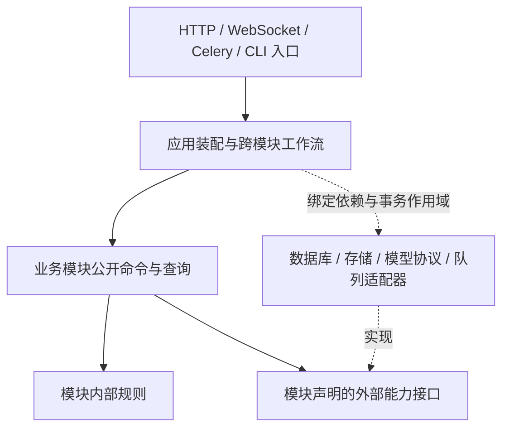

# 后端业务模块解耦与跨语言替换设计

> Status: in progress — 任务准入、执行派发、视频/审核证据、训练公共下层、终态/取消/失败重试、素材建题及共享预测准备已分片迁移；其余业务域、完整数据所有权与跨语言替换尚未实施。
>
> 创建日期：2026-10-16。
>
> 目标：重构后端业务边界，使模块可以独立演进，后续能够按模块替换实现语言；不是仅整理 Python 文件，也不是立即拆成微服务。

## 1. 决策与范围

采用**契约优先的模块化单体，按需提取进程边界**：

1. 先在现有 API/worker 部署中建立业务职责、数据写入所有权、明确的模块公开接口和依赖门禁。
2. 保持现有用户可见 API、WebSocket、数据格式、权限、事务和作业行为；内部导入不是公共兼容承诺，迁移时一次更新全部仓内调用方并删除旧实现，不增加兼容 facade。
3. 进程内调用传递类型化数据，不为了未来跨语言而增加本地 HTTP、JSON 编解码或网络往返。
4. 真正更换语言时，先证明目标模块不存在尚未解决的跨模块原子事务要求，再增加该边界的 HTTP 适配器和独立运行单元。
5. 保留已有五个推理服务和训练执行器的协议边界，不重写它们，也不将 Celery 当作跨语言公共协议。

本设计不选择未来语言，不建立通用微服务框架、通用 repository/BaseService、全局领域事件总线或第二套 ML 协议。跨语言能力由可交换的数据契约、状态所有权和替换验收证明，不以目录数量或服务数量验收。

实施按第 9 节逐片推进。第 3–9 节仍是目标设计，不能被当作全后端已解耦的现状说明；实际落地范围和验证见文末 Outcome。首片决策记录在 ADR-0088，后续切片继续同步正式开发文档。

## 2. 设计基线（实施前）与约束

| 事实                                                           | 源码依据                                                                                                                                             | 对设计的约束                                                             |
| -------------------------------------------------------------- | ---------------------------------------------------------------------------------------------------------------------------------------------------- | ------------------------------------------------------------------------ |
| API 装配集中，但业务规则并未全部下沉到服务                     | [路由聚合](../../apps/api/app/api/v1/router.py)、[审核入口](../../apps/api/app/api/v1/tasks/review.py)                                               | 迁移对象包含路由内的规则和事务编排，不能只移动 services                  |
| 存在 service → API 和 service → worker 的函数内导入            | [最终写入守卫](../../apps/api/app/services/project_write_guard.py)、[Mask 修复派发](../../apps/api/app/services/mask_repair.py)                      | 门禁覆盖函数内与相对导入；通过公开业务接口和注入的派发适配器消除反向依赖 |
| 任务、标注、批次和审核存在紧密关系，标注还依赖源媒体与标定身份 | [任务模型](../../apps/api/app/db/models/task.py)、[标注模型](../../apps/api/app/db/models/annotation.py)                                             | 先保留标注生产聚合，不把任务、审核、轨迹机械拆成不同服务                 |
| 预标注在请求路径按设备动态选队列                               | [预标注入口](../../apps/api/app/api/v1/projects.py)、[Celery 配置](../../apps/api/app/workers/celery_app.py)、[消费者配置](../../docker-compose.yml) | 静态 task_routes 不是完整执行契约，迁移必须覆盖动态路由和实际消费者      |
| 通用作业终态回填直接了解多个领域账本                           | [终态协调](../../apps/api/app/services/async_job_terminal.py)                                                                                        | 作业控制面与领域状态机分开，不能将所有领域终态统一为 failed/cancelled    |
| 审核通知在事务提交后发布                                       | [审核入口](../../apps/api/app/api/v1/tasks/review.py)、[通知服务](../../apps/api/app/services/notification.py)                                       | 保存提交与投递顺序；现有仓库地图的相关描述需要随该路径实施时纠正         |
| 训练执行器是独立拉取进程，且并行执行 CPU 预览                  | [执行器入口](../../apps/training-executor/Dockerfile)、[执行循环](../../apps/training-executor/training_executor/worker.py)                          | 不将训练执行归入 Celery worker，不丢失预览、租约及子进程回收语义         |
| 已有领域 package 和局部架构门禁                                | [后端分层](../../docs-site/dev/concepts/backend-layers.md)、[现有守卫](../../apps/api/tests/test_domain_package_architecture.py)                     | 复用现有实现和 AST 检查能力，不重复拆 GPU、导出等已整理的模块            |

[旧领域化计划](archive/2026-07-15-v0.23.0-api-services-domain-modularization.md)是历史依据，不延续其中保留旧 facade 的迁移策略。

保留这些既有领域决策：

- [模型版本、部署和发布身份分离](../adr/archive/0076-controlled-trained-model-identity.md)：模型冻结身份及精确部署约束不能因服务切换失效。
- [项目任务数据集与冻结版本身份分离](../adr/archive/0087-project-task-dataset-streams.md)：管理关联、发行序号和高水位不能参与或改写训练包摘要。
- [Data Manager 只读模型](../adr/archive/0047-data-manager-entity-read-model.md)：查询视图不获得权威写入权。

## 3. 目标业务模块

下表是**建议的逻辑边界与数据所有者**，不是当前目录已经满足的事实。数据归属先表达写入责任，不要求本轮改表名、重建历史对象或拆数据库。

| 模块                          | 负责的业务与权威数据                                                                                                           | 不负责的内容                                                                  | 主要公开能力                                                              |
| ----------------------------- | ------------------------------------------------------------------------------------------------------------------------------ | ----------------------------------------------------------------------------- | ------------------------------------------------------------------------- |
| `identity` 身份               | 用户、组织/分组身份、认证、API key、账号有效性和身份撤销                                                                       | 不自行推断项目操作权限，不做任务派发                                          | 解析/验证主体、读取有效身份、管理账号与凭据                               |
| `workspace` 项目与授权        | 项目、成员、项目职责与能力、项目配置/工具绑定及配置模板                                                                        | 不修改任务/标注/训练状态；项目计数不是项目配置真值                            | 项目配置快照、项目访问决策、成员和配置变更                                |
| `assets` 源数据与媒体         | 原始 Dataset/DatasetItem、素材 Scene/帧组织、标定、连接器、源媒体及媒体派生资产                                                | 不拥有 SceneTrack 人工标注，不创建/修改 Task，不拥有冻结训练标签              | 查询媒体清单、授权读取引用、导入源素材、请求媒体派生任务                  |
| `labeling` 标注生产           | 批次、任务分配/锁/状态、标注、持久预测候选与采纳、审核证据/反馈、SceneTrack/视频标注片段、标注质量与修复账本                   | 不调度模型实例，不管理训练实验；不修改源媒体与项目成员                        | 建题、派题、标注写入、提交/审核、带版本条件的候选落库、冻结已审核数据     |
| `inference` 推理编排          | 后端 registry/启用、能力、服务池、GPU 仲裁、多阶段 pipeline/模板、推理运行记录和失败重试上下文                                 | 不直接写 Task/Annotation/Prediction，不重新决定模型发布，不拥有人工采纳规则   | 查询能力、执行/取消推理、返回结果产物与实际模型身份、管理实例生命周期     |
| `learning` 训练与模型生命周期 | ProjectTaskDataset 管理关联、TrainingDatasetVersion 冻结身份、训练/搜索/预览/观测、评估/主动学习、模型版本、部署回执和发布选择 | 不复制生产标注真值，不修改审核结论，不绕过 inference 的实例管理直接操作模型池 | 构建训练版本、管理执行器协议、训练/评估、冻结发布引用、验证和发布受控模型 |
| `insights` 跨域查询           | Data Manager、Dashboard、绩效与谱系组合读取、可重建统计/索引/分析投影                                                          | 不拥有业务真值，不因列表操作直接写其他模块的表                                | 分页/过滤/统计查询、投影刷新；批量写操作转交明确的领域命令                |

支撑能力各有窄边界，不合并成一个无所不包的 platform 模块：

| 能力            | 所有权                                                  | 限制                                                            |
| --------------- | ------------------------------------------------------- | --------------------------------------------------------------- |
| `jobs`          | 通用异步作业 ID、进度、执行关联、取消请求和通用执行状态 | 领域状态仍由所属模块解释；Celery task/result 不作为唯一业务账本 |
| `audit`         | 审计记录、查询与保留策略                                | 需要同事务保存的业务审计继续同事务保存，不默改为异步尽力而为    |
| `notifications` | 通知偏好、持久通知、投递与 WebSocket 通道适配           | 不决定审核或作业业务结果，不提前发布未提交的业务结果            |

问题反馈、系统设置、健康与运维入口按实际职责归到独立应用功能或支撑组件，不塞进业务 shared；在入口清单中逐项登记所属组件与依赖。

### 3.1 容易混淆的数据边界

- **预测与推理**：inference 负责算出候选；labeling 负责候选与任务版本、作用域和人工编辑规则的一致性落库。现有数据库中的 Prediction 归 labeling，避免采纳操作跨服务修改两套真值。
- **媒体与标注**：assets 拥有 Scene 的素材与标定，labeling 拥有 SceneTrack 及人工成员；跨边界只传稳定 ID、内容摘要和修订，不传 ORM relationship。
- **生产数据与训练数据**：learning 从 labeling 获得不可变、带版本的训练来源快照，从 assets 获得媒体引用；不在运行时 join 生产表自行重新解释审核资格。
- **项目与派生计数**：项目配置由 workspace 拥有，任务数量由 labeling 的事实派生。现有 `Project.total_tasks` 在迁移中登记为历史物理落点；切换读方前保留原事务语义，通过明确的同事务适配器维护，不允许多个模块各自决定计数。目标改为 labeling 提供的计数/insights 投影后，删除原写入路径；物理列删除另需迁移与消费者核对。
- **对象存储**：共享 S3/MinIO transport 不是共享数据所有权。源图由 assets 管理，Mask 由 labeling 管理，训练包/权重由 learning 管理，导出产物由其导出任务所有者管理。只有所有者决定保留、删除和引用校验。
- **模型部署**：learning 拥有模型版本及验证后的部署回执/发布事实；inference 拥有实例与安装执行状态。由应用工作流协调安装、验证和发布，两边不直接改对方表。

## 4. 公开接口与依赖方向

### 4.1 模块结构与装配

目标是在现有 `app/services` 下形成业务所有者，而不是新建平行的 `app/modules` 再维护两套实现。现有 gpu_arbitration、ml_routing、video_tracking、exporting、data_management 是迁移素材，不等于都成为独立业务模块。

每个模块包含明确的公开入口/契约、应用用例、规则及私有持久化/外部适配器。只在职责确实存在时分文件，不为每个模块生成空的四层模板。

具体规则：

1. 入口负责协议解析和主体获取，业务状态机不留在 router 或 Celery task body。
2. 跨模块只能调用公开命令/查询，不能导入私有服务、数据库模型、router 私有函数或 worker task 对象。
3. 函数内 import、动态导入字符串、测试 monkeypatch 路径和脚本调用也纳入迁移；移动导入到函数内不算消除依赖。
4. 双向业务流程放在应用工作流层协调，不让两个模块互相调用。例如“请求推理 → 返回产物 → 候选落库”由工作流串联 inference 与 labeling；“安装模型 → 试用 → 发布”由工作流串联 inference 与 learning。
5. 作业终态处理器在应用装配时显式绑定；jobs 不导入所有领域模型，领域也不导入 Celery。进程内协调仍能绑定到同一本地事务。
6. 规则层不依赖 FastAPI、Celery、全局 settings 或 ORM。模块公开接口不接受 Request、AsyncSession、ORM 实例或可任意访问其他模块的容器。
7. 项目写入准入仍使用 workspace 提供的权限能力，最终写入检查不退化为“入口检查过一次”；身份事实不能由客户端传入的角色字段代替。
8. insights 可以读取其他模块明确提供的快照或构建投影；其他模块不反向依赖 insights 来决定业务许可、审核或模型发布。

### 4.2 代表性接口

下列名称表达目标业务语义，不是宣称已经存在的新 API 路由，也不直接作为 Celery 注册名。迁移时补齐该切片的完整操作清单，并映射现有输入、错误及调用方。

| 所有者 / 操作                     | 输入                                                          | 输出                                             | 关键约束                                             |
| --------------------------------- | ------------------------------------------------------------- | ------------------------------------------------ | ---------------------------------------------------- |
| identity / ResolvePrincipal       | 认证材料、目标 audience                                       | 有效主体、凭据作用域、撤销状态                   | 无效身份明确失败；认证材料不进入业务事件             |
| workspace / ResolveWritePolicy    | 主体 ID、项目 ID、操作与资源范围                              | 当前访问决策、项目配置修订                       | 不把权限缓存/历史角色当最终写入许可                  |
| assets / GetMediaManifest         | 主体上下文、素材 ID 集、所需修订                              | 媒体种类、尺寸/时序/标定、内容摘要、受限读取引用 | 不暴露存储凭据；URL 时效不等于素材身份               |
| labeling / CreateTasks            | 项目与源素材引用、创建参数、操作身份                          | 已建任务/作业、重复请求的确定结果                | 建题和聚合计数由该用例维护，assets 不再代写          |
| labeling / ApplyAnnotationCommand | 主体、任务 ID、现有版本前置条件、变更                         | 已提交的版本、变更结果                           | 保留锁、成员撤销、审核阶段、Mask 幂等与冲突语义      |
| labeling / ApplyPredictionResult  | 冻结作用域、任务前置条件、候选产物引用、模型实际身份、操作 ID | 已应用/拒绝项及版本信息                          | 复核任务资格；过期或重复结果不得覆盖后续人工操作     |
| labeling / ExportReviewedSnapshot | 项目、任务种类、选取条件、资格规则修订                        | 不可变快照、来源修订/摘要、可分块读取句柄        | 固定一个一致切面，不用分页时不断变化的生产查询拼快照 |
| inference / ExecutePrediction     | 快照化配置、明确的执行范围、冻结模型引用、产物输入引用        | 运行 ID、产物引用、实际模型身份与每项结果        | 保留设备队列、pipeline 谱系和取消/部分失败语义       |
| learning / FreezeModelReference   | 项目、用途与当前发布选择                                      | 不可变版本、权重/类别摘要、许可的部署身份        | 后续发布变化不能改写已排队任务                       |
| learning / ExecutorOperation      | 既有 claim/heartbeat/upload/finish 等协议输入                 | 既有回执、租约和上传授权                         | 保留 attempt/fence、训练与 CPU 预览的独立所有权      |
| jobs / RequestCancellation        | 主体、作业 ID、操作身份                                       | 取消请求及当前已知执行状态                       | “已请求”不等于已停止；领域终态由所有者确认           |

### 4.3 语言无关的数据契约

- 进程内使用模块拥有的类型化 DTO；DTO 可以由现有 Pydantic 工具链描述，但不能继承或携带 SQLAlchemy 模型、session、异常对象或可调用对象。
- 跨进程的新命令/查询默认 HTTP + JSON/OpenAPI；现有 ML 协议和训练 pull 协议保持独立，不改造成统一万能 RPC。
- 契约不要求消费方运行 Python。对外依据为导出的 OpenAPI/JSON Schema 与语义说明，Python 类 identity 不是契约；保留既有 schema → 快照 → 生成消费者的单一来源流程，不手写一套同名 JSON Schema 制造第二真值。
- 真正替换服务实现时，先固定已导出的协议及契约用例，新实现按它实现；切换后由新的协议所有者提供同一产物，删除旧服务生成路径，禁止两种语言分别手维护规范。
- 新的内部跨进程边界才增加对应规范和生成接线；尚无远程消费者的进程内函数不提前网络化，不为每个函数生成 OpenAPI。
- DTO 显式定义字段缺失与 null、空集合与未读取、UUID/标识符文本、UTC 时间格式、数值精度/上限及几何单位。超过 JSON 安全整数的精确整数用十进制字符串；禁止 NaN/Infinity。不得仅凭语言默认类型推断跨语言语义。
- 任务名、几何、媒体、格式和训练身份沿用现有 task_contract、protocol_v2、training_contract 的词表与冻结规则；共享词表不允许携带模块数据库访问或高层编排。
- 新边界的错误必须有稳定 machine code、现有 HTTP 映射、必要冲突事实与是否可安全重试的语义。保持现有公开 API 错误体，不为了内部统一而修改前端、SDK 或 CLI 合同。
- 查询明确排序、分页游标、快照/新鲜度和 unknown/partial；批量命令明确逐项结果、原子范围和部分提交规则。
- 长作业返回操作/作业身份，明确成功、失败、部分成功、取消请求与取消完成，不把调用超时当作业务失败。
- 现有业务幂等规则原样迁移。首次新增远程写边界时必须补齐操作 ID、作用域、请求摘要、保留期和重复冲突规则，网络超时后可查询原操作；非幂等命令不得因 transport 自动重发。
- 大图片、Mask、视频、训练包和权重只传受限对象引用、格式与摘要，按需流式读取，不在模块间复制二进制或塞入大 JSON。
- 远程主体上下文由可信适配器验证，限定 audience/作用域，不能信任任意 actor_id 请求头；请求追踪标识不提供权限。URL/日志/事件不得携带长期凭据。

## 5. 数据所有权与一致性

### 5.1 先分写入责任，不先拆数据库

第一阶段保留 PostgreSQL、现有表、外键和统一 Alembic 迁移链。每张业务表、Redis key namespace 与对象前缀登记唯一所有者；一个共享物理实例不等于所有模块都有写权限。

目标规则：其他模块不能直接写所有者数据，也不能依赖其 ORM 关系或私有 SQL。现有跨域 join 逐项登记，在对应切片结束前替换为所有者的批量查询/一致快照或 insights 的只读投影；禁止用逐行 RPC 替换批量 SQL。

跨域外键可以先保留以维持当前完整性；它们不证明可以独立拆库。真正提取服务时，明确数据库角色、迁移执行者、删除/引用策略及跨域外键影响。换语言可以先继续使用受限的原数据库表，拆库是另外的决定。

### 5.2 事务边界不能被接口表掩盖

同进程下，应用装配创建事务作用域，将模块持久化适配器绑定到同一连接/事务；公开业务操作不传 AsyncSession。各模块通过自己的适配器写自己的数据，应用工作流决定需要共同提交的操作。

例如审核状态、批次流转、业务审计和持久通知仍可同事务提交，再执行需要提交后才能运行的通知发布。迁移时不能把现有 flush 改成模块内部各自 commit，也不能反过来删除既有分块提交语义。

**共享本地事务的工作流不能只把一个适配器换成 HTTP 就宣称等价。** 对每条跨模块写路径选择并记录：

| 不变量类型                            | 处理方式                                                                  | 远程提取条件                                                             |
| ------------------------------------- | ------------------------------------------------------------------------- | ------------------------------------------------------------------------ |
| 必须共同成败的标注/审核/证据更新      | 保留在 labeling 聚合及同一事务内                                          | 不把这一原子范围拆成多个服务                                             |
| 最终写入必须和项目成员/账号撤销串行化 | 保留现有权威读取、锁和写入事务边界                                        | 在等价并发协议被设计并验证前，相关命令不远程拆出；不能用过期权限快照替代 |
| 训练数据冻结                          | labeling 创建不可变来源快照，learning 消费固定句柄/摘要，构建可在其后完成 | 来源切面、项目配置修订、媒体引用和保留规则已固定，不边翻页边读取活数据   |
| 长耗时推理/训练/导出                  | 用显式状态、产物/执行回执和条件写入推进                                   | 重复、超时、迟到结果和取消后的写入有确定语义                             |
| 统计、列表和通知投递                  | 保持当前同步语义，或单独批准可观察的投影延迟/投递语义变更                 | 明确新鲜度/投递保证，并具有可核对的来源；不能悄悄改成最终一致            |

项目计数迁移、项目删除、成员交接、建题、模型部署/发布都要单独列出事务矩阵。跨域删除不能靠服务调用顺序模仿数据库级原子级联；拆出前必须定义引用保留、拒绝删除或已验证的删除流程。

### 5.3 作业、消息与投递

- Celery 作为 Python 执行适配器保留，公开接口表达“执行这个领域操作”，不暴露 pickle、任务 Python 路径、chord 对象或 Celery exception。
- jobs 维护通用作业状态；各领域维护自己的账本及 `partial`、`rollback_failed` 等语义，应用工作流绑定领域终态回填。
- 当前同步原子更新不因引入事件而拆开。只在某条已选定远程边界确需可靠异步交接时，为该边界实现同事务 durable outbox/操作收据以及明确的消费去重；不先建全平台消息基础设施。
- 不宣称 exactly-once。需要可靠交接的边界按可重投、去重、顺序范围、重复/迟到处理和失败后核对定义语义。
- 如果使用领域事件，至少固定事件 ID、类型/schema 修订、来源实体 ID/修订、发生时间、关联操作和最小必要数据；事件表达已提交事实，不作为任意写入命令或权限许可。
- 进程崩溃、断网和重投的验证属于首次远程提取的完成条件，不能只验证正常 HTTP 返回。

## 6. 关键工作流的目标职责

1. **导入 → 建题**：assets 完成素材导入并提供稳定引用；应用工作流调用 labeling 建题。建题进度和计数由 labeling 维护，导入完成不能等同于建题成功。
2. **标注 → 提交 → 审核**：labeling 拥有状态机，调用可信身份/项目能力接口，保存版本化证据并保持当前事务与锁；审计和持久通知参与所需本地事务，通知在允许的提交时序发布。
3. **预标注 → 候选落库**：工作流冻结作用域/模型身份，inference 执行并返回产物；labeling 在落库时复核版本、范围、权限和终态。工作台单题与批量预标注的资格规则保持区分，取消、重试及发布变化不能绕过冻结身份。
4. **审核数据 → 训练 → 发布**：labeling 冻结审核来源，assets 提供媒体身份，learning 管理版本/包、执行器与模型回流；安装与原生试用通过 inference，确认后由 learning 发布。项目任务流管理关联不能改写历史包身份。
5. **Data Manager 批量操作**：insights 负责选择与展示；写命令在领域模块重新验证最终目标和资格，不能相信查询时的列表权限或筛选结果永远有效。

## 7. 跨语言替换路径

按“契约冻结 → 实现与验证 → 明确切换 → 删除旧实现”执行：

1. 从已迁移模块选择无未解决强事务依赖的边界，记录操作、数据所有者、同步/异步状态机和性能基线。
2. 固定语言无关协议、真实请求/结果 fixture 与契约用例；既有 HTTP/ML/训练合同不另起炉灶。
3. 新语言实现只获得其拥有的数据与所需外部能力；不得连接全部业务表绕过模块接口。新旧实现不能同时成为同一数据的独立写入者。
4. 在隔离数据上对比新旧行为。生产只读影子流量只适用于无副作用查询；命令回放不得写生产库或触发真实模型/媒体副作用。
5. 明确切换写入所有者，停止旧端派发并排空/确认旧执行，转交 durable operation/租约和结果收据；在途任务、迟到回调和 Celery 注册名逐项处理，不能因换路由直接丢弃。
6. 外部 API 适配层保持原合同，所有仓内调用方在该切片迁移。稳定后删除旧业务实现、旧派发入口、旧内部导入、临时切换逻辑及失效测试，不永久保留双写或兼容别名。
7. 回退以已验证的协议/数据可读性和执行所有权为前提，先冻结新写入再移交；不能在两边仍运行时只切回 URL。已经改变数据语义且不能反向读取的切换，不承诺应用级即时回退。

建议优先评估**有明确输入产物与输出产物的媒体处理子能力，或可重建的统计查询**作为首次语言替换演练；不是先拆包含权限、审核和标注原子写入的核心聚合。只有盘点证明符合条件才选定，不把候选当作已确认迁移范围。

## 8. 完成标准与验证方法

### 8.1 模块真正解耦的标准

- 每个入口和权威数据对象有明确所属模块；共享读模型与派生字段单独标明。
- 模块外只依赖公开契约，不导入私有 ORM/路由/worker；模块内外不存在依靠函数内导入掩盖的环。
- 模块可由自己的命令/查询入口和可替换适配器运行行为验证，无需导入整个 FastAPI/Celery 装配图。
- 关键用例的权限、版本前置条件、错误、锁、事务及作业终态与原行为一致；行为变化必须独立说明和验收。
- 首个真实远程边界有实际命令/查询 smoke，证明调用方不依赖提供方语言运行时；仅通过 JSON 序列化或编译不算证明。

### 8.2 每个实施切片的验证

1. 改前记录真实调用路径和现有相关行为用例；只新增能捕获消费者可见风险的回归，不测试 re-export identity 或目录文本。
2. 扩展现有架构守卫：覆盖目标模块的函数内/相对导入、私有访问与循环依赖，并为已清除旧路径保持防回流规则。不把已有范围外问题伪装成本切片已解决。
3. 运行目标路由/服务/worker 测试及实际调用 smoke；涉及写库的验证使用已确认可丢弃的测试数据库。涉及 worker 变化时按 runtime 技能刷新实际消费者后再验证。
4. 冻结并对照外部 API/OpenAPI、WebSocket、ML/训练协议、导出格式、冻结摘要、状态码和错误语义；内部 Python identity 与私有 monkeypatch 路径不属于兼容目标。
5. 采样核对查询次数、队列、对象读取与峰值内存，防止跨模块改造引入 N+1、二进制复制或重复模型加载；性能预算由改前同场景测量定义，不凭空给出阈值。
6. 真正远程化时额外覆盖重复写、执行后丢响应、过期权限、取消后迟到结果、执行器退出不明、消费者重启和在途切换。

## 9. 实施任务与依赖

| 阶段                 | 工作                                                                                               | 前置                                   | 可验收交付                                                       |
| -------------------- | -------------------------------------------------------------------------------------------------- | -------------------------------------- | ---------------------------------------------------------------- |
| A 现状与不变量       | 完整入口清单、调用/数据写入图、事务矩阵；明确当前错误与冻结身份                                    | 本设计                                 | 全部第一方入口和主要写路径有归属，未知项与证据明确，不只画目录   |
| B 契约与装配边界     | 为选定切片确定公开命令/查询、DTO、适配器绑定和目标依赖门禁；保留必要本地事务                       | A 对应边界                             | 消费方和数据所有权明确，无新通用框架、无空模板与旧 facade        |
| C 先消除已知反向依赖 | 收口项目/任务写入守卫；把服务中的任务派发改为注入的执行接口；把终态登记移到应用装配                | B 对应切片                             | router/worker 只做入口，公开行为与状态机不变，目标反向导入消失   |
| D 逐业务切片迁移     | assets→labeling 建题；标注/审核原子聚合；inference 编排；learning 快照/发布；insights 查询逐片切换 | 各自 A/B/C 及实际依赖                  | 每片同步迁移调用方/测试/文档并移除旧实现；不把五片绑成一次大搬迁 |
| E 可替换性演练       | 选择已完成 D 且无强事务阻碍的候选，真正用选定新语言实现、运行并切换                                | 候选的依赖与验收已通过，维护者选择语言 | 同合同真实运行、数据/执行单一所有者、故障与在途切换验证通过      |

B/C/D 是按切片推进，不要求一次定义所有未来接口，也不要求先完成全仓目录重排。A 的现状清单可以共享，已有检查结果不因切片恢复而无理由重跑。

首个实施切片建议选**最终写入守卫从 API 反向依赖中移出**：沿用当前业务所有者与锁，不夹带权限规则修改，迁移 labeling 相关调用方并验证成员撤销、任务阶段及审核证据。该切片能直接验证公开入口、依赖门禁和事务保真，不先引入网络协议。

每个切片文档更新到对应的 [仓库地图](../../docs-site/dev/concepts/repository-map.md)、[后端分层](../../docs-site/dev/concepts/backend-layers.md) 和相关领域页面。纯结构迁移不虚构用户可见功能；若实际改变用户行为，则同时更新用户指南和 CHANGELOG。发布版本与语言选择由维护者决定，本文不预分配。

## 10. 证据范围

- 设计基线来自源码抽查、既有架构决策和 Compose 配置解析；它不代表完整业务域的运行验证。
- 当前实施与验证覆盖任务访问/写入准入、质量/媒体/训练数据集执行派发、视频上下文/审核证据、训练公共下层、作业终态/取消/失败重试、素材建题所有权及共享预测准备；没有修改数据库 schema 或受版本管理的运行配置。首片 OpenAPI 仅同步邻帧端点描述中的帮助函数名称，之后切片未改变快照，均未改变路径、字段或响应合同。
- 后续业务域及语言替换仍按第 8、9 节分别验收；不得把局部结果扩展为全后端已完成解耦。

## Outcome

### 任务访问与写入准入

- 已实施切片：`services/task_access.py` 统一持有上下文绑定、编辑阶段、有效分派、写能力、审核调整证据和单题/批量可见性。`project_write_guard` 不再导入 API；相关 HTTP、WebSocket、写入服务和跨帧 worker 已迁移，旧私有定义与 package 导出已移除，无兼容 facade。
- 本片门禁：现有 AST 架构守卫支持明确声明的单文件服务，覆盖 `task_access`、`project_write_guard` 的 API/worker 反向依赖及服务环。新增管理者上下文错配、完成态锁定的行为回归；既有审核证据、权限撤销和写入用例保持原行为。
- 本地回归：隔离测试库的 12 个相关测试文件，249 passed、5 skipped；5 项均为没有声明 lazy-root 规则的服务/领域，不是业务用例跳过。
- 实际运行：在隔离环境启动真实 Uvicorn 和普通/维护 Celery worker；标注创建 201、同幂等键返回同一标注，完成态写入 409。撤销成员后，HTTP 维持 404 隐藏资源存在，最终写入守卫维持 403 `permission_changed`。跨帧作业经实际队列完成，新增 1 条、跳过 1 条，并核对持久化结果。准入模块冷加载不装配 API/worker。
- 契约与静态检查：OpenAPI snapshot 与当前路由一致；本片 Python Ruff 检查通过。
- 正式开发文档：`docs-site/dev/concepts/backend-layers.md`、`repository-map.md`、`task-module.md`、`scheduler-and-task-dispatch.md`、`docs-site/dev/reference/ws-protocol.md`。
- ADR：[0088 — 任务可见性与写入准入由服务层统一持有](../adr/archive/0088-service-owned-task-admission.md)。
- 提交：`eb9fd7623`，实现、回归与正式文档在同一切片提交；发布里程碑：Not yet determined。纯内部结构迁移，未新增用户可见行为，未添加 CHANGELOG 条目。

### 质量执行派发

- 已实施切片：新增纯类型执行端口 `QualityJobDispatcher` 与具体 `CeleryQualityJobDispatcher`，由 `deps` 装配；五个服务派发入口要求显式注入，11 个 HTTP 处理入口全部迁移，业务服务不再导入这些 worker。没有增加默认实现、兼容 facade、通用字符串任务总线或本地 RPC。
- 保真范围：三类质检保留预分配执行 ID，Mask 修复/回滚保留 `media` 队列，格式导入保留原 task 的 `delay`；提交顺序、派发失败状态、通知及 HTTP 错误归属不变。架构守卫覆盖端口和五个服务文件，支持 package 内单文件所有者。
- 本地回归：主要相关回归 98 passed、11 skipped；视频轨迹真实数据库边界与派发失败回归另有 2 passed。11 项跳过均是未声明 lazy-root 规则的所有者；ZIP 重复成员夹具产生一条预期警告。Ruff 与 OpenAPI 检查通过。
- 实际运行：隔离测试库、真实 Uvicorn、普通/维护 Celery worker 及 MinIO 下，Mask QC、点云质检和视频轨迹质检完成并保留执行 ID；Mask 修复把面积从 4 改为 3，回滚恢复为 4。回滚夹具先补齐生产所需的原始 Mask 上传归属记录，未弱化生产校验。
- 导入验证最初暴露独立问题：真实导入已派发并记录执行 ID，但 Worker 以 `format_plan_digest_conflict` 失败。该问题已作为下一独立进度修复，未混入派发解耦；预检夹具暂存对象已纠正到 `import_bucket`。
- 提交：`70b9ec938`；正式文档为后端分层、仓库地图及 [ADR-0089](../adr/archive/0089-injected-quality-job-dispatch.md)。纯内部结构迁移，未添加 CHANGELOG 条目。

### 导入计划摘要一致性

- 根因：原 `_plan` 在模型规范化前计算摘要，而 API 持久化和 Worker 验算的是补齐字段并转换为 JSON 值的模型；合法计划因此被误判为冲突。
- 修复：先验证 `MaskFormatPlan`，再对排除顶层 `plan_digest` 的完整 JSON 表示计算摘要。保留 Worker 原有验算，不绕过冲突保护，也不改写旧收据或失败作业。
- 回归：在既有收据/执行场景中补上冻结计划可被消费者验算的断言，修复前明确失败；修复后图片及视频格式相关三文件共 26 passed，一条 ZIP 重复成员夹具警告。两个变更 Python 文件的 Ruff 检查通过。
- 实际运行：使用同一实际暂存文件重新预检、提交导入，真实 Uvicorn / Celery / PostgreSQL / MinIO 下作业完成；核对只新增一条有效标注，类别与 bbox 几何和原始文件一致。至此，质量切片六条执行路径均已实跑通过，未重跑已完成的质检和修复验收。
- 用户指南与 CHANGELOG 同步记录正确的计划校验和旧收据重新预检要求；本进度独立提交，不改变 OpenAPI schema、数据库 schema 或运行配置。

### 媒体执行派发

- 已实施切片：纯类型 `MediaJobDispatcher` 定义缩略图、视频元数据、分块及单帧执行请求，`CeleryMediaJobDispatcher` 保留四个既有 task 的 `delay` 与默认队列。数据集扫描、上传完成、ZIP、视频缓存双入口和媒体资产重试均由 HTTP 装配；连接器导入 worker 自行装配。`dataset` 与 `video_frame_service` 不再导入 worker，无默认实现或兼容路径。
- 门禁：端口、数据集及视频帧服务纳入反向依赖检查；端口和数据集纳入服务环检查。没有为既有视频服务环添加豁免规则，也未宣称该环已消除。
- 本地回归：视频帧、ZIP 入库、连接器导入、存储接口、视频工作台及架构六文件共 163 passed、14 skipped；跳过均为未声明 lazy-root 规则的所有者。变更 Python 文件的 Ruff 与 OpenAPI 检查通过。
- 真实 Uvicorn / Celery / PostgreSQL / MinIO：缩略图与 blurhash 落库，视频元数据及 180 帧时间表生成，主分块、单帧、JPEG 预取和强制重试完成；下载并解码实际缓存图片核对尺寸。端口冷加载不装配 API/worker/Celery。
- 实跑另外发现既有预热缺陷：新邻块创建为 `pending` 后，被预热的进行中排除条件跳过，未真正派发。该问题已作为后续独立修复完成，未混入本片纯结构迁移。
- 提交：`36b15c5e1`，正式文档同步。纯结构迁移不新增 CHANGELOG；沿用 ADR-0089 的端口注入模式，不引入通用任务总线或网络调用。

### 训练数据集执行派发

- 已实施切片：`TrainingDatasetDispatcher` 是纯类型异步端口，`CeleryTrainingDatasetDispatcher` 持有原 task、默认队列和线程卸载。创建/重试 API、学习策略手动检查、周期 worker 与策略内部派发全部显式传递端口；没有默认实现、API 依赖导入或旧服务派发补丁路径。
- 保真范围：先保存执行 ID 再发布，保留 version/job/attempt；broker 响应丢失后仅在同一 attempt 仍 pending 时落失败，不覆盖已 running/ready 的尝试。领域服务保留权限、事务、失败状态和通知职责。
- 门禁：端口、训练数据集及学习策略服务检查 API/worker 反向导入；端口和训练数据集检查服务环。既有学习策略/训练编排环没有新增豁免，也没有宣称已消除。
- 本地回归：训练数据集、学习策略、项目任务数据集、存储删除及架构五文件共 159 passed、17 skipped；跳过均为未声明 lazy-root 规则的所有者。变更 Python 文件的 Ruff 与 OpenAPI 检查通过。
- 实际运行：真实 API 预检并创建版本，经 Celery 物化为 ready；下载实际 ZIP，核对 SHA-256、三张图片、三份 bbox 标签及 train/val 划分，attempt 和执行 ID 保持不变。周期学习策略 task 的空扫描实跑完成；实际自动候选触发仍以回归测试为证，不扩展为线上资格结论。
- 提交：`6748cae79`；后端分层、仓库地图及实施证据同提交。纯结构迁移不新增 CHANGELOG，无存储迁移、worker task 签名或对外 schema 改动。

### 新邻块预热实际派发

- 根因：预热复用创建 pending 行的 helper，却把所有 pending 行视为此前进行中的作业，导致本次新建邻块没有发布任务；真实队列观察到主块 ready、邻块长期 pending。
- 修复：helper 同时返回本事务成功插入的 ID，只有 INSERT 的成功方记录新建身份；预热在提交后派发本次新建行及失败行，保留已有 ready/pending 的去重和原 SAVEPOINT 并发保护，全部 helper 消费者同步迁移。
- 回归：新增缺失/pending/ready/failed 四状态用例，修复前仅缺失邻块失败；修复后视频帧服务整文件 38 passed。并发插入回归同时验证四个请求只产生一个新建身份。Ruff 检查通过。
- 实际运行：只清理本次探针此前未派发的孤立邻块，重新制造缺失邻块；真实 API 请求已缓存主块后，新邻块通过真实 Celery 生成至 ready，下载产物并经 ffprobe 核对视频尺寸。既有缩略图、元数据、帧缓存及训练数据集验收未重跑。
- 用户指南、开发参考与 CHANGELOG 同提交。不改变分块粒度、采样、标注或对外 schema；不承诺恢复历史孤立 pending 或消除数据库/broker 间失败窗口。

### 视频上下文与审核快照边界

- 已实施切片：`video_context` 统一持有共享上下文及源帧采样，帧/片段/协作、导出、追踪、质检和测试全部迁移；帧服务旧导出已删除。`annotation_evidence` 接收原 API 的六个轮次、快照及首次审核事实函数，API/片段服务直接消费，无旧私有路径或兼容别名。
- 边界保真：采样舍入、绝对源帧网格、Task/片段锁顺序、贡献者冻结、审计缺失回退和首审仅记录一次均保持原实现。上下文仍绑定 ORM，不冒称已完成语言无关 DTO。
- 门禁：新所有者与片段/协作/证据加入反向依赖及环检查。原视频三模块 SCC 已消除；全仓 AST 导入检查没有发现已迁移旧符号，OpenAPI 未改变。
- 回归：16 个相关文件首次 341 passed、2 failed、21 skipped；两个失败分别来自独立连接测试未覆盖请求 DB 依赖、路由账本测试硬编码默认 Redis。修正为隔离 test engine 与权威账本工厂，仅复跑两项，均通过；最终该范围 343 passed、21 项 lazy-root 规则不适用。Python Ruff 检查通过。
- 真实 Uvicorn / Celery / PostgreSQL：视频 manifest、片段认领/提交完成，当前轮与贡献者证据冻结；贡献者即使为超级管理员也自审 403，独立审核成功并保持首次审核归属。另以没有提交审计的冻结 Task 行验证回退归属，未绕过审计不可变约束，也未宣称执行了审计归档任务。
- 提交：`dbb5b54b2`；正式后端分层、仓库地图、视频参考与实施记录同步。纯内部结构迁移，无新增 CHANGELOG、schema 或运行配置。

### 训练配置、领取与产物边界

- 已实施切片：资源标识、配置目录、参数解析和受控模板归入 `training_adapters`；项目事务锁与自动策略/参数搜索领取判定归入 `training_claims`；流式产物、观测摘要与有界 JSON 校验归入 `training_artifacts`。API、策略、搜索、配方、预览、初始化、观测、模型注册及测试均迁移到所有者，旧编排入口物理移除，无兼容导出。
- 边界保真：执行状态机与资源租约仍由 run 编排持有；项目锁保持原 PostgreSQL key/等待语义，领取回调不额外取得项目/策略锁。手动恢复、项目有效性、策略版本/模板/初始化约束、流式大小/digest/attempt 校验、关闭响应体与线程卸载不变；没有引入消息总线、远程调用或新状态机。
- 门禁：三个下层及初始化、run、策略、搜索、配方、观测所有者加入反向依赖与环检查。全仓 AST 导入图中原六模块 SCC 已消除；已迁移旧导入与旧导出检查、下层冷加载检查及 OpenAPI 检查通过。
- 回归：13 个相关文件首次 244 passed、5 failed、2 errors、29 skipped。修正共享 dispatcher fixture 的归属、并发测试完成后遗漏的空闲资源租约清理，以及迁移后漏改的产物读取补丁目标；失败项、修改的并发用例及策略文件复验共 33 passed，最终该范围 251 passed、29 项 lazy-root 规则不适用。并发用例使用唯一测试资源并按身份清理，不放宽资源隔离断言。
- 真实 Uvicorn / PostgreSQL / MinIO：项目 advisory lock 与原 key 互斥并按事务释放；禁用策略、停止搜索及手动覆盖前提符合原判定，持有项目锁时领取检查不阻塞。真实流式对象、观测摘要和初始化校验通过，digest、attempt、异属 run 拒绝；目录禁用模式保持关闭。未执行原生训练、GPU 资格验证或真实自动训练调度，控制面夹具不作为这些能力的证明。
- 提交：`ca28961fc`；后端分层、仓库地图与实施证据同步。纯内部结构迁移，无新增 CHANGELOG、schema、运行配置或存储迁移。下层仍依赖当前 ORM/配置/存储，不宣称已具备跨语言 wire 契约。

### 作业终态装配与领域回填

- 已实施切片：`async_job_terminal` 收敛为不可变 `JobTerminal` 事实，不再持有任何领域模型、回填函数或注册表。六类作业的回填规则迁入五个现有领域所有者，由 `application/job_terminal.py` 显式绑定；HTTP 三条共享硬取消路径和 Celery 信号全部迁移，无旧函数或兼容导出。
- 工作流保真：通用状态、领域行锁、领域终态、通知与提交的顺序不变。HTTP/worker 保留事务和连接所有权；样本评估与主动学习继续委托自身中断状态机，不把 `cancelling`/`lost`、旧 attempt 隔离或取消原因抹平。没有将普通 worker 正常完成改成统一事件分发，也未修改通知白名单或发布时点。
- 门禁：通用作业及终态事实加入依赖方向和 SCC 检查；前者应用内依赖只允许自身模型，后者不依赖其他应用模块。所有已声明领域禁止反向导入应用装配层，包含函数内和相对导入；没有增加环豁免或延迟导入规避。
- 回归：十个完整相关文件 174 passed、31 skipped；主动学习取消/旧 job 隔离及改为工作流入口的评估取消原因场景另有 2 passed，其中评估用例与整文件结果重叠，累计 175 个不同用例通过。新增三个修复取消状态用例覆盖已完成分片、空分片及已结束账本；跳过均为 lazy-root 规则不适用，一条 ZIP 重复成员夹具警告。变更 Python Ruff 与 OpenAPI 检查通过。
- 真实 Uvicorn / Celery / PostgreSQL：三类硬取消同步更新通用与领域账本；对现有 cleanup task 注入不支持的关键字触发真实失败信号，六类领域账本及无账本 kind 均按原规则落库。先确认 worker 收到 revoke 再发布的任务触发真实撤销信号，修复与导入保留 `partial`，回滚失败保留 `rollback_failed`，持久通知按原白名单生成。主动回滚调用方事务可同时撤销通用行、领域行和持久通知；终态事实冷加载不装配 ORM/API/worker/传输。
- 提交：`f72a461b5`；实跑使用最小控制面账本夹具，并未执行真实质检、导入、修复、推理或训练工作负载。上述状态标记不作为实际产物或 GPU 资格证明；正式后端分层、通知说明、仓库地图与本记录同步，纯内部结构迁移不新增 CHANGELOG、schema、配置或存储迁移。

### 剩余入口与数据写入盘点

- 已完成模块级源码盘点：HTTP 身份/工作区、素材、标注、推理、学习、统计及运维入口；WebSocket 的项目/全局作业/通知频道；Celery 常规与维护入口、beat 与 heartbeat；独立训练/CPU 预览执行器；后台 CLI/导入回填脚本；消费 HTTP 的 SDK/CLI/TUI。该清单不是“每个命令、每张表和每个对象前缀的所有权/事务台账”，不据此宣称阶段 A–D 全局完成。
- 切片开始时全源 AST 图实测仍有四个服务 SCC：`annotation_slice ↔ mask_slice_restore`、`pointcloud_import ↔ scene_inference`、`active_learning_pool → sample_evaluation_sources → sample_evaluations → active_learning_pool`，以及 `mask_formats` 的 package/registry/adapters/image/video 注册环。服务直接反向导入 worker 的剩余项为 `secondary_inference` 的上下文/图片/ROI 助手；讨论服务另有 `app.deps` 组合依赖，追踪派发还携带 Celery 与 worker 字符串任务名。这些不是已通过局部门禁便可忽略的范围。
- 本轮切片后的写入与事务缺口：素材入库与建题写入已有不同所有者，但追加仍依赖本地强事务，初始分块、追加 flush 和标定前置提交仍需分别保留。解绑/项目删除仍跨域原子删除；提交/审核组合状态、证据、批次、审计和通知；账号/成员变更与最终写入必须串行；推理结果仍直接写标注；训练快照依赖单语句一致切面；模型安装发布为带 check_id 的两事务工作流；Data Manager 仍包含任务分派命令。不能把这些差异统一成一种提交模式。

### 作业取消与当前管理能力边界

- 已实施切片：HTTP 取消入口只调用 `application/job_cancellation.py` 并提交。修复、格式导入、训练数据版本和评估各自拥有 `request_job_cancel`；批量预测和跨帧拥有自己的取消结果构建。`JobExecutionControl` 是无 ORM/broker 的执行端口，具体 Celery 适配器由 HTTP 依赖装配，保持非强制撤销；没有新取消状态机、默认实现或兼容导出。
- 授权收口：原训练数据集路由 `lock_owner` 迁入 `project_write_guard.lock_project_manager`，训练、模型、配方、搜索、预览、分析、评估、主动学习与谱系调用方全部迁移。保留账号→项目共享锁、当前管理能力及原错误文本；作业可见性迁入 `async_job_access`，旧私有函数移除，列表仍保持 SQL 范围查询而非逐行检查。
- 保真：所有既有 kind/状态准入和授权优先级、pending/running 分支、撤销前后时序、数据版本刷新/当前尝试、评估取消意图、结果计数、通知与调用方提交保持原行为。撤销发布失败不被伪装成已停止，也未改变其原状态处理；没有增加重试、outbox、校验或任务协议。
- 回归：21 个相关完整文件 391 passed、36 skipped；另增评估当前/被替代尝试的通用取消入口回归 2 passed，累计 393 个不同用例通过。修复/格式取消覆盖 pending/running 及 broker 成功/异常八种状态组合。跳过均为 lazy-root 规则不适用，一条 ZIP 重复成员夹具警告；变更 Python Ruff 与 OpenAPI 检查通过。
- 实跑：真实 Uvicorn/Celery/PostgreSQL 验证十二种取消场景，pending 立即终态、running 保留请求标记、领域账本和原通知白名单符合原行为。API 实际发布的非强制撤销可阻止后续任务体执行，结果确认为 REVOKED；账号/项目共享锁与所有权写入所需的 `FOR UPDATE` 锁互斥，回滚后可取得该锁。使用控制面账本夹具，未执行真实质检、修复、导入、推理或训练负载。
- 性能采样：直接执行提交前处理函数与新处理函数，对十二组相同状态夹具逐项计数，SQL 数全部相同，范围为每次 2–19 条，没有引入额外逐行查询。Python 峰值也已采样，但包含冷缓存/语句缓存差异，不作为内存优化或稳定性能预算结论。
- 提交：`cd87b98e4`；正式分层、仓库地图、通知说明与本记录同步。纯内部结构迁移，无新 CHANGELOG、API/schema、运行配置或存储迁移。领域持久化适配器仍接受本地会话/ORM，未宣称可直接换成远程服务。

### 失败预测重试准入、占用与执行边界

- 已实施切片：单项重试与按作业重试迁入 `application/prediction_retry.py`；领域 `prediction` 持有失败预测管理权限、行锁占用与释放，放弃/恢复同步迁移同一权限入口。`services/prediction_retry.py` 统一重试次数上限、UTF-8 JSON 上下文预算与纯执行端口，预标注 API/worker 和测试全部迁移；API 原常量、权限助手与 worker 旧上下文预算助手删除，无兼容导出。
- 保真：保留原角色/项目准入、错误优先级、放弃/次数/排队保护、失败 ID 解析和重复项计数。单项仍在占用提交前按设备及受控模型快照选队列，批量仍沿用原默认路由；先提交占用后发布，中途异常仅释放尚未返回派发成功的项，已返回成功项继续占用。补偿不增加执行计数，但 broker 回执不确定时不能证明原请求未入队/执行。未增加权限锁、自动重试、outbox、网络往返或新的作业状态机。
- 门禁与回归：重试策略/端口加入禁止反向依赖、应用依赖白名单与 SCC 检查；纯模块冷加载不引入 ORM、FastAPI、Celery、配置或入口。12 个相关完整文件合计 290 passed、37 skipped，跳过均为 lazy-root 规则不适用；新增发布前/中途失败及单项补偿回归，并强化 UTF-8 8 KiB 边界。仓库固定版本 Ruff 和 OpenAPI 快照检查通过。
- 实跑：真实 Uvicorn/Celery/PostgreSQL 下，普通与受控模型的两条单项 CPU 路径均由已注册的本工作树 worker 消费；缺失任务分支保留原错误和冻结上下文、增加一次执行计数、释放排队标记，并写入失败作业与原终态通知。批量真实发布两条消息至原 `ml` 队列，重复与超限记录保持 2 queued / 2 skipped，重复请求 409；broker 消息参数、队列及持久占用相符。
- 提交：`e72cabc11`；单项执行到真实缺失资源终态，批量验证真实 broker 入队而未启动 GPU 消费者；没有执行原生推理、加载模型或证明 GPU 资格。正式分层、仓库地图、流水线与失败预测说明同步，纯内部结构迁移无新 schema、配置、迁移或版本变更，仍不是跨语言 wire 协议。

### 素材准备与标注建题写入所有权

- 已实施切片：`application/dataset_task_creation.py` 组合管理关联、请求时同步/排队选择、素材准备与建题；`labeling_tasks` 持有初始泛型/点云任务、媒体关联、进度和项目任务数增量。资产服务保留入库、去重、尺寸、素材行/文件数、标定与帧准备；边界使用不可变 `dataset_task_facts`，场景推断和点云准备共用 `dataset_frame_grouping`。API 上传完成/ZIP/扫描/关联、两个 worker、六个种子/导入脚本及测试全部迁移，旧建题函数和方法删除，无兼容导出。
- 保真：保留初始默认 5000 项及调用方指定的分块提交、泛型零任务不提交、追加只 flush、点云标定前置独立提交及无新任务重放、现有关联立即返回、请求时阈值和 queued 分支、逐文件导入提交/错误与提交后媒体派发。没有添加锁、唯一约束、upsert、SAVEPOINT 或新准入；解绑/删除仍在原资产/API 路径，不宣称整个模块已解耦。
- 集成风险修正：抽取草稿将泛型单语句 `NOT EXISTS` 改成全量 ID 的 `IN` 查询，实跑 33,000 项复现 asyncpg 32,767 参数上限。集成保留原单语句只读投影和排序，不引入额外预查询或全量既有素材物化；修正后真实创建 33,000 项、项目计数一致、重放新增 0，并保留大数据量行为回归。投影仍绑定本地数据库，不是远程查询契约。
- 门禁与回归：五个新/收敛所有者加入反向依赖和 SCC 检查，事实模块只依赖标准库，分组只允许事实与角色词表。21 个完整相关文件首次 299 passed、1 failed、42 skipped；新标定重放回归在 rollback 后读取过期 ORM 主键导致 MissingGreenlet，冻结主键后该项 1 passed，累计 300 个不同用例通过。空数据集改用真实调用方事务回滚证明，不保留 commit mock 次数断言。Ruff、OpenAPI 快照与旧调用 AST 检查通过；全服务 AST 图为 240 个模块、三个剩余 SCC，点云/场景反向环已消除。
- 实跑：真实 Uvicorn/Celery/PostgreSQL/MinIO 验证上传完成及重复 409、ZIP 新增/去重、扫描新增/重放和实际 WEBP 缩略图；默认队列暂停后受理阈值 0 的建题，再将配置改为 2000，原作业仍创建 2 项。真实 S3 连接器保留预算 3 而非执行时的 1，得到新增 1、重复 1、元数据错误 1；已提交素材/任务保留，错误项不增加计数。追加素材、任务和项目计数可在调用方一起回滚；点云关联生成主点云/相机角色，标定对象修改后零新增重放仍持久化新标定。
- 性能采样为同一两项数据集、同样预热项目的初始泛型建题，基线函数取自提交前源码。Python 峰值包含语句缓存差异，不作为内存优化或稳定预算结论：

| 实现       | SQL 数 | Python 峰值字节 |
| ---------- | ------ | --------------- |
| 提交前基线 | 4      | 361898          |
| 当前实现   | 4      | 297931          |

- 验证限制：独立 API 烟测将原签名 URL 的 `/minio` 代理前缀映射到原内部 MinIO 端点，未做浏览器/Vite/Nginx 反代验收。PCD ZIP 曾伴随 MinIO HTTP 头告警和 20 秒烟测客户端超时；独立 PCD PUT/GET 为 0.012 秒，延长烟测客户端等待后 ZIP 30.416 秒完成，延迟根因尚未确定，不给端到端延迟预算结论。生产传输、重试和超时配置未改；未执行 SFTP、视频、GPU 或原生推理资格验收。
- 提交：`22de9ecd1`；正式分层、仓库地图、计数、场景、点云和连接器说明同步。纯内部结构迁移，无新 schema、配置、数据库迁移、版本或 CHANGELOG；素材追加和建题仍需要本地强事务，不能直接替换为远程调用。

### 共享预测上下文、ROI 与进度所有权

- 已实施切片：`prediction_context` 持有上下文规范化、模型展示名和原图 RGB 读取；`prediction_roi` 持有原裁剪、索引、属性合并与几何回映；`prediction_progress` 持有原 Redis 消息。HTTP、同步二次推理、批量与逐帧 worker 及测试全部迁移，原 worker 助手和 ROI 路径删除，无兼容别名。`secondary_inference` 不再反向依赖 worker，逐帧执行也不再依赖批量 worker 的共享助手。
- 保真与门禁：保留 task/prompt 规范化、保留字段优先级、受控模型冻结上下文、类别索引校验、原图桶选择/RGB、JPEG 编码、父框索引、每父阶段缓存、几何坐标口径和孔洞，以及原项目/全局频道、消息元数据和节流调用点。队列、fan-out、根作业 ID、授权与提交未改。四个所有者加入反向依赖/SCC 门禁；ROI 不允许应用依赖，上下文只允许对象存储，进度只允许配置，退役 ROI 导入和动态调用受现有全仓 AST 扫描约束。
- 回归：15 个相关完整文件首次 346 passed、46 skipped，跳过为 lazy-root 规则不适用；最终审阅删除其中一条只验证 `on_failure` 转发 mock 的旧断言，保留 345 个已通过的行为/架构用例，不为助手搬迁重新钉死转发实现。固定版本 Ruff 与 OpenAPI 快照检查通过。合并保留上一切片的重试策略所有者及 UTF-8 预算，不恢复旧 worker 预算助手。
- 实跑：上下文与 ROI 冷加载不引入 ORM、FastAPI、Celery、配置或入口。真实 PostgreSQL Task 在两个桶使用同一 key 的不同 PNG，读取均为 RGB 且桶选择正确；真实 MinIO 裁剪上传为 200×120 JPEG，缓存重放只上传一次，保留父框下标 1，归一化框回映为 `(30,32,10,18)`，多连通多边形孔洞保持。属性合并使用合成返回体验证置信度、白名单、前缀与已有属性保留，不冒充模型推理。
- 实跑：真实 Redis 验证普通进度仅项目频道、带作业元数据的终态同时发布项目/全局频道，阶段统计保留且项目消息不混入作业元数据。已注册 Celery worker 实际消费 `batch_predict` 的缺失 backend 分支，作业持久化为失败，根执行 ID 不变，并收到新共享发布者发出的原项目错误消息。没有启动真实模型、执行 GPU/视频推理或进行浏览器验收；无新的远程协议、配置、存储或版本变更。
- 纯内存采样：基线取自 `22de9ecd1` 的原上下文函数和完整 ROI 模块，与当前实现输出一致。同一 800×400 RGB 图像热身后各执行 100 轮，每轮构建 32 个上下文并裁剪/缓存重放两次；不涉及数据库、网络、模型或额外二进制转运。单次 Python heap 峰值与耗时如下，不作为优化、RSS 或端到端稳定预算结论：

| 实现       | 100 轮累计毫秒 | Python 峰值字节 |
| ---------- | -------------- | --------------- |
| 提交前基线 | 34.444         | 95672           |
| 当前实现   | 34.285         | 99149           |

- 提交门禁曾被本地 ignored 的过期生成类型与缺失 Node 依赖阻断。确认依赖目录属于当前 checkout、生成文件未跟踪后，按现有锁文件执行 frozen install，并从当前快照运行 `pnpm codegen`；没有修改清单/锁文件或手写生成类型，`tsc -b --noEmit` 随后通过。前端本切片只有帮助函数引用注释变更，无 UI 行为变化。

### 本轮边界核对

- 实测服务图为 243 个模块、三个剩余 SCC：`active_learning_pool/sample_evaluation_sources/sample_evaluations`、`annotation_slice/mask_slice_restore` 和 `mask_formats` 的注册环。点云/场景环已去除，预测同步服务到 worker 的反向导入已去除；不能以局部守卫通过宣称全图无环。
- 该轮结束时，讨论服务仍依赖 `app.deps`，`video_tracking.jobs` 仍直接依赖 Celery 及执行任务名。后续完成情况见下方剩余边界切片记录；局部门禁不代表其他跨域写入已迁移。
- 当前只完成上述可独立提交的本地切片。完整命令/表/对象前缀台账、所有跨域写入归属、独立 wire DTO 和真实语言替换仍是计划验收项；本轮不选择语言，不把本地 ORM/session 端口冒充进程边界。

### 讨论可见性与通知接收人边界

- `task_discussion` 和 `discussion_notifications` 直接使用已有 `project_access.resolve_project_access_by_id`，保持项目检查先于任务检查；移除对 HTTP 依赖装配的反向导入，没有复制权限规则或新增兼容接口。HTTP 自身仍消费同一解析器，不改公开合同。
- 两个服务加入领域/SCC 门禁，服务禁用根扩展至 `app.deps`，覆盖函数内与相对导入。已有批次/分派、有效成员/账号、404 隐藏、接收人去重及提交后发布语义保持。
- 八个相关完整文件 148 passed、48 skipped，跳过均为 lazy-root 不适用。真实 ASGI HTTP/PostgreSQL/Redis 烟测确认成员 200、外部主体 404、成员移除后 404；原回复通知可从独立会话读取已提交行，成员移除后的新回复仍成功提交但不再通知该接收人。未使用模拟权限/存储/发布器，未进行浏览器验收。
- 提交：`227ffdd17`。纯内部调用方向切换，不新增查询、锁、提交、schema、配置或外部协议；正式分层和仓库地图同步。其余循环依赖与跨域事务仍按后续切片推进。

### 视频追踪执行派发边界

- `video_tracking.dispatch.VideoTrackerJobDispatcher` 定义同步 UUID → 执行 ID 端口，无 ORM、FastAPI、Celery、配置或入口依赖。HTTP 由 `deps.get_video_tracker_job_dispatcher()` 装配，Mask 修复由 worker 入口装配；所有创建/入队调用方显式传递，不提供默认适配器或旧兼容路径。
- 具体 `video_tracker_dispatch` 仍使用原任务注册名、一个字符串 UUID 和 `gpu` 队列。领域 `jobs` 保留执行 ID 提交/refresh、异常 rollback/relock、queued-only 失败和 staged_result 清理、fail-closed 503；不宣称数据库和 broker 原子提交或不确定发布未入队。追踪算法、审阅和候选写入未在本切片改变。
- 11 个相关完整文件 262 passed、49 skipped，跳过为 lazy-root 不适用；固定 Ruff 和精确 OpenAPI 检查通过。纯端口加入依赖白名单，整个追踪包纳入 SCC 保护，未增加豁免。
- 真实 Redis/Celery/PostgreSQL 烟测确认原始 broker 消息的注册名、`gpu`、唯一字符串 UUID 和执行 ID 与持久行一致。临时让本工作树宿主消费者订阅 `gpu`，原注册任务实际消费两条消息并在模型调用前将撤权主体的作业标为 `permission_revoked`，不改变执行身份；该控制面烟测不是 GPU/原生视频推理资格验收。
- 相同冻结夹具下，提交前 `227ffdd17` 函数与当前函数各用 3 条 SQL，未新增查询。没有新增 schema、配置、版本或外部协议；视频追踪、帧服务、正式分层和仓库地图同步。

### 主动学习与样本评估引用边界

- `active_learning_references` 持有 `retain_references` 和 `guard_source`；主动学习创建与反馈、评估清理、数据版本/素材/项目/任务删除调用方全部迁移，旧高层导出删除。评估源读取直接消费 `sample_evaluation_engine` 限制及原存储实例，不再反向导入评估编排；没有延迟导入、复制规则或环豁免。
- 引用保存、去重、摘要和删除保护、原图条件读取与身份校验、错误优先级、提交/清理顺序保持。四个服务加入领域门禁，相关服务加入 SCC 保护；全源图实测 245 个服务模块，仅剩标注切片恢复和 Mask 格式注册两组 SCC。
- 11 个相关文件累计 291 个不同用例通过、53 个 lazy-root 不适用跳过。新增独立 held-out 评估保留回归使用真实独立样本、完整清单和 ZIP 身份，不以训练样本冒充 held-out；固定 Ruff 和精确 OpenAPI 检查通过。
- 真实 PostgreSQL/MinIO 烟测验证同一引用重复保存仍为两条，六类被保留资源均返回原 409；与切换前函数对照，每种保护各 1 条 SQL。当前标注切面和 16×12 源图的字节、SHA-256、尺寸一致；被引用评估清理被阻止且数据库行/对象保留，释放引用后评估行和报告对象删除而源图保留。
- 实跑仅使用模型/部署控制面账本夹具，未执行训练、模型安装、推理或 GPU 负载；没有新增 schema、配置、外部协议或分布式事务，正式分层和仓库地图同步。

### 标注切片与 Mask 恢复边界

- `AnnotationSliceError`、规范摘要和 `SLICE_RESTORE_TTL` 移至只依赖标准库的 `annotation_slice_contracts`。切割、Mask mutation、恢复及 HTTP 错误映射全部直接消费新所有者；原编排不再导出旧错误/常量/摘要函数，没有兼容别名。
- 四个服务加入依赖/SCC 门禁，纯合同禁止应用内依赖。全源图实测 246 个服务模块，仅剩 Mask 格式注册环；没有循环豁免或函数内导入绕过。
- 四个相关完整文件 242 passed、57 个 lazy-root 不适用跳过；固定 Ruff、格式与精确 OpenAPI 检查通过。未新增只验证导入或转发的永久测试。
- 真实 ASGI HTTP/认证/PostgreSQL/Redis/MinIO 烟测完成 Polygon 和 Mask 的提交、同键重放、撤销与重做；旧完整版本集恢复返回原 `409 version_mismatch`。Mask 实际对象读取前后保留 6 个前景像素，原对象版本 1→2→3→4、新对象 1→2→3，截止不续期、revision 非缩短保护及 schema 2 引用账本均验证。与切换前摘要函数对照，Unicode、键序、标量结果及 NaN 拒绝不变。
- 没有新增 schema、存储迁移、配置或外部协议；未进行浏览器/渲染验收，正式分层与标注说明同步。

### Mask 格式目录与全服务循环守卫

- `mask_formats.catalog` 显式装配原 22 个描述符及具体 adapter；`registry` 只保留登记/查询原语，移除查询时隐式注册、adapter 反向注册和 package root 重导出。HTTP、格式导入、导出及测试调用方全部迁移；原包内函数导入也提升到可见的模块依赖，没有兼容别名。
- 全源 AST 图实测 247 个服务模块、零多节点 SCC。整个格式包加入依赖及 lazy-root 门禁，registry 采用窄应用依赖白名单；已无遗留环后删除原选域列表，SCC 守卫改为覆盖所有服务，而不是用新增豁免掩盖未知循环。
- 八个相关文件 215 passed、58 个 lazy-root 不适用跳过，另对加强后的全图守卫定向验证；该用例替换原范围用例，不重复累计。固定 Ruff、格式及精确 OpenAPI 检查通过；一条重复 ZIP 成员夹具警告。
- 真实 ASGI HTTP/PostgreSQL/Redis/MinIO/Celery 验证：22 项描述符的 ID、能力、选项及版本与切换前完全一致，项目格式列表相同；真实暂存 SHA、preflight/receipt 和同请求重放只派发一个 `media` 导入任务，落库一条 bbox；`export` 队列实际生成 AAP JSON 与 Binary PNG ZIP，真实对象读取验证 3×2 图像的 6 个前景像素。broker 任务名、队列及执行 ID 与持久账本一致，消费者运行当前源码并在验证后退出。
- 没有新增 schema、配置、外部协议或格式资格声明；未进行浏览器/GPU 验收。后续仍须完成跨域写入和全部入口/数据/对象前缀台账，不能从源码无环推出这些验收已完成。

### 素材解绑、项目删除与无源任务原子边界

- 三个应用用例组合素材、标注聚合、反馈、缺陷引用、学习保留和项目行所有者；HTTP 与两个开发种子脚本全部迁移，原 `project_delete` 模块删除。领域和全源 SCC 守卫保持，退役路径加入 Python 冷加载与仓库静态清单，没有旧别名。
- 解绑保留排序 Task 锁、原有限子集、关联存在性检查时点、全部批次重算和仅本次受影响非默认空批次删除；无关联返回 `None` 后仍由调用方回滚。项目保留检查顺序、缺陷引用解除、全局素材/registry 保留及调用方提交不变；无源清理保留原反连接与不同计数字段集。
- 13 个完整相关文件及三个退役路径用例累计 357 个不同用例通过、59 个 lazy-root 不适用跳过。新增保留已关联任务/计数回归捕获了抽取时原始子查询参数被推断成 VARCHAR 的缺陷，修复为 UUID 绑定后仅重跑该失败场景；原始批量 SQL 的无身份映射同步语义保留，未引入大批量 `RETURNING` ID 物化。
- 真实 ASGI HTTP/PostgreSQL/MinIO 烟测验证解绑落库与精确计数、无关联 404 回滚、调用方回滚恢复项目/任务/缺陷引用、成功删除后缺陷记录解除引用、保留版本在子删除前阻止操作，以及无源清理的七条批量写入无 `RETURNING`。对象删除事件中用独立数据库连接确认提交已可见，再实际清除派生金字塔前缀；原图字节保留。金字塔仅为空 lineage 和清理标记，不是渲染资格验收；保留版本仅为 pending 控制面账本，未执行训练。
- 相同冻结夹具对照切换前 `6619a765e` 与当前用例，SQL 次数保持：

| 用例           | 切换前 | 当前 |
| -------------- | -----: | ---: |
| 单任务素材解绑 |     15 |   15 |
| 项目跨域删除   |     23 |   23 |

- 固定 Ruff、格式、精确 OpenAPI 和 24 项退役路径静态检查通过。没有新增 schema、配置、远程事务或后台补偿；正式分层、项目说明、计数与仓库地图同步。

### 标注生命周期、审核与送审原子聚合

- `LabelingTaskService` 持有提交、跳过、撤回、重开、接受退回及领取/审核状态和对应项目计数写入；三个应用工作流组合贡献证据、首次审核事实、反馈镜像、计数、审计、持久通知与质检。HTTP 单题和批次入口均迁移，旧 `_shared.perform_task_submit` 删除，不保留别名。
- `AuditOriginContext` 只携带 method/path/IP，工作流不接收 FastAPI `Request`；其余审计入口保持原请求适配。抽取检查中修复审计 `target_id` 参数遗漏及重复不可达实现，真实持久化回归保留原始 HTTP 来源，未新增生产侧 INET 转换。
- 13 个相关完整文件累计 261 个不同用例通过、59 个 lazy-root 不适用跳过。两条新增来源断言最初错误地将 PostgreSQL INET 原生对象与字符串直接比较，改为断言其规范字符串后仅重跑两条失败场景；其他已通过场景未重复执行。固定 Ruff、格式与精确 OpenAPI 检查通过；公开 schema 仅七处说明同步，字段、路由、状态码不变。
- 真实 ASGI HTTP/认证/PostgreSQL/Redis 烟测完成标注创建、送审、撤回、重复领取、已领取撤回 409、通过、重开、再次领取/退回及接受退回、跳过。新轮次重建、退出 review 清空当前证据、首次通过事实不被后续退回覆盖、标注保留及退回反馈镜像均验证；十条状态审计的动作和原请求 method/path/IP 持久化正确。真实 `task.approved` Redis 消息到达时，独立数据库连接已能读取通知行及 completed task。
- 整批真实提交 202 个候选，另一个 rejected task 保持原状；实测两块及最终批次投影合计三次提交，202 条逐题审计完整、批次 review 计数 202，remaining 候选为零。初次原生场景在再次送审后未先领取，正确收到既有 409；补齐真实领取流程后通过，未修改审核准入。
- 保留原分块失败部分提交、提交后质检与审核通知顺序；批次自动迁移事件未改为统一提交后。未执行媒体解码、ML、QC 或浏览器验收，没有新增 schema、配置或远程协议。该切片不宣称已补齐最终写入锁与撤权串行化；后者继续独立验收。

### 推理产物与标注最终写入边界

- 所有真实候选写入、采纳/拒绝、二次推理和批次推进调用方迁移到不可变作用域；未知主体不降级为 system，也不借项目所有者补造身份。`PredictionService`、`AnnotationService` 与 `BatchService` 分别持有实际写入；二次推理只返回标准库不可变事实。普通采纳严格绑定实际 Prediction 的 task/project 与 URL，移除错题采纳路径。
- `project_access.lock_current_project_access()` 与原解析器共用同一角色策略，不复制权限矩阵；按账号→项目→成员读取并持有当前权威，再以最终 Task/批次、编辑 advisory、源 Annotation 版本和作业终态准入。Task 版本不被误当作所有标注的全局修订；实际 AI 属性变化推进 Annotation 版本。批量、工作台、外部导入资格保持区分，运行中协作取消不等同终态。
- 专用无主体夹具命令复核真实数据库、环境和显式开关，保持无 Meta/预测数投影；普通命令仍拒绝无主体。逐帧从 durable job 恢复范围，实际任务批次与请求批次分开验证；Celery 注册名、参数和队列不变。
- 28 个完整相关文件及两个原有单项累计 381 个不同用例通过，另 13 个最终范围/URL/版本、40 个流水线验证和 17 个失败预测用例通过，全服务循环/依赖门禁通过（64 个 lazy-root 不适用跳过）。错题同项目/跨项目两条回归修复前实际返回 200，修复后 404 且无标注写入。修复抽取时遗漏的 schema 工具单位导入；显式迁移测试主体、逐命令刷新 Scope，撤权/取消夹具按独立已提交事实模拟，删除旧版本不变及纯转发断言。失败场景修复后仅重跑失败项。
- 真实 ASGI HTTP/认证/PostgreSQL/Redis/Celery 烟测验证：候选、分区 Meta 时间键和计数落库；账号/项目/任务行及编辑 advisory 锁持续到提交，并拒绝独立会话抢占。已提交撤权 401、所有权转移 404、真实送审和编辑锁后的旧结果 409；普通员工跨项目错 URL 采纳 404 且不写其他项目任务。真实 HTTP 修改 ROI 后旧事实 409，成功 AI 属性写入后旧 If-Match 409。
- 当前源码 `gpu` 消费者实际注册并消费原 `app.workers.tasks.batch_predict`，执行 ID 与持久账本相同；撤权作业在模型调用前以原失败原因进入真实 Redis FAILURE 和数据库 failed。仅验证执行控制面，未执行媒体解码、模型推理、GPU、浏览器或渲染资格验收，消费者已退出。
- 最终复核发现重试工作流抽取时丢失结果投影，三个原有成功/失败场景先复现缺失计数，再由通用作业所有者的 `replace_result()` 恢复，终态仍由原 tracked workflow 推进。真实 `gpu` 消费者执行缺失目标的重试：Redis 任务 SUCCESS 返回既有业务失败，数据库账本 failed、原因和 0/1 计数完整，重试次数为 1；未调用模型，消费者已退出。
- 同一冻结任务、actor、running job 与 1000 个 bbox，预热语句后比较切换前 `73b054864` 和当前最终写入：

| 采样指标                  |    切换前 |      当前 |
| ------------------------- | --------: | --------: |
| SQL 条数                  |         8 |        11 |
| Python 命令堆峰值（字节） | 1,298,042 | 1,298,487 |

- 三条额外 SQL 用于新增最终资格/编辑/作业复核，不新增逐项 RPC；堆指标来自 tracemalloc，仅覆盖命令中新分配的 Python 堆，不含预构造输入、数据库、模型/媒体原生内存或进程 RSS。两次命令均回滚，不以该采样宣称大规模/GPU性能资格。固定 Ruff、格式和精确 OpenAPI 检查通过，无 schema、配置或远程事务变更；正式分层、流水线、标注、用户指南和技能所有者同步。

### 剩余范围

- 剩余写入切片为身份/成员撤销与其他最终写入串行化、训练快照/部署、Data Manager 分派，以及盘点确认的旧文件/媒体、类别/指南资产、评论反馈、章节、保留清理、执行终态、质检执行和预标清空。完整入口/数据/对象前缀台账及语言替换验收仍未完成；未集成和未验证的隔离检查点不计为交付。当前持久化适配器及初始建题只读投影仍使用本地 AsyncSession、ORM 与 HTTPException，不把本地接口冒充进程协议，也不在未选择目标语言前执行语言替换。
