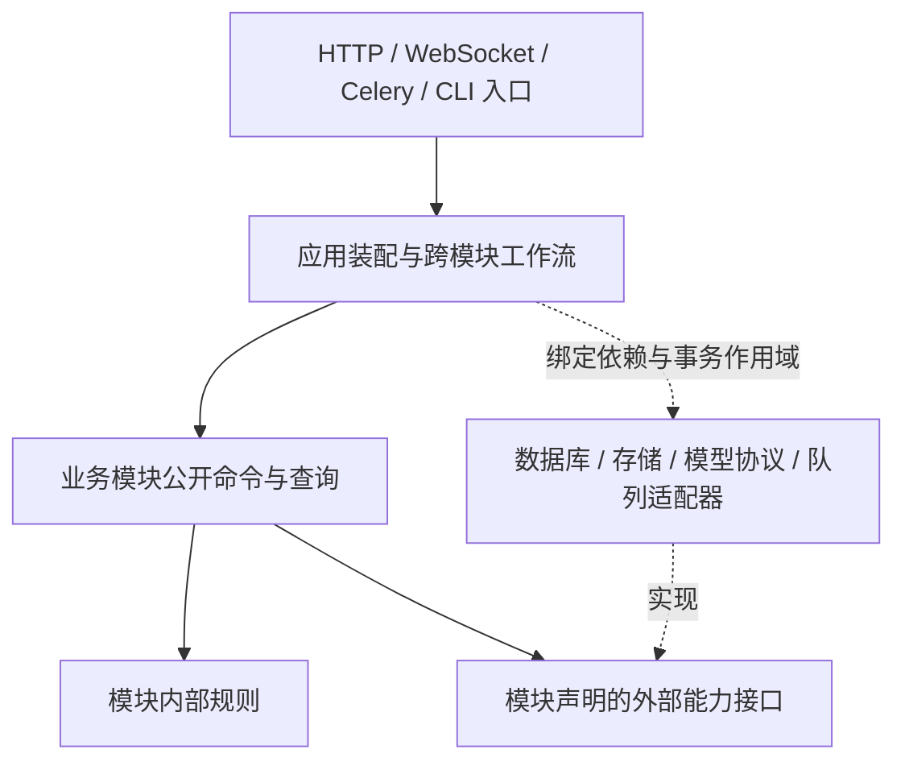

# 后端业务模块解耦与跨语言替换设计

> Status: in progress — 任务准入与质量执行派发切片已实施；导入计划摘要校验问题待修复，其余业务模块和跨语言替换尚未实施。
>
> 创建日期：2026-10-16。
>
> 目标：重构后端业务边界，使模块可以独立演进，后续能够按模块替换实现语言；不是仅整理 Python 文件，也不是立即拆成微服务。

## 1. 决策与范围

采用**契约优先的模块化单体，按需提取进程边界**：

1. 先在现有 API/worker 部署中建立业务职责、数据写入所有权、明确的模块公开接口和依赖门禁。
2. 保持现有用户可见 API、WebSocket、数据格式、权限、事务和作业行为；内部导入不是公共兼容承诺，迁移时一次更新全部仓内调用方并删除旧实现，不增加兼容 facade。
3. 进程内调用传递类型化数据，不为了未来跨语言而增加本地 HTTP、JSON 编解码或网络往返。
4. 真正更换语言时，先证明目标模块不存在尚未解决的跨模块原子事务要求，再增加该边界的 HTTP 适配器和独立运行单元。
5. 保留已有五个推理服务和训练执行器的协议边界，不重写它们，也不将 Celery 当作跨语言公共协议。

本设计不选择未来语言，不建立通用微服务框架、通用 repository/BaseService、全局领域事件总线或第二套 ML 协议。跨语言能力由可交换的数据契约、状态所有权和替换验收证明，不以目录数量或服务数量验收。

实施按第 9 节逐片推进。第 3–9 节仍是目标设计，不能被当作全后端已解耦的现状说明；实际落地范围和验证见文末 Outcome。首片决策记录在 ADR-0088，后续切片继续同步正式开发文档。

## 2. 设计基线（实施前）与约束

| 事实                                                           | 源码依据                                                                                                                                             | 对设计的约束                                                             |
| -------------------------------------------------------------- | ---------------------------------------------------------------------------------------------------------------------------------------------------- | ------------------------------------------------------------------------ |
| API 装配集中，但业务规则并未全部下沉到服务                     | [路由聚合](../../apps/api/app/api/v1/router.py)、[审核入口](../../apps/api/app/api/v1/tasks/review.py)                                               | 迁移对象包含路由内的规则和事务编排，不能只移动 services                  |
| 存在 service → API 和 service → worker 的函数内导入            | [最终写入守卫](../../apps/api/app/services/project_write_guard.py)、[Mask 修复派发](../../apps/api/app/services/mask_repair.py)                      | 门禁覆盖函数内与相对导入；通过公开业务接口和注入的派发适配器消除反向依赖 |
| 任务、标注、批次和审核存在紧密关系，标注还依赖源媒体与标定身份 | [任务模型](../../apps/api/app/db/models/task.py)、[标注模型](../../apps/api/app/db/models/annotation.py)                                             | 先保留标注生产聚合，不把任务、审核、轨迹机械拆成不同服务                 |
| 预标注在请求路径按设备动态选队列                               | [预标注入口](../../apps/api/app/api/v1/projects.py)、[Celery 配置](../../apps/api/app/workers/celery_app.py)、[消费者配置](../../docker-compose.yml) | 静态 task_routes 不是完整执行契约，迁移必须覆盖动态路由和实际消费者      |
| 通用作业终态回填直接了解多个领域账本                           | [终态协调](../../apps/api/app/services/async_job_terminal.py)                                                                                        | 作业控制面与领域状态机分开，不能将所有领域终态统一为 failed/cancelled    |
| 审核通知在事务提交后发布                                       | [审核入口](../../apps/api/app/api/v1/tasks/review.py)、[通知服务](../../apps/api/app/services/notification.py)                                       | 保存提交与投递顺序；现有仓库地图的相关描述需要随该路径实施时纠正         |
| 训练执行器是独立拉取进程，且并行执行 CPU 预览                  | [执行器入口](../../apps/training-executor/Dockerfile)、[执行循环](../../apps/training-executor/training_executor/worker.py)                          | 不将训练执行归入 Celery worker，不丢失预览、租约及子进程回收语义         |
| 已有领域 package 和局部架构门禁                                | [后端分层](../../docs-site/dev/concepts/backend-layers.md)、[现有守卫](../../apps/api/tests/test_domain_package_architecture.py)                     | 复用现有实现和 AST 检查能力，不重复拆 GPU、导出等已整理的模块            |

[旧领域化计划](archive/2026-07-15-v0.23.0-api-services-domain-modularization.md)是历史依据，不延续其中保留旧 facade 的迁移策略。

保留这些既有领域决策：

- [模型版本、部署和发布身份分离](../adr/archive/0076-controlled-trained-model-identity.md)：模型冻结身份及精确部署约束不能因服务切换失效。
- [项目任务数据集与冻结版本身份分离](../adr/archive/0087-project-task-dataset-streams.md)：管理关联、发行序号和高水位不能参与或改写训练包摘要。
- [Data Manager 只读模型](../adr/archive/0047-data-manager-entity-read-model.md)：查询视图不获得权威写入权。

## 3. 目标业务模块

下表是**建议的逻辑边界与数据所有者**，不是当前目录已经满足的事实。数据归属先表达写入责任，不要求本轮改表名、重建历史对象或拆数据库。

| 模块                          | 负责的业务与权威数据                                                                                                           | 不负责的内容                                                                  | 主要公开能力                                                              |
| ----------------------------- | ------------------------------------------------------------------------------------------------------------------------------ | ----------------------------------------------------------------------------- | ------------------------------------------------------------------------- |
| `identity` 身份               | 用户、组织/分组身份、认证、API key、账号有效性和身份撤销                                                                       | 不自行推断项目操作权限，不做任务派发                                          | 解析/验证主体、读取有效身份、管理账号与凭据                               |
| `workspace` 项目与授权        | 项目、成员、项目职责与能力、项目配置/工具绑定及配置模板                                                                        | 不修改任务/标注/训练状态；项目计数不是项目配置真值                            | 项目配置快照、项目访问决策、成员和配置变更                                |
| `assets` 源数据与媒体         | 原始 Dataset/DatasetItem、素材 Scene/帧组织、标定、连接器、源媒体及媒体派生资产                                                | 不拥有 SceneTrack 人工标注，不创建/修改 Task，不拥有冻结训练标签              | 查询媒体清单、授权读取引用、导入源素材、请求媒体派生任务                  |
| `labeling` 标注生产           | 批次、任务分配/锁/状态、标注、持久预测候选与采纳、审核证据/反馈、SceneTrack/视频标注片段、标注质量与修复账本                   | 不调度模型实例，不管理训练实验；不修改源媒体与项目成员                        | 建题、派题、标注写入、提交/审核、带版本条件的候选落库、冻结已审核数据     |
| `inference` 推理编排          | 后端 registry/启用、能力、服务池、GPU 仲裁、多阶段 pipeline/模板、推理运行记录和失败重试上下文                                 | 不直接写 Task/Annotation/Prediction，不重新决定模型发布，不拥有人工采纳规则   | 查询能力、执行/取消推理、返回结果产物与实际模型身份、管理实例生命周期     |
| `learning` 训练与模型生命周期 | ProjectTaskDataset 管理关联、TrainingDatasetVersion 冻结身份、训练/搜索/预览/观测、评估/主动学习、模型版本、部署回执和发布选择 | 不复制生产标注真值，不修改审核结论，不绕过 inference 的实例管理直接操作模型池 | 构建训练版本、管理执行器协议、训练/评估、冻结发布引用、验证和发布受控模型 |
| `insights` 跨域查询           | Data Manager、Dashboard、绩效与谱系组合读取、可重建统计/索引/分析投影                                                          | 不拥有业务真值，不因列表操作直接写其他模块的表                                | 分页/过滤/统计查询、投影刷新；批量写操作转交明确的领域命令                |

支撑能力各有窄边界，不合并成一个无所不包的 platform 模块：

| 能力            | 所有权                                                  | 限制                                                            |
| --------------- | ------------------------------------------------------- | --------------------------------------------------------------- |
| `jobs`          | 通用异步作业 ID、进度、执行关联、取消请求和通用执行状态 | 领域状态仍由所属模块解释；Celery task/result 不作为唯一业务账本 |
| `audit`         | 审计记录、查询与保留策略                                | 需要同事务保存的业务审计继续同事务保存，不默改为异步尽力而为    |
| `notifications` | 通知偏好、持久通知、投递与 WebSocket 通道适配           | 不决定审核或作业业务结果，不提前发布未提交的业务结果            |

问题反馈、系统设置、健康与运维入口按实际职责归到独立应用功能或支撑组件，不塞进业务 shared；在入口清单中逐项登记所属组件与依赖。

### 3.1 容易混淆的数据边界

- **预测与推理**：inference 负责算出候选；labeling 负责候选与任务版本、作用域和人工编辑规则的一致性落库。现有数据库中的 Prediction 归 labeling，避免采纳操作跨服务修改两套真值。
- **媒体与标注**：assets 拥有 Scene 的素材与标定，labeling 拥有 SceneTrack 及人工成员；跨边界只传稳定 ID、内容摘要和修订，不传 ORM relationship。
- **生产数据与训练数据**：learning 从 labeling 获得不可变、带版本的训练来源快照，从 assets 获得媒体引用；不在运行时 join 生产表自行重新解释审核资格。
- **项目与派生计数**：项目配置由 workspace 拥有，任务数量由 labeling 的事实派生。现有 `Project.total_tasks` 在迁移中登记为历史物理落点；切换读方前保留原事务语义，通过明确的同事务适配器维护，不允许多个模块各自决定计数。目标改为 labeling 提供的计数/insights 投影后，删除原写入路径；物理列删除另需迁移与消费者核对。
- **对象存储**：共享 S3/MinIO transport 不是共享数据所有权。源图由 assets 管理，Mask 由 labeling 管理，训练包/权重由 learning 管理，导出产物由其导出任务所有者管理。只有所有者决定保留、删除和引用校验。
- **模型部署**：learning 拥有模型版本及验证后的部署回执/发布事实；inference 拥有实例与安装执行状态。由应用工作流协调安装、验证和发布，两边不直接改对方表。

## 4. 公开接口与依赖方向

### 4.1 模块结构与装配

目标是在现有 `app/services` 下形成业务所有者，而不是新建平行的 `app/modules` 再维护两套实现。现有 gpu_arbitration、ml_routing、video_tracking、exporting、data_management 是迁移素材，不等于都成为独立业务模块。

每个模块包含明确的公开入口/契约、应用用例、规则及私有持久化/外部适配器。只在职责确实存在时分文件，不为每个模块生成空的四层模板。

具体规则：

1. 入口负责协议解析和主体获取，业务状态机不留在 router 或 Celery task body。
2. 跨模块只能调用公开命令/查询，不能导入私有服务、数据库模型、router 私有函数或 worker task 对象。
3. 函数内 import、动态导入字符串、测试 monkeypatch 路径和脚本调用也纳入迁移；移动导入到函数内不算消除依赖。
4. 双向业务流程放在应用工作流层协调，不让两个模块互相调用。例如“请求推理 → 返回产物 → 候选落库”由工作流串联 inference 与 labeling；“安装模型 → 试用 → 发布”由工作流串联 inference 与 learning。
5. 作业终态处理器在应用装配时显式绑定；jobs 不导入所有领域模型，领域也不导入 Celery。进程内协调仍能绑定到同一本地事务。
6. 规则层不依赖 FastAPI、Celery、全局 settings 或 ORM。模块公开接口不接受 Request、AsyncSession、ORM 实例或可任意访问其他模块的容器。
7. 项目写入准入仍使用 workspace 提供的权限能力，最终写入检查不退化为“入口检查过一次”；身份事实不能由客户端传入的角色字段代替。
8. insights 可以读取其他模块明确提供的快照或构建投影；其他模块不反向依赖 insights 来决定业务许可、审核或模型发布。

### 4.2 代表性接口

下列名称表达目标业务语义，不是宣称已经存在的新 API 路由，也不直接作为 Celery 注册名。迁移时补齐该切片的完整操作清单，并映射现有输入、错误及调用方。

| 所有者 / 操作                     | 输入                                                          | 输出                                             | 关键约束                                             |
| --------------------------------- | ------------------------------------------------------------- | ------------------------------------------------ | ---------------------------------------------------- |
| identity / ResolvePrincipal       | 认证材料、目标 audience                                       | 有效主体、凭据作用域、撤销状态                   | 无效身份明确失败；认证材料不进入业务事件             |
| workspace / ResolveWritePolicy    | 主体 ID、项目 ID、操作与资源范围                              | 当前访问决策、项目配置修订                       | 不把权限缓存/历史角色当最终写入许可                  |
| assets / GetMediaManifest         | 主体上下文、素材 ID 集、所需修订                              | 媒体种类、尺寸/时序/标定、内容摘要、受限读取引用 | 不暴露存储凭据；URL 时效不等于素材身份               |
| labeling / CreateTasks            | 项目与源素材引用、创建参数、操作身份                          | 已建任务/作业、重复请求的确定结果                | 建题和聚合计数由该用例维护，assets 不再代写          |
| labeling / ApplyAnnotationCommand | 主体、任务 ID、现有版本前置条件、变更                         | 已提交的版本、变更结果                           | 保留锁、成员撤销、审核阶段、Mask 幂等与冲突语义      |
| labeling / ApplyPredictionResult  | 冻结作用域、任务前置条件、候选产物引用、模型实际身份、操作 ID | 已应用/拒绝项及版本信息                          | 复核任务资格；过期或重复结果不得覆盖后续人工操作     |
| labeling / ExportReviewedSnapshot | 项目、任务种类、选取条件、资格规则修订                        | 不可变快照、来源修订/摘要、可分块读取句柄        | 固定一个一致切面，不用分页时不断变化的生产查询拼快照 |
| inference / ExecutePrediction     | 快照化配置、明确的执行范围、冻结模型引用、产物输入引用        | 运行 ID、产物引用、实际模型身份与每项结果        | 保留设备队列、pipeline 谱系和取消/部分失败语义       |
| learning / FreezeModelReference   | 项目、用途与当前发布选择                                      | 不可变版本、权重/类别摘要、许可的部署身份        | 后续发布变化不能改写已排队任务                       |
| learning / ExecutorOperation      | 既有 claim/heartbeat/upload/finish 等协议输入                 | 既有回执、租约和上传授权                         | 保留 attempt/fence、训练与 CPU 预览的独立所有权      |
| jobs / RequestCancellation        | 主体、作业 ID、操作身份                                       | 取消请求及当前已知执行状态                       | “已请求”不等于已停止；领域终态由所有者确认           |

### 4.3 语言无关的数据契约

- 进程内使用模块拥有的类型化 DTO；DTO 可以由现有 Pydantic 工具链描述，但不能继承或携带 SQLAlchemy 模型、session、异常对象或可调用对象。
- 跨进程的新命令/查询默认 HTTP + JSON/OpenAPI；现有 ML 协议和训练 pull 协议保持独立，不改造成统一万能 RPC。
- 契约不要求消费方运行 Python。对外依据为导出的 OpenAPI/JSON Schema 与语义说明，Python 类 identity 不是契约；保留既有 schema → 快照 → 生成消费者的单一来源流程，不手写一套同名 JSON Schema 制造第二真值。
- 真正替换服务实现时，先固定已导出的协议及契约用例，新实现按它实现；切换后由新的协议所有者提供同一产物，删除旧服务生成路径，禁止两种语言分别手维护规范。
- 新的内部跨进程边界才增加对应规范和生成接线；尚无远程消费者的进程内函数不提前网络化，不为每个函数生成 OpenAPI。
- DTO 显式定义字段缺失与 null、空集合与未读取、UUID/标识符文本、UTC 时间格式、数值精度/上限及几何单位。超过 JSON 安全整数的精确整数用十进制字符串；禁止 NaN/Infinity。不得仅凭语言默认类型推断跨语言语义。
- 任务名、几何、媒体、格式和训练身份沿用现有 task_contract、protocol_v2、training_contract 的词表与冻结规则；共享词表不允许携带模块数据库访问或高层编排。
- 新边界的错误必须有稳定 machine code、现有 HTTP 映射、必要冲突事实与是否可安全重试的语义。保持现有公开 API 错误体，不为了内部统一而修改前端、SDK 或 CLI 合同。
- 查询明确排序、分页游标、快照/新鲜度和 unknown/partial；批量命令明确逐项结果、原子范围和部分提交规则。
- 长作业返回操作/作业身份，明确成功、失败、部分成功、取消请求与取消完成，不把调用超时当作业务失败。
- 现有业务幂等规则原样迁移。首次新增远程写边界时必须补齐操作 ID、作用域、请求摘要、保留期和重复冲突规则，网络超时后可查询原操作；非幂等命令不得因 transport 自动重发。
- 大图片、Mask、视频、训练包和权重只传受限对象引用、格式与摘要，按需流式读取，不在模块间复制二进制或塞入大 JSON。
- 远程主体上下文由可信适配器验证，限定 audience/作用域，不能信任任意 actor_id 请求头；请求追踪标识不提供权限。URL/日志/事件不得携带长期凭据。

## 5. 数据所有权与一致性

### 5.1 先分写入责任，不先拆数据库

第一阶段保留 PostgreSQL、现有表、外键和统一 Alembic 迁移链。每张业务表、Redis key namespace 与对象前缀登记唯一所有者；一个共享物理实例不等于所有模块都有写权限。

目标规则：其他模块不能直接写所有者数据，也不能依赖其 ORM 关系或私有 SQL。现有跨域 join 逐项登记，在对应切片结束前替换为所有者的批量查询/一致快照或 insights 的只读投影；禁止用逐行 RPC 替换批量 SQL。

跨域外键可以先保留以维持当前完整性；它们不证明可以独立拆库。真正提取服务时，明确数据库角色、迁移执行者、删除/引用策略及跨域外键影响。换语言可以先继续使用受限的原数据库表，拆库是另外的决定。

### 5.2 事务边界不能被接口表掩盖

同进程下，应用装配创建事务作用域，将模块持久化适配器绑定到同一连接/事务；公开业务操作不传 AsyncSession。各模块通过自己的适配器写自己的数据，应用工作流决定需要共同提交的操作。

例如审核状态、批次流转、业务审计和持久通知仍可同事务提交，再执行需要提交后才能运行的通知发布。迁移时不能把现有 flush 改成模块内部各自 commit，也不能反过来删除既有分块提交语义。

**共享本地事务的工作流不能只把一个适配器换成 HTTP 就宣称等价。** 对每条跨模块写路径选择并记录：

| 不变量类型                            | 处理方式                                                                  | 远程提取条件                                                             |
| ------------------------------------- | ------------------------------------------------------------------------- | ------------------------------------------------------------------------ |
| 必须共同成败的标注/审核/证据更新      | 保留在 labeling 聚合及同一事务内                                          | 不把这一原子范围拆成多个服务                                             |
| 最终写入必须和项目成员/账号撤销串行化 | 保留现有权威读取、锁和写入事务边界                                        | 在等价并发协议被设计并验证前，相关命令不远程拆出；不能用过期权限快照替代 |
| 训练数据冻结                          | labeling 创建不可变来源快照，learning 消费固定句柄/摘要，构建可在其后完成 | 来源切面、项目配置修订、媒体引用和保留规则已固定，不边翻页边读取活数据   |
| 长耗时推理/训练/导出                  | 用显式状态、产物/执行回执和条件写入推进                                   | 重复、超时、迟到结果和取消后的写入有确定语义                             |
| 统计、列表和通知投递                  | 保持当前同步语义，或单独批准可观察的投影延迟/投递语义变更                 | 明确新鲜度/投递保证，并具有可核对的来源；不能悄悄改成最终一致            |

项目计数迁移、项目删除、成员交接、建题、模型部署/发布都要单独列出事务矩阵。跨域删除不能靠服务调用顺序模仿数据库级原子级联；拆出前必须定义引用保留、拒绝删除或已验证的删除流程。

### 5.3 作业、消息与投递

- Celery 作为 Python 执行适配器保留，公开接口表达“执行这个领域操作”，不暴露 pickle、任务 Python 路径、chord 对象或 Celery exception。
- jobs 维护通用作业状态；各领域维护自己的账本及 `partial`、`rollback_failed` 等语义，应用工作流绑定领域终态回填。
- 当前同步原子更新不因引入事件而拆开。只在某条已选定远程边界确需可靠异步交接时，为该边界实现同事务 durable outbox/操作收据以及明确的消费去重；不先建全平台消息基础设施。
- 不宣称 exactly-once。需要可靠交接的边界按可重投、去重、顺序范围、重复/迟到处理和失败后核对定义语义。
- 如果使用领域事件，至少固定事件 ID、类型/schema 修订、来源实体 ID/修订、发生时间、关联操作和最小必要数据；事件表达已提交事实，不作为任意写入命令或权限许可。
- 进程崩溃、断网和重投的验证属于首次远程提取的完成条件，不能只验证正常 HTTP 返回。

## 6. 关键工作流的目标职责

1. **导入 → 建题**：assets 完成素材导入并提供稳定引用；应用工作流调用 labeling 建题。建题进度和计数由 labeling 维护，导入完成不能等同于建题成功。
2. **标注 → 提交 → 审核**：labeling 拥有状态机，调用可信身份/项目能力接口，保存版本化证据并保持当前事务与锁；审计和持久通知参与所需本地事务，通知在允许的提交时序发布。
3. **预标注 → 候选落库**：工作流冻结作用域/模型身份，inference 执行并返回产物；labeling 在落库时复核版本、范围、权限和终态。工作台单题与批量预标注的资格规则保持区分，取消、重试及发布变化不能绕过冻结身份。
4. **审核数据 → 训练 → 发布**：labeling 冻结审核来源，assets 提供媒体身份，learning 管理版本/包、执行器与模型回流；安装与原生试用通过 inference，确认后由 learning 发布。项目任务流管理关联不能改写历史包身份。
5. **Data Manager 批量操作**：insights 负责选择与展示；写命令在领域模块重新验证最终目标和资格，不能相信查询时的列表权限或筛选结果永远有效。

## 7. 跨语言替换路径

按“契约冻结 → 实现与验证 → 明确切换 → 删除旧实现”执行：

1. 从已迁移模块选择无未解决强事务依赖的边界，记录操作、数据所有者、同步/异步状态机和性能基线。
2. 固定语言无关协议、真实请求/结果 fixture 与契约用例；既有 HTTP/ML/训练合同不另起炉灶。
3. 新语言实现只获得其拥有的数据与所需外部能力；不得连接全部业务表绕过模块接口。新旧实现不能同时成为同一数据的独立写入者。
4. 在隔离数据上对比新旧行为。生产只读影子流量只适用于无副作用查询；命令回放不得写生产库或触发真实模型/媒体副作用。
5. 明确切换写入所有者，停止旧端派发并排空/确认旧执行，转交 durable operation/租约和结果收据；在途任务、迟到回调和 Celery 注册名逐项处理，不能因换路由直接丢弃。
6. 外部 API 适配层保持原合同，所有仓内调用方在该切片迁移。稳定后删除旧业务实现、旧派发入口、旧内部导入、临时切换逻辑及失效测试，不永久保留双写或兼容别名。
7. 回退以已验证的协议/数据可读性和执行所有权为前提，先冻结新写入再移交；不能在两边仍运行时只切回 URL。已经改变数据语义且不能反向读取的切换，不承诺应用级即时回退。

建议优先评估**有明确输入产物与输出产物的媒体处理子能力，或可重建的统计查询**作为首次语言替换演练；不是先拆包含权限、审核和标注原子写入的核心聚合。只有盘点证明符合条件才选定，不把候选当作已确认迁移范围。

## 8. 完成标准与验证方法

### 8.1 模块真正解耦的标准

- 每个入口和权威数据对象有明确所属模块；共享读模型与派生字段单独标明。
- 模块外只依赖公开契约，不导入私有 ORM/路由/worker；模块内外不存在依靠函数内导入掩盖的环。
- 模块可由自己的命令/查询入口和可替换适配器运行行为验证，无需导入整个 FastAPI/Celery 装配图。
- 关键用例的权限、版本前置条件、错误、锁、事务及作业终态与原行为一致；行为变化必须独立说明和验收。
- 首个真实远程边界有实际命令/查询 smoke，证明调用方不依赖提供方语言运行时；仅通过 JSON 序列化或编译不算证明。

### 8.2 每个实施切片的验证

1. 改前记录真实调用路径和现有相关行为用例；只新增能捕获消费者可见风险的回归，不测试 re-export identity 或目录文本。
2. 扩展现有架构守卫：覆盖目标模块的函数内/相对导入、私有访问与循环依赖，并为已清除旧路径保持防回流规则。不把已有范围外问题伪装成本切片已解决。
3. 运行目标路由/服务/worker 测试及实际调用 smoke；涉及写库的验证使用已确认可丢弃的测试数据库。涉及 worker 变化时按 runtime 技能刷新实际消费者后再验证。
4. 冻结并对照外部 API/OpenAPI、WebSocket、ML/训练协议、导出格式、冻结摘要、状态码和错误语义；内部 Python identity 与私有 monkeypatch 路径不属于兼容目标。
5. 采样核对查询次数、队列、对象读取与峰值内存，防止跨模块改造引入 N+1、二进制复制或重复模型加载；性能预算由改前同场景测量定义，不凭空给出阈值。
6. 真正远程化时额外覆盖重复写、执行后丢响应、过期权限、取消后迟到结果、执行器退出不明、消费者重启和在途切换。

## 9. 实施任务与依赖

| 阶段                 | 工作                                                                                               | 前置                                   | 可验收交付                                                       |
| -------------------- | -------------------------------------------------------------------------------------------------- | -------------------------------------- | ---------------------------------------------------------------- |
| A 现状与不变量       | 完整入口清单、调用/数据写入图、事务矩阵；明确当前错误与冻结身份                                    | 本设计                                 | 全部第一方入口和主要写路径有归属，未知项与证据明确，不只画目录   |
| B 契约与装配边界     | 为选定切片确定公开命令/查询、DTO、适配器绑定和目标依赖门禁；保留必要本地事务                       | A 对应边界                             | 消费方和数据所有权明确，无新通用框架、无空模板与旧 facade        |
| C 先消除已知反向依赖 | 收口项目/任务写入守卫；把服务中的任务派发改为注入的执行接口；把终态登记移到应用装配                | B 对应切片                             | router/worker 只做入口，公开行为与状态机不变，目标反向导入消失   |
| D 逐业务切片迁移     | assets→labeling 建题；标注/审核原子聚合；inference 编排；learning 快照/发布；insights 查询逐片切换 | 各自 A/B/C 及实际依赖                  | 每片同步迁移调用方/测试/文档并移除旧实现；不把五片绑成一次大搬迁 |
| E 可替换性演练       | 选择已完成 D 且无强事务阻碍的候选，真正用选定新语言实现、运行并切换                                | 候选的依赖与验收已通过，维护者选择语言 | 同合同真实运行、数据/执行单一所有者、故障与在途切换验证通过      |

B/C/D 是按切片推进，不要求一次定义所有未来接口，也不要求先完成全仓目录重排。A 的现状清单可以共享，已有检查结果不因切片恢复而无理由重跑。

首个实施切片建议选**最终写入守卫从 API 反向依赖中移出**：沿用当前业务所有者与锁，不夹带权限规则修改，迁移 labeling 相关调用方并验证成员撤销、任务阶段及审核证据。该切片能直接验证公开入口、依赖门禁和事务保真，不先引入网络协议。

每个切片文档更新到对应的 [仓库地图](../../docs-site/dev/concepts/repository-map.md)、[后端分层](../../docs-site/dev/concepts/backend-layers.md) 和相关领域页面。纯结构迁移不虚构用户可见功能；若实际改变用户行为，则同时更新用户指南和 CHANGELOG。发布版本与语言选择由维护者决定，本文不预分配。

## 10. 证据范围

- 设计基线来自源码抽查、既有架构决策和 Compose 配置解析；它不代表完整业务域的运行验证。
- 当前实施与验证覆盖任务访问/写入准入及质量执行派发两个切片，没有修改数据库 schema 或运行配置；首片 OpenAPI 仅同步邻帧端点描述中的帮助函数名称，第二片未改变快照，均未改变路径、字段或响应合同。
- 后续业务域及语言替换仍按第 8、9 节分别验收；不得把局部结果扩展为全后端已完成解耦。

## Outcome

### 任务访问与写入准入

- 已实施切片：`services/task_access.py` 统一持有上下文绑定、编辑阶段、有效分派、写能力、审核调整证据和单题/批量可见性。`project_write_guard` 不再导入 API；相关 HTTP、WebSocket、写入服务和跨帧 worker 已迁移，旧私有定义与 package 导出已移除，无兼容 facade。
- 本片门禁：现有 AST 架构守卫支持明确声明的单文件服务，覆盖 `task_access`、`project_write_guard` 的 API/worker 反向依赖及服务环。新增管理者上下文错配、完成态锁定的行为回归；既有审核证据、权限撤销和写入用例保持原行为。
- 本地回归：隔离测试库的 12 个相关测试文件，249 passed、5 skipped；5 项均为没有声明 lazy-root 规则的服务/领域，不是业务用例跳过。
- 实际运行：在隔离环境启动真实 Uvicorn 和普通/维护 Celery worker；标注创建 201、同幂等键返回同一标注，完成态写入 409。撤销成员后，HTTP 维持 404 隐藏资源存在，最终写入守卫维持 403 `permission_changed`。跨帧作业经实际队列完成，新增 1 条、跳过 1 条，并核对持久化结果。准入模块冷加载不装配 API/worker。
- 契约与静态检查：OpenAPI snapshot 与当前路由一致；本片 Python Ruff 检查通过。
- 正式开发文档：`docs-site/dev/concepts/backend-layers.md`、`repository-map.md`、`task-module.md`、`scheduler-and-task-dispatch.md`、`docs-site/dev/reference/ws-protocol.md`。
- ADR：[0088 — 任务可见性与写入准入由服务层统一持有](../adr/archive/0088-service-owned-task-admission.md)。
- 提交：`eb9fd7623`，实现、回归与正式文档在同一切片提交；发布里程碑：Not yet determined。纯内部结构迁移，未新增用户可见行为，未添加 CHANGELOG 条目。

### 质量执行派发

- 已实施切片：新增纯类型执行端口 `QualityJobDispatcher` 与具体 `CeleryQualityJobDispatcher`，由 `deps` 装配；五个服务派发入口要求显式注入，11 个 HTTP 处理入口全部迁移，业务服务不再导入这些 worker。没有增加默认实现、兼容 facade、通用字符串任务总线或本地 RPC。
- 保真范围：三类质检保留预分配执行 ID，Mask 修复/回滚保留 `media` 队列，格式导入保留原 task 的 `delay`；提交顺序、派发失败状态、通知及 HTTP 错误归属不变。架构守卫覆盖端口和五个服务文件，支持 package 内单文件所有者。
- 本地回归：主要相关回归 98 passed、11 skipped；视频轨迹真实数据库边界与派发失败回归另有 2 passed。11 项跳过均是未声明 lazy-root 规则的所有者；ZIP 重复成员夹具产生一条预期警告。Ruff 与 OpenAPI 检查通过。
- 实际运行：隔离测试库、真实 Uvicorn、普通/维护 Celery worker 及 MinIO 下，Mask QC、点云质检和视频轨迹质检完成并保留执行 ID；Mask 修复把面积从 4 改为 3，回滚恢复为 4。回滚夹具先补齐生产所需的原始 Mask 上传归属记录，未弱化生产校验。
- 导入验证发现独立阻断：真实导入已派发并记录执行 ID，但 Worker 以 `format_plan_digest_conflict` 失败。现有 `_plan` 对未规范化 payload 计算摘要，持久化模型会补齐字段，而 Worker 校验持久化表示；后续单独修复并提交，不混入派发解耦。预检夹具暂存对象已纠正到 `import_bucket`。
- 正式文档：后端分层、仓库地图及 [ADR-0089](../adr/archive/0089-injected-quality-job-dispatch.md)。实现、回归和文档单独提交；纯内部结构迁移，未添加 CHANGELOG 条目。

### 剩余范围

- 数据集、视频帧及训练数据集的其他派发边界、作业终态装配、全仓入口/数据所有权清单、其他业务域和真实跨语言替换演练仍待逐域实施。当前领域服务仍使用现有 ORM 与 HTTPException，未新增网络调用或独立存储。
