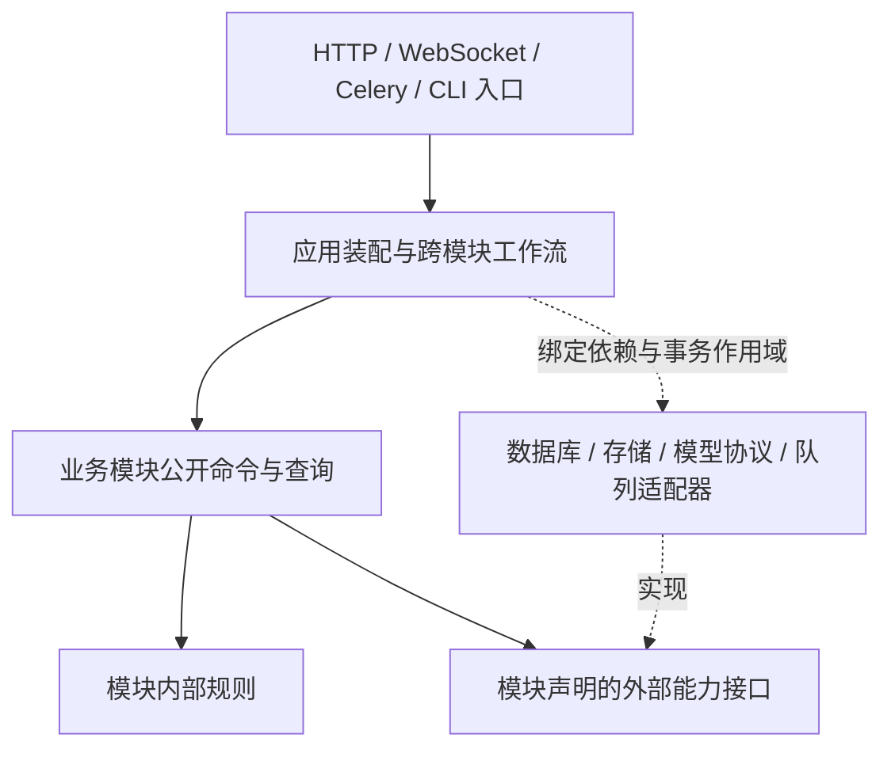

# 后端业务模块解耦与跨语言替换设计

> Status: in progress — 任务准入、执行派发、视频/审核证据、训练公共下层、终态/取消/失败重试、素材建题、共享预测准备、流水线模板命令/预标注 schema、质检执行/决策、Schema 清理、项目配置/模板行命令与 Mask 修复/导入执行已分片迁移；完整入口/数据所有权复核继续推进，尚未实施语言替换。
>
> 创建日期：2026-10-16。
>
> 目标：重构后端业务边界，使模块可以独立演进，后续能够按模块替换实现语言；不是仅整理 Python 文件，也不是立即拆成微服务。

## 1. 决策与范围

采用**契约优先的模块化单体，按需提取进程边界**：

1. 先在现有 API/worker 部署中建立业务职责、数据写入所有权、明确的模块公开接口和依赖门禁。
2. 保持现有用户可见 API、WebSocket、数据格式、权限、事务和作业行为；内部导入不是公共兼容承诺，迁移时一次更新全部仓内调用方并删除旧实现，不增加兼容 facade。
3. 进程内调用传递类型化数据，不为了未来跨语言而增加本地 HTTP、JSON 编解码或网络往返。
4. 真正更换语言时，先证明目标模块不存在尚未解决的跨模块原子事务要求，再增加该边界的 HTTP 适配器和独立运行单元。
5. 保留已有五个推理服务和训练执行器的协议边界，不重写它们，也不将 Celery 当作跨语言公共协议。

本设计不选择未来语言，不建立通用微服务框架、通用 repository/BaseService、全局领域事件总线或第二套 ML 协议。跨语言能力由可交换的数据契约、状态所有权和替换验收证明，不以目录数量或服务数量验收。

实施按第 9 节逐片推进。第 3–9 节仍是目标设计，不能被当作全后端已解耦的现状说明；实际落地范围和验证见文末 Outcome。首片决策记录在 ADR-0088，后续切片继续同步正式开发文档。

## 2. 设计基线（实施前）与约束

| 事实                                                           | 源码依据                                                                                                                                             | 对设计的约束                                                             |
| -------------------------------------------------------------- | ---------------------------------------------------------------------------------------------------------------------------------------------------- | ------------------------------------------------------------------------ |
| API 装配集中，但业务规则并未全部下沉到服务                     | [路由聚合](../../apps/api/app/api/v1/router.py)、[审核入口](../../apps/api/app/api/v1/tasks/review.py)                                               | 迁移对象包含路由内的规则和事务编排，不能只移动 services                  |
| 存在 service → API 和 service → worker 的函数内导入            | [最终写入守卫](../../apps/api/app/services/project_write_guard.py)、[Mask 修复派发](../../apps/api/app/services/mask_repair.py)                      | 门禁覆盖函数内与相对导入；通过公开业务接口和注入的派发适配器消除反向依赖 |
| 任务、标注、批次和审核存在紧密关系，标注还依赖源媒体与标定身份 | [任务模型](../../apps/api/app/db/models/task.py)、[标注模型](../../apps/api/app/db/models/annotation.py)                                             | 先保留标注生产聚合，不把任务、审核、轨迹机械拆成不同服务                 |
| 预标注在请求路径按设备动态选队列                               | [预标注入口](../../apps/api/app/api/v1/projects.py)、[Celery 配置](../../apps/api/app/workers/celery_app.py)、[消费者配置](../../docker-compose.yml) | 静态 task_routes 不是完整执行契约，迁移必须覆盖动态路由和实际消费者      |
| 通用作业终态回填直接了解多个领域账本                           | [终态协调](../../apps/api/app/services/async_job_terminal.py)                                                                                        | 作业控制面与领域状态机分开，不能将所有领域终态统一为 failed/cancelled    |
| 审核通知在事务提交后发布                                       | [审核入口](../../apps/api/app/api/v1/tasks/review.py)、[通知服务](../../apps/api/app/services/notification.py)                                       | 保存提交与投递顺序；现有仓库地图的相关描述需要随该路径实施时纠正         |
| 训练执行器是独立拉取进程，且并行执行 CPU 预览                  | [执行器入口](../../apps/training-executor/Dockerfile)、[执行循环](../../apps/training-executor/training_executor/worker.py)                          | 不将训练执行归入 Celery worker，不丢失预览、租约及子进程回收语义         |
| 已有领域 package 和局部架构门禁                                | [后端分层](../../docs-site/dev/concepts/backend-layers.md)、[现有守卫](../../apps/api/tests/test_domain_package_architecture.py)                     | 复用现有实现和 AST 检查能力，不重复拆 GPU、导出等已整理的模块            |

[旧领域化计划](archive/2026-07-15-v0.23.0-api-services-domain-modularization.md)是历史依据，不延续其中保留旧 facade 的迁移策略。

保留这些既有领域决策：

- [模型版本、部署和发布身份分离](../adr/archive/0076-controlled-trained-model-identity.md)：模型冻结身份及精确部署约束不能因服务切换失效。
- [项目任务数据集与冻结版本身份分离](../adr/archive/0087-project-task-dataset-streams.md)：管理关联、发行序号和高水位不能参与或改写训练包摘要。
- [Data Manager 只读模型](../adr/archive/0047-data-manager-entity-read-model.md)：查询视图不获得权威写入权。

## 3. 目标业务模块

下表是**建议的逻辑边界与数据所有者**，不是当前目录已经满足的事实。数据归属先表达写入责任，不要求本轮改表名、重建历史对象或拆数据库。

| 模块                          | 负责的业务与权威数据                                                                                                           | 不负责的内容                                                                  | 主要公开能力                                                              |
| ----------------------------- | ------------------------------------------------------------------------------------------------------------------------------ | ----------------------------------------------------------------------------- | ------------------------------------------------------------------------- |
| `identity` 身份               | 用户、组织/分组身份、认证、API key、账号有效性和身份撤销                                                                       | 不自行推断项目操作权限，不做任务派发                                          | 解析/验证主体、读取有效身份、管理账号与凭据                               |
| `workspace` 项目与授权        | 项目、成员、项目职责与能力、项目配置/工具绑定及配置模板                                                                        | 不修改任务/标注/训练状态；项目计数不是项目配置真值                            | 项目配置快照、项目访问决策、成员和配置变更                                |
| `assets` 源数据与媒体         | 原始 Dataset/DatasetItem、素材 Scene/帧组织、标定、连接器、源媒体及媒体派生资产                                                | 不拥有 SceneTrack 人工标注，不创建/修改 Task，不拥有冻结训练标签              | 查询媒体清单、授权读取引用、导入源素材、请求媒体派生任务                  |
| `labeling` 标注生产           | 批次、任务分配/锁/状态、标注、持久预测候选与采纳、审核证据/反馈、SceneTrack/视频标注片段、标注质量与修复账本                   | 不调度模型实例，不管理训练实验；不修改源媒体与项目成员                        | 建题、派题、标注写入、提交/审核、带版本条件的候选落库、冻结已审核数据     |
| `inference` 推理编排          | 后端 registry/启用、能力、服务池、GPU 仲裁、多阶段 pipeline/模板、推理运行记录和失败重试上下文                                 | 不直接写 Task/Annotation/Prediction，不重新决定模型发布，不拥有人工采纳规则   | 查询能力、执行/取消推理、返回结果产物与实际模型身份、管理实例生命周期     |
| `learning` 训练与模型生命周期 | ProjectTaskDataset 管理关联、TrainingDatasetVersion 冻结身份、训练/搜索/预览/观测、评估/主动学习、模型版本、部署回执和发布选择 | 不复制生产标注真值，不修改审核结论，不绕过 inference 的实例管理直接操作模型池 | 构建训练版本、管理执行器协议、训练/评估、冻结发布引用、验证和发布受控模型 |
| `insights` 跨域查询           | Data Manager、Dashboard、绩效与谱系组合读取、可重建统计/索引/分析投影                                                          | 不拥有业务真值，不因列表操作直接写其他模块的表                                | 分页/过滤/统计查询、投影刷新；批量写操作转交明确的领域命令                |

支撑能力各有窄边界，不合并成一个无所不包的 platform 模块：

| 能力            | 所有权                                                  | 限制                                                            |
| --------------- | ------------------------------------------------------- | --------------------------------------------------------------- |
| `jobs`          | 通用异步作业 ID、进度、执行关联、取消请求和通用执行状态 | 领域状态仍由所属模块解释；Celery task/result 不作为唯一业务账本 |
| `audit`         | 审计记录、查询与保留策略                                | 需要同事务保存的业务审计继续同事务保存，不默改为异步尽力而为    |
| `notifications` | 通知偏好、持久通知、投递与 WebSocket 通道适配           | 不决定审核或作业业务结果，不提前发布未提交的业务结果            |

问题反馈、系统设置、健康与运维入口按实际职责归到独立应用功能或支撑组件，不塞进业务 shared；在入口清单中逐项登记所属组件与依赖。

### 3.1 容易混淆的数据边界

- **预测与推理**：inference 负责算出候选；labeling 负责候选与任务版本、作用域和人工编辑规则的一致性落库。现有数据库中的 Prediction 归 labeling，避免采纳操作跨服务修改两套真值。
- **媒体与标注**：assets 拥有 Scene 的素材与标定，labeling 拥有 SceneTrack 及人工成员；跨边界只传稳定 ID、内容摘要和修订，不传 ORM relationship。
- **生产数据与训练数据**：learning 从 labeling 获得不可变、带版本的训练来源快照，从 assets 获得媒体引用；不在运行时 join 生产表自行重新解释审核资格。
- **项目与派生计数**：项目配置由 workspace 拥有，任务数量由 labeling 的事实派生。现有 `Project.total_tasks` 在迁移中登记为历史物理落点；切换读方前保留原事务语义，通过明确的同事务适配器维护，不允许多个模块各自决定计数。目标改为 labeling 提供的计数/insights 投影后，删除原写入路径；物理列删除另需迁移与消费者核对。
- **对象存储**：共享 S3/MinIO transport 不是共享数据所有权。源图由 assets 管理，Mask 由 labeling 管理，训练包/权重由 learning 管理，导出产物由其导出任务所有者管理。只有所有者决定保留、删除和引用校验。
- **模型部署**：learning 拥有模型版本及验证后的部署回执/发布事实；inference 拥有实例与安装执行状态。由应用工作流协调安装、验证和发布，两边不直接改对方表。

## 4. 公开接口与依赖方向

### 4.1 模块结构与装配

目标是在现有 `app/services` 下形成业务所有者，而不是新建平行的 `app/modules` 再维护两套实现。现有 gpu_arbitration、ml_routing、video_tracking、exporting、data_management 是迁移素材，不等于都成为独立业务模块。

每个模块包含明确的公开入口/契约、应用用例、规则及私有持久化/外部适配器。只在职责确实存在时分文件，不为每个模块生成空的四层模板。

具体规则：

1. 入口负责协议解析和主体获取，业务状态机不留在 router 或 Celery task body。
2. 跨模块只能调用公开命令/查询，不能导入私有服务、数据库模型、router 私有函数或 worker task 对象。
3. 函数内 import、动态导入字符串、测试 monkeypatch 路径和脚本调用也纳入迁移；移动导入到函数内不算消除依赖。
4. 双向业务流程放在应用工作流层协调，不让两个模块互相调用。例如“请求推理 → 返回产物 → 候选落库”由工作流串联 inference 与 labeling；“安装模型 → 试用 → 发布”由工作流串联 inference 与 learning。
5. 作业终态处理器在应用装配时显式绑定；jobs 不导入所有领域模型，领域也不导入 Celery。进程内协调仍能绑定到同一本地事务。
6. 规则层不依赖 FastAPI、Celery、全局 settings 或 ORM。模块公开接口不接受 Request、AsyncSession、ORM 实例或可任意访问其他模块的容器。
7. 项目写入准入仍使用 workspace 提供的权限能力，最终写入检查不退化为“入口检查过一次”；身份事实不能由客户端传入的角色字段代替。
8. insights 可以读取其他模块明确提供的快照或构建投影；其他模块不反向依赖 insights 来决定业务许可、审核或模型发布。

### 4.2 代表性接口

下列名称表达目标业务语义，不是宣称已经存在的新 API 路由，也不直接作为 Celery 注册名。迁移时补齐该切片的完整操作清单，并映射现有输入、错误及调用方。

| 所有者 / 操作                     | 输入                                                          | 输出                                             | 关键约束                                             |
| --------------------------------- | ------------------------------------------------------------- | ------------------------------------------------ | ---------------------------------------------------- |
| identity / ResolvePrincipal       | 认证材料、目标 audience                                       | 有效主体、凭据作用域、撤销状态                   | 无效身份明确失败；认证材料不进入业务事件             |
| workspace / ResolveWritePolicy    | 主体 ID、项目 ID、操作与资源范围                              | 当前访问决策、项目配置修订                       | 不把权限缓存/历史角色当最终写入许可                  |
| assets / GetMediaManifest         | 主体上下文、素材 ID 集、所需修订                              | 媒体种类、尺寸/时序/标定、内容摘要、受限读取引用 | 不暴露存储凭据；URL 时效不等于素材身份               |
| labeling / CreateTasks            | 项目与源素材引用、创建参数、操作身份                          | 已建任务/作业、重复请求的确定结果                | 建题和聚合计数由该用例维护，assets 不再代写          |
| labeling / ApplyAnnotationCommand | 主体、任务 ID、现有版本前置条件、变更                         | 已提交的版本、变更结果                           | 保留锁、成员撤销、审核阶段、Mask 幂等与冲突语义      |
| labeling / ApplyPredictionResult  | 冻结作用域、任务前置条件、候选产物引用、模型实际身份、操作 ID | 已应用/拒绝项及版本信息                          | 复核任务资格；过期或重复结果不得覆盖后续人工操作     |
| labeling / ExportReviewedSnapshot | 项目、任务种类、选取条件、资格规则修订                        | 不可变快照、来源修订/摘要、可分块读取句柄        | 固定一个一致切面，不用分页时不断变化的生产查询拼快照 |
| inference / ExecutePrediction     | 快照化配置、明确的执行范围、冻结模型引用、产物输入引用        | 运行 ID、产物引用、实际模型身份与每项结果        | 保留设备队列、pipeline 谱系和取消/部分失败语义       |
| learning / FreezeModelReference   | 项目、用途与当前发布选择                                      | 不可变版本、权重/类别摘要、许可的部署身份        | 后续发布变化不能改写已排队任务                       |
| learning / ExecutorOperation      | 既有 claim/heartbeat/upload/finish 等协议输入                 | 既有回执、租约和上传授权                         | 保留 attempt/fence、训练与 CPU 预览的独立所有权      |
| jobs / RequestCancellation        | 主体、作业 ID、操作身份                                       | 取消请求及当前已知执行状态                       | “已请求”不等于已停止；领域终态由所有者确认           |

### 4.3 语言无关的数据契约

- 进程内使用模块拥有的类型化 DTO；DTO 可以由现有 Pydantic 工具链描述，但不能继承或携带 SQLAlchemy 模型、session、异常对象或可调用对象。
- 跨进程的新命令/查询默认 HTTP + JSON/OpenAPI；现有 ML 协议和训练 pull 协议保持独立，不改造成统一万能 RPC。
- 契约不要求消费方运行 Python。对外依据为导出的 OpenAPI/JSON Schema 与语义说明，Python 类 identity 不是契约；保留既有 schema → 快照 → 生成消费者的单一来源流程，不手写一套同名 JSON Schema 制造第二真值。
- 真正替换服务实现时，先固定已导出的协议及契约用例，新实现按它实现；切换后由新的协议所有者提供同一产物，删除旧服务生成路径，禁止两种语言分别手维护规范。
- 新的内部跨进程边界才增加对应规范和生成接线；尚无远程消费者的进程内函数不提前网络化，不为每个函数生成 OpenAPI。
- DTO 显式定义字段缺失与 null、空集合与未读取、UUID/标识符文本、UTC 时间格式、数值精度/上限及几何单位。超过 JSON 安全整数的精确整数用十进制字符串；禁止 NaN/Infinity。不得仅凭语言默认类型推断跨语言语义。
- 任务名、几何、媒体、格式和训练身份沿用现有 task_contract、protocol_v2、training_contract 的词表与冻结规则；共享词表不允许携带模块数据库访问或高层编排。
- 新边界的错误必须有稳定 machine code、现有 HTTP 映射、必要冲突事实与是否可安全重试的语义。保持现有公开 API 错误体，不为了内部统一而修改前端、SDK 或 CLI 合同。
- 查询明确排序、分页游标、快照/新鲜度和 unknown/partial；批量命令明确逐项结果、原子范围和部分提交规则。
- 长作业返回操作/作业身份，明确成功、失败、部分成功、取消请求与取消完成，不把调用超时当作业务失败。
- 现有业务幂等规则原样迁移。首次新增远程写边界时必须补齐操作 ID、作用域、请求摘要、保留期和重复冲突规则，网络超时后可查询原操作；非幂等命令不得因 transport 自动重发。
- 大图片、Mask、视频、训练包和权重只传受限对象引用、格式与摘要，按需流式读取，不在模块间复制二进制或塞入大 JSON。
- 远程主体上下文由可信适配器验证，限定 audience/作用域，不能信任任意 actor_id 请求头；请求追踪标识不提供权限。URL/日志/事件不得携带长期凭据。

## 5. 数据所有权与一致性

### 5.1 先分写入责任，不先拆数据库

第一阶段保留 PostgreSQL、现有表、外键和统一 Alembic 迁移链。每张业务表、Redis key namespace 与对象前缀登记唯一所有者；一个共享物理实例不等于所有模块都有写权限。

目标规则：其他模块不能直接写所有者数据，也不能依赖其 ORM 关系或私有 SQL。现有跨域 join 逐项登记，在对应切片结束前替换为所有者的批量查询/一致快照或 insights 的只读投影；禁止用逐行 RPC 替换批量 SQL。

跨域外键可以先保留以维持当前完整性；它们不证明可以独立拆库。真正提取服务时，明确数据库角色、迁移执行者、删除/引用策略及跨域外键影响。换语言可以先继续使用受限的原数据库表，拆库是另外的决定。

### 5.2 事务边界不能被接口表掩盖

同进程下，应用装配创建事务作用域，将模块持久化适配器绑定到同一连接/事务；公开业务操作不传 AsyncSession。各模块通过自己的适配器写自己的数据，应用工作流决定需要共同提交的操作。

例如审核状态、批次流转、业务审计和持久通知仍可同事务提交，再执行需要提交后才能运行的通知发布。迁移时不能把现有 flush 改成模块内部各自 commit，也不能反过来删除既有分块提交语义。

**共享本地事务的工作流不能只把一个适配器换成 HTTP 就宣称等价。** 对每条跨模块写路径选择并记录：

| 不变量类型                            | 处理方式                                                                  | 远程提取条件                                                             |
| ------------------------------------- | ------------------------------------------------------------------------- | ------------------------------------------------------------------------ |
| 必须共同成败的标注/审核/证据更新      | 保留在 labeling 聚合及同一事务内                                          | 不把这一原子范围拆成多个服务                                             |
| 最终写入必须和项目成员/账号撤销串行化 | 保留现有权威读取、锁和写入事务边界                                        | 在等价并发协议被设计并验证前，相关命令不远程拆出；不能用过期权限快照替代 |
| 训练数据冻结                          | labeling 创建不可变来源快照，learning 消费固定句柄/摘要，构建可在其后完成 | 来源切面、项目配置修订、媒体引用和保留规则已固定，不边翻页边读取活数据   |
| 长耗时推理/训练/导出                  | 用显式状态、产物/执行回执和条件写入推进                                   | 重复、超时、迟到结果和取消后的写入有确定语义                             |
| 统计、列表和通知投递                  | 保持当前同步语义，或单独批准可观察的投影延迟/投递语义变更                 | 明确新鲜度/投递保证，并具有可核对的来源；不能悄悄改成最终一致            |

项目计数迁移、项目删除、成员交接、建题、模型部署/发布都要单独列出事务矩阵。跨域删除不能靠服务调用顺序模仿数据库级原子级联；拆出前必须定义引用保留、拒绝删除或已验证的删除流程。

### 5.3 作业、消息与投递

- Celery 作为 Python 执行适配器保留，公开接口表达“执行这个领域操作”，不暴露 pickle、任务 Python 路径、chord 对象或 Celery exception。
- jobs 维护通用作业状态；各领域维护自己的账本及 `partial`、`rollback_failed` 等语义，应用工作流绑定领域终态回填。
- 当前同步原子更新不因引入事件而拆开。只在某条已选定远程边界确需可靠异步交接时，为该边界实现同事务 durable outbox/操作收据以及明确的消费去重；不先建全平台消息基础设施。
- 不宣称 exactly-once。需要可靠交接的边界按可重投、去重、顺序范围、重复/迟到处理和失败后核对定义语义。
- 如果使用领域事件，至少固定事件 ID、类型/schema 修订、来源实体 ID/修订、发生时间、关联操作和最小必要数据；事件表达已提交事实，不作为任意写入命令或权限许可。
- 进程崩溃、断网和重投的验证属于首次远程提取的完成条件，不能只验证正常 HTTP 返回。

## 6. 关键工作流的目标职责

1. **导入 → 建题**：assets 完成素材导入并提供稳定引用；应用工作流调用 labeling 建题。建题进度和计数由 labeling 维护，导入完成不能等同于建题成功。
2. **标注 → 提交 → 审核**：labeling 拥有状态机，调用可信身份/项目能力接口，保存版本化证据并保持当前事务与锁；审计和持久通知参与所需本地事务，通知在允许的提交时序发布。
3. **预标注 → 候选落库**：工作流冻结作用域/模型身份，inference 执行并返回产物；labeling 在落库时复核版本、范围、权限和终态。工作台单题与批量预标注的资格规则保持区分，取消、重试及发布变化不能绕过冻结身份。
4. **审核数据 → 训练 → 发布**：labeling 冻结审核来源，assets 提供媒体身份，learning 管理版本/包、执行器与模型回流；安装与原生试用通过 inference，确认后由 learning 发布。项目任务流管理关联不能改写历史包身份。
5. **Data Manager 批量操作**：insights 负责选择与展示；写命令在领域模块重新验证最终目标和资格，不能相信查询时的列表权限或筛选结果永远有效。

## 7. 跨语言替换路径

按“契约冻结 → 实现与验证 → 明确切换 → 删除旧实现”执行：

1. 从已迁移模块选择无未解决强事务依赖的边界，记录操作、数据所有者、同步/异步状态机和性能基线。
2. 固定语言无关协议、真实请求/结果 fixture 与契约用例；既有 HTTP/ML/训练合同不另起炉灶。
3. 新语言实现只获得其拥有的数据与所需外部能力；不得连接全部业务表绕过模块接口。新旧实现不能同时成为同一数据的独立写入者。
4. 在隔离数据上对比新旧行为。生产只读影子流量只适用于无副作用查询；命令回放不得写生产库或触发真实模型/媒体副作用。
5. 明确切换写入所有者，停止旧端派发并排空/确认旧执行，转交 durable operation/租约和结果收据；在途任务、迟到回调和 Celery 注册名逐项处理，不能因换路由直接丢弃。
6. 外部 API 适配层保持原合同，所有仓内调用方在该切片迁移。稳定后删除旧业务实现、旧派发入口、旧内部导入、临时切换逻辑及失效测试，不永久保留双写或兼容别名。
7. 回退以已验证的协议/数据可读性和执行所有权为前提，先冻结新写入再移交；不能在两边仍运行时只切回 URL。已经改变数据语义且不能反向读取的切换，不承诺应用级即时回退。

建议优先评估**有明确输入产物与输出产物的媒体处理子能力，或可重建的统计查询**作为首次语言替换演练；不是先拆包含权限、审核和标注原子写入的核心聚合。只有盘点证明符合条件才选定，不把候选当作已确认迁移范围。

## 8. 完成标准与验证方法

### 8.1 模块真正解耦的标准

- 每个入口和权威数据对象有明确所属模块；共享读模型与派生字段单独标明。
- 模块外只依赖公开契约，不导入私有 ORM/路由/worker；模块内外不存在依靠函数内导入掩盖的环。
- 模块可由自己的命令/查询入口和可替换适配器运行行为验证，无需导入整个 FastAPI/Celery 装配图。
- 关键用例的权限、版本前置条件、错误、锁、事务及作业终态与原行为一致；行为变化必须独立说明和验收。
- 首个真实远程边界有实际命令/查询 smoke，证明调用方不依赖提供方语言运行时；仅通过 JSON 序列化或编译不算证明。

### 8.2 每个实施切片的验证

1. 改前记录真实调用路径和现有相关行为用例；只新增能捕获消费者可见风险的回归，不测试 re-export identity 或目录文本。
2. 扩展现有架构守卫：覆盖目标模块的函数内/相对导入、私有访问与循环依赖，并为已清除旧路径保持防回流规则。不把已有范围外问题伪装成本切片已解决。
3. 运行目标路由/服务/worker 测试及实际调用 smoke；涉及写库的验证使用已确认可丢弃的测试数据库。涉及 worker 变化时按 runtime 技能刷新实际消费者后再验证。
4. 冻结并对照外部 API/OpenAPI、WebSocket、ML/训练协议、导出格式、冻结摘要、状态码和错误语义；内部 Python identity 与私有 monkeypatch 路径不属于兼容目标。
5. 采样核对查询次数、队列、对象读取与峰值内存，防止跨模块改造引入 N+1、二进制复制或重复模型加载；性能预算由改前同场景测量定义，不凭空给出阈值。
6. 真正远程化时额外覆盖重复写、执行后丢响应、过期权限、取消后迟到结果、执行器退出不明、消费者重启和在途切换。

## 9. 实施任务与依赖

| 阶段                 | 工作                                                                                               | 前置                                   | 可验收交付                                                       |
| -------------------- | -------------------------------------------------------------------------------------------------- | -------------------------------------- | ---------------------------------------------------------------- |
| A 现状与不变量       | 完整入口清单、调用/数据写入图、事务矩阵；明确当前错误与冻结身份                                    | 本设计                                 | 全部第一方入口和主要写路径有归属，未知项与证据明确，不只画目录   |
| B 契约与装配边界     | 为选定切片确定公开命令/查询、DTO、适配器绑定和目标依赖门禁；保留必要本地事务                       | A 对应边界                             | 消费方和数据所有权明确，无新通用框架、无空模板与旧 facade        |
| C 先消除已知反向依赖 | 收口项目/任务写入守卫；把服务中的任务派发改为注入的执行接口；把终态登记移到应用装配                | B 对应切片                             | router/worker 只做入口，公开行为与状态机不变，目标反向导入消失   |
| D 逐业务切片迁移     | assets→labeling 建题；标注/审核原子聚合；inference 编排；learning 快照/发布；insights 查询逐片切换 | 各自 A/B/C 及实际依赖                  | 每片同步迁移调用方/测试/文档并移除旧实现；不把五片绑成一次大搬迁 |
| E 可替换性演练       | 选择已完成 D 且无强事务阻碍的候选，真正用选定新语言实现、运行并切换                                | 候选的依赖与验收已通过，维护者选择语言 | 同合同真实运行、数据/执行单一所有者、故障与在途切换验证通过      |

B/C/D 是按切片推进，不要求一次定义所有未来接口，也不要求先完成全仓目录重排。A 的现状清单可以共享，已有检查结果不因切片恢复而无理由重跑。

首个实施切片建议选**最终写入守卫从 API 反向依赖中移出**：沿用当前业务所有者与锁，不夹带权限规则修改，迁移 labeling 相关调用方并验证成员撤销、任务阶段及审核证据。该切片能直接验证公开入口、依赖门禁和事务保真，不先引入网络协议。

每个切片文档更新到对应的 [仓库地图](../../docs-site/dev/concepts/repository-map.md)、[后端分层](../../docs-site/dev/concepts/backend-layers.md) 和相关领域页面。纯结构迁移不虚构用户可见功能；若实际改变用户行为，则同时更新用户指南和 CHANGELOG。发布版本与语言选择由维护者决定，本文不预分配。

## 10. 证据范围

- 设计基线来自源码抽查、既有架构决策和 Compose 配置解析；它不代表完整业务域的运行验证。
- 当前实施与验证覆盖任务访问/写入准入、质量/媒体/训练数据集执行派发、视频上下文/审核证据、训练公共下层、作业终态/取消/失败重试、素材建题所有权、共享预测准备及流水线模板命令/共享结构校验；没有修改数据库 schema 或受版本管理的运行配置。首片 OpenAPI 仅同步邻帧端点描述中的帮助函数名称，之后切片未改变快照，均未改变路径、字段或响应合同。
- 后续业务域及语言替换仍按第 8、9 节分别验收；不得把局部结果扩展为全后端已完成解耦。

## Outcome

### 任务访问与写入准入

- 已实施切片：`services/task_access.py` 统一持有上下文绑定、编辑阶段、有效分派、写能力、审核调整证据和单题/批量可见性。`project_write_guard` 不再导入 API；相关 HTTP、WebSocket、写入服务和跨帧 worker 已迁移，旧私有定义与 package 导出已移除，无兼容 facade。
- 本片门禁：现有 AST 架构守卫支持明确声明的单文件服务，覆盖 `task_access`、`project_write_guard` 的 API/worker 反向依赖及服务环。新增管理者上下文错配、完成态锁定的行为回归；既有审核证据、权限撤销和写入用例保持原行为。
- 本地回归：隔离测试库的 12 个相关测试文件，249 passed、5 skipped；5 项均为没有声明 lazy-root 规则的服务/领域，不是业务用例跳过。
- 实际运行：在隔离环境启动真实 Uvicorn 和普通/维护 Celery worker；标注创建 201、同幂等键返回同一标注，完成态写入 409。撤销成员后，HTTP 维持 404 隐藏资源存在，最终写入守卫维持 403 `permission_changed`。跨帧作业经实际队列完成，新增 1 条、跳过 1 条，并核对持久化结果。准入模块冷加载不装配 API/worker。
- 契约与静态检查：OpenAPI snapshot 与当前路由一致；本片 Python Ruff 检查通过。
- 正式开发文档：`docs-site/dev/concepts/backend-layers.md`、`repository-map.md`、`task-module.md`、`scheduler-and-task-dispatch.md`、`docs-site/dev/reference/ws-protocol.md`。
- ADR：[0088 — 任务可见性与写入准入由服务层统一持有](../adr/archive/0088-service-owned-task-admission.md)。
- 提交：`eb9fd7623`，实现、回归与正式文档在同一切片提交；发布里程碑：Not yet determined。纯内部结构迁移，未新增用户可见行为，未添加 CHANGELOG 条目。

### 质量执行派发

- 已实施切片：新增纯类型执行端口 `QualityJobDispatcher` 与具体 `CeleryQualityJobDispatcher`，由 `deps` 装配；五个服务派发入口要求显式注入，11 个 HTTP 处理入口全部迁移，业务服务不再导入这些 worker。没有增加默认实现、兼容 facade、通用字符串任务总线或本地 RPC。
- 保真范围：三类质检保留预分配执行 ID，Mask 修复/回滚保留 `media` 队列，格式导入保留原 task 的 `delay`；提交顺序、派发失败状态、通知及 HTTP 错误归属不变。架构守卫覆盖端口和五个服务文件，支持 package 内单文件所有者。
- 本地回归：主要相关回归 98 passed、11 skipped；视频轨迹真实数据库边界与派发失败回归另有 2 passed。11 项跳过均是未声明 lazy-root 规则的所有者；ZIP 重复成员夹具产生一条预期警告。Ruff 与 OpenAPI 检查通过。
- 实际运行：隔离测试库、真实 Uvicorn、普通/维护 Celery worker 及 MinIO 下，Mask QC、点云质检和视频轨迹质检完成并保留执行 ID；Mask 修复把面积从 4 改为 3，回滚恢复为 4。回滚夹具先补齐生产所需的原始 Mask 上传归属记录，未弱化生产校验。
- 导入验证最初暴露独立问题：真实导入已派发并记录执行 ID，但 Worker 以 `format_plan_digest_conflict` 失败。该问题已作为下一独立进度修复，未混入派发解耦；预检夹具暂存对象已纠正到 `import_bucket`。
- 提交：`70b9ec938`；正式文档为后端分层、仓库地图及 [ADR-0089](../adr/archive/0089-injected-quality-job-dispatch.md)。纯内部结构迁移，未添加 CHANGELOG 条目。

### 质检执行状态机装配

- 已实施切片：本地服务端口 `services/quality_job_lifecycle.py::QualityJobLifecycle` 定义通用作业生命周期操作；`application/quality_execution.py` 将其绑定到 `services.async_job` 状态写入和 `notify_job_terminal`。Mask QC / 点云质检的执行状态机分别归入 `services/mask_qc/execution.py`、`services/point_cloud_quality/execution.py`；视频轨迹质检继续由 `services/video_track_quality.py::execute_run` 持有。三个 worker 只保留原 task 注册名、单个 Run ID 参数和 Session 适配，仍路由到 `media`，服务端无 application/worker 反向依赖或新增 SCC。端口仍携带 `AsyncSession`，不是已可跨语言调用的 wire 契约。
- 保真范围：沿用各领域既有 Run/Issue、取消探针（仅 Mask QC 与点云质检有此执行合同）、AsyncJob 更新、事务检查点、失败/取消/陈旧终态和通知顺序。视频轨迹质检仍可得到 `completed`、`empty_overlap`、`stale`、`failed`，不添加视频取消合同；不改变公开 schema、task 参数或队列。
- 本地验证：相关行为与完整服务架构套件 275 项，201 passed、74 skipped、0 failed；跳过项均为该所有者未声明 lazy-root 规则。Ruff 0.15.22 与精确 OpenAPI 快照检查通过。
- 实际运行：独立 PostgreSQL/MinIO fixtures 与刷新后的真实 `media` Celery consumer 完成 Mask QC 两次合法扫描（3 个 Issue 稳定去重且第二次推进 `last_seen_run_id`）、真实 RLE issue-region 读取和已提交工作后的取消（3 个先前 Issue 保留）；缺失 RLE 的 Mask 失败保留前一任务 findings。点云实际 PCD/track/projection 扫描完成并写入 4 个 Issue，非数值 legacy box center 失败且保留先前 finding。相邻视频 segment/track fixture 分别得到 `completed`/`empty_overlap`；源变更得 `stale`，缺失 mask source 得 `failed` 且无部分 Issue。数据库 ledger 与原始 HTTP/worker 证据保留在 `/tmp/aap-boundary-quality-final-evidence/`。不声称浏览器、GPU、模型或自然年龄资格。
- 补充真实运行先提交独立 Issue-region，再仅删除来源 RLE 对象；实际 region-content 入口仍为 200，8×8 RLE 及解码像素与删除前完全相同，来源/region key 不同。这证明所测持久 Issue 读取不再依赖来源对象，不等同于自然年龄或全 GC 保留期验收。
- 取历史 `3b6d3cb1e` worker 与当前 worker 生命周期，在独立等形 PostgreSQL/MinIO 夹具上各直接执行一次；来源字节相同，每次开始前 region 对象都不存在，两侧均完成并持久化 3 个 Issue，SQL 顺序摘要一致：

| 采样指标                              |  历史实现 |  当前实现 |
| ------------------------------------- | --------: | --------: |
| SQL 语句数                            |        23 |        23 |
| S3 GetObject / HeadObject / PutObject | 1 / 3 / 1 | 1 / 3 / 1 |
| Python 堆峰值增量（字节）             | 1,504,486 | 1,063,132 |

- 该对照每侧仅一次，非预热后中位数；直接调用生命周期，不包含 broker 排队，堆指标不代表 RSS、原生内存或性能优化。原始 SQL/object-call/heap 数据在 `quality-probes/budget-pair-measurements.json`；追加探针完成后已停止并销毁唯一自有运行环境。
- 主线冷进程导入应用装配时未加载 API/worker；真实主线 PostgreSQL/MinIO 直接执行新装配，独立连接读到 Run/AsyncJob 均 completed/100、三类实际 Issue，且持久 region RLE 与来源一致。此探针不经过 broker 或模型，不重复隔离环境的消费者资格验收。
- 本片纯内部结构迁移，未新增用户可见行为，不添加 CHANGELOG 条目。

### 导入计划摘要一致性

- 根因：原 `_plan` 在模型规范化前计算摘要，而 API 持久化和 Worker 验算的是补齐字段并转换为 JSON 值的模型；合法计划因此被误判为冲突。
- 修复：先验证 `MaskFormatPlan`，再对排除顶层 `plan_digest` 的完整 JSON 表示计算摘要。保留 Worker 原有验算，不绕过冲突保护，也不改写旧收据或失败作业。
- 回归：在既有收据/执行场景中补上冻结计划可被消费者验算的断言，修复前明确失败；修复后图片及视频格式相关三文件共 26 passed，一条 ZIP 重复成员夹具警告。两个变更 Python 文件的 Ruff 检查通过。
- 实际运行：使用同一实际暂存文件重新预检、提交导入，真实 Uvicorn / Celery / PostgreSQL / MinIO 下作业完成；核对只新增一条有效标注，类别与 bbox 几何和原始文件一致。至此，质量切片六条执行路径均已实跑通过，未重跑已完成的质检和修复验收。
- 用户指南与 CHANGELOG 同步记录正确的计划校验和旧收据重新预检要求；本进度独立提交，不改变 OpenAPI schema、数据库 schema 或运行配置。

### 媒体执行派发

- 已实施切片：纯类型 `MediaJobDispatcher` 定义缩略图、视频元数据、分块及单帧执行请求，`CeleryMediaJobDispatcher` 保留四个既有 task 的 `delay` 与默认队列。数据集扫描、上传完成、ZIP、视频缓存双入口和媒体资产重试均由 HTTP 装配；连接器导入 worker 自行装配。`dataset` 与 `video_frame_service` 不再导入 worker，无默认实现或兼容路径。
- 门禁：端口、数据集及视频帧服务纳入反向依赖检查；端口和数据集纳入服务环检查。没有为既有视频服务环添加豁免规则，也未宣称该环已消除。
- 本地回归：视频帧、ZIP 入库、连接器导入、存储接口、视频工作台及架构六文件共 163 passed、14 skipped；跳过均为未声明 lazy-root 规则的所有者。变更 Python 文件的 Ruff 与 OpenAPI 检查通过。
- 真实 Uvicorn / Celery / PostgreSQL / MinIO：缩略图与 blurhash 落库，视频元数据及 180 帧时间表生成，主分块、单帧、JPEG 预取和强制重试完成；下载并解码实际缓存图片核对尺寸。端口冷加载不装配 API/worker/Celery。
- 实跑另外发现既有预热缺陷：新邻块创建为 `pending` 后，被预热的进行中排除条件跳过，未真正派发。该问题已作为后续独立修复完成，未混入本片纯结构迁移。
- 提交：`36b15c5e1`，正式文档同步。纯结构迁移不新增 CHANGELOG；沿用 ADR-0089 的端口注入模式，不引入通用任务总线或网络调用。

### 训练数据集执行派发

- 已实施切片：`TrainingDatasetDispatcher` 是纯类型异步端口，`CeleryTrainingDatasetDispatcher` 持有原 task、默认队列和线程卸载。创建/重试 API、学习策略手动检查、周期 worker 与策略内部派发全部显式传递端口；没有默认实现、API 依赖导入或旧服务派发补丁路径。
- 保真范围：先保存执行 ID 再发布，保留 version/job/attempt；broker 响应丢失后仅在同一 attempt 仍 pending 时落失败，不覆盖已 running/ready 的尝试。领域服务保留权限、事务、失败状态和通知职责。
- 门禁：端口、训练数据集及学习策略服务检查 API/worker 反向导入；端口和训练数据集检查服务环。既有学习策略/训练编排环没有新增豁免，也没有宣称已消除。
- 本地回归：训练数据集、学习策略、项目任务数据集、存储删除及架构五文件共 159 passed、17 skipped；跳过均为未声明 lazy-root 规则的所有者。变更 Python 文件的 Ruff 与 OpenAPI 检查通过。
- 实际运行：真实 API 预检并创建版本，经 Celery 物化为 ready；下载实际 ZIP，核对 SHA-256、三张图片、三份 bbox 标签及 train/val 划分，attempt 和执行 ID 保持不变。周期学习策略 task 的空扫描实跑完成；实际自动候选触发仍以回归测试为证，不扩展为线上资格结论。
- 提交：`6748cae79`；后端分层、仓库地图及实施证据同提交。纯结构迁移不新增 CHANGELOG，无存储迁移、worker task 签名或对外 schema 改动。

### 新邻块预热实际派发

- 根因：预热复用创建 pending 行的 helper，却把所有 pending 行视为此前进行中的作业，导致本次新建邻块没有发布任务；真实队列观察到主块 ready、邻块长期 pending。
- 修复：helper 同时返回本事务成功插入的 ID，只有 INSERT 的成功方记录新建身份；预热在提交后派发本次新建行及失败行，保留已有 ready/pending 的去重和原 SAVEPOINT 并发保护，全部 helper 消费者同步迁移。
- 回归：新增缺失/pending/ready/failed 四状态用例，修复前仅缺失邻块失败；修复后视频帧服务整文件 38 passed。并发插入回归同时验证四个请求只产生一个新建身份。Ruff 检查通过。
- 实际运行：只清理本次探针此前未派发的孤立邻块，重新制造缺失邻块；真实 API 请求已缓存主块后，新邻块通过真实 Celery 生成至 ready，下载产物并经 ffprobe 核对视频尺寸。既有缩略图、元数据、帧缓存及训练数据集验收未重跑。
- 用户指南、开发参考与 CHANGELOG 同提交。不改变分块粒度、采样、标注或对外 schema；不承诺恢复历史孤立 pending 或消除数据库/broker 间失败窗口。

### 视频上下文与审核快照边界

- 已实施切片：`video_context` 统一持有共享上下文及源帧采样，帧/片段/协作、导出、追踪、质检和测试全部迁移；帧服务旧导出已删除。`annotation_evidence` 接收原 API 的六个轮次、快照及首次审核事实函数，API/片段服务直接消费，无旧私有路径或兼容别名。
- 边界保真：采样舍入、绝对源帧网格、Task/片段锁顺序、贡献者冻结、审计缺失回退和首审仅记录一次均保持原实现。上下文仍绑定 ORM，不冒称已完成语言无关 DTO。
- 门禁：新所有者与片段/协作/证据加入反向依赖及环检查。原视频三模块 SCC 已消除；全仓 AST 导入检查没有发现已迁移旧符号，OpenAPI 未改变。
- 回归：16 个相关文件首次 341 passed、2 failed、21 skipped；两个失败分别来自独立连接测试未覆盖请求 DB 依赖、路由账本测试硬编码默认 Redis。修正为隔离 test engine 与权威账本工厂，仅复跑两项，均通过；最终该范围 343 passed、21 项 lazy-root 规则不适用。Python Ruff 检查通过。
- 真实 Uvicorn / Celery / PostgreSQL：视频 manifest、片段认领/提交完成，当前轮与贡献者证据冻结；贡献者即使为超级管理员也自审 403，独立审核成功并保持首次审核归属。另以没有提交审计的冻结 Task 行验证回退归属，未绕过审计不可变约束，也未宣称执行了审计归档任务。
- 提交：`dbb5b54b2`；正式后端分层、仓库地图、视频参考与实施记录同步。纯内部结构迁移，无新增 CHANGELOG、schema 或运行配置。

### 训练配置、领取与产物边界

- 已实施切片：资源标识、配置目录、参数解析和受控模板归入 `training_adapters`；项目事务锁与自动策略/参数搜索领取判定归入 `training_claims`；流式产物、观测摘要与有界 JSON 校验归入 `training_artifacts`。API、策略、搜索、配方、预览、初始化、观测、模型注册及测试均迁移到所有者，旧编排入口物理移除，无兼容导出。
- 边界保真：执行状态机与资源租约仍由 run 编排持有；项目锁保持原 PostgreSQL key/等待语义，领取回调不额外取得项目/策略锁。手动恢复、项目有效性、策略版本/模板/初始化约束、流式大小/digest/attempt 校验、关闭响应体与线程卸载不变；没有引入消息总线、远程调用或新状态机。
- 门禁：三个下层及初始化、run、策略、搜索、配方、观测所有者加入反向依赖与环检查。全仓 AST 导入图中原六模块 SCC 已消除；已迁移旧导入与旧导出检查、下层冷加载检查及 OpenAPI 检查通过。
- 回归：13 个相关文件首次 244 passed、5 failed、2 errors、29 skipped。修正共享 dispatcher fixture 的归属、并发测试完成后遗漏的空闲资源租约清理，以及迁移后漏改的产物读取补丁目标；失败项、修改的并发用例及策略文件复验共 33 passed，最终该范围 251 passed、29 项 lazy-root 规则不适用。并发用例使用唯一测试资源并按身份清理，不放宽资源隔离断言。
- 真实 Uvicorn / PostgreSQL / MinIO：项目 advisory lock 与原 key 互斥并按事务释放；禁用策略、停止搜索及手动覆盖前提符合原判定，持有项目锁时领取检查不阻塞。真实流式对象、观测摘要和初始化校验通过，digest、attempt、异属 run 拒绝；目录禁用模式保持关闭。未执行原生训练、GPU 资格验证或真实自动训练调度，控制面夹具不作为这些能力的证明。
- 提交：`ca28961fc`；后端分层、仓库地图与实施证据同步。纯内部结构迁移，无新增 CHANGELOG、schema、运行配置或存储迁移。下层仍依赖当前 ORM/配置/存储，不宣称已具备跨语言 wire 契约。

### 作业终态装配与领域回填

- 已实施切片：`async_job_terminal` 收敛为不可变 `JobTerminal` 事实，不再持有任何领域模型、回填函数或注册表。六类作业的回填规则迁入五个现有领域所有者，由 `application/job_terminal.py` 显式绑定；HTTP 三条共享硬取消路径和 Celery 信号全部迁移，无旧函数或兼容导出。
- 工作流保真：通用状态、领域行锁、领域终态、通知与提交的顺序不变。HTTP/worker 保留事务和连接所有权；样本评估与主动学习继续委托自身中断状态机，不把 `cancelling`/`lost`、旧 attempt 隔离或取消原因抹平。没有将普通 worker 正常完成改成统一事件分发，也未修改通知白名单或发布时点。
- 门禁：通用作业及终态事实加入依赖方向和 SCC 检查；前者应用内依赖只允许自身模型，后者不依赖其他应用模块。所有已声明领域禁止反向导入应用装配层，包含函数内和相对导入；没有增加环豁免或延迟导入规避。
- 回归：十个完整相关文件 174 passed、31 skipped；主动学习取消/旧 job 隔离及改为工作流入口的评估取消原因场景另有 2 passed，其中评估用例与整文件结果重叠，累计 175 个不同用例通过。新增三个修复取消状态用例覆盖已完成分片、空分片及已结束账本；跳过均为 lazy-root 规则不适用，一条 ZIP 重复成员夹具警告。变更 Python Ruff 与 OpenAPI 检查通过。
- 真实 Uvicorn / Celery / PostgreSQL：三类硬取消同步更新通用与领域账本；对现有 cleanup task 注入不支持的关键字触发真实失败信号，六类领域账本及无账本 kind 均按原规则落库。先确认 worker 收到 revoke 再发布的任务触发真实撤销信号，修复与导入保留 `partial`，回滚失败保留 `rollback_failed`，持久通知按原白名单生成。主动回滚调用方事务可同时撤销通用行、领域行和持久通知；终态事实冷加载不装配 ORM/API/worker/传输。
- 提交：`f72a461b5`；实跑使用最小控制面账本夹具，并未执行真实质检、导入、修复、推理或训练工作负载。上述状态标记不作为实际产物或 GPU 资格证明；正式后端分层、通知说明、仓库地图与本记录同步，纯内部结构迁移不新增 CHANGELOG、schema、配置或存储迁移。

### 剩余入口与数据写入盘点

- 已完成模块级源码盘点：HTTP 身份/工作区、素材、标注、推理、学习、统计及运维入口；WebSocket 的项目/全局作业/通知频道；Celery 常规与维护入口、beat 与 heartbeat；独立训练/CPU 预览执行器；后台 CLI/导入回填脚本；消费 HTTP 的 SDK/CLI/TUI。该清单不是“每个命令、每张表和每个对象前缀的所有权/事务台账”，不据此宣称阶段 A–D 全局完成。
- 切片开始时全源 AST 图实测仍有四个服务 SCC：`annotation_slice ↔ mask_slice_restore`、`pointcloud_import ↔ scene_inference`、`active_learning_pool → sample_evaluation_sources → sample_evaluations → active_learning_pool`，以及 `mask_formats` 的 package/registry/adapters/image/video 注册环。服务直接反向导入 worker 的剩余项为 `secondary_inference` 的上下文/图片/ROI 助手；讨论服务另有 `app.deps` 组合依赖，追踪派发还携带 Celery 与 worker 字符串任务名。这些不是已通过局部门禁便可忽略的范围。
- 本轮切片后的写入与事务缺口：素材入库与建题写入已有不同所有者，但追加仍依赖本地强事务，初始分块、追加 flush 和标定前置提交仍需分别保留。解绑/项目删除仍跨域原子删除；提交/审核组合状态、证据、批次、审计和通知；账号/成员变更与最终写入必须串行；推理结果仍直接写标注；训练快照依赖单语句一致切面；模型安装发布为带 check_id 的两事务工作流；Data Manager 仍包含任务分派命令。不能把这些差异统一成一种提交模式。

### 作业取消与当前管理能力边界

- 已实施切片：HTTP 取消入口只调用 `application/job_cancellation.py` 并提交。修复、格式导入、训练数据版本和评估各自拥有 `request_job_cancel`；批量预测和跨帧拥有自己的取消结果构建。`JobExecutionControl` 是无 ORM/broker 的执行端口，具体 Celery 适配器由 HTTP 依赖装配，保持非强制撤销；没有新取消状态机、默认实现或兼容导出。
- 授权收口：原训练数据集路由 `lock_owner` 迁入 `project_write_guard.lock_project_manager`，训练、模型、配方、搜索、预览、分析、评估、主动学习与谱系调用方全部迁移。保留账号→项目共享锁、当前管理能力及原错误文本；作业可见性迁入 `async_job_access`，旧私有函数移除，列表仍保持 SQL 范围查询而非逐行检查。
- 保真：所有既有 kind/状态准入和授权优先级、pending/running 分支、撤销前后时序、数据版本刷新/当前尝试、评估取消意图、结果计数、通知与调用方提交保持原行为。撤销发布失败不被伪装成已停止，也未改变其原状态处理；没有增加重试、outbox、校验或任务协议。
- 回归：21 个相关完整文件 391 passed、36 skipped；另增评估当前/被替代尝试的通用取消入口回归 2 passed，累计 393 个不同用例通过。修复/格式取消覆盖 pending/running 及 broker 成功/异常八种状态组合。跳过均为 lazy-root 规则不适用，一条 ZIP 重复成员夹具警告；变更 Python Ruff 与 OpenAPI 检查通过。
- 实跑：真实 Uvicorn/Celery/PostgreSQL 验证十二种取消场景，pending 立即终态、running 保留请求标记、领域账本和原通知白名单符合原行为。API 实际发布的非强制撤销可阻止后续任务体执行，结果确认为 REVOKED；账号/项目共享锁与所有权写入所需的 `FOR UPDATE` 锁互斥，回滚后可取得该锁。使用控制面账本夹具，未执行真实质检、修复、导入、推理或训练负载。
- 性能采样：直接执行提交前处理函数与新处理函数，对十二组相同状态夹具逐项计数，SQL 数全部相同，范围为每次 2–19 条，没有引入额外逐行查询。Python 峰值也已采样，但包含冷缓存/语句缓存差异，不作为内存优化或稳定性能预算结论。
- 提交：`cd87b98e4`；正式分层、仓库地图、通知说明与本记录同步。纯内部结构迁移，无新 CHANGELOG、API/schema、运行配置或存储迁移。领域持久化适配器仍接受本地会话/ORM，未宣称可直接换成远程服务。

### 失败预测重试准入、占用与执行边界

- 已实施切片：单项重试与按作业重试迁入 `application/prediction_retry.py`；领域 `prediction` 持有失败预测管理权限、行锁占用与释放，放弃/恢复同步迁移同一权限入口。`services/prediction_retry.py` 统一重试次数上限、UTF-8 JSON 上下文预算与纯执行端口，预标注 API/worker 和测试全部迁移；API 原常量、权限助手与 worker 旧上下文预算助手删除，无兼容导出。
- 保真：保留原角色/项目准入、错误优先级、放弃/次数/排队保护、失败 ID 解析和重复项计数。单项仍在占用提交前按设备及受控模型快照选队列，批量仍沿用原默认路由；先提交占用后发布，中途异常仅释放尚未返回派发成功的项，已返回成功项继续占用。补偿不增加执行计数，但 broker 回执不确定时不能证明原请求未入队/执行。未增加权限锁、自动重试、outbox、网络往返或新的作业状态机。
- 门禁与回归：重试策略/端口加入禁止反向依赖、应用依赖白名单与 SCC 检查；纯模块冷加载不引入 ORM、FastAPI、Celery、配置或入口。12 个相关完整文件合计 290 passed、37 skipped，跳过均为 lazy-root 规则不适用；新增发布前/中途失败及单项补偿回归，并强化 UTF-8 8 KiB 边界。仓库固定版本 Ruff 和 OpenAPI 快照检查通过。
- 实跑：真实 Uvicorn/Celery/PostgreSQL 下，普通与受控模型的两条单项 CPU 路径均由已注册的本工作树 worker 消费；缺失任务分支保留原错误和冻结上下文、增加一次执行计数、释放排队标记，并写入失败作业与原终态通知。批量真实发布两条消息至原 `ml` 队列，重复与超限记录保持 2 queued / 2 skipped，重复请求 409；broker 消息参数、队列及持久占用相符。
- 提交：`e72cabc11`；单项执行到真实缺失资源终态，批量验证真实 broker 入队而未启动 GPU 消费者；没有执行原生推理、加载模型或证明 GPU 资格。正式分层、仓库地图、流水线与失败预测说明同步，纯内部结构迁移无新 schema、配置、迁移或版本变更，仍不是跨语言 wire 协议。

### 素材准备与标注建题写入所有权

- 已实施切片：`application/dataset_task_creation.py` 组合管理关联、请求时同步/排队选择、素材准备与建题；`labeling_tasks` 持有初始泛型/点云任务、媒体关联、进度和项目任务数增量。资产服务保留入库、去重、尺寸、素材行/文件数、标定与帧准备；边界使用不可变 `dataset_task_facts`，场景推断和点云准备共用 `dataset_frame_grouping`。API 上传完成/ZIP/扫描/关联、两个 worker、六个种子/导入脚本及测试全部迁移，旧建题函数和方法删除，无兼容导出。
- 保真：保留初始默认 5000 项及调用方指定的分块提交、泛型零任务不提交、追加只 flush、点云标定前置独立提交及无新任务重放、现有关联立即返回、请求时阈值和 queued 分支、逐文件导入提交/错误与提交后媒体派发。没有添加锁、唯一约束、upsert、SAVEPOINT 或新准入；解绑/删除仍在原资产/API 路径，不宣称整个模块已解耦。
- 集成风险修正：抽取草稿将泛型单语句 `NOT EXISTS` 改成全量 ID 的 `IN` 查询，实跑 33,000 项复现 asyncpg 32,767 参数上限。集成保留原单语句只读投影和排序，不引入额外预查询或全量既有素材物化；修正后真实创建 33,000 项、项目计数一致、重放新增 0，并保留大数据量行为回归。投影仍绑定本地数据库，不是远程查询契约。
- 门禁与回归：五个新/收敛所有者加入反向依赖和 SCC 检查，事实模块只依赖标准库，分组只允许事实与角色词表。21 个完整相关文件首次 299 passed、1 failed、42 skipped；新标定重放回归在 rollback 后读取过期 ORM 主键导致 MissingGreenlet，冻结主键后该项 1 passed，累计 300 个不同用例通过。空数据集改用真实调用方事务回滚证明，不保留 commit mock 次数断言。Ruff、OpenAPI 快照与旧调用 AST 检查通过；全服务 AST 图为 240 个模块、三个剩余 SCC，点云/场景反向环已消除。
- 实跑：真实 Uvicorn/Celery/PostgreSQL/MinIO 验证上传完成及重复 409、ZIP 新增/去重、扫描新增/重放和实际 WEBP 缩略图；默认队列暂停后受理阈值 0 的建题，再将配置改为 2000，原作业仍创建 2 项。真实 S3 连接器保留预算 3 而非执行时的 1，得到新增 1、重复 1、元数据错误 1；已提交素材/任务保留，错误项不增加计数。追加素材、任务和项目计数可在调用方一起回滚；点云关联生成主点云/相机角色，标定对象修改后零新增重放仍持久化新标定。
- 性能采样为同一两项数据集、同样预热项目的初始泛型建题，基线函数取自提交前源码。Python 峰值包含语句缓存差异，不作为内存优化或稳定预算结论：

| 实现       | SQL 数 | Python 峰值字节 |
| ---------- | ------ | --------------- |
| 提交前基线 | 4      | 361898          |
| 当前实现   | 4      | 297931          |

- 验证限制：独立 API 烟测将原签名 URL 的 `/minio` 代理前缀映射到原内部 MinIO 端点，未做浏览器/Vite/Nginx 反代验收。PCD ZIP 曾伴随 MinIO HTTP 头告警和 20 秒烟测客户端超时；独立 PCD PUT/GET 为 0.012 秒，延长烟测客户端等待后 ZIP 30.416 秒完成，延迟根因尚未确定，不给端到端延迟预算结论。生产传输、重试和超时配置未改；未执行 SFTP、视频、GPU 或原生推理资格验收。
- 提交：`22de9ecd1`；正式分层、仓库地图、计数、场景、点云和连接器说明同步。纯内部结构迁移，无新 schema、配置、数据库迁移、版本或 CHANGELOG；素材追加和建题仍需要本地强事务，不能直接替换为远程调用。

### 共享预测上下文、ROI 与进度所有权

- 已实施切片：`prediction_context` 持有上下文规范化、模型展示名和原图 RGB 读取；`prediction_roi` 持有原裁剪、索引、属性合并与几何回映；`prediction_progress` 持有原 Redis 消息。HTTP、同步二次推理、批量与逐帧 worker 及测试全部迁移，原 worker 助手和 ROI 路径删除，无兼容别名。`secondary_inference` 不再反向依赖 worker，逐帧执行也不再依赖批量 worker 的共享助手。
- 保真与门禁：保留 task/prompt 规范化、保留字段优先级、受控模型冻结上下文、类别索引校验、原图桶选择/RGB、JPEG 编码、父框索引、每父阶段缓存、几何坐标口径和孔洞，以及原项目/全局频道、消息元数据和节流调用点。队列、fan-out、根作业 ID、授权与提交未改。四个所有者加入反向依赖/SCC 门禁；ROI 不允许应用依赖，上下文只允许对象存储，进度只允许配置，退役 ROI 导入和动态调用受现有全仓 AST 扫描约束。
- 回归：15 个相关完整文件首次 346 passed、46 skipped，跳过为 lazy-root 规则不适用；最终审阅删除其中一条只验证 `on_failure` 转发 mock 的旧断言，保留 345 个已通过的行为/架构用例，不为助手搬迁重新钉死转发实现。固定版本 Ruff 与 OpenAPI 快照检查通过。合并保留上一切片的重试策略所有者及 UTF-8 预算，不恢复旧 worker 预算助手。
- 实跑：上下文与 ROI 冷加载不引入 ORM、FastAPI、Celery、配置或入口。真实 PostgreSQL Task 在两个桶使用同一 key 的不同 PNG，读取均为 RGB 且桶选择正确；真实 MinIO 裁剪上传为 200×120 JPEG，缓存重放只上传一次，保留父框下标 1，归一化框回映为 `(30,32,10,18)`，多连通多边形孔洞保持。属性合并使用合成返回体验证置信度、白名单、前缀与已有属性保留，不冒充模型推理。
- 实跑：真实 Redis 验证普通进度仅项目频道、带作业元数据的终态同时发布项目/全局频道，阶段统计保留且项目消息不混入作业元数据。已注册 Celery worker 实际消费 `batch_predict` 的缺失 backend 分支，作业持久化为失败，根执行 ID 不变，并收到新共享发布者发出的原项目错误消息。没有启动真实模型、执行 GPU/视频推理或进行浏览器验收；无新的远程协议、配置、存储或版本变更。
- 纯内存采样：基线取自 `22de9ecd1` 的原上下文函数和完整 ROI 模块，与当前实现输出一致。同一 800×400 RGB 图像热身后各执行 100 轮，每轮构建 32 个上下文并裁剪/缓存重放两次；不涉及数据库、网络、模型或额外二进制转运。单次 Python heap 峰值与耗时如下，不作为优化、RSS 或端到端稳定预算结论：

| 实现       | 100 轮累计毫秒 | Python 峰值字节 |
| ---------- | -------------- | --------------- |
| 提交前基线 | 34.444         | 95672           |
| 当前实现   | 34.285         | 99149           |

- 提交门禁曾被本地 ignored 的过期生成类型与缺失 Node 依赖阻断。确认依赖目录属于当前 checkout、生成文件未跟踪后，按现有锁文件执行 frozen install，并从当前快照运行 `pnpm codegen`；没有修改清单/锁文件或手写生成类型，`tsc -b --noEmit` 随后通过。前端本切片只有帮助函数引用注释变更，无 UI 行为变化。

### 本轮边界核对

- 实测服务图为 243 个模块、三个剩余 SCC：`active_learning_pool/sample_evaluation_sources/sample_evaluations`、`annotation_slice/mask_slice_restore` 和 `mask_formats` 的注册环。点云/场景环已去除，预测同步服务到 worker 的反向导入已去除；不能以局部守卫通过宣称全图无环。
- 该轮结束时，讨论服务仍依赖 `app.deps`，`video_tracking.jobs` 仍直接依赖 Celery 及执行任务名。后续完成情况见下方剩余边界切片记录；局部门禁不代表其他跨域写入已迁移。
- 当前只完成上述可独立提交的本地切片。完整命令/表/对象前缀台账、所有跨域写入归属、独立 wire DTO 和真实语言替换仍是计划验收项；本轮不选择语言，不把本地 ORM/session 端口冒充进程边界。

### 讨论可见性与通知接收人边界

- `task_discussion` 和 `discussion_notifications` 直接使用已有 `project_access.resolve_project_access_by_id`，保持项目检查先于任务检查；移除对 HTTP 依赖装配的反向导入，没有复制权限规则或新增兼容接口。HTTP 自身仍消费同一解析器，不改公开合同。
- 两个服务加入领域/SCC 门禁，服务禁用根扩展至 `app.deps`，覆盖函数内与相对导入。已有批次/分派、有效成员/账号、404 隐藏、接收人去重及提交后发布语义保持。
- 八个相关完整文件 148 passed、48 skipped，跳过均为 lazy-root 不适用。真实 ASGI HTTP/PostgreSQL/Redis 烟测确认成员 200、外部主体 404、成员移除后 404；原回复通知可从独立会话读取已提交行，成员移除后的新回复仍成功提交但不再通知该接收人。未使用模拟权限/存储/发布器，未进行浏览器验收。
- 提交：`227ffdd17`。纯内部调用方向切换，不新增查询、锁、提交、schema、配置或外部协议；正式分层和仓库地图同步。其余循环依赖与跨域事务仍按后续切片推进。

### 视频追踪执行派发边界

- `video_tracking.dispatch.VideoTrackerJobDispatcher` 定义同步 UUID → 执行 ID 端口，无 ORM、FastAPI、Celery、配置或入口依赖。HTTP 由 `deps.get_video_tracker_job_dispatcher()` 装配，Mask 修复由 worker 入口装配；所有创建/入队调用方显式传递，不提供默认适配器或旧兼容路径。
- 具体 `video_tracker_dispatch` 仍使用原任务注册名、一个字符串 UUID 和 `gpu` 队列。领域 `jobs` 保留执行 ID 提交/refresh、异常 rollback/relock、queued-only 失败和 staged_result 清理、fail-closed 503；不宣称数据库和 broker 原子提交或不确定发布未入队。追踪算法、审阅和候选写入未在本切片改变。
- 11 个相关完整文件 262 passed、49 skipped，跳过为 lazy-root 不适用；固定 Ruff 和精确 OpenAPI 检查通过。纯端口加入依赖白名单，整个追踪包纳入 SCC 保护，未增加豁免。
- 真实 Redis/Celery/PostgreSQL 烟测确认原始 broker 消息的注册名、`gpu`、唯一字符串 UUID 和执行 ID 与持久行一致。临时让本工作树宿主消费者订阅 `gpu`，原注册任务实际消费两条消息并在模型调用前将撤权主体的作业标为 `permission_revoked`，不改变执行身份；该控制面烟测不是 GPU/原生视频推理资格验收。
- 相同冻结夹具下，提交前 `227ffdd17` 函数与当前函数各用 3 条 SQL，未新增查询。没有新增 schema、配置、版本或外部协议；视频追踪、帧服务、正式分层和仓库地图同步。

### 主动学习与样本评估引用边界

- `active_learning_references` 持有 `retain_references` 和 `guard_source`；主动学习创建与反馈、评估清理、数据版本/素材/项目/任务删除调用方全部迁移，旧高层导出删除。评估源读取直接消费 `sample_evaluation_engine` 限制及原存储实例，不再反向导入评估编排；没有延迟导入、复制规则或环豁免。
- 引用保存、去重、摘要和删除保护、原图条件读取与身份校验、错误优先级、提交/清理顺序保持。四个服务加入领域门禁，相关服务加入 SCC 保护；全源图实测 245 个服务模块，仅剩标注切片恢复和 Mask 格式注册两组 SCC。
- 11 个相关文件累计 291 个不同用例通过、53 个 lazy-root 不适用跳过。新增独立 held-out 评估保留回归使用真实独立样本、完整清单和 ZIP 身份，不以训练样本冒充 held-out；固定 Ruff 和精确 OpenAPI 检查通过。
- 真实 PostgreSQL/MinIO 烟测验证同一引用重复保存仍为两条，六类被保留资源均返回原 409；与切换前函数对照，每种保护各 1 条 SQL。当前标注切面和 16×12 源图的字节、SHA-256、尺寸一致；被引用评估清理被阻止且数据库行/对象保留，释放引用后评估行和报告对象删除而源图保留。
- 实跑仅使用模型/部署控制面账本夹具，未执行训练、模型安装、推理或 GPU 负载；没有新增 schema、配置、外部协议或分布式事务，正式分层和仓库地图同步。

### 标注切片与 Mask 恢复边界

- `AnnotationSliceError`、规范摘要和 `SLICE_RESTORE_TTL` 移至只依赖标准库的 `annotation_slice_contracts`。切割、Mask mutation、恢复及 HTTP 错误映射全部直接消费新所有者；原编排不再导出旧错误/常量/摘要函数，没有兼容别名。
- 四个服务加入依赖/SCC 门禁，纯合同禁止应用内依赖。全源图实测 246 个服务模块，仅剩 Mask 格式注册环；没有循环豁免或函数内导入绕过。
- 四个相关完整文件 242 passed、57 个 lazy-root 不适用跳过；固定 Ruff、格式与精确 OpenAPI 检查通过。未新增只验证导入或转发的永久测试。
- 真实 ASGI HTTP/认证/PostgreSQL/Redis/MinIO 烟测完成 Polygon 和 Mask 的提交、同键重放、撤销与重做；旧完整版本集恢复返回原 `409 version_mismatch`。Mask 实际对象读取前后保留 6 个前景像素，原对象版本 1→2→3→4、新对象 1→2→3，截止不续期、revision 非缩短保护及 schema 2 引用账本均验证。与切换前摘要函数对照，Unicode、键序、标量结果及 NaN 拒绝不变。
- 没有新增 schema、存储迁移、配置或外部协议；未进行浏览器/渲染验收，正式分层与标注说明同步。

### Mask 格式目录与全服务循环守卫

- `mask_formats.catalog` 显式装配原 22 个描述符及具体 adapter；`registry` 只保留登记/查询原语，移除查询时隐式注册、adapter 反向注册和 package root 重导出。HTTP、格式导入、导出及测试调用方全部迁移；原包内函数导入也提升到可见的模块依赖，没有兼容别名。
- 全源 AST 图实测 247 个服务模块、零多节点 SCC。整个格式包加入依赖及 lazy-root 门禁，registry 采用窄应用依赖白名单；已无遗留环后删除原选域列表，SCC 守卫改为覆盖所有服务，而不是用新增豁免掩盖未知循环。
- 八个相关文件 215 passed、58 个 lazy-root 不适用跳过，另对加强后的全图守卫定向验证；该用例替换原范围用例，不重复累计。固定 Ruff、格式及精确 OpenAPI 检查通过；一条重复 ZIP 成员夹具警告。
- 真实 ASGI HTTP/PostgreSQL/Redis/MinIO/Celery 验证：22 项描述符的 ID、能力、选项及版本与切换前完全一致，项目格式列表相同；真实暂存 SHA、preflight/receipt 和同请求重放只派发一个 `media` 导入任务，落库一条 bbox；`export` 队列实际生成 AAP JSON 与 Binary PNG ZIP，真实对象读取验证 3×2 图像的 6 个前景像素。broker 任务名、队列及执行 ID 与持久账本一致，消费者运行当前源码并在验证后退出。
- 没有新增 schema、配置、外部协议或格式资格声明；未进行浏览器/GPU 验收。后续仍须完成跨域写入和全部入口/数据/对象前缀台账，不能从源码无环推出这些验收已完成。

### 素材解绑、项目删除与无源任务原子边界

- 三个应用用例组合素材、标注聚合、反馈、缺陷引用、学习保留和项目行所有者；HTTP 与两个开发种子脚本全部迁移，原 `project_delete` 模块删除。领域和全源 SCC 守卫保持，退役路径加入 Python 冷加载与仓库静态清单，没有旧别名。
- 解绑保留排序 Task 锁、原有限子集、关联存在性检查时点、全部批次重算和仅本次受影响非默认空批次删除；无关联返回 `None` 后仍由调用方回滚。项目保留检查顺序、缺陷引用解除、全局素材/registry 保留及调用方提交不变；无源清理保留原反连接与不同计数字段集。
- 13 个完整相关文件及三个退役路径用例累计 357 个不同用例通过、59 个 lazy-root 不适用跳过。新增保留已关联任务/计数回归捕获了抽取时原始子查询参数被推断成 VARCHAR 的缺陷，修复为 UUID 绑定后仅重跑该失败场景；原始批量 SQL 的无身份映射同步语义保留，未引入大批量 `RETURNING` ID 物化。
- 真实 ASGI HTTP/PostgreSQL/MinIO 烟测验证解绑落库与精确计数、无关联 404 回滚、调用方回滚恢复项目/任务/缺陷引用、成功删除后缺陷记录解除引用、保留版本在子删除前阻止操作，以及无源清理的七条批量写入无 `RETURNING`。对象删除事件中用独立数据库连接确认提交已可见，再实际清除派生金字塔前缀；原图字节保留。金字塔仅为空 lineage 和清理标记，不是渲染资格验收；保留版本仅为 pending 控制面账本，未执行训练。
- 相同冻结夹具对照切换前 `6619a765e` 与当前用例，SQL 次数保持：

| 用例           | 切换前 | 当前 |
| -------------- | -----: | ---: |
| 单任务素材解绑 |     15 |   15 |
| 项目跨域删除   |     23 |   23 |

- 固定 Ruff、格式、精确 OpenAPI 和 24 项退役路径静态检查通过。没有新增 schema、配置、远程事务或后台补偿；正式分层、项目说明、计数与仓库地图同步。

### 标注生命周期、审核与送审原子聚合

- `LabelingTaskService` 持有提交、跳过、撤回、重开、接受退回及领取/审核状态和对应项目计数写入；三个应用工作流组合贡献证据、首次审核事实、反馈镜像、计数、审计、持久通知与质检。HTTP 单题和批次入口均迁移，旧 `_shared.perform_task_submit` 删除，不保留别名。
- `AuditOriginContext` 只携带 method/path/IP，工作流不接收 FastAPI `Request`；其余审计入口保持原请求适配。抽取检查中修复审计 `target_id` 参数遗漏及重复不可达实现，真实持久化回归保留原始 HTTP 来源，未新增生产侧 INET 转换。
- 13 个相关完整文件累计 261 个不同用例通过、59 个 lazy-root 不适用跳过。两条新增来源断言最初错误地将 PostgreSQL INET 原生对象与字符串直接比较，改为断言其规范字符串后仅重跑两条失败场景；其他已通过场景未重复执行。固定 Ruff、格式与精确 OpenAPI 检查通过；公开 schema 仅七处说明同步，字段、路由、状态码不变。
- 真实 ASGI HTTP/认证/PostgreSQL/Redis 烟测完成标注创建、送审、撤回、重复领取、已领取撤回 409、通过、重开、再次领取/退回及接受退回、跳过。新轮次重建、退出 review 清空当前证据、首次通过事实不被后续退回覆盖、标注保留及退回反馈镜像均验证；十条状态审计的动作和原请求 method/path/IP 持久化正确。真实 `task.approved` Redis 消息到达时，独立数据库连接已能读取通知行及 completed task。
- 整批真实提交 202 个候选，另一个 rejected task 保持原状；实测两块及最终批次投影合计三次提交，202 条逐题审计完整、批次 review 计数 202，remaining 候选为零。初次原生场景在再次送审后未先领取，正确收到既有 409；补齐真实领取流程后通过，未修改审核准入。
- 保留原分块失败部分提交、提交后质检与审核通知顺序；批次自动迁移事件未改为统一提交后。未执行媒体解码、ML、QC 或浏览器验收，没有新增 schema、配置或远程协议。该切片不宣称已补齐最终写入锁与撤权串行化；后者继续独立验收。

### 推理产物与标注最终写入边界

- 所有真实候选写入、采纳/拒绝、二次推理和批次推进调用方迁移到不可变作用域；未知主体不降级为 system，也不借项目所有者补造身份。`PredictionService`、`AnnotationService` 与 `BatchService` 分别持有实际写入；二次推理只返回标准库不可变事实。普通采纳严格绑定实际 Prediction 的 task/project 与 URL，移除错题采纳路径。
- `project_access.lock_current_project_access()` 与原解析器共用同一角色策略，不复制权限矩阵；按账号→项目→成员读取并持有当前权威，再以最终 Task/批次、编辑 advisory、源 Annotation 版本和作业终态准入。Task 版本不被误当作所有标注的全局修订；实际 AI 属性变化推进 Annotation 版本。批量、工作台、外部导入资格保持区分，运行中协作取消不等同终态。
- 专用无主体夹具命令复核真实数据库、环境和显式开关，保持无 Meta/预测数投影；普通命令仍拒绝无主体。逐帧从 durable job 恢复范围，实际任务批次与请求批次分开验证；Celery 注册名、参数和队列不变。
- 28 个完整相关文件及两个原有单项累计 381 个不同用例通过，另 13 个最终范围/URL/版本、40 个流水线验证和 17 个失败预测用例通过，全服务循环/依赖门禁通过（64 个 lazy-root 不适用跳过）。错题同项目/跨项目两条回归修复前实际返回 200，修复后 404 且无标注写入。修复抽取时遗漏的 schema 工具单位导入；显式迁移测试主体、逐命令刷新 Scope，撤权/取消夹具按独立已提交事实模拟，删除旧版本不变及纯转发断言。失败场景修复后仅重跑失败项。
- 真实 ASGI HTTP/认证/PostgreSQL/Redis/Celery 烟测验证：候选、分区 Meta 时间键和计数落库；账号/项目/任务行及编辑 advisory 锁持续到提交，并拒绝独立会话抢占。已提交撤权 401、所有权转移 404、真实送审和编辑锁后的旧结果 409；普通员工跨项目错 URL 采纳 404 且不写其他项目任务。真实 HTTP 修改 ROI 后旧事实 409，成功 AI 属性写入后旧 If-Match 409。
- 当前源码 `gpu` 消费者实际注册并消费原 `app.workers.tasks.batch_predict`，执行 ID 与持久账本相同；撤权作业在模型调用前以原失败原因进入真实 Redis FAILURE 和数据库 failed。仅验证执行控制面，未执行媒体解码、模型推理、GPU、浏览器或渲染资格验收，消费者已退出。
- 最终复核发现重试工作流抽取时丢失结果投影，三个原有成功/失败场景先复现缺失计数，再由通用作业所有者的 `replace_result()` 恢复，终态仍由原 tracked workflow 推进。真实 `gpu` 消费者执行缺失目标的重试：Redis 任务 SUCCESS 返回既有业务失败，数据库账本 failed、原因和 0/1 计数完整，重试次数为 1；未调用模型，消费者已退出。
- 同一冻结任务、actor、running job 与 1000 个 bbox，预热语句后比较切换前 `73b054864` 和当前最终写入：

| 采样指标                  |    切换前 |      当前 |
| ------------------------- | --------: | --------: |
| SQL 条数                  |         8 |        11 |
| Python 命令堆峰值（字节） | 1,298,042 | 1,298,487 |

- 三条额外 SQL 用于新增最终资格/编辑/作业复核，不新增逐项 RPC；堆指标来自 tracemalloc，仅覆盖命令中新分配的 Python 堆，不含预构造输入、数据库、模型/媒体原生内存或进程 RSS。两次命令均回滚，不以该采样宣称大规模/GPU性能资格。固定 Ruff、格式和精确 OpenAPI 检查通过，无 schema、配置或远程事务变更；正式分层、流水线、标注、用户指南和技能所有者同步。

### 身份、责任交接与当前权威串行化

- 版本化离职/恢复、传统停用/删除、成员职责交接与项目转移迁入应用组合；身份状态/凭据、账号资料与偏好、数据组目录、成员行、任务/批次责任、workspace 所有权和 GDPR 审计历史分别由既有领域所有者写入。传统生命周期不混同离职，原 SQL/Redis 凭据代际与通知顺序保留，无兼容转发。
- 写入权限解析与管理命令统一复用当前账号→项目→成员锁；项目为 KEY SHARE，阻止显式 FOR UPDATE 的所有权转移/删除而不阻塞普通计数更新。最初 SHARE 在双写实测中产生 40P01；改用 KEY SHARE 和 SQL 原子计数后，两次提交均成功、完成/审核数为 2/0。传统生命周期的项目围栏同步使用 KEY SHARE。
- 任务生命周期/审核在命令边界重新取权，旧 `ProjectAccess` 只核对主体/资源绑定，不充当许可；审核显式核对当前 `review.write`。批次、任务以 NOWAIT 刷新并锁定，整批每 200 题提交后重新取权，保留部分提交与提交后质检/通知语义，不新增编辑者角色规则。
- 离职先锁项目再锁目标/接收人成员，并刷新 Project、批次、任务和编辑锁行后核对快照/CAS。真实保留会话的旧项目曾允许前负责人停用成员，修复后拒绝 403；职责降级后的直接审核领取曾被接受，修复后拒绝 403 且未认领。
- 数据组交叉改名/删除先复现两种 40P01，再以操作者权威 KEY SHARE 保留撤权互斥、允许非授权字段投影，两项均成功提交。退出冲突曾先吊销令牌，现先取得账号准入：409 不破坏令牌，随后可正常退出。新增账号权威围栏回归验证撤权锁提交前互斥、提交后停用阻断目录修改。
- 617 个不同测试通过，其中 149 项为架构检查；69 项 lazy-root 规则不适用跳过。初轮因原生夹具残留额外超管影响“最后超管”前置条件，并因偏好锁误改 NOWAIT 破坏原有并发合并而中断；重置已验证可丢弃环境，保留原等待式偏好/登录锁，仅补跑失败、未完成及新改动范围，未改写合并/CAS 断言掩盖回归。
- 真实 ASGI/JWT/PostgreSQL/Redis：写入持锁时离职/转移 409，提交后 200；旧凭据 401、恢复后旧题 404、前负责人写入 404，历史作者与标注保留、责任与编辑锁原子交接。数据组创建/重复/指派/改名/删除、临时密码登录、自助改密、旧密码拒绝和传统删除/GDPR 均验证，历史脱敏 2 条并记录同一计数。
- 真实 HTTP 同项目双题审核均 200，计数为 2/0；202 题整批送审实测三次提交和三次当前权威获取、202 条逐题审计，额外 rejected 题保持不变。随后撤回、重送、重开、接受退回均 200，重开后完成/审核数为 1/0。原生脚本的初次路由/响应字段错误按实际 schema 修正，分段继续验证，没有以脚本错误修改产品契约。
- 同一成员授权解析器 SQL 采样为切换前 3 条、当前 3 条；只代表解析器，不代表包含命令再次取权的完整 HTTP 路由预算，也未测本片完整进程内存。精确 OpenAPI 与固定 Ruff 检查通过；无 schema、配置或版本变更，未执行模型、媒体、质检 worker、浏览器或渲染资格验收。

### 训练来源快照与部署检查事务

- `labeling_assets` 用一个 PostgreSQL 语句固定生产审核/跳过资格、工具配置、媒体引用和活跃标签；`dataset_task_facts` 提供标准库深层不可变 DTO。learning 不再读取 Task/Annotation 或自行重算这些生产资格。目标工具几何在 SQL 聚合内过滤，其他工具保留计数及空样本约束；流式读取使用有界分块，不能改成跨语句分页拼快照。
- `application/trained_model_deployment` 组合两阶段检查，`trained_models` 持有 checking/check_id、回执及结果，`trained_model_backend` 持有原安装/固定样本试用 I/O。注册、检查、候选决策和发布复用 `training_claims.project_lock`，删除路由间锁助手导入；保留 ready 回执复查、临时错误、同检查条件回填、当前权限和提交时点，没有兼容入口、新模型协议或自动重试。
- 实际比较提交前实现与当前实现：检测、空选择和含其他工具标注的完整快照/报告逐项相同。真实 ASGI/JWT/PostgreSQL/Redis/MinIO/Celery export worker 完成预检 200、创建 202、ready 和同请求重放 202；下载 ZIP 核对持久 SHA-256、三张图片的完整解码尺寸及 train/val 划分，attempt 与冻结快照不变。
- 真实认证 MLBackendClient TCP 请求通过受控 503 故障端点验证：checking 在 I/O 回应前已提交，账号/项目/检查行和项目 advisory 可被独立会话取得；网络失败完成原两次提交并保存 failed。独立会话创建新检查后旧请求 409，I/O 期间停用/撤销主体后旧请求 401，二者仅保留前置提交，不发布旧回执/试用。该验证使用合成模型来源，只证明事务和最终围栏，不声称实际模型安装、样本推理、训练或 GPU 资格。
- 当前相关范围 293 项测试通过，其中 149 项架构检查；69 项 lazy-root 规则不适用跳过，不重复累计复跑。新增来源切面不可变/实时资格刷新回归，强化部署竞争用例，让数据库变化而请求 ORM 缓存保持旧值；提交前与当前 HTTP 处理器均拒绝旧检查 409，证明保留语义。冻结摘要、包桥接、模型、精确路由、策略、谱系及全服务门禁通过；复核移除路由锁助手时补迁候选决策调用方，并删除架构所有者的重复声明。固定 Ruff、Markdown 格式和精确 OpenAPI 检查通过。
- 同一 129 题混合工具数据，先预热并各采样三次 `freeze_selection`，快照与报告仍逐项相同：

| 采样指标                    |    切换前 |      当前 |
| --------------------------- | --------: | --------: |
| SQLAlchemy 语句数（每次）   |         1 |         1 |
| Python 堆峰值中位数（字节） | 6,800,827 | 1,325,789 |

- 采样包含真实 S3 HEAD 与同一调试日志配置；Python tracemalloc 不代表进程 RSS、数据库/驱动 fetch 往返或原生模型内存，不外推为所有几何规模的性能资格。真实消费者与临时源对象均已回收；无 schema、配置、版本或远程事务变化。

### Data Manager 选定分派写入所有权

- 预览/确认及原公开模型迁入 `labeling_assignment`；insights 保留查询、保存视图和异步操作幂等助手，不再写 Task 指派。批次接收人校验公开为 `BatchService.lock_and_validate_assignment_targets`，全部当前代码调用方同步切换，不留私有别名；保留明确 UUID、200 项上限、缺失/null、覆盖/继承、审核态限制、领取重置和逐项结果。
- 六项回归先复现：旧负责人/停用主体仍被允许，旧 ORM 缓存使完成态、批次锁定及移批绕过预览 CAS，编辑 advisory 繁忙则等待并报 SQL 锁超时。修复后六项均通过：公开命令重新取得当前管理权威，批次→任务锁刷新实际事实并重验归属，非阻塞编辑围栏保留本人/他人锁的逐项失败，不把其他错误吞成成功。
- 真实 ASGI/JWT/PostgreSQL/Redis 与独立行锁复现等待窗口：修复前转移项目 200，原分派请求仍 200 并在新 owner 下写入；修复后持锁分派使并发转移返回 409，分派提交后转移 200，旧 owner 下一请求 404。未选中任务保持不变，没有依赖覆盖、模型、队列、媒体或浏览器资格冒充。
- 16 个完整相关文件共 418 项测试通过；70 项 lazy-root 不适用，另 1 项权限负向参数矩阵的允许边由专门正向用例覆盖而跳过。OpenAPI 精确匹配，Ruff/格式检查通过。保留真实范围/产物行为断言，删除两条重复的派发参数回显断言；只 flush 的领域命令与 HTTP 同事务审计/提交保持。
- 同一个冻结的任务/项目/主体/接收人，预热后各取三次命令采样并回滚；复用同一已锁定计划，删除重复目标装载和重复编辑查询，未新增 RPC：

| 采样指标                    |  切换前 |    当前 |
| --------------------------- | ------: | ------: |
| SQL 语句数（每次命令）      |      14 |      12 |
| Python 堆峰值中位数（字节） | 366,577 | 324,076 |

- 该采样仅覆盖单题命令，不代表完整 HTTP、200 题吞吐、进程 RSS 或原生内存。历史角色计划中带明确基线提交的旧符号仅作当时证据保留，当前开发文档使用新所有者；无 schema/版本/配置或远程协议变化。

### 传统文件上传与媒体物化写入

- `LegacyFileUploadWorkflow` 组合项目管理、存储和 labeling；`LabelingTaskService` 持有任务创建、不可变上传目标及完成写入。初始化/完成保留原提交点，完成提交后才派发；回填通过 `MediaJobDispatcher`，不新增 outbox、重试或双写。确认的存储 I/O 不持有权威/目标行锁，之后复用当前账号→项目→批次→任务围栏，重新检查管理资格、上传状态及来源绑定。
- 真实 ASGI/JWT/PostgreSQL/Redis/MinIO 先复现四个项目外请求均 200，其中私有原图实际下载且 SHA-256 与源文件相同；收口后四者均 404，当前成员但非管理者的三类管理操作 403。保留标注员读取自己可见任务的 200，并拒绝同项目隐藏任务，不错误收紧为只有管理者能读取。
- 独立任务行锁与真实项目转移复现旧完成请求：原转移 200 后旧请求仍 200，任务被写为 pending；当前争用完成 409，状态仍 uploading，转移 200 后旧 owner 下一请求 404。缓存中的旧权限、旧任务状态亦有失败前/通过后回归，不只在路由入口增加一次检查。
- `MediaMaterializationWriter` 只传值与 JSON/时间表；SQL 适配器绑定 assets/labeling 写入素材、任务缩略图与持久帧索引。视频尺寸/帧索引在海报 I/O 前提交、最终元信息/海报提交和图片金字塔失效语义保留。审查发现隔离检查点漏传 blurhash，提交前以真实图像、公开读取及占位色回归补齐，并删除参数回显、固定文案和只证明派发接线的断言，不把检查点缺陷记成已发布产品问题。
- 16 个完整相关测试文件通过 365 项，随后追加的存储验证后来源换绑回归通过，共 366 个不同用例通过；71 项 lazy-root 不适用。当前范围含 13 项新增行为回归及全服务依赖门禁，不重复累计复跑。OpenAPI 精确匹配，无 schema、配置、版本或消息参数变化。认证/scope 仅按既有策略补管理与任务准入，不把不一致的历史 API-key scope 约定暗改为新的统一策略。
- 实际刷新独立 `media` Celery 消费者，执行合法传统上传的缩略图、项目回填、数据集图片缩略图与视频元信息。验证源图完整 SHA、两类缩略图 256×192 与像素、占位色、视频 64×48、两帧时间表 0/500ms、ready 海报及保留元数据。海报宽度 512 是请求上限，小源实际仍 64×48；修正了验证程序的放大假设，仅补验该断言及尚未执行的预算，没有重复成功消费。消费者已停止；不声称浏览器、精确播放、GPU 或真实模型资格。
- 同一个已知尺寸的冻结图片条目，用提交前历史 `_generate_thumbnail` 函数及当前实现，依赖相同未变更 codec/storage，预热后各采样三次；产物完整 SHA-256 相同：

| 采样指标                    | 历史实现 | 当前实现 |
| --------------------------- | -------: | -------: |
| SQL 语句数（每次 worker）   |        2 |        2 |
| 对象 HEAD 次数              |        2 |        2 |
| 对象 GET 次数               |        1 |        1 |
| 对象 PUT 次数               |        1 |        1 |
| 桶 HEAD 次数                |        1 |        1 |
| Python 堆峰值中位数（字节） |  976,749 |  973,993 |

- 内存差值不作为优化结论；采样不代表未知尺寸分支、完整 HTTP、视频/大图吞吐、进程 RSS 或原生 codec 内存。原图 URL 仍为既有短期签名授权；已签发 URL 不因后续撤权立即失效，完成提交与 broker 派发也不具备分布式原子性。持久化及权威适配器仍依赖本地 Session，不冒充语言替换完成。
- 文档预构建门禁与 VitePress 全站打包/渲染通过。构建暴露既有 logout 处理器副本及两条 ADR 对非站内计划的相对链接：教程改为当前所有权/时序与真实源码入口，删除过期副本和虚构测试；ADR 沿用仓库已有的源文件引用方式。未关闭死链检查；剩余提示仅为既有 promql/env 高亮回退和大 chunk 警告。

### 类别重命名与指南资产边界

- 类别绑定修改由 workspace 持有，存量名称迁移由 `AnnotationService` 持有，应用命令在当前管理权威和排他项目围栏下组合，HTTP 保留同事务提交。可选工具只限制配置；标注仍按项目/名称迁移全部活跃与非活跃记录，不改版本、预测、alias/color 或其他类别的 `alias_to`，非空同名请求仍为成功无操作。
- 指南图片工作流显式注入存储 transport，workspace 只持有 key/MIME/登记规则，大小和 MIME 词表移至标准库叶模块。HEAD 不持有权威行锁，返回后重取当前账号与管理权限并排他锁定最新项目 JSON；无效对象清理在最终取权之后。显式删除持有围栏直至 I/O 和调用方提交，不引入 outbox 或新的重试策略。
- 三项行为回归先失败：存储校验后转移项目或停用账号仍返回 200，并发登记被旧 JSON 覆盖；修复后通过。16 个完整相关文件累计 298 个不同用例通过，72 项 lazy-root 规则不适用，不重复累计补跑。测试保留权限、范围和持久化行为，移除参数回显、TTL 默认值与固定错误文案断言。
- 真实 ASGI/JWT/PostgreSQL/Redis/MinIO 先复现 HEAD 期间项目转移 200 后旧完成请求仍 200；修复后转移仍可在 HEAD 期间完成，但旧登记返回 404，资源登记为空。受控签名 HEAD 故障端点只证明窗口/围栏，不声称是实际 MinIO 故障。
- 当前真实对象上传、完整 SHA 与 24×16 RGB 图像解码一致；重复完成保留两条登记，成员读取 200、成员删除 403、移出成员后读取 404。负责人删除移除全部重复登记且真实对象 404；零字节对象完成返回 400，真实对象已删除。
- 受控签名 DELETE 返回 503，实际 SDK 发出既有五次尝试；期间项目转移 409，删除请求仍按原策略 200 并清空登记，原始 MinIO 对象保留。请求完成后转移 200，残留夹具对象已清除。另一超限 HEAD 窗口转移 200、旧请求 404，未发出任何 DELETE，原始对象保留；没有将故障端点等同真实存储宕机。
- 持有标注写入所用项目 KEY SHARE 时，重命名由原 200 改为 409；释放后成功，选定绑定改变、禁用的其他绑定不变，而跨工具存量标注一并迁移，版本/活跃状态与预测均保留。
- 同一持久项目、主体、任务及标注预热后各采样三次完整重命名 HTTP 请求：

| 采样指标                    |  切换前 |    当前 |
| --------------------------- | ------: | ------: |
| SQL 语句数（每次请求）      |      10 |      13 |
| Python 堆峰值中位数（字节） | 387,474 | 387,163 |

- 额外三条 SQL 用于当前权威及项目围栏；堆差不作为优化结论，不代表大项目吞吐、进程 RSS、原生内存或远程提取资格。普通项目 PATCH/配置模板仍须独立完成，不以本片命令的锁证明所有 workspace 写入已闭合。
- 精确 OpenAPI 最初因抽取时丢失现有路由说明失败；恢复原公开说明后仅补跑该项并通过，公开字段与路由不变。固定 Ruff、Markdown 格式及 VitePress 预构建/全站打包渲染通过；无配置或版本变更，未进行浏览器、模型或 GPU 资格验收。原生程序、夹具与故障端点已回收。

### 标注评论、反馈、审计与通知事务

- `AnnotationCommentWorkflow` 组合原评论、独立反馈镜像、审计和延迟通知，评论所有者只持有提及校验及行修改；反馈四类写入迁入 `AnnotationFeedbackWorkflow`，`FeedbackService` 仍写自己的行。真实任务/项目优先于反规范化字段，当前权威与资源围栏后重算动作及内容支持，不引入标注可编辑/编辑锁策略、双向镜像、outbox 或新的重试。
- 真实 ASGI/JWT/PostgreSQL 独立行锁先复现两条旧路径：评论和反馈 PATCH 等待目标行时项目转移 200，释放行后旧请求仍 200 且正文持久改变。当前两者对繁忙行返回 409、正文保持原值，之后转移 200，旧 owner 再请求 404；原评论与反馈镜像继续独立。
- 原评论两项回归先失败：缓存中仍有效的已删评论继续更新，已移除的附件支持错误允许清空正文；当前均拒绝。追加附件后的正向清空最初仍被重复预检拒绝 422，改为仅依据最终锁定记录校验后通过。六项当前账号/项目否定场景在加锁前已通过，不把它们宣称为新修复；非活跃/取消来源标注上的现有评论仍可依法编辑/删除。
- 真实 PostgreSQL 延迟约束触发器阻塞提交时，独立连接看不到原评论、镜像、业务审计或通知，Redis 无帧；解除后实际消息到达时四者已持久，审计 POST/path/IP 正确。镜像、审计、通知插入及提交四处真实 SQL 故障均返回 500，四类业务行全部回滚且无消息。
- 独立 Redis 实际 ACL 拒绝 PUBLISH 时，评论仍返回 201，四类业务行保留，通知 REST 仍可读取；恢复原发布权限。只改变本工作树已验证可丢弃的 Redis，未模拟发布函数或修改主环境。
- 原生任务留言实际创建 200、编辑后旧提及被清除且不增通知；问题、回复及多层回复 200，审核员带显式 `body:null` 的混合状态请求 403，状态修改/重开及 resolver 设置/清空、同状态无额外审计/通知、删除 403/204 均验证。项目级无任务问题创建/回复/删除为 200/200/204，失效根回复 404；真实反馈提交故障保留原行/审计/通知数量。
- 实际提及、回复及状态 Redis 消息均能在独立数据库连接读取持久目标。原生程序曾错误等待根作者回复通知参与者；现有策略只通知根作者并排除操作人，因此该回复不发送自通知。确认实际无通知行后，只续验尚未执行的状态、项目级和提交失败步骤，未重跑已成功写入或更改产品通知策略。
- 锚点 JSON 编码归 `schemas/annotation_feedback.py::serialize_feedback_anchor`，创建与父锚比较调用方统一迁移，无私有 API/helper 别名。保留键名、遗漏/null、旧 pixel 与 point-cloud 字段、未知历史视频上下文及严格输入约束；移除 SQL 文本断言、模拟依赖抛错的路由接线和重复模型复制测试，保留真实 HTTP 隐藏任务与持久化覆盖。
- 同一冻结原评论、任务、项目及主体，预热后各采样三次完整评论 PATCH：

| 采样指标                    |  切换前 |    当前 |
| --------------------------- | ------: | ------: |
| SQL 语句数（每次请求）      |      16 |      22 |
| Python 堆峰值中位数（字节） | 388,980 | 391,312 |

- 额外查询用于当前权威及 Task/Annotation/Comment 资源围栏，不新增逐项 RPC。该预算仅代表原评论单题 PATCH，不代表全部反馈路径、深线程、大项目吞吐、进程 RSS 或原生内存；未进行浏览器、渲染、模型或 GPU 验收。应用编排仍是本地 Session/ORM 适配器，不宣称语言替换完成。
- 当前 17 个相关测试文件累计 341 个不同用例通过，73 项 lazy-root 规则不适用，不重复累计补跑。初轮发现旧测试仍调用已移除的路由私有编码器及构造无 HTTP scope 的 Mock Request：编码契约迁入公开 schema 值适配器并补验，删除依赖抛错回显和重复模拟复制用例，未增加旧符号兼容入口。实际隐藏任务的 HTTP 创建/列表/回复与视频 JSON 持久读取保持；精确 OpenAPI 通过，无 schema 字段、配置、版本或消息参数变更。
- 固定 Ruff、Markdown 格式及 VitePress 预构建/全站打包渲染通过。临时程序、SQL 故障/延迟触发器、Redis ACL 变更与原生夹具已回收，未保留测试入口或业务兼容别名。

### 视频章节命令与来源围栏

- `VideoChapterWorkflow` 复用当前权威与批次→任务围栏，再以共享素材锁和排他章节锁刷新真实来源；章节所有者不再用传入 Task/User 作为授权，并保留原 flush/rollback。HTTP 保留审计、更新 refresh、响应构造和提交，原素材级章节数据不复制到项目或任务，也不引入编辑锁或 segment 领取要求。
- 真实 ASGI/JWT/PostgreSQL 独立章节行锁复现原更新：等待行时项目转移 200，释放行后旧请求 200 并持久修改。当前更新遇繁忙行 409，原标题保持；之后转移 200，旧 owner 下一请求 404。
- 实际负责人创建 201、已分派成员读取 200，成员三类写入均 403；typed 字段覆盖元数据约定键、显式 null 保留、步长合并和 `{}` 替换、范围更新 200、非法范围 422、重复区间 409、跨素材删除 404 及成功删除 204 均落库验证。六条业务审计的 method/path/IP、空修改及删除前范围快照一致。
- 真实 PostgreSQL 延迟约束在提交时失败，章节内容和业务审计均回滚。原生程序初次误把非映射的 `assigned_to` 当任务分派字段，成员读取正确被拒绝；按实际 `assignee_id` 修正已提交夹具，只续验失败与未执行步骤，没有放宽产品任务可见性或重复创建章节。
- 同一冻结章节、任务、项目、素材及主体，预热后各采样三次完整 PATCH：

| 采样指标                    |  切换前 |    当前 |
| --------------------------- | ------: | ------: |
| SQL 语句数（每次请求）      |      13 |      18 |
| Python 堆峰值中位数（字节） | 387,504 | 393,974 |

- 额外查询用于当前权威、来源及章节围栏；仅代表单章节 HTTP，不是大素材/大章节列表、进程 RSS 或原生内存资格。验证使用持久视频元数据但没有实际源视频字节，不声称解码、精确播放、浏览器、模型或 GPU 验收。公开 schema、配置、版本与派发参数不变。
- 九个完整相关测试文件累计 334 个不同用例通过，74 项 lazy-root 规则不适用，精确 OpenAPI 匹配。固定 Ruff、Markdown 与 VitePress 预构建/全站构建通过；保留真实作用域、范围与持久化断言，移除固定错误文案、缓存状态和时间戳非空断言。临时程序、故障触发器和原生夹具已回收。

### Raster Mask 保留与物理清理

- `RasterMaskRetentionWorkflow` 组合四类领域过期命令及八类本地引用投影；采纳、追踪、转换和 revision 的写入分别归原领域，`raster_mask_storage` 持有对象筛选、reservation 与物理删除。引用复查显式注入，不建立 service→application/worker 反向导入；Celery 只创建 job-local Session，原任务名、`cleanup` 路由、03:20 UTC 周期及结果字段不变。
- 真实 PostgreSQL/MinIO 为八类根各存一个独立内容对象，实际执行八个存在查询，逐键证明只有对应家族保护；普通 JSON 与 gzip 均真实存取。另一个无根对象在 dry-run 保留、强制未来截止下物理删除，八个有根对象的原始 RLE 全部可读。对象均为新建，未来截止和生命周期夹具的强制旧时间只证明物理清理路径，不冒充自然经过 24 小时的资格。
- 同一 PostgreSQL 事务时间下验证 55 个根/状态/期限场景：截止前后各一微秒与相等、追踪完成时间缺失、取消状态保留、质检终态/问题与修复回滚期限；真实删除 2 个 revision、2 个转换计划并过期 7 个追踪候选。修正轨迹的活动唯一索引先返回 23505，过期后允许同轨迹新 queued 作业；不是释放 TaskLock。有限恢复保留只延长，真正 PostgreSQL infinity 保持。
- 期限探针使用与 worker 相同的空 ORM 身份映射；初次保留 seeder 已加载的 infinity 实例触发 SQLAlchemy 的 naive/aware `evaluate` 比较错误，改正夹具会话形态后续验，没有改写领域谓词，也不宣称任意预加载 Session 的兼容性。
- 独立连接实际观察 PostgreSQL advisory 等待：初筛后在首锁前提交的新预测根使对象保留；首提交后通过真实上传 API 写入的新 reservation 阻止重锁后的删除。反向次序中上传等待 GC 第二把内容锁，GC 物理删除并提交后，上传 200 重建同摘要内容，字节与 reservation 均恢复。探针初次把首事务 PID 当成重锁事务 PID，连接池换连接后观测失败；改为在第二锁内取实际 PID，仅续验未完成场景。
- 真实 SQL 删除拒绝使 `errors=1/deleted=0`，reservation 回滚且字节保留。任务专属未监听端点导致实际 SDK 五次 `ConnectTimeoutError` 后同样返回对象错误，但此前 reservation 删除已提交、原始 MinIO 字节仍可读且内容摘要有效；列表故障则直接传播，dry-run 已提交的过期回执没有恢复。未将受控传输故障等同真实 MinIO 宕机或权限拒绝，未新增重试。
- 1005 个真实有效内容对象验证每次候选处理上限：dry-run 列出 1029 个对象、选中 1000 个但不删；首次物理删除 1000 个，下一次删除余下 5 个，原有 24 个受保护对象不变。该上限不是根扫描或 S3 分页列表的内存上限。
- 真实 ASGI/JWT、独立 PostgreSQL 与 MinIO 执行图片 Mask 上传→创建→切割→撤销→强制旧时间 GC→重做。源 PNG 实际解码为 64×48 且像素/完整 SHA 一致；两个结果各 1536 像素，全部 3072 像素恰好保留一次，JSON/gzip 内容、对象 ID 和原恢复期限一致；孤儿对象实际删除。没有浏览器、GPU 或渲染资格声明。
- 刷新并运行真实只消费 `cleanup` 的 Celery worker，核对注册任务及活动队列，派发时不显式指定队列。dry-run `137bd05a-57aa-4acd-b11f-a203d466a920` 和普通任务 `76f18345-5b11-4722-b6a9-41b2ffc8a5c8` 均为 SUCCESS、零对象错误；新建过期回执/计划/revision 从独立连接不可见，追踪 discarded 且 revision 为 13，新鲜无根对象按宽限保留。首个计数断言误假定只有新建候选：三个既有 cancelled/JSON null 行再次参与更新，实际计数为 4，下一次为 3；按真实行与结果后续验，没有重跑成功 dry-run 或改变既有计数策略。消费者已停止。
- 同一组 27 个根和 28 个新鲜对象，加载提交前完整清理函数并去掉任务装饰器，保留实际领域依赖；预热后各采样三次完整 dry-run，结果字段完全一致：

| 采样指标                    | 历史实现 | 当前实现 |
| --------------------------- | -------: | -------: |
| SQL 语句数（每次清理）      |       14 |       14 |
| S3 ListObjectsV2 次数       |        1 |        1 |
| Python 堆峰值中位数（字节） |  521,463 |  500,294 |

- 堆差不作为优化结论；该预算不代表物理删除吞吐、大根集合、进程 RSS、原生内存或远程提取。两阶段协议也不是通用新上传 TTL：在强制旧时间条件下，首锁之前已提交的同 key 去重上传 reservation 仍可被删除，已实际观察并在存储参考中明确；不把本次抽取宣称为该旧窗口的修复。
- 集成前补齐检查点遗漏的 `asyncio`、`ContextVar` 与测试 RLE builder 导入，并保留 Main 已完成的交互采纳最终写入 scope。删除 4 个仅检查 SQL 文本、mock 回显或调用顺序的测试，而非重钉假设；永久宽限用例补充截止相等和未知时间必须保留的边界。纯结构迁移没有新增用户功能，README、用户指南与 CHANGELOG 不虚构功能条目。
- 21 个相关测试文件累计 445 个不同用例通过，74 项 lazy-root 规则不适用；只对补充了相等/未知时间输入的宽限用例补跑，不重复累计。精确 OpenAPI 匹配，公开 schema、配置、版本与消息参数不变；临时 SQL 触发器、故障路由、消费者、原生程序与夹具已回收。

### 跨帧与连接器导入的通用作业写入

- 通用行写入由 `services/async_job.py` 持有：payload 浅合并、进度裁剪、显式 result 整体替换，保留 Main 的结果专用 `replace_result`。取消默认仍只接受 pending/running；跨帧显式无条件覆盖并推进到 100，导入显式接受 pending/running/已经 cancelled 并保留进度。领域不新加 flush、提交或通知，worker 原事务和发布时点不变。
- 真正独立的 PostgreSQL 会话验证 15 个取消状态/策略组合、浅合并而非深合并、结果替换、进度上下界、旧错误保留、调用方提交前不可见及回滚恢复；仅装配通用所有者、模型和存储，不加载 API/worker 模块。原生程序在回滚后读取过期 ORM 的 ID 导致 MissingGreenlet，后续从独立连接核对已提交投影，没有重跑成功命令或改变生产事务。
- 刷新真实 `default/media/audit` Celery 消费者并核对注册与队列。跨帧实际完成一个新建、一个已有轨迹跳过；新增标注、贡献者和 SceneTrack 创建人归请求者，源标注仍归原作者，终态通知一条。该路径使用实际数据库几何但未提供 PCD 字节，不宣称解码、运动补偿、浏览器、渲染或 GPU 资格。
- 跨帧协作取消的独立 SQL gate 观察首帧及 33% 进度已提交；请求取消后当前帧仍可完成，最终保留两个成功、一个取消，创建数 2、进度 100。延迟提交 gate 下真实 Redis `job.cancelled` 已到达，而独立连接仍见 running/67%、零通知行；释放后 cancelled 与单条通知持久，证明原提交前发布合同未被改成提交后发布。pending 请求实际 REVOKED，进度保留 0、目标零新增。
- 首个跨帧探针在 solo worker 执行 SQL gate 时等待控制 ping，误把忙碌当成未就绪；释放 gate 后原任务成功完成。仅续验原结果与后续取消，未重投成功任务，也不声称观察到了该任务的中间 50%；后续 33%/67% 由真实独立连接验证。
- 连接器通过实际私有 IPv4 白名单和加密凭据访问独立 import 桶，三张真实 PNG 加一份字节重复文件导入。受理预算为 4，交付前 live 配置降为 1，仍按原快照完成 3 新增/1 跳过、3 条关联任务和项目计数；原图完整 SHA 一致，真实媒体任务生成 256×192 WebP，像素/blurhash 与元信息落库。初次误假定小图缩略图不放大，按实际 codec 的最长边 256 规则续验产物，没有重跑成功导入或缩略图。
- 历史无快照作业在 collecting 更新 gate 前，独立连接已经读到锁内捕获并提交的快照和未覆盖的无关 payload；真实四对象源超过其新捕获的 1 文件预算，作业/Celery 按原策略 failed/FAILURE，零素材。不是把故障当成功，也没有添加自动重试。
- 运行中导入在首文件、任务及计数提交后，真实 HTTP 取消保留 27%；在途第二文件完成，最终 cancelled、2 新增/2 跳过、2 条任务，进度保留 50 而非强制 100。pending 导入取消后仍枚举 4 个对象，最终 skipped=4、零素材、进度 5。两者只保留原单条通知，未承诺已发布通知的计数重新刷新。
- 同一持久作业与已预热系统预算，使用提交前两个命令体及当前依赖，预热后各采样三次。进度命令复用强引用的已装载作业，历史快照命令每次先恢复为缺少快照的相同 payload：

| 命令         | 采样指标                    | 历史实现 | 当前实现 |
| ------------ | --------------------------- | -------: | -------: |
| 跨帧进度     | SQL 语句数                  |        1 |        1 |
| 跨帧进度     | Python 堆峰值中位数（字节） |  290,648 |  290,272 |
| 历史导入快照 | SQL 语句数                  |        3 |        3 |
| 历史导入快照 | Python 堆峰值中位数（字节） |  310,011 |  310,301 |

- 堆差不作为优化结论；该预算只覆盖已装载身份的进度命令与预算捕获，不代表完整 HTTP/导入吞吐、对象 I/O、进程 RSS、原生内存或远程替换资格。没有改变注册名、参数、队列、schema、配置或版本；内部 Session/ORM 仍是本地适配器。
- 修正隔离检查点新测试在未 flush 时 refresh 丢弃自身修改的问题，显式 flush 只属于测试，不转移生产提交所有权。保留结果替换、终态优先级、旧错误及范围/计数行为回归；删除时间戳非空、模拟执行 ID、固定文案和注入发布错误文本断言，不重钉接线。开发与 API 文档同步当前取消、快照及发布语义，纯结构迁移不虚构新用户功能。
- 8 个相关测试文件累计 310 个不同用例通过；74 项 lazy-root 不适用，另 4 项是已删除 facade 对应的空参数矩阵，不是业务跳过。精确 OpenAPI、固定 Ruff、Markdown 与 VitePress 预构建/全站渲染通过。原生消费者、SQL gate/触发器、临时加密密钥、连接器白名单/预算覆盖和夹具已回收，未保留测试入口或兼容别名。

### 预标注批量清空与级联写入

- `application/bulk_clear_preannotate.py` 组合模式、逐项结果、汇总审计与唯一最终提交；标注行清理归 `annotation_cleanup`，分区预测/失败预测与 Meta 删除归 `PredictionService`，批次预标作业删除归通用 `async_job`，批次及任务生命周期仍归 `BatchService`。移除检查点引入的 Batch→Annotation 高层反向调用，以标注所属的下层清理命令避免形成 SCC；没有兼容别名、逐项 savepoint、新派发或远程 RPC。
- 缓存负责人回归先失败：项目已转移，旧对象仍授权清空并返回 succeeded。现在复用当前账号→项目围栏，管理命令保留原全局管理员/当前负责人策略；将“锁定行事实”与普通项目成员/能力解析分开，修正初轮复用可见性策略导致越权目标错误变成 `project_missing` 的问题，既有 `forbidden` 合同恢复。
- 真正独立的 PostgreSQL 会话运行标注解绑、预测/Meta、作业清理及接受 AI 软删命令；提交前观察者仍见原行，rollback 完整恢复，执行时未加载 API/worker。真实 ASGI/JWT 验证两次重复 ID、外项目及缺失批次的有序结果，真实删除计数只计一次，汇总审计 method/path/IP 正确。
- `predictions_only` 实际保留两条人工/已采纳 AI 标注的有效性、几何与版本、任务进度/物化计数、贡献/审核证据、分派及编辑锁，仅解绑父预测并删除候选、失败、Meta 与 `batch_predict` 行；其他种类作业保留。重置模式实际停用已采纳 AI、保留人工、任务回 pending、计数 0/1、记录删除者、清审核/编辑锁与失效继承分派，显式审核分派覆盖保留；普通单批次 reset HTTP 调用方同样通过。
- 实际 PostgreSQL 延迟约束拒绝最终审计提交，两批次全部业务行与汇总业务审计回滚；第二批预测 DELETE 的真实 SQL 拒绝也使第一批删除回滚，HTTP 500，不把内存中的 succeeded 或失败列表冒充逐项事务隔离。没有新增 savepoint，SQL 事务失效保持整次失败语义。
- 实际标注行锁让清空停在 DML，提交前旧路由允许项目转移 200，释放后旧清空仍 200 并删除；当前围栏使并发转移 409，清空完成后转移 200，旧负责人下一请求进入 forbidden 且原预测保留。首个原生探针误把平台管理员当作可接收负责人，现有策略正确拒绝 400；改为真实 project_admin 接收人，只续验未完成的竞态及预算，未重复已通过的清空/重置/故障步骤。
- 最终审阅发现下层任务内容锁可主动回滚整个事务，逐项 catch 不能再沿用此前权限围栏和成功列表。真实已提交夹具、不同 PostgreSQL backend PID 持有第二批 pending Task 锁，修改前返回 500、第一批已处理行实际回滚；现在立即保留 `task_evidence_busy` 409，两批预测/作业及原状态全部保留、业务审计为零。移除无法形成独立锁竞争的同 bind/savepoint 夹具测试，以真实原生场景作为回归证据，未把伪竞争计入通过数。
- 同一冻结批次、任务、预测、标注、作业与主体，预热后各三次完整 HTTP：

| 采样指标                    | 历史实现 | 当前实现 |
| --------------------------- | -------: | -------: |
| SQL 语句数（每次请求）      |       10 |       11 |
| Python 堆峰值中位数（字节） |  460,888 |  425,443 |

- 增加一条 SQL 用于当前账号/项目事实围栏；堆差不作优化结论，不代表大批量吞吐、进程 RSS、原生内存或远程提取资格。使用真实数据库几何但没有素材字节或模型执行，不声称浏览器、解码、渲染、Celery 或 GPU 验收；清理本身不触发对象 I/O。
- 十个相关测试文件累计 246 个不同用例通过，75 项 lazy-root 规则不适用。精确 OpenAPI 初轮发现检查点改写了原路由说明，恢复公开说明后补验通过，未改字段、路由或配置/版本。
- 固定 Ruff、Markdown 格式及 VitePress 预构建/全站渲染通过；用户指南、API 管理清空说明与 Security 变更记录已同步。原生夹具、SQL 触发器和临时程序已回收；独立 Redis 在 reset 时遇宿主 bind 目录的 appendonlydir 启动失败，核对 owner/挂载/退出日志后由本槽 init 恢复，没有改动产品重试或清空策略。

### 保存流水线命令与预标注 schema

- `services/pipeline_template.py` 统一持有已保存流水线的创建、更新、删除、apply、默认项切换及共享 `validate_saved_pipeline`；项目内嵌配置和命名模板共用结构校验。backend 存在 / 项目启用只在 apply 路径核验。`application/project_pipeline.py::apply_saved_pipeline` 组合当前项目管理权威、backend 启用检查与模板 owner；HTTP 层保留提交/响应时序。
- `PipelineStage` / `PreannotateRequest` 的唯一权威定义迁至 `schemas/preannotate.py`，API、项目配置和测试调用方均直接使用该 schema。字段缺失与显式 null、阶段次序、task/task_type 归一化及原有 options 校验不变；项目 `preannotate_pipeline` 缺省不改、显式 null 清除。
- 在自有 `aap_wt_6d01ee8f9f063d6a_test` PostgreSQL 上以真实 FastAPI ASGI/JWT 和默认 DB 依赖跑完流水线创建、读取、更新、删除、apply/default 切换与非法 stage/options/backend/reference、owner manager/非成员 outsider 路径。独立 SQLAlchemy 会话核验非法操作不增 usage、不创建副本且不更改旧默认；成功 apply 的副本、来源 usage_count 和唯一默认选择均已持久化验证。原始输出：`/tmp/aap-pipeline-evidence/pipeline-smoke-final.log`；runtime owner/Redis/nine-bucket 校验：`/tmp/aap-pipeline-evidence/doctor-test.log`。
- 同一项目/默认/公开模板夹具、每次事务回滚后，各三次命令级采样：

| 采样指标                    | 历史 inline 命令 | 当前应用命令 |
| --------------------------- | ---------------: | -----------: |
| SQL 语句数                  |                9 |           11 |
| Python 堆峰值中位数（字节） |          289,128 |      294,261 |

- 当前命令增加的两条查询用于持锁复核当前账号/项目管理权威；采样不含 HTTP 认证依赖与响应序列化，也不代表吞吐或进程 RSS。
- request schema 接受 `task_type=ocr`、`prompt_type=text`、`output_mode=both` 与 `predict_mode=append` 并归一化为 `task=ocr`；`test_preannotate_text.py` 仍验证真实 HTTP caller 到任务入参的文本/OCR 转发，但 Celery 派发在测试中替身，不声称运行真实 ML。
- 5 个相关行为/架构测试文件均已执行；改动的 `test_project_pipelines.py` 与 `test_preannotate_text.py` 合计 22 项复验通过，其余项目配置、验证器与架构套件在合跑中通过（含预期跳过项）。精确 OpenAPI snapshot、Ruff 0.15.22、Markdown 格式检查与 VitePress 全站构建通过；构建保留现有 promql/env 高亮 fallback 与 chunk-size 提示。原始证据保存在 `/tmp/aap-pipeline-evidence/` 的测试、OpenAPI、Ruff、Prettier 与 docs-build 日志中。
- 主线集成后从冷进程加载领域/schema，无 API/worker 导入；真实主线 ASGI/JWT 创建与 apply 均为 201，独立连接核对源与副本的规范阶段一致、来源 usage=1、旧默认取消及唯一新默认。该探针覆盖当前主线账号/项目锁适配器与已迁移请求 schema 的组合，不重复隔离环境完整验收，不接触模型端点。

### 全局 ML registry 删除与项目主绑定事务

- `application/ml_registry_deletion.py::delete_registry` 编排 `validate_delete`、实际路由静默检查、pool 查询与 `MLBackendService.delete`。registry 删除 flush 成功后，才调用 workspace 清除指向该 pool 的全部项目主绑定；应用命令不提交，HTTP 保留既有审计后 commit。`MLBackendService.delete` 不直接 UPDATE `Project`，删除、绑定清理、审计和最终提交处于同一调用者事务，外键/SQL/提交失败不会留下半完成状态。
- `services/project_workspace.py` 持有稳定绑定 helper：`set_primary_backend_binding(*, project: Project, pool_id: UUID | None) -> None` 与 `async clear_primary_backend_binding_for_pool(db: AsyncSession, pool_id: UUID) -> None`。原项目 owner transfer、类别重命名和 guide asset helpers 保留。删除路由重读并以账号 `FOR UPDATE` 锁定当前活跃超管，角色/停用变化分别仍返回 403/401，锁持有至调用者提交。
- 真实隔离 PostgreSQL/Redis 上执行 ASGI/JWT 删除，未覆盖 `get_db` 或认证依赖：204 后 registry 消失，两条指向目标 pool 的项目主绑定都清空，其他 registry 与其项目主绑定不变，`ProjectMLBackendPool` 启用关系保留。当前数据库已降权 actor 的有效 JWT 返回 403 且 registry/绑定保留；集成套件另以同一身份映射的陈旧对象验证角色降权与停用分别拒绝为 403/401。
- 失败路径保留原策略：缺失 registry 404、GPU fence 非可删 409、运行中预标 job 409、活动 member 未 drain 409、真实隔离 Redis route lease 未清空 409，均不删 registry 或清主绑定。后者用实际路由账本 lease，不调用或假装调用模型/GPU endpoint。真实 ASGI/PostgreSQL 延迟约束在 commit 时拒绝主绑定 UPDATE，返回 500；独立连接确认 registry 行及原绑定仍在，证明两者同事务回滚。
- 补充同夹具预算取历史 `3b6d3cb1e` 的删除方法及原 validate→quiescent→delete 次序；两侧统一使用真实 JWT/角色检查、当前账号行锁、实际 Redis 静默检查与业务审计 flush，只比较元数据删除/解绑所有权的变化。每次 flush 后 rollback，保留完全相同的 registry、两条目标项目绑定及无关绑定；各预热一次后交错采样三次：

| 采样指标                    | 历史删除命令 | 当前删除命令 |
| --------------------------- | -----------: | -----------: |
| SQL 语句数                  |           22 |           22 |
| Python 堆峰值中位数（字节） |      365,390 |      353,999 |

- 该预算不含 HTTP 传输/中间件、夹具创建和事后读取，也不代表旧授权策略整体、吞吐或进程 RSS；首个历史堆样本为 528,815 字节，离散明显，不把堆差宣称为优化。完整样本及方法摘要在 `artifact://1499`，补充探针自身先修正夹具未 flush 的外键错误后才完成有效采样；未改生产代码或重跑已通过用例。
- registry 管理、项目绑定和精确 OpenAPI 三个既有测试文件累计 47 个不同用例通过；首次运行的两个夹具错误修正后只重跑受影响用例，去重计数不重复累加。`test_domain_package_architecture.py` 另有 159 passed、74 skipped。删除只回显 mock unload 成功响应的测试及运行中作业/撤权拒绝的固定解释文案断言，保留资源不变、消费者可见的 GPU 错误字段与 `Retry-After` 边界；三个受影响用例在主线补验通过，不重复累计。路由/公开 schema 与精确 OpenAPI snapshot 不变。此切片没有调用真实模型或 GPU，不声明推理/硬件资格。
- 主线冷进程导入应用删除命令时未加载 API/worker；实际主线路由在成员 drain 及真实 Redis 静默检查后返回 204，两条目标主绑定清空、无关绑定及独立启用关系保留。随后同 JWT 的主体降为 project_admin，再删无关 registry 返回 403，registry/绑定均保留；不以此冒充 GPU 卸载或模型资格。

### 质检问题人工决策

- 已实施切片：`services/mask_qc/service.py::decide_issue` 与 `services/point_cloud_quality/service.py::decide_issue` 分别持有 Mask QC、点云质检 issue 的人工状态决策。两者都校验冻结 Task 绑定和源新鲜度；Mask 写入状态及 resolver/time，重开清空 resolver/time。点云额外 trim reason/note，维护 verdict、reviewer 与时间，重开清空解析和复核字段。没有改变角色判定、评审许可、锁策略或 issue/source 所有权。
- API 继续保留现有 scope/角色与任务可见性判断、成员/Task/issue 锁和刷新、点云审计、提交及响应 refresh 顺序。公开请求、响应、缺失/null/default 语义和 OpenAPI 快照不变；审计仍随本地事务提交，不转为异步或 outbox。
- 真实 Uvicorn TCP、JWT、PostgreSQL 实跑使用隔离库 `aap_wt_f9f8b83bf8f18b51_dev`，`app.dependency_overrides` 为 0。用真实 Mask annotation 和 point-cloud Scene/DatasetItem/Task/SceneTrack/Annotation 持久图直接建题，无 expensive scan；super_admin 当前 actor 的 resolve/reopen、点云 wont_fix/resolved、trim 后 reason/note、verdict、resolver/reviewer 及重开清空均按实际 HTTP/持久行核对。无项目成员权限的 outsider 对两类 issue 均为 404；缺 wont_fix reason 为 422。
- 两类 annotation version 改变后的旧 issue 决策均返回 409；Mask 仍为 open，点云原解析/复核字段仍存储且无拒绝审计，证明路由 Session 关闭回滚 stale refresh 的未提交更改。另在真实 Task `FOR UPDATE` 已取得、issue `FOR UPDATE NOWAIT` 尚未取得的同步窗口，由独立 PostgreSQL session 改写 issue.task_id；两类请求都按原 expected Task 拒绝 409，数据库保留并发写入的 task 绑定，issue 决策字段不变。
- 同一持久来源图下，为样本创建独立等形 issue 行；历史命令来自 `3b6d3cb1e` API 路由，历史 handler 仅临时挂在同一 Uvicorn app 的隔离 `/api/v1/__baseline` 前缀。两侧各预热一次并采样三次真实 HTTP PATCH，所测为等形问题行而非同一主键原地回滚；SQL 数不变，堆峰值中位数如下，不作为优化结论：

  | 领域     | SQL / 请求（历史 → 当前） | Python 堆峰值中位数（字节，历史 → 当前） |
  | -------- | ------------------------: | ---------------------------------------: |
  | Mask QC  |                   13 → 13 |                        372,287 → 372,872 |
  | 点云质检 |                   19 → 19 |                        401,959 → 401,883 |

- 完整原始样本在 `artifact://1254` 的 `QUALITY_DECISION_SMOKE`；该预算仅代表 issue PATCH，不推断其它列表、并发规模、RSS、ML、GPU、浏览器或点云渲染能力。
- 本地回归：Mask QC、点云质检和领域架构三套测试共 253 项，179 passed、74 skipped、无失败/错误；精确 OpenAPI snapshot 匹配；固定 Ruff `0.15.22` 对变更 Python 文件检查及格式检查通过。
- 正式开发文档：后端分层、仓库地图、标注模块与点云数据模型。纯结构切片不增加 CHANGELOG；未修改 DB schema、API schema、依赖、配置或版本。
- 主线集成后以真实 ASGI/JWT 和独立 PostgreSQL 连接验证 Mask resolve/reopen 为 200/200，来源版本改变后为原 reason-only 409，拒绝决定未持久化，重开完整清空 resolver/time。最初夹具遗漏 RLE encoding 被现有校验拒绝，补齐合法输入后才验上述路径；未改生产校验。此主线探针没有执行扫描、对象 I/O 或模型。

### Schema 孤儿标注清理

- 公开的 `class-usage` / `cleanup-orphans` 路径、默认 `dry_run=true`、响应字段均不变。`application/project_task_cleanup.py` 先重读并持有账号与当前项目管理权，再排他锁定项目并从锁内 schema 派生目标；`AnnotationService` 独占孤儿标注软删、有效类别属性 key 修剪、贡献证据和任务统计 DML。写锁顺序为账号 → 项目 → 批次 → 任务 → 标注，逐层刷新并校验当前 project / batch / task / annotation 身份；忙锁和目标改向返回 `409`。默认预览无 DML、审计或事务提交；真实标注、证据、统计与 HTTP 审计同事务提交。
- 保留 manual / AI 来源、几何和 `_` 元数据；仅软删类别孤儿、仅从有效类别标注摘除 schema 外用户属性 key，维持未知 `None` 贡献者语义。无对象存储删除，也未扩宽清理范围。
- `pnpm dev:worktree -- exec --mode test -- sh -c 'cd apps/api && .venv/bin/python -m pytest tests/test_project_orphan_cleanup.py tests/test_project_orphan_cleanup_transactions.py tests/test_domain_package_architecture.py -q'` 退出码 0；该选择集 242 项，168 通过、74 项因没有 lazy-root 规则而按现有测试声明跳过。覆盖默认预览无 SQL DML / commit 且行和审计不变、执行内容 / counts / evidence / audit、禁用账号和转移 owner 后重新授权、annotation/task 改向、真实 task NOWAIT 冲突，以及延迟约束触发器造成的 commit 故障原子回滚。
- 精确契约检查 `pnpm dev:worktree -- exec --mode test -- sh -c 'cd apps/api && .venv/bin/python ../../scripts/export_openapi.py --check'` 通过，snapshot 与当前路由一致。新鲜 Python 进程仅导入 `app.services.annotation` 后确认 `sys.modules` 无 `app.api*` / `app.workers*`；架构套件内 forbidden imports、模块内局部环、SCC 检测均通过。固定 Ruff `0.15.22` 对四个变更 Python 文件格式化（3 个重排，1 个未改），对应 `ruff check` 全过。
- 由 `dev:worktree` 启动隔离 test-mode Uvicorn，真实 JWT HTTP 对 `/api/v1/projects/{id}/cleanup-orphans` 的预览 / 执行均返回 `200` 和相同 `{orphan_annotations: 1, orphan_attribute_keys: {legacy: 1}}`。独立 PG 会话核对：有效 manual 标注、几何、`_mask_root` 保留，legacy key 删除；AI 类别孤儿只软删并保留来源 / `_model_run`；task 数量 `2 → 1`、未知贡献者 `None` 原样，只有一条相同响应的审计。证据：`/tmp/aap-schema-cleanup-evidence/live_http_evidence.json`、`live_evidence.json`。健康端点报告 degraded / `503` 的唯一详情是没有启动 Celery worker；此切片不改 worker，实际 cleanup HTTP 路径已通过。
- 同一冻结 PostgreSQL 的 2,048 个 active annotations、同一 schema，各预热一次后采样五次，对比旧 owner 的只读扫描/计数算法参考与当前 `AnnotationService` dry-run；两侧返回均为 128 个类别孤儿及 128 个有效类别 `legacy` key：

| 采样指标                    | 历史算法参考 | 当前 owner |
| --------------------------- | -----------: | ---------: |
| SQL 语句数（每次）          |            1 |          1 |
| Python 堆峰值中位数（字节） |    9,091,658 |  9,074,946 |

- 初次预算仅保存中位数，补充采样保留十组原始 SQL/heap/result，见 `/tmp/aap-schema-cleanup-evidence/schema_cleanup_budget_samples.json`；没有重跑已接受的测试或 HTTP 清理。该窄预算只包含只读扫描、SQLAlchemy 行物化及方法内 Python 分配，不包含 HTTP/认证、管理权与写锁、commit、PG 原生内存或进程 RSS，不据此宣称优化或修改命令吞吐。
- 实际 HTTP smoke 的不可变审计行拒绝了 fixture `DELETE`，未修改该记录；先清理项目/任务/标注，按审计外键保留 actor，再由 `doctor` 确认无活动会话并以专属确认销毁 `480ade4267685159:test` 的 test DB/Redis/九个桶。补充预算使用同一自有槽并再次销毁，临时程序已移除。公开字段、OpenAPI 与版本不变；当前管理权/目标围栏的用户影响记录于 Security。
- 主线冷进程导入标注 owner 未加载 API/worker；默认数据库依赖的真实 ASGI/JWT 预览与执行均为 200。独立连接确认预览不更改行/审计，执行软删类别孤儿、修剪有效标注 legacy key 并保留 `_proof`，任务计数为 1、已知贡献者记录当前 actor，业务审计恰好一条。该主线探针没有对象 I/O、worker 或模型执行。

### 项目配置与模板行命令

- `services/project_workspace.py` 统一持有项目配置规范化/创建/更新、ProjectTemplate 行创建/更新/删除/复制与 usage 计数，及主 backend 绑定 helper；类别读投影仍由 `services/project.py` 提供，模板可见性/scope/payload helper 仍在 `services/project_template.py`。`application/project_workspace_configuration.py` 复核当前 actor、项目与模板权威，组合项目 kind/协作/模板和 source 项目处理、backend 启用及主绑定；模板先在无锁读取后执行可见性与操作准入，再取得 NOWAIT 行锁，并在锁后保留原可见性/权限复核；项目内嵌流水线结构调用 `services/pipeline_template.py::validate_saved_pipeline`。HTTP 保留 commit、refresh 和响应。
- `test_project_templates.py` 的默认 ASGI/JWT 路径不覆盖 `get_db`，在自有 PostgreSQL 中实际创建、更新、应用并删除模板；独立 session 观察 template usage、项目配置、显式 null/空 JSONB 与省略字段保留。真实 PATCH 的 kind 不一致返回 422 且独立 session 确认旧行不变；延迟约束触发器使真实 commit 返回 500，独立 session 确认更新回滚，触发器、函数及测试行均在 `finally` 清理。权限测试另覆盖当前 owner、转移后的旧 owner、outsider 与降权 JWT。
- 16 个相关测试文件累计 344 passed、74 skipped；精确 OpenAPI snapshot 匹配。固定 Ruff `0.15.22` 对改动 Python 文件 format，`ruff check` 全部通过。补充锁回归单独一项通过，未重跑此前套件，也不重复累计同一回归的后续补验。原始日志见 `/tmp/aap-workspace-config-evidence/` 的 `focused-tests-final.log`、`template-openapi-tests.log`、`ruff-format.log` 与 `ruff-check-final.log`。
- 同一私有模板与 project_admin 预先装载后，取历史 `891f4e344` API 的 update-template 变更/校验体及其历史 policy/coalesce helpers，与当前 workspace owner 的 update 命令配对。每侧预热一次后交错采样三次命令及显式 flush，每次新 session 随后 rollback，独立观察者确认同一冻结模板不变：

| 采样指标                    | 历史命令体 | 当前 owner |
| --------------------------- | ---------: | ---------: |
| SQL 语句数（每次）          |          1 |          1 |
| Python 堆峰值中位数（字节） |    283,796 |    283,828 |

- 原始六组 SQL/current-heap/peak-heap 在 `/tmp/aap-workspace-config-evidence/workspace-template-budget.log`；预算不含 HTTP/JWT、当前管理权加载/锁、预装载、序列化、rollback、RSS/原生内存或 GPU/浏览器，不以此比较整个历史授权策略或宣称优化。补充预算未改生产代码或重复已验套件，自有 `06d959c2d32212dd:test` 已销毁。
- 主线冷进程导入新装配未加载 API/worker；默认 DB 依赖的真实 ASGI/JWT 创建模板 201、更新 200、应用建项目 200、修改项目 200、删除模板 204。独立连接确认来源 usage=1、项目 owner 与规范绑定一致，省略 description 保留、显式 guide null 与空绑定保留，随后 truck 类别和新指南持久化；不接触存储、worker 或模型。
- 以独立 owner 事务持有真实模板 `FOR UPDATE` 并从默认 ASGI/JWT 路径以 outsider 请求：修复前私有模板 PATCH/DELETE/duplicate 均返回 `409 template_busy`，随机缺失 ID 返回 404；修复后 PATCH/DELETE/duplicate 及 apply 私有模板均为 404。新独立 PG 回归同时验证公开模板对非创建者的编辑/删除仍为 403、允许的 duplicate/apply 遇锁仍为 409，且所有模板和项目行无副作用。原始脱敏响应分别见 `/tmp/aap-workspace-config-evidence/template-lock-before.log` 与 `template-lock-after.log`；回归用例为 `test_locked_private_template_operations_remain_concealed`。
- 项目配置路由移除无 Python 调用方的 `_CLONEABLE_PROJECT_FIELDS` 重导出；其他模板和项目 helper 调用保持现有服务归属。

### Mask 修复与格式导入执行

- 修复与导入的实际工作流现由 `application/mask_repair_execution.py::run_mask_repair`、`application/mask_format_import.py::run_mask_format_import` 持有；services 留在批次/分片/回滚和格式导入 ledger、准入、派发补偿及数据/对象存储 helper 所有权。worker 保持原注册名、参数、`media` 队列及应用入口调用方式。
- 修复路径恢复项目特权检查依赖及 SAM RLE 引用构建。SAM 在预测与候选对象持久化后、登记批次候选前提交预测事务，释放 AsyncJob 行锁后才竞争 Batch 锁，消除取消方 job→batch 与 worker batch←job 的锁序反转；其它提交/发布时点不变。
- 回滚失败将 `MaskRepairBatch.rollback_failed` 与通用 AsyncJob failed 同事务提交。API 派发失败补偿在 rollback 前缓存 batch/job ID，rollback 后用稳定 ID 持久化失败并返回原 HTTP 错误。
- 格式导入在应用工作流逐项执行，保留现有账本提交/取消点。Celery broker 发布与数据库不是原子操作；受理提交后、任务 ID 登记前进程崩溃的窗口仍存在。本次未新增 outbox、自动重试或 exactly-once。
- 真实 test-mode PostgreSQL/MinIO/`media` Celery 消费者曾执行修复成功及完整回滚、版本冲突的部分回滚、SAM 候选持久化/取消锁序、格式导入成功/部分失败/取消和 HTTP 503 派发补偿重试。组合 JUnit 当次 330 项、78 项跳过、1 项失败；唯一失败是视频 fixture 漏设 `region_mask_ref`，返回 `region_unavailable`，已补齐 fixture 并仅重跑该视频 case，最终 1 项通过（`/tmp/aap-mask-video-final.xml`）。组合 JUnit 原件为 `/tmp/aap-mask-boundary-runtime.xml`，其中格式 schema-only test 后来删除，故不把组合运行宣称为删除后的全套最终通过。组合运行的 exact OpenAPI、架构与 facade 用例未失败。
- 组合命令（运行时还包含后来删除的 schema-only migration test）：`pnpm dev:worktree -- exec --mode test --with-worker -- sh -c 'cd apps/api && .venv/bin/python -m pytest -q -o junit_family=legacy --junitxml=/tmp/aap-mask-boundary-runtime.xml tests/test_mask_execution_runtime.py tests/test_mask_repair_m5.py tests/test_mask_formats_m6.py tests/test_mask_formats_m7.py tests/test_mask_formats_m8.py tests/test_migration_0147_mask_format_imports.py tests/test_domain_package_architecture.py tests/test_compat_facades.py tests/test_openapi_contract.py'`；其 XML 为失败修复前记录，未重跑删除后的组合套件。
- 修复后只重跑视频 case：`pnpm dev:worktree -- exec --mode test -- sh -c 'cd apps/api && .venv/bin/python -m pytest -q --junitxml=/tmp/aap-mask-video-final.xml tests/test_mask_execution_runtime.py::test_video_dry_run_reaches_privileged_segment_authorization'`；预算命令：`pnpm dev:worktree -- exec --mode test -- sh -c 'cd apps/api && .venv/bin/python -m pytest -q -s tests/test_mask_budget_tmp.py'`（临时 probe 已删除，原始结果保存在 JSON）。
- 组合运行记录的实际 AsyncJob IDs：修复批次 `50d8e4ce-1e75-44f8-b392-591279115270` / 作业 `19a9d4fa-3ec7-4c2e-a99f-57bff3c02e7f` / 回滚 `daf58138-28c8-43e2-b896-c9029847d131`；部分回滚 `93b64e9b-3d63-45e6-bdb7-936a3a268237` / 执行 `07a114ca-dcd9-4851-b741-51a89330eb5f` / 回滚 `6f7ed32b-bf4f-4852-87e7-008b226c83ed`；SAM 控制面 `2b833cbf-3b1f-4de4-a9ef-b5c8216ac5e0` / 作业 `e02f9154-4256-41df-a8e8-3ffeb17ee4bc`；格式成功 `fd52f52c-fb6d-4877-85c2-3c57ea8ce911` / `d41d4f96-81a6-4506-930f-3ba8ec3e629e`，部分失败 `6cc4d833-aa09-413d-8135-016ef80306a9` / `4cd17f69-dcbd-4dcf-aaf1-7e580d70a3d3`，取消 `bc28f7cc-830a-4bab-bcfe-9b8a920508cd` / `1fa6207d-8618-4c01-a93d-b3fc0373a2d5`；派发失败/重试批次 `672b5518-793b-4ba0-b497-5597d4c4ba4b`，修复作业 `96e9aa97-d5f6-4398-8d9d-7e4be7dc9add`→`6cc5a12e-6843-4762-a0fa-b996bd7a6ba6`，格式批次 `434ef888-99f2-4ac8-a0b0-5b3c9f2ba220`，作业 `493198b5-e3f4-4a6d-aa42-6496183347c2`→`06b8cf92-b288-435f-a276-c3bbf2dd009a`。这些是 AsyncJob UUID，不冒充 Celery task ID。SAM 用本地协议 HTTP fixture，真实数据库 Prediction/PredictionMeta 与 RLE 对象已写入；仅证明控制面/持久化及锁序，不证明模型或 GPU。
- 窄预算使用冻结的一项 AAP JSON mask、同 shape/RLE 与独立任务，先分别对 checkpoint `538268465` 的原 worker 函数和当前应用函数各做一次未计样本预热，再各采一条样本；SQL 事件计数、对真实 MinIO client 的 HEAD/GET/PUT 包装计数与 `tracemalloc` 只包围单个 worker 函数调用：

| 单项导入采样（预热后，单样本） | checkpoint 538268465 |      当前 |
| ------------------------------ | -------------------: | --------: |
| SQL statements                 |                   39 |        39 |
| MinIO HEAD / GET / PUT         |            2 / 2 / 0 | 2 / 2 / 0 |
| Python 堆峰值（字节）          |              440,123 |   439,229 |

- 原始预算证据为 `/tmp/aap-mask-boundary-budget.json`。此采样在同一进程、同一数据库/对象存储客户端中执行，预热为每版本一项且测量顺序为旧后新；仅一条样本，不是中位数、统计显著性或优化结论。`tracemalloc` 只覆盖应用函数的 Python 分配，不包括 worker 进程、进程 RSS、驱动/原生内存、GPU、并发吞吐或完整 HTTP/派发路径；MinIO 调用计数不覆盖网络重试或服务端工作量。
- 主线冷进程导入格式导入装配未加载 API/worker；默认 DB 依赖的 ASGI/JWT 上传初始化/预检为 200，执行受理为 202。启动消费者前读取真实 Redis `media` 消息，注册名为 `app.workers.mask_format_import.run_mask_format_import`、唯一位置参数为 batch UUID，执行 ID 与持久 AsyncJob 一致；随后启动本工作树真实 Celery solo 消费者并核对注册与 `media` 订阅。作业和批次均 completed、Celery SUCCESS，独立连接读到 committed item，MinIO 的 5×3 RLE 及解码像素与来源完全一致。原始执行 ID 为 `a0ab649d-a009-4945-b519-bb36e27e7ecb`；消费者已温和关闭，不包含模型或 GPU。为采集消息而先入队后开消费者，不据此宣称消除了已记录的发布/登记窗口。

### Scene 元数据 PATCH 写入

- `Scene` owner 承担 PATCH 的名称冲突检查及 `name` / `source_format` / `source_metadata` 更新，只 flush；API route 保留有效身份认证、事务 commit、refresh 和响应装配。此切片不新增 project-owner 检查，null、字段省略、空字典和 404 语义保持不变；不把导入器的替换/清空语义合并进此 PATCH 命令。
- 修复前以本 worktree 的真实 Uvicorn API 和独立测试 PostgreSQL 复现：PATCH 返回 200 并回显新名称/来源，但新的 HTTP GET 与独立数据库会话都仍读到 `before` / `manual` / `{"before": true}`。原因是请求只 flush/refresh，`get_db` 关闭 session 时回滚。
- 修改后真实 Uvicorn PATCH 返回 200；新 HTTP GET 和独立 PostgreSQL 会话都读到 `committed-rename` / `nuscenes` / `{"source": "committed"}`。随后 `source_metadata: {}` 经 PATCH 和新会话 GET 均为空对象。省略/null 请求不变；同 dataset 重名返回原 `409` 且没有写入同请求的其他字段；目标不存在继续 `404`。
- 在同一独立 PostgreSQL 测试库安装临时延迟约束触发器，让 UPDATE 在真实 commit 时失败；Uvicorn 返回 500，新的数据库会话仍读到提交前的名称、来源和 metadata。触发器/函数之后移除；没有捕获或压制 SQL 错误。
- 聚焦 `test_scene_model.py`、领域架构与精确 OpenAPI 检查：167 passed、74 skipped；固定 Ruff 0.15.22 的 lint/format 检查、173 个文档 frontmatter 检查、changelog 检查及完整 VitePress 文档构建通过。计划新鲜度检查仅提示另外 3 份既有旧计划缺少 Outcome。
- 冻结单 Scene 的变更/响应体，分别采样三次旧路由体和当前 owner + route commit：

| 采样指标                    | 旧路由体 | 当前 owner + commit |
| --------------------------- | -------: | ------------------: |
| SQL 语句数（每次）          |        4 |                   4 |
| Python 堆峰值中位数（字节） |  296,807 |             296,550 |

- 三组原始 SQL/heap 样本在 `/tmp/aap-scene-patch-evidence.json`。该窄预算排除 HTTP/认证、API 启动、存储、worker 与进程 RSS；旧路径缺少持久化提交，两侧持久化保证不同，不把 SQL 数或堆差当成等价事务成本、吞吐或优化结论。
- 主线冷进程导入 Scene owner 未加载 API/worker；默认 DB 依赖的 ASGI/JWT 使用非项目负责人的 employee 身份，PATCH 与新 GET 均为 200，独立 PostgreSQL 连接读到已提交的名称/来源/metadata。随后空 metadata 持久化，显式 null 保留现值；没有新增项目角色策略或存储/worker/模型调用。移除响应键全集与固定解释文案断言后，仅补验受影响的持久化回归，行为断言仍通过。

### 通知偏好命令

- `services/notification_preferences.py` 保持标准库专用 catalog；`notification_preferences_command.py` 持有新行默认构造与 PostgreSQL `channels || patch` 原子 upsert，不提交事务。偏好路由继续绑定 JWT 当前用户，保留缺失/null/未知类型错误、调用方 commit 与成功后发布 `notifications.sync reason=preferences` 的既有顺序；email 与未知扩展键不丢失，不创建 Notification 行、不增加重试/outbox，也不改变公开 schema 或用户行为。
- 在自有隔离测试模式用 ASGI/JWT、PostgreSQL 和实际 Redis Pub/Sub 验证只提交 `in_app` 的新行使用目录 toast 默认、更新/默认 GET 与提交可见性；独立连接确认两个并发会话的 PostgreSQL backend PID 不同，写入 `in_app` / `toast` 后仍恰好一行且保留 email/扩展键。真实 Redis 订阅收到同步事件后立即从另一 PostgreSQL 会话读到提交值；实际延迟约束提交失败未持久化且无事件，连接拒绝时请求仍成功并保留已提交偏好。新旧通知类型/空请求与显式 null 验证保持原 HTTP 合同。
- 窄范围全路径预算：相同用户/环境预热后各采样三次真实 JWT-ASGI PUT（包含用户查找、偏好 upsert 和 Redis 发布），SQLAlchemy `before_cursor_execute` 每请求均 2 句；`tracemalloc` Python heap 峰值中位数如下：

  | 指标                           |  抽取前 |  抽取后 |
  | ------------------------------ | ------: | ------: |
  | SQL 语句数 / 请求              |       2 |       2 |
  | Python heap 峰值中位数（字节） | 396,100 | 395,819 |

- 原始采样值（SQL 次数 / Python heap 峰值字节）：抽取前 `[2, 2, 2]` / `[398724, 396100, 395198]`，抽取后 `[2, 2, 2]` / `[399406, 395819, 395197]`。原始数据保留在此计划，而非会随测试模式清理的运行目录。
- SQL/heap 仅描述该冻结单请求与其 Python 分配，不代表进程 RSS、原生内存、并发吞吐或优化收益；该路径不执行对象存储、worker 或模型。
- 相关 API、命令、架构回归共 261 项：186 passed、75 skipped、无失败；真实数据库/Redis 用例来自 `tests/test_notification_preference_commands.py`。固定 Ruff 0.15.22 检查及格式检查均通过，`scripts/export_openapi.py --check` 精确匹配快照。原临时预算探针与因中断产生的 PostgreSQL 触发器/账号已移除。
- 主线默认 DB 依赖的 ASGI/JWT PUT/PUT/GET 均为 200，并行订阅真实 Redis，在同步事件到达时以独立 PostgreSQL 连接读到新行已提交的频道值；后续单键更新保留其他频道，未创建 Notification 行。命令冷导入未加载 API/worker。删除 catalog 非空断言，延迟失败触发器限制到当前测试账号，保留纯标准库隔离与真实提交失败的行为检查；不影响其他测试账号。

### 运维导入、数据库重置与开发种子清理

- `DatasetService` 持有图片/nuScenes 素材创建、来源 metadata、尺寸回填、内容摘要、文件数与数据库重置；`project_workspace` 持有导入项目命令，`IdentityCommandService.ensure_import_admin` 持有原 CLI 身份引导/生产拒绝。Scene 导入来源采用独立替换入口，保留 null 清空语义，不复用 PATCH 的 null 忽略。
- `NuScenesImportWorkflow` 组合 workspace、关联、标定与任务，明确关闭标定和分块提交，让入口统一提交同一个 SQL 事务；普通建题保留原默认提交点。`DatasetResetWorkflow` 组合任务素材引用解除和素材行删除，仍只清数据库、不删除 MinIO；CLI 保留参数及数据集/owner 报告。
- 隔离实际图片 CLI 使用 `--name` / `--folder` / `--limit` 导入真实 JPEG；nuScenes CLI 导入一场景两帧，独立连接核对 5 个素材、2 个 pose、2 个点云任务及标定/相机链接，重放不新增。真实延迟约束拒绝最后提交后无导入数据库行，7 个已上传对象仍保留；实际重置删除数据集/素材/场景/关联并解除任务来源，但不删除源字节。
- 统一 SQL 事务暴露旧开发种子提前删对象的问题：真实旧 `P-PC-DEV` 夹具在提交失败后恢复数据库行，但旧 PCD 已丢失。改为返回旧 key 清理计划，`seed_pointcloud.main` 与 `seed.py` 都在成功提交后才物理删除。实际 `seed_pointcloud.main` 失败时旧行和旧对象均保留；成功时提交前后旧对象都存在，显式提交后清理才删除，新对象不受影响。新上传在 SQL 回滚后仍可能成为孤儿；提交后删除失败只告警，不宣称跨存储原子性。
- 原始 CLI、独立数据库/MinIO 读回及修复前后证据在 `/tmp/aap-boundary-operational-final/.worktree/evidence/operational-ingest/`。旧数据/上传/触发器与临时程序已清理；主线复核实际 owner、9 桶标签、停止状态及零数据库会话后销毁该隔离测试资源，没有操作其余工作树。
- 同一一场景两帧/单 JPEG 夹具，各版本预热一次、交错采样三次；指标为 SQL 语句数和相对采样开始已存活内存的 Python 堆峰值增量：

| 路径     | 指标                            | 历史实现 | 当前实现 |
| -------- | ------------------------------- | -------: | -------: |
| 图片导入 | SQL 语句数                      |        4 |        4 |
| 图片导入 | Python 堆峰值增量中位数（字节） |  808,749 |  810,749 |
| nuScenes | SQL 语句数                      |       32 |       35 |
| nuScenes | Python 堆峰值增量中位数（字节） |  457,918 |  458,284 |

- 原始样本见上述目录 `warmed/interleaved-warm-budget.json`。范围为导入函数体，图片包含 S3 与每次 engine 重连，nuScenes 包含最终提交；不含 Python 导入、CLI 启动/参数解析或首次身份引导。当前 nuScenes 多 3 条 SQL，且事务提交粒度不同，不将堆差当成吞吐、网络往返、RSS、原生内存或优化结论；未重跑此前已经接受的冷启动单样本。
- 隔离检查点聚焦回归为 216 passed、74 项 lazy-root 不适用；主线删除 AST/导入与 mock 转发检查、提交调用计数和文案/复制值断言，保留数据库回滚、延迟素材计数、引用解除、身份不被重置等行为。5 个受影响用例定向通过，不重复累计隔离阶段用例。
- 主线冷导入导入装配未加载 API/worker；两个真实 CLI 在默认运行配置、PostgreSQL/MinIO 上成功。独立连接读到图片素材 1 个、原嵌套 key，3×2 PNG 的完整 SHA 与来源一致；nuScenes 5 个素材、1 个场景、2 个 pose、2 个任务和 1 个项目关联，相机字节实际解码为 1×1。未启动消费者/模型，也不声明浏览器、GPU、全量官方数据集或 PCD 渲染资格。

### 软删评论附件清理

- `AnnotationCommentService` 持有软删评论的候选选择与附件行清空命令：只选 inactive 且 `updated_at` 严格早于当前时刻减 7 天的最多 500 条评论，空附件也占候选名额；不增加排序或二次补充批次。worker 保留非空附件判断、legacy `storage_key` 的原样解释、MinIO 调用与唯一一次最终提交。
- 对象删除异常仍记录日志并清空该评论附件行；成功对象数只计 SDK 调用成功。数据库提交失败可以回滚附件行，但不能恢复此前已物理删除的字节。未增加重试或 outbox，也未改变跨资源非原子性。
- 真实隔离运行时以默认路由投递 Celery 任务，worker 已注册且订阅 `cleanup`。实际 MinIO 字节验证了仅匹配的两把 `storage_key` 被删，任务返回 `comments=2, objects=2`；active、近截止、camelCase 和无关 key 保留，空附件跳过。真实 boto3 SDK 的单对象 403 由本地 S3 兼容代理控制，验证字节保留、附件行仍清空且 `objects=0`；PostgreSQL 延迟约束触发真实提交失败，附件行回滚而此前对象删除不回滚。完整原始证据：`/tmp/aap-boundary-comment-attachments-final-live-evidence.log`。
- 冻结 DB-only 投影含 64 条过期评论，每版本采样 5 次：

| 采样指标                    | 旧 worker 直写 | 当前服务所有者 |
| --------------------------- | -------------: | -------------: |
| SQL 语句数（每次）          |             65 |             65 |
| Python 堆峰值中位数（字节） |        485,242 |        476,588 |

- SQL 为一次选择及逐行清空；该窄范围仅含 SQL 选择/行清空与 Python 分配，是预算记录而非内存优化结论，不包含 MinIO、Celery、网络 I/O 或全进程 RSS；完整样本见 `/tmp/aap-boundary-comment-attachments-final-budget-evidence.log`。
- 所选验收集（新增清理测试、服务架构守卫、OpenAPI contract）163 passed、74 skipped；OpenAPI snapshot `--check` 通过，Ruff 0.15.22 `check` 与三份 Python 文件 `format --check` 通过。无既有 `purge_soft_deleted_attachments` / `_purge_async` 测试需要删除或重钉；新增测试验证真实数据库候选、时间边界及 500 条总行上限。
- 主线冷导入评论 owner 未加载 API/worker；未覆盖队列的派发在真实 Redis `cleanup` 中读到原注册名及任务 ID，随后启动新进程并核对已注册且只订阅 `cleanup`。真实任务 `5d943679-aa4c-4d9f-9b5c-10c5b3d1e7fc` 为 SUCCESS、`comments=1, objects=1`；独立 PostgreSQL 连接确认过期行清空、active 行不变，MinIO 确认过期对象不存在而 active 对象字节完整保留。消费者已温和退出，退出码 0；未请求模型或 GPU。

### 训练数据创建与配方命令

- `services/training_datasets.create_version` 接管手动训练数据版本写入；HTTP 只传递当前项目/负责人、API Key 身份与派发端口，并映射既有领域错误。命令复用 `freeze_selection`、`project_task_dataset.ensure_membership` 与 `lock_project_manager`，保留项目 advisory→当前管理权威的锁序、请求摘要重放、预检摘要校验、父版本/名称/冻结配置、成员修复及派发前原子创建/入队提交；随后仍按原时序派发、刷新和附加读元数据。
- `services/training_recipes.write_revision` 接管新建配方与追加修订，HTTP 保留原路由权限、scope 和状态码。请求摘要重放优先于 head/来源检查，继续校验项目/当前管理权威、预期 head、归档状态、来源范围和完整配置；失败请求事务回滚已 flush 的新配方身份，不留下 revision 或 head。
- 集成复核另发现配方归档仍由 API 直写；补入 `services/training_recipes.archive_recipe`，保持项目锁、当前管理权威、配方行锁、head CAS、既有冲突及已归档重放语义。领域只暂存归档，HTTP 仍在原位置提交后构造响应；没有把同模块的遗漏直写留给最终台账。
- 行为回归覆盖训练数据有效创建/重放、同请求不同内容 409、陈旧预检及无效选择无版本/作业/流/成员写入；配方覆盖创建/重放、第二修订与 head CAS、改变已用请求内容 409，以及首修订来源失败后的事务回滚。冷进程分别导入两个 owner，均未装载 API 或 worker。固定 Ruff `0.15.22` format/check 通过；五个相关测试文件（训练数据集、项目任务数据集、配方、领域包架构与 OpenAPI）合跑成功，包含服务 SCC 门禁及精确 OpenAPI snapshot 比较。运行使用 `pytest -q` 的 quiet 配置，终端仅输出进度和跳过标记，未记录通过/跳过总数。
- 真实运行使用自有 `aap_wt_19cc8c279ff04497_dev`，真实 Uvicorn TCP、默认 DB/JWT 依赖和普通 Celery worker；数据库健康 200，独立 PostgreSQL session 后验确认持久状态。训练数据有效创建/普通重放/成员缺失修复重放均为 202，改变请求内容 409；陈旧预检 409、未知任务选择 404，二者均无版本/作业/流/成员写入。成员序号由 1 修复到 2，最终只有 1 个版本、1 个作业、1 个成员关系；真实准备任务到 `ready`，下载 ZIP 为 2,346 字节，SHA-256 `5712a92f13f8511b3945edfce9211db1d6367f7160acef382063e59b2ddb7a0a`，manifest 含两张完整解码的 32×24 图片。配方创建/同请求重放、第二修订/重放均为 201，修改已用请求内容与过期 head 均为 409；无效首修订返回 404，独立查询确认失败前后均为 1 个配方、2 个修订，head 保持 2。未调用或声称验证模型/GPU。
- 同一已提交项目、预检摘要和两张源图下，各侧预热一次后交错执行三次 inline 旧路由/当前命令：

| 采样指标                        | 旧 inline | 当前命令 |
| ------------------------------- | --------: | -------: |
| SQL 语句数（每次）              |        21 |       21 |
| S3 HeadObject 调用数（每次）    |         2 |        2 |
| Python 堆峰值增量中位数（字节） |   611,427 |  611,101 |

- 采样仅含 create admission（预载项目/用户后重验命令锁）、真实源对象 HEAD、冻结、写事务/命令提交、无操作 dispatch adapter、refresh 与读元数据；不含 HTTP/JWT 依赖、预检请求、broker/worker、fixture、RSS/native memory 或 latency。预热样本不计中位数；该命令级采样不代表优化、端到端或吞吐预算。完整样本在 `/tmp/aap-boundary-learning-data-final-evidence/owner-budget.json`，真实 ASGI/持久化与包校验摘要在同目录 `runtime-smoke.json`。
- 开发参考、后端分层与仓库地图同步记录命令所有权。路径、响应 schema、数据库 schema 和受版本管理配置不变；这仍是本地 Session/ORM/HTTPException 边界，不是远程协议或语言替换。
- 主线默认 DB 的 ASGI/JWT 使用明确的进程内受控训练目录元数据夹具，不启动执行器/worker/模型。首次夹具遗漏目录要求的临时 executor 凭据，原门禁返回 409，独立连接确认零配方；补全夹具后创建/重放为 201/201，过期 head 归档为 409 且未写入，匹配 head 归档为 200，独立 PostgreSQL 连接确认归档已提交而 head 和修订数仍为 1。删除固定预检文案断言，并补充过期 head 不能归档的行为分支，两个受影响回归通过；没有改生产校验或声明原生训练/GPU 可用。
- 配方归档额外采用提交前真实 API 函数 AST 与当前适配器 AST，各预热一次后交错采样三次，包含预载 owner/project 后的领域围栏、提交和响应，不含 HTTP/JWT、中间件、夹具加载/重置、RSS、原生内存或延迟：

| 归档采样指标                    | 历史适配器 | 当前 owner |
| ------------------------------- | ---------: | ---------: |
| SQL 语句数（每次）              |          6 |          6 |
| S3 SDK 调用数（每次）           |          0 |          0 |
| Python 堆峰值增量中位数（字节） |    466,706 |    466,615 |

- 主线归档原始堆增量为历史 `[466706, 467237, 466645]`、当前 `[466615, 466255, 466789]`，每次均为 6 SQL / 0 S3；预热排除。原始观测为运行输出 `LEARNING_MAIN_ARCHIVE_BUDGET`，仅记录命令预算，不代表优化、吞吐、真实模型权重或执行器资格。两个 owner 的主线冷导入均未加载 API/worker；精确 OpenAPI、六个 Python 文件的固定 Ruff 检查通过。

### 评估与主动学习命令

- `services/sample_evaluations.create_run` 统一持有 Run、确定性 UUID5 Sample ID 与首个 attempt 的持久化；`retry_run` 持有 claim 清理、失联 attempt/job 终结、仅失败样本复位及新 attempt。`services/active_learning.retry_round` 持有旧 attempt claim/完成状态、仅失败 Candidate 复位及新 attempt。API 保留模型/数据冻结身份、请求 digest/idempotency、授权/过期/删除门禁与锁，并在提交后派发、按原顺序生成输出。
- 独立 PostgreSQL Session 核对真实 Uvicorn TCP ASGI/JWT 请求：sample create/replay/conflict 为 202/202/409，invalid create 为 422 且无写入，invalid retry 为 409 且数据库快照不变，retry 为 202；generation 增一、冻结 spec/digest 与确定性 sample IDs 不变，仅 failed sample 复位，inflight 保留，旧 lost attempt claim 清除并完成、旧 AsyncJob 失败。真实延迟约束在 commit 失败时返回 500，独立 Session 确认 Run/Job 与派发队列无变化。
- 主动学习 preview/create/retry/invalid retry 为 200/202/202/409；独立 Session 确认仅 failed candidate 复位、inflight 保留、冻结 spec/request ID 不变，旧 attempt claim 清除并完成，拒绝路径无持久化变化。证据 JSON：`/tmp/aap-boundary-evaluation-evidence/real_http_smoke.json`。资格协议只用本地 HTTP fixture 回答 profile GET；Celery worker 未启动、队列任务未执行，没有假 ML 结果、推理或 GPU 工作。
- 在同库冻结输入上各预热一次、交错测量三次，命令 + flush 期间的 SQL 数与 Python 堆峰值增量中位数：

  | 命令                  | SQL 历史 | SQL 当前 | 堆增量历史（字节） | 堆增量当前（字节） |
  | --------------------- | -------: | -------: | -----------------: | -----------------: |
  | Sample create         |        8 |        8 |            362,051 |            362,051 |
  | Sample retry          |       12 |       12 |            308,422 |            308,366 |
  | Active-learning retry |        8 |        8 |            303,612 |            303,495 |

- 历史 inline 与当前 owner command 使用同样夹具和 AsyncSession，flush 后 savepoint rollback；SQL 计数含命令/flush，不含 fixture 读取和 savepoint，堆测量排除 HTTP/auth/派发。差值仅描述采样，不宣称性能优化；完整方法与样本在 `/tmp/aap-boundary-evaluation-evidence/boundary_budget.json`。
- 主线以受控训练/模型/部署/profile 元数据和真实 MinIO 输入装配新 create owner；独立 PostgreSQL 连接读到已提交的 Run、两个 UUID5 样本及首尝试。两张 PNG 从 MinIO 实际读回、解码为 16×12，完整 SHA 与来源一致。显式提交 lost/failed/inflight 夹具后，默认 DB 的 JWT-ASGI retry 返回 202；新连接确认 generation 为 2、只重置 failed、原 spec/请求不变、旧 job failed。实际 Redis `ml.cpu` 消息为 `app.workers.sample_evaluations.run_sample_evaluation`，执行 ID `91b710dd-3974-4208-802a-c7f727979cb7` 与新 job 持久记录一致；没有启动消费者或执行推理/GPU。
- 移除 mock 资格调用计数和时间戳非空断言，保留重放身份、确定性请求、旧 claim 释放、冻结收据、状态转移与终态作业行为；仅补验三个受影响回归，均通过，不与原验收集重复累计。
- 本地 `test_sample_evaluations.py`、`test_active_learning.py`、`test_domain_package_architecture.py` 与精确 OpenAPI contract 共 202 passed、75 skipped；冷进程导入两领域服务未加载 API/worker。Ruff 0.15.22 对变更 Python 文件的 check 与 format --check 通过；开放 API schema 未变。

- 本切片迁移评估/主动学习 Run、Sample、Attempt、Candidate 命令 DML；通用 execution-ID 绑定所有权单独收拢。这里观测实际派发，但没有执行排队任务，不把种子训练状态或 profile 协议夹具当作真实模型、推理或 GPU 资格。

### 训练控制命令所有权

- `services/training_runs` 现在持有运行 admission、排队取消和执行器 recovery；`services/training_studies` 持有 Study/Trial 创建与取消；`services/learning_policies` 持有策略保存、禁用、删除及显式检查/触发编排。跨所有者的续训与运行删除由 `application/training_control.py` 组合。HTTP 保留授权依赖、调用方 commit 和响应顺序；准入返回是否新建，成功重放不新增原入口没有执行的提交。
- 保留请求/预检摘要、来源和 API-key 授权快照、项目与管理者锁、Study 预算 reservation、终态/取消优先级、GPU lease 与执行器 attempt/boot fence、恢复回执和删除引用保护；不改变训练协议、状态机、重试或策略语义。无 API/worker 反向导入。
- 策略触发候选版本、任务数据集成员和异步作业的同事务 staging 由 `training_datasets.create_policy_candidate_version` 持有；所有策略验证完成后的自动触发 run/首个 attempt 持久化由 `training_runs.create_policy_triggered_run` 持有。`learning_policies` 保留策略和 trigger 状态机/ledger；委托不加 commit、不改响应或 dispatch 顺序。
- 早期 focused `test_training_runs.py` + `test_learning_policies.py` 41 项通过，`test_training_studies.py` 首轮通过；新增 policy candidate/run owner 命令后复跑 `test_learning_policies.py` + `test_domain_package_architecture.py` 至 100% 且无失败（保留显式 skip）。冷进程导入三项 learning service 与 application 后没有载入 API/worker；新增 3 个 owner 模块的 Ruff check/format check 通过。`pnpm openapi:check` 在 API 路径改造后精确匹配，未变更公开合同。
- 隔离开发库 `aap_wt_444f0eca0344e257_dev` 的真实 Uvicorn TCP + JWT / 默认 `get_db`：预检 200、准入和相同 request-id 重放均 202 且只有同一条持久 run（独立 PG session 观测 queued），排队取消 200 且 run/attempt 均为 cancelled。配置变化后的旧预检摘要为 409、独立 observer 行数为 0；临时 deferred constraint trigger 注入提交失败为 500、独立 observer 行数为 0，trigger/function 已清理。该受控 fixture 未启动 worker、真实训练或 GPU。
- 同一开发库补充真实 Uvicorn TCP/JWT / 默认 `get_db` 与独立 PG observer：受控 executor claim 进入 preparing→heartbeat 后 training→cancel 后 cancelling 且保留 lease；旧 boot recovery 为 409 且状态不变，有效 recovery 为 200、run/attempt cancelled、`execution_lost` receipt 和 lease 释放，旧 heartbeat 为 409。另一个失败 attempt 使用 owned MinIO 中的受控占位字节/摘要验证 resume 202、第二 attempt queued 且 `resume_from_id` 指向旧 attempt、旧 heartbeat 409；不代表真实训练 checkpoint 或 GPU。Study preview/create/同 request 重放为 200/202/202 且同 ID，独立 observer 见 2 Trials、首个 10 秒 reservation，cancel 后 Study/queued child 为 cancelled。自动策略真实源图片 `/check` 为 200，独立 observer 见 building trigger、pending version/job 和 1 个 task-dataset membership；受控无 worker dispatcher 记录 dispatch，关闭策略取消候选 version/job，disable 历史状态及 delete trigger/policy 为 200/204。原始观察 `/tmp/aap-training-control-evidence/remaining-controls.json`；全程无 worker、真实训练或 GPU。
- 主线用默认 `get_db`、真实 ASGI/JWT 与提交后的新 PG 事务补验运行和 Study 新建/重放：身份保持一致，分别只有一个运行/首个 attempt，以及一个 Study/两个 Trial。现场执行历史函数发现隔离检查点把成功重放带入了提交；准入命令现返回新建标记，HTTP 恢复原有检查点，而不是无条件提交。真实 Session 提交事件对照如下：

| 成功重放路径 | 原入口直接函数 | 隔离检查点直接函数 | 主线默认 DB / ASGI |
| ------------ | -------------: | -----------------: | -----------------: |
| 运行         |              0 |                  1 |                  0 |
| Study        |         未采样 |                  1 |                  0 |

- 主线补齐受控就绪候选的实际 `/check` → 自动运行/首个 attempt/`training_run` 作业提交 → 新 PG observer → executor claim：两次检查只产生同一运行，领取进入 preparing 且资源 lease 指向该 attempt；随后真实 cancel/finish 请求使运行 cancelled 并释放 lease。拥有的 MinIO ZIP 已完整回读校验 SHA，并解码其中 train/val 两张 16×12 PNG；目录、就绪状态和 manifest 仍是明确的控制面元数据夹具，不是数据构建器、模型或训练/GPU 资格。首个探针误把既有 claim 的 `assignment` envelope 当成扁平响应；只修正探针并从已提交状态继续，没有重复已验路径或改生产响应。原始观察与主线 admission 预算保留于 `.worktree/training-control-main-smoke.json`。

- 主线 admission 直接路由函数与隔离 policy-check 实际 ASGI 请求分别记录预热后的交错预算：

| 路径         | 采样指标                    | 历史实现 | 当前实现 |
| ------------ | --------------------------- | -------: | -------: |
| admission    | SQL 语句数（每次）          |       10 |       10 |
| admission    | Python 堆峰值中位数（字节） |  384,805 |  385,021 |
| policy-check | SQL 语句数（每次）          |       39 |       39 |
| policy-check | 源对象 HEAD 次数（每次）    |        2 |        2 |
| policy-check | Python 堆峰值中位数（字节） |  487,667 |  486,586 |

- admission 范围为预载身份后的直接路由命令与 rollback-only 外事务中的调用方提交，不含网络、JWT 依赖、预检和响应序列化，也不是独立连接或并发锁证明；policy-check 包含实际 ASGI/JWT、commit 与受控 dispatch transport，排除夹具、策略保存、observer、worker、训练与 GPU。两侧预热不入中位数，均采样三次；它们不是同一范围的两个端到端性能指标，也不代表优化。原始样本分别为 `.worktree/training-control-main-smoke.json` 的 `final_admission_budget` 与 `/tmp/aap-training-control-evidence/policy-check-budget.json`。
- 主线仅补验六个受影响行为：运行/Study 幂等准入、有效目录镜像变化后的旧预检拒绝、排队取消、Study 预算再保留与禁用策略的显式续训，均通过。初次从仓库根目录调用 pytest 未找到相对 `alembic.ini`，六项都停在 setup；改用 `uv --directory apps/api` 后完成，不与隔离验收重复累计。删除在假 commit 内主动 rollback 的循环论证用例；提交失败原子性仍以真实 deferred constraint / 新 PG 事务证据为准。Ruff 0.15.22 对十个变更 Python 文件通过，精确 OpenAPI 检查通过；两个临时主线探针已移除，原始观察保留。
- 正式开发说明更新在 `docs-site/dev/concepts/backend-layers.md`。纯边界迁移未改 schema、公开 API/OpenAPI、依赖、配置或版本，不增加 CHANGELOG；仍未做语言替换。

### 视频素材重试与金字塔任务投影

- `storage` 保留角色/项目准入、校验、错误状态与提交后派发，将 VideoChunk / VideoFrameCache 重置委托给 `video_frame_service`。分块清空生成模式和诊断，帧只重置状态/错误；两者都保留既有 locator 与缓存字节数。`LabelingTaskService.set_task_thumbnail` 改为调用方事务内暂存，普通媒体 worker 在原位置显式提交；金字塔在 generation lease 核对后经 `MediaMaterializationWriter` 投影 Task overview，并与代次状态一起提交。DatasetItem 投影仍归 assets，不增协议、队列或重试。
- 隔离四文件首轮出现新增夹具未设主键的 setup error；修正后只重跑该用例，未把两次结果累计为全量通过。隔离 Ruff 0.15.22 对十一个 Python 文件的格式/check、精确 OpenAPI 和冷导入/任务注册检查通过；原始细分在 `/tmp/aap-assets-evidence/backend-assets-boundary-runtime.json` 的 `checks`。
- 隔离实际 ASGI/JWT 与新 PG 事务：非管理员拒绝后行不变，授权分块/帧重试提交 reset 与保留字段；停止其拥有的 Redis 后入队失败，reset 仍可见。新构建的真实 Celery consumer 通过其拥有的 Redis/PostgreSQL/MinIO 生成下列产物，均回读校验；金字塔 manifest 和十四个 tiles 已解码/核对摘要，旧 lease 不改 Task 投影，也没有 generation 2 对象。

| 验证入口           | 产物             | 格式 |  字节 | 尺寸    |
| ------------------ | ---------------- | ---- | ----: | ------- |
| 隔离 Celery worker | 视频分块         | H264 | 7,947 | 160×120 |
| 隔离 Celery worker | 视频帧           | WEBP |   758 | 64×48   |
| 隔离 Celery worker | 金字塔 overview  | WEBP | 1,614 | 512×384 |
| 主线实际缩略图例程 | 普通 Task 缩略图 | WEBP |   168 | 256×192 |

- 主线默认 `get_db` / ASGI/JWT 重试两类缓存，提交后的新 PG 事务读到完整 reset 和保留字段；实际 Redis 消息维持 `app.workers.media.ensure_video_chunks` / `extract_video_frames` 名称。只移除探针新建且已核对目标 UUID 的两条消息，不消费或清空原队列。新 Python 进程执行实际 `_generate_task_thumbnail`，独立事务和 MinIO 回读确认其显式提交没有丢失；未启动宽队列 consumer。
- 主线发布命令使用明确的代次事务元数据夹具：匹配 lease 的 publication 暂存成功后调用方 rollback，Task 路径/blurhash 与 asset/generation 状态均在新 PG 事务中保持原值；错误 lease 拒绝且不改投影。这不代表主线重跑完整金字塔生成。原始观察保留于 `.worktree/media-boundary-main-smoke.json`，临时脚本已移除。
- 命令预算各侧预热后交错采样三次；before 是原内联字段/Task 投影的临时复现，current 是实际 helper/writer，包含行加载、flush、commit 与样本间状态恢复，不是历史函数 AST 对照：

| 命令             | SQL 每次（前） | SQL 每次（后） | 堆峰值中位数（前，字节） | 堆峰值中位数（后，字节） |
| ---------------- | -------------: | -------------: | -----------------------: | -----------------------: |
| 分块 reset       |              2 |              2 |                  292,451 |                  292,571 |
| 帧 reset         |              2 |              2 |                  285,630 |                  285,494 |
| Task publication |              6 |              6 |                  297,163 |                  298,667 |

- 所有预算样本的范围内对象 API 调用为零，不含 HTTP/JWT、队列、codec 或对象 I/O；不据此声称整请求性能或优化。原始样本与范围在 `/tmp/aap-assets-evidence/backend-assets-boundary-budget.json`。正式说明同步后端分层、图片金字塔和视频帧服务文档；未改公开 schema、依赖、配置或版本，纯边界迁移不增加 CHANGELOG。
- 主线五个受影响回归通过，新增调用方 rollback 后 Task/代次状态整体保持的断言，并保留有效发布、失效 lease、缓存身份与权限边界。移除 mock 派发参数回声、自由错误文案和异常文案固定断言；实际队列名称以原生消息观察验证。主线十一个 Python 文件的 Ruff 格式/check 与精确 OpenAPI 均通过。

### 运维 CLI 的身份、任务数据集与视频时间表写入

- `application/bootstrap_admin.py` 组合身份命令与审计；用户创建、口令哈希和既有邮箱判断归 `IdentityCommandService`，CLI 持有最终提交。`application/task_dataset_backfill.py` 持有有界枚举、核查与报告，membership 继续由 `project_task_dataset` 写入；CLI 保留只读模式、逐批提交和 JSON Lines 输出，不改冻结内容。
- `VideoTimetableRebuildWorkflow` 组合原来源对象读取、纯 ffprobe 与稀疏锚点，`DatasetService` 写索引、总帧数与时间表错误字段。按项提交、失败项回滚、其它视频 metadata 保留；源 key 和既有桶前缀路由未改。探测实现迁到 canonical `services/media_probe.py`，旧 worker 模块与解析重导出不保留。
- 隔离真实 CLI / owned PostgreSQL、MinIO、Redis worker 已观察 bootstrap 创建与重放、backfill 只读/逐批应用/第二批 SQL 失败回滚与后续恢复，以及真实 H264 的稀疏时间表、只读探测和触发器失败后的旧索引保持。普通 metadata Celery 任务实际持久化十二行索引；它不是浏览器或精确视频 renderer 资格。原始 CLI 输出与新连接观察保留在 `/tmp/aap-ops-evidence/ops-smoke.json`、`ops-smoke-commands.json`。
- 主线双视频原生复现确认：首项源对象缺失后的 rollback 使整批已选 ORM 行过期，只缓存当前项 ID 仍会在下一项抛 `MissingGreenlet`。CLI 现先保存选择项 UUID，并在发生 rollback 后显式刷新后续项，不吞异常、不添加重试。修正后仍以非零退出码报告首项失败，但第二项完成；新 PG 事务见失败项旧索引保持、后续锚点为 `[0, 3, 6, 9, 11]`、源总帧数十二，原有 metadata 保留。该用户可见修复已记入 Unreleased。
- 主线还复现了遗漏 packet-sample 消费者的实际 `ImportError`；现直接导入 canonical service，旧模块不可导入，历史 Markdown 路径也已迁移。没有通过恢复旧别名掩盖未迁移调用方。
- 主线真实 bootstrap CLI 创建后，将其自有夹具设为停用普通账号再重放：角色、活动状态、名字和口令哈希均不变，bootstrap 审计不重复。回填真实 dry-run 没有新 membership，按批应用与重放后的关联序号及冻结快照保持正确；这些是版本元数据夹具，不是数据构建器执行。双视频、bootstrap 和回填的完整主线观察保留于 `.worktree/ops-boundary-main-smoke.json`，两个临时脚本已移除。
- 冻结一项目/一版本，以 `cb2051461` 历史脚本函数和当前 application helper 对照，各预热一次后交错采样三次：

| 采样指标                    | 历史 CLI helper | 当前 application helper |
| --------------------------- | --------------: | ----------------------: |
| SQL 语句数                  |               9 |                       9 |
| Python 堆峰值中位数（字节） |         440,883 |                 440,844 |

- 预算包含 helper、owner 锁/查询、membership 写入和 flush，排除提交/回滚、夹具、session checkout、CLI 报告、MinIO、auth 和 HTTP；不代表整条 CLI、故障路径、吞吐或 RSS 优化。完整样本在 `/tmp/aap-ops-evidence/ops-budget.json`。隔离九个定向文件合跑及冷导入已通过；未与本轮主线补验重复累计。未改数据库/API schema、依赖、配置或版本，保留 Main 已验的 seed SQL 提交后旧对象清理。
- 主线十六个定向消费者回归通过，覆盖凭据重放保持、时间表只读/稀疏替换、双项失败后继续，以及 packet/codec 样本行为；十七个变更 Python 文件的 Ruff 格式/check 和精确 OpenAPI 通过。移除初始化状态/时间戳/字段回声及固定错误文案断言，保留身份、审计、索引、metadata 合并和事务状态不变量。

### 标注创建收据

- `AnnotationCreateWorkflow` 承接 HTTP 锁定 Task、核验当前权限和视频写入范围之后的创建编排；工作流 trim 并校验 key，`AnnotationService` 独占创建收据查找和写入。actor + task + key 范围、canonical 请求摘要、409 reason 与原 operation ID 均不变；没有新增通用幂等框架或重试策略。
- 首次创建仍按标注/任务统计 flush → heartbeat → refresh/冻结收据 → 审计 → commit → 最终 refresh。精确重放直接返回冻结响应，后续编辑不会改变历史响应，也不重复贡献、历史、审计或心跳工作；未带 key 的路径仍非幂等。保留 Main 已完成的 Schema 孤儿标注清理所有权。
- 隔离真实 Uvicorn TCP/JWT/default `get_db` 已观察创建/重放 201、改 payload 409、不同 actor/task/key 隔离及 PATCH 后冻结响应。不同 PostgreSQL PID 的并发请求实际观察到 `PgSleep` 和 `transactionid` 锁等待，两个 201 读取同一响应，新连接只有一条标注/收据/审计。仅本地 deferred audit constraint 使真实 commit 失败为 500，新连接三类记录均为零；探针触发器已移除。
- 主线默认依赖 ASGI/JWT 和实际 PostgreSQL 另验 trim-key 创建/重放、payload 冲突、编辑后历史重放：201/201、409、200/201。新事务观察到标注仍为已编辑的 `person`，冻结响应仍为 `car`；一条标注、一条收据、两条审计、贡献者及设为 2100 年的锁期限在重放前后完全相同。夹具是非协作图片 Task；通用心跳 helper 对其适用，但不据此宣称视频 scope、RasterMask 对象或 renderer 资格。完整主线观察在 `.worktree/annotation-receipt-main-smoke.json`，临时脚本已移除。
- 主线标注幂等文件、SCC 边界守卫与精确 OpenAPI 组合运行到 `[100%]` 并正常结束；终端未保留计数摘要，不累计为虚构测试总数。回归保留 key 顺序/长度、actor/task/key 隔离、冲突身份、冻结历史与无重复副作用，移除自由错误文案固定断言。四个 Python 文件的固定 Ruff 格式/check 通过。
- 隔离命令预算以历史直接路由块与当前工作流对照，各预热一次、三轮交错采样，包含 flush、commit、refresh，排除相同 Task 锁/actor 装载、授权/视频 scope、夹具及 HTTP 传输；同一 owned-test 连接以外层 savepoint 重置，不是独立并发证明：

| 指标                        | 历史直接路由块 | 当前创建工作流 |
| --------------------------- | -------------: | -------------: |
| SQL 语句数                  |             17 |             17 |
| Python 堆峰值中位数（字节） |        369,516 |        370,076 |

- 六个原始预算样本及真实 HTTP/独立观察者证据分别在 `/tmp/aap-annotation-receipt-budget.json`、`/tmp/aap-annotation-receipt-smoke.json`。不据此推断吞吐、RSS 或性能优化。正式说明同步标注模块、后端分层与仓库地图；未改 schema、依赖、配置或版本，纯结构迁移不增加 CHANGELOG。本地 Session/ORM/HTTP 错误仍不是语言无关进程协议。

### 邀请接受与成员授予

- `application/invitation_acceptance.py` 组合身份邀请和 workspace 成员授予。邀请规则、原锁围栏、组名及接受状态由 `InvitationService` 持有；主线另把账号构造收回 `IdentityCommandService.create_invited_account`，不将 User DML 留在组合层。`project_membership.grant_invitation_membership` 独占成员 INSERT、`assigned_by` 和并发重复 409，不自行提交。HTTP 保留审计 → commit → refresh → 注册 JWT 的原顺序。
- 隔离真实 Uvicorn TCP/default 依赖已观察注册 201、返回 JWT 对 `/auth/me` 认证 200、已有账号接受 200、重放 410；独立 SQL 确认两个成员的邀请人归属及两条审计持久化，未投递 SMTP。原始记录在 `/tmp/aap-invitation-evidence/http-smoke.json`，其自有 dev/test 资源已销毁。
- 主线默认依赖 ASGI/JWT 复验相同成功路径，新 PostgreSQL 事务确认两个 invitation、正确的 annotator/reviewer 成员与邀请人、受邀 employee 账号及两条审计。首次探针误读不存在的 `AuditLog.detail` 后，只修正观察者为真实 `detail_json` 并恢复已提交夹具，没有重复注册/接受；完整说明在 `.worktree/invitation-main-smoke.json`。
- 仅对自有 invitation UUID 安装 deferred constraint trigger，使 PostgreSQL 在实际 commit 抛错；SQLAlchemy 错误观察者确认命中该触发器，而不是用任意 500 冒充。HTTP 500 后新事务见零新账号、零新审计、原有两个成员保持、目标邀请仍 pending；触发器和函数均已移除。
- 审查指出两项独立 Session 回归在测试事务之外提交夹具。主线原生复现后，三个用户、两个项目、三张邀请及一个成员确实残留；只按捕获 ID 清理，再为两项测试加 `finally` 清理。完整组合与随后第二次定向运行均通过，新连接读取四个固定夹具邮箱均无用户残留，没有用随机邮箱掩盖泄漏。
- 主线组合回归实际为 209 passed、77 skipped、零失败/错误，包含邀请权限/过期/撤销/角色/转移、同事务回滚、不同 PostgreSQL PID 的并发接受、SCC 和精确 OpenAPI；两项重复清理资格不叠加计数。移除 SQL 字符串/Mock 接线测试、自由错误文案和固定 token_type 回声，保留真实 JWT 认证与状态/身份断言；七个 Python 文件的固定 Ruff 格式/check 通过。
- 隔离冻结候选的命令预算以 `cb2051461` 历史方法为 before，各侧预热一次后交错采样三次，命令后 rollback，排除 HTTP/JWT、审计、夹具和事后读取：

| 路径         | SQL（前） | SQL（后） | Python 堆峰值中位数（前，字节） | Python 堆峰值中位数（后，字节） |
| ------------ | --------: | --------: | ------------------------------: | ------------------------------: |
| 已有账号接受 |        19 |        19 |                         298,145 |                         298,201 |
| 新账号注册   |        20 |        20 |                         311,014 |                         304,931 |

- 两份原始样本在 `/tmp/aap-invitation-evidence/{budget,register-budget}.json`；主线补充了账号所有者调用帧，不将该冻结候选的堆数字宣称为主线复测结果，也不推断优化、RSS 或吞吐。后端分层及仓库地图已同步；纯边界迁移不改 schema、依赖、配置、版本或 CHANGELOG，仍是本地 Session 事务而非远程协议。

### 通用 AsyncJob 剩余写入

- `services/async_job.py` 持有执行 ID、payload、进度、生命周期和删除命令。`bind_execution_id` 不查询、flush 或提交，允许 `None` 清空预分配 ID；调用方保留缺行判断、条件优先级、预分配/回传 ID 的选择和提交/派发顺序。批量预测浅合并 payload，帧进度仍为 `min(99, max(cur, pct))`，保留原提交点。
- 主线迁移训练数据、评估/主动学习、批量预测、导出、连接器导入、项目预标和跨帧绑定；保留此前迁入 Mask services 的两类派发命令，并补齐 `begin_repair_execution` 在取消判断之前的第三处条件绑定。未恢复旧 HTTP setter。终态删除仍是严格 cutoff、原状态集合及调用方提交，返回 UUID 只用于计数。
- 主线真实 PostgreSQL 两连接已断言 commit 可见性、未提交替换不可见与 rollback 保持；数值 PID 未在探针后段失败前保存，不补造 PID。实际 `_run_batch(None)` 到批次范围拒绝前已提交清空执行 ID，且未进入模型调用；浅合并保留其它键并整体替换嵌套对象。帧 helper 的真实序列为 40、40、99；六行旧时间夹具验证终态/严格截止选择及整体 rollback 后，再提交删除三行，保留 pending/running/等于截止三行，最后只清理夹具 ID。
- 默认依赖 ASGI/JWT 导出返回 202，真实 Redis 和新建 export-only Celery solo consumer 完成，持久 ID 与作业 UUID 不同、状态 completed/进度 100。MinIO 回读 3552 B ZIP，与已提交 size 完全相等，CRC 和四份 JSON 解析通过，保留规范媒体路径；实际 schema 不含原始 file_name 字面值，探针修正自身断言后只恢复观察，没有重跑已完成工作或改生产导出。独立 ml.cpu 队列中的未资格评估任务仍在。完整主线事实及局限在 `.worktree/generic-job-main-smoke.json`。
- 主线组合首次为 232 passed、77 skipped，两项需要外部 media consumer 的旧场景因本次未启动该消费者而超时，不能称整组全绿。随后把同两场景的现有 dispatcher 端口绑定到唯一测试队列，以真实 Redis/Celery/S3 新消费者完成派发失败后恢复及回滚版本冲突/已完成分片保留；预期冲突仍抛错并形成领域终态，没有吞异常。只移除首轮捕获到的两张自有 batch 对应孤儿消息，不消费其它 media 队列消息。该补验不是生产 media 路由复验，记录在 `.worktree/generic-mask-consumer-smoke.json`。
- 定向组合包含 SCC 和精确 OpenAPI；十五个 Python 文件的固定 Ruff 格式/check 通过。独立只读审查确认 nullable ID、进度上限、删除条件/提交与 Mask 前取消绑定不变；静态扫描未再发现 owner 外的生产 AsyncJob 写入。删除 setter 字段回声和 mock 派发计数断言；保留 payload 浅合并、保留边界和预分配身份行为。永久保留测试用固定旧年份，避免筛选其它现存作业。
- 隔离交付记录的命令预算各侧预热一次、三轮交错采样，范围内每次一条 SQL、零对象客户端调用；不是本轮主线重新采样：

| 命令     | SQL（前） | SQL（后） | Python 堆峰值中位数（前，字节） | Python 堆峰值中位数（后，字节） |
| -------- | --------: | --------: | ------------------------------: | ------------------------------: |
| 执行 ID  |         1 |         1 |                         281,201 |                         281,169 |
| payload  |         1 |         1 |                         281,609 |                         281,841 |
| progress |         1 |         1 |                         281,097 |                         281,385 |
| 终态删除 |         1 |         1 |                         296,836 |                         296,988 |

- 隔离记录在 `/tmp/aap-boundary-job-bindings-evidence/results.txt`，包含另一次真实 export consumer 与独立连接观察；其 363 passed、75 skipped 不与主线重复累计。不从小样本推断 RSS、吞吐或优化。未改公开/数据库 schema、依赖、配置或版本；纯所有权迁移不增加 CHANGELOG。

### 素材上传完成的内容与尺寸

- HTTP 上传完成不再直接写 `DatasetItem.file_size`、`content_hash` 或图片尺寸；独立内容观测由 `DatasetService.record_uploaded_item_content` 暂存，尺寸复用已有 `set_item_dimensions`。原长度 truthy、32 字符 ETag、去重查询/重复对象删除/占位删除、缺尺寸读取、追加建题、最终提交和派发顺序未改，不新增授权或上传校验规则。
- 主线默认 ASGI/JWT 与真实 MinIO/PG：上传实际 77 B、11×7 PNG 后完成返回 200，新事务读到精确大小、MD5 和尺寸；相同内容的另一对象为 409，指向原 item，只有重复占位及对象被删除；缺对象返回 400 并删除占位。夹具没有关联项目，因此 linked_tasks=0，不冒充本轮已完成建题/renderer 或缩略图消费资格。
- 实际 Redis 消息保留 `app.workers.media.generate_thumbnail` 名称；只核对并移除该自有 item 的一条消息，不启动宽 media consumer。完整事实在 `.worktree/dataset-upload-owner-smoke.json`，临时探针已移除。
- 原内联三字段写入的字面复现与当前 owner 路径各预热一次、三轮交错采样；范围是同一已加载 item 的内容/尺寸与 flush，尺寸 get 复用 identity map。不含 reset/rollback、授权/HTTP、S3 或派发，不称历史函数 AST、RSS 或吞吐优化：

| 指标                        | 原内联写入 | 当前 owner |
| --------------------------- | ---------: | ---------: |
| SQL 语句数                  |          1 |          1 |
| Python 堆峰值中位数（字节） |    277,137 |    277,369 |

- 五项定向回归通过，覆盖追加建题、批量建题、保留存储前缀拒绝与精确 OpenAPI；两个 Python 文件的固定 Ruff 格式/check 通过。未新增字段回声测试。后端分层及仓库地图已同步；不改 schema、依赖、配置、版本或 CHANGELOG。
- 本次真实小对象 PUT 再次出现 `MissingHeaderBodySeparatorDefect` 和未解析的第二条 200 状态行，随后请求仍完成；原始日志事件保留在 `.worktree/pcd-live-recurrence.json`。该现象已纳入独立 PCD/HTTP framing 诊断，未在本所有权切片中掩盖警告或调整超时/重试。

### 点云质检派发失败

- `point_cloud_quality.service.record_dispatch_failure` 持有运行 failed、错误截断至 4000 字符和完成时间写入，不提交事务；HTTP 保留原通用作业失败、共同 commit 和 503 映射。仍先提交受理再调用派发端口，未引入消息原子性、重试或新的状态保护。
- 主线默认 DB/JWT 的实际 ASGI 创建路径，只有外部派发端口注入受控异常，响应为 503；新 PostgreSQL 事务见运行与 AsyncJob 均 failed、错误相同、完成时间和冻结来源/配置摘要持久化。不是实际 broker 故障，也没有扫描点云、调用模型或验证 renderer。
- 长错误在真实 flush 后回滚，新事务保留原错误和完成时间；完整观察在 `.worktree/point-cloud-dispatch-main-smoke.json`。探针先补齐必需的用户 name；HTTP 成功完成后，观察者误读不存在的 AsyncJob.error，仅改为真实 error_message 并恢复已提交夹具，没有重复 HTTP。
- 原内联领域写入的字面复现与当前 owner 各预热一次、三轮交错采样，范围为同一预加载运行的写入和 flush，不含 preload、rollback、通用作业失败、commit、授权/HTTP、派发或对象 I/O：

| 指标                        | 原内联写入 | 当前 owner |
| --------------------------- | ---------: | ---------: |
| SQL 语句数                  |          1 |          1 |
| Python 堆峰值中位数（字节） |    277,933 |    277,901 |

- 范围内对象客户端调用均为零，不称历史 AST 对照、RSS、吞吐或优化。定向点云行为、SCC 与精确 OpenAPI 组合为 175 passed、77 skipped、零失败/错误；三文件固定 Ruff 格式/check 通过。移除 mock 派发非空与撤销参数回声断言，保留已提交取消状态和问题行为。正式分层与仓库地图已同步；纯边界迁移不改 schema、依赖、配置、版本或 CHANGELOG。

### Study 子运行与尝试写入所有权

- `training_studies` 保留冻结计划、Trial、预算/账本计算与协调；`training_runs.create_study_child` 持有 Study 子实验的 `TrainingRun`、首个 `TrainingAttempt` 和有效 `native_budget` 预留写入，`reserve_study_budget` 持有续训预留，`cancel_study_child` 持有 queued 立即终止与 active 进入 cancelling 的差异。`application/training_control.py` 的续训消费者已迁移；没有兼容别名。
- 保留 Study／项目／创建者／数据集／初始化模型、Trial request/config 摘要、origin/authorization、reservation ID、flush 和查询顺序、调用方事务与项目锁。Study 的 `trial.run_id` 与排程状态仍由 Study 编排更新；子运行持久化不提交、不派发，也不执行模型。
- 隔离自有 PostgreSQL test 环境 `aap_wt_622aaa2e2271a89c_test`（0189）以真实提交和不同 backend PID 的新事务观察 admission：一个 queued 子运行、首个 queued attempt 与 pending AsyncJob 持久化，预算 reservation、配置/request 摘要及 Study origin/authorization 匹配。独立 Study 实际提交 cancellation 后，Study/run/attempt 与 AsyncJob 均 cancelled、native accounting 为 not_started，调度关闭；身份与原始观察在 `/tmp/aap-study-run-1792240740/.worktree/study-run-control-plane.json`。没有启动 worker、领取模型权重或使用 GPU。
- 冻结 base `ebe9234c768ef92b02604a8f5cdc8fab6ca9d7bc` 的原协调路径与当前完整 `coordinate` 各预热一次、三轮交错采样。两侧使用等形元数据夹具而非同一项目/Study UUID，包含 coordinate 的 SELECT/flush，不含 fixture、调用方 commit、observer、HTTP、worker 或模型/GPU；不将堆差异归因于重构，也不据此宣称吞吐、RSS 或优化。全部样本及身份在 `/tmp/aap-study-run-1792240740/.worktree/study-run-budget.json`：

| 指标                        | 原协调路径 | 当前 owner |
| --------------------------- | ---------: | ---------: |
| SQL 语句数                  |         17 |         17 |
| 对象存储请求                |          0 |          0 |
| Python 堆峰值中位数（字节） |    568,751 |    643,904 |

- 隔离相关 Study/Run、领域 SCC 与 OpenAPI 测试组合中，新增 identity assertion 因测试解包遗漏 `project`/`dataset` 失败，其余用例完成且未报告失败；修正后仅重跑该行为用例通过，不把首次组合写成全绿。主线删除新增构造字段回声断言，保留原有幂等、取消、权威、预算及回执行为；六项定向消费者回归与四文件固定 Ruff 格式/check 通过，未重复隔离原生验收。纯所有权迁移不改 schema、公开合同、依赖、配置或 CHANGELOG。

### Mask 格式导入执行账本

- `application.mask_format_import.run_mask_format_import` 继续负责编排、格式适配器调用与 staged-object I/O；批次 running/terminal 状态、完成时间和逐项结果 journal 改由 `services.mask_formats.service` 的窄命令写入。命令不查询、不提交，调用方保留每项事务、失败回滚后重锁、提交后的进度更新、取消检查点与通用作业通知顺序。
- 保留 batch/job 身份围栏、分派 execution ID 绑定和原来的状态优先级；不改变 API/OpenAPI、schema、Celery task/队列、错误、对象/SQL 次序，也未恢复 worker/API setter。该里程碑仅完成领域 ledger 所有权，不代表其它剩余边界或语言替换已完成。

- 本隔离 worktree 的 `test` runtime 使用 root 派生 identity `84683bb06e1b1cde`、自有数据库 `aap_wt_84683bb06e1b1cde_test`、Redis 和九个带 owner 标签的 bucket，doctor 校验 healthy、迁移 head `0189` 且探测时 sessions 为 0。克隆来的 `10d326fc5132e320` 状态只保存在 worktree 外的隔离副本中；未使用、停止或销毁 Main 的数据库、Redis、bucket。
- 新建 solo Celery consumer 分别订阅唯一隔离队列，读取当前 worktree 文件并注册原任务名/`(batch_id: str) -> None` 签名；像素导入、部分失败和提交后取消三项真实消费者场景通过。其中像素导入实际回读 S3/RLE，4 个前景像素与期望一致；后两项分别观察 journal `committed, failed, committed`，以及保留 `partial`、item `0`、AsyncJob 结果 `{committed: 1, reason: cancelled_by_user}` 和 `job.cancelled` 通知。dispatch failure 后修复/导入重试也由独立队列真实消费完成。只隔离 probe 队列，不是生产 `media` 路由复验，也没有模型/GPU 资格。原始身份、像素摘要和消费记录在 `/tmp/aap-mask-ledger-1792240740-evidence/{runtime-identity,mask-import-consumer,mask-import-dispatch-retry}.json`。
- 独立唯一队列的真实 `mask_repair` 与 `rollback_mask_repair` consumer 复验 `test_repair_celery_consumer_commits_real_mask_and_rolls_back` 通过：S3/RLE 修复像素与预期一致，rollback 后恢复原始 RLE 且 ledger 为 `rolled_back`/`completed`，操作 kind 与 lineage 均保留。注册任务、签名、来源、队列、batch/job/rollback-job IDs 的原始 JSON 在 `/tmp/aap-mask-ledger-1792240740-evidence/mask-repair-rollback-consumer.json`；仍未复验生产 `media` queue、模型或 GPU。
- 真实取消通知信号回归 1 项通过；领域取消请求参数化场景 8 项通过。域架构/SCC 文件整体为 165 passed、77 skipped、0 failures/errors，`test_services_graph_has_no_cycle` 与 SCC 负向图检测通过。精确 `tests/test_openapi_contract.py` 为 2 passed；三个受影响 Python 文件的固定 Ruff 0.15.22 format/check 均通过。
- 收尾前 doctor 核实自有 owner 标签、全部九个 bucket 与数据库 sessions `0`；仅停止并以精确 confirmation `84683bb06e1b1cde:test` 销毁此 worktree `test` runtime。销毁成功；后置 doctor 检查的 database/Redis 与九个 bucket 均为 `null`，`healthy=false` 是资源已删除后的预期状态。前置及销毁后的原始 JSON 在 `/tmp/aap-mask-ledger-1792240740-evidence/runtime-post-tests.json` 和 `runtime-teardown.json`；保留 identity/lock 与隔离保存的克隆 `.worktree` 状态，不触及 Main 资源。
- 与冻结 base `ebe9234c768ef92b02604a8f5cdc8fab6ca9d7bc` 的原内联赋值路径对照，单次均为同一 `MaskFormatImport SELECT FOR UPDATE`、一次字段写入及 caller commit；两侧各预热一次并按三轮交错采样。各样本 SQL 均为 2、范围内对象 I/O 均为 0，堆峰值中位数如下：

| ledger 命令        | SQL（前） | SQL（后） | 堆峰值中位数（前，字节） | 堆峰值中位数（后，字节） |
| ------------------ | --------: | --------: | -----------------------: | -----------------------: |
| running            |         2 |         2 |                  290,467 |                  290,619 |
| item result        |         2 |         2 |                  290,192 |                  290,264 |
| cancellation       |         2 |         2 |                  290,212 |                  290,212 |
| partial terminal   |         2 |         2 |                  289,791 |                  289,951 |
| unexpected failure |         2 |         2 |                  289,951 |                  289,791 |

- 命令预算只覆盖单行读取、Mutation/owner command 与提交；不含 AsyncJob/通知、adapter、HTTP、S3 或整条导入性能，不据此推断吞吐、RSS 或优化。完整 before/current 原始 SQL、对象调用计数及堆峰值样本在 `/tmp/aap-mask-ledger-1792240740-evidence/mask-import-budget.json`；其它逐阶段 pytest JSON/JUnit 亦保留在同一目录。
- 主线移除新增 `record_property` 探针元数据与自由错误文案断言，保留真实像素、部分提交、取消结果及单次终态通知不变量；取消信号定向回归一项和三文件固定 Ruff 格式/check 通过。未重复已完成的隔离 S3/消费者资格，不将两侧记录累计成新测试总数。

### 失败预测处置与重试

- `services/prediction.py::PredictionService` 独占失败项 dismiss/restore 字段更新、重试成功后的失败行删除，以及失败计数、`last_retry_at`、`extra.retry_pending` 清除和可选 `last_gpu_arbiter_error` 保存。HTTP 保留原角色/项目管理准入；仅状态改变时记录相同审计并提交，已 dismiss/restored 的重复操作不刷新、不审计、不提交。worker 只保留队列与实际推理编排，预测产物和失败行在同一调用事务提交；移除 `_bump_retry_counter`，没有服务到 worker 反向依赖。
- 隔离 owned-dev 默认 Uvicorn app / `get_db` / JWT 实际 HTTP 与 PostgreSQL 观察见 `/tmp/aap-failed-prediction-1792240740/.worktree/failed-prediction-native-smoke.json`：重复 dismiss 的时间戳稳定、重复 restore 后新连接读到 `NULL`，分别只有一条 dismiss/restored 审计；成功重试的新连接见 FailedPrediction 已删除、单条 score `0.91` Prediction、一个 completed AsyncJob 和 Task 计数 1。受控本地 HTTP `/predict` fixture 的 503 路径持久化计数 1、`last_retry_at`、移除 `retry_pending` 并保留其他 `extra`；另一次提交观察确认可选仲裁错误记录写入，独立 rollback 观察则原样保留计数/时间/extra。fixture 仅验证传输与边界，不是模型、GPU 或真实推理资格。
- 命令预算来自冻结基线 `ebe9234c768ef92b02604a8f5cdc8fab6ca9d7bc` 的历史函数/赋值与当前 owner 命令，各侧预热一次、交错三次并回滚；范围仅含四项命令，不含连接、行准备、提交、审计/授权/HTTP/JWT、作业通知、推理、对象 I/O、结果写入或样本观察：

| 命令         | SQL（前/后） | Python 堆峰值中位数（前，字节） | Python 堆峰值中位数（后，字节） |
| ------------ | -----------: | ------------------------------: | ------------------------------: |
| dismiss      |        1 / 1 |                         277,579 |                         277,515 |
| restore      |        1 / 1 |                         276,841 |                         276,841 |
| 成功重试删除 |        2 / 2 |                         303,264 |                         303,480 |
| 失败重试计数 |        2 / 2 |                         305,071 |                         305,527 |

- 所有预算样本对象 API 调用为零；原始样本及范围在 `/tmp/aap-failed-prediction-1792240740/.worktree/failed-prediction-boundary-budget.json`。不据此推断整请求性能、吞吐、RSS 或优化。隔离四个受影响 Python 文件的 Ruff 0.15.22 check/format-check 通过；`test_failed_predictions.py`、`test_domain_package_architecture.py` SCC 守卫与 `test_openapi_contract.py` 精确 OpenAPI 在 owned-test 环境组合运行至 `[100%]`，进程退出码为 0；未保留计数摘要，不虚构测试总数。
- 后端分层、重试流程、仓库地图开发说明已同步；未改数据库/API schema、依赖、配置、版本或公开 OpenAPI，纯所有权迁移未增加 CHANGELOG。隔离运行时身份为 `56dc8583bc97f1bb`，dev/test 的 owner 校验均为本 worktree 且 session 数为 0 后，分别以精确确认 `56dc8583bc97f1bb:dev` / `56dc8583bc97f1bb:test` 销毁；未触碰 Main 的数据库、队列或对象桶。
- 主线六项定向消费者回归通过，覆盖重复 dismiss/restore 的单次审计、普通/受控设备成功重试、后端失败计数和仲裁错误保留；四文件固定 Ruff 格式/check 通过。另以只读 doctor 核对隔离 dev/test 的数据库、Redis 与各九个桶均已不存在，退出码 1 是销毁后的预期状态；未重新初始化或重复其已完成原生验收。

### 样本评估执行台账与删除意图

- `services/sample_evaluations.py` 现统一持有 Run、Attempt、Sample 执行台账命令及 HTTP 删除意图写入；worker 保留轮询、传输/模型 I/O、权限权威复核、当前 attempt/job/claim 围栏和原提交/派发窗口，通用 AsyncJob 字段仍由 `services.async_job` 命令持有。请求、状态、证据、`produced_attempt_id`、错误与时间戳均沿用既有身份和状态语义；没有服务反向导入 worker/Celery/API，也未保留旧 helper 别名。
- 隔离 owned PostgreSQL 及控制的 metadata/output 夹具观察了 claim、heartbeat、checkpoint、旧 claim stale attempt 拒写、取消、lost、冻结输入导致的 failed sample 部分状态，以及默认 ASGI/JWT DELETE 在对象清理失败时返回 503 并经新连接观察删除意图已提交；完整身份和字段快照见 `/tmp/aap-evaluation-ledger-evidence/postgresql-state-transitions.json`。该记录只含一次 HTTP 删除，不能据 setter 层时间保持推断 HTTP 重放；旧 attempt 拒写记录有效。未执行或宣称模型/GPU。
- 定向回归 `tests/test_sample_evaluations.py`、`tests/test_sample_evaluation_worker.py`、`tests/test_async_jobs.py`、`tests/test_domain_package_architecture.py`、`tests/test_openapi_contract.py`：243 passed、77 skipped；含 SCC 边界守卫及精确 OpenAPI snapshot。五个 Python 文件的 Ruff 0.15.22 check 和 format check 通过。
- 命令预算以冻结的 `ebe9234c7` 直接 worker claim 为旧路径、当前 service 命令为新路径，同项目/数据集、各侧预热一次后交错采样三次；包含权威复核、Run 锁/当前 Attempt 读取、通用 Job running 状态和 commit，不含夹具/独立观察。两侧每次均 14 条 SQL、0 次对象 I/O；Python 堆峰值增量中位数如下，不据此推断延迟、RSS、吞吐或优化：

| 指标                            | 冻结直接写入 | service 命令 |
| ------------------------------- | -----------: | -----------: |
| SQL 语句数                      |           14 |           14 |
| Python 堆峰值增量中位数（字节） |      349,536 |      349,455 |

- 样本原生 PostgreSQL 状态阶段和精确预算采样分别保存在 `/tmp/aap-evaluation-ledger-evidence/postgresql-state-transitions.json`、`/tmp/aap-evaluation-ledger-evidence/claim-budget.json`；运行时清理前的 owned 资源核验与 teardown 记录分别为 `/tmp/aap-evaluation-ledger-evidence/runtime-before-destroy.json`、`/tmp/aap-evaluation-ledger-evidence/runtime-destroy.json`。已销毁仅由本 worktree 创建的 test 资源 `1cfa7885b8be9f03:test`，未触碰继承的 Main 资源。
- 正式开发说明同步 `docs-site/dev/concepts/backend-layers.md` 与 `docs-site/dev/concepts/training-datasets.md`。未改变 OpenAPI/schema、依赖、配置或版本；纯结构迁移不增加 CHANGELOG。
- 主线审查修正抽取时多写的样本错误字段：普通 checkpoint 仍清错，取消收据恢复仍只写证据/状态/producer，明确保留原有诊断。实际 `settle_cancel`、受控完成收据与新 PG 事务已观察 cancelled 运行/作业、succeeded 样本及原 request/attempt/诊断保持；新增消费者回归保护此区别，不为纯 setter 回声建测试。
- 主线默认 ASGI/JWT/DB 的两次真实 DELETE 均为 503/cleanup_pending，各自的新 PG 事务读到相同删除时间和当前 attempt；恢复受控存储后通过既有 purge 命令完成 SQL 删除。原生观察在 `.worktree/evaluation-owner-main-smoke.json`，临时探针已移除。对象存储、收据和输出均为受控夹具，不声称 MinIO、模型、GPU 或 Celery consumer 资格。
- 主线两项受影响测试文件合跑为 43 passed、零失败/错误；五文件固定 Ruff 格式/check 通过。保留真实 claim/attempt、收据、部分报告、删除意图与新事务状态断言，删除新增 setter 重放回声和自由错误文案固定；不与隔离组合重复累计。

### 训练运行及数据版本删除组合事务

- 原通用存储 helper 的全部两类业务调用已切换：Run 删除由 `training_runs.stage_run_deletion`、数据版本删除由 `training_datasets.stage_version_deletion` 持有；`training_storage_cleanup.stage_deletion` 仅持有存储意图。应用/HTTP 编排保留原权限、执行锁、引用保护与同一次 commit，之后调用 `purge_committed`。旧 `delete_record` 及调用已移除，不保留任意 ORM 行删除的兼容入口。
- 默认 ASGI/JWT/get_db、owned PostgreSQL 与真实 MinIO 已分别实跑两类删除：精确前缀的 PostgreSQL 延迟约束触发器使真实 commit 失败，HTTP 500 后新事务仍见业务行、无意图，原对象字节保持；移除临时约束后注入存储端口故障，HTTP 204，独立 asyncpg 连接在对象端口调用前已见业务行删除、意图及 `last_attempted_at` 提交。后者是受控存储故障，不声称真实 MinIO 宕机。
- 恢复真实 MinIO 后，经既有 `purge_requested` 清理原桶对象及意图；临时把进程内训练桶指向另一个 owned 桶，仍只删除意图记录的原桶。同 key 的另一桶字节保持。两类精确 fixture、S3 对象和临时函数/触发器均已清理；未启动 worker、模型或 GPU，普通字节不是训练产物资格。原始观察与全部样本在 `.worktree/training-deletion-owner-main-smoke.json`。
- 预算只比较旧 helper 写入前半段的内联复现（意图 add、ORM delete、Session commit、读取意图 ID）与当前所有者命令加调用方 commit；同一已提交记录，各侧预热后交错三次，外层事务回滚复原夹具。这里 Session commit 释放 SAVEPOINT，不是网络 COMMIT；不含加载、权威/锁、外层回滚、purge、对象 I/O 或观察，不推断端到端延迟、RSS 或吞吐。每次均 3 条 SQL、0 次对象 I/O：

| Python 堆峰值增量中位数（字节） | 旧写入前半段 | 当前所有者组合 |
| ------------------------------- | -----------: | -------------: |
| 数据版本                        |      290,409 |        290,393 |
| 训练运行                        |      290,233 |        290,233 |

- 既有回归保留提交失败不删对象、两段清理提交故障保留可恢复意图，以及确切目标桶不随配置变化等消费者状态；删除日志文字、调用参数/次数回声和无意义返回值固定，维护测试直接运行存储所有者，不扫描或派发无关评估。正式分层和训练存储说明同步；无 API/schema、依赖、配置、版本或任务签名变更，纯结构迁移不增加 CHANGELOG。
- 主线定向存储故障/提交窗口、版本/运行/Study 删除保护、SCC 及精确 OpenAPI 合跑：179 passed、77 skipped、零失败/错误；JUnit 为 `/tmp/aap-training-deletion-owner-main.xml`。六个 Python 文件固定 Ruff 格式/check 通过；临时原生探针已移除。

### 训练预览过期写入归属

- `DELETE .../training-previews/{id}` 仍由 API 保留原项目/预览权威读取、行锁、单次提交和 `204` 响应；仅将 `expires_at` 写入移动到 `services.training_previews.expire`。该命令按原顺序先设置 `preview.expires_at = now()`，再委托现有 `cancel`，不把过期等同于清理或物理删除。
- 语义保持：排队中的预览仍与 AsyncJob 一起成为终态 `cancelled`；正在运行的预览变为 `cancelling`，作业保留 `running` 并记录协作取消请求，资源租约不释放。读取投影仍因 `expires_at` 返回 `expired`。增加的现有服务/路由回归分别覆盖这两条路径及终态取消和过期在事务回滚后的原子恢复。
- 本地回归：`tests/test_training_previews.py` 定向文件执行至 `[100%]`、零失败（pytest 输出未提供显式测试总数）。实际 Uvicorn HTTP smoke 使用默认 JWT、数据库和授权依赖：两条 DELETE 均返回 `204`，随后 GET 均投影为 `expired`。服务停止后，由新的 `async_session` 观察到排队行/作业均为 `cancelled` 并有 `completed_at`；运行中行是 `cancelling`、作业仍 `running` 且 `cancel_requested=true`，原资源租约仍持有该预览。数据库终态变更在 savepoint 内可见，rollback 后新连接读回原 `queued`/`pending`、未请求取消且原到期时间不变。
- 预算对照以 `4f3f26541` 路由内联写入的明确转录为历史侧，同等已加载排队预览各预热一次、三轮交错采样，测量命令到 flush；两侧中位数均为 3 条 SQL，Python `tracemalloc` 峰值分别为 290,589 B（历史）与 290,957 B（当前）。范围不含授权、HTTP、行读取、commit 或执行器工作，不据小样本声称性能变化；该预算进程的 S3 `before-call` 次数为 0。
- Ruff 0.15.22 `format --check`（3 个变更 Python 文件）与 `ruff check` 均通过。同步更新后端分层、仓库地图及训练数据集开发概念页；未改变 API schema、数据库 schema、依赖、运行配置或 CHANGELOG。
- 原始实际运行观察：`/tmp/aap-preview-expiry-evidence/http.json` 与 `/tmp/aap-preview-expiry-evidence/postgres.json`。活动租约是持久化夹具，没有启动 executor/worker；Smoke 不覆盖预览创建或原生 ML 执行，预算的零 S3 观测仅限其狭窄命令范围。
- 主线四项过期/取消、回滚和 PUT 清理窗口消费者回归通过，三文件固定 Ruff 格式/check 通过；未重复隔离 Uvicorn 验收。预算夹具的 Job 没有通知 owner，因此预算也不包含通知行和 Redis 发布；真实 HTTP 夹具有 owner，范围不同。隔离 dev/test 以精确 `5d15ac1bb2790770:dev` / `5d15ac1bb2790770:test` 确认销毁。

### 冻结分析成员媒体观测

- `training_dataset_analysis.record_media_observation` 持有 `media_state`、`media_checked_at` 和原 commit；API 保留授权、版本共享行锁、读取与错误映射，以及提交失败关闭已打开响应流的行为。冻结字节校验成功记 verified，`frozen_preview_unavailable` 同样记 verified，其他原媒体错误记 unavailable；不可变统计和版本摘要不回写。
- 隔离默认 JWT/get_db 的 ASGI HTTP、真实 PostgreSQL/MinIO 观察到：成功 200 字节摘要为 `6364f8ead64d0af153eb438f273d134302bef89538862c895a2286d107ac2a11` 且流关闭，新 Session 见 verified；预览解码失败 409 仍 verified；对象缺失 404 后 unavailable。提交端口在真实 flush 后注入故障，流关闭，rollback 后新 Session 见原 unavailable 状态及原时间。这里不是独立 PID 或真实数据库故障资格，不含模型、GPU 或 worker。
- 原始状态与六次交错预算在 `/tmp/aap-analysis-media-1792242095/evidence/native-analysis-media.json`。历史侧是 `4f3f26541` API 成功字段写入和 commit 的内联复现，当前侧使用同一已加载行，各侧预热一次；只含变更与 commit，排除授权、行读取、对象、串流及 HTTP，每次 1 条 SQL、0 次对象调用。堆峰值增量中位数为历史 288,415 字节、当前 288,775 字节，不推断整请求性能或优化。
- 隔离该测试文件为 31 passed（原始完成/退出码在 `evidence/analysis-media-tests.json`，不因外层等待超时重跑）；主线四项冻结媒体、预览、状态持久化和提交失败回滚/关闭消费者回归通过，三个 Python 文件固定 Ruff 格式/check 通过。正式分层和训练分析说明已同步；纯结构迁移不增加 CHANGELOG，无 API/schema、依赖、配置、版本变更。

### 金字塔访问元数据

- API 保留媒体授权、ready eligibility、缓存与代次身份；访问时间戳改由 `services/image_pyramid.py` 的 `touch_generation_access` 持有。保持原条件（未访问或严格早于 `utcnow() - 10 分钟`）、条件及更新时独立读取时钟（NULL 短路时只读一次）、building 查询后的同一提交点。它是 generation 元数据，不是 AsyncJob 或 Task 缩略图投影；304 仍在触达前返回。
- 定向 HTTP 回归验证初次触达、恰好十分钟不触达、十分钟加一微秒触达、304 不触达、未授权拒绝与源替换后不触达。独立 PostgreSQL session 验证 owner commit 对新连接可见，以及另一个 session 的未提交替换不可见、rollback 后已提交时间戳仍在。
- 实际 loopback Uvicorn 使用默认 DB/JWT 依赖和 owned test PostgreSQL/MinIO/Redis：无凭据 401；授权 ready generation 200 与 `private, max-age=60`、稳定 ETag/代次、signed URL 存在；立即第二次 200 不触达；条件请求 304 不触达。独立连接读到 commit，并观察到 rollback 保留已提交触达；Task thumbnail path/blurhash 和 generation identity 不变。首响应有 1 次 GetObject 与 2 次 HeadObject；signed URL 值未保留。清理自有数据库行、三件对象及 Uvicorn。完整原始记录：`/tmp/aap-pyramid-access-1792242095/.worktree/image-pyramid-access-smoke.json`。
- 命令预算以 `4f3f26541077743d88db7f55a298ac4d78b038bf` 的 API 原内联块作 frozen-before，和当前 owner 使用同一已提交 ready generation 行，各预热一次后交错三轮：

| 指标                        | 原内联块 | 当前 owner |
| --------------------------- | -------: | ---------: |
| SQL 语句数                  |        1 |          1 |
| Python 堆峰值中位数（字节） |  283,490 |    283,466 |

- 预算只含已加载 `ImagePyramidGeneration` 的访问触达与 commit，排除 SQL 预载/重置、HTTP/auth、源与对象校验及 URL 签名；每侧对象 API 调用为零。小样本不代表整请求性能、吞吐、RSS 或优化。原始样本与运行细节见 `/tmp/aap-pyramid-access-1792242095/.worktree/image-pyramid-access-smoke.json`。隔离金字塔/架构组合为 177 passed、77 skipped、零失败/错误；三个变更 Python 文件经固定 Ruff 0.15.22 format/check。未改 schema、OpenAPI、依赖、配置、版本或 CHANGELOG。
- 此记录是 metadata 所有权与实际访问/事务行为证明；没有运行 generation worker，也不构成 renderer/WebGPU、影像生成或缩略图消费资格。
- 主线三项 ready HTTP/严格十分钟边界、源替换拒绝和事务消费者回归通过；提交失败回归已改为真正调用访问所有者，在实际 flush 后注入 commit 故障并 rollback，以新 Session 确认保留上次触达，删除直接 setter 的 SQLAlchemy 回声。三文件固定 Ruff 格式/check 通过；未重复已完成的隔离 HTTP/MinIO 验收。

### 审计输出邮箱投影

- `api/v1/audit_logs.py::_row_to_out()` 先通过现有 `AuditLogOut.model_validate()` 转换，再只在 DTO 上写入关联用户当前邮箱；已存的历史邮箱仍优先，NULL 才回退当前邮箱。查询/导出过滤、导出元数据与 `audit.export` 的 flush/commit 均未改变；未添加 `AuditLog` setter、schema 或触发器豁免。
- 改前在隔离 worktree 的新鲜 PostgreSQL `aap_wt_7194133dc1dceeb7_dev`、真实 Uvicorn HTTP、JWT 和默认 DB 依赖下复现：历史邮箱与当前邮箱不同，列表返回 200 且正确展示已存历史值/NULL 行的当前邮箱回退；JSON 导出返回 500。日志证实 `AuditService.log().flush()` 尝试更新 NULL 历史行，append-only trigger 抛出 `audit_logs rows are immutable: UPDATE operation denied`。独立连接确认失败回滚后存储的历史邮箱和 NULL 未变更，未产生 `audit.export`。
- 修复后同一数据库、同一主体和同一过滤器下，列表及 JSON 导出均返回 200；导出仍含两行及相同 `filter_criteria`。新建独立 PostgreSQL engine/connection 观察到原历史邮箱仍旧值、原 NULL 仍为 NULL，且一条 `audit.export` 以 JSON、两行、原过滤器成功提交。证据含完整 HTTP 响应体和独立连接查询：`/tmp/aap-audit-projection-1792242095/.worktree/audit-projection-evidence.json`。
- 确定性回归验证历史值优先、NULL 行回退当前邮箱、列表/导出输出一致、历史列未改写及导出审计 detail 已提交。主线 `tests/test_audit_logs.py` 全部 7 项通过；固定 Ruff `0.15.22` format/check 两个变更 Python 文件均通过，不把隔离组合计数归到该单文件。
- 狭窄映射预算以前置读取源码的 `_row_to_out()` 原实现逐字内联为 frozen-before，对照当前函数；等形预加载 ORM fixture、每侧预热一次、三轮交错采样。每次只含 `AuditLog → AuditLogOut` 及邮箱回退，不含查询/路由/过滤/HTTP/审计提交/导出串流；SQL 以 SQLAlchemy execute 事件计数，对象存储客户端调用为 0：

| 指标（单次映射范围）        | Frozen before | 当前 |
| --------------------------- | ------------: | ---: |
| SQL 语句数                  |             0 |    0 |
| Python 堆峰值中位数（字节） |          1840 | 1848 |
| 对象存储客户端调用          |             0 |    0 |

- 峰值样本（字节）：before `1864 / 1840 / 1832`，当前 `1856 / 1848 / 1816`。此小样本仅说明映射没有新增 SQL 或对象存储 I/O，不据此声称性能优化；API lifespan 执行其既有桶存在性检查，但本路径不读取/写入对象内容。

### 剩余范围

- 全入口写入复核定位的素材上传完成、点云派发失败、Study 子运行/尝试、Mask 格式导入执行、失败预测处置/重试、样本评估执行/删除意图、训练记录删除组合事务、训练预览过期、分析样本媒体观测、金字塔访问元数据及审计输出投影已收口；仍有在线状态维护、训练数据构建和主动学习执行，共三组剩余边界。完整入口/数据/存储台账继续交付；本地 Session、ORM 和 HTTPException 不是进程协议，未选择目标语言，不执行语言替换。
