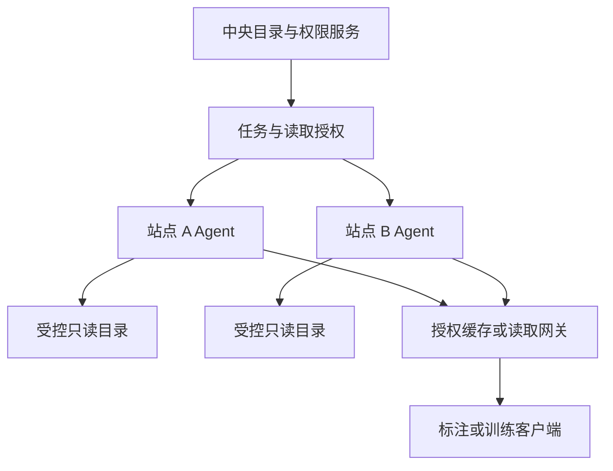

# EPIC-06：多端部署、站点 Agent 与就近读取

> 状态：approved / implementing；依据用户持续推进整套 Epic 及先推进当前环境可实施部分的授权；不分配发布版本。
> 晋升日期：2026-10-26；重审基线：`93902bb7b22ff15d6822d74f4a78659207ed6946`，工作树干净。
> 实施前须通过 [promotion gate](backlog/README.md#promotion-gate)。[草案总览](backlog/1792661016_dataset-storage-roadmap.md)、[架构契约](backlog/1792661016_dataset-storage-architecture.md)和[交付验收](backlog/1792661016_dataset-storage-delivery-acceptance.md)共同约束本系列。

> 优先级：P2，M3；M1 允许通过只读共享挂载先覆盖可直连服务器。
> 负责人角色：后端、运维；训练服务、前端协作。
> 依赖：EPIC-01/02/04/05 基础；EPIC-11 权限与 EPIC-12 观测的最小能力。

## 本项目基线与改造落点

本轮重新核对扫描、登记、权限、内容快照与原图缓存。SFTP 拉取不是站点 Agent；当前没有配对和出站任务，不能宣称 E06 已实现。原 AC01 要求的是隔离测试拓扑，不要求先提供生产站点。已授权本地实施，删除把生产目标解释为工程前置的限制。

| 当前 owner                                         | 复用边界                                                                              |
| -------------------------------------------------- | ------------------------------------------------------------------------------------- |
| `services/filesystem_storage.py`                   | 抽取 Linux openat2、根 anchor、整目录快照与读前读后复核到标准库包。                   |
| `dataset_scans.py`、`workers/dataset_scan.py`      | 中心继续持有 AsyncJob／Run、generation／租约和目录原子 checkpoint；Agent 只执行 I/O。 |
| `dataset_registration.py`、`dataset_references.py` | 复用预检、人工确认和幂等登记，不建第二套任务历史。                                    |
| `content_snapshot.py`、`original_cache.py`         | 中心继续核验完整内容和授权；临时 stage 不等于持久缓存。                               |
| `storage_access.py`                                | 位置准入与实际 I/O 收尾；网络断开不能证明远端关闭。                                   |

保留人工 Web3100／API8100、既有数据／原件、共享 `.env` 和 Node 依赖。不重建后端镜像，不触碰主检出服务，不重开训练规模、Tracker 或全部消费者资格验证。

## 1. 问题与当前基础

已有 SFTP 与 S3 拉取适配器可处理外部来源，但这不等同于跨网络站点的持续读取、离线恢复与本地计算能力。现有任务文件解析仍主要围绕全局对象桶；多站点需要可定位的内容和可选择的访问路径。[SFTP 适配器](../../apps/api/app/services/sources/sftp.py)、[存储解析](../../apps/api/app/services/storage.py)

本 Epic 解决“图片在不同服务器，平台统一管理但不全部集中复制”。它不等于建设分布式文件系统，也不要求用户先部署 Ceph 或把所有机器加入一个存储集群。

## 2. 分层部署方案

| 场景                                               | 建议路径                                             | 阶段                   |
| -------------------------------------------------- | ---------------------------------------------------- | ---------------------- |
| 平台与图片同机                                     | 服务端只读挂载受控目录                               | M1，EPIC-02/03         |
| 多台服务器在可控局域网                             | 经运维提供共享挂载，或经已验证的来源适配器访问       | M1/M2                  |
| 数据在独立网络、边缘站点或无法被平台入站连接的机器 | 站点 Agent 主动建立认证连接，执行允许的扫描/读取任务 | M3，本 Epic            |
| 训练节点靠近某些数据                               | 基于站点与副本选择就近读取/缓存，不改变版本内容      | M3，本 Epic 与 EPIC-10 |

只要 M1 场景能够完成“目录注册—浏览—标注—版本冻结”，就不应把 Agent 作为首期阻塞依赖。

## 3. 目标、范围与暂不做

目标：中央平台持有目录、权限和业务关系；Agent 在受控站点执行只读扫描和读取，离线时明确降级，恢复时继续任务。

范围包括站点登记、Agent 配对/轮换/撤销、心跳和协议版本、任务租约、断点恢复、分块传输、来源状态回报，以及有限的就近路由。

暂不做任意远程命令执行、站点间自由互联、通用文件同步客户端、来源目录双向写回和跨站点自动删除。原件复制、缓存预热必须对应明确任务与容量预算。

## 4. 用户故事

| 编号    | 用户故事                                                                         | 价值                         |
| ------- | -------------------------------------------------------------------------------- | ---------------------------- |
| E06-S01 | 作为运维，我能在数据所在服务器配对一个 Agent，并仅开放指定只读根。               | 无需开放整台机器或全部目录。 |
| E06-S02 | 作为数据管理员，我能把远端根内目录注册为数据集，看到初次扫描与后续同步进度。     | 统一目录和工作入口。         |
| E06-S03 | 作为标注人员，我能读取远端图片；站点离线时清楚知道原图不可用，已有预览仍可展示。 | 避免误认为数据已删除。       |
| E06-S04 | 作为训练任务负责人，我能优先使用同版本的就近副本，缺失时看到可执行的准备任务。   | 降低重复跨站点传输。         |
| E06-S05 | 作为运维，我能限制站点并发和带宽，并在 Agent 重启后续跑已确认任务。              | 不压垮源磁盘和链路。         |
| E06-S06 | 作为管理员，我能撤销 Agent，阻断新任务和读取授权，同时保留可审计的历史。         | 生命周期可控。               |

## 5. 架构与权限边界



图中箭头表示逻辑调用关系，不代表网络必须由中心主动入站。草案默认 Agent 发起出站 HTTPS 长轮询，读取采用受限中继；只有真实网络测量证明不适用时，才在晋升评审中改选通道。

- Agent 仅接受协议内的枚举、stat、受限读取和任务管理指令，不接受 shell 命令。
- 站点认证不替代用户鉴权。读取授权绑定用户/任务、Asset 内容修订、位置、有效期与用途。
- 中央目录不接收来源私钥明文，不把站点根目录结构全部公开给普通用户。
- 不可达站点不自动触发全量远程复制；可用副本必须通过内容校验和授权检查。
- 站点能力是被报告并核验的事实；不能因为某站点连通就推断浏览器可直连该站点。

## 6. 状态和任务协议草案

| 对象                | 建议字段/状态                                                     | 行为约束                                       |
| ------------------- | ----------------------------------------------------------------- | ---------------------------------------------- |
| `Site`              | `id/name/network_hint/region`                                     | 网络提示仅用于候选路由，不作为授权依据。       |
| `AgentRegistration` | `agent_id/site_id/protocol_version/credential_revision/last_seen` | 禁止复用已撤销身份。                           |
| Agent 状态          | `pending/online/degraded/offline/revoked`                         | 离线由心跳和操作证据判断，展示最后成功时间。   |
| 任务租约            | `job_id/attempt_id/lease_expiry/checkpoint`                       | 超时重派可能重复执行，写入索引和结果必须幂等。 |
| 扫描批次            | `scan_id/sequence/cursor/complete`                                | 未完整完成的扫描不能据此判定全目录缺失。       |
| 内容读取            | `asset_id/location_id/revision/range`                             | 路径重新验证；内容变化时拒绝冒充原 revision。  |

协议接口是提案，可复用现有 AsyncJob 与 worker 体系，不另建第二套任务历史。Agent 的本地 checkpoint 和中心已确认进度要区分，重试必须能处理“本地已完成、中心未收到确认”。

## 7. 断线、变化与路由语义

1. 心跳超时：标记站点暂不可用，保留样本和来源索引；不产生批量删除。
2. 扫描中断：保留扫描水位，恢复后从可验证 checkpoint 继续；必要时重扫小范围，不能跳过未确认文件。
3. 文件读取中断：客户端收到可区分的可重试错误；续传基于同一内容修订，原件变化后不得接着拼接新字节。
4. 只有预览缓存：允许只读浏览，禁止编辑/提交标注和需要完整原图的训练。若有同一内容修订的完整已验证缓存，可按既有授权继续读取和标注；不能按预览“看起来足够清楚”绕过原图门槛。
5. 多副本：先筛选可授权且内容校验一致的副本，再按站点、健康、延迟选路。不能把“路径相同”视为内容相同。
6. 站点重新上线：先验证身份、协议、根映射，再恢复新任务；旧失效租约不能继续提交修改。
7. Agent 撤销：阻断新签发读取与任务租约，现存短期 URL 按明确到期上限失效；需要立即撤销时走受控网关读取。

## 8. UI 边界

存储管理新增“站点/Agent”视图，显示站点、可用根、最近心跳、版本、带宽限制和受影响位置。位置详情展示受影响数据集数量和深链，不复制数据集目录。

数据集页展示来源站点、可用性和最近同步；站点离线时“原图暂不可用，已有预览可查看”比泛化“加载失败”更有用。Agent 配对凭据、端口和配置保留在管理员操作中。

## 9. 验收标准

| 编号     | 可验证标准                                                                                                 |
| -------- | ---------------------------------------------------------------------------------------------------------- |
| E06-AC01 | 在中心无法入站访问站点的测试拓扑中，Agent 配对后可完成受控目录扫描及授权读取，不要求开放来源目录公网访问。 |
| E06-AC02 | 来自未配对、已撤销、过期或协议不兼容 Agent 的任务提交被拒绝，并保留可定位错误。                            |
| E06-AC03 | 扫描期间断网与 Agent 重启后恢复任务，结果无重复 DatasetItem，未完成扫描不会把未见文件批量标为删除。        |
| E06-AC04 | 断网后数据集仍可搜索和查看已有元数据；原图与预览可用性分别显示，无法冻结的版本明确阻塞。                   |
| E06-AC05 | 同一资产存在两处校验一致副本时可按策略切换；不一致副本被排除，不向客户端拼接不同内容。                     |
| E06-AC06 | 受控根之外的文件和未授权项目文件无法通过构造 Agent 请求或读取 URL 访问。                                   |
| E06-AC07 | 配置站点并发与带宽上限后，新任务受限且业务读取优先级可验证；不以无限并发重试恢复站点。                     |
| E06-AC08 | Agent 撤销后不能获取新任务和新读取授权；已签发授权的最长残留有效期有记录并通过测试。                       |
| E06-AC09 | 接入一个远端站点不会改变同机/共享挂载位置的现有读取、扫描和标注流程。                                      |

## 10. 部署兼容与测试

- 首先用一个只读站点、一个非生产目录验证；按明确的 Agent 位置类型分派，暂停接入不影响已有本地位置。
- Agent 协议至少支持明确的服务端兼容版本范围；升级前验证在跑任务 drain，不能让不兼容 Agent 继续领取任务。
- 回滚至旧 Agent 仅在协议、checkpoint 格式兼容时允许；不兼容时停止任务后重新配对，保留原内容标识。
- 网络故障测试覆盖高延迟、丢包、DNS/证书错误、连接中断、旧租约重放、源目录改名和根挂载缺失。
- 训练侧只消费版本清单，Agent 不在本地决定标签或 train/val 切分。

回退约束用于实际部署或协议切换出现故障时恢复服务，沿用已确定的受控应用回退、保留 schema 与数据。日常开发以修复和针对性验证推进；不为每个工程步骤重复增加回滚演练，也不将回滚专项作为扫描、登记、读取接入的额外前置条件。

## 11. 风险和待决策

- 首期支持哪些运行环境：建议 Linux 容器或系统服务先行，Windows 桌面 Agent 留待明确需求。
- 是否需要现场预览网关：依据真实带宽/时延测量选择中继或短期直连，不同时实现所有传输方案。
- 站点能否离线缓存授权与任务：建议只完成已获租约的受限任务，中心不可用时不新增授权。
- 训练就近调度需与 GPU 调度能力协商，不能单以存储距离覆盖计算资源和权限约束。

## 12. 工程任务与完成定义

- [ ] 定义站点、Agent 身份、协议版本、任务租约和撤销机制。
- [ ] 实现只读根注册、扫描批次提交、读取 Range 与内容修订检查。
- [ ] 对接现有 AsyncJob 的进度、恢复、取消和授权失败展示。
- [ ] 实现带宽/并发限制和有限副本路由；接入观测指标。
- [ ] 交付部署包、升级/撤销/故障排查手册与隔离网络演练结果。
- [ ] 通过验收后，用户可把第二个站点已有目录接入同一数据集目录体系，且原图无需集中搬迁。

## 本项目推进切片与晋升条件

实施拓扑：当前环境部署真实隔离的 Linux 中心和 Agent，中心不能入站，Agent 可出站 HTTPS；使用非生产受控根和明确预算。第二站点也可本机隔离，不等待生产部署目标。独立配对凭据不复用个人或训练执行器凭据。

| 切片  | 独立结果            | 交付范围                                                                                       | 验收 / 回退边界                                                   |
| ----- | ------------------- | ---------------------------------------------------------------------------------------------- | ----------------------------------------------------------------- |
| E06-A | 一个 Linux 只读站点 | 新增一个受限 Agent 部署单元，主动 HTTPS 长轮询/中继，配对、扫描/读取、租约恢复和撤销共同交付。 | 中心不可入站仍可使用；旧租约/已撤销身份拒绝；本地目录流程不退化。 |
| E06-B | 有限就近副本        | 多个授权同内容副本按站点/健康择路，受预算预取，不默认全量复制。                                | 续传不混内容；并发/带宽有界；撤权残留窗口可测。                   |

前置合同不等于等待前置 Epic 全量完成。每个切片合并后系统仍须可用；含新来源的回退保留兼容读取和授权，不能把其相对路径交给旧 S3 拼接逻辑。预计多数切片涉及超过 8 个文件，实施时明确大范围边界与准确清单。

已有回归入口：[test_dataset_import.py](../../apps/api/tests/test_dataset_import.py)、[test_connector_crypto_guard.py](../../apps/api/tests/test_connector_crypto_guard.py)、[test_storage_connections_api.py](../../apps/api/tests/test_storage_connections_api.py)。这些仅为旧行为回归起点，新合同/状态/故障场景须补有意义的用例；不能以旧测试通过替代本 Epic 验收。分层命令、真实浏览器矩阵和产物清理见[交付验收](backlog/1792661016_dataset-storage-delivery-acceptance.md#本项目验证与文档交付)。

实现时同步：[index.md](../../docs-site/ops/deploy/index.md)、[network-security.md](../../docs-site/ops/deploy/network-security.md)、[storage-connections.md](../../docs-site/dev/concepts/storage-connections.md)，以及适用 API 指南/快照/前端类型、`CHANGELOG.md` Unreleased。新增配置同步 `.env.example`、`pnpm docs:gen-env-vars`、`DEV.md`；涉及 SDK 合同按对应 skill 核验。正式 ADR 在实施时分配可用编号。

完成实施后按[计划规范](README.md#required-completion-steps)追加 `## Outcome`，列实际提交、正式文档、验证证据、清理与剩余限制；草案清单不等于已实现。

## 当前实施合同、文件范围与验证顺序

本 Epic 超过 8 个文件、跨共享包／独立 Agent／中心 API 与 Worker／Web。以下是依赖有序的工程步骤，不缩减原 E06-A 的闭环或 AC01–09。

```text
管理员／Web → 中心权限与 StorageLocation → AsyncJob／扫描／登记 owner
                                          ↓ 持久传输命令
Agent → 出站 HTTPS 长轮询／受限中继 → 中心 API → Snapshot／既有缓存 → 客户端
  ↓
受控只读根 → 完整 SHA stage → 分块提交
  ↓
耐久本地日志：本地完成 ≠ 中心已确认
```

### A1：共享原语、严格协议与可执行 Agent 基座

准确新增文件范围：

- `apps/_shared/filesystem_read/pyproject.toml`、`README.md`、`src/aap_filesystem_read/{__init__,roots,stage}.py`、`tests/test_*.py`：无 API／数据库依赖，显式根映射；完整读取与退出复核后才产出 stage。
- `apps/_shared/site_agent_contract/pyproject.toml`、`README.md`、`src/aap_site_agent_contract/{__init__,messages}.py`、`tests/test_*.py`：协议版本、严格白名单、规范化 digest、根修订／租约、结果和 ACK。
- `apps/storage-agent/pyproject.toml`、`storage_agent/{__init__,config,journal,runner,client,__main__}.py`、`tests/test_*.py`、`README.md`、`Dockerfile`、`deploy/storage-agent.service`：独立 Linux 进程，无入站监听，固定 HTTPS origin；只保存独立身份、本地根和有界日志／stage。

A1 先实现和验证独立组件；中心未接通时不算 AC01 通过，也不能作为可用的平台接入功能发布。API 保留既有异常、anchor 编码和 monkeypatch seam；共享 facade 的内部去重独立安排，不作为 Agent 接入的新增验收前置。

### A2：中心身份、扫描／登记和读取闭环

准确文件范围：

- 新增 `apps/api/app/db/models/site_agent.py`、`schemas/site_agent.py`、`services/site_agents.py`、`services/agent_transport.py`、`api/v1/site_agents.py`、`alembic/versions/0265_site_agents.py` 及对应 `tests/test_site_agents*.py`／`test_agent_transport*.py`。
- 修改 `db/models/__init__.py`、`api/v1/router.py`、`schemas/storage_location.py`、`services/storage_location.py`、`api/v1/storage_locations.py`：站点、独立身份／一次性配对、轮换／撤销、心跳、root handle 与 `kind=agent`。
- 修改 `services/filesystem_storage.py`、`apps/api/pyproject.toml`／`uv.lock`：共享原语 facade 与依赖；容器构建／挂载按实际入口调整，不重建当前后端镜像。
- 修改 `services/reference_storage.py`、`dataset_scans.py`、`dataset_registration.py`、`dataset_source_sync.py`、`dataset_content.py`、`dataset_references.py`、`content_snapshot.py`、`storage_access.py`、`original_cache.py`、`workers/dataset_scan.py`：Agent I/O 分派、远端 observation、完整内容与授权复验；中心 worker node_id 保持原语义。
- 修改 `api/v1/originals.py`、`api/v1/dataset_sources.py`：完整内容核验后提供同 revision 单范围读取，不把现有 Accept-Ranges:none 误报为已支持。

迁移基于当前 head 0264 追加，保留 schema。命令和关闭证据存 PostgreSQL，不建第二任务历史；临时块通过有界 Redis 中继，不登记新原件或强制开启持久缓存，不依赖 API 进程粘滞。源文件最多 64 MiB、块最多 256 KiB；临时中继过期／缺块明确失败。网络超时未获关闭证据时保留 unsettled 责任，后续对账收尾。

协议只允许 `probe / browse / scan / read`，严格拒绝未知字段／任意目标 URL。目录沿用单目录 5000 项、扫描 50000 项／5000 目录。命令绑定身份／根资格／位置配置／维护修订、业务租约、用途和内容身份。网络等待前提交；锁序保持 Location→Source→Job→Run，传输 received 与业务 applied 分开，业务 ACK 和 checkpoint 同事务。

### A3 与 B：管理界面及双站点

A3 复用存储页面和居中 Modal，新增 `apps/web/src/components/storage/SiteAgentsPanel.tsx` 与组件测试，接入实际页面／API 层前固定父文件清单。展示心跳、可用根、预算和影响位置；数据集维持原图／预览分开。B 在既有内容身份与授权筛选后做有限站点／健康路由，不改 GPU 调度或建设通用复制系统。

### 分层验证和文档

- A1：当前 API 虚拟环境 pytest，明确 `PYTHONPATH` 指向独立包；验证路径边界／替换、完整 SHA／stage、协议拒绝、ACK 重放、日志恢复／预算。固定 Ruff 0.15.22 check 与 format；清理任务产物。
- A2：通过现有 launcher 核实 disposable test 库后运行 SQL／租约并发及受影响扫描／登记／读取回归；公开接口同步 OpenAPI／前端类型和 SDK manifest。人工库不作为测试库。
- A3／B：新增 `scripts/verify_site_agent.py` 和直接纯测试；真实隔离 HTTPS 双 Agent 完成配对、扫描、登记、读取／Range，注入断网重启、旧租约、重复提交、撤权、副本变化和预算优先级，逐项对应 AC01–09。
- Web 变更按既有约定做 token lint、组件测试、真实明暗／宽窄截图及交互、请求、控制台检查。A1 无 Web 变更不重复既有 UI 验收。
- 随实际实现更新 `docs-site/ops/deploy/site-agents.md`、部署索引／网络安全、`dev/concepts/storage-connections.md`、API／用户指南、README／DEV 与 CHANGELOG。未实现的中心接入明确标注；整项完成追加 Outcome，不把组件测试写成 Epic 已验收。

## Outcome — E06-A1 独立组件

2026-10-26，原稿按当前基线晋升 `f172c9e40`；安全只读原语 `bc83b149c`、严格协议 `479218226`、独立出站 Agent `67cf29360` 已提交。此处只收口 A1 工程步骤，E06-A 和整项 E06 均未完成，原始故事与 AC01–09 保持。

已交付：标准库共享根读取与完整 SHA stage；固定版本／白名单消息；单实例耐久本地日志，分开本地完成、received 和 applied；独立身份与根修订核对、HTTPS／CA、拒绝重定向、分块 ACK、租约发送期限、有限带宽／空间／重试、drain 与本地配置检查。当前客户端串行执行，关闭未决即使被拒绝也保留，目录结果超过协议上限记录明确失败。

当前组件共 471 项测试通过：共享文件系统 68、协议 354、Agent 最终 49。主树合并检查曾一次运行 467 项，随后仅对有实际改动的 Agent 运行最终 49 项，不重复计算旧用例。真实本机 TLS 对端验证丢 ACK 后重新打开耐久日志仍发送原 stage、证书与重定向拒绝、握手中到期后不发送请求；这些是协议组件证据，不是完整隔离网络或平台接入验收。

三个本地 wheel 在独立虚拟环境安装及 CLI／导入 smoke 通过，未安装 FastAPI／SQLAlchemy；Ruff 0.15.22 check／format、提交钩子与 diff 检查通过。文档片段／208 页 frontmatter／freshness 检查及完整文档构建通过（37.01 秒）。正式说明见 [Agent 部署范围](../../docs-site/ops/deploy/site-agents.md)与[独立包 README](../../apps/storage-agent/README.md)。Dockerfile／systemd 文件是部署骨架，本轮未构建镜像或启用服务。

人工 Web3100、API8100 返回 200，DB／Redis／MinIO／Celery 均健康；没有迁移、重启或修改已有 API／Worker。1626 个文档生成文件、测试目录、wheel 中间文件、临时虚拟环境及两棵已集成隔离树清理；未创建测试数据库／对象桶。只保留 0600 的边界与结果摘要 `/tmp/aap-e06-a1-summary-s3zb6umf.json`。

下一步 A2 直接接通中心独立身份／配对、传输命令、已有扫描／登记／内容快照和撤销。随后 A3／B 完成管理界面、真实隔离双站点、Range、恢复与有限副本路由。原子业务 ACK、关闭对账、中心到期鉴权尚待 A2 实现，不能用当前组件通过替代。没有新增生产站点、回滚专项或无关训练门槛。

## Outcome — E06-A2 中心接入进展

2026-10-26，独立身份与配对 `a37fa499b`、真实配对客户端 `ff8525de1`、既有扫描／同步 owner 接入 `f0ab661d1` 已集成；中心传输、Agent 位置和内容快照接入已提交 `136994740`。此记录是 A2 核心链路的实施进展，E06-A／完整 E06 尚未完成，累计仍为九项 Epic 归档。

中心保存独立站点、身份／凭据摘要和持久命令，支持一次性配对、心跳／根修订、drain、轮换与撤销。命令优先级、并发／中继预算、块偏移与完整 SHA、关闭证据及业务 ACK 接通；已拒绝结果不能被后续业务采纳复活。Agent 日志保存同一身份的耐久 session，丢失轮询响应可重投原命令，期限不延长。

Agent 位置复用原有使用范围、探测和目录浏览。来源保留中心 Worker 身份，扫描／同步沿用原 AsyncJob、租约和 checkpoint；预检、确认登记及引用原图进入既有完整 Snapshot 和当前授权复核，不集中复制原图。位置根与来源子目录分别传递，远端 observation 不混入中心 inode。预检的每次远端探测在当前权限／作业状态复核后保存并确认，避免阻塞下一次探测，也不把内部命令 UUID 写入探测 JSON。

验证口径：28 项身份测试、24 项扫描／同步测试、111 项本次传输／位置／登记读取及既有相关回归、358 项协议、103 项 Agent 和 4 项 SDK 合同通过，固定 Ruff check／format、OpenAPI 对照、前端类型生成及文档片段／208 页 frontmatter／计划 freshness 检查通过。协议／Agent 联合运行中一项旧“重启更换 session”断言随耐久 session 合同修订后单独通过，按不同节点计一次。登记读取回归中八项旧错误分支的测试驱动在 rollback 后访问过期 ORM 对象；其中一个代表节点在接入前基线同样复现，八项未算通过，单列为既有夹具问题，没有扩为本轮专项前置。

新增 owner 集成用例确实经过 Agent 安全文件读取／stage、中心 SQL／Redis 和既有扫描→预检→确认登记→引用原图流程，但替换了网络等待和独立跨连接准入。真实 HTTPS 配对及独立 CLI 恢复属于组件测试；它们均不能替代 AC01 的中心不可入站拓扑或完整平台网络验收。

人工环境沿用当前工作树归属服务、Web3100／API8100、原数据库及九桶；新增迁移 0265／0266，刷新本地 API／Worker 依赖，不重建后端镜像、不改共享环境或主检出。disposable test 数据库／Redis／九桶、四棵已集成测试树及中间产物已清理，保留私有结果摘要 `/tmp/aap-e06-a2-summary-wo5s723.json`。

后续继续实际网络闭环，再推进 A3／B 的管理界面、Range、隔离双站点与有限副本路由；API 共享 facade 去重单列，不阻塞功能接入。按原 AC 验证恢复、撤销和预算，不增加生产站点、回滚专项、万条训练或其他消费者改造门槛。

## Outcome — E06 单站点真实链路与管理界面

2026-10-26，Agent 图片 Range `e08e2bf46` 与管理界面 `2e51b0b6d` 已集成。本片交付 A2 的真实单站点网络闭环及 A3 的管理界面／Range；完整 E06、双副本选路和中断恢复仍在实施，不将本片等同于全部 AC 通过。

新增真实夹具 `scripts/verify_site_agent.py`：只接受 launcher 核实的 disposable test 拓扑和本机已有镜像的不可变摘要，分别创建中心与站点 Docker 网络；来源目录仅只读挂载给独立 Agent，中心无法连接站点上实际可达的 canary。真实 HTTPS API、独立 Celery Worker 和独立 Agent 完成配对、两文件／一子目录扫描、预检和确认登记，登记字节 797,419、集中复制原图零字节。扫描条目和已登记样本各自通过完整原图 SHA、单区间、后缀、If-Range 不匹配完整返回及越界416；没有替换网络、存储许可或业务 ACK。本地隔离拓扑对应 AC01，不授予生产网络资格，也不要求生产站点作为后续工程前置。

演练直接发现并修复探测成功后按错误中心节点键查回而返回500的问题；API 和中心 Worker 发起均按 `agent:<UUID>` 保存并返回。管理列表增加精确 Agent 过滤，保留当前位置权限及 total／分页。Agent 的图片 content 从完整核验后的同一快照选择区间，同内容完整缓存保持范围能力；非 Agent、预览与通用原件的既有边界分别保留。

“存储管理 → 站点与 Agent”仅超级管理员可见，提供全宽分页／站点筛选、居中详情、瞬时配对信息、暂停／恢复、轮换／撤销及受控根位置登记。真实浏览器使用一次性测试 API 和与主树逐文件相同的已提交 UI；明暗桌面、390px窄屏、创建站点／Agent、配对信息离开弹窗后清除、登记跳转、暂停恢复、撤销、Escape和返回焦点均通过，无横向溢出、浏览器异常或失败请求。未向人工环境添加这些测试站点。

本片 89 个不同后端用例通过（首次88通过／1失败，修正新过滤谓词后该节点单独通过），另2个 OpenAPI、57个 Web、4个 SDK 合同和4个夹具守卫通过。OpenAPI／Web类型已生成，根目录完整 TypeScript、固定 Ruff 与 CSS token检查通过，文档片段／208页 frontmatter／计划检查及完整文档构建通过（39.98秒）；原有两条 TrainingComparisonResults z-index 提示未扩为本片修改。后续只按原 AC 验证断网／重启、离线可用性、预算／撤销和双站点一致副本路由，不重复应用回滚、训练规模或已停止的消费者专项。

人工3100／8100及两个Worker／绑定Beat沿原归属服务刷新，迁移头0266，原有业务与文件保留；未构建镜像。一次性测试API／Web和浏览器已退出，21个演练Docker资源独立复核不存在，两个已集成隔离工作树与分支已删除；所属test数据库、Redis和九桶已通过launcher销毁。私密原始日志、凭据与截图在收尾清理，仅保留有界摘要。

## E06-A4 实施：中断恢复、中心带宽与离线展示

2026-10-26，承接单站点已交付链路，仅对应原始 AC03／04／07／08。恢复与预算 `089658495`、离线投影与界面 `299359528` 已合入，实际演练和界面验收完成前不记整片收口。完整 E06 与累计九项归档状态保持。

同一耐久会话丢失领取响应后，即使命令已过期，中心仍提供原始命令用于关闭回报；Agent 在访问来源前拒绝过期命令，不更新原到期时间。暂停派发继续收尾已领取责任。正文带宽取中心与本地较低上限，原图分块和扫描结果共用预算，不计算 HTTP／TLS 头和配对／轮询控制消息；重启允许有界首片突发。

来源和样本列表批量投影已授权的站点／Agent、心跳、凭据、暂停和根修订状态；离线不移除样本，搜索与分页继续可用，预览和完整缓存记录分开保留。完整已验证缓存仍沿现有任务权限读取，缓存未命中时才检查来源可用性；既有冻结包不增加来源在线门槛。界面沿用紧凑字号和居中样本检查器。

主树新增17项数据库回归全通过，相关套件154项中152项通过；两项无效图片工作台旧用例在未包含离线改动的隔离基线 `bb65898fb` 同样失败，都是旧测试 drain 在 rollback 后同步访问过期 ORM 身份触发 MissingGreenlet，未作为 E06 新前置。共享合同与 Agent477项组件、Web55项检查由各实现分支完成，主树SDK4项和OpenAPI2项通过。真实 HTTPS 故障夹具只操作自有网络／Agent、通过只读SQL观察真实状态，不写造租约、ACK或业务结果；实际Outcome与清理事实随后追加。

## E06-B 实施：显式同内容副本选路

承接原始 S04／AC05；迁移0267用于显式、可撤销的定向引用副本关联。管理员只可关联同一数据集内、已接受且SHA／大小一致的引用样本，关联不合并样本、任务或历史版本，不按SHA自动授予访问，也不产生传递授权。A的业务授权始终保留，物理来源不可达时才尝试明确允许的候选；候选完整读取、内容核验并在交付前复核当前授权和关联，禁止拼接不同来源的部分内容。

使用显式优先级与当前候选资格，不声称已测得网络距离或自动识别训练节点站点。A的既有完整缓存仍优先；新留存取A/B策略更严格者。复用现有引用快照和训练冻结准备调用，不修改已就绪版本、Executor或训练算法。管理入口放入现有样本检查器的默认折叠区，候选、列表和操作遵循当前来源管理权限及分页。后续使用自有双Agent拓扑验证A离线转B、篡改副本拒收及内容身份不变，不增加模型训练或生产WAN资格。

## Outcome — E06-A4 中断恢复、带宽与离线展示

2026-10-26，恢复／预算 `089658495` 与离线状态／UI `299359528` 已集成，新增故障场景 `verify_site_agent.py --scenario recovery` 通过。中心与站点仍处独立网络，中心无法入站访问站点，来源只读挂载给 Agent，未重建镜像或集中复制原件。

实际中断788,087字节图片的分块上传，断开 Agent 网络并重启同一耐久日志，原请求14.117秒后得到完整同SHA内容；中心上限65,536字节／秒低于本地预算，实际生效。随后真实丢弃领取响应，等待原45秒许可到期，再启动同一会话，Agent回报command_expired并关闭责任，没有重新读取或延长许可。扫描大目录期间断网重启后沿checkpoint恢复，完成2文件、400排除项、2目录的枚举与再次确认登记，仍为原2个Item，没有未见批量删除或重复样本。最后真实等待心跳超过60秒，元数据／搜索／分页和具体不可用原因保持，恢复后在线；撤销后新轮询和原图读取拒绝，原已关闭历史仍可核对。

首次演练已通过续传，后在观察队列时超时：杀掉 Agent 不会立即终止中心已在途的长轮询，原脚本只观察queued而漏掉已领取状态。修正夹具兼容queued／leased并保留真实响应与原期限后，完整故障场景通过；未更改服务租约或伪造回执。

主树去重153项API／DB／OpenAPI通过，包含18项新增恢复／离线回归及已有完整缓存离线冻结、无缓存拒绝冻结检查；2项旧无效图片测试在隔离基线同样失败，未扩为本片门槛。477组件与55Web分支检查、4SDK、7夹具守卫、根树完整TypeScript、固定Ruff及CSS token检查通过。实际中心写入保存地址使用测试桥接入口，宿主机合同测试与演练间通过launcher重置一次性namespace，不共享这类运行时定位事实。

真实浏览器检查来源与居中样本详情的明暗主题、1280桌面／390窄屏、页签切换、当前连接／撤销原因、Escape及返回样本按钮焦点，未出现横向溢出。最终510项网络观测无HTTP错误，页面和控制台error为零；截图均待内容及有限动画完成后检查。实际断网可用性由独立HTTPS演练验证，浏览器使用相同已提交界面和自有测试数据，未修改人工业务数据。

正式文档同步Agent运维／独立README、数据集用户和API指南、README／DEV／CHANGELOG及本计划。文档208页frontmatter、209页严格可读性、210页导航和39.65秒完整构建通过。人工0266、3100／8100、两个78任务Worker及绑定Beat沿原监督服务刷新并恢复健康，刷新前后均无待执行或运行任务，原数据／文件保留。两次演练所属12个Docker资源已独立复核不存在，测试API／Web和浏览器退出；root及基线的test数据库、Redis和九桶经launcher清理，私密凭据／截图／原始日志随任务清理，仅保留有界摘要。完整E06仍待显式双副本真实读取与管理验收，不重开应用回滚、万条训练或消费者专项。
