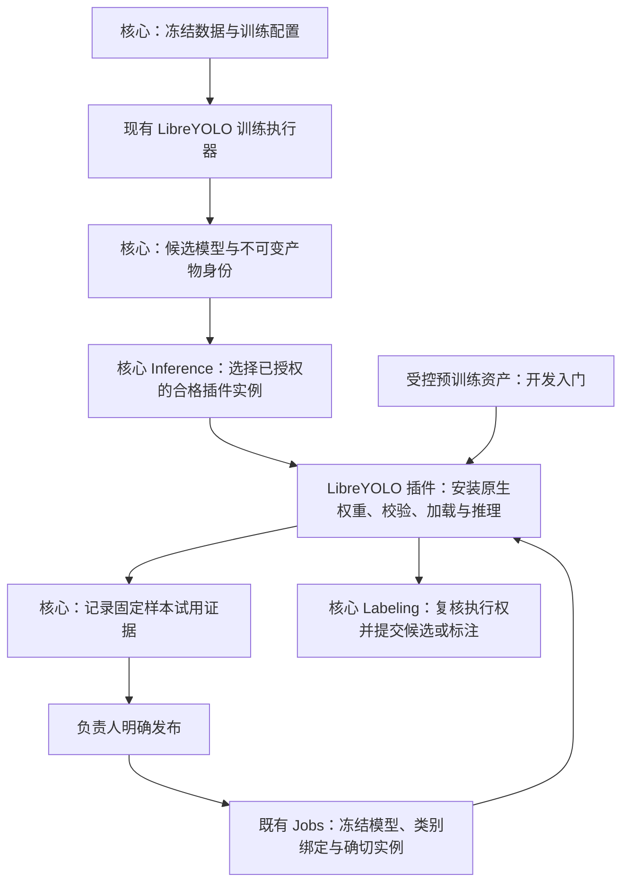

# LibreYOLO 推理插件：原生训练回流与低门槛开发

> 状态：本切片实施及单卡 GPU 验收完成（2026-10-29）。按用户授权使用 omp 原生子代理，在隔离工作树修改后统一集成；验收证据及明确未覆盖的范围见 Outcome，不据此退役整体后端重构计划。
>
> 创建日期：2026-10-28。
>
> 目标：利用现有 Inference 契约，将 LibreYOLO 的原生训练结果交给独立的 LibreYOLO 推理插件，首期只开放 YOLOv9 检测，**必须支持 NVIDIA CUDA GPU 推理**；同时交付外部开发者可以独立使用的真实示例、开发工具和安装闭环。
>
> 依据：[插件边界与生态研究](../research/51-plugin-capability-boundaries-and-ecosystem.md)。本计划是首个纵向切片，不是[旧后端重构计划](1792160873_backend-module-decoupling.md)的整体替代，也不批准取消其未完成目标。模块剩余工作的权威台账仍为[模块部署与边界](../../docs-site/dev/concepts/module-deployment.md)。
>
> 后续范围：[统一插件契约与 YOAO-Plugins 拆仓规划](1793184138_inference-plugins-repository-extraction.md)。本切片仍是第一道实际验收门；后续迁移五个现有后端，不把当前检测 SDK 扩张为通用插件框架，前端扩展仅在出现具体联合插件需求后增加。

## 1. 交付目标与明确边界

主验收不是“另起一个 YOLO HTTP 服务”，而是 **LibreYOLO 训练 → 原生权重回流 → LibreYOLO GPU 推理 → 人工发布 → 项目实际使用**。已有预训练模型用于开发者快速入门，但不能替代真实训练产物在 GPU 上的回流验收。

| 维度     | 本次决定                                                         | 不包含／不得暗示                                                          |
| -------- | ---------------------------------------------------------------- | ------------------------------------------------------------------------- |
| 推理实现 | 独立、可安装的 LibreYOLO 插件；直接运行 LibreYOLO 原生模型       | 改名后的 Ultralytics YOLOv9 服务，或复制整个 `yolo-backend`               |
| 模型范围 | `libreyolo9t/s/m/c`，原生 family 为 `yolo9`；默认入门规格为 `t`  | E 规格、其他家族、分割、姿态、OBB、分类、跟踪、ONNX/TensorRT              |
| 训练来源 | 复用现有 LibreYOLO 训练执行器、冻结配置、数据与训练产物合同      | 新建训练器、在推理插件增加 `/fit`、改变训练账本                           |
| 权重入口 | 受控预训练资产，以及已通过资格检查的原生训练 checkpoint          | 接收任意 pickle、自动转为 Ultralytics 权重、同名文件回退                  |
| 推理设备 | 首期必交 NVIDIA CUDA GPU；保留显式 CPU 开发模式和已有 CPU 资格   | GPU 只列为后续事项；指定 CUDA 后静默回退 CPU；把带 CUDA 的依赖包当作验收  |
| 平台接入 | 现有 Registry、服务池、项目启用、预测／预标注和模型发布流程      | 第二套模型市场、Jobs、训练发布表或标注写入系统                            |
| 安装形态 | 管理员明确安装固定摘要的容器制品；开发模式可本地运行 Python 服务 | 在 API 进程导入第三方 Python、API 挂载 Docker socket、安装任意 shell hook |
| 开发体验 | 小接口、真实检测模板、可分发 wheel、联调与契约检查               | 要求用户理解 Celery、内部 ORM、Native/SQL 或复制数千行后端代码            |

GPU 已由用户明确要求，属于本切片完成门槛，不得用 CPU-only 交付替代。首期以 CUDA、单实例显式绑定一张 GPU、FP32 推理为合格路径；多卡通过独立实例部署，不增加模型并行、ROCm、MPS、自动混合精度或 TensorRT。共享逐样本评估和主动选样仍有独立资格门，本切片不因 GPU 推理成功而放开这些能力。

## 2. 已有基础与真正的缺口

| 已核对的事实                                                                                                                                            | 对计划的约束                                                                                   |
| ------------------------------------------------------------------------------------------------------------------------------------------------------- | ---------------------------------------------------------------------------------------------- |
| [共享原生 loader](../../apps/_shared/libreyolo_native/src/libreyolo_native/__init__.py) 承接原适配器的严格 metadata、类别顺序、完整主模型张量及输出校验 | 复用这份实现，不重写一个宽松 loader，也不保留跨应用兼容别名                                    |
| [YOLO Backend 的受控模型说明](../../apps/yolo-backend/README.md)明确：LibreYOLO 目前通过 `/managed-models` 回流；普通模型目录仍是 Ultralytics           | 这次要拆开实现归属，不只是给现有普通目录增加名称                                               |
| [`model_return.py`](../../apps/_shared/training_contract/training_contract/model_return.py) 固定 LibreYOLO `1.6.0`、原生格式和 CPU 来源资格             | 旧身份不能改写；新增 GPU 部署资格必须与不可变训练产物分开，并扩展现有 `inference_runtime` 验证 |
| [`controlled-model-assets.json`](../../apps/yolo-backend/scripts/controlled-model-assets.json) 已记录四个 LibreYOLO9 规格的固定来源、SHA256 和字节数    | 沿用资产单一来源；不得再维护一份手抄摘要表                                                     |
| [`aap-protocol-v2`](../../apps/_shared/protocol_v2/README.md) 已提供请求／响应公共模型与受控词表                                                        | 保留既有 HTTP 协议；不发明“插件推理协议 3”                                                     |
| [`aap-backend-runtime`](../../apps/_shared/backend_runtime/README.md) 已提供受借用／取消保护的模型池和叶子工具                                          | 组合现有组件，不能为了 SDK 再实现一套池和资源账本                                              |
| [模型服务接入、路由与认证](../../docs-site/dev/concepts/ml-backend-routing-and-auth.md)已区分实例、服务池、项目启用、候选模型、发布及固定实例路由       | 插件安装不是自动启用所有项目；新实例不能接管旧任务的冻结身份                                   |
| [ML Backend 教程](../../docs-site/dev/tutorials/ml-backend-starter.md)已有 echo 示例，但开发者仍需自己编写 HTTP、下载、结果转换等代码                   | 真实 LibreYOLO 插件应成为推荐开发路径；echo 仅保留为协议教学示例                               |
| [`ai-annotation-sdk`](../../packages/python-sdk/README.md)已有 Registry、项目 ML、模型服务池等客户端入口                                                | 运维 CLI 复用已有客户端，不把模型依赖塞进平台客户端 SDK                                        |
| [ADR-0038](../adr/archive/0038-defer-ml-backend-base-class.md)曾选择共享 schema 与模板，不引入统一后端基类                                              | 本次先记录窄检测适配层的架构决定；不强迫现有五种 backend 迁移到一个万能父类                    |

真正缺口是：可独立分发的检测开发外壳、原生 LibreYOLO 服务的独立归属、安装身份与能力发现的绑定、训练回流目标的能力匹配，以及旧实例的安全退出。增加 manifest 本身不能证明这些问题已解决。

## 3. 核心与插件的职责

| 所有者         | 保持拥有的职责                                                         | 不得转移的职责                                                 |
| -------------- | ---------------------------------------------------------------------- | -------------------------------------------------------------- |
| Learning       | 数据版本、训练任务、候选来源、类别绑定、试用与人工发布                 | 不让插件发布项目模型、修改训练状态或直接读 Learning 私表       |
| Inference      | 实例注册、能力快照、认证、项目启用、服务池与模型部署路由               | 不增加 `if plugin_id == libreyolo` 的专属调度分支              |
| Assets         | 产物归属与授权读取                                                     | 不向插件授予对象存储管理凭据或整桶访问                         |
| Jobs／Labeling | 作业与尝试身份、取消、当前任务规则、最终事务提交                       | 插件不写 annotation／prediction 表，也不决定过期结果是否可提交 |
| LibreYOLO 插件 | 原生 loader、模型执行、框／分数／类别输出、实际资源释放                | 不拥有项目权限、不自动确认发布、不替平台完成类别业务映射       |
| 插件 SDK       | 检测 HTTP 外壳、边界转换、入口认证、资源借用、受控模型安装通用机械过程 | 不演变为包含训练 runner、数据库和通用事件总线的后端框架        |
| 部署管理员     | 安装受信任制品、配置资源与网络、保管实例凭据、执行升级和卸载           | 安装制品不自动授予项目权限或第三方代码信任                     |

当前任务和批量预标注沿各自现有校验路径：当前任务仍执行 Workbench 的可编辑、锁和草稿规则；批量仍执行相应任务范围规则。结果返回后的 owner 复核不能被插件“成功”状态替代。

## 4. 插件契约：安装描述与运行能力分开

### 4.1 安装描述

新增一个面向外部制品的最小 manifest。字段属于拟议接口，不是当前仓库已提供的命令或文件格式。

| 内容       | 要求                                                                                                                    |
| ---------- | ----------------------------------------------------------------------------------------------------------------------- |
| 身份       | 稳定 `plugin_id`、插件版本、发布者、代码许可证；不复用 `managed:yolo` 认证身份                                          |
| 制品       | 固定 OCI digest、支持的宿主／SDK 合同范围、启动入口；禁止浮动 `latest` 作为安装身份                                     |
| 能力意图   | 声明 `inference`、图片检测，以及是否实现受控训练模型安装；不得夹带数据库／任意命令权限                                  |
| 资源与网络 | CPU／内存限制、GPU 需求及显存预算、实际资源绑定、允许的资产来源和受控目录；仅授予明确批准的 GPU，不默认暴露宿主全部设备 |
| 模型资产   | 引用规范资产清单或其打包子集及摘要，不复制维护基础模型的另一份真值                                                      |
| 健康检查   | 公开存活检查、受认证的能力检查、必要资产和真实推理检查分别记录                                                          |

manifest 是部署意图，不是模型可用的证明。安装完成后，平台仍读取真实 `/setup`；运行能力不能超出安装许可。实例能力缓存仍由既有 Registry 管理，不另建一个可漂移的模型目录。

### 4.2 HTTP 合同

- 沿用 `aap_protocol_v2.version` 的当前协议版本及兼容声明（当前为 `2.2`，兼容 `2.1/2.0`），不另抄一个版本常量。`/health`、`/setup`、`/predict` 使用现有公共类型。
- `/setup.models[]` 首期使用既有目录槽位 `id="detect"`、`task="detect"`，通过独立实例身份区分 LibreYOLO 与 Ultralytics。当前 `model_catalog.py` 按 `detect/segment` 读取训练模型的参数合同；随意改为另一个 model ID 会破坏这条复用路径。
- 声明闭集检测、`bbox`、`supported_inputs=["full_image","crop"]` 和实际合格的规格；不新增视频、交互提示、分割、共享评估或追踪资格。`resource_profile`、`/health.compute.effective_device` 与实际设备、实例绑定和运行时资格一致，不能声明 GPU 却用 CPU 执行。
- 提供 `/versions`、`/warmup`、实际卸载及受控排空／生命周期接口，接入既有 GPU admission/control 合同。GPU `managed_lifecycle` 只有在所有模型池、真实加载／推理／释放和控制边界通过资格后才能声明；不能仅复制 `/setup` 标志或端点壳。
- 完整实现受认证的 `POST /managed-models`、`GET /managed-models/{version_id}`。`InstallRequest`、不可变收据和运行时返回字段沿用既有合同，不增加训练端点。
- 基础模型目录和 `trained:<模型 UUID>` 是两种身份：前者来自受控预训练资产，后者携带原 `frozen_model_ref`、空 `model_variants`，严格使用冻结的训练产物、类别和安装收据。
- LibreYOLO 名称、训练 framework、原生 family 和安装插件 ID 是不同维度；不能靠名称包含 `yolo` 来判断权重是否兼容。
- 任意语言仍可直接实现 HTTP 合同；Python 检测 SDK 是便利路径，不成为 Inference 的语言限制。

## 5. 原生 LibreYOLO 实现与训练回流

### 5.1 迁移现有适配器，不复制全后端

将原生 metadata、类别顺序、完整张量验证和 LibreYOLO 结果读取归属于新插件的原生加载模块。共享合同继续留在 `aap-training-contract`；协议结构留在 `aap-protocol-v2`；通用资产校验和模型池继续复用现有组件。

`ManagedModelStore` 当前位于 `apps/yolo-backend/managed_models.py`：提取其框架无关的锁、流式下载、摘要核对、原子发布、冲突与收据读取机制，通过原生检查函数注入差异；禁止复制一份安装仓库。现有 Bearer middleware 也绑定五个 provider，应提取 provider-neutral 的手动 Token 路径，而不是给 LibreYOLO 冒用 `yolo` 身份。

新插件不依赖 Ultralytics，也不导入 `apps/yolo-backend`。现有 YOLO Backend 保留自身 Ultralytics 能力；LibreYOLO 回流的旧调用、依赖和文档在完成迁移后清除，不保留跨应用 re-export 或双实现。

以下校验不能削弱：

1. 安装前核对模型 UUID、权重 SHA256、字节数、格式、训练框架／版本、family、size、类别名称及顺序。
2. `weights_only=True` 读取受控 checkpoint；只接受经过资格检查的原生 metadata。完整主模型张量必须实际匹配；不能用宽松 `strict=False` 掩盖缺失权重。
3. 原生单图 Results 不是检测数组。保留全部检测，不使用会只取出第一条检测的错误索引。
4. 校验原图尺寸、类别索引、有限坐标、有效框与分数；SDK 只执行一次像素到协议坐标转换。正常空检测合法，格式错误不能伪装成空检测成功。
5. 安装收据固定框架、模型、产物和已验证的部署 runtime。模型池隔离键保留模型 UUID、权重摘要、收据摘要以及执行 profile／设备身份；CPU 与 GPU 实例不能混用模型、类别缓存或资源证明。
6. 缺失或损坏的受控权重直接失败；推理过程中不联网下载、猜测模型名或回退到基础权重。

现有 CPU 回流资格为 LibreYOLO `1.6.0`、Torch `2.14.1+cu132`、torchvision `0.29.1+cu132`、设备 `cpu`。这是一份必须保留的历史资格，不是新插件只能运行 CPU 的约束。GPU 路径从相同框架／依赖基线取得独立 CUDA 资格，明确实际精度、CUDA 构建与受验硬件范围；不能直接把共享 `LIBRE_RUNTIME.device` 改成 CUDA，也不能把旧收据改成新证明。SDK 本身不依赖 Torch，重依赖只属于实际模型插件。

受控资产清单证明来源与摘要，不证明上游预训练文件已满足平台训练 checkpoint 的 metadata。实施时必须读取固定摘要的四个真实文件，记录 schema、版本、类别、尺寸及 letterbox 信息。若预训练 metadata 与平台训练产物不同，使用明确的预训练身份校验路径；不能降低训练回流的严格校验。默认 t 资产必须在插件可供项目使用前准备完成，不能只让 `/setup` 展示一个永远无法运行的入口。

### 5.2 回流闭环

- 继续从现有成功训练执行注册候选模型，保留数据版本、训练配置与框架身份。
- 由 Learning／Inference 查询项目已启用、认证有效且明确支持该原生格式和运行时的实例；不能把所有检测服务都当成可安装 LibreYOLO checkpoint 的目标。
- 向新实例安装不可变产物，核对收据，再运行固定验证样本。安装成功不等于试用通过，也不等于发布。
- 试用结果使用训练时的原生类别顺序及项目绑定，不能替换为预训练 COCO 类别。
- 负责人显式发布后，后续任务冻结模型、权重、类别绑定、部署与确切实例；失败不得自动转到普通 YOLO 或同池未安装该权重的成员。
- 保留已有取消、重试、重复请求、鉴权修订和迟到结果围栏；最后写入仍由核心 owner 在原事务边界中决定。
- 保持原有共享评估／主动选样资格门：本次证明“能安装、试用和推理”，不等于证明“能参与所有在线学习策略”。

### 5.3 需要精确保留的接口与返回值

| 链路         | 现有接口／字段                                                                                | 插件接入要求                                                                                                            |
| ------------ | --------------------------------------------------------------------------------------------- | ----------------------------------------------------------------------------------------------------------------------- |
| 候选注册     | `POST /api/v1/projects/{project_id}/trained-models`                                           | 保留成功 run／attempt、唯一权重产物、冻结配置、类别与绑定的检查                                                         |
| 安装和试用   | `POST /api/v1/projects/{project_id}/trained-models/{version_id}/deploy`，请求 `{registry_id}` | 复用 `trained_model_deployment` 与 Inference backend control；`checking` 检查以原 `check_id` 完成，旧检查不能覆盖新试用 |
| 发布         | `POST /api/v1/projects/{project_id}/model-releases`                                           | 保留 `sample_confirmed`、`expected_generation` 和实时收据核对；不自动确认                                               |
| 检测条目     | `rectanglelabels`、顶层整数 `native_class_index`、有限 `score`                                | 标签仍是原生类别名称；由核心按 `bindings[index]` 映射项目类别，不由插件预先改名                                         |
| 坐标         | `value.x/y/width/height` 为 `0..100` 百分比                                                   | 相对于实际送入插件的整图或裁剪图，宽高为正且不越界；裁剪结果由平台映射回父图，不由插件重复变换                          |
| 受控结果身份 | `model_version="trained:<uuid>"`、`meta.trained_model`、`meta.inference_runtime`              | `model_version_id/sha256/classes_digest` 与运行时信息精确匹配；缺失不能当普通基础模型结果接收                           |

检查重点复用 `trained_models.expected_receipt/check_receipt/validate_and_map_results`、`trained_model_backend.install_and_trial`、`inference_model_execution` 和既有 `ModelExecutionPort`，不复制这些业务规则到 SDK。当前 `assert_image_scope` 已允许受控检测作为父框裁剪阶段，切片不能误把它收窄成只能整图。Workbench 当前任务通过 `preannotate` 的 `workbench` scope 调用，不冒用要求交互能力的 `interactive-annotating` 端点。

### 5.4 GPU 运行时资格与资源生命周期

**产物身份不等于执行设备。** 保持现有 checkpoint、SHA、类别与训练来源不变，在已有 [`inference_runtime.py`](../../apps/_shared/training_contract/training_contract/inference_runtime.py) 中扩展显式、受控的 CUDA profile 与兼容关系，而不是新建一份模型记录或第三套推理协议。

1. **冻结来源、单独验证部署。** `expected_receipt` 继续校验不可变来源；部署的 `inference_runtime` 记录取得资格的执行 profile。CUDA profile 必须由核心允许的兼容集合验证，不能信任插件自报一个任意字典。CPU 历史 profile 和新 GPU profile 都保持精确校验，不能以框架版本相同代替设备资格。
2. **旧任务绝不换设备。** 已冻结的 CPU `inference_runtime`、收据、部署与发布快照不改写；同一模型在 GPU 插件上重新安装、试用并形成新部署后才能发布。对缺少 `inference_runtime` 的旧引用也明确保留原 CPU 语义，不能因为两边版本都是 `1.6.0` 就接受 GPU 结果。
3. **显式绑定实际设备。** 每个实例固定平台 GPU resource、物理 GPU UUID 和容器内逻辑设备；不依赖宿主 `cuda:0` 序号猜测对应关系。设备或 profile 改变需要新的部署检查，不能通过普通预测参数修改。硬件 UUID 属于资源／部署绑定，不混进模型产物 SHA。
4. **GPU 执行不可假冒。** 原生 loader 和 predictor 必须支持指定 CUDA 设备并核验参数／张量实际驻留。保留完整主模型张量验证和原图输出约束；首期显式 FP32，强制关闭自动 half／AMP 及 TF32，不能只因模型 dtype 为 float32 就声称满足精度合同。模型、输入和执行设备不符直接失败，不静默搬回 CPU。
5. **复用准入与模型池。** 一切实际到卡加载、预热、试用和推理均经过既有 GPU 准入；Token 认证不等于持有资源许可。资产下载和 CPU metadata 校验不占用 GPU 许可。SDK 适配既有仲裁和受借用保护的池，不让作者重写显存调度。
6. **原生执行退出才释放。** 取消 HTTP／协程后仍跟踪原生线程、CUDA stream 与模型借用；完成必要同步后才能归还资源或报告排空。卸载必须覆盖预训练池、训练模型池、正在构建和隔离状态，不能只调用一次 `empty_cache()` 就宣称显存释放。
7. **错误保持真实。** GPU 不可见、设备绑定不符、许可失效、驱动／构建不合格、OOM 或 CUDA 上下文故障均给出明确不可用原因。资源状态不确定时隔离并停止接流，不自动换卡、换模型、改精度或回退 CPU。
8. **运行事实与资格分开留证。** 资格记录框架、Torch／torchvision、CUDA 构建、精度和已验硬件范围；部署记录设备绑定与实际加载／释放证据。目录和路由使用当前部署事实，不把旧来源资格中的 `cpu` 当成当前 GPU 的运行事实。

GPU 是本次必需实现与验收内容。只通过 CPU 回归、导入 CUDA 版 Torch、返回 `effective_device=cuda` 或运行 `nvidia-smi` 均不算完成。GPU 资源注册、控制权限和生产准入仍由现有 Inference owner 管理；独立本地开发模式的检测成功也不授予共享 GPU 托管资格。

具体合同改动保持窄范围：

| 位置                                                    | 必须交付的变更                                                                                                                                                                                                                   |
| ------------------------------------------------------- | -------------------------------------------------------------------------------------------------------------------------------------------------------------------------------------------------------------------------------- |
| `training_contract.model_return`／`inference_runtime`   | 保持 `LIBRE_RUNTIME`、`libre_identity()` 和来源收据不变；增加封闭的 CUDA qualification，按明确 profile 重新计算并精确比较。profile 使用设备种类 `cpu/cuda`，不写机器相关的 `cuda:0`；CUDA 构建从真实镜像核验，不只由包名后缀推测 |
| 受控安装与实例配置                                      | 实例配置选择 CPU／CUDA；`ModelDeploymentCreate` 仍以 `{registry_id}` 选择目标，不把设备塞进 `InstallRequest` 或磁盘不可变 receipt。实际执行 profile 由 `runtime_receipt` 返回并固定到部署                                        |
| `trained_models.validate_result_runtime` 与插件执行入口 | 对缺 runtime 的历史 LibreYOLO 引用同时检查原 CPU 语义与版本；GPU-only 实例拒绝这类引用，不偷偷升级为 GPU，也不因请求而回退 CPU                                                                                                   |
| `trained_model_backend.install_and_trial`               | 新 LibreYOLO 部署必须返回明确 runtime；同一个已固定 CPU／GPU profile 的部署不能被重试原地改成另一个 profile，应新建实例／部署并重新试用                                                                                          |
| `trained_models` 发布流程                               | 除来源收据合法外，还要精确比较现场 `GET /managed-models/{id}` 的 runtime 与部署已固定的 runtime；当前只检查“这个 runtime 合法”不足以证明“仍是试用过的那个 runtime”                                                               |
| 原生 adapter／池                                        | GPU 使用 `require_gpu_device()` 与实际张量检查，不使用可能锁定 CPU 的 `effective_device()`／fallback helpers 决定执行身份；模型重建按冻结 profile／收据摘要，不读取当前环境猜设备                                                |

GPU 接入不改变现有 Ultralytics 运行时合同；新增的 LibreYOLO profile 选择不能把其他框架已有 GPU 能力误解释为 CPU，也不能要求重写历史 frozen JSON 或其摘要。

### 5.5 GPU 控制机制复用，避免让插件作者承担复杂性

- 将 `apps/yolo-backend/gpu_lifecycle.py` 中的 `WorkloadOperation`／`YoloGpuLifecycle` 状态机提取为共享的、按实例配置的 GPU lifecycle 组件，组合 `ManagedLruPool`，不复制第二套实现。同步迁移原 YOLO 调用、测试、镜像身份与相关运维探针；探针更新不得扩大固定服务／命令权限。
- 复用 `aap_protocol_v2.lifecycle` 的能力、签名和控制合同，接入现有 `install_backend_routing_controller`。所需端点包括 `/drain`、`/drain/cancel`、`/unload`、`/lifecycle/mode`、`/lifecycle/reset`；不是通过新增 `managed:libreyolo` 解决。
- 业务 Bearer 与 GPU 准入分别验证：GPU workload 还必须验证 `X-AAP-GPU-Generation`、`X-AAP-GPU-Admission-Token`，核对签名、有效期、boot、scope、代际、控制 epoch 和 JTI 重放；消费顺序沿现有合同。插件只持有验证 keyring，不持有 GPU authority 私钥。
- 补齐受控实例绑定：当前 lifecycle 不能只相信第一份 claim 携带的实例／资源身份；必须与安装时固定的 Registry ID、`gpu_resource_id` 和实际物理设备核对。平台资源 ID 使用现有 node／physical-device-token 合同，容器内 `cuda:0` 只是逻辑位置。
- 首期将预训练与受控模型放入同一受管理 `models` 池，靠完整身份隔离条目。`BackendResidency.pools` 的 ID 集在冷态、驻留、排空、卸载全过程保持一致；builder／borrower／隔离状态都计入，未知状态不得伪装成空池或可驱逐。
- `/health` 按现有 challenge 合同生成非缓存证明；`managed_lifecycle` 的能力摘要与真实控制实现一致。发布和安装资格绑定实际制品与验证报告，不由作者单独把一个布尔开关设为 true 就取得共享 GPU 接流资格。

这些机制由共享运行时与 SDK 配置完成。模型作者仍只承担模型加载、检测和释放的真实职责；全局容量、租约、淘汰目标和签名权继续由 Inference owner 掌握。

## 6. 用户易于开发：具体交付而非一句“提供 SDK”

### 6.1 三个模型职责，使用组合而非继承框架

拟议 Python 检测适配层只要求作者提供三个明确职责。实际名字在实现时与公开类型一同冻结；不能要求作者自己实现整套 HTTP handler。

这是对旧教程“用户自行编写端点”的有意改进：由一个可选、窄范围的检测包消除重复机械代码，而不是抽象所有模型和训练方式。实施前按阶段 A 记录对 ADR-0038 的重新决策；本计划不把尚不存在的 SDK 说成已有设施，也不把其他五种 backend 的迁移变成本切片前置条件。

| 作者提供 | 输入与输出                                                               | 平台／SDK 不泄漏给作者的内部信息                      |
| -------- | ------------------------------------------------------------------------ | ----------------------------------------------------- |
| 加载模型 | 已验证资产路径、规格、显式 CPU／CUDA 设备与受限配置 → 模型实例和有序类别 | ORM、Session、存储管理凭据、项目数据库结构            |
| 单图检测 | 已解码原图、已校验的检测参数 → 像素坐标 `xyxy`、类别索引、分数           | HTTP task envelope、Label Studio 百分比、标注写入事务 |
| 释放实例 | 释放该实例持有的模型和本地资源                                           | 全局 Jobs、其他模型的资源、宿主机管理权限             |

SDK 负责映射 `TaskItem`、逐任务响应、类别名称、`rectanglelabels`、标准错误、认证、下载限制、GPU 许可与资源借用、取消和生命周期控制。作者遵守传入的设备和释放合同，不自己签发资源许可。保留原始 task ID 的类型；不能靠返回数组位置猜测 task 对应关系。

检测外壳默认单实例串行执行，复用现有安全模型池；不要求开发者实现锁、借用计数、排空和异常隔离。HTTP 请求取消不表示原生推理线程或 CUDA 工作已退出；底层执行仍在运行时，不得提前释放模型、重新分配同一资源或报告排空成功。

训练回流作为可选的 `managed-models` 能力组合：SDK 承担受控下载、摘要、原子安装和收据的通用机制；模型作者提供原生格式验证／加载。LibreYOLO 插件完整实现它，但普通第三方预训练检测插件不被强迫实现训练、发布或学习系统。

### 6.2 可独立分发的物料

拟议目录，用于明确归属，不表示文件已经存在：

| 位置                             | 产物                                                                                |
| -------------------------------- | ----------------------------------------------------------------------------------- |
| `packages/inference-plugin-sdk/` | 窄检测 SDK、公开类型、开发命令、真实 HTTP 契约检查器                                |
| `plugins/libreyolo/`             | 独立构建的 LibreYOLO 插件、manifest、锁定依赖、容器配置、真实检测样例和原生回流实现 |
| `packages/python-sdk/`           | 复用平台客户端，增加必要的安装管理命令；core-only 安装不引入模型运行时              |
| 现有 Inference／Learning owner   | 安装绑定、能力匹配、部署与发布的最小扩展；不新增并行业务 owner                      |
| 现有开发教程与协议参考           | 使用插件的推荐入门路径、接口约束、错误处理与兼容范围                                |

SDK 与其依赖必须能从版本化 wheel 集合或包仓库安装，模板也必须能单独获取。生产包不能要求用户通过 `../../apps/_shared`、`sys.path` 补丁或主仓库 editable 链接才能运行。复用共享包意味着分发这些包，而不是复制源码或要求用户克隆整个平台。

### 6.3 推荐开发路径

以下是待交付的体验规格，**不是当前可运行命令**：

1. 安装检测 SDK 的开发工具，从 `libreyolo-yolov9` 模板生成独立工程。生成结果包含真实 loader／predictor，而不是返回固定框的 echo 或待填写的伪实现。
2. 显式执行资产准备，复用受控清单下载／核对 YOLOv9t。输出来源、摘要和缓存位置；后续推理离线使用，不在第一条请求中隐式下载。
3. 用开发命令显式选择 `--device cuda:0` 启动真实 HTTP 服务，先检查可见设备、构建和模型实际驻留；无可用 GPU 时明确失败。无 GPU 的开发者可显式选择 `--device cpu` 调试，但它不能替代 GPU 验收。本地图片由工具提交为受控输入，不开放任意本地路径读取，也不打印 Token。
4. 对服务执行契约检查和 GPU 检测检查：真实图片、多检测／空检测、类别与坐标、非法参数、缺失权重、认证失败、错误设备、取消／排空和显存释放。报告区分本地独占 GPU 运行与接入平台后的资源托管资格，并给出失败字段及修复方向。
5. 构建固定摘要的安装包／镜像，由管理员安装注册。随后沿既有 `aap ml-backends enable ... --project ...` 或项目设置启用，并用平台实际请求证明可达和可用。
6. 需要接入自己的模型时，只替换模型加载、检测和释放实现及声明；需要训练回流时，再实现原生格式验证，不修改平台中心枚举或添加私有数据库访问。

开发工具使用独立入口，例如 `aap-plugin init/dev/check/build`；部署管理使用平台 CLI 的 `aap plugins` 命令组。二者均为拟议名称，前者不需要平台管理员权限，后者不得绕过平台原有权限。`aap ml-registry`、`aap ml-backends` 和 `aap project-ml` 的现有能力继续复用，不复制成另一套命令实现。

### 6.4 开发体验验收

- 在主仓库之外的全新目录和干净虚拟环境，从交付包生成、运行、检查并构建插件；不能靠当前工作区的隐藏依赖通过。
- 用户无需写 FastAPI 路由、手工下载 presigned URL、构造百分比框、操作数据库或实现 Celery task。
- 安装平台客户端 core-only 不引入 LibreYOLO／Torch；安装通用检测 SDK 也不默认拉取特定模型框架。
- GPU 选择通过一个明确设备／资源配置完成；普通模型作者不需要实现签名、显存准入、CUDA 取消围栏或平台资源 API。无法满足托管条件时提供具体诊断，不隐藏成 CPU 成功。
- 发布物包含依赖锁、框架与权重许可证说明、兼容合同和可运行样例。代码许可证与权重许可证分别核验，不从仓库名称推断。
- 现有 echo 教程明确降为协议教学；新的推荐路径必须完成真实推理与平台注册，不能以文档示意替代实际可用物料。

## 7. 安装与生命周期：做完整，但不先造通用市场

### 7.1 采用管理员侧部署，不扩大 API 权限

本切片的安装器运行在明确指定的执行机，由管理员持有部署权限；通过类型化参数启动批准制品，并调用平台公开 API 完成注册。API 不执行第三方 shell，不直接构建任意 Git 仓库，也不接管 Docker socket。

当前 [`ml-backend-runner.py`](../../scripts/ml-backend-runner.py)刻意限制五个内置服务和固定 Compose 文件。不能为了安装插件把这条运维安全边界改成“任何服务名、任何路径、任何命令”。新的插件部署入口只接受 manifest 中经策略批准的制品与受限资源配置。

安装绑定归 Inference 所有，首期复用 Registry 的保留元数据 `extra_params.plugin`，记录安装 ID、插件／制品／manifest 摘要、运行目录身份、状态、操作修订及管理员来源；Registry／服务池引用沿既有记录，不另建模型目录或 Jobs 账本。执行机保存对应部署收据，重连时核对身份，不能依据容器名字接管未知服务。

安装顺序先预留不可接流的 Registry／安装身份及批准的 GPU 资源绑定，再将这些身份、独立 Token 和验证 keyring 注入容器，最后探活、验证资格并激活。不能先接受任意第一份资源 claim，再把它当作该实例的可信身份；失败阶段保留可恢复记录，不自动给项目接流。

这是需要实现的受保护字段，不是任意 JSON 约定：当前项目级 Backend 更新也能写 `extra_params`。必须由 Inference owner 的专用管理员命令控制该保留字段，所有普通创建／更新、项目更新及导入同步入口都不得覆盖、伪造或通过整对象替换删除它；公共 DTO 明确只读展示。平台最终准入同时核对安装状态与 Registry 事实，不能只信执行机本地收据。

### 7.2 认证与输入边界

- 使用现有外部实例 `auth_method="token"` 路径，按安装生成至少 32 字符的独立 Bearer 凭据；不冒用 `managed:yolo`，不为每个插件增加一个内置 provider 常量。受控训练模型不允许 `none`；当前 `enabled_backend` 和模型目录已有这个资格门。
- GPU 托管执行还要求独立的签名准入／控制许可与固定实例／资源匹配；业务 Token 不能替代它。只把验证公钥交给插件，私钥与容量授予权保留在核心。
- 凭据以受限文件或既有秘密机制注入；公开 manifest、日志和安装报告不包含明文 Token。实例认证修订继续参与旧请求／旧检查结果的失效判定。
- 只读取本次调用授权的图片或权重地址；下载限制覆盖协议、目标来源、大小、超时和重定向。访问凭据不转发给图片／权重地址。
- 网络策略必须能使用部署明确允许的内部对象存储地址，但不能因此允许任意内网地址、本机文件或云实例凭据端点。
- 第三方容器不是安全沙箱承诺：管理员仍须信任安装制品；默认非特权、受限挂载，不挂平台源代码、数据库、Docker socket 或其他插件秘密。

### 7.3 状态与恢复要求

| 操作 | 必须达到的可观察状态                                                               | 失败时行为                                                                     |
| ---- | ---------------------------------------------------------------------------------- | ------------------------------------------------------------------------------ |
| 安装 | 制品身份通过、实例已启动、受认证 `/setup` 相符、Registry 绑定可追溯                | 不自动启用项目；保留失败阶段，重试不得重复注册或覆盖他人实例                   |
| 启用 | 由项目权限持有者启用既有服务池／实例，并完成必要能力检查                           | 不因全局已安装而绕过项目权限                                                   |
| 停用 | 阻止新准入；记录已有执行，按原任务和取消规则收尾                                   | 不把 route lease 数为零直接当作模型线程已停止                                  |
| 排空 | 平台准入与插件自身入口均已封住，借用者／构建者／原生执行实际结束                   | 超时保持不可接流，不强行报告成功或提前释放资源                                 |
| 升级 | 新制品以新运行身份验证；受控模型重新核对部署、收据和试用                           | 失败保持旧发布可用；不能原地替换后让旧冻结任务误认身份未变                     |
| 卸载 | 无活动执行或当前发布依赖后撤销凭据、停止受管实例，将安装绑定置为退役并保留身份记录 | 有活动依赖时阻断；历史部署、收据、发布与 Registry 行保留，不以级联删除完成卸载 |

特别注意：现有服务池成员的 `draining` 只在路由 `enforce` 下真正约束新路由。插件停用必须覆盖 `off/observe/enforce` 的实际入口，或以等价且经验证的准入围栏阻止请求；不得把仅修改成员状态当作完整停流。

实现位置应覆盖模型执行网关、训练模型安装／试用／发布及目录可用性判断；普通池重新启用不能绕过已停用插件。优先复用现有项目／池 `enabled` 的全模式围栏，再校验持久的安装状态，而不是仅在 CLI 中做一次检查。

卸载运行时不等于删除 Registry：`trained_model_deployments.registry_id` 当前是 `ON DELETE RESTRICT`，历史部署仍会阻止物理删除。保留停用／退役实例供历史查询；若用户显式尝试删除，应返回清晰的依赖冲突，不能等数据库 FK 异常。不得为删除实例而改写历史发布快照或清空来源。

## 8. 旧 YOLO Backend 的安全切换

切换必须沿受控部署身份完成，不允许原地改写旧任务、收据或历史发布记录。

1. 盘点使用 LibreYOLO 的候选、部署、当前发布、排队／运行任务及重试依赖；区分普通 Ultralytics 模型，不牵连其服务。
2. 安装新插件，对同一不可变权重与类别身份建立新的部署记录，取得新安装收据和真实试用证据。
3. 负责人确认切换项目发布；只有之后创建的任务引用新部署。先前排队或运行的任务继续遵循冻结身份，或经明确取消后创建新任务，不能悄悄转发到新实例。
4. 对所有仍需使用的 LibreYOLO 历史版本提供重新部署到新插件的路径；历史数据保持可读，不能删除旧部署记录来“消除依赖”。
5. 通过 Learning owner 明确区分“禁止产生新引用”和“已冻结执行可以继续收尾”。对旧 LibreYOLO 部署关闭新引用、重新部署与旧发布回滚入口，待已有执行／重试资格处置完毕，再置为明确的退役状态；补齐相应状态合同、迁移、目录和冻结引用检查，不把业务退役伪装成 `failed`。
6. 若旧实例还服务 Ultralytics，不得为 LibreYOLO 迁移全局停用该实例。只退役 LibreYOLO 部署；旧 Registry、收据、试用及 release snapshot 全部保留。退役操作必须原子阻断新冻结，不能先查“无任务”再留下准入竞态。
7. 旧执行和引用处置完成后，清除 YOLO Backend 中的 LibreYOLO loader、专属分支、依赖和失效文档；不保留永久兼容代理。
8. 回滚到旧模型版本时使用新插件上经过验证的部署。不能把安装器回滚镜像等同于项目发布回滚；涉及 runtime qualification 变化时重新校验。

若目标环境仍有无法迁移的活动依赖，切换验收阻断并列明依赖；不能以“已拆出目录”宣布退役完成。旧镜像可仅在有明确范围的迁移窗口内服务冻结任务，不成为新开发的第二份实现。

## 9. 实施顺序与完成门槛

### A. 冻结当前合同与切片边界

- 记录当前训练回流、`trained:` 路由、类别绑定、认证、收据和取消语义的调用链与回归样本。
- 复审 ADR-0038，以新的架构记录说明：增加可选、组合式的窄检测开发外壳，不推倒现有 backend，不引入训练框架。
- 冻结 manifest／安装绑定、检测作者接口以及训练回流能力描述；以能力匹配代替供应商名字判断。
- 扩展现有 `inference_runtime` 的 CUDA profile 与验证规则，明确旧 CPU 引用（含没有 runtime 字段的历史引用）不能隐式升级；冻结 GPU 绑定、许可和实际释放的完成条件。
- 补齐本切片触及的 Inference／Learning／Assets owner 缺口；未触及的全模块解耦工作继续留在原台账。

完成门槛：接口能完整表达原生训练模型回流，而不是先做预训练展示、以后再发明第二套安装合同。

### B. 独立 LibreYOLO 运行时与检测开发包

- 提取并迁移现有原生适配器；组合协议、资产、模型池和认证组件。
- 实现真实 `/predict`、能力声明、受控模型安装／收据、预热／排空／释放。
- 实现原生 CUDA loader／predictor 和既有 GPU lifecycle 的适配；完成真实设备驻留、所有模型池的资源登记、取消保护和卸载证明，不另建仲裁器。
- 提供独立 wheel 和容器构建；LibreYOLO 插件无 Ultralytics 依赖、无应用内部导入。
- 默认模板采用 YOLOv9t 与明确 CUDA 配置，t/s/m/c 均在真实 GPU 上验证；显式 CPU 开发模式保留。未准备的资产或不可用 GPU 给出明确原因，不自动下载、换模型或回退设备。

完成门槛：真实服务进程在 GPU 上执行预训练与原生训练权重；CPU 原有合同回归不变。冷加载、全部检测保留、取消保护及 GPU 资源退出均有实际证据。

### C. 核心接入、安装管理与训练回流

- 在现有 Registry owner 下实现最小安装绑定及必要权限；提供管理员 CLI 生命周期入口。
- 训练模型目标选择匹配框架、原生格式、规格与合格 CPU／CUDA runtime，保持精确实例和 GPU 资源绑定；安装、试用、发布及执行均接入现有准入和控制权限。
- 接通候选注册、安装、固定样本试用、人工发布、当前任务／批量预标注；禁止基础模型回退。
- 涉及公共 API 的变更同步更新 OpenAPI、Python SDK 覆盖清单与类型；不要求用户使用未记录的私有 API。
- 为旧 LibreYOLO 部署提供可审计的停止新引用／退役流程，保留历史 Registry 外键；保留元数据的管理员写入权限和所有入口的防篡改校验一并交付。

完成门槛：平台真实调用 GPU 插件完成训练回流和发布后推理；安装失败、资源拒绝、停用和迟到结果不越过围栏。GPU 训练产物在 CPU 上跑通不是此阶段完成证据。

### D. 外部开发体验、迁移与最终验证

- 交付生成、开发、检查、构建工具及完整真实模板；从外部干净环境验证发布物。
- 执行目标环境的旧 LibreYOLO 部署迁移，清除被替代入口；未变的 Ultralytics 能力继续通过既有回归。
- 更新正式教程、协议、在线学习回流、管理员安装／卸载说明和 CHANGELOG；计划不充当永久使用手册。
- 对实际产品操作做浏览器验收；记录环境、制品摘要、样本／权重身份、模型发布和执行结果，不以单元测试替代端到端证据。

完成门槛：下面的验收矩阵全部通过。没有“先交空插件框架”的中间完成定义。

## 10. 验收矩阵

| 验收面              | 场景与通过标准                                                                                                                                                                    |
| ------------------- | --------------------------------------------------------------------------------------------------------------------------------------------------------------------------------- |
| 真实训练闭环        | 使用可销毁测试项目／数据，经现有 LibreYOLO 训练器产生 checkpoint；注册、安装、GPU 固定样本试用、人工发布后实际预标注；记录产物、部署、profile 与设备，不用基础权重或 CPU 执行冒充 |
| 规格范围            | t/s/m/c 均验证真实 CUDA 加载与推理；至少 t 跑完整真实训练到 GPU 项目使用闭环。其余规格使用可追溯原生 checkpoint；CPU 历史资格保持回归                                             |
| 结果语义            | 多目标全部保留；正常空结果、类别顺序、原图尺寸、边界框、分数与 SDK 转换正确；与同权重的原生 LibreYOLO 输出对照                                                                    |
| GPU 实际执行        | 核验模型／输入张量设备、真实 CUDA 执行及实际物理卡绑定；与相同权重的原生 CUDA 输出对照，并按预先定义的数值容差比较 CPU／GPU，不用位级一致假定或单纯非空结果                       |
| GPU 准入与隔离      | 缺失／过期／错误设备的资源许可拒绝；同卡两个实例竞争时不越过预算；OOM 或 CUDA 故障不隐式回退 CPU／其他模型。真实双卡隔离按本次确认范围另行验收                                    |
| GPU 释放与恢复      | 在真实加载、预测、取消、淘汰、卸载、排空、进程退出和重启中记录借用、显存与资源账本；至少两轮冷加载／释放，等待 CUDA 完成后才返回可复用证明                                        |
| CPU 历史与 GPU 迁移 | 老 CPU 收据、发布和排队引用不改写；新 GPU runtime 经重新部署和试用确认；缺 runtime 的旧引用不能因版本相同而接受 GPU 结果；试用后现场 profile 漂移、重试原地换 profile 均被拒绝    |
| 回流真实性          | 改动 SHA、字节数、类别顺序、框架／版本、格式、规格、runtime qualification 或收据均被拒绝；缺失／损坏文件不触发同名或基础权重回退                                                  |
| 发布与类别          | 试用不自动发布；未发布模型不变成项目默认；训练类别不混入 COCO；新发布不改写旧任务冻结身份                                                                                         |
| 当前任务与批量      | 两条实际路径均跑通；任务锁、草稿、已完成状态、项目启用与 scope 等沿各自 owner 规则执行                                                                                            |
| 精确路由            | 多实例池中仅安装于 A 的训练模型不被送到 B；A 不可用时明确失败，不换模型；旧实例迁移不更改排队任务                                                                                 |
| 权限与输入          | 未认证、错误 Token、未启用项目、非法图片／权重来源、跨项目产物访问被拒绝；插件拿不到数据库或对象存储管理凭据                                                                      |
| 取消与迟到          | HTTP 断连／取消不会提前释放仍执行的模型；失效任务／尝试／权限的迟到结果不落库；重复执行不重复提交                                                                                 |
| 生命周期            | 在三种 router mode 下验证停用、在途排空、升级失败、重启恢复；卸载被活动发布／执行依赖阻断且保留历史数据                                                                           |
| 进程与资产恢复      | 权重安装中断、冷启动、进程退出和缓存损坏均有确定行为；不留下可被当成成功收据的半成品                                                                                              |
| 开发者路径          | 外部干净目录从分发物完成生成、真实检测、HTTP 检查、构建和安装；不依赖主仓库 editable 路径或私有模块                                                                               |
| 依赖与许可          | 新插件依赖图不含 Ultralytics；SDK 不绑定 Torch；制品、代码及权重许可与来源可追溯                                                                                                  |
| 安全切换            | 旧 LibreYOLO 活动依赖全部迁移／显式处置；旧适配分支删除；普通 YOLO 功能不受影响；历史记录可读                                                                                     |
| 产品表面            | 实际检查模型注册、项目启用、加载试用、发布与预标注；若修改 UI，检查明暗主题、桌面／窄屏、请求失败和控制台错误                                                                     |

持久回归测试只覆盖真实消费者行为、边界和状态转换；不增加“文件存在”“函数被调用”“字段原样转发”式测试。涉及数据库的验收只在已核实可销毁环境执行。真实权重、真实 HTTP 与实际平台使用证据必须独立记录，不能把 mock 或纯契约检查称为模型资格。

优先继承的行为回归入口：原生检查已迁至 `plugins/libreyolo/tests/test_native.py`；普通 YOLO 保留 `apps/yolo-backend/tests/test_managed_models.py`、`test_managed_blob_cache.py`；平台侧为 `apps/api/tests/test_trained_models.py`、`test_model_catalog.py`、`test_managed_secondary_inference.py`、`test_prediction_commit_boundary.py` 及 Registry／路由测试。原生张量测试与使用 Torch 桩的契约测试继续隔离进程；迁移测试时不把原生校验降成 mock。新增检查需覆盖元数据越权覆盖、退役准入竞态和历史外键保留等真实风险，而不是为新文件重新写一套同义测试。

GPU 验收复用 `apps/yolo-backend/scripts/validate_managed_lifecycle.py`、共享 `lifecycle_evidence`／`exercise_lifecycle_fault_matrix`、受控检测真实 HTTP 夹具与 `apps/api/scripts/validate_gpu_arbitration.py` 的流程和证明字段，但必须验证新的 LibreYOLO 实现及外部插件身份，不把旧报告改名。节点级生命周期证据沿既有两轮冷加载规则检查：卸载后基线波动不超过 64 MiB、模型工作集回收至少 90%、最终 Torch allocated／reserved 为零；在独占验收 GPU 上采集，同卡竞争／淘汰另跑。验收前核实工作区、镜像摘要、GPU 绑定与模型卷；共享包或镜像变化时重建相关实例，不能以 API 重启代替模型服务更新。

本次只读硬件查询可见两张 NVIDIA GeForce RTX 3090，各 24,576 MiB，驱动 `595.99.02`，可作为实施时的真实 GPU 验收目标。该查询没有证明容器设备通路、Torch CUDA 执行或插件生命周期；实施时仍须取得上述真实证据。不能因验收环境暂时不可用而静默跳过 GPU 验收并宣布完成。

本次实施期间，用户明确选择只验收单卡。实际验收使用 GPU1，不使用或停止 GPU0 上的主环境进程；真实双卡隔离不计入本期完成门槛，保留为未验证能力，不据单卡结果宣称跨卡隔离已通过。其余验收门槛不变。

## 11. 正式文档交付与旧计划关系

实施时同步更新：

- [ML Backend 接入教程](../../docs-site/dev/tutorials/ml-backend-starter.md)：真实插件为推荐路径；开发、调试、检查、打包与错误处理。
- [ML Backend 协议](../../docs-site/dev/reference/ml-backend-protocol.md)：能力与受控模型安装合同的必要增量，保持已有 wire semantics。
- [模型服务接入、路由与认证](../../docs-site/dev/concepts/ml-backend-routing-and-auth.md)：外部插件身份、安装生命周期和精确部署绑定。
- [在线学习](../../docs-site/user-guide/online-learning/index.md)：LibreYOLO 原生训练回流目标、试用、发布和迁移。
- [管理员注册指引](../../docs-site/user-guide/superadmin/ml-backend-registry.md)及实际涉及的 CLI／SDK 文档：安装不等于项目启用或模型发布。
- 受影响的 API 文档、README、生成工件、开发架构记录与 `CHANGELOG.md` Unreleased；不在本计划分配发布版本。

本切片完成只能证明 Inference 插件及所触及边界闭合，不能把 Assets、Learning、Insights 或全模块独立部署自动标记完成。旧计划是否正式 supersede，仍按研究报告的完整目标交接与维护者决策办理。

## Outcome

- 当前进度：本计划约定的 LibreYOLO 推理插件、训练回流及单卡 GPU 生命周期验收已完成。推理运行时、共享生命周期、检测开发 SDK、安装治理和管理员 CLI 已集成；这不代表整个后端重构、双卡隔离、模型质量或生产发布验收完成。
- 正式文档：[开发者接入与 SDK](../../docs-site/dev/tutorials/ml-backend-starter.md)、[ML Backend 协议](../../docs-site/dev/reference/ml-backend-protocol.md)、[安装与重启](../../docs-site/user-guide/superadmin/ml-backend-registry.md)、[训练模型回流](../../docs-site/user-guide/online-learning/models.md)、[路由与事务边界](../../docs-site/dev/concepts/ml-backend-routing-and-auth.md)及 [ADR-0180](../adr/0180-installable-inference-plugins.md)；`CHANGELOG.md` Unreleased 已记录功能与可见修复。
- 原生与训练证据：受控 t/s/m/c 资产已核验摘要和字节数，独立 CUDA 加载、真实推理与原生输出对照已执行。GPU1 上完成 YOLOv9t 三轮真实训练、评估与权重上传；checkpoint 为 36,698,917 字节，SHA-256 为 `1bb0eb804545a754b84e254207436c8f0afe6403eaee2e28fa3bf8556440b060`。这是训练回流冒烟，不是模型质量评估。R6 对同权重、同样本的原生 CPU／CUDA FP32 比较已通过预先声明的坐标 0.1 px、分数 0.0001 容差；四规格均保留五个目标与正常空结果，未放宽既有同设备 HTTP golden 门槛。
- 产品闭环证据：训练产物完成 GPU 受控安装、固定样本试用及浏览器人工发布。当前任务由标注员在实际工作台执行并显示两条可审核候选；批量两项成功；显式 `input.mode="crop"` 的管线完成根阶段两条、裁剪阶段六条结果并持久化。公开查询的已存预测包含训练身份及 CUDA runtime provenance；试用没有自动发布，候选没有自动写成正式标注。
- CPU 冻结与安全切换：旧 CPU 批量及真实裁剪作业在切换 GPU 发布后仍按原冻结 CPU 收据执行，未重定向到 GPU；原磁盘收据摘要不变。三个 CPU 部署均经公共退役接口退役，项目启用已关闭，容器已停止，历史记录仍可读取。旧 YOLO LibreYOLO 适配分支已删除；普通 YOLO 不再声明 LibreYOLO 运行依赖。
- 制品与开发者证据：外部干净目录使用非 editable wheel 完成 `init`、构建、安装、CPU `dev` 与八项真实 HTTP 检查，不依赖仓库源码路径。早期 R6 镜像为 `sha256:f520ea6f01e8450983c585cff41fde131d30fa9dd3419125d1c664d0820abbc0`；三个原始安装身份的两轮 CUDA 冷加载／释放制品检查通过，但采用进程内 ASGI，不能充作真实网络或平台仲裁证明。最终 R8 制品与平台实测见后文。依赖清点含 80 个分发包，无 Ultralytics 包或依赖声明，SDK 无直接 Torch 依赖；179 项声明的许可证文件全部找到。自有包与模板仍有许可声明缺口，制品还包含组合及专有许可，不宣称整体 MIT 或已获再分发许可。
- 已验证的治理边界：普通应用角色调用已发布的 Jobs 退役查询能力，未新增私有表授权；当前任务 actor／任务锁回归八项通过。真实网络完成 owner 准入、预测与结算，重放、错 registry 和不完整许可返回 403；同卡安装锁竞争返回 409 且不留下部分安装。管理员 CLI 定向检查 44 项通过。
- GPU 驱逐根因与修复：drain、unload 及重试复用同一 request／attempt ID，Native 路由拒绝第二次消费，导致实际卸载请求未发出。已改为每次控制发送使用独立尝试身份，未放宽签名、端点或路由守卫；39 项定向驱逐回归和使用真实 TCP、Native 路由、签名生命周期端点的集成回归通过。独立环境 R6 三实例随后完成十次真实 HTTP 预测、八次带签名并最终结算的卸载；竞争时保持 16,384 MiB 承诺不超过 24,000 MiB 预算。驱逐继续遵守既有最短驻留时间，未为验收缩短生产策略。
- 环境与恢复：按用户授权封存旧验收环境，保留数据库备份、Redis、历史和隔离记录；授权停止旧容器不作为安全退役证明。独立新命名空间使用 R6，真实 HTTP 已验证多目标／空结果、许可重放和错实例拒绝、双实例承诺 16,384 MiB 不超过 24,000 MiB 预算。两个出错实例随后通过公共 CLI 和真实终止排空证明退役；其中恢复为未知代际的账本，已修复为按当前快照取得围栏、按原持久终止意图核验结算，没有清账本绕过检查。成员回收仍由正式修复任务等待许可期限并核验证明。
- 托管产物恢复：实际 R6 制品复现修复中断后原收据退出规范目录、同版本可绑定另一份权重的问题。修复改为保留原收据、仅原子替换权重；十四项缓存回归通过。R7 制品 `sha256:99e9597bcaa899f0fdb6093b041bd67903cb2825cfdc319a2786ea83dd26eabf` 的 CPU 进程恢复实测，在真实权重替换前、后分别强制结束进程，重启均保留原收据、拒绝冲突身份并完成原身份修复。这是制品内实际存储边界的故障注入，不冒充 HTTP 或 GPU 资格。最终共享运行时制品 R8 已构建并推送本地仓库，摘要为 `sha256:a4df2f5b4b6352d16bfa053ceb04e88b1ca95ca675bc38d6acae150d68ddff8f`，须绑定新的安装资格。
- R8 真实 HTTP 托管恢复：CPU 隔离制品的未认证安装／查询均拒绝；缺失、损坏权重返回冲突并可按原身份修复。修复下载已写入 4,194,304 字节时中断自有 CPU 容器，重启后拒绝同版本冲突摘要，原身份修复成功。规范收据字节与摘要始终不变，最终权重仍为上述真实训练 checkpoint；这不替代 R8 的 GPU 安装资格。
- 平台集成：新环境公开 `predict-test` 暴露同步托管图片路径对账户、任务私有表的残留读取。已改用现有 Identity 账户事实和 Labeling 任务／批次读取及锁能力，未恢复私有表授权；落实文档要求的本环境 import 桶版本控制后，同一公开请求返回 200 和真实检测结果。
- 真实断连恢复已解除阻塞：在 GPU 请求与模型 borrower 均为一时断开 TCP，owner 接受 uncertain 结算且未提前释放承诺。首次停用暴露租约与安装围栏互相阻塞；修复将持久终止意图预留与新许可签发分离，在原安装 owner 下，核验许可期限之后的新鲜空闲证明和 Redis incarnation／revision，再结清过期工作租约。二十四项定向回归及独立数据库中的十三项 Native 权限检查通过。将前向迁移应用到原独立环境后，使用原状态目录重试公共 CLI，7.616 秒完成安全停用：原账本 incarnation 不变、租约由一变零、围栏释放、承诺由 16,384 降至 8,192 MiB，目标容器由安装器移除；随后公共卸载成功。没有清账本或强停 GPU 容器。
- 独立环境重新训练：在确认 GPU1 无推理进程且旧 R6 安装均完成公共退役后，再次完成三轮真实训练。新 `best.pt` 为 36,698,917 字节，SHA-256 为 `2ad28312b0ed1d966d64ef8ffe8654c70cb293c7feed05a11bee5167655dc0a1`，训练与 attempt 均成功，原生资格检查通过；按冻结的八十类顺序注册新模型，注册后发布代际仍为零。训练执行器空闲状态经核验后停止、移除，只保留产物与记录。
- 强制路由前置暴露新的安装缺口：安装器没有配置路由控制凭据，不能据 GPU gate 已启用宣称 router enforce 已验收。已补齐私有路由凭据文件和激活前的认证绑定；绑定结果未确认时保留 prepared。新配置的四个 R8 安装身份分别通过两轮实际 CUDA 冷态检查，随后真实 CLI 安装均为 active；其中第三个实例使用原状态目录恢复成功，未换身份。A、B 经认证排空后组成同一服务池，新训练权重仅 A 查询成功，B 返回未安装。新训练模型沿原部署身份完成加载试用，浏览器查看固定样本后显式发布，发布代际由零变一；样本的两条 bench 误检如实保留，不将三轮训练冒烟称为质量达标。router off／observe／enforce 的实际当前任务请求均成功，B 权重为 A 的一百倍仍未收到预测；将 A 排空后请求明确拒绝，不回退 B。SDK 受控重启及进程身份回归六十二项、GPU 激活检查五十七项、独立数据库中安装 API 与排空检查十项通过。
- 失败路由围栏的安全退役：旧配置实例最初的公共卸载返回 `project_busy`，数据库日志证明是未确认的路由管理围栏，而非项目事务争锁。新增终止专用 Native 端点许可、精确 HTTP 路径限制及安装 owner 的事务绑定更新标记后，同一原状态目录的公共卸载在 4.812 秒完成真实签名排空、退役与安装器停容器；原路由控制 ID 及 prepared 状态、停止身份与排空证明仍保留。配置修订如实递增，没有清除围栏或伪装路由绑定成功。前向迁移及封闭 GPU 控制角色已在独立环境核验；终止边界单元检查六十二项、独立数据库中十九项原生安装／排空／权限回归通过，测试资源按所属身份销毁。
- 受控重启：显式 `plugins restart` 保留原安装、制品、模型目录及 GPU 资格，取得终止证明后停止对应旧进程，再创建新容器与 boot。进程启动身份、候选重放及中断排空的持久意图均已覆盖；SDK 六十八项行为回归通过。当前 SDK wheel 在干净目录非 editable 安装，三十一个依赖不含 Torch，实际命令帮助、平台查询和受控重启成功。新 boot 的旧 incarnation 阻塞已通过受原终止证明、停止身份和当前资格约束的单次替换绑定修复；完成绑定后的精确重放不改写修订、控制 ID、挑战或 epoch。独立数据库中的替换、终止端点、安装 API 和排空回归十四项通过。
- 激活期限与冷态结算：reset 等待旧许可后签发的新令牌仍有自己的有效期；将两个阶段共用的 240 秒截止时间改为各阶段独立计时，没有缩短 Native 许可窗口。回归先复现原超时，修复后相关六十三项通过。另在真实工作台请求中抓到 GPU 健康事务等待调用方 Registry 读锁的 PostgreSQL 阻塞链：首条任务虽成功，却留下不确定租约并拒绝下一条推理。两个图像执行分支现均在每阶段实际派发边界提交选择事务；通用网关不提交借用的业务事务，任务、权限及最终写入守卫不变。独立连接行锁回归先失败、后通过；实际冷态首条与后续公开请求均完成，账本保持 resident 且工作租约为零。
- 三种路由模式的完整生命周期：router off／observe／enforce 分别执行一个含六百个输入的真实 GPU 请求，在 requests 与 borrower 均非零时发起公共 CLI 重启。停用后新请求被拒绝，原请求仍保有一条工作租约及 8,192 MiB 承诺；全部输入完成、签名排空与结算后，安装器才停止旧容器。三种模式均以同一安装及模型收据完成新容器、新 boot 激活；管理员显式恢复池成员后，公开当前任务推理成功且没有残留工作租约。三种模式的错误资格升级均在启动前拒绝，候选经公共取消退役后，旧实例仍 active 并恢复公开推理。活动发布仍阻止原实例退役，未删除历史依赖或路由围栏。
- 最终平台路径：独立环境使用新训练 checkpoint 完成真实当前任务、两项批量和显式 `input.mode="crop"` 请求。批量使用实际上传、版本化并经既有资产注册 owner 建立的两份 JPEG，未采用缺原件的裸 Task 记录；两项均成功并持久化，未分派 draft 批次仍为 draft。裁剪根阶段两条、子阶段六条结果，公开查询保留八条候选；这是低置信度冒烟，不是精度证明。批量与冷启动后工作租约均为零。共享管线校验四十一项、OpenAPI 快照检查、SDK 合同十四项及定向 Ruff 通过。原始 JSON、JUnit、安装状态及截图分别保留在封存的 `/tmp/aap-libreyolo-acceptance-p4h46lve` 和独立的 `/tmp/aap-libreyolo-recovery-sywcmbwi`，未将访问凭据写入仓库。
- 检查限制：同步托管图片的整组隔离权限回归在 1,200 秒后超时，不计为通过，独立测试数据库保留。已定位的 `test_setup_key_revocation_never_dispatches_inference[interactive]` 返回 403，但 setup 中撤销凭据后仍调用交互模型；此交互路径失败未在检测插件切片中修复。独立环境另观察到 `GET /api/v1/datasets?limit=100` 返回 500，未在本切片诊断或修改数据集目录。错误投影另有真实 TCP 回归通过，覆盖重新编码的响应长度、结构化 503 与 Retry-After；不据定向通过宣称完整套件全绿。GPU0 主环境未被用于验收，封存环境的数据库、Redis、备份和历史继续保留。
- 用户新增的多后端与独立仓库规划已承接；目标 `YOAO-Labs/YOAO-Plugins` 已创建为私有仓库，未推送代码。统一契约、按运行环境提供 SDK；本期仍只推进推理与 Python 开发体验。
- 旧后端核心重构计划未退役；本切片及后续拆仓不取消其他领域的剩余目标，不据局部实测宣称生产资格。
