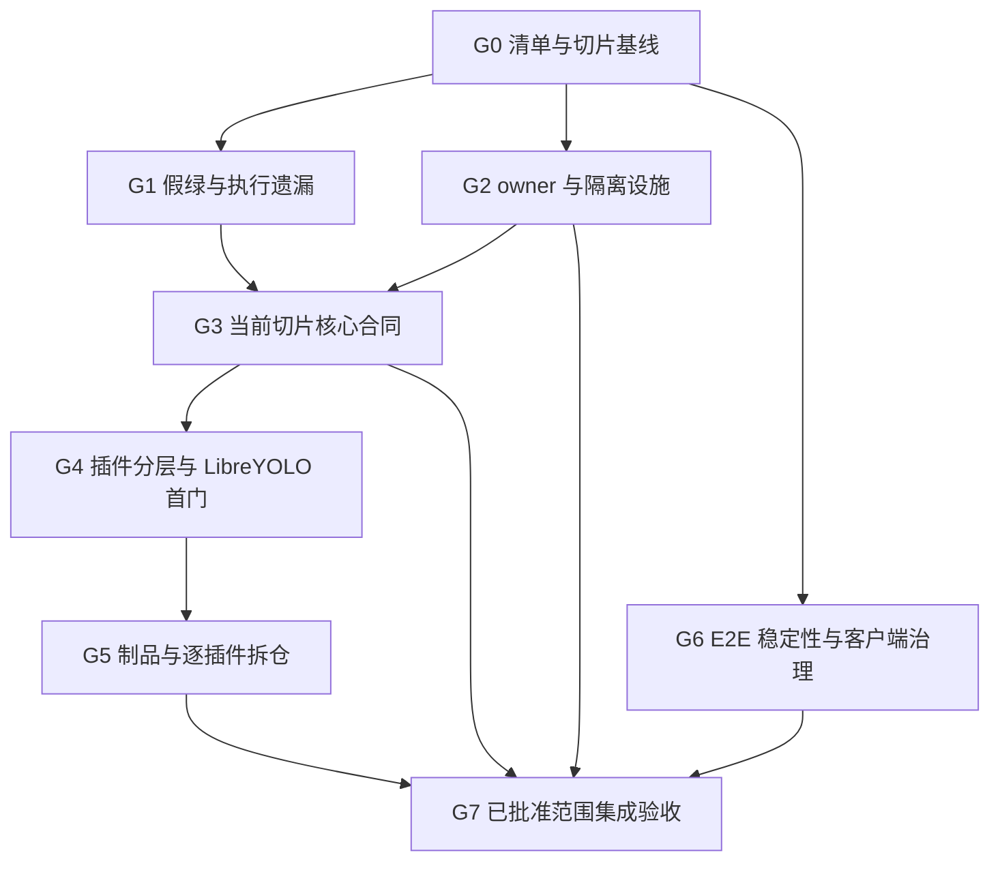

# 面向后端模组解耦与能力插件化的测试治理计划草案

> 状态：阶段 E 的本地集成验收已完成。第 16 节的阶段 F 正在实施：N4 四个切片与 N6-K 已完成各自验收；T1 默认完整资格、T2 精确清理仍未通过，N5／N6 后继及 J1／J2 门保持关闭。局部通过不等于 G2／G3／G6 或全计划完成，也不授权公开发布或生产采用。
>
> 创建日期：2026-10-29。源码参考 HEAD：`c2bb66ba2`；该标识不是工作区无未提交改动的声明。实施前按目标切片记录实际源码、契约与制品身份。
>
> 目标：让测试真正保护公开行为、数据所有权和可替换能力，并随模组与插件边界迁移；消除已证实的假绿、遗漏执行和测试设施耦合，不以测试数量、目录数量或覆盖率数字代替验收。
>
> 本计划补充既有产品计划的测试与验收工作，不替代它们，不自行取消其目标或分配发布版本。

## 1. 与现有计划的关系

### 1.1 依据与权威来源

| 来源                                                                                                                 | 本计划继承的约束                                                               | 不扩大解释的部分                                                                           |
| -------------------------------------------------------------------------------------------------------------------- | ------------------------------------------------------------------------------ | ------------------------------------------------------------------------------------------ |
| [后端业务模块解耦与跨语言替换](1792160873_backend-module-decoupling.md)                                              | 单一数据 owner、公开契约、调用方事务、最终写入授权、消费者迁移、独立工件与恢复 | 进程内端口、目录拆分或一个 Node peer 不等于整模块独立部署／替代语言实现                    |
| [模块部署与边界台账](../../docs-site/dev/concepts/module-deployment.md#剩余工作台账)                                 | 核心模块剩余工作的唯一实时台账；实现、消费者迁移、运行资格和环境采用分开       | 本计划不复制另一份模块完成状态表，也不凭局部测试关闭 Assets、Learning、Insights 或装配缺口 |
| [核心能力、插件与 App 生态研究](../research/51-plugin-capability-boundaries-and-ecosystem.md)                        | 核心掌握权威状态与最终提交；扩展提供可替换能力；按真实纵向切片推进             | 研究中的继承式替代是建议，不构成原解耦计划已退役或取消全模块目标的授权                     |
| [LibreYOLO 首切片](1793156248_libreyolo-inference-plugin.md)                                                         | 真实训练回流、原生 CUDA、人工发布、当前任务与批量、生命周期及历史身份          | CPU、ASGI、静态资格报告或仅能启动服务均不能替代完整门槛；实际单卡授权不扩成双卡验收        |
| [推理后端插件化与 YOAO-Plugins 拆仓](1793184138_inference-plugins-repository-extraction.md)                          | 六个插件单元、统一协议而非统一算法基类；契约制品先行、独立发布、完整能力保留   | 不迁走核心 Inference owner、训练执行器或存储 Agent；不提前实现前端 SDK、通用插件框架       |
| [现行测试指南](../../docs-site/dev/testing.md)与[既有测试治理记录](../research/27-repository-optimization-ledger.md) | 复用 MSW、owned seed、实际 runner、必需套件审计与已有隔离机制                  | 既有审查清单是历史快照，不是当前全部测试仍被收集的证明；不重新打开已完成的历史工作包       |

### 1.2 当前进度的解释规则

LibreYOLO 首切片的最新 Outcome 已记录真实训练、GPU 试用、人工发布、当前任务／批量及部分历史退役证据；拆仓计划较早的进度段仍保留“这些尚未完成”的描述。两者不能直接拼成一个全绿状态。

实施时以首切片最新具名证据和实际制品为准，核对 `code revision / image digest / installation / runtime profile / GPU binding / scenario`。最新 Outcome 仍列出受控重启、三种 router mode 的完整在途生命周期、失败升级恢复及最终集成检查等未闭合门槛。已记录的交互撤权后仍 dispatch 和整组检查超时按原归属保留，不为确认它们再跑一次，也不混入检测插件切片顺手修复。

本计划只记录这些事实对测试分层和证据复用的影响；产品状态继续更新原计划及唯一模块台账。后续状态改变时按影响范围更新，不要求重复已经有效的未变验收。

### 1.3 范围与非目标

**纳入：** API 与核心模组、共享契约、Python 客户端／CLI／TUI、插件 SDK／运行时、六个推理提供方、训练执行器、存储 Agent、Web 单测／E2E、运维及文档工具测试的执行归属、有效性与设施边界。

**不纳入：** 为测试治理重写产品架构；把所有模组网络化；统一全部 Python／Torch／CUDA 环境；新增消息总线、通用测试框架或第二份协议；取消现有能力；修改生产数据库；公开或推送插件仓；放宽权限、重试、超时、覆盖率或 GPU 资格标准。

发现真实产品缺陷时，保留失败证据并按对应 owner 单独处理。只有它确实阻塞当前已批准验收时才列为前置；与当前切片无关的失败不授权扩修，也不被改成 skip 以制造通过。

## 2. 问题基线与治理原则

### 2.1 已有审查证据

以下是本次讨论前一轮的实际本地审查结果，不是新一轮全仓通过声明：

| 对象                                                   | 已观察的问题或结果                                                                                                                            | 处置方向                                                         |
| ------------------------------------------------------ | --------------------------------------------------------------------------------------------------------------------------------------------- | ---------------------------------------------------------------- |
| `apps/api/tests/test_list_pagination_api_contracts.py` | 在独立进程内将 decisions／feedback 的四个 round 过滤从 `==` 反转为 `!=`，原六个作用域测试仍通过；探针未加载 API 全局 conftest，也未连接数据库 | 用不同 round 的真实数据和独立期望验证作用域、总数及分页          |
| `apps/_shared/task_contract/tests/test_tasks.py`       | 内存中把 `keypoints` 错映射到 `detect`，整个文件 36 项仍通过；期望来自同一生产映射                                                            | 固定消费者语义向量，不从被测表产生答案                           |
| 两个存储绑定恢复 Web 测试                              | AuditArchive／报告附件用例都注入 `avatar_binding_target_missing`，定向两项通过                                                                | 改用各用途真实 machine code，再合并真正相同的交互场景            |
| 模组／插件执行入口                                     | API 默认仅收集自身 `tests`，ML runner 固定八套件；Jobs、训练执行器、插件 SDK 等独立目录及部分插件测试未进入对应现有入口                       | 当前发现集与实际 runner 收集集对账，补齐持续门禁                 |
| Jobs queue client                                      | 独立运行 19 项通过，无数据库依赖                                                                                                              | 保留有价值的请求、错误、取消和边界覆盖，不因 mock transport 删除 |
| 源码／E2E／fixture 审查                                | 发现 mock 自产节点再断言、旧 SQL 文本代表当前行为、宽 POST 成功代表持久化、过期 skip、测试函数互调及全表差集清理                              | 逐项分类，不将静态发现冒充已复现产品故障                         |

上述变异没有落盘修改；未执行全量数据库、浏览器或 GPU 验收。实施者不为重复获得这些统计而重跑；修正后需要证明同类错误确实使新回归失败。

### 2.2 每条测试必须回答的问题

1. **谁的合同？** 指定核心 owner、公开协议、客户端或插件能力，不用“后端测试”作为全部归属。
2. **失败保护什么？** 指向错误授权、错误状态、数据丢失、错误结果、资源泄漏、消费者不兼容等具体风险。
3. **答案从哪里来？** 固定业务例、已核验历史响应、独立参考实现或实际持久状态；不能只是被测常量、mock 返回值或当前实现的重新序列化。
4. **实际运行哪一层？** 纯函数、同事务 ASGI、真实 PostgreSQL、独立 HTTP、原生模型、GPU 或真实浏览器，明确替身所在边界。
5. **何时执行？** 可复现本地命令、CI／验收入口和必要资源；“文件存在”不算已接线。
6. **何时可删？** 合同已退役，或同一风险已有更准确且实际执行的替代覆盖；不是代码搬迁后补丁路径失效就删除。

### 2.3 用例处置类别

- `KEEP`：有独立行为价值，明确层级和入口。
- `REWRITE`：保留风险目标，替换自证、弱断言或错误边界。
- `MOVE`：随 owner／制品迁移，旧路径调用方同步迁移，不保留 re-export。
- `MERGE`：合并同层同边界同风险的重复场景；保留不同用途、权限、错误或运行方式的差异。
- `DELETE`：过期合同、无独立价值的实现形式断言、已有更强覆盖的重复用例。

对删除和合并记录原 case、风险、替代 case／退役依据及实际验证。不要为每条正常测试强行建人工台账；重点登记被修改／删除的案例和未解决缺口。新用例只保护可见行为、边界、错误或状态转换，不增加文件存在、原样转发、mock 回声和源码拼写测试。

## 3. 目标测试结构与所有权

### 3.1 分层按证明范围，而不是按工具命名

| 层级                   | 唯一职责                                                                  | 推荐位置／现有起点                                        | 不足以证明                         |
| ---------------------- | ------------------------------------------------------------------------- | --------------------------------------------------------- | ---------------------------------- |
| 规则单元               | 归一化、几何、状态转移、纯策略和边界                                      | owner 包的 `tests`；Web 源码旁测试                        | HTTP 装配、数据库事务、真实模型    |
| 公开契约一致性         | wire 字段、缺失与 null、标识符、数值、错误、排序／游标、历史向量          | 现有共享契约包与各模组 `conformance`                      | 安装、运行凭据、并发执行资格       |
| owner 持久化／运行集成 | 真实数据库能力、权限、锁、同事务提交／回滚、独立服务适配                  | owner 的集成测试；涉及统一迁移链和 API 组合的测试仍留平台 | 全链路产品操作或另一语言完整提供方 |
| 应用组合／消费者       | HTTP／WebSocket／worker／CLI 调用实际 owner，最终授权、错误映射及跨域结果 | `apps/api/tests` 按领域与执行依赖逐片组织                 | 插件真实权重、GPU 或浏览器像素     |
| 插件原生／制品         | 原生模型、运行依赖、实际池／session、wheel／镜像与 HTTP                   | 当前 backend／plugin 测试，未来随唯一源码迁仓             | 平台授权、人工发布、最终落库资格   |
| 业务验收／硬件资格     | 真实安装到项目使用、GPU 生命周期、重启／恢复、浏览器交互                  | 复用现有验收脚本和 `apps/web/e2e`                         | 其他硬件、未执行的能力或生产容量   |
| 架构与工具门禁         | 禁止私有依赖、工件一致性、runner 选择／失败传播、运维安全                 | 现有 AST 守卫、脚本及文档工具测试                         | 上述业务运行结果                   |

### 3.2 目录和 fixture 收敛

1. 各 owner 保留自己的测试，只有存在相应运行需求时才增加 `unit/contract/integration` 子目录；不生成空目录模板。
2. API 纯规则随实际 owner 下沉；API 保留协议适配、跨 owner 组合和集成。尚未提取的 Learning／Insights 继续在现有位置测试，不为目录整齐虚构独立包。
3. API 的 DB、ASGI 和运行环境 fixture 随相应集成子树收敛。顶层 conftest 仅保留必要收集规则及安全护栏；纯规则不隐式导入整个应用或依赖 Redis。移动时验证 pytest 实际 fixture 解析，不直接删除全局安全检查。
4. 保留 `factory.py`、现有 owned seed、`storage_migration_isolation.py` 等已有设施。将 `test_*` 间共享场景迁到邻近 support 模块，显式传入所需 fixture／客户端；不调用另一个可收集测试函数，不依赖其模块 autouse 副作用。
5. 区分“借用同一事务的 ASGI 客户端”和“真实 get_db／独立连接／冷进程客户端”。前者继续用于快速业务检查，后者验证独立提交、异常退出、最终回滚和生产错误映射；不把全局 monkeypatch 当作生产拓扑。
6. Web 保留源码旁测试、现有 `src/test` 与 E2E 分工；不为统一 `__tests__` 外观批量搬迁。页面测试复用 MSW 与 providers；真实 Canvas／WebGL／WebGPU 和布局仍由相应浏览器验证负责。
7. 不运行仓库根的一次 pytest 来混合所有后端。存在同名模块、不同 Python／Torch 版本及 `sys.modules` 桩时，继续使用独立解释器／环境。

### 3.3 跨仓后的唯一归属

| 内容                                                                                                   | 源码／规则归属             | 测试归属与消费者                                                               |
| ------------------------------------------------------------------------------------------------------ | -------------------------- | ------------------------------------------------------------------------------ |
| Identity、Workspace、Assets、Labeling、Learning、Jobs、Audit、Notifications、Insights 与核心 Inference | 平台仓                     | owner 行为、真实消费者、权限与事务留平台；不随模型服务迁出                     |
| wire schema、任务身份、训练产物、manifest、生命周期证明 schema 与权威纯校验                            | 平台维护的便携契约包       | 发布受审正反例和兼容向量；平台与插件消费同一版本，不各写一套规范               |
| 模型池、检测 SDK、算法侧运行时、证据采集、Mask 工具、原生 loader                                       | 独立 Plugin-SDK 仓库       | 单元／原生／打包测试随实现迁移；平台不依赖某个插件来决定资格                   |
| 六个算法插件与特定模型资产流程                                                                         | YOAO-Plugins 各插件        | 原生输出、完整能力目录、模型／设备／session 与制品测试；权重独立管理许可与摘要 |
| 管理员 SDK／CLI／TUI                                                                                   | 平台 `packages/python-sdk` | 公共 API、确认／退出码、安装操作和发行物测试；不引入 Torch 为运行依赖          |
| 宿主安装、批准、项目启用、模型发布、最终写入和退役                                                     | 平台 owner／应用组合       | 使用实际插件制品的双端业务验收；插件不得自行批准自己的报告                     |

当前 `aap_backend_runtime.lifecycle_evidence` 同时被算法侧和宿主消费。迁移前先沿既有公共契约承接纯 schema／校验规则，再迁算法侧采集与运行代码；不让平台通过安装整个模型运行时获得权威校验器，也不复制第二份规则。

统一 schema 真值与独立测试答案并不冲突：字段类型由唯一 schema 生成／校验；“keypoints 必须表示 pose”“缺失全池清理证明必须拒绝”等语义由经审阅的固定向量保护，不能从当前实现动态推导。

### 3.4 E2E 的首要目标：抵抗内部重构，而不是跟着源码改答案

用户已明确指出，当前 PR 经常需要随源码修改 E2E。这应作为本轮治理的核心问题，而不是普通维护成本。**业务行为和公开契约不变时，已有 E2E 场景与业务期望应保持不变；仅内部重构不应要求重新定义成功。** 这不禁止为新增风险补测试，也不禁止在真正改变交互入口时调整操作适配。

#### 已核对的典型模式

| 现有对象                                                                                             | 静态观察                                                                                              | 治理决定                                                                                                      |
| ---------------------------------------------------------------------------------------------------- | ----------------------------------------------------------------------------------------------------- | ------------------------------------------------------------------------------------------------------------- |
| [Mask 编辑 E2E](../../apps/web/e2e/tests/mask-editor.spec.ts)                                        | 场景内理解内部 hover 容器、Radix 对话框实例与画布重渲染时机；选择首个候选；最终仅要求宽范围 POST 成功 | 固定目标 task／prediction；将必要 UI 操作收敛到窄 helper；业务断言提升为类型、lineage、内容、持久化及刷新恢复 |
| [Mask Worker 用例](../../apps/web/e2e/tests/mask-advanced-operations.spec.ts)中的“1080p 实际 Worker” | 直接导入 `/src/...`，调用 compute 函数、注入故障 Worker；已标明开发服务限制                           | 保留真实 Worker／取消／输入不变的价值，归入浏览器运行时集成，不作为产品黑盒或构建制品通过证据                 |
| [原生 Mask 创建与重编辑](../../apps/web/e2e/tests/raster-mask-native.spec.ts)                        | 按确切 task 等待写入，读取持久内容，刷新再编辑、再次读取                                              | 复用其业务证据方向；仍需逐项处理定位与等待，不因这个场景较强就把整个文件认定为完全稳定                        |
| `e2e/helpers/workbench-layout-matrix.ts`                                                             | 同时包含语义布局操作、Dockview DOM 解析和画布／WebGL context 身份检查                                 | 分清产品布局恢复与渲染生命周期专项；必要厂商 DOM 适配集中维护，不能把防止画布重建的有效约束一并删掉           |

上述检查没有新运行浏览器，不据源码推断具体 flaky 率，也不推断每一次历史 PR 修改都是错误修测。

#### 三类浏览器测试明确分工

- **产品 E2E**：从用户操作进入真实构建产物，经过实际服务，验证公开可见结果与持久状态。优先保留创建／编辑／保存／重载、审核、权限拒绝、关键失败恢复、插件试用／发布／使用等纵向业务切片；参数排列和局部组件分支下沉。
- **浏览器集成**：Worker、Canvas API、路由延迟／故障和页面状态组合等需要真实浏览器但不构成完整业务链的检查。允许明确的受控替身或直接模块入口，报告其边界；需要真实 Worker 的用例不能为减少 E2E 数量降为 jsdom 假 Worker。源码入口与 build 入口在现有 runner 中分开登记，不混算制品通过。
- **视觉／性能／渲染资格**：布局像素、单 renderer／context、资源预算、设备丢失与实际 GPU 路径。只读探针可以证明这些专项约束，但不代替保存、发布或用户可见结果；相关浏览器／设备和 artifact 要求保持。

#### 保持业务场景稳定，集中少量 UI 适配

1. 复用现有 `e2e/fixtures` 与 `e2e/helpers`，按操作概念保留窄 helper，例如打开指定标注的 Mask 编辑、确认指定转换、读取指定任务的已存标注；不引入覆盖所有页面的继承式 Page Object 框架。
2. 业务用例描述角色、明确资源、用户动作和独立期望；组件如何拆分、按钮放在哪个容器中、Dockview 内部类名如何变化，应只影响相关操作适配，而非重写整组业务结果。
3. 定位优先使用有作用域的 role／label／accessible name；Canvas、无可访问名称的稳定操作边界可使用语义 test id。test id 表达任务、标注和操作，不编码组件名、CSS 或 DOM 层级；新增可访问语义优先服务真实用户，不专门暴露可变内部对象。
4. 资源按 seed 返回的确切身份或唯一业务名称定位，先确认唯一性；不以 `.first()`／`.nth()` 隐藏错误候选或重复控件。表格第几列、真实层叠画布等有明确结构合同的使用可以保留在对应专项适配，不做全仓机械替换。
5. helper 不能同时支持一串新旧 selector、吞掉失败、强制点击遮挡控件、修改 store 代替用户动作，或补写后端把失败操作变成成功。每个 helper 只执行当前合法流程，业务断言仍在场景中可审查。
6. 数据与身份可以用受控 API／owned seed 准备，沿现有 `seed.injectToken` 集中封装非 auth 场景登录状态；不要求每条标注用例重复 UI 登录。真实登录、续期和撤权由独立场景验证；准备 fixture 不能注入本用例要证明的最终结果。
7. 公共 DTO／schema 的类型引用与规范版本不等于错误耦合。遵守现有单一 schema 来源；应移除的是运行时依赖私有实现来完成被测动作或生成 expected，不是机械禁止一切 `src` 字符串。

#### 观察结果而非内部实现步骤

- 保存成功必须对应指定资源及其公开合同：持久字段／版本／几何与 lineage 正确，必要时刷新重新进入仍一致。Toast、某个请求 2xx 或“调用了一次函数”只是中间证据，不是最终成功。
- 同一 API 和交互合同下，后端 owner 迁移、内部 HTTP／Native 绑定或插件实现替换，不改变产品 E2E 的期望。提供方专属算法、权重、设备和错误矩阵由插件契约／原生层承担；选择 fixture 或部署目标可参数化，不能从当前 `/setup` 输出推导正确答案。
- 不把“请求总次数、DOM 子节点顺序、生成 id、工具栏内部组合”固定成产品合同。若次数体现重复提交或节点身份体现不得重建 renderer，则在对应具名专项保留，说明消费者风险。
- 等待可操作状态、指定请求完成、持久查询收敛或实际画面就绪；不用 `networkidle`、任意 sleep、扩大 timeout 代替已知完成信号。确实验证“一个时间窗口内没有保存／重试”等负向时间合同可保留有依据的窗口，不一刀切删掉所有时间等待。
- 对话框按固定 fixture 的预期决策和业务身份处理；不能用短暂等待加 catch，把应出现的警告／确认当成可有可无。几何／像素 expected 来自可解释样本及独立结果，不重新调用被测几何实现生成答案。

## 4. 核心模组的契约与运行验收

### 4.1 不变量矩阵

| 所有者／边界         | 必须保留的检查                                                                | 实际观察点                                                               |
| -------------------- | ----------------------------------------------------------------------------- | ------------------------------------------------------------------------ |
| Identity／Workspace  | 账号与凭据撤销、项目成员／角色变化、资源关系和最终写入串行化                  | 真实允许／拒绝、持久副作用；不是只看入口 403 或鉴权 mock 调用            |
| Assets               | 原件／内容身份、授权读、版本、来源保留、输入发布、删除拒绝                    | 实际对象版本与字节、owner 记录、拒绝后数据不变；不得猜旧物理键           |
| Labeling             | task／batch／annotation 版本、锁、审核证据、候选 lineage、Mask 与视频结果提交 | 真实同事务状态及回滚、人工修改后迟到结果拒绝、像素／帧身份               |
| Inference            | manifest 许可与现场能力匹配、精确实例路由、冻结模型、准入、未知结果           | 实际目标实例／执行身份、禁止换模型／换设备回退、错误传播及结算           |
| Learning             | 冻结数据、run／attempt、产物摘要、部署试用、人工发布及旧引用                  | 不可变来源／类别／收据，发布前后行为；executor 成功不等于完整 owner 闭合 |
| Jobs                 | 稳定 job／execution ID、重复／丢响应、取消请求与真实停止、部分结果            | 持久账本、真实消息和领域终态；不将全部失败压成统一 cancelled             |
| Audit／Notifications | caller 事务、审计不可变、接收者权限、提交后发布与恢复                         | 真实回滚和发布顺序；无提前通知或错误接收者                               |
| Insights             | 跨 owner 范围、排序／分页、总数、新鲜度及保存视图写入                         | 多主体、多项目／round 的真实数据；不能以 page/count 互相作答案           |
| Runtime assembly     | 冷 API／worker／CLI、最小凭据、工件、迁移及恢复                               | 真正进程和受限角色；拒绝源码挂载、宽角色或私表回退造成的假独立           |

这不是要求每个 helper 都覆盖全矩阵。每个交付切片选择它实际触及的列，未触及的缺口继续留原台账。

### 4.2 Native／SQL、历史向量与源码断言的不同待遇

依据 [Native 数据能力协议](../../docs-site/api/guides/module-data.md) 和原解耦计划，保留以下有效证明：

- 发布包与迁移工件的 ABI／schema／函数体一致性，防止安装到不同实现；必须同时有行为检查，不能将“两个副本相等”当业务真值。
- 借用调用方事务、公开更新字段 mask、autoflush／触发器／锁顺序中确实影响行为的约束；它们不自动是内部实现细节。
- 有来源 commit／摘要的历史公开响应和冻结身份。不得用当前实现重新生成 expected，也不得删除仍受支持的历史数据读取。
- 实际受限 LOGIN、私表／列／序列／helper／角色提升拒绝、默认权限和分区权限；先迁真实消费者再撤销暂留权限。
- 真实旧数据升级、失败保持、dump／restore、必要回滚和重装；不以空库 upgrade 或直接 stamp 冒充。

替换仅搜索 SQL 字符串、注释、函数名、局部 AST 形状的行为测试。例如旧 `0193` 源码不能证明后来 `CREATE OR REPLACE` 的当前函数行为。迁移到 head 上的真实操作与失败／回滚断言后，删除失去独立价值的文字断言。

复用 `test_domain_package_architecture.py` 及其合成违规样本做依赖守卫；复用 `scripts/verify_module_data_boundary.py` 和 `aap_owner_data.verify_function_only_role` 做受限运行验证，不新建通用 Native 测试框架。

### 4.3 跨语言与证据完整性

沿用 Workspace／Jobs／Audit／Notifications 的 `conformance/node` 及现有 Identity peer；覆盖公开字段、UUID、缺失与 null、时间精度、超出安全整数的十进制字符串、错误、排序和事务结果。

同一固定向量分别作用于真实提供方和消费者。Node 自己回显、两端共享同一错误实现、单操作 peer 成功均不等于整模块语言替换。完整替代提供方仍按原计划独立选择、切换和验收。

当前模块验收器已核对选定 target、实际 collection 与 JUnit case，多余／缺失 case、skip、setup 失败、提前中断和旧报告不能变成完整通过。下一步是取得当前所选资格的完整运行证据，而不是再创建结果框架；只为选定范围定义 required，不把历史所有场景永久塞进每次定向验收。

### 4.4 隔离与清理

- 沿现有 worktree test／e2e mode 验证数据库、桶、Redis、端口和 worker 归属；日常库不可用作测试库。
- 同事务 fixture 保留 rollback；独立提交测试采用已证明的私有 schema、独立数据库或精确创建资源登记，按实际约束选择，不强推一种方案。
- 替换全表前后差集清理，并验证既有 ID 登记的事务边界；`raster_mask_isolation.py` 已采用准确 ID，需检验回滚与实际提交结果，而不是再次迁移差集。记录准确 ID、对象版本、命名空间、角色／进程和清理责任，不能把时间窗口内别人的新增数据当成自己的。
- 在启用同库并行前，实际交错两个测试的提交和清理，证明邻居及预存数据不受影响；失败／取消后的资源也可核对。没有此证据时保持已有串行或每 worker 独立资源策略，不先打开 xdist。
- 测试设置、受限执行角色与清理角色分开；设置方可以使用已授权的测试 owner，但被测请求不能借此获得宽权限。

## 5. 插件资格与可移植分发

### 5.1 六个能力单元，不能只剩检测通用测套

| 插件             | 需要独立保留的能力与回归                                                                                   | 资源／状态证据                                                            |
| ---------------- | ---------------------------------------------------------------------------------------------------------- | ------------------------------------------------------------------------- |
| LibreYOLO        | 原生 YOLOv9 t/s/m/c；多目标／空结果；受控权重、类别、尺寸、CPU 历史与 CUDA runtime；t 的真实训练到项目使用 | 当前授权单卡上的真实 CUDA、借用、排空、重启、安装／升级恢复和精确实例路由 |
| Ultralytics YOLO | 检测、分割、姿态、OBB、开放词表、exemplar、tracker；受控检测／分割与既有评估                               | 全部池、原图 RLE、模型身份；不能用 LibreYOLO bbox 用例替代                |
| RapidOCR         | det／rec／e2e、合法组合、阈值隔离、文字／方向／语言 schema 与真实输出                                      | 全部实际 det／cls／rec sessions 的 provider、借用和释放                   |
| ONNXTools        | 检测、crop 分类、composite、车型／颜色枚举                                                                 | 三句柄及最多四个业务 sessions；真实上游依赖与获准权重                     |
| Grounded-SAM2    | 文本／点／框／Mask／涂抹、多候选、批量框、跨窗视频与精确 Mask                                              | image／video 双池、embedding、对象／源帧、session 与取消                  |
| SAM3             | 文本／交互／exemplar、multiplex 与 PVS 两类视频合同                                                        | GPU-only；image／multiplex／PVS 三池和有状态会话，不制造 CPU 模型成功     |

CPU、原生依赖、真实权重、真实网络和 GPU 是不同证明维度。CPU job 可以验证 SAM3 的纯协议，但不能声称跑过其原生模型；ORT provider 列表不能代替实际 session 运行／释放；ASGI 原生执行也不能代替 TCP、安装器与平台仲裁。

### 5.2 公共负例与资格信任

1. 独立固定任务别名、模型身份、必要资格义务等语义向量。对必需证明项逐项缺失／false、池遗漏、设备／安装／摘要篡改和过期执行建立拒绝例，不能继续从 `REQUIRED_CONTRACT_CHECKS` 自动产生全部答案。
2. 在各实际 app 上验证缺失／错误凭据和正确凭据，不仅测试新建 FastAPI 上的 auth middleware。业务用例可使用显式认证 helper；真实应用认证用例不得被 autouse 自动补头。
3. manifest 是许可意图，`/setup` 是现场声明，资格报告是待核对证据；三者及实际部署身份一致才可准入。插件自报 `passed` 不得直接授予权限。
4. 小检测接口继续保留；OCR／交互／视频按现有完整 HTTP 协议验证，不强迫继承检测类或新增万能输出 JSON。
5. 修正 RapidOCR schema 的空迭代：分别验证 REC 与 E2E 必需字段及其输出语义，不能以“遍历现有字段均合法”代表必需字段存在。
6. 纯 CPU 环境的受控缺依赖 skip 记录适用范围；相应原生／发布门必须安装部署 pin 与提供授权资产，缺项应阻断该门，不退回 shim。已安装包的传递导入错误不能被宽泛 ImportError 当作“目标包未安装”。

### 5.3 复用现有工具，限定结论

- `aap-plugin init/prepare-assets/dev/check/build`：当前检测开发路径；`check` 的真实 HTTP 正反例可复用，不宣称已覆盖 OCR、交互和视频。
- `check --qualify-local`、`aap-libreyolo probe`：本地显式独占设备的模型／生命周期诊断；不颁发平台托管资格。
- `aap-libreyolo-evidence`、各 backend 的 `validate_managed_lifecycle.py`：复用证据采集和故障场景；标明哪些经过 ASGI、哪些经过真实网络。
- `apps/api/scripts/validate_gpu_arbitration.py`：平台仲裁与资源实际操作；必须使用已获准隔离环境和明确 run 身份。
- 现有 `live_provider_guard`、worktree 隔离与 worker 刷新流程：验证实际服务、镜像、挂载与凭据，不凭源码文件推断运行版本。

本计划不新增一套同时调度所有语言、数据库、模型与浏览器的测试平台；需要的新用例放进现有 owner runner。

### 5.4 LibreYOLO 首门与后续插件门

首门沿原计划完整要求：至少 t 的真实训练 checkpoint → GPU 受控安装／固定样本试用 → 浏览器人工发布 → 当前任务、批量及适用裁剪路径；t/s/m/c 的原生输出与实际 CUDA 对照仍保留。

同一制品与安装资格需要覆盖三种 router mode 的在途停用、受控重启、新 boot 绑定、失败升级恢复、精确实例禁止回退、未认证／资源许可拒绝、取消后实际计算未退出时不得提前释放。历史 CPU 收据和旧排队引用不改写；已退役实例不为测试方便重新恢复成活跃源码旁路。

沿现有标准核验两轮冷加载／释放：卸载基线波动不超过 64 MiB、工作集回收至少 90%，Torch allocated／reserved 最终为零；ORT 等非 Torch 插件同时证明自己的实际 sessions 释放。数值容差及性能预算沿相关原计划／改前样本，不任意新设或放宽。

GPU 仅使用授权的独占设备；当前首切片只验单卡，不接管主环境 GPU，也不把单卡同卡竞争称为跨卡隔离。硬件或许可不可用则该资格保持未验证，不能以 skip／CPU 成功关闭。

### 5.5 跨仓与发行物门

在首次实际拆仓前完成：

1. 便携契约有可实际获取、带版本和 SHA256 的 wheel／schema／一致性夹具；插件消费制品，不引用另一个 checkout。
2. 新仓干净检出，分别构建 SDK、运行时和目标插件 wheel／sdist／镜像，验证没有跨仓 editable、平台私包、ORM、Celery 或模型无关的重依赖泄漏。
3. 在仓库外安装制品并运行承诺支持的测试／开发者路径；检查实际归档包含所需 JSON／schema／模板／许可证。不能仅依据 MANIFEST 或 SOURCES.txt 推断打包成功。
4. Python 客户端 SDK 的仓内 OpenAPI／文档测试与可移植发行物测试分开标记；仓内缺 snapshot 仍失败，不能通过通用“文件不存在就 skip”掩盖遗漏。
5. 干净环境真实开发、HTTP 检查、构建和平台安装均可完成；基础镜像 apt 仍联网时不宣称整个构建离线。
6. 新制品 digest 的托管资格与实际平台闭环重新核对，旧镜像报告不能改名复用。未变纯规则证据可按影响范围复用。
7. 切换测试源码、CI、依赖、Compose 和文档后删除旧活跃实现及旧运行入口。保留历史向量／冻结记录与获准历史制品，不保留双维护源码、跨仓 re-export 或运行时回退。

每个插件独立版本、锁文件和运行环境。公共契约变更要验证受支持消费者组合；不要求六个插件同步升级，也不通过取消旧受支持组合让新制品通过。

## 6. 执行入口、CI 与证据模型

### 6.1 最小套件清单，而非第二个测试框架

现有 `scripts/test-suites.json` 按真实执行入口组织清单，不是第二个测试框架：

- `ml_cpu`：记录 `id / owner / paths / python / resources / skip_policy`。
- `owner_contracts`：记录独立包 `directory / options` 及所需 `system_packages`。
- `other_test_roots`：记录 `paths / owner / selection_source / resources / skip_policy`，指向现有 job，而不复制其执行逻辑。
- 真实 collection、命令及结果工件由对应 runner／验收器记录；不把尚未存在的统一字段或万能执行器描述为已交付接口。

E2E 的详细路径选择继续由 `plan-e2e-suites.mjs` 维护，清单只引用其套件，不复制另一份选择规则。ML/shared 选择若迁入清单，则删除 runner 与 planner 的重复列表，由它们消费同一数据；不能新增第三份手工清单。历史 research TSV 保持历史，不被改写成实时配置。

发现侧覆盖 Python、Node、Vitest、Playwright 和独立脚本，区分可执行测试、fixture、vendor、生成物与历史证据。文件发现和真实 collection 双向对账；参数化 case 按当前 runner 收集，不手抄总数。一个 case 可以在多个环境运行，但必须标明原因，不能因计数重复误判为多份独立覆盖。

### 6.2 门禁安排

| 门禁                 | 主要执行范围                                               | 缺失／skip 处理                                                 |
| -------------------- | ---------------------------------------------------------- | --------------------------------------------------------------- |
| PR 快速规则与契约    | 所有受影响 owner、共享契约、SDK、脚本及 Web 单元／页面集成 | 未映射路径和新测试目录不能静默跳过；保守扩大范围                |
| PR 数据与消费者集成  | 受影响 API／模块、迁移、真实角色／事务与代表性消费者       | 已选中场景的失败、setup error、取消、未执行均失败               |
| 原生依赖／模型资格   | 部署 pin、真实权重、HTTP 和各 provider 特有行为            | 缺依赖或授权资产阻断对应资格；普通 CPU job 的 skip 不继承为通过 |
| GPU／生命周期        | 目标制品、实际设备、全部池／session、故障恢复和平台仲裁    | 只在授权资源上运行；缺硬件保持待验，不降低为 CPU                |
| 拆仓／制品切换       | 非 editable 安装、跨仓契约组合、真实安装和业务闭环         | 旧源码／旧镜像结果不能替代新制品                                |
| 主分支／定时完整检查 | 全部已登记的适用非硬件套件及既有 E2E 全量策略              | 不能用 PR 路径裁剪代替全量入口；硬件资格仍明确单列              |

先补现有入口遗漏，再优化选择。共享契约、运行装配、锁文件、runner、重命名／删除及未知路径采用保守策略。插件仓改动除自身测试外，还需将候选制品与兼容组合交给平台集成验证；不为取证自动公开私有仓或暴露密钥。

复用现有 E2E required-suite 审计和后端分片聚合的 fail-closed 语义；为模块／插件补足等价结果核对，但不把所有 runner 改写成 Playwright 报告格式。普通合并检查可在适用范围通过，GPU／发布资格必须有独立显式状态，不能被普通绿灯覆盖。

### 6.3 证据与覆盖率

每次集中验收至少记录：源码／制品与契约身份、命令和选定范围、实际收集与通过／失败／skip／not-run、所需环境归属、关键业务状态或产物、原始报告路径、复用依据及限制。GPU 额外记录实际设备、runtime、池／session 和采样条件。证据去除秘密，不提交模型权重、用户数据、数据库备份或个人 Token。

覆盖率按实际源码 owner 计量。当前 API `source=["app"]` 与 Codecov backend 路径不会自动包含移出的模组，需同步收集和路径映射；保持迁移前后相同逻辑源码的可比范围，再设置分域基线。不得借搬目录、扩大 exclude、carryforward 或降低阈值制造提升。现有 Web 阈值和 E2E 重试／超时策略不调整。

核心质量指标是：套件是否遗漏、关键风险是否有有效回归、所选验收是否完整执行、正常改内部实现是否引起无谓失败，以及本地／CI 成本。删除多少测试、文件变小多少、总用例增加多少均不作为完成目标。耗时与性能只比较同场景测量，不预设无来源的提速比例。

### 6.4 PR 中修改 E2E 的审查规则

不是要求“产品代码和测试不能同一个 PR 修改”，而是要求测试不能随错误实现一起改变答案。使用现有 PR 说明记录原因，不新增自动猜测业务语义的门禁或另一份审批系统：

| 变更类型                           | E2E 默认处理                                 | 必需说明／证据                                                             |
| ---------------------------------- | -------------------------------------------- | -------------------------------------------------------------------------- |
| 内部重构、owner 下沉、内部调用替换 | 旧业务场景与 expected 不改；允许补新风险回归 | 同一用户合同下原场景实际通过；若必须改测试，解释暴露的私有依赖及其移除方式 |
| 布局／控件位置变化，业务语义未变   | 只调整必要的操作定位／helper，不改变最终结果 | 用户仍可完成原操作；不能依赖强制点击或多 selector 回退                     |
| 明确批准的产品行为／公开协议改变   | 更新受影响场景与期望                         | 新旧合同、需求依据、错误／历史兼容的处置；不以“源码现在如此”为理由         |
| 修复已有缺陷                       | 默认保留正确旧期望，补缺失边界               | 新回归在旧错误行为下失败、修复后通过；不能将错误结果重新录成 golden        |
| fixture／依赖／环境或时序问题      | 修设施或明确同步，不放宽业务断言             | trace／请求／实际状态指出失败层；资源、构建及服务版本可核对                |

涉及删除断言、放宽匹配、增加 skip／retry／timeout 或更新视觉基线时，必须说明原断言保护什么、为何不再适用及替代证据。确实无意义的原断言按本计划删除，不为了“测试绝不改”继续保留；新的断言也不能更弱。

G6 以小批次先完成测试边界和操作适配，再用于真实产品重构；不要在一个大型 PR 中同时改业务合同、重新生成全部夹具并重写全部 expected，使回归失去独立参照。必要的同 PR 变更保留可审阅的分组差异和先失败后通过证据，不强制机械拆成多个 PR。

从现有 PR／报告记录必要的样本：是否改变业务合同、修改的是场景／期望／适配／设施、首跑失败原因及真实通过状态。用这些样本判断“纯重构触发测试重写”是否减少，而不是规定测试改动行数上限、禁止新增测试或只看重跑后成功率。

## 7. 分阶段实施包

以下 G 编号属于本测试治理计划，不是原产品计划 A–F 的重命名。每个阶段包含可独立验收的结果，不要求每个 helper 改动都启动完整环境。

### G0：当前清单、风险与切片基线

**输入：** 本计划及现行源码、runner、唯一模块台账、两份插件计划。

**工作：**

- 生成当前文件发现与实际收集对照，覆盖核心模组、共享包、SDK、六 provider、执行器／Agent、Web、脚本和文档工具。
- 确认 orphan、重复执行、条件跳过、collection error 和仅有手动入口的套件，不把未执行写成通过。
- 对当前交付切片列风险 → owner → 具名测试／实际验收 → 运行入口的映射，校正旧清单与较早插件进度描述的适用范围。
- 固定变更前可比较的源文件／契约／工件范围和主要耗时来源；复用前一轮已证实的两个变异结果。
- E2E 单独区分产品场景、浏览器集成和渲染专项；按已反馈的频繁修测问题，优先盘点私有状态依赖、场景内 selector、弱成功断言与测试修改理由，不将其仅归为 flaky 调参。

**交付：** 当前执行归属清单设计、候选处置表、必需场景集合及明确未覆盖项。

**退出门：** 新发现的测试目录均有责任和执行去向；没有靠人工历史总数证明 collection 完整；不要求先逐条审完全仓才能进入 G1。

### G1：优先修复假绿与执行遗漏

**依赖：** G0 中对应套件已确认。

**具体目标：**

- 重写 round 分页作用域和任务别名期望；修正两处存储绑定错误码。
- 为生命周期证明建立独立正反例，补必需项缺失、false、池和身份错配；保留控制流 mock，但取消其“硬件资格”含义。
- 补核心模组／契约／插件 SDK／剩余 LibreYOLO／执行器／Agent／脚本入口及触发路径，区分最小依赖和原生依赖，不全部塞进 API venv。
- 对验收器选定场景和报告做完整性核对，不能只有一个通过案例就结束。

**主要修改面：** 相关测试、现有 pyproject／package 脚本、`run-ml-cpu-tests.sh`、`plan-e2e-suites.mjs`、`ci.yml`／`backend-test.yml`／`ml-cpu-test.yml` 与现有证据审计入口。

**退出门：** 原先两个错误变体现在必然失败、正常实现通过；错误码测试覆盖真实用途；遗漏套件实际运行并产生报告；选定场景缺失／skip 不再误报通过。新接线暴露的既有失败单列，不删除或豁免以强行绿灯。

### G2：owner 测试归属与设施隔离

**依赖：** G0；各子域可独立推进，不依赖整个 G1 全仓完成。

**具体目标：**

- 先以 Jobs／Identity／Workspace 等已有独立包作样板，迁移纯规则与公开契约测试；API 留消费者组合。
- 从 `test_identity_e2e_native.py`、`test_workspace_e2e_native.py`、Workspace 兼容重放和 SDK 测试间导入抽出窄场景 helper，显式绑定原 autouse 前置。
- 将 DB／HTTP／运行 fixture 按使用域收敛；保持 test DB 守卫、rate limiter 等有作用的隔离，不机械删除。
- 替换全表差集资源清理；验证并发邻居、失败退出、原有数据和对象版本。
- 移动文件时同步测试导入、pytest 配置、架构门禁、runner、覆盖率路径和文档链接。按现有文件 hash 分片算法重新核对完整选集，不改变分片算法掩盖移动。

**退出门：** 选定 owner 可独立运行；纯测试无需基础服务；同事务和真实进程证据明确分开；迁移前后需保留的 case／风险均有映射；无旧别名或测试函数互调；清理不影响邻居。只有通过隔离门的范围才允许扩大并行。

### G3：核心公开合同、Native 与跨语言验收收口

**依赖：** 当前切片所需 G1 和 G2，不等待所有模块目录迁移。

**具体目标：**

- 按第 4 节保留真正协议／安装／恢复证明，替换 SQL 文字和私有名称自证。
- 用当前 head 的真实数据库、公开 owner 操作和受限角色验证行为；继续使用同一调用方事务，不为可测试性改成 RPC 或独立 commit。
- 复用现有 Node peers、冷 API／worker／CLI 和 restore 场景，区分单命令跨语言与完整提供方替换。
- 对 Assets／Learning／Insights 尚未完成的路径标明当前 owner 和验收缺口，在其产品切片迁移消费者时一起迁测试，不提前撤权或宣布完成。

**退出门：** 当前交付合同的成功、拒绝、并发／回滚、真实消费者及适用恢复均有完整证据；删掉的文字／重复用例已有更准确替代；旧公开向量和有效历史工件未改写；没有新私表访问或宽权限。

### G4：插件分层验收与 LibreYOLO 首门

**依赖：** G1，以及首切片实际触及的 G2／G3；不等待全后端独立部署。

**具体目标：**

- 按第 5 节分开纯契约、原生依赖、实际 HTTP、GPU／平台治理；实际 app 认证负例不被全局补头。
- 将资格纯校验和算法侧采集的测试归属划清，提供可移植且独立的契约向量。
- 跟随 LibreYOLO 当前实施补齐剩余生命周期场景，沿原制品／安装身份解释既有证据；不重做未变训练或恢复已退役分支。
- 建立六 provider 的能力验收矩阵；先实现当前检测切片必需的检查，再随复杂后端迁移增加其真实场景，不交空的“全能 conformance”占位。

**退出门：** LibreYOLO 原计划的剩余必需场景实际闭合后才宣称首门完成；本地检查、ASGI、CPU 与 GPU 证据没有混用；无隐式回退、假报告批准或遗漏池。其他五个插件仍按各自状态记录，不能随试点一并勾选。

### G5：便携制品、跨仓切换与六插件逐个迁移

**依赖：** 对应产品计划的实际授权；公共契约先行，首次拆仓继承 G4／原 LibreYOLO 首门，不绕过其完成条件。

**具体目标：**

- 先交付可获取契约包与归档资源检查，再迁 SDK／运行时／LibreYOLO，完成仓外安装与新 digest 平台闭环。
- 共享接缝稳定后，YOLO／RapidOCR／ONNXTools 各自迁移；Grounded-SAM2 固定有状态矩阵，SAM3 保留 multiplex／PVS 差异。实现可按真实独立边界并行，不共享环境依赖或 GPU 独占资格。
- 建立平台与插件仓的候选制品兼容检查及必需结果交接；不以远端仓存在代替代码迁入或发布完成。
- 逐插件切换新身份、项目启用和受控模型试用／发布；封住旧新引用后核对在途作业、session、全池排空、物理停止和零活动依赖，再退役实例与旧活跃源码。

**退出门：** 每个已迁插件都有完整能力、发行物、平台兼容和退役证据；未迁插件仍由原入口执行，不能失去 CI。历史任务／收据／发布身份不被改写；许可未清或硬件未验的能力不计为发布合格。

### G6：E2E 契约稳定化，以及 Web／SDK／运维测试治理

**依赖：** G0 的对应浏览器范围明确即可启动；G1 中相关错误码与执行入口在验收前合入。不等待 G2–G5，也不作为后端拆仓的无关前置。

**具体目标：**

E2E 按三步交付，第一步与 G1 并行开始：

1. **G6a 分层与冻结业务期望**：以 Mask 创建／AI 精修为首个样板，记录用户合同、准确资源、现有有效期望及弱项；从产品 E2E 中拆清 Worker 直接调用、受控页面集成和渲染专项，保留各自入口与必需覆盖。不是先删除再等待替代。
2. **G6b 操作适配与真实结果**：复用窄 helper，去掉场景内实现细节和任意首项定位，修正等待与结果观察；再推广到同类编辑、审核、布局恢复等高维护成本链路，不批量创建 Page Object 或为每个现有点击再包一层。
3. **G6c 抗重构验收**：使用一个实际、未改变业务合同的模块／组件重构作为样本，保持规范化后的场景、业务 expected 与 fixture 语义，验证前后实现；可复用适用的既有前态证据，不为演示专门改生产代码。另对首个样板施加具体错误，如保存未持久化或 lineage 错配，证明测试仍会失败，临时故障注入不进入产品代码。

- 移除 `WorkbenchShell` 的假对话框存在断言和无独立价值的源码／CSS 文字检查；共享组件归属规则若保留则作为明确静态规则，不计功能覆盖。
- 合并弱重复 Mask 创建 E2E；AI polygon 精修保留独立入口，验证精确 task／prediction、annotation 类型、lineage、内容和刷新恢复。
- 删除过期的旧视频栈 skip；保留现行精确帧／像素与真实交互测试，不只补一张截图。
- 三种存储绑定共同流程使用小型参数化场景，保留用途专属错误、API 及权限；MSW unexpected-request guard 按实际页面接入，不谎称已全局生效。
- SDK 按 API 覆盖清单保护真实序列化、分页、错误、关系授权、破坏性确认和退出码；核对 sdist／wheel 的 fixture 及仓内文档测试边界。
- 脚本测试驱动实际选择与受控操作结果，替换只抽取 AST 条件执行的检查；保留工件摘要、安装顺序及失败停止等真实运维约束。

**退出门：** 每个删除／合并均有风险去向；相关页面／CLI／脚本实际运行；产品 E2E 观察真实业务结果，浏览器集成与渲染专项另计。样板在业务合同不变的真实重构中不重写场景和 expected，且能拒绝已选错误行为；没有更宽 skip、catch、重试或超时。按变更影响选择浏览器表面，未修改 UI 不为文案治理重跑全站主题矩阵。

### G7：集成验收、文档与治理收口

**依赖：** 本次批准实施范围内的 G1–G6；尚未批准的插件产品迁移明确留在原计划，不因治理基础完成被标为已完成。

**工作与退出门：**

- 在同一集成根对发现、collection、runner 归属和必需报告做最终对账；所有可执行测试有当前去向，未执行范围明确。
- 对受影响 owner／契约／客户端／插件完成集中回归与实际 smoke；重跑范围由变更决定，不为收集数字重复成功验收。
- 核对源码迁移前后的覆盖率逻辑范围、首次失败和资源成本；不使用降低阈值或扩大排除作为收口。
- 补齐测试指南、对应模块／SDK／插件开发和运维文档。新增 API／环境／用户可见修复按仓库规则同步生成工件与相关文档；纯测试重构不虚构功能 changelog。
- 测试治理状态写本计划 Outcome；模块／插件产品资格仍写原权威入口。移除本任务临时探针和自有资源，保留去秘密的必要证据。

**完成措辞：** 可单独报告“测试治理基础已完成”“某插件迁移门已通过”；只有六插件各自门槛与原计划全部适用要求完成，才能报告六插件测试迁移完成。任何未验硬件、未迁模块和未取得生产资格必须明确列出。

## 8. 依赖与实施组织

图中的 G2／G3 依赖指目标切片需要的部分，不是要求全仓先整理完。若本轮仅批准治理基础，G5 不进入本轮集成根，其后续执行仍受原拆仓计划门槛约束，不能被写成完成。

实施责任按边界分配：CI 入口／结果审计一个集成 owner；核心 owner／fixture 一个切片 owner；插件 SDK／便携契约与 provider 使用明确接口交接；Web／客户端和脚本可独立推进。修改子任务按仓库要求使用隔离工作树，读审可共享 checkout；公共契约、清单、根 fixture 与 CI 不由多个修改者同时改写。

CPU 套件可以并行；真实数据库／对象存储先证明资源隔离；同一授权 GPU 的独占验收串行。每个 slice 在验收边界集中跑必要检查，不让每个 helper 提交都启动整套冷栈。

## 9. 首批具体处置清单

| 目标                                                                                       | 决定                 | 保护目标／替代证据                                                     | 阶段   |
| ------------------------------------------------------------------------------------------ | -------------------- | ---------------------------------------------------------------------- | ------ |
| `apps/api/tests/test_list_pagination_api_contracts.py`                                     | REWRITE              | 多 round 实际范围、总数、稳定分页及无权限；错误过滤变体失败            | G1     |
| `apps/_shared/task_contract/tests/test_tasks.py`                                           | REWRITE              | 独立 canonical／legacy 语义向量；错误别名和缺失别名失败                | G1     |
| `backend_runtime/tests/test_lifecycle_evidence.py` 及平台／SDK／LibreYOLO 的报告 fixture   | REWRITE／MERGE       | 固定资格义务、必需项缺失／false、池及身份篡改拒绝；不生成同源答案      | G1／G4 |
| 各实际 backend app 与认证 fixture                                                          | REWRITE              | 无／错凭据真实拒绝，业务 helper 显式认证；共享 middleware 测试继续保留 | G4     |
| `rapidocr-backend/tests/test_catalog_params.py`                                            | REWRITE              | REC／E2E 必需字段及真实输出映射，删除 schema 后明确失败                | G4／G5 |
| API 模组／共享契约／插件 SDK／训练执行器／Agent 与 scripts 的执行入口                      | KEEP＋接线           | 实际 collection、依赖隔离、PR 触发和必需结果                           | G0／G1 |
| `test_task_creation_job_contract.py` 的当前行为文字断言                                    | REWRITE              | 当前 head 的真实命令／失败／回滚；历史工件一致性另保留                 | G3     |
| `test_identity_actor_context_gateway.py`／`test_project_member_profiles.py` 的局部名称检查 | DELETE／REWRITE      | 真实身份调用、受限 DB 角色、成员响应和越权拒绝                         | G3     |
| `test_identity_e2e_native.py`／`test_workspace_e2e_native.py` 等测试互调                   | MOVE                 | 场景 helper 显式依赖，保留不同角色／绑定的真实消费者覆盖               | G2     |
| `raster_mask_isolation.py` 的事务归属登记及其他资源清理                                    | REWRITE              | 准确资源所有权、提交／回滚边界和邻居安全，不靠随机 ID 推断归属         | G2     |
| `AuditArchiveBindingChangeButton.test.tsx`／`StorageBindingChangeButton.test.tsx`          | REWRITE／MERGE       | 各用途真实错误码、清空选择与重新选择，保留专属权限                     | G1／G6 |
| `filterCoverage.test.ts`／Overlay CSS 文字／Shell 假节点断言                               | DELETE／明确静态归属 | 页面交互、实际几何／可见性和真正状态回调；不保留 mock 回声             | G6     |
| `mask-editor.spec.ts`                                                                      | MERGE／REWRITE       | 复用 native 强创建场景；保留 AI 精修 lineage 与持久内容                | G6     |
| `workbench-video-media-smoke.spec.ts`                                                      | DELETE               | 删除过期旧栈规格；现行精确帧／真实像素合同继续保留                     | G6     |
| `scripts/test_verify_module_data_boundary.py` 的条件抽取测试                               | REWRITE              | 驱动真实选择／bootstrap 凭据路径，分支体损坏可失败；不删有效工件校验   | G3／G6 |
| `packages/python-sdk` 及便携契约的发行物 fixture                                           | 核验后 REWRITE／MOVE | 真实 wheel／sdist 在仓外可运行；仓内 snapshot 缺失仍失败               | G5／G6 |

路径中的短前缀承接本仓对应 `apps/_shared`、`apps` 或 `apps/web`；正式实施台账使用完整路径和具名 case。此表是已知候选，不代表其整个文件无价值，也不授权一次性删除全部内容。

## 10. 验收、暂停与回退规则

### 10.1 每个切片的完成检查

- [ ] 当前风险、owner、公开合同、测试层和实际入口明确。
- [ ] 被修改／删除的案例有去向；替代行为已实际验证，不只编译或 collection 成功。
- [ ] 已知假绿的错误变体能被击穿；额外变异只针对具体不确定边界，不追求全仓 mutation 分数。
- [ ] 同事务、真实角色、冷进程、HTTP、原生模型、GPU 和浏览器证据分开。
- [ ] 没有新私表依赖、跨仓源码依赖、旧符号兼容层或同源 expected。
- [ ] 选定场景与实际报告一致；skip／not-run／失败未被混成 success。
- [ ] 原 API、错误、几何单位、冻结身份、权限、提交和取消语义保持，或产品变更已单独批准。
- [ ] 纯内部重构保持 E2E 业务场景与 expected；必要测试改动按 §6.4 分类，未把实现回归改成新期望。
- [ ] 受影响调用方、runner、覆盖率路径与文档同步；临时资源按精确身份清理。

### 10.2 暂停条件

出现以下情况暂停相应切片，不阻塞独立工作：公开合同缺少确定来源；真实权重许可／硬件不可用；角色／历史数据恢复要求未定义；旧活动执行无法证明退场；跨仓制品尚不能获取；修复需要改变原计划范围。

暂停时记录精确缺项、已完成部分和恢复条件。不能用模拟产物、宽凭据、CPU 回退、重新生成 golden、删除失败测试或全局 skip 替代。

### 10.3 回退与资料保留

测试组织／CI 变更使用独立提交并保留原选择基线；回退不能顺带恢复已退役生产适配器或重写数据。若新测试揭示已有缺陷，可先回退与其无关的结构迁移，但保留问题证据与对应验收未通过状态。

产品实例切换的回退仍遵守原计划的冻结新准入、执行所有权、数据可读性和历史收据约束，不是修改 URL 或重开旧源码目录。历史向量、受控迁移工件和必要审计记录不是清理目标。

## 11. 建议的批准与启动范围

建议首先批准 **G0＋G1、G6a／G6b 的 E2E 稳定性样板，以及 G2 中当前 owner／清理设施的有界样板**。E2E 不是后端拆分结束后的清理任务，应先减少“每次 PR 随源码改答案”的耦合，再用稳定业务场景保护后续拆分。LibreYOLO 正在推进的实际验收沿原计划继续，G4 为其补齐测试分层和证据完整性，不另设全仓治理前置。

G3 随核心 owner 切片接入；G5 跟随原拆仓计划逐插件授权与验收。这里的分批只是执行顺序，不删除本草案中的全范围目标。原解耦计划退役、通用插件宿主、前端 SDK、生产采用、仓库公开和发布仍需各自明确决策，不随本草案默认批准。

实施后的长期规则进入现有测试指南与对应开发／运维文档，阶段证据追加本计划 Outcome；不把计划正文变成第二份产品状态台账。

## 12. Outcome：按里程碑集成

实施基线为 main 合并提交 `dc5ac3d46`。后续按用户要求，以具名里程碑分别提交实现、文档和验收记录；已存在的实施提交不改写。本节记录测试治理，不替代模块／插件的运行资格与环境采用台账。

### 12.1 G0：测试清单与执行归属

**状态：清单与入口门通过；实际套件执行并非全绿。**

- `scripts/test-suites.json` 是 ML CPU、20 个独立 owner 套件及其他测试根的单一归属源。CI 从该清单生成 owner 矩阵，不再维护另一份项目／依赖参数列表。
- `scripts/test-suite-inventory.mjs` 实际发现 40 个独立 Python 测试根，未登记项为 0；新增未登记根会使审计失败。实验、硬件、真实权重和特殊拓扑均保留独立入口与资源边界。
- owner 项目使用各自环境、Node 22 及明确的原生工具配置。媒体 Node peer 直接调用 Node，不依赖开发机的 `rtk` 包装；Protocol 测试显式声明 asyncio 插件。
- 清单回归 2 项通过；严格 workflow 命名检查通过。20 个 owner 根均已实际 collection，无 collection error；随后在独立 Python 3.11 环境实际执行，13 个根退出成功、7 个根退出失败，共记录 29 个失败报告、4 个因本机缺少 libvips 的跳过。collection 成功不计作执行成功。

| 未通过的 owner 根                 | 失败报告数 |
| --------------------------------- | ---------: |
| `apps/_shared/workspace_contract` |          2 |
| `apps/_shared/inference_contract` |         12 |
| `apps/jobs`                       |          2 |
| `apps/audit`                      |          5 |
| `apps/notifications`              |          3 |
| `apps/assets-catalog`             |          1 |
| `apps/assets-media`               |          4 |

逐项命令、退出状态、case 和原始 JUnit 保存在本地 `.artifacts/test-results/owner-execution/summary.json` 及同目录报告。现有合同、错误与冻结向量未为接线改写；上述失败保持真实失败门，交由对应 owner／G3 切片处理。未执行的真实硬件／发行物资格不在本里程碑结论中。

### 12.2 G1：结果完整性与执行门

**状态：本轮结果门与语义回归样板通过；全仓治理退出门仍未通过。**

- ML CPU、owner、SDK 和仓库 Python 脚本分别保留真实 JUnit；缺失必需报告不能当作成功。SDK 测试的本地共享契约由项目 `tool.uv.sources` 解析，不依赖临时 `--with` 安装未发布制品。
- 严格浏览器结果门核对实际 case 与通过统计。真实 CLI 已复现“统计为 1 个通过、case 为空”返回 0／success，修复后同一输入返回 1／failure；Markdown 和 JSON 同为失败。新增独立回归保护此边界，删除文案、计时转发与 mock I/O 回声断言，改用实际状态分类与失败尝试优先级。
- 报告／选择回归 18 项通过，模块选择回归 5 项及 20 个 subtest 通过。真实 Native、readonly 和源码 Worker 报告分别通过严格消费者，未把 skip／not-run 改记成功。
- 模块 verifier 已在任务自有 PostgreSQL 与 Node peer 下实际执行选定的两个分页 case，collection nodeid、JUnit 和通过数一致；已创建资源清理完成，报告无清理错误。证据为 `.artifacts/test-results/module-selected-cases-ready.json`，不等同整个模组部署或替代语言资格。
- 独立语义样板保留多 round 分页、canonical／legacy 别名和生命周期必需义务。内存变体将 keypoints 错配为 detect 时出现 1 个失败；反转 round 过滤时出现 2 个失败，未改写生产文件或使用同源 expected。
- 实际 ML runner 的 `inference-plugin-sdk` 冷环境执行为 33 通过／1 跳过，并生成独立 JUnit。跳过的是未安装 `aap_libreyolo_plugin` 时的真实 provider hook 用例，不是通过；SDK 最小环境不因这个用例引入算法框架，provider 资格另验。报告见 `.artifacts/test-results/ml-runner-artifact-smoke.json`。

严格门的修复前后证据为 `.artifacts/test-results/empty-execution-regression-evidence.json`。新增接线实际揭示的问题继续保留：owner 根见 G0；共享 runtime 集中回归为 146 通过／1 失败，仓库 Python scripts 为 798 通过／24 失败，相关原始报告保存在 `.artifacts/test-results/`。这些结果不通过删测、修改合同或放宽权限处理；未验证的 GPU、真实权重与发行物不因治理接线获得资格。

### 12.3 G2：owner 夹具隔离样板

**状态：当前 Mask／Playwright owner 样板通过；不是全仓夹具迁移完成。**

- 17 个前置准备／清理调用改由 worker 自有 Python 进程调用现有 seed router。普通产品创建／修改仍通过受限 HTTP API，不给 runtime 恢复私表权限。进程复用导入，每次响应前释放连接池，worker 与全局 teardown 显式结束进程；没有失败后改走 owner 写业务结果的 fallback。
- 通道拒绝开发模式、非 PostgreSQL、非显式测试库、owner／runtime 目标不一致和 seed 路由外请求；截图配置从明确的 `SCREENSHOT_DATABASE_URL` 绑定夹具目标。实际子进程负例 6 项通过，错误不回显 DSN 或凭据。
- 在任务自有 `aap_wt_2c9849816c479c7f_test` 实际运行 3 个清理回归：只移除本 engine 新分配的 owner；上传失败后仍能清理已提交分配；遇到其他 engine 的 publication 时拒绝删除并保留邻居 guard。连同通道负例共 9 项通过，JUnit 为 `.artifacts/test-results/g2-owner-isolation.xml`。
- 真实 owner 通道准备／清理已执行；构建产物 Native 21 项及 readonly 2 项均经此夹具准备后，通过普通 API 完成业务与清理。浏览器证据归 G6a，不把夹具 ASGI 调用记作独立 HTTP 服务部署资格。

本批保留 `seed.reset()` 的已记录全局串行例外；未迁移 workspace／Identity 的全部夹具，未改变原有数据库角色、存储归属或部署身份。

### 12.4 G6a：构建产物 E2E 与源码 Worker 分层样板

**状态：本轮 Mask 产品／Worker 切片通过；不是全部 E2E、真实 GPU 或插件资格完成。**

- Native 入口先构建 Web，以独立 `playwright.mask-product.config.ts` 启动 `vite preview`；源码 Worker 转入单独配置及静态页面，只启动 Vite，不依赖 API、认证或数据库。配置不再合并重复的 webServer，也不把源码集成计入产品黑盒通过数。
- Native／readonly 标签在 collection 时选择，不用条件 skip 掩盖未执行；持久化、RLE 像素、lineage 和刷新恢复断言保留。写入等待先匹配端点／方法，再核对状态与结果，错误响应不再伪装成超时。AI 精修用真实橡皮擦控制进入模式，专门的快捷键场景保留。
- 实际失败暴露的窄生产前置问题已修复：创建／更新统一使用 JSON 模式几何序列化；提交后用 command 的不可变 annotation ID 读回，避免过期对象的异步属性加载；内容读取和预测接受前置检查使用现有公开只读关系，不扩大私表权限或放宽资格检查。
- 任务自有普通 runtime、构建产物和 Chromium 实际执行：Native **21 通过**、readonly **2 通过**；真实源码 Worker **1 通过**。三份报告均无失败、skip、flaky 或 not-run，并由严格报告消费者核对。Worker 的一项 case 内验证真实完成／取消及受控错误；侵蚀面积使用独立矩形几何期望，不依赖仅非空、上下文转发或 mock 错误文案回声。

原始证据分别为 `.artifacts/test-results/mask-product-native-final.json`、`mask-product-readonly-final.json`、`mask-worker-browser-integration.json`。失败前报告及 `annotation-write-diagnostic.json` 保留，未重生 golden 或改写几何 expected。上述结果不授予真实设备 GPU、模型权重、六个插件或完整模组部署资格；后续 G6b／G3–G5 沿各自切片推进。

### 12.5 G3：冻结图像导出的公开 owner 合同

**状态：N1 必需的同事务图像导出切片通过；不是完整核心模块或替代语言资格。**

- Workspace 项目与 Labeling 核心行改用现有公开关系；新增四项有界精确锁覆盖预测、轨迹、区间及链接集合。保留 UPDATE／SHARE NOWAIT、全局 ID 顺序、父级插入围栏及 `max_rows + 1`，不按当前无轨迹夹具特判。完整行在数据库测量后才加载，最终预算和加载共享同一语句快照。
- Jobs 增加十五列原生 ABI 的 `read_job_for_update_nowait`，冻结 worker 的领取／发布检查及相关 Job 读取不再访问私表。原等待锁仍保留等待语义；新锁不建立 RPC、独立 commit、重试或私表授权。owner、生产／worktree grants、迁移与当前包资源同步；历史 SQL／Schema 不改写。
- 删除重复核对 Schema／SQL 文字和函数个数的纯用例。Jobs 的 autoflush 改为从公开能力观察实际已写／未写记录；新增实际冻结 worker 在普通受限角色下的 NOWAIT、范围及 savepoint 回滚回归，保留原行 ABI、缺失行、等待锁和只读事务证据。
- 隔离 PostgreSQL 的 Labeling 选定 **2 项通过**，Jobs **9 项通过**，均无失败、错误或跳过；两个 verifier 自有数据库、容器和对象资源均已清理，零清理错误。原始记录为 `.artifacts/test-results/g3-core-locks.json`、`g3-core-locks.junit.xml`、`g3-jobs-nowait.json` 和 `g3-jobs-nowait.junit.xml`。
- 本任务 e2e 库应用至 `bo0402`，普通 API 和实际 export worker 刷新后，以 `aap_json` 受理任务，后台完成并由浏览器下载 ZIP；包内未修改的 `annotations.json` 以原选择器预览、导入均返回 200，写入 2 条、错误 0。API 读回确认 0.73 多边形几何一致，原模型预测身份保留；输出仍为 `format: "aap"`、原生 schema `1.7`。证据为 `.artifacts/test-results/branding/native-roundtrip-proof.json`。

失败前证据保留：旧 collector 的私表 500、首次普通 runtime 缺少新函数 EXECUTE 的 500，以及 worker 私表读取造成的领取前失败。后者的精确任务已通过普通取消 API 结束，不计通过。主服务恢复的 503 是隔离环境缺少 probe owner 配置；配置现有函数专用 owner 后，实际设置返回 200，刷新及 API 读回均保留绑定，未使用 owner 写业务结果兜底。

权限核对同时记录了 worktree 原有 Jobs 兼容读权限；没有用它证明本切片。随后仅在自有验收库临时撤销 `async_jobs` 表和列的全部 CRUD，在 Workspace／Labeling 六项私表及 Jobs 均无直接 SELECT 的普通账号下，再次完成**非缓存**导出、精确任务下载及未修改 JSON 的预览／导入，写入 3 条、错误 0，原多边形与模型预测仍由普通 API 读回。严格证据为 `.artifacts/test-results/branding/native-strict-roundtrip-proof.json`；生产权限配置未扩展。

Jobs 与 Labeling 的实际 wheel 构建通过，新锁 SQL 和当前合同资源均在归档内，摘要及成员记录于 `.artifacts/test-results/g3-package-resources.json`。这只是构建与归档资源核验，不替代完整独立安装／运行资格。

既有点云内容身份／视频 FPS 失败报告未由本切片关闭；本轮不宣称它们通过，也不继承旧冷镜像、完整恢复、Node 替代提供方、真实模型或 GPU 资格。Assets 原有范围未提前撤权，模型端点仍是本任务的假夹具，不是推理资格证明。

### 12.6 后端优化分支整合与下一切片

源分支 `feat/plugin-opt@848e3cb22` 的成果整合到 `feat/backend-opt@ba225032b` 后，执行归属以已拆仓结构为准：

- 平台 ML CPU runner 只保留协议／任务契约和受控权重入库工具；Plugin-SDK 与六个官方模型插件由独立仓库执行，不恢复已删除源码。
- 生命周期资格的九项固定义务、缺失／false 拒绝及缺失／空池拒绝落入平台 `lifecycle_contract`；不再从被测实现的常量生成期望。
- 清单发现只纳入有 Python 测试源码的测试根；旧目录中的字节码和忽略的外部插件 checkout 不再误报为活跃平台套件。合并环境实际发现 32 个平台测试根，未登记项为零；清单与选择器回归 22 项通过，ML CPU 选择器 selftest 通过，生命周期契约 35 项通过。
- G3 导出锁迁移顺延为 `bo0414 → bo0415`，单一 head 已检查；四个相关 Python 项目的依赖锁均通过一致性检查。此处不等于新数据库迁移或集成运行通过。

下一项完整验收内容为 **G2 的 Identity／Workspace 原生场景 helper 隔离**：保留各角色、真实受限连接、事务及拒绝结果，把测试函数互调和隐式 autouse 依赖迁到邻近 support 模块；主进程集中执行集成验收。N3 公开发行名、已知 LiDAR／视频问题、全仓 fixture 整理和物理 GPU 资格不在这一切片内。上文源分支的历史失败和限制不因合并而关闭。

### 12.7 G2 后续：SDK 支持模块与原生夹具权限边界

两个独立工作树的提交已由主进程审核并集成：原生场景支持模块为 `c70fdac94`，SDK 支持模块为 `25b042486`。静态审核确认 SDK 120 个原测试函数和 18 个原 seed 场景的业务主体保持不变；这不替代运行验收。

- SDK 全套首轮为 1255 通过、1 失败，失败是合并后离线操作目录过期。沿现有生成器重建后，discovery／OpenAPI 契约 35 项复验通过；按 case 合并两轮最新结果为 1256 通过、无失败或跳过。与合入前 collection 对照时，仅规范化每次 collection 新生成的 UUID 参数，其余 nodeid 保持一致。原始报告保存在 `.worktree/plugin-opt-integration/sdk-g2.xml`、`sdk-catalog-fixed.xml` 与 `sdk-latest-results.json`，不是第二次全套执行的计数。
- 独立 PostgreSQL 与十个自有存储桶已从空库迁移至 `bo0415`。保留中的主工作树 `bo0400` 测试环境未被改动。原生首轮 124 个 case 中 60 通过、64 失败，另有 28 个 teardown 错误；后续级联失败不能当作独立产品缺陷计数。
- 原生失败暴露旧 seed consumer 假设与当前存储 owner 边界冲突；另有验收脚本漏装 Identity consumer profile、过时的会话替身及已不命中的故障注入。仅把清理范围改为公开只读关系仍无法完成附件清理，试探修改已撤回，未扩展生产权限。

用户明确选择统一到已有 **owner 夹具通道**：准备／清理由 owner 进程执行，真实业务请求保持受限 API；旧 seed 资格用例与报告必须同步调整，不能把 owner 执行计作受限 consumer 能力。对应提交 `5b17e49f9`、`441880faa` 已集成，进程内故障注入另使用只挂载 seed 路由的测试应用，不切换普通业务应用的数据库权限。

首轮 owner 通道集成验收选择 121 项，112 通过、9 失败、无 teardown 错误；报告为 `.worktree/plugin-opt-integration/native-owner-channel.xml`。较原 124 项移除的三项是跨进程后无法生效的重复 monkeypatch 场景，原 owner 层故障用例仍在同一选集中执行。当时剩余两项 Identity 清理 replay 尚未迁移 owner；四项 Workspace 全行快照因新增字段失配；三项清理保护需要核对物理收尾与最终记录删除的先后约定，不能以 SDK 通过、helper 提交或历史资格代替。

后续提交 `990dbeb75` 将 Identity 清理 replay 迁入 owner 子进程，保留原 surviving-account 快照与重复清理结果；移除四项只固定整行默认值的 Workspace oracle、孤立 JSON 和 capture 分支，不重新记录新默认值。项目职责、namespace 隔离、重建幂等与邻居保留仍由原功能场景覆盖。

提交 `687c256bf` 修复了真实的提前删对象风险：完整清理在准备 owner／删除对象前复用现有项目退役守卫；预检 savepoint 回滚，不提前持久化从未启动作业的许可，最终删除仍复核。两项最终数据库拒绝测试保留 SQLSTATE、子记录回滚、无提前许可及成功重试，明确已完成的对象删除不随最终事务回滚。

- 最终原生选集 **117 通过、0 失败／错误／跳过**，与 collection 的每个 nodeid 精确相等；`native-owner-final.xml`、`native-owner-final-nodeids.json` 和 `native-owner-final-summary.json` 均位于 `.worktree/plugin-opt-integration/`。报告实际读回 25 项 owner 夹具＋受限业务场景、2 项 owner 清理 replay，独立 Node、权限拒绝和借用事务证据分别保留。既有 anyio／JUnit property 格式警告仍在，不扩大为完整 verifier 或冷工件资格。
- 相邻评论附件／指南图片清理回归 **33 通过、0 失败／错误／跳过**，报告为 `seed-physical-cleanup.xml`；这些用例使用真实 SQL／HTTP 和受控对象提供方。
- 脱离 pytest 的实际 owner 子进程＋普通 API smoke 完成准备、表单同契约登录、项目读取和清理。添加本任务未退役 started-history 后，清理返回 409，五个真实 MinIO PNG 的 SHA256 与五条任务均保持，未生成退役许可；移除准确的测试历史后清理返回 200，项目和对象均已移除。证据为 `owner-pipe-safety-smoke.json`，fixture 连接为 `owner`、普通服务连接为 `legacy_runtime`，没有 owner fallback。

本切片不代表全仓 fixture 已整理、差集清理已支持并行、完整冷安装／恢复重新通过，或已知 LiDAR 内容身份／视频 FPS 问题已关闭。SDK、Web／文档构建与浏览器观察分别按其真实层级记录，不合并成模型、GPU 或发行资格。

收尾时文档站实际构建再次通过。六个已集成 Orca 工作树及分支已按 patch 等价性回收，API／Web 预览、浏览器和离线 TUI 均已停止；仅本任务 `04f88a7231ae7f6f:test` 的 PostgreSQL、Redis、十个桶及 PostgreSQL 匿名卷被销毁，`native-cleanup.json` 记录零清理错误。保留源工作树与用户未提交的 `.gitignore` 修改，不接管日常环境。

### 12.8 G2 后续：精确 keeper 清理与附件设施隔离

以 `1e71b02e7` 为基线，Orca Run `run_34fbb3c16367` 的两个独立工作树均实际使用 `openai-codex/gpt-6.1-terra:xhigh`。主进程审核并集成精确清理提交 `413d7eb96` 和附件支持模块提交 `9a2846a2b`，未改变生产代码、权限、迁移或发行名。

- `committed_owner` 不再查询全表前后差集；仅登记当前 owner 会话的 User／Project／模型服务实例 ORM 插入，回滚撤销归属，未提交事务先回滚，再按准确 ID 清理。载入／更新原有记录不认领归属，其他会话的插入不进入登记；原始 SQL 不在这个窄登记合同内。原 seed 范围仍由 owner 子进程清理，失败不被吞掉，业务 HTTP 没有 owner fallback。
- 新增正常／异常退出两项真实 PostgreSQL 回归，覆盖预存并更新的记录、独立会话新增数据、插入回滚后邻居复用 ID、未提交记录和准确 keeper 清理。固定 seed namespace 仍串行，不开放 xdist 或宣称整套同库并行。
- 评论附件／指南图片的 `Objects`、`build`、`upload` 迁到 `seed_attachment_support.py`，两组测试直接导入，不再互相导入测试模块。两个 context 及各自清理仍本地维护；三个迁移 helper 和原 82 个测试函数的 AST 均保持。
- 原 150 个 nodeid 全部保留，仅新增两项回归；主进程在新建 `bo0415` 隔离环境运行八个文件，**152 通过、0 失败／错误／跳过**，JUnit 与 collection 逐项相等。证据为 `.worktree/g2-precise-fixtures/native-final.xml`、`acceptance-summary.json`、`collection-comparison.json` 和 `test-body-preservation.json`。
- 独立于 pytest 的同一跨进程 smoke 在变更前实际复现：清理删除了另一个进程在登记开始后提交的账号。变更后，本用例记录被删除，预存并更新的账号和并发进程账号均保留；seed 收尾经过真实 owner 子进程。前后证据为 `smoke-before.json`／`smoke-after.json`，不是模拟事件调用次数。
- 文档站构建通过；保留既有 anyio／JUnit property、语法高亮回退及构建 chunk 警告。没有重跑未受影响的 SDK／Web，也不沿用其历史通过数充作本轮结果。

本轮只关闭上述原生 keeper 差集及两组附件测试的互相导入；`raster_mask_isolation.py` 等其他设施仍按各自切片治理。附件的 33 项仍使用受控对象提供方，不扩大为真实 S3、完整冷安装／恢复、全仓 fixture 或模型／GPU 资格。

两个 worker 均已释放，工作树和分支在 patch 等价性核对后回收。本任务 `70f13779ec8740b0:test` 的 PostgreSQL、Redis、十个桶及 PostgreSQL 匿名卷已按归属销毁，`cleanup.json` 记录零错误；源工作树、日常环境及用户 `.gitignore` 修改未接管。

### 12.9 G2 后续：RLE 事务归属与共享设施

以 `494d060e4` 为基线，Orca Run `run_5af70b55d4fa` 在两个独立工作树实际使用 `openai-codex/gpt-6.1-terra:xhigh`。主进程审核并集成支持模块提交 `4096021e4`、事务登记提交 `6c3ff5950`，并补齐审核发现的实际提交失败问题。未修改生产代码、权限、迁移、插件仓库或发行名。

- `raster_mask_isolation.py` 原本已经按 ID 清理，本轮不是再做差集迁移。真实 PostgreSQL 探针确认旧实现漏记 ORM-aware Core INSERT 的已提交许可，并在 ORM 根事务／savepoint 回滚后误删另一 engine 复用 ID 的 publication。
- 登记按连接与 savepoint 暂存，回滚撤销，成功释放 savepoint 合并到上层；根提交保留独立分配。Core 只跟踪当前原生许可路径的单行插入，不认领冲突未插入、upsert 更新或其他 engine 的记录，也不消费 `RETURNING`。批量、upsert 与原始 SQL 不属于这个窄登记合同。
- SQLAlchemy 的 commit 事件先于真实 COMMIT。主进程以临时表的延迟唯一约束触发实际提交失败，确认初版修复仍会误认领邻居复用的许可；随后增加失败撤销及覆盖对象、publication、许可和独立成功提交的回归。前后 smoke 使用相同数据库操作，不模拟事件调用次数。
- `Objects`、`Harness` 与 `harness` 迁到 `raster_mask_support.py`；对象、GC、Annotations 消费者和 managed mask repair 四个模块直接导入。三个 helper 及原 103 个测试函数的 AST 保持不变，无旧模块转发别名。
- 脱离 pytest 的八个数据库 smoke 通过：根／savepoint 回滚后邻居保留，冲突未插入不认领，本用例已提交许可／publication 准确删除，实际 COMMIT 失败后的邻居仍保留。前后证据为 `.worktree/g2-raster-isolation/` 下的 `smoke-before.json`／`smoke-after.json`、`orm-smoke-before.json`／`orm-smoke-after.json` 和 `commit-smoke-candidate.json`／`commit-smoke-after.json`。

本轮是 owner 层真实 PostgreSQL 元数据与受控对象提供方验证，不扩大为受限模块运行、真实 S3、渲染器、模型／GPU、完整冷安装／恢复或整套同库并行资格。既有固定 namespace 的串行约束保持；其他跨测试模块导入按后续范围治理。

完整选集保留原 201 个 nodeid，增加七项归属回归，实际结果为 **184 通过、24 失败、0 错误／跳过**；新增七项全部通过，JUnit 与 collection 的 208 项逐项一致。`raster-final.xml` 是这次完整执行的原始报告，不是全绿报告；`collection-comparison.json`、`test-body-preservation.json` 与 `acceptance-summary.json` 保留范围核对。

为区分本轮回归和已有问题，主进程从基线 `494d060e4` 导出完整原测试目录，恢复旧 tracker、原 fixture 和导入路径，在同一获准一次性数据库定向执行这 24 项；**24 项均以同类断言或缺失属性失败，无 setup 错误**。`baseline-failures.xml` 与 `baseline-attribution.json` 保留对照，不把它们删掉或改成跳过：

- 17 项涉及预测导入的类型化错误／多文件中止／回滚合同：现有普通 `ValueError` 分支把 409／503 变为 422，多文件分支还会继续处理。这些既有生产边界问题未由本轮夹具修复关闭。
- 六项 publication caller 场景的故障注入仍指向已不存在的 `predictions_import.lock_tasks_for_evidence` 或 `mask_qc.store_coco_rle`；应按当前 owner 能力迁移验收，不重新固定内部符号。
- 一项指南图片 unlink 后仍观察到 `ready` 而非期望的 `retired`，旧测试目录也复现；需要单独核对当前引用移除与退役合同，不能通过修改该断言宣称修复。

下一独立验收内容优先处理预测导入的失败原子性与公开错误合同，再同步当前 publication owner 场景和指南图片退役验收。当前只关闭 RLE 元数据归属与上述共享设施迁移，不宣称 G2 全部完成或扩展选集全绿。文档站构建通过，保留既有 anyio 重写、审计跨 event loop、语法高亮回退和 chunk 大小警告；没有以未执行的 SDK／Web／浏览器结果充数。

两个 worker 均已释放，两个工作树及分支已在 patch 等价性核对后删除。本任务 `35f95044222ad7c1:test` 的数据库、Redis、十个桶及 PostgreSQL 容器／匿名卷已按归属销毁，`cleanup.json` 记录零错误；基线导出、运行脚本和凭据一并移除，仅保留受保护的验收证据。`feat/plugin-opt` 源工作树、日常环境、保留中的主工作树测试资源及用户 `.gitignore` 修改未接管。

### 12.10 G2 后续：预测导入失败原子性与当前 publication 合同

以 `767136c868` 为基线，Orca Run `run_6908477a1b9c` 的两个独立工作树均实际使用 `openai-codex/gpt-6.1-terra:xhigh`。主进程审核并集成预测导入修复 `e7c1e648b` 和 publication 验收 `cf82a26cb`，再修正集成中发现的测试客户端接入、旧 COCO mock 与共享 helper 归属。未修改权限、迁移、插件仓库、发行名或业务 SDK。

- 预测导入将 `RasterMaskContractError` 与普通格式 `ValueError` 分开处理，保留结构化 409／503，立即停止后续文件。终止异常先回滚业务写入，再尽力记录失败回执；回执缺失或写入失败不会提交部分预测，也不替换原异常。普通多文件格式错误的跳过规则不变。
- 上阶段 24 项失败中，17 项预测导入合同及一项指南附件断言保留并通过。六项依赖旧内部符号的 publication 用例迁为十项当前 owner 场景，覆盖原生／COCO 的当前、缺失、过期权限／来源，真实 Task NOWAIT 竞争，以及 QC issue 成功／失败后的引用与回滚。不是恢复旧锁或 worker 别名。
- 指南 unlink 的独立 SQL／ASGI 探针观察到缓存值 `ready`、数据库值 `retired`，刷新后同为 `retired`；测试在原断言前刷新对象，未修改生产退役逻辑或放宽断言。
- 默认存储消费者使用共享 `consumer_mask_storage`，让真实 owner 流程的已捕获客户端连接同一受控对象提供方。删除一项仅检查 session 转发的测试；旧 COCO mock／措辞断言改为三个真实持久化场景，分别覆盖空前景、错误像素总数和不支持的压缩计数，同时核对有效 Mask／polygon、内容读回及去重归属。
- `_image_project_task`、`_rle`、`_seed_mask` 原样迁到 `raster_mask_support.py`，所有本轮调用者直接导入，不新增测试模块之间的依赖。三个 helper、既有 `Objects`／`Harness`／`harness` 及原 portability／QC 测试函数 AST 均保持。

脱离 pytest 的四个完整 FastAPI ASGI 请求使用正常 `legacy_runtime` 连接；owner 子进程只负责造数、独立观察与清理，普通请求不持有 owner URL：

| 请求（原生 JSON 与 COCO 各一例） | 变更前                               | 变更后                                         |
| -------------------------------- | ------------------------------------ | ---------------------------------------------- |
| 单文件遇到存储准入拒绝           | 返回 422，旧预测被删除               | 返回结构化 409，旧预测与计数保留               |
| 三文件，中间文件遇到存储准入拒绝 | 返回 200，继续后续文件并提交部分预测 | 立即中止并回滚整批，保留旧预测、计数和失败回执 |

隔离库的维护门禁实际触发 `ContentError(storage_maintenance)`；现有分配层再包装为 `raster_object_storage_binding_unproven`。异常链已通过独立分配探针读回，本轮保留这个公开原因，不宣称修改底层分类或完成 S3 故障验收。

最终选集 **157 通过、0 失败／错误／跳过**，collection 与 JUnit 逐项一致：核心五文件 114 项、pipeline validator 41 项、两个 helper 原调用者各一项。核心选集的原 95 项保留 87 项，上述六项旧注入、一项转发检查、一项聚合 mock 被明确替代，新增 27 项；没有隐藏跳过或将先前失败报告改成全绿。证据位于 `.worktree/import-failure-contracts/`：`acceptance-complete.xml`、`acceptance-summary.json`、`collection-comparison.json`、`helper-preservation.json`、`observed-before.json`／`observed-after.json`、`allocation-cause.json` 和 `guide-state-smoke.json`。

API／用户说明、README、测试指南与 Unreleased 已同步；仓库固定 Ruff 检查及文档站构建通过。保留既有 anyio 重写、语法高亮回退和 chunk 大小警告。当前结论只关闭上述失败合同与测试归属问题，不等于重跑此前全部 208 项、G2 全部完成、受限模块部署、真实 S3、浏览器／渲染器、模型／GPU、冷安装／恢复或整套同库并行资格。

两个 worker 已释放，两个工作树及分支在 patch 等价性核对后删除。本任务 `db91e217d18c9ada:test` 的数据库、Redis、十个桶及 PostgreSQL 容器／匿名卷已按归属销毁，`cleanup.json` 记录零错误；运行脚本、私有连接配置、临时 token 和 scratch 已清除，只保留受保护的验收证据。`feat/plugin-opt` 源工作树、日常及保留中的测试资源未接管，用户 `.gitignore` 内容与既有 stash 保持。

### 12.11 G2 后续：托管原件支持模块与 worker 清理归属

以 `f24951d61` 为基线，Orca Run `run_40650e6c85f2` 的两个独立工作树均实际使用 `openai-codex/gpt-6.1-terra:xhigh`。主进程审核并集成支持模块提交 `cc6c75beb`、归属修复提交 `441548084`，再把提交失败回归改为延迟唯一约束触发的真实 COMMIT 失败。本轮仅修改测试设施、回归与测试说明，未修改生产 API、权限、迁移、插件仓库或发行配置。

- `managed_original_provider_support.py` 接管 `error`、`response`、`Body`、`MemoryS3`、`check_error`；`managed_original_client_support.py` 接管 `Client`、`stage_client`。七个 helper 的 AST 原样保留，所有这些符号的调用者直接导入支持模块；历史创建／迁移夹具不在这次搬迁范围内。
- 受影响的 170 个测试函数在仅归一化上述导入路径后，装饰器、函数体与断言 AST 均保持。原 360 个 collection nodeid 全部保留，新增十项；三个 nuScenes／视频调用者文件的 60 项只做 collection 和导入迁移核对，没有重跑已知 LiDAR 内容身份／视频 FPS 问题，也不计作通过。
- `managed_worker_world` 原来只登记插入 ID，不撤销回滚归属。四个独立 PostgreSQL smoke 在基线实际观察到：根事务／savepoint 回滚后，另一会话提交的同 ID 账号会被正常或异常退出时的清理删除。
- 修复按当前 world 的 ORM 实例保留归属，成功根提交保留记录，回滚或未提交关闭撤销对应记录；不会因后续事务失败丢弃早先独立提交。载入／更新预存记录和其他会话的写入不被认领，监听器在正常和异常退出时解除。原始 SQL／Core 插入不在这个窄合同内。
- 新增十项真实数据库回归，覆盖根回滚、savepoint 回滚、释放 savepoint 后根回滚、未提交关闭及实际 COMMIT 失败，分别走正常／异常收尾，并核对四类业务记录的删除与邻居保留。十项全部通过；相同四个独立 smoke 修复后均保留邻居及预存更新，只删除本用例已提交记录。
- 脱离 pytest 的受控提供方 smoke 验证 staging 客户端接入、精确版本读回、当前版本变化拒绝、条件写冲突、保留替换版本，以及 body／客户端关闭；没有把旧版本仍可读取误作允许当前原件漂移，也不宣称真实 S3 资格。

扩展选集执行 **310 个唯一用例：248 通过、62 未通过、0 跳过**。原始 pytest 阶段结果为 18 个 failure、46 个 error，其中两个用例同时在执行和 teardown 失败；JUnit 按 nodeid 去重后与 collection 逐项一致。没有删掉失败用例或将报告替换成仅十项回归的全绿结果。

主进程从基线导出完整原测试目录，核验所有 `tests.*` 导入均来自该目录，并在第二套全新、同 migration head 的一次性数据库执行这 62 项：全部仍未通过。61 项的失败阶段和首行异常签名一致；ZIP 用例同样是期望 403、实际 200，但基线响应含存储失败、集成响应含两项成功写入，不能将两者的完整执行路径宣称等价。

| 既有失败组                  | 唯一用例数 | 当前观察                                                          |
| --------------------------- | ---------: | ----------------------------------------------------------------- |
| 预测提交边界夹具            |         26 | 仍调用已移除的 `PredictionService.create_from_ml_result`          |
| 原件及 Task target 历史夹具 |         18 | 重复安装 `dataset_item_scene_references`，setup 失败              |
| Task target 内部注入        |          2 | 仍引用已移除的读取／二次推理内部符号                              |
| 引用媒体导出                |         10 | 当前权限拒绝、连接替身及来源合同不匹配                            |
| Dataset 写入事务            |          2 | ZIP 预期拒绝未发生，以及复制场景的 job 外键失败                   |
| 预测执行／重试              |          4 | 重试回执、可见性及 snapshot 绑定合同漂移；两项还在 job 清理时报错 |

这些既有问题没有由本轮支持模块搬迁关闭。下一独立验收内容优先收敛预测提交／重试的当前 owner 场景和历史原件迁移夹具；ZIP 的拒绝合同及上述响应差异需单独诊断，不通过恢复旧入口、放宽断言或扩大 owner 权限处理。

证据位于 `.worktree/managed-fixture-ownership/`：`ownership-before.json`／`ownership-after.json`、`provider-smoke.json`、`acceptance.xml`、`acceptance-summary.json`、`baseline-failures.xml`、`baseline-attribution.json`、collection 对照及 helper／测试函数保留记录。固定 Ruff 检查通过；当前结论只覆盖 owner 夹具、真实 PostgreSQL 事务与受控提供方，不扩大为受限模块部署、真实 S3、浏览器、模型／GPU 或整套同库并行资格。

两个 worker 已释放，两个工作树和分支经 patch 等价性核对后回收。两套资源 `914ae98103a0dfc0:test`、`ebf0c4d1a301e93f:test` 的数据库、Redis、各十个桶及 PostgreSQL 容器／匿名卷均已按归属销毁，清理记录零错误；未接管源工作树、日常环境及用户保留的资源。

### 12.12 G2 后续：当前预标提交／重试合同与原件夹具

以 `e17fc4a7d` 为基线，Orca Run `run_c85d736f3816` 继续将测试治理和 N1 产品语言拆成独立工作树，worker 使用 `openai-codex/gpt-6.1-terra:xhigh`。主进程审核并集成 `f5b9d772a`、`68ae072cd`、`f2f4a156b`、`f6d02a42b`、`3fdcd972b`；`3d6ab86a1` 修复集成验收发现的原件入口与已分派草稿权限问题，随后完成真实清单、持久结果和取消竞争的闭环修复。

- 原件 publication 场景改走独立数据库中的真实 owner／参与者事实；历史迁移夹具仍测试历史迁移，按确切文件名选择，不重复安装同名对象。Task target 场景使用当前读取／二次推理边界，不恢复已移除符号。
- 提交场景从公开 `run_preannotation` 进入，真实捕获、准备并封存规范选择清单；只控制物理字节和模型响应。保留两候选原子性、失败回滚、已采纳／手工标注、作业终态、取消竞争、剩余选择和逐帧差异断言。
- 修复多阶段重试冻结元数据的 JSON 转换及事务绑定收据被深拷贝的问题。`bo0417` 将服务端已核验来源证明从普通结果元数据比较中对称剥离，普通元数据、实际结果及来源准入仍分别核验。
- 图片覆盖移到结果准备完毕后的候选事务；推理失败、SQL 写入回滚或取消先持锁时保留旧内容。多阶段部分失败保存可用候选，但失败行必须绑定原执行快照与确切候选 ID，不能计为成功。`bo0418` 保留完整 Native 写入证明与权限配置，只调整成员覆盖时点和部分失败结算。
- 缺少当前 Task 的模型结果记录明确失败，正常记录中的空检测结果仍成功。视频运行状态先 flush 再进行来源复核，保留视频派发前覆盖合同。取消与图片候选提交共用作业锁，迟到元数据不能覆盖停止意图；未开始成员通过既有 Native 接口登记跳过，broker ID 不替代持久租约。
- SQL 故障回归验证准备结果重放且不重新推理。三个假 Session 回显用例明确删除，稳定候选 ID／时间、失败 ID 改由既有真实 Native writer、提交及重试场景验证；纯编码器增加冻结轨迹身份保留场景。丢确认测试验证写入次数与回执恢复，不固定内部调用顺序。审计事件使用独立数据库整体退役，不关闭不可变审计守卫。

相关后端选集分批执行，按 nodeid 和最后一次对应结果去重为 **187 通过、0 失败／错误／跳过**：

| 验收范围                            | 唯一用例数 |
| ----------------------------------- | ---------: |
| 提交边界、预测执行与 worker 归属    |         49 |
| 原件与 Task target                  |         42 |
| 图片来源权限与工作台范围            |         25 |
| Native 结果、消费者及 writer 编码器 |         30 |
| 管线验证                            |         41 |

上一节的 62 项既有失败中，本轮逐项对应关闭 **50 项**；引用媒体导出的 10 项及 Dataset 写入事务的 2 项未纳入选集，仍待独立诊断。没有把它们记为通过，也没有重跑此前 310 项或宣称 G2 全部完成。`acceptance-summary.json` 保存各 nodeid 的原始报告来源、替代用例和剩余范围，早期失败报告保留。

脱离 pytest 的实际公开工作流 smoke 使用真实 PostgreSQL owner、来源清单和持久结果，分别验证推理失败保留旧内容、成功覆盖、部分失败原子提交，以及取消后已提交一题／跳过一题；独立观察者核对候选、标注、统计、快照与失败关联，结束后精确回收夹具。物理字节与模型响应受控，不冒充真实 S3、GPU 或受限部署验收。`bo0416`／`bo0417` 的前后对照及 `bo0418` 的升级—降级—升级证明行为和函数定义可逆，owner、ACL 与安全配置保持；普通元数据／候选篡改负例仍拒绝。

浏览器使用普通登录、owner 进程造数，实际完成清空预测和重置批次请求并由独立连接读回；提示词、预设、原因校验、取消／Escape、焦点恢复、历史导航及日／夜、桌面／窄屏均检查。产品语言和浏览器细节见命名计划的 12.5。公开请求／响应结构、OpenAPI 快照、Plugin-SDK 与官方插件发布渠道未改动。

固定版本 Ruff、改动控件 ESLint、Web 类型检查与生产构建、文档站构建通过；格式化前后 Python AST 一致。文档构建保留既有语法高亮回退和 chunk 提示，不把它们计为本轮修复。临时验证脚本、登录凭据和 runtime scratch 已删除，只保留受保护的验收报告。

证据位于 `.worktree/prediction-tests-language/`：最终后端报告、`acceptance-summary.json`、来源／收据／迁移对照、`atomic-workflow-smoke.json`、`cancel-workflow-smoke.json`、`browser-acceptance.json` 和清理记录。五个 worker 已释放，五个工作树及分支经 patch 等价性核对后回收；`09cfecab047918d9:test`／`:e2e` 的数据库、Redis、各十个桶及本轮 PostgreSQL 容器／匿名卷已按归属销毁，清理零错误。源工作树、日常及保留资源、用户 `.gitignore` 和既有 stash 不接管。

### 12.13 G2 后续：原请求授权、完整 ZIP 发布与导出验收

以 `02923b24c` 为基线，Orca Run `run_d38d4de57bb8` 将引用媒体导出和 Dataset 事务分到独立工作树，另设独立审核工作树；全部使用 `openai-codex/gpt-6.1-terra:xhigh`。主进程审核、逐项集成提交并运行真实验收，不采用 worker 自报测试结果作为完成证据。三个工作树和分支已核对 patch 等价性并回收。

- 用户授权的共享 Git prune 已完成：保留原分支、reflog 和既有 stash，回收约 94 MiB 对象空间；未将清理解释为删除用户数据或普通运行环境。
- 导出回归通过当前 owner 准备真实参与者、来源和权限事实，覆盖原始 Key 轮换、撤销、scope／期限变化，以及源变更、失败和取消后的准确归属。共享请求证明重新认证实际原 Bearer，并与首次准入的期限核对；不把期间取得的新期限替换为原请求授权。
- 用户确认本阶段完整处理 ZIP，而非只加 API 层检查。`bo0419` 使原生发布绑定原凭据、Dataset 生命周期和当前目录管理权限；所有批次的可入库字节先封存，再统一提交 Item、Scene、计数和收据。错误封存批次不留下部分标记，未知图片尺寸不能被完成请求伪造。扫描也先完成物理工作，不跨后续 I/O 持有最终发布权限锁。
- 独立来源进程不再把空的可选暂存字段传给严格原件分配合同；目录数据集准入改用现有 Identity 账号状态能力，不直接读取私有 `users` 表，不扩大 LOGIN 权限。图片回归必须完成真实来源绑定和准入；不可变原件／审计记录随已验证的一次性数据库整体退役，不关闭保护触发器。
- `bo0420` 将空间快照内的相机角色从逐项重复 JSON 扫描改为一次展开与连接，保持文本 UUID 匹配、缺失条目、排序和完整快照语义。相同 33,001 项导出用例从 3,399 秒降至 374 秒；这是本地同规模观测，不是普遍性能承诺。

脱离 pytest 的真实验收使用普通 API 运行角色、实际 MinIO 和独立 Source HTTP 进程：本地成功／迟到 Key 轮换、远端 201 文件成功／迟到 Key 轮换，以及远端目录权限、生命周期和 JWT 代次变化，共七个场景。发布闸门前逐件读回并核对全部物理字节；拒绝后 Item、Scene、计数均为零，已封存归属继续保留。Source 临时角色仅执行准确的 37 项能力，临时存储凭据与进程均已移除。

真实导出 smoke 实际执行导出 worker 函数并下载 ZIP，核对包内引用图片；在真实 PUT 后轮换原 Key 时不发布链接或产物索引，保留待确认物理归属。不是 Celery 进程或浏览器验收。原请求期限竞争有普通角色下的失败前／修复后对照；空间快照有完整结果一致性与缺失／非规范 UUID 对照。`bo0418` 与 `bo0420` 间实际 Alembic 往返保持所核对的公开入库能力与空间快照函数定义、owner、ACL 和安全配置完全一致。

相关选集按 nodeid 和最后一次对应报告去重为 **177 通过、0 失败／错误／跳过**：

| 验收范围                    | 唯一用例数 |
| --------------------------- | ---------: |
| 导出授权与引用媒体          |         58 |
| Dataset 写入事务            |         10 |
| Native 入库与独立来源进程   |         19 |
| 来源、连接与空间素材消费者  |         47 |
| Source 包协议、工作流与存储 |         43 |

12.12 留下的 **10 项引用媒体导出、2 项 Dataset 事务失败全部对应关闭**。ZIP 原单例扩展为正常完成、跨 200 项边界及迟到授权变化场景；不通过缩小输入规模或放宽发布守卫验收。删除只回显旧参数转发的用例和过时 thumbnail 派发 mock 断言；当前非图片交付改由真实 Native 租约测试覆盖私表拒绝、伪造 token 拒绝、正确确认持久化与不再重复领取。早期失败及 teardown 报告保留，`acceptance-summary.json` 记录确切替代关系，不把它们改写为一次全绿执行。

固定版本 Ruff、公开 OpenAPI 一致性、文档站构建及 `git diff --check` 通过；OpenAPI 无变化，文档构建保留既有语法高亮回退和 chunk 提示。当前结论不是整仓套件、远端 CI、浏览器或模型／GPU 验收，也不宣布 G2 或 N3–N6 全部完成。

证据位于 `.worktree/export-dataset-language/`，包含去重后的验收清单、原失败映射、真实 smoke、迁移往返、Git prune 前后状态与工作树清理记录。三个 worker 均已释放，三个工作树与分支已回收；六套 Native 验收环境及 `cfae843501c07954:test`／`:e2e` 的数据库、Redis、对象桶、任务自有 PostgreSQL 容器和卷均按归属销毁，清理零错误。临时脚本、运行凭据和 scratch 已移除；用户 `.gitignore`、既有 stash、主／源工作树及日常资源保持不变。

### 12.14 G2／G3 与 G6b／G6c：独立 owner、冷启动消费者和 Mask 产品门

以 `f9a9886c0` 为基线，Orca Run `run_78a35c68d7e2` 将 owner／脚本治理、Mask 操作适配、产品语言及验收发现的修复拆到独立工作树，worker 使用 `openai-codex/gpt-6.1-terra:xhigh`。主进程审核并逐项集成，再执行组合验收；不把 worker 的局部通过当作组合门通过，也不把本节解释为 G2／G3／G6 或整个命名计划全部完成。

- owner 合同从各自根目录执行，补齐当前声明依赖和 Source 可选依赖边界；未知或缺失作业的通知范围继续拒绝。删除只比较 SQL 源码、迁移文件名或数量的旧断言，逐项关联真实行为、安装产物、权限与事务验证，不重新固定新数量。
- `bo0423` 完整分离账号在线状态与安全事实；`bo0425` 将工作台偏好移到独立私表，迁移全部读取、写入、夹具与账号创建路径。偏好写入保留原有等待策略及账号／凭据保护，不把等待改成 NOWAIT；普通消费者仍不能直接访问在线状态、偏好表或初始化触发函数。
- `bo0426` 使图片只读准入与 Task 共享读取兼容，实际写入准入仍互斥；可选缩略图准备遇忙不再使任务列表失败，但后续账号、来源和当前权限复核不可省略。受限 owner／LOGIN 场景实际验证非法 actor、来源改绑、账号停用和竞争准入仍拒绝。
- 修复 Dataset 分页、工作台与训练版本查询的私表访问、审核批次的真实可见范围、直传初始化／完成的发布身份及来源物理写入回调。`bo0424` 固定上传发布身份，已入库文件由实际摘要、大小和图像尺寸核验，不靠完成请求自报。
- 独立环境保留用户明确指定的端口，部分资源准备失败仍按已有归属收尾；冷启动组装在 PostgreSQL 网络接入／移除前释放 owner 连接池。夹具删除遇真实外键依赖返回冲突，保留关联审计及必要账号直到一次性数据库整体退役，没有关闭不可变审计保护。

**后端退出门：** 按当前 nodeid 和最后一次对应结果对账，不将下表相加冒充独立总覆盖。

| 验收范围                    |                          当前结果 | 证据边界                                                                                                      |
| --------------------------- | --------------------------------: | ------------------------------------------------------------------------------------------------------------- |
| 八个独立 owner 根目录       |                 1393 个主用例通过 | 原 1390 项中，Media 图片控制文件的 54 项由当前 57 项整体替换；不是累加两版                                    |
| 平台脚本选集                | 820 个主用例、797 个 subtest 通过 | subtest 单列；最终 verifier 的 7 个主用例、20 个 subtest 为后续聚焦验证                                       |
| 当前 Native 选集            |              389 个唯一主用例通过 | 335 项组合报告中 1 项旧数量断言失败；删除该断言后，59 项后续运行替换其中 5 项并新增 54 项 Media seed 行为重放 |
| 冷启动 Notifications 消费者 |                    1 个主用例通过 | 实际独立 Identity／API／Socket 容器、普通角色、真实登录及 socket 链路；不是进程内替身                         |

Native 验收包含真实安装、冻结函数体、owner／ACL、事务及迁移往返。受限角色的 `bo0426 → bo0424 → bo0426` 另外验证偏好值、旧列权限恢复、账号创建、触发器 owner 和图片准入安全围栏；新鲜授权安装脚本也同步更新。Media seed 的历史捕获文件原字节保留，只排除无产品意义的 SQL 读取次数元数据，业务结果、回滚、提交与缓存语义继续逐字段比较。

原 owner 账本的 20 项仍适用用例均有当前通过证据，9 项源码／字节断言已退役且每项行为替代都匹配到实际通过节点。脚本历史失败中 20 项已通过、1 项数量断言由真实权限验证替代；另 1 项 terminal-drain 用例已移到独立 Plugin-SDK，本轮没有该仓库执行资格，明确保留为未验证，不记为平台修复或外部仓库通过。

冷启动先前暴露的镜像身份标签缺失、共享存储请求超时及任务私有 MinIO 只发布回环端口均保留原报告。最后一项由只绑定回环和 Docker 网关的任务私有存储解决，实际容器访问存储健康端点返回 200 后重跑冷消费者通过；未扩大业务权限、增加重试、跳过启动检查或修改共享 MinIO。最终冷启动资源清理零错误，私有存储确认零剩余桶后销毁容器、网络和卷。

**抗重构证据：** 采用已有 `MaskConfirmDialogs` 抽取前后的真实历史提交 `945b584b4`／`3caac4350`，在两个快照工作树执行同样的 D1／D3 用户场景，前后各两项通过，场景、业务 expected 与夹具语义保持。没有为演示新增生产重构。故意丢弃真实写入的负对照使 D1 持久结果断言失败；它是预期红灯，不算产品失败或通过项。历史源码补丁和提交身份保留在 `refactor-source-receipts.json`。

组合浏览器门在原长驻验收环境执行时，38 项中 **26 通过、3 失败、9 因整套时限未执行**，保留 `mask-product-final.json` 及原始 trace。复核显示：设置面板超时前已有六次同类点击成功；D2 尚在等待真实内容上传，不能把未到达 commit 拦截点当作重复输入保护失效；迟到的造数 404 也没有足够证据判为越权删除。两个独立诊断 worker 未提交推测性修复。新建独立数据库、Redis 和 MinIO 后，原 flood-fill 场景在原时限内通过，临时事件记录确认 owned → inject → cleanup 成功；这不证明旧环境延迟的根因。计时代码已完整撤回，未加入重试、扩大时限或修改业务 expected。

**最终浏览器退出门：** 当前集成源码 `bd51c24e3` 在新的任务私有环境完成以下验收；标准构建的 38 项与原失败报告逐项同名对账，没有缩小选集。两组均零重试、零跳过。

| 验收构建          |  当前结果 | 证据边界                                                                                       |
| ----------------- | --------: | ---------------------------------------------------------------------------------------------- |
| 标准生产构建      | 38 项通过 | 高级编辑、原生 Mask、主要动作、切分、持久读回、冲突与恢复；`mask-product-private-final.json`   |
| 单独受控 E2E 构建 |  1 项通过 | 小 tile 内存上限阻止新增绘制，但仍可保存已有草稿；`tile-budget-final.json`，不冒充标准构建证据 |

`mask-acceptance.final.json` 记录两组结果、源码身份和原选集对应关系。普通前端构建、受控 E2E 构建及文档站构建均通过；正常提交钩子的 Ruff、格式、ESLint 和类型检查通过。旧环境延迟仍无确定根因，不因最终门通过而标成已修复。

**阶段收尾：** 在此前九个中间工作树之外，又移除三个已集成修复工作树、两个历史抗重构快照和两个无代码变更的诊断工作树及对应分支；删除前保留提交、补丁等价性和验收证据。五个任务验收 lane／mode、任务 PostgreSQL、两个先后使用的私有 MinIO 及其卷、三个任务镜像均已退役；私有 MinIO 均先确认零桶再移除。临时虚拟环境、受控构建、探针、浏览器身份状态和凭据已清理，失败报告、截图及对账记录保留在权限为 `0700` 的证据目录。记录见 `remaining-worktree-cleanup.json`、`remaining-branch-cleanup.json`、`remaining-runtime-cleanup.json`、`private-storage-cleanup.json`、`task-image-cleanup.final.json` 和 `scratch-cleanup.final.json`。

共享 MinIO 保持运行；以下三个桶因归属证据不足而保留，不能仅按名称删除：`aap-wt-d44ff55fcbb18c58-test-accepted-inputs`、`aap-wt-23d18b50cacd8a44-dev-accepted-inputs`、`aap-wt-37bb4c8bebcd0a83-test-datasets`。可取得的归属恢复记录已归档到 `retained-ownership-journals/`。用户 `.gitignore`、既有 stash、`feat-plugin-opt` 和日常环境不在本轮清理范围。

证据根目录为 `.worktree/test-language-gates/`：`owner-case-ledger.final.json`、`script-runtime-case-ledger.final.json`、`native-case-ledger.final.json`、`notifications-cold-final-v4.json`、受保护的原始报告及 `mask-worker/sanitized/`。全局 `seed.reset` 仍是显式串行夹具例外；未宣称整个仓库、远端 CI、独立发行 wheel、真实模型／GPU 或其他浏览器渠道完成。产品语言与导入导航的实际窗口见命名计划 12.7。

## 13. 下一轮阶段并行安排

本轮基线为 `bc7e2b7ef`，Orca Run 为 `run_6b91abf3470a`。沿用独立工作树、`omp`／`openai-codex/gpt-6.1-terra:xhigh` 和主进程审核集成；阶段范围按下面的用户决策调整。

### 13.1 已确认的优先级

- 独立 Plugin-SDK 的 terminal-drain 历史用例后置优化，本轮不修改或执行该仓库；继续保留未验证状态，不阻塞当前平台夹具和产品语言阶段。
- 前一轮保留的三个共享桶按用户本次准确授权删除，不扩大为共享 MinIO 或其他环境清理。
- 长驻／共享环境延迟先建 issue 跟踪，本轮不提交推测性修复，不通过加时限或重试掩盖现象。
- 当前实施优先收敛全局 `seed.reset()` 和隐式共享 fixture 路径；产品语言独立清点后续 N1／N2／N7 范围。公开 SDK、持久协议及 N3–N6 不因此自动获得实施资格。

### 13.2 已执行的边界处置

- 延迟诊断已登记为 [issue #151](https://github.com/YOAO-Labs/ai-annotation-platform/issues/151)，保留原失败、对照环境和旧现场已退役的限制；不将该 issue 的登记记作修复。
- 三个准确授权的桶已删除。执行时均无对象版本、删除标记或未完成分片上传，删除后逐桶确认 404；其他桶集合未变化，共享 MinIO 未重启。证据为 `.worktree/seed-language-next/authorized-bucket-deletion.json`。第 12.14 节的“保留”是此前收尾事实，本节记录用户随后授权的处置。

### 13.3 并行阶段与合入门

| 阶段              | 测试治理通道                                                                                                     | 产品语言通道                                                                 | 汇合条件                                                                                         |
| ----------------- | ---------------------------------------------------------------------------------------------------------------- | ---------------------------------------------------------------------------- | ------------------------------------------------------------------------------------------------ |
| A：本轮实施与清点 | 删除全局 reset producer、隐式 filtering fallback，迁移 Python、Playwright、视频基准和手动 filtering 的真实调用者 | 只读核对剩余 N1／N7 场景，形成具体文件、消费者和保留标识清单                 | 主进程审核提交，并完成真实 owner／数据库／存储、手动入口和浏览器消费验收；不能只依赖 worker 检查 |
| B：下一轮三路并行 | `seed_project_roles` 强制 namespace，移除共享 fallback，迁移实际消费者并验证 A／B 和普通邻居存活                 | 外部预测导入决策说明；AI 工作流结果说明，两路文件所有权独立                  | A 的集成门通过后分别批准；各自独立工作树提交，再由主进程审核、合入和执行对应真实验收             |
| C：导出与组合收口 | 对本轮已迁移消费者复核权限、持久结果和剩余串行边界，不自动开放整套同库并行                                       | 导出选项描述与真实下载／原生预测导入衔接，保留机器值、冻结作业和历史制品身份 | 使用 B 已集成的导入／结果语言作为端到端验收基线；实际导出 worker、下载及内容证据齐备后关闭       |

A 的实现任务为 `task_5ba0b6caf97e`，语言清点为 `task_00843cd58804`，主进程集成门为 `task_848f4903592b`。后续任务为 `task_0e22c00047a1`（G2 project roles）、`task_87a3ab1a8952`（N1 预测导入）、`task_50ad99feab11`（N7 工作流说明）和 `task_4d0e7918cd15`（N1 导出）。后续任务均有明确的排期批准 gate，本次只规划，不把 ready／blocked 状态冒充实施结果。

本轮源码清点确认：`SeedAPI.reset()` 没有普通 Playwright 用例调用，但后端 reset、Python 场景、视频基准脚本及 filtering 的隐式共享路径仍有消费者。必须同时迁移 producer 和消费者，不能仅删除前端方法。视频基准继续支持原 Node 运行要求，通过现有 owner 进程造数和按准确 namespace 清理；手动 filtering 只向专用 setup 进程交付 owner 连接，普通 API／worker 仍用受限连接，保留空库、数据库归属和既有 manifest 复用／拒绝规则。

**仍不属于 A 的全局边界：** `global-teardown.ts` 的 `/seed/cleanup`、`seed_project_roles` 的可选共享分支、截图 seed／reconciliation 和 scale seed。它们有独立真实消费者，不能随 reset 删除一起暗中改变。B 只解决其中的 project roles；其余边界必须再按各自生产者、准确归属和失败收尾证据收敛。

每个执行阶段继续遵守：owner 通道准备和清理，普通身份执行产品请求；不增加重试、扩大时限、削弱业务 expected 或跳过失败。数据库／对象存储资源先隔离；浏览器运行期间不得创建／删除 Docker 容器或网络。测试数据和权限验收不被文案调整替代，文案验收也不被后端通过替代。

### 13.4 A 的集成结果与尚未通过的组合门

本节记录 A 的首次验收及当时的阻塞。用户随后批准的独立修复和最新组合门结果见第 13.5 节，不覆盖下列失败历史。

夹具实现提交 `2082cf1b3` 已审核并以 `66d7dcc0b` 合入当前分支。主进程补齐了两类真实收尾问题：造数进程异常后先关闭原 owner 通道，再用独立 owner 通道执行具名清理；WebCodecs 原片改为项目专属路径，准确回收本项目，不覆盖或删除邻居原片。外部 Identity 引用仍明确拒绝清理，移除引用后才允许继续；没有吞掉外键冲突。

真实消费者还暴露了两个产品问题：视频预测导入仍读取旧媒体汇总，以及同一任务的批量采纳并发争用写锁。前者改用现有当前原件派生摘要，后者改为同批依次提交，并在任务或账号退出后停止尚未提交的操作。视频用例增加实际画帧就绪前置条件，保留原业务 expected、用例时限、零重试和原生播放降级路径；服务端 NOWAIT、权限和版本围栏未调整。

| 验收范围                              | 实际结果                                                           | 证据与限制                                                                                                                                            |
| ------------------------------------- | ------------------------------------------------------------------ | ----------------------------------------------------------------------------------------------------------------------------------------------------- |
| worktree 脚本选集                     | 18 个主用例、10 个 subtest 通过                                    | `worktree-scripts.xml`                                                                                                                                |
| owner／普通身份／具名清理 Native 选集 | 125 项通过；修正测试自身夹具后，剩余引用拒绝回归聚焦通过 1 项      | `fixture-native-v3.junit.xml`、`reference-refusal-focused-v2.xml`；不是一次 126 项全绿运行                                                            |
| 视频预测导入                          | 4 项通过                                                           | `video-import-focused.xml`，覆盖当前原件摘要与旧汇总不一致                                                                                            |
| 批量采纳 owner 生命周期               | 6 项通过                                                           | 同任务不重叠写入，以及切题、换账号后不继续排空旧批次                                                                                                  |
| filtering 浏览器原四项                | 2 通过、1 失败、1 未执行；此前未执行的视频隐藏场景另外通过         | `filtering-browser-v5.json`、`filtering-video-hide.json`；不记为整组四项通过                                                                          |
| 手动 filtering 入口                   | 创建、停止、保留数据重启及六类拒绝守卫通过；真实登录和筛选结果可见 | `manual-guards.json`、`manual-browser-summary.json`；API 子进程仍是受限角色，普通 HTTP filtering 返回 500 权限拒绝，而非 403，已删除的 reset 返回 404 |
| 视频基准失败收尾与原片隔离            | 造数失败、单原片清理均无项目／对象残留，邻居保留                   | `setup-failure-fixed.json`、`video-source-fixed.json`；完整三分辨率基准不在通过项中                                                                   |

证据根目录为 `.worktree/seed-language-next/`。浅色／深色桌面与窄屏截图已检查，窄屏继续显示现有只读桌面端提示，没有强行绕过遮罩；无横向溢出。额外手动图片批量采纳观察没有发出 accept 请求，也没有持久写入，不作为通过证据，保留于 `manual-batch-observation.json`；实际批量写入证据来自上述通过的视频浏览器场景。

**组合门仍未关闭：**

- 图片隐藏、刷新后恢复显示返回 `409 task_busy`，记录为 [issue #153](https://github.com/YOAO-Labs/ai-annotation-platform/issues/153)。只观察到与邻居原件请求时间重叠，尚未证明持锁 SQL；不将其归因于 #151，不通过等待所有网络空闲、重试或削弱锁来改绿。
- 三分辨率视频基准的准确 namespace 清理返回 `e2e_seed_video_cleanup_busy`，仍有 126 项 retiring 输出，记录为 [issue #152](https://github.com/YOAO-Labs/ai-annotation-platform/issues/152)。失败后读取到零活跃存储操作不证明失败当时无竞争。临时驱动的 finally 清理异常发生在保存子进程输出之前，原始基准的首个失败阶段未取得，不能声称性能测量／GPU 资格通过。
- Plugin-SDK terminal-drain 继续后置；第 13.3 节列出的全局串行边界没有被隐式移除。

因此本轮 owner 迁移与已修复问题分别记录证据，但主进程集成任务保持 blocked，B／C 的排期批准 gate 不自动放行。后续需先审核图片恢复的实际锁边界并重新取得完整组合门；这不是把当前失败隐藏成下一轮已完成。

只读复核进一步确认了一个具体可产生冲突的合同：原件读授权对同一批次取 `FOR SHARE NOWAIT`，而 `record_annotation_actor` 经当时的 Labeling owner 工作流对批次取 `FOR UPDATE NOWAIT`，其锁错误统一映射为 `task_busy`。这不是已识别的原失败持锁连接，也不是共享图片对象造成 Task 身份混用。候选修复是仅对 contributor 记录采用批次 SHARE，继续保留准确 Task UPDATE、NOWAIT、身份／状态／来源复核和其他操作的原锁模式；必须新增前向 owner 迁移并以真实并发、批次重分配、撤权及原四项浏览器场景验证，不能修改冻结历史 SQL。该范围超出原先无迁移的 fixture 切片，用户随后已批准独立修复；实际实现还需保护写事务间的排他性，见下一节。

文档站构建通过，既有语法高亮与大 chunk 警告保留。浏览器全部关闭后，四个一次性 lane／mode 已退役；私有 PostgreSQL 确认无业务数据库和 worktree 角色，私有 MinIO 确认零桶，再移除这两个容器及私有网络、卷。两个 worker 工作树在确认干净及补丁已集成后移除，相应分支也已删除；共享 MinIO 仍是原容器且保持运行。临时原生依赖、虚拟环境、探针和私有凭据已移除，失败／成功报告及截图保留在 `0700` 的证据目录。收尾记录为 `owned-mode-cleanup.json`、`empty-private-infrastructure.json`、`private-infrastructure-retirement.json`、`worker-retirement-proof.json`、`worker-branch-retirement.json` 和 `scratch-retirement.json`。这些清理结果不替代尚未通过的组合门。

### 13.5 独立 Labeling 锁修复与原组合门补验

用户批准增加独立修复阶段后，复用两个隔离工作树，分别处理 owner 迁移与消费者回归；worker 使用 OMP `openai-codex/gpt-6.1-terra:xhigh`。主进程审核并合入 `06540cdc7`、`630d81b1b`、`436397ced`，没有修改历史 `0335` SQL、提高接口时限、添加重试或放宽权限。

前向迁移 `bo0427` 仅让 contributor 记录使用批次 SHARE，保留准确 Task UPDATE NOWAIT。主进程的真实双写探针发现：仅换成 SHARE 会在后续批次自动流转时形成锁升级死锁（`40P01`）。最终实现增加同批次 contributor 的非阻塞事务级 advisory 写入互斥：读者仍可共存，第二个写者在变更前得到 `55P03`／`409 task_busy`，提交或回滚后释放互斥，不同批次互不阻塞。批次调整、统计和其他需要排他锁的操作不因此获得并行承诺。

权限选集同时纠正了一个旧夹具：保留直接任务分派时，批次转为草稿并不撤销标注员的返工权限，不能继续断言拒绝。替换为没有任务分派覆盖的真实批次重新分派后，实际暴露出原件复核使用缓存批次负责人的缺陷。`original_content_access.visible_task` 的锁定批次读取现显式刷新 identity map；保留拒绝交付和关闭临时文件的断言，没有改成接受 `200`。

| 验收范围                          | 实际结果                                                                                                         | 证据                                                                                                                      |
| --------------------------------- | ---------------------------------------------------------------------------------------------------------------- | ------------------------------------------------------------------------------------------------------------------------- |
| 真实邻居原件读与 contributor 写   | `bo0426` 在 `task_batches` UPDATE 上产生 `55P03`；最终 `bo0427` 在读事务仍持锁时允许记录，回滚／提交结果符合预期 | `holder-before.json`、`holder-final-downgrade.json`、`holder-final-upgrade.json`                                          |
| 真实双 `AnnotationService.create` | 竞争写者立即拒绝且无标注／贡献者／状态残留；首写提交后新事务可写入                                               | `writer-upgrade-probe.json`、`writer-exclusion-final.json`                                                                |
| 迁移往返                          | 降级还原历史函数体，升级恢复最终函数体；OID、owner、ACL、SECURITY DEFINER 和函数配置保持不变                     | `migration-roundtrip-final.json`；最终函数体 SHA256 为 `027a35cab040cb4a3397a16eace630937b0e3ec7d854aaa90277c7a8f57bbf90` |
| Native 合同与权限                 | 原 42 项选集 41 通过、1 旧夹具失败；真实重新分派场景先失败，修复后 4 项来源／权限检查及邻居读写回归共 5 项通过   | `native-final.xml`、`native-authority-final.xml`、`native-authority-fixed.xml`；存在重叠项，不相加为一次全绿运行          |
| 原四项 Chrome 场景                | 4 通过、0 跳过、0 重试；图片／视频隐藏、刷新恢复、持久几何及当前帧画布断言通过，六张画布截图已检查               | `filtering-browser-fixed-env.json`、`filtering-browser-output-fixed-env/`                                                 |
| 文档                              | 文档站构建通过，既有语法高亮与 chunk 警告保留                                                                    | `pnpm docs:build`                                                                                                         |

证据根目录为 `.worktree/labeling-batch-lock-9900dda3b4/`。浏览器前两项使用原有 employee 标注员，图片／视频隐藏两项使用原有 super_admin 夹具，没有切换身份来消除冲突；受限数据库角色与普通当前身份的锁／权限证明来自 Native 和真实事务探针。最初一次浏览器启动因临时控制器未传递私有 MinIO 凭据而失败，未执行任何用例；修正临时环境后才取得上述完整四项结果。

**范围与保留边界：**

- 上述证据关闭 #153 对应的隐藏／恢复写入冲突及 A 的原四项行为组合门；不追认历史浏览器失败时的具体持锁 PID，也不将其归因于 #151。
- 另一次扩大至 58 项的 Native 运行达到 1800 秒执行期限，没有最终 JUnit；进度标记不计作通过项，未取得挂起栈，不声称扩展原件选集通过。
- 四项浏览器断言通过不等于整页无服务端异常。切换到 `tracker_only` 时日志出现 `TrackerJobStateConflict: tracker candidate is missing its accepted source map`；当前 filtering tracker 夹具只拼装了 `staged_result.results`。trace 未捕获对应失败 HTTP 响应，不能据此断言 tracker 预览健康或已修复。该 fixture 合同边界保留到后续 G2 验收，不在本次锁修复中添加 fallback 或修改 tracker 合同。
- #152 的完整三分辨率基准、#151 的长驻环境延迟、额外手动图片批量采纳未取得有效请求的观察仍保留。Plugin-SDK terminal-drain 继续后置；B 的三路并行与 C 的依赖不变，排期批准 gate 不自动放行。

浏览器退出后，两种 owned mode 的数据库、Redis 和桶已准确退役；私有 PostgreSQL 仅剩经核验为空的初始化 `owner` 数据库，无业务库、worktree 角色或其他客户端会话，私有 MinIO 零桶。随后移除这两个私有容器、卷与网络，确认共享 MinIO 原容器仍在运行。两个 worker 工作树在干净和补丁等价证明后由 Orca 移除，两个精确分支引用已不存在。临时探针、原生依赖、运行目录及私有凭据已删除，报告、trace 和截图保留；记录见 `owned-mode-cleanup.json`、`empty-private-infrastructure.json`、`private-infrastructure-retirement.json`、`worker-retirement.json`、`worker-branch-retirement.json`、`scratch-retirement.json`。未执行全局 prune，未推送或更新日常开发栈。

### 13.6 阶段 B：具名角色夹具、导入决策与结果说明

用户批准推进 B 后，以 `f16f863bd` 为基线，在同一 Orca Run 下启动三个隔离工作树；worker 继续使用 OMP `openai-codex/gpt-6.1-terra:xhigh`。主进程审核并依次合入：

| 通道                                      | worker 提交 | 集成提交    |
| ----------------------------------------- | ----------- | ----------- |
| G2 project-role namespace 与 tracker 夹具 | `3eff3ed50` | `dd1d79fdf` |
| N1 外部预测导入决策                       | `fb855da6b` | `58cc4d1c9` |
| N7 AI 工作流结果说明                      | `1763a067c` | `f632f4591` |

`seed_project_roles` 现在要求准确 namespace，删除共享 fallback，并迁移 Python、Playwright 与冷启动消费者。具名清理保留另一角色夹具和普通邻居。filtering 的 source-less tracker 使用实际预览合同，不再把仅有 `staged_result.results` 的拼装数据当作可预览候选；没有增加 accepted-source fallback 或改变正式 tracker 采纳合同。

主进程处理了验收中暴露的夹具边界：提交型 owner 夹具遗漏的 `seedroute` namespace 纳入同一准确清理集合；旧冷启动用例让受限普通 API 执行整套造数，已替换为 owner 子进程准备、普通安装镜像消费。冷启动环境只保留 Identity／Workspace consumer grants，普通 API 通过现有 `identity_auth_client` 读取认证能力，不获得 fixture／seed 权限或 owner DSN。导入探针在原有 CPU、内存和 PID 限额下固定单 OpenBLAS 线程；探针挂载权限和临时网络切换时的连接池生命周期按实际故障修正，没有提高资源上限、添加业务重试或吞掉权限错误。

| 验收范围                                                                           | 实际结果                                                                                                                                  | 证据与口径                                                                                                     |
| ---------------------------------------------------------------------------------- | ----------------------------------------------------------------------------------------------------------------------------------------- | -------------------------------------------------------------------------------------------------------------- |
| 角色 seed、具名清理、Identity／Workspace fenced HTTP、filtering 与导入 Native 选集 | 21 个去重后的当前用例通过，其中 1 项为实际冷启动镜像消费者                                                                                | `native-case-ledger.final.json`；来自分次聚焦运行，不冒充一次整套全绿。旧混合 API 造数节点已退役，不重复计入   |
| 冷启动普通 API                                                                     | 两个 namespace、角色访问和真实标注写入通过；清理 A 两次后 A 被拒绝，B 和普通邻居存活；私表及 owner 写能力拒绝                             | `identity-cold-owner-auth.json`／`.xml`；未执行旧的 HTTP seed 进程物理取消资格                                 |
| 浏览器角色与 tracker                                                               | employee 在 A 实际进入标注、在 B 审核通过且读回 completed；C 访问 404；source-less tracker 两次真实 preview 200，切到邻题后清除、切回恢复 | `g2-browser-proof.json` 与已检查截图；未采纳 tracker，也未运行模型                                             |
| 导入向导                                                                           | 9 项前端行为测试通过；项目菜单与 AI 详情入口均实际预览、确认、读回                                                                        | `n1-browser-api-proof.json`；逐条版本优先、默认版本补缺、替换／追加及正式标注／模型预测保留均有持久结果        |
| Jobs 与工作流说明                                                                  | 实际持久化夹具展示 completed 混合结果、失败、空结果和跳过；恢复链接、批次前置链接及旧锚点可用                                             | `n7-browser-outcomes.json`、`n7-rendered-docs-proof.json`、`rendered-guide-links.json`；不是推理或重试执行证据 |
| 文档与静态检查                                                                     | 文档站构建、固定版本 Ruff 检查／格式及 CSS token 检查通过                                                                                 | 现有语法高亮、chunk 和两处 Training `z-10` 提示保留                                                            |

证据根目录为 `.worktree/test-language-b-6c5b12d68d/`。两个导入入口共八张日／夜、桌面／390px 窄屏截图已检查，无页面横向溢出；文档也检查实际主题切换和宽窄布局。文档预览进程最初持有重建前的静态资源索引，产生脚本 404，重启后取得完整激活页面和最终 173 个无失败响应的请求窗口；旧的未激活或过渡动画截图不计作最终证据。

**仍保留的边界：**

- 浏览器没有未捕获 JavaScript 异常，但未修改页面仍出现 Konva 图层提示和 `MyBatchesCard` 嵌套按钮警告；B 审核访问中曾出现一次 `409 source_busy`，随后实际审核成功。没有据此宣称整页零异常，也没有添加重试或扩大为无证据的锁修复。
- AI 导入入口使用实际项目详情深链；该项目未绑定模型服务，不声称它出现在已启用模型的项目网格。YOLO 非空匹配文件在逐行校验前可能清除旧外部预测的既有边界仍按真实行为说明，不算本次修复。
- #151 长驻环境延迟、#152 完整三分辨率视频基准和独立 Plugin-SDK terminal-drain 后置项不变。全局 teardown、截图／reconciliation 和 scale seed 的串行边界未自动解除；不宣称整仓并行、远端 CI、模型／GPU 或 SDK 发行资格。

浏览器关闭后，阶段 B 自有 e2e 数据库、Redis、十个桶和冷启动镜像均已退役；三个 worker 工作树在干净及补丁等价证明后移除，精确分支引用已删除。用户随后询问旧 `bo0400` test 环境的清理范围；核实该 mode 已停止、数据库零连接且全部 owner 匹配后，按既有闲置环境清理授权准确删除其数据库、Redis 和十个桶。共享 MinIO 明确仍被运行中的生产 API 通过 `minio:9000` 和 `prod-*` 桶使用，原容器与生产 API 保持运行，日常开发栈未停止。记录见 `runtime-cleanup.json`、`old-test-retirement.json`、`worker-cleanup.json` 和 `worker-branch-cleanup.json`；私有 HAR、身份数据、探针和临时原生依赖已移除，脱敏报告与截图保留。

B 的上述组合门完成；C 的导出说明与真实导出／下载衔接仍由 `gate_b339edc6cc01` 单独批准，本次不启动 C、不推送、不发布，也不执行全局 prune。

### 13.7 阶段 C 扩展：五路独立实施与主进程组合验收

用户在 B 完成后批准推进 C，并要求增加产品语言工作树。以 `c1f426e40` 的实现为基线，先提交本节与产品语言计划的排期，再从同一个当前本地 HEAD 创建五个独立工作树；沿用 `run_6b91abf3470a`、OMP `openai-codex/gpt-6.1-terra:xhigh` 和主进程审核合并。已批准的是下面的明确切片，不包括 N3–N6。

| 通道                  | 独占修改范围                                    | 验收重点                                                                                       |
| --------------------- | ----------------------------------------------- | ---------------------------------------------------------------------------------------------- |
| C1 导出语言           | `ExportModal.tsx`、用户导出格式指南             | 图片／视频选项、普通权限实际导出、worker 完成、下载制品内容与图片原生预测导入                  |
| C2 导出消费者测试     | 原生导出与导入的既有 API 测试、导出弹窗行为测试 | 收敛默认值／序列化快照，强化真实批次范围、候选与正式标注边界；不将 mock 参数回声当作端到端证据 |
| C3 模型服务注册与目录 | 模型市场的注册表单、空目录／能力卡与相应指南    | 注册、连通与项目启用的区别；表单校验、取消、权限和可复制诊断不变，不运行模型                   |
| C4 批次管理           | 批次列表／看板、项目分派弹窗及批次指南          | 退回、重置、锁定与分派的实际影响；取消无写入，确认后的状态／标注／分派按既有合同读回           |
| C5 训练结果比较       | 比较页、指标表、结果展示及比较指南              | 最佳权重评估与最新轮次指标分开，执行耗时不冒充 GPU 时间；保留指标身份、分组、零值与缺失值      |

实现互不等待，公共组件、运行环境、CHANGELOG 和两份总计划仍由主进程独占。各 worker 只在分配的工作树内修改并正常提交；实现期间不启动服务、安装依赖或运行构建／测试／格式化，完成切片时执行正常提交钩子。主进程收到提交后审核、合入，再集中运行对应检查和真实浏览器验收。

测试通道复用现有 owner 夹具及函数级隔离，不另建生产测试入口或共享造数服务。对已经覆盖的行为不重复新增用例；现有仅固定文案、实现或偶然默认值的断言删除，不换成新字符串快照。普通 HTTP／worker 不获得 owner DSN，不放宽权限、锁、重试或时限来通过验收。

组合验收区分证据等级：导出必须取得实际后台执行与下载内容；模型注册／目录和训练比较可以使用真实 API 消费准确的 owner 准备状态，但不能据此声称模型连通、训练执行或 GPU 资格。视频只记录真实导出范围，不借图片往返补全视频往返。每个 UI 切片检查明暗主题、桌面／窄屏、操作控件、网络和控制台，并保留发现的具体限制。

创建全新的任务自有环境；已经退役的 B 和 `bo0400` test 不恢复为共享测试基线。生产共享 MinIO、日常服务和未知归属资源不清理。Docker 生命周期集中在浏览器运行之前或全部关闭之后。若发现直接阻碍本阶段验收的实现缺陷，先明确复现与责任范围；超出这些切片的架构／权限／协议变更必须另行批准，独立通道继续。

本节记录批准后的实施安排；实际交付与剩余边界见第 13.8 节。worker 已提交不替代主进程验收。

### 13.8 阶段 C：五路集成与真实导出验收

五个独立工作树均按指定 OMP 模型完成，主进程审核后合入：

| 通道          | 集成提交    | 实际交付                                                                                       |
| ------------- | ----------- | ---------------------------------------------------------------------------------------------- |
| C1 导出语言   | `5ded5b7ce` | 图片候选／正式标注、视频帧模式与格式选择说明及用户指南                                         |
| C2 导出消费者 | `bc56e030f` | 精确批次成员、相邻批次隔离、空任务保留、普通项目管理员预测导入；删除偶然默认值与 mock 转发断言 |
| C3 模型目录   | `a7eb25794` | 协议声明、缓存能力、连接、项目启用和资源声明的区别                                             |
| C4 批次管理   | `dee0dad99` | 重置、退回、锁定和分配的数据影响说明                                                           |
| C5 训练比较   | `09c03d3ba` | 最佳权重最终评估、最近上报轮次、历史执行和评估口径说明                                         |

**导出与消费者组合门：**

- 普通项目管理员通过实际 API 导出选定图片批次，下载原生 JSON／COCO／YOLO 包；精确保留该批次三个任务，包括空任务，不混入相邻批次。浏览器项目菜单另行提交 COCO／原生 JSON，实际 worker 完成，任务铃下载包精确包含项目的十二个任务及四个空任务。
- 将实际下载的图片原生候选重新导入：预览不写入，确认生成外部候选；独立读取验证正式标注 ID 和完整内容不变，不把候选计作正式标注。
- 视频使用真实 H.264 原片、原生媒体登记和普通运行角色。批次包实际完成；浏览器另行选择源帧闭区间 3–9、Video JSON／YOLO 逐帧检测／原生 JSON 和所有帧，预检有损后明确确认。实际 worker 完成，任务铃下载与独立 HTTP 下载逐字节一致：采样网格为 3、6、9，YOLO 三份标签的坐标正确，Video JSON 展开七帧；原生 JSON 和清单使用同一冻结媒体回执。此处没有声称视频导入往返或 GPU 解码资格。

**主进程修复了直接阻碍组合门的四个缺陷：**

1. 视频快照仍访问 Workspace／Labeling 私表。改用现有公开读关系，并通过迁移 `bo0428` 增加有界质量投影和只返回 ID 的 Segment／质量运行 SHARE NOWAIT 锁；保留作用域、JSON 预算及调用方事务，不增加私表权限。
2. 冻结视频打包被重复的可变媒体读取覆盖，原生视频序列化也未完全消费冻结元数据。打包与序列化改用同一冻结媒体事实／交付回执；回归检查禁止回到当前媒体读取。
3. 后续迁移曾将 ZIP／媒体配对约束恢复为仅图片。前向迁移 `bo0429` 恢复 schema 4 视频与图片的类型区分，保留项目、作业、输出、期限、状态和 lease 围栏。
4. 视频预检仍使用旧几何名称。逐帧检测／MOT 复用实际 writer 的几何集合，YOLO 分割限定多边形，COCO 分割保留多边形和 Mask 轨迹；不支持仍阻止导出，有损仍需确认。界面与指南不再把预检会拒绝的形状描述为“跳过”。

**新增产品语言的真实状态验证：**

- C3 以 owner 准备的离线服务及缓存目录验证搜索空结果、协议到模型导航、详情与权限；项目管理员没有注册写入口，管理员实际执行必填校验和取消，网络记录无注册写请求。能力卡与注册表单均检查明暗、桌面和 390px 窄屏。没有注册假健康服务、测试连接、预热或运行模型。
- C4 实际重置后读取草稿／待处理状态、保留人工标注及失效分派处理；锁定取消不写入，确认保留原批次状态并设置锁。分配取消前后记录一致，确认只修改选定角色且跳过锁定批次。退回夹具最初缺少冻结审核贡献证据，服务正确返回两次 `409 review_contributors_unknown`；通过既有 owner 夹具恢复待处理，再由实际标注员提交三题审核后，浏览器退回成功：批次为 `rejected`、三题为 `pending`、反馈保留、标注完整内容不变。没有放宽审核守卫。
- C5 使用真实 API 读取已持久化报告和事件：兼容组 Best 为 0.72／0.65，Last 为 0.32／0.36，排名不同；另一口径的 0.95 不参与该组排名。切换到后来失败的执行不复用历史成功报告；历史执行选择、URL、输入差异和曲线均实际操作。缺失值保持缺失，报告可用不等于模型已发布；未执行训练。

**检查结果与明确保留项：**

- 十个受影响前端套件共 120 项通过；最终导出提示修正后，该套件 18 项再次通过。类型检查、CSS token 检查、固定版本 Ruff 和文档构建通过。页面明暗／宽窄截图已检查，比较页和模型目录／表单未出现页面级横向溢出。
- 原生快照／读关系选集 17 项、冻结视频／交付格式选集 64 项、完整迁移下的媒体配对与原生视频选集 3 项、新增几何预检回归 1 项通过。这些选集有交集，不相加为独立用例总数。独立 module-data 验证器在 `bo0428` 对原生视频锁与权限通过并自行清理；`bo0429` 另由完整迁移数据库及真实交付验证。
- 原 API 扩展选集的 250 个不同用例中，233 通过、1 跳过、16 未通过：两项旧作用域 harness 仍依赖过时的 mock／调用签名，十四项图片／视频 worker harness 与当前 schema-qualified Jobs 外键不相容。没有放宽产品约束来适配这些夹具，也不将其当作真实 worker 失败的证据。
- 一次命令误启动前端全量检查，观察到 703 个文件通过、2 个文件失败，7496 项通过、3 项失败；失败位于未修改的 `useWorkbenchImageSource` 和 `useImageAnnotationActions`。没有基线对照，不声称已证明为既有失败或整仓通过。
- 验收环境未配置 GPU authority：管理员 `/admin/ml-integrations/gpu-resources`、`overview` 返回 500，`all` 返回 503；表单展示部分数据／资源读取失败，未计为健康服务管理资格。最终普通用户导出浏览器窗口没有失败 HTTP 响应或未捕获 JavaScript 异常，不覆盖此前的审核 409、管理员读取错误和最初失败的导出作业。
- #151、#152、独立 Plugin-SDK terminal-drain 及原有串行资格边界不变；不宣称远端 CI、模型／训练／GPU、SDK 发行或视频往返通过。

证据保留于 `.worktree/test-language-c-8afc874d/`，包括原生权限／回归报告、前后预检、实际 ZIP、导入与批次回读、比较／注册状态、脱敏网络记录及截图。五份 worker handoff 已归档。关闭浏览器后精确删除本阶段 test／e2e 数据库、Redis 和各十个桶；五个工作树先验证干净和补丁等价，并核实固定 TrackEval 子模块没有未提交内容、未发布提交或 stash，再释放终端、移除工作树与精确分支引用。共享生产 MinIO 和生产 API 的原容器 ID 与运行状态前后相同，日常开发栈未停止。

C1–C5 的上述组合门关闭；不据此关闭 N1／N7 的其他切片，也不自动启动 N3–N6、推送、发布或全局 prune。下一阶段可并行安排剩余导出 worker 夹具的 owner 化与另一个明确的产品语言切片，仍需单独确定范围和组合门。

## 14. 阶段 D：已知失败收敛与真实状态表达

用户在 C 收口提交 `107cdf1c4` 后批准确定下一阶段并行实施。本阶段先提交排期，再从同一已提交 HEAD 创建六个独立 Orca 工作树；修改 worker 继续使用 OMP `openai-codex/gpt-6.1-terra:xhigh`，主进程负责审核、集成和组合验收。新建 Run 的身份与任务规格记录在本轮独立 `.orca-dag/` 目录，实际结果另行追加，不将启动或源码清点记为通过。

### 14.1 六路独占范围

| 通道                          | 修改范围                                                                              | 要保留或修复的行为                                                                                                                                                                             |
| ----------------------------- | ------------------------------------------------------------------------------------- | ---------------------------------------------------------------------------------------------------------------------------------------------------------------------------------------------- |
| D1 图片／视频导出 worker 夹具 | `test_image_export_worker.py`、`test_video_export_worker.py` 及两者必要的邻近 support | 将十四项失败从历史随机 schema 切到现有完整迁移、明确归属的 owner 数据库；项目、媒体、Labeling 与 Jobs 看见同一已提交世界。保留缓存首个期限、空范围、标注漂移、取消、提交结果不明及配对责任断言 |
| D2 视频范围消费者夹具         | `test_video_export_scope.py`，必要时调整其直接共享原件 fixture 消费                   | 按当前 durable Jobs dispatch 和原件发布 actor 合同准备；保留区间 1–3 对应帧 3–9、持久 payload、无伪造 DatasetItem 的独立视频及非法 segment 拒绝                                                |
| D3 工作台消费者测试           | `useWorkbenchImageSource.test.ts`、`useImageAnnotationActions.test.ts`                | 两项图片旧 URL 断言改为认证读取、解码后的 owned 地址；一项批量并发断言按当前串行合同验证去重、跨帧范围和历史结果。不得恢复旧 URL fallback 或并发写入                                           |
| D4 项目取消数据集关联         | 项目 `DatasetsSection`、其行为测试、数据集用户指南                                    | 修复影响预览未完成／读取失败时仍允许确认的缺陷；未知影响不能写成零影响，取消不写入，成功预览后仍执行原名称确认和幂等请求                                                                       |
| D5 存储视频失败状态           | `StoragePage`、其行为测试、存储操作指南                                               | 区分加载、读取失败、当前权限范围内无失败和实际失败；不把零条记录称为整体健康。普通操作使用中文说明，诊断、资产类型及重试合同保留                                                               |
| D6 我的反馈                   | `SettingsPage` 的反馈区、其行为测试、设置指南                                         | 区分请求失败与成功空列表；准确说明当前账号最近返回的记录，不宣称已有展开详情／重新打开操作                                                                                                     |

D1 不修改被其他 LiDAR／缓存／原件消费者共用的历史 schema producer 来迁就新测试；沿用已有 `managed_database` 等设施，必要的两媒体共享准备只放邻近 support，不增加生产 seed 入口。D2 不通过改 `search_path`、补假外键或恢复旧发布签名来适配夹具。普通运行连接不获得 owner 凭据。

D3 当前证据只说明旧断言与现有合同不一致，不足以证明所有真实图片加载和串行采纳健康。先保留消费者目标，再验证认证地址、元数据轮询停止、准确任务失效、串行排空和在途去重；若新回归暴露实际缺陷，单独报告责任代码与最小修复，不按新的错误行为重写 expected。

D4–D6 是有具体源码证据的状态缺陷与语言联动，不是仅替换词汇。主进程合入前用新增定向回归在未修复实现上取得失败证据，合入后验证通过；模拟拒绝／延迟与真实 API 状态分开记录。

### 14.2 汇合门与未授权边界

- 六路实现互不等待；共享组件、根 fixture、运行配置、CHANGELOG 和两份总计划由主进程独占。worker 实现期间不启动服务或执行测试／构建／格式化；切片完成后正常提交，钩子不绕过。
- 对原十六项 API 失败和三项前端失败逐项对账，同时运行受影响的有效行为选集。删除无行为价值的源码／偶然默认值断言不能冒充原失败修复；新增用例保护真实边界而非文案快照。
- owner 数据库夹具须实际证明独立连接可见、当前原生关系有效、提交／回滚及准确清理；保留物理存储／通知替身的测试明确是定向集成证据，不冒充真实队列或授权资格。不重复整套 C 验收；如生产导出行为确有变更，再补对应真实 worker／下载路径。
- 浏览器使用全新的任务自有环境，owner 仅准备与清理。D3 验证认证图片及实际采纳结果；D4 只对明确可销毁夹具执行确认，并独立读回被解除的项目关系、任务／标注及保留的数据源。D5／D6 使用真实 API 的有记录／无记录状态，故障展示单独标识受控注入。受影响页面检查明暗、桌面／窄屏、网络、控制台和溢出。
- 不修改 API／文件协议、公开 SDK／CLI、签名域、持久命名或生产权限；N3–N6、训练执行、模型／GPU、视频回导、#151、#152 和独立 Plugin-SDK terminal-drain 仍不纳入。训练配置语言候选依赖真实可用目录及执行器／资源条件，留待独立切片，不以模拟预检代替成功资格。
- 日常环境与生产共享 MinIO 保留；只管理本轮有明确归属的资源。数据库、容器和网络生命周期与浏览器窗口错开，不执行全局 prune、推送或发布。

本节定义本阶段的实施与验收范围；实际结果见第 14.3 节。

### 14.3 阶段 D：六路集成与状态缺陷验收

Orca Run `run_5939cc27ecca` 从排期提交 `e74f38bba` 创建六个独立工作树。worker 均使用 OMP `openai-codex/gpt-6.1-terra`、reasoning `xhigh`，主进程审核后依次合入：

| 通道                | 集成提交    | 实际交付                                                              |
| ------------------- | ----------- | --------------------------------------------------------------------- |
| D1 导出 worker 夹具 | `9ac453798` | 图片／视频使用完整迁移数据库及已提交的原生父记录，不再依赖随机 schema |
| D2 视频作用域       | `2aff36618` | 当前异步 Jobs dispatch、原件发布 actor 与有效 segment 夹具            |
| D3 工作台消费者     | `cb39d5341` | owned 图片地址、串行采纳、在途去重与逐项历史结果                      |
| D4 取消数据集关联   | `a0a0125ee` | 影响读取失败／未完成时禁止确认，保留名称确认与源数据边界              |
| D5 视频失败状态     | `c3eaf744c` | 加载、不可用、当前可见空集与实际失败分开                              |
| D6 我的反馈         | `b4f52f4d8` | 请求失败不再冒充空列表，指南对齐现有只读能力                          |

**失败对账与本地验证：**

- 原十四项图片／视频 worker 失败和两项视频范围失败已收敛：两个 worker 文件十四项、完整范围文件六项，共二十个不同用例通过。首轮集成另暴露新夹具 display ID 超过 `varchar(20)`；主进程缩短随机后缀后重跑十四项，通过且未放宽产品 schema。
- pytest 外另用准确归属、完整迁移的临时数据库运行图片／视频准备；独立连接实际看见已提交的项目、媒体、任务、标注、Job 与 ExportMediaBundle。零客户端后按 OID／归属标记核验并删除临时库。
- 原三项前端失败对应的两个文件，连同原件、决定生命周期及三个产品状态套件，共七个文件、127 项通过。主进程删除新加的 owned 地址内部拼接格式断言，保留实际 blob、地址轮换和禁止旧签名地址回退的行为断言。
- D4–D6 的新增定向用例先在未修复源码取得八项失败，再在集成源码通过。第一次临时复制不完整导致的收集错误不计为失败前证据；纠正复制后才取得上述行为结果。

**真实浏览器与独立回读：**

- D3 的真实 64×48 托管图片通过认证 original-identity／original 接口读取；Konva 实际使用已解码 blob，刷新后仍可见。普通 API 导入三个当前任务候选及一个邻题候选，浏览器采纳已加载候选后读回三个准确父预测标注；一次撤销只删除最后一项，余下两个刷新后保留，邻题候选与标注不变。批量沿用逐项历史，不声称一次撤销整个批量；跨帧范围、串行重入和旧 owner 排空由定向测试证明，不冒充现场模型／视频执行。
- D4 实际预览五题、一条标注及一个空批次；取消没有 DELETE 请求。受控延迟和请求拒绝均禁用确认，未知影响不显示零影响；准确名称才允许真实确认。独立 owner 回读关联、五题、标注和空批次已删除，数据集和五个源文件的 ID、字节数及 SHA256 不变，邻居完整图与源文件不变。预览仍不是后端删除事务的锁。
- D5 普通 API 下管理员及有权项目管理员各见三条准确准备的失败，另一项目管理员见零条。浏览器实际刷新、复制诊断，原生剪贴板写入的多行诊断字节保持一致。受控拒绝分别覆盖首次读取失败和刷新失败保留旧行；它们不是实际解码器故障或重试恢复资格。
- D6 当前账号读取分别得到标注员一条、审核员一条和空账号零条，浏览器没有混入另一账号记录；拒绝注入显示不可用而不是空记录。账号切换使用现有 E2E auth bootstrap 后重新导航，不冒充人工登录或无需导航的热切换资格；记录由 owner 准备，未将创建反馈计作通过。
- D4–D6 的日／夜、1440px／390px 页面及错误／空态截图已检查，没有页面级横向溢出。浏览器未捕获 JavaScript 异常；网络中的主动拒绝单独标识。工作台夹具离线模型的能力协商警告保留，不宣称整页、模型服务或 GPU 健康。

证据位于 `.worktree/test-language-d-ea849e/`：`api-export-results.xml`、`api-workers-after.xml`、`ui-before-fixed-scaffold.json`、`ui-after.json`、`candidate-history-readback.json`、`managed-image-render.json`、`unlink-before.json`／`unlink-after.json`、`role-scoped-reads.json` 及实际截图。原生 worker 测试仍保留物理传输、通知、最终授权和部分 `_io` 替身；不是受限数据库角色、真实队列或实际媒体解码的资格验证。

### 14.4 新发现与下一阶段候选

本轮真实操作另定位两个独立问题，均未修改责任实现，也不记为通过：

1. **反馈创建的 Identity 消费边界：** 普通运行 API 的 `POST /api/v1/bug_reports` 返回 500；`bug_attachment_uploads._actor` 仍对 Identity `users` 执行直接 `FOR UPDATE`，受限 LOGIN 正确拒绝。后续应迁移到现有 owner 能力并验证普通权限创建及拒绝路径，不通过扩大私表权限修复。
2. **候选采纳的重做：** `useAnnotationHistory.applyLeaf` 的 `acceptPrediction` redo 明确只消耗历史而不恢复标注。浏览器一次撤销后从三条变两条，点击重做没有恢复写请求，读回仍为两条；这是独立历史能力缺口，不将本轮“历史写入正确”扩大为重做正确。后续先明确恢复身份与部分失败合同，再同步操作说明和行为测试。

下一阶段可将反馈 Identity 消费者与候选历史修复分到独立工作树，产品语言分别跟随各自可执行能力验收；共享类型、运行配置、总计划和合并仍由主进程负责。须另行确定最小修改范围及批准门，不以本节自动启动权限、持久历史或 API 合同改造。训练配置的真实目录／执行器前置条件、N3–N6、#151、#152、独立 Plugin-SDK terminal-drain 和原串行资格边界不变；未执行推送、发行或全局 prune。

### 14.5 检查与资源退役

前端类型检查、CSS token 检查、仓库要求的 Ruff `0.15.22` 检查与四个文件格式检查、文档站构建均通过。首次误用旧 Ruff 版本被配置拒绝，不计为源码检查失败；改用要求的版本后通过。保留两处既有 Training `z-10` 提示、文档高亮／大 chunk 提示及 Konva 图层提示，没有为检查扩大本轮修改范围。

浏览器关闭后停止本轮普通 API／Web／worker，按准确确认值删除当前工作树自有 test／e2e 数据库、Redis 和各十个桶。六个 worker 工作树验证干净、补丁已集成，所有子模块无未发布提交、未提交文件或 stash 后，由 Orca 移除；保留的六个分支再按预期旧提交原子删除。私有网络 headers、临时夹具脚本及本轮原生依赖已删除，脱敏记录和截图保留。共享生产 MinIO 与生产 API 的原容器 ID 和运行状态不变，日常环境未停止；没有全局 prune、推送或发布。详细回执见 `owned-mode-retirement.json`、`worker-retirement-eligibility.json`、`worker-submodule-retirement-eligibility.json`、`worker-retirement.json`、`worker-branch-retirement.json` 和 `scratch-retirement.json`。

## 15. 阶段 E：N1–N3 收尾与阻塞缺陷

用户批准在阶段 D 基线 `9887506c7` 上继续并行实施，完整收尾产品语言 N1–N3，并修复直接阻塞验收的缺陷。范围与跨仓边界以[产品语言计划第 15 节](1793263851_yoao-product-language-and-naming.md#15-阶段-en1n3-完整收尾)为准，不继续沿用阶段 D 对 N3 的未授权限制；N4–N6、真实发布和生产环境采用仍不自动放行。

测试治理本轮负责三个组合门：

- **反馈与历史行为：** 修复受限 API 创建反馈的 Identity 消费边界，以及候选采纳撤销后的 redo；先保存具体失败证据，修复后核对普通权限、持久结果、上下文隔离及错误路径，不能放宽 grants 或保留无效果的成功操作。
- **发行物消费者：** 当前包图和真正消费者均纳入；新契约先成为实际可安装制品，后切 SDK／CLI、作者 SDK、官方插件与平台运行消费者。仓外安装、独立资源查找、core-only／extras、模板和真实 HTTP 是退出门，源码 import 或 mock 转发不替代。
- **N1／N2 集成：** 对既有完成项与新增修改分别对账，真实 UI、文档、命令及业务 smoke 与行为测试相互印证；不为改名更换业务 expected，不新增源码文字或偶然默认值断言。

独立修改工作树使用指定 OMP 模型与 `xhigh`，主进程审核合并并集中执行组合验证。跨仓制品摘要、包名／import／命令映射、配置迁移和临时环境都有准确归属；普通 API／worker 不接触 owner 造数凭据。发现的实际阻塞按原 owner 最小修复，不纳入无关优化。公开发布、模型／GPU 资格和生产资源迁移不得冒充本轮完成结果。

### 15.1 阻塞闭环与真实消费者

| 阻塞／边界                                      | 最小修复或处理                                                            | 当前验证                                                                                                           |
| ----------------------------------------------- | ------------------------------------------------------------------------- | ------------------------------------------------------------------------------------------------------------------ |
| 反馈创建读取 Identity 私表                      | 使用已有当前账号／原凭据权限能力，不加私表 grants                         | 普通 API 上传、创建、读取、编辑；外部账号的附件绑定／下载拒绝，实际浏览器提交与管理筛选                            |
| 候选采纳撤销后 redo 无恢复写入                  | 恢复原正式标注身份与几何，保留任务、账号及当前版本围栏                    | 实际采纳三项 → 撤销 → 重做，原三个 ID 与几何完全恢复；相邻任务无标注，切换任务不混用历史                           |
| 冻结 LiDAR 元数据读取错误                       | detached 数据统一使用公开 `metadata`，不把 ORM 的 `MetaData` 当业务 JSON  | 冻结输入、ABA 修改隔离、归档打包及当前测试消费者通过；不重新读取可变媒体元数据                                     |
| 原生 LiDAR 导出缓存指纹读取私表、导入错误注册表 | 指纹读取已发布 Annotation／Task／Project facts，使用真实目录注册表实例    | 普通 worker 作业实际完成；新增受限读角色回归明确无三张私表权限，并验证项目、批次、显式任务、空范围与取消／隐藏排除 |
| SDK 相对签名链接附加 Bearer，MinIO 拒绝双重认证 | 导出签名下载明确不附加平台认证；一般 API 下载保留认证                     | 23 项导出／下载检查通过；修复后的 wheel／sdist 均在仓外独立环境下载真实 ZIP，摘要一致                              |
| 视频 Mask 夹具与持久几何断言漂移                | 夹具使用当前 owned metadata；比较真实持久几何，不重钉未持久化的可选空字段 | 相关采纳检查通过；真实原生 Mask 精修后重新加载，独立 RLE 验证 99 个前景像素及擦除／保留位置                        |
| GPU／模型能力的独立 owner 边界                  | GPU client 构造纳入结构化不可用错误；能力读取进入控制上下文               | GPU 不可用为结构化 503；真实 CPU 服务健康、启用、预热请求及命名编排保存／SDK 读回通过                              |
| 注册表不可用误显示空状态、窄屏筛选挤压          | 错误与空列表分开，缓存行保留；控件按现有布局约束换行                      | 实际 503 与重试；明暗／宽窄截图与真实交互，不仅快照或文字断言                                                      |

原生 LiDAR 实际作业 `9d5d8696-e801-4724-918c-ea28b1718b49` 产出 1,878 字节 ZIP，SHA256 为 `288630fe52a1ffe1fd4beeb2af47e340c45cced5a98e0340613ff6f8dadee197`。独立读取实时 API，核对两帧的 3D 几何、类别、工具单元、轨迹及 `[0, 1]` 时间区间；`aap_json`、文件 `format: "aap"` 与 schema `1.7` 保持原合同，`training_qualified` 仍为 false，不将标注导出提升为训练资格。

开发部署使用 `/minio/...` 相对签名地址时，SDK 连接同时提供 API 与对象存储代理的平台入口；仅 API 的内部端口并不提供这个代理。作业查询仍需身份认证，签名下载不携带平台 Bearer。两种发行物的并发登录曾触发一次账号更新 409；保留这个冲突保护，顺序执行剩余 sdist 消费者后成功，没有添加自动重试。

### 15.2 检查账本与非证明项

- 初次 API 组合检查为 168 项：144 通过、20 失败、4 跳过。20 个失败分别为 LiDAR 冻结元数据 7 项、历史测试事务失效对象 4 项、Mask 采纳夹具／持久几何 9 项；修复后对应三个文件的复验为 34 通过、1 个视频上下文失败，改用当前视频快照后该视频组 3 项通过。没有把初次失败隐藏为最终全量绿色。
- 4 个原生 Mask 函数权限场景随后在专门验证过的一次性拓扑中执行并通过，数据库、运行角色、owner 与 function-only 调用边界均有回执。它们不是完整 `module-data-verifier` 的替代；本轮实时 Inference 环境的接受标签也不能冒充该完整拓扑。
- 前端相关七文件 101 项通过，最终类型与 CSS token 检查通过，角色显示组 4 项通过；已有 Training 两处 `z-10` 提示保留，未为此扩大范围。反馈、历史、原生 Mask、管理页和在线 TUI 均另外取得真实路径证据。
- 私有临时名称使用实际视频探测／逐帧解码、临时目录清理、Node peer 三项和存储 CLI 38 项加 10 个子项验证；点云实际 WebGL／WebGPU 消费者通过，但 promotion gate 未通过，未宣称 GPU 性能资格。
- 客户端、作者 SDK、六官方插件与独立 owner 包分别保留源码行为检查、干净发行物安装、资源读取与真实消费者记录。CPU 模板插件实际 HTTP 预测有效；平台侧验证到服务连接、项目绑定和编排保存，不声称未执行的编排推理或批准权重加载已经通过。
- 新制品下载工具对清单摘要、成员路径及缺失文件先行校验，CI 使用显式清单与摘要入口；没有虚构远端 release 或配置未提供的远端凭据。源制品、当前分发物、测试及浏览器证据分别记录，API 镜像的早期命名检查不代表随后源码修复已被该旧镜像包含。

脱敏证据集中于 `.worktree/test-language-e-17482e/`，包括 `feedback-live-api.json`、`history-live-identities.json`、`native-mask-live-content.json`、`client-current-live-tui.json`、`live-pipeline-readback.json`、`live-management-requests.json`、`live-lidar-native-{wheel,sdist}-result.json` 和 `live-lidar-native-semantic.json`。当前限制与 N4–N6 归属见[产品语言计划 §15.5](1793263851_yoao-product-language-and-naming.md#155-保留边界及后续归属)，不混入本轮完成项。

### 15.3 最终检查与精确退役

- 31 个受影响 Python 文件的 Ruff 检查通过；需格式化的 8 个文件使用仓库要求的 Ruff `0.15.22` 处理。前端受影响文件完成格式检查及必要格式化，没有改动无关代码。
- 工作流命名严格检查通过；制品下载工具 3 项测试及 4 个子项通过。受限角色的原生导出指纹回归 1 项、SDK 导出／下载合同 23 项通过；真实 wheel／sdist 下载及语义核对另有独立证据。
- 最终文档站构建通过，路由索引包含 753 条路由、117 个模块，33 个 Excalidraw 图及文档代码片段检查通过。保留既有高亮回退及大 chunk 提示。实际文档页面核验后关闭浏览器与预览服务，不以构建代替页面证据。
- 工作树移除前检查干净状态、补丁集成及子模块所有权；两处因重放／命名切换而改变补丁身份的提交有独立 `range-diff` 对照。62 份交接、报告和截图复制后核对摘要，35 个工作树由 Orca 移除，43 个对应分支核对不存在；仍被保留的分支通过预期旧提交值原子删除，没有删除其他分支或共享 stash。
- 父工作树 test／e2e 与额外 Inference 资格环境按准确所有权销毁；自有 PostgreSQL、MinIO 及其匿名卷和闲置资格镜像已移除。当前普通服务、CPU demo、TUI、文档预览均退出；临时消费者环境、造数脚本及私有凭据清理，验收制品和脱敏证据保留。共享开发容器 ID 与镜像不变，8 个仓库 stash 完整保留；当前 API 开发环境、共享 Node 依赖与 `.artifacts/python/plugin-sdk` 保留用于继续开发。

退役回执位于同一证据目录：`original-runtime-retirement.json`、`fresh-runtime-retirement.json`、`worker-handoff-preservation.json`、`worker-retirement-eligibility.json`、`worker-retirement.json`、`rebased-integration-proof.json`、`branch-runtime-retirement.json`、`scratch-retirement.json` 和 `image-retirement.json`。本轮没有执行全局 prune、推送、公开发布或生产资源迁移。

## 16. 阶段 F 规划：迁移前后的并行测试治理

### 16.1 当前状态与调度约束

实现基线为 `52c1701bb`，规划提交为 `f4358c055`；用户随后明确要求“开始实施”。Orca Run `run_e7b759f25170` 已登记 14 个原始任务和 8 个批准／集成门，规格位于 `.orca-dag/20261104-074930-788/`；F0 已完成并派发七个独立工作树，J1／J2 尚未通过。产品目标、任务编号、文件责任及 N4–N6 保留边界见[产品语言计划](1793263851_yoao-product-language-and-naming.md)第 16 节。

F0 冻结合同与独立证据后，T1／T2 与 N4 的四路、N6-K 形成七路首批；T1 后串行准备 N5-S，再实施 N5-W。J1 由主进程审核集成并完成真实验收；随后 N6-S／N6-E 两路并行，J2 收口。N4-F、N5-S、N5-W、N6-S、N6-E 各自有明确批准门，J1／J2 是主进程集成门；F0 的总实施门不替代这些具体切换批准。

所有修改 worker 使用独立工作树、OMP `openai-codex/gpt-6.1-terra` 与 reasoning `xhigh`。主进程持有总计划、CHANGELOG、迁移 head、共享 grants／验证器和验收资源；后继从已集成的确切前置提交起步。任务状态／人工 checkpoint 不证明 Git 已合并。本 Run 不使用自动 merge worker；主进程继续承担审核和合入。不要以 viewer 默认共享工作树直接启动整图。

**后续范围决定：** 用户批准 D1／D2 保留旧键作为恢复证据，并将独立 Media／Images 读许可及 dataset 级 Jobs 围栏纳入 T2。用户同时确认当前为 Beta、无真实用户数据迁移负担：N4 改为一次性受控切换，不建设旧保存任务续跑、长期 alias、双写或多版本混跑。当前业务行为、受限权限、归属和物理排空验收不削减；只收敛历史执行兼容要求。

用户随后批准本阶段补齐真实推理作业的最小退役前置，以及新建私有夹具导出的创建时短保留期。前者复用现有受管 scope 协议，补齐 Job／执行代次与 scope 准入围栏、真实提供方排空和结果／输入／输出证明；不以固定输出 mock 替代真实录制，也不自动取得 GPU 资格。后者由 Export owner 根据真实运行归属在创建时冻结短期限，普通导出仍为 168 小时，已有交付期限不变；不改历史时间戳、不清空队列、不直接删除独立导出锚点。两项使用独立工作树，主进程持有后续前向迁移顺序及真实组合验收。

### 16.2 T1：补完整资格，不重建结果门

当前 `scripts/test-suites.json` 和 `verify_module_data_boundary.py::_passed_test_count` 已有真实执行归属与严格结果对账，分别不再当作“拟新增清单”和“仅要求至少一项通过”的缺口。本轮重点是阶段 E 四项函数权限场景没有覆盖的 **当前默认 module-data 验证器组合门**。

- F0 固定当前默认选集、原始 collection、实际代码／制品及环境身份；保留 default strict profile，不用定向 `--test-file` 缩小后冒称完整通过。
- 按当前已有角色、函数／读关系、Node peer、冷 API／worker、前向迁移及 restore 场景执行；owner 仅负责准备，产品请求和被测调用使用真实受限 LOGIN。
- 已知 58 项超时没有最终 JUnit，不为“确认失败”再次盲跑。先处理与本次资格相关的明确前置；若新运行停滞，保留首次 phase、请求／连接／锁证据和完整退出，不通过增加时限或重试改绿。
- 必需 target、实际收集 nodeid、JUnit 及验证器非 pytest 阶段逐项对账；缺失、错误、skip、中断、清理失败均保留为未通过。定向修复后的子集证据不能代替最终默认选集。
- 完成只意味着当前具名验证器的资格通过，不代表所有模块替代语言实现、GPU、生产拓扑或治理全计划通过。若某前置确需越出批准范围，只阻断对应门并报告，不偷换成更小选集。

独立测试修正 `98e65e23e` 已审核并合入集成工作树为 `5043630c3`，补丁等价比较一致。它保留当前 head 的 restore／replay，将历史退役拒绝放到准确 revision 的自有一次性数据库，保留真实拒绝与空库降级；并修正现行原件路径、流水线 HTTP 拒绝、批结果请求和 GPU 标量围栏覆盖。该提交没有运行数据库、默认 suite 或真实运行时验收，录制及旧 seed 调用方迁移仍单独进行，不能据此宣称 T1 已通过。

### 16.3 T2：收敛仍会跨运行清理的设施

当前 `global-teardown.ts` 仍调用 `/api/v1/__test/seed/cleanup`；E2E README 明确它可能影响其他命名空间，截图 reconciliation 和 scale seed 也保留独立串行边界。因此由一个 owner 完整迁移这条相连通道，避免三个 worker 分别修改同一 seed／cleanup 合同。

1. 复用现有 owner 通道、准确 namespace／ID／对象版本清单，迁移全局 teardown、截图准备／reconciliation 和 scale 的真实生产者与清理消费者。先迁完整 caller 再删除旧广域入口，不提交空 teardown、旧删除 fallback 或第二套通用 fixture 框架。
2. 在可销毁环境交错两个独立运行及一组普通预存数据，实际创建、更新、提交和清理；分别覆盖 owned、截图和 scale。A 成功／失败／取消退出时，B 的行、源文件和准确对象版本不变；新旧资源不能仅凭相同 SHA 或前缀判定归属。
3. 真实迟到请求、活动读取／执行、外部引用及归属变化保留拒绝语义，物理 I/O 未结束不能先删锚点。保留首个异常和准确清理结果，不能用 `finally` 覆盖原始失败。
4. 清理身份与运行身份分离；普通请求不得借夹具权限。未取得交错证明的 family 继续串行或独立数据库／桶，不据此全局打开 xdist 或宣称整套共享库并行。
5. #152 的三视频／126-output 退出门仍单列。若本切片证实同一因果缺陷且获准最小修复，须补其完整正常／错误退出及邻居保护；否则精确清理的一组通过不关闭该 issue。预算语义变更须单独评审，不能直接加等待。
6. 已批准扩展现有私有 owner 协议，迁移实际独立 Media／Images 原件读者，覆盖真实认证、GET／HEAD／Range、迟到请求及被终止读者的未知 I/O。补齐 `project_id` 为空的 dataset 级作业（包括 `media_backfill`）的类型化准入／退役围栏；未知 payload 不能判为无关。真实读者验证通过前，物理回收例外保持禁用；不另建通用代理、第二个删除引擎或旧协议 fallback。
7. 夹具存储由私有协调进程记录真实新建实例／卷、发布前状态及准确数据库身份，再登记不可变根回执；普通 seed 请求不能提供“已批准”的清单。协调入口复用现有 owner 通道，默认工作树与 CI／CLI 调用方必须一并接通，不以人工插入根记录作为最终交付。管理凭据不传给普通 API／worker。
8. 当前生产者先登记准确运行／item 身份、提交真实待写入 item，再开始物理创建。中断恢复只将已验证且 I/O 已结束的 Creation 挂回原有、身份未变的 item；尚未写入的分配仅允许经过精确 CAS 放弃。未知写入、并发挂接及身份变化继续阻止清理；不为旧的无 item 孤立对象扩展退休记录类型或伪造业务锚点。
9. 裸原件 URL 的签名限制必须在数据集预留前生效，并在最后一个根运行退役后保留，直到相应物理存储被准确退役；UUID 难猜、HEAD 不存在或 URL 到期均不能代替这个闭环。受跟踪的 owner delivery 与其他物理存储的普通读取保持各自合同。
10. 沿用原件回收 owner 的 location 级 `active → draining → stopped` 维护门。共享该专用 location 的 B 有实际活动操作时，A 清理保持阻塞且不改动双方数据；真实排空后串行进入维护窗口、仅回收 A 的准确版本，再由同一 owner 恢复并验证 B。交错运行的邻居保护不等于不同运行可以独立并发执行物理回收，不停止共享平台 location，也不新增逐 run 绕过。
11. nuScenes 截图实际使用独立 `map`／`raw_lidar` 辅助原件，不能伪造成 DatasetItem。沿现有 Assets 辅助原件 owner，在物理写入前登记准确运行、准入、原件／Creation 身份及来源合同；只恢复或退休本轮身份一致、已验证且 I/O 结束的真实意图。复用同一回收引擎，新增明确的 `dataset_auxiliary` 变体；原 `dataset_asset` 变体仍强制真实 item／asset 身份，不能扩成无锚点的通用 Creation 回收。公开回收 DTO、OpenAPI、Web 与 SDK 离线操作目录同步表达互斥身份，并验证实际 UI 消费者；SDK 覆盖表中尚未实现的回收端点继续保持 `uncovered`，不借此新增客户端能力或声称已覆盖。私有准入能力不因测试库后缀授予普通 API 账号；未知状态、外部引用及普通非夹具行为继续保留原保护。
12. 夹具专用目标不得覆盖平台默认 `datasets` 存储绑定。协调进程登记私有、不可变的目标身份与真实 generation；分配、读取、维护窗口及回收均复核该目标和原 location 门。普通 API 创建／上传／读取／退役仍使用原业务绑定，并与 A／B 夹具交错验证。复用现有 Python 分配器和 native 写入／核验能力，不保留已被替代的私有 SQL 分配旁路，不自动认领普通上传或放宽整桶签名限制。截图实际使用的本地多相机标定读取也须凭真实 item／接受操作取得许可；可选独立 Catalog／Spatial 部署不因这条本地路径通过而取得资格。
13. 截图中的真实邀请、注册和后台作业继续经过各自产品 owner。用户归属须在真实账号创建边界绑定，不能凭邀请接受者 ID／邮箱认领预存或并发注册的账号；已有账号接受邀请不产生夹具账号所有权。已派发作业不能改作未派发的展示夹具，Celery revoke、终态文案和直接删除 Jobs 行均不代表物理退役。当前恢复录制的真实 `prediction_retry` 缺少准确的 broker／provider／输出退役证明，会阻止整根清理；保留作业锚点和明确拒绝，不静默跳过原录制流程。该缺口与 #152 分开登记，不能以未派发的展示作业清理通过代替，也不在夹具改造中未经范围批准新建跨 provider／GPU 的退役体系。相应 Identity 录制测试继续执行原有 Labeling／Jobs／Identity 脚本消费者，改用真实运行级原件夹具，不以固定展示 ID、仅 ORM 元数据或直接 Identity 命令缩小其目标。

### 16.4 迁移验收矩阵

| 通道                  | 必需独立证据                                                                                                                                            | 不能替代它的结果                                                                                            |
| --------------------- | ------------------------------------------------------------------------------------------------------------------------------------------------------- | ----------------------------------------------------------------------------------------------------------- |
| N4-F 历史与新格式     | 保留旧 ZIP／向量及摘要；普通 worker 的新导出；当前支持的图像／视频／LiDAR annotation 导入和独立几何／轨迹／来源读回；直接和目录 reader 的版本／身份负例 | 用新 writer 重建全部旧 fixture；服务函数单测代替 worker；声称不存在的 LiDAR prediction 或完整视频跨实例往返 |
| N4-F 一次性切换边界   | 当前三种导出入口、幂等重放及 Mask preflight／部分恢复／journal；实际旧工作结算、旧准入与 writer 停止，新 selector 拒绝旧准入；保留旧制品原字节证据      | 旧任务在新运行时续跑；仅改 OpenAPI；取消／TTL／终态当物理停止；为通过验收改写旧摘要或遗失对象责任           |
| N4-D1 run／study 草稿 | 真实旧稿升级和重载；原 owner／revision／request／pending 不变；服务已提交后丢响应，用户显式恢复只得到一个原请求资源                                     | mock echo、Toast、自动重提；存储失败仍报告提交成功                                                          |
| N4-D2 数据集请求      | session／user／project／task／bridge 隔离；完整新 `ownerKey`；相同 request/body 的恢复和不同 body 的冲突                                                | 只替换键前缀；重新生成 request ID 规避冲突                                                                  |
| N4-D3 导入文字        | 实际向导 → 存储配置 → 返回／重载；成功单次消费及失败保留；仅持久化既定非秘密字段                                                                        | 删除后才验证；吞保存异常后跳走；承诺关闭标签页后的恢复                                                      |
| D1／D2 并发与错误     | 新标签页协作锁、无锁支持时拒绝、旧键与迁移指纹保留、旧标签页晚到写入、账号切换迟到回调、配额／损坏／旧新冲突及准确恢复                                  | 声称旧键比较删除具备原子性；永久双写、静默 fallback 或无需求的多版本升级链                                  |
| N5-S 安全识别         | 旧／新 namespace 中额外能力、PUBLIC／SECURITY DEFINER、私表／列／序列、CREATE／TEMP 和角色提升实际拒绝                                                  | 仅断言 SQL 含新字符串；为了新命名放宽整体 grants                                                            |
| N5-W owner-transfer   | 空库历史链、已有数据前向迁移、dump／restore、真实 LOGIN／Node、调用方 commit／rollback、重复／冲突回执、锁竞争及旧谱系拒绝                              | 单次 ALTER SCHEMA、source import、直接 stamp 或删掉 populated receipt 后“回滚成功”                          |
| N6-K 技能发现         | 单一来源／链接完整，新的隔离会话实际发现新名称，其他 checkout／用户全局链接未变                                                                         | 当前会话缓存、目录名称 grep 或改写全局 agent 配置                                                           |
| N6-S export 分配      | 新前缀真实 worker 产物；旧精确 key/version 的下载／保留／退役；错误／在途 I/O／外部引用拒绝与恢复                                                       | 相同字节即归属相同；批量替换 DB 字符串或复制／删除旧对象                                                    |
| N6-E 本地环境         | 精确新旧清单，普通 API／worker／队列／存储实跑，未知 owner／活跃连接／旧 manifest／变量冲突拒绝，状态性恢复及切换后新写入                               | 空库空卷启动成功；换标签取得所有权；共享生产环境替代可销毁验证                                              |

草稿源码核对已经定位 D1 持久化失败返回值和 D3 解析／导航顺序风险；格式核对发现目录空任务版本检查、普通 LiDAR worker 的 source-axis 传递需要单独证明。它们是下一批的验收／最小修复目标，**不是本次规划已经复现或修复的结论**。未影响的有效业务期望保持，新回归只保护数据丢失、权限、状态、身份和恢复等消费者可见风险。

### 16.5 组合门、资源窗口与后置事项

- J1 统一核对代码／候选制品／迁移 head 后执行真实格式、三类草稿、精确清理和 owner-transfer 组合门；J2 再在新命名环境核验新 export 分配、历史读取与恢复。两个 join 由主进程审核真实提交并执行，不能直接采纳 worker 的“完成”作为通过。
- 数据库／对象存储和重型资格使用各自确认过的隔离资源与明确窗口；浏览器操作／截图期间不创建或删除 Docker 容器／网络。UI 只对受影响页面检查明暗、桌面／窄屏、请求、控制台和溢出，不重录无关素材。
- 为每个持久切片分别记录切换前恢复点、停准入／旧 writer 退出、受支持的失败恢复以及新写入后的策略。恢复旧快照可能丢失新写入时必须拒绝无损回退声明，不能重新开放旧写者或擦除回执来通过。
- 整个 Run 没有公开发布、版本升级、生产／日常采用或无范围的全局 prune 授权。仅按后续明确批准清理默认 Docker builder 的未使用构建缓存，以及已弃用旧 ML backend 的准确容器与无容器引用的本地镜像；不扩展到数据卷、共享 Registry GC 或未决账本。其余只清理本任务准确归属的资源和已审核集成的干净工作树，保留脱敏证据。
- #151 长驻环境延迟、#152 完整视频退出门及单次原件身份 409 分别保留原证据与归属。对账阶段 E 的 `.worktree/test-language-e-17482e/sdk-runtime.xml` 后确认：165 项 runtime 报告包含通过的 `test_new_terminal_generation_fences_abandoned_drain_without_releasing_work`，原“该外部用例未执行”的欠账已关闭，不再为确认旧失败重复运行。它不证明实际 provider／GPU 物理排空或新控制合同资格；后者在改变相关制品／退役实例时仍须单独验收，不当作 N4／Workspace 的无关前置。
- 剩余 N5 namespace／GUC、跨 owner task-edit 锁域和跨仓路由／GPU 控制，以及 N6 其他存储用途／引用哨兵／真实 systemd 与 Compose，留给独立批准的后继。控制面必须先具备匹配制品和所有实际 provider 的物理排空／签名证明；CPU、未加载模型或控制 ACK 不能替代它。

本次规划只验证文档、任务图和批准状态；实际实施后再写 Outcome。默认完整验证器、每个首切片与后续环境采用保持独立结论，不以一张“阶段全绿”覆盖未执行范围。

### 16.6 首批实施与已确认的前置缺口

- F0 已记录代码／外部仓库身份、SDK 制品摘要、历史 ZIP 原始摘要、独立视频／LiDAR 期望及现有资源保护清单。新专用 PostgreSQL／MinIO 和 `bo0430` e2e 模式已准备，普通 API 的 `/health/db` 与 Web 实际返回 200；这只证明基线可用，不是新格式、草稿或清理切片已验收。
- N6-K 的 `d4fc25259` 已由主进程审阅，集成 checkout 的新隔离 HOME／OMP RPC 实际发现十个 `yoao-*` 技能，本地链接和指令解析通过；计划中的可执行引用随本次集成更新。未改动全局技能或其他工作树，也未据此运行无关应用套件。
- N4-D3 的 `ec897f30b` 已经真实浏览器验证会话／数据集范围、存储往返、旧版恢复、损坏／冲突保留和单次消费；主进程补上移除失败后成功恢复的错误状态清理，回归先失败后通过，并在集成 Web 读回“失败保留旧值、成功移除且清除提示、冲突值不变”。相关两个文件 25 项通过，不使用误触发的全量 Web 结果掩盖两个既有失败；自有夹具的物理退役仍单独对账。
- D3 的统一迁移合同复核另发现缺少新键发布／读回，已补齐并验证冲突时禁止覆盖。浏览器直接观察到删除旧键前新旧原文一致；写入失败保留旧键，消费失败保留新键，成功重试及存储页重载往返后单次消费完成。25 项相关测试和静态检查通过；四种主题／视口截图已检查，捕获请求未见 HTTP 4xx／5xx，未将无响应状态的请求当作成功响应。
- T1 默认选集中存在两个已删除的旧消费者：取消的 mock 接线测试和已移除的图像 bridge。应记录原选择、旧行为归属与当前替代覆盖后修正清单，不能复活无价值测试或称原选集已通过。另已发现不同 live fixture 对同一 LOGIN 要求互斥权限；必须用隔离的真实 profile 验证全部当前选择，不能合并权限或跳过用例。完整 collection／JUnit、当前冷制品与恢复门仍待完成。
- T2 的固定共享 ID／前缀与未保存版本的写入不足以证明运行归属。最小私有运行／资源／admission 台账及现有 owner 扩展调整为 `bo0432`，依赖修复当前 Labeling 暂存引用的 `bo0431`；原 T2 `bo0431` 仅是从未应用、构建或安装的源码，未改写历史迁移。历史未归属资源保持保护；新路径复用创建、retention 和精确版本回收，不另造删除引擎。未完成实际物理读者验证前，不能放宽回收 Gate。
- T2 已确认独立 Assets Media／Images 和媒体 worker 存在直接签发 URL、HEAD／GET 原件的路径；现有完整下载入口拒绝 Range，浏览器播放租约不是内部服务凭据。另有 dataset 级 Jobs 不经过 project 围栏。用户已批准扩展现有私有协议与实际消费者；同位置的夹具回收例外在真实验证前仍禁用，不能只改 API 或伪造排空证据通过。
- D1／D2 的旧键比较删除对不配合旧标签页不具备原子性；用户已明确批准保留旧键及最小迁移指纹。两路正常读写只使用新键，旧键仅供显式恢复，不增加永久双写或历史执行兼容。
- **N4-D2 已完成独立验收：** `6a86e7987`／`f7df93b55` 在独立 Web 与普通 API 上，真实检测及原生 RLE 创建均先提交再丢失 202 响应；显式恢复保持完整 body、request ID 和同一个 version ID，普通列表各只出现一条，原 request ID 配不同 body 返回 409。原生 RLE 与 polygon 版本实际达到 ready；检测版本仅记录幂等身份与唯一性，不推断其最终 ready 状态。
- D2 的真实双标签页锁竞争、task／bridge／账号／会话隔离、迟到回调、旧标签页晚写、损坏及冲突恢复通过；真实浏览器中注入配额与无锁错误时没有创建 POST，不称为物理磁盘耗尽或跨浏览器资格。91 项相关测试与静态检查通过，四种主题／视口截图经主进程检查；没有未捕获页面错误或 5xx，预期的冲突 409 单列。浏览器与测试会话已关闭，夹具及候选 Web 留待准确退役；两项无关全量 Web 失败不在本切片修复。
- **N4-D1 已完成独立功能验收：** `fc4a32760`／`e28776742`／`250b168b8` 的真实 run／study 均在服务提交后丢失 202 响应，重载、显式升级及恢复保留原 owner、draft ID、revision、request ID 和完整 pending body；受限 API 与普通只读 SQL 在清理前分别读到唯一原请求资源。研究正常派生的一个 child run 单列，不误算为重复提交。训练不要求或声称实际 GPU 执行。
- D1 的可编辑旧稿、损坏／冲突、配额／读取失败、无 Web Locks、双标签页竞争、旧标签页晚写，以及项目切换、真实登出／不同账号登录后的迟到回调已在浏览器验证；错误路径保留草稿且不额外创建。主进程检查编辑器和恢复对话框的八张明暗／宽窄截图；最终会话没有已捕获页面错误，早期故障注入与不存在项目跳转单列，不声称整段导航零失败。
- **D1 清理不构成 T2 通过证据：** 浏览器结束后，保留通知抵达前，worker 已删除本轮项目、数据集、run／study 等夹具及 17 个精确对象。主进程核对删除清单与原始清单完全一致（8 个源对象、9 个训练输出，版本号均为 `null`）；脚本验证专用数据库／MinIO、对象内容与训练 lease 为空，但没有独立读者物理排空证明。保留原始回执、脚本、截图、不可变 Audit、已停用账号与源 COCO8 缓存，不重建已删除记录来伪造原验收；上述持久读回是清理前的历史证据。
- N4-F 在真实普通 API 上发现 Mask 上传初始化向 `require_project_owner` 传入账号对象而非 UUID，修复后真实初始化和匿名 PUT 均返回 200。随后预检的 503 由当前 Labeling 合同遗漏 `staging_ref` 引起：在明确回滚的受限连接中捕获真实 owner 响应，并确认诊断行不存在。`089d9cfbb` 补齐创建／快照／前向 SQL 及异步 worker 读取；历史 `0351` 不变。`ffb7fbce9` 删除旧保存任务兼容层。旧 worker、订阅队列与未确认消息实际排空后，自有环境切换到 `bo0431`；未重新开放旧 writer。
- **N4-F 已完成本切片验收：** 集成代码 `24a109c3d` 上，普通 worker 完成七个当前图像／视频／LiDAR 导出，覆盖项目、真实批次、显式任务、视频帧范围及 ISO／source-axis；独立核对任务、原件摘要与几何。实际视频和两种坐标系 LiDAR 导入均经无写入 dry-run 后提交，读回关键帧、点索引、场景轨迹及区间，原有标注和源字节保留。真实 Mask 部分失败、恢复、item journal 与两 worker 的物理结算另有回执。
- wheel／sdist 在仓外独立安装后，使用真实 API 完成 SDK／CLI 导入、导出及下载；安装了额外依赖的 TUI 用实际客户端提交原生 LiDAR 导出并自动下载，不再以早期 mock-client pilot 作为消费者证明。最终浏览器验证五个相关表面、明暗与宽窄组合；另修复项目导出按 `data_type` 而非 `type_key` 猜测媒体类型的问题。
- 四个 F0 冻结的阶段 C／E 历史 ZIP 及 annotations 成员摘要保持不变，当前直接 decoder 与目录 adapter 均通过独立几何／轨迹／来源核对；保留的历史 1.3 Mask 原字节也经真实暂存、普通 worker 和像素读回。旧 reader 实际拒绝新 2.0 文件。以上不证明不存在的 LiDAR prediction、完整跨实例视频迁移或旧作业续跑；准确旧 key 的下载／保留／退役仍单列 N6-S。
- T1 已执行的完整资格尝试失败，未生成默认选集通过结论。已审核的前置修复隔离互斥 LOGIN、极大 Audit ID 与固定账号 seed，保留三条验证器预检 Audit 事件，并在资源分配前检查本地 Node 依赖。共享 grants 修复候选在真实受限 LOGIN／HTTP 的定向 13 项中通过 11 项；两个失败分别为临时 MinIO 探针的响应结构断言错误和 GPU membership trigger 对 JSON 标量执行键删除。项目视频删除丢失物理执行退役检查、部分旧测试合同及 T2 前置仍需收敛；不得把定向结果称为完整默认资格。
- **流水线局部更新修复已取得定向证据：** 修正映射读取，公开 schema 与独立 owner 均在写入前拒绝 `stages: null`。`96a12de61` 的 borrowed／HTTP 两项完整回放分别核对 69 个保留样本及当前 null 拒绝／状态不变；另一个真实受限 LOGIN 直接向 owner 提交 null 的用例已通过。仅删除未启用模型服务错误的提示文字比较，保留状态、错误中的有序 ID、响应头和数据库前后值；不重录历史字节。当前 checkout 的旧捕获入口因与新合同不再相容而移除，原捕获代码仍保留在 Git 历史。
- 权限重新应用的真实前后观测证明：旧 Inference owner 的 Project `id`／`ml_backend_pool_id` 列权限被撤销，Workspace ID、Registry 读取和 Workspace lock／clear 能力保留。SDK／OpenAPI 的 26 项检查及实际 CLI 显式 null 拒绝通过；API、Web 和 SDK 产物同步生成。以上仅关闭此定向缺陷；另外两项 native 缺陷的定向证据见下文，迁移集成、物理退役及完整默认资格仍待验收。
- T2 的新原件回收资格必须来自协调进程在可销毁数据库中登记的根运行存储身份和源头回执；普通 seed 不能自行声明或修改。父进程另建专用 MinIO 容器、新数据卷及新凭据，实际确认准确新桶已启用版本控制且发布前没有对象、版本、删除标记或 multipart。该物理观测尚未绑定验收数据库、登记根权限或开放普通消费者，不代表 T2 已通过；现有共享存储及旧对象不补造归属。
- T1 的私有存储引导／suite 登记与 T2 的生产者、运行清单和精确清理已形成主进程集成候选；源码合入不等于真实资格。后续修复和独立运行证据见下文，T1 默认完整门与 T2 组合门仍未通过。
- 截图生产者、spec、catalog、录制辅助命令和清理消费者已切到运行级身份；真实双运行交错、失败／取消退出及邻居保护仍需组合验收，不能使用旧共享 repair 绕过。
- 待写入 item 恢复及根存储签名围栏当前只有未执行的候选；真实 signer、跨进程读取、维护窗口和并发激活尚未验收。T1 默认完整资格、J1 以及 N5／N6 后继门继续保持未通过。
- CI 的 E2E 入口已改用现有工作树协调器，不再以初始 owner 连接另起普通 API，并保留已构建 Web 的指纹核验与 preview。本地以此前不存在的 `test` 模式实际执行该入口：独立 `_app` LOGIN 的五项高权限标志均关闭，公共 schema 建表返回 `42501`，专属导入／已受理输入桶版本控制已启用，清除 owner 选择变量的冷 API `/health/db` 返回 200。21 项工作树资源回归、配置格式及 workflow 命名检查通过。探针原先错误地要求 SIGTERM 后退出码为零；原始失败回执保留，实际日志显示完成优雅关闭，安装的 Uvicorn 随后重抛信号并返回 `-15`。核实零连接与资源归属后，该临时 `test` 模式已准确销毁，既有 e2e 未动。此证据不含尚未集成的夹具协调器、T2 回收或远端 CI。
- 固定 MinIO 服务镜像实际包含 `/usr/bin/mc`；主进程核对镜像身份、提取该二进制并在宿主机执行，得到 `RELEASE.2025-08-13T08-35-41Z`，SHA256 为 `01f866e9c5f9b87c2b09116fa5d7c06695b106242d829a8bb32990c00312e891`。E2E CI 复用这份镜像内客户端，不新增 Go 构建依赖，也不使用已返回 410 的旧官方下载地址。此证据只证明工具准备和宿主执行，不证明新的 IAM／协调器／回收生命周期已通过。
- native Media／Images 的额外只读目标与私有协调器已接入候选；取消后的物理线程／子进程排空、准确版本拒绝探针、引导前工具检查和销毁归属锁均保留。独立 Media／Images 进程、nuScenes 辅助原件及实际回收闭环仍待验收，不能用存储账户探针替代。
- 验证器退役临时 resource root 时，若仍有准确源头回执或 owner journal，则保留原目录，并在清理结果登记路径、SHA256 与 `fixture_evidence` 原因；成功销毁运行资源不再同时抹掉物理来源证据。实际调用该退役入口，分别验证真实观测字节副本、真实空 owner 生命周期的 journal 单独存在时均被保留，无此证据的临时根仍删除；临时探针目录已收尾，未改数据库或对象桶。此窄验证不是协调器、T2 物理回收或完整资格通过，证据为 `runtime-private/fixture-evidence-retention-smoke.json`。
- 主进程在独立集成工作树接入协调器候选，尚未改动主分支的保留运行环境。源码审核确认该候选改写默认 `datasets` 绑定，普通 API 分配可能进入夹具桶却没有运行归属，与原件读取围栏及准确退役冲突。修正采用私有目标绑定，并同步实际分配器、协调器及维护／回收检查；完整运行验证仍待进行。新的夹具表与回收身份结构统一由冻结 SQL 安装，避免正常迁移与从基线安装的结构分叉。
- **两项 native 修正取得数据库定向证据：** 在另建的准确归属 PostgreSQL 中，先迁移到保留基线 `bo0431`，再安装两份 `bo0433` 候选 SQL。两个真实受限 LOGIN 不能直接读取 Registry；SQL NULL 与七种 JSON null／标量／数组输入保持各自语义，非运行配置更新不改变 membership／fence，受保护 URL 和 seed-tag 写入仍被拒绝。另由真实 LOGIN 调用项目删除：未退役视频执行保留 task／job，且没有删除或 Audit 回执；普通空项目可删除，相同 operation 重放结果不变。确认零连接后，准确临时容器及匿名卷已删除，未启动 GPU／媒体读者或修改保留环境。回执为 `runtime-private/native-guard-smoke.json`；这不是 `bo0432 → bo0433` 迁移、完整角色矩阵、T2 物理闭环或 T1 默认完整资格通过。

N4 的私有验收回执位于 `.orca-dag/20261104-074930-788/runtime-private/`，包括 `n4-f-current-exports-acceptance.json`、`n4-f-current-mask-acceptance.json`、`n4-f-current-sdk-acceptance.json`、`n4-f-media-import-acceptance-{retry1,source}.json`、`n4-f-tui-live-acceptance-retry1.json`、`n4-f-historical-files-acceptance.json`、`n4-f-historical-mask-live.json` 与 `n4-f-browser-final-24a109c3d/`。最初失败和过严探针断言分别保留，不覆盖为后续成功。

D2 的已审核浏览器回执和四张截图已按原摘要保留在同目录 `n4-d2-acceptance/`，`manifest.json` 记录源工作树、候选提交及逐文件 SHA256。父进程移除提示文案断言、保留实际拒绝与数据不变断言后，集成的 91 项行为测试通过；运行时代码未再改动，沿用已核验的浏览器证据。

D1 的已审核回执、清理对账、脚本和八张截图保存在同目录 `n4-d1-acceptance/`，逐文件摘要见 `manifest.json`；其中 `cleanup_safety_qualified` 明确为 `false`。这不授予其他夹具回收资格，也不替代 T2 的真实读者闭环。

主进程移除 D1 晚到响应回归中的提示文字耦合，保留可访问错误、较新草稿原文不变和不跳转断言；集成后三个训练相关文件共 100 项测试通过，运行时代码未再改动。

流水线的真实回放、先前失败、独立 native 拒绝与 CLI 结果保留在 `runtime-private/pipeline-update-acceptance/`；源头观测保留在 `runtime-private/fixture-store-genesis.observation.json`。两者分别记录定向合同通过与存储未激活状态，不合并为整阶段完成。

### 16.7 当前集成候选与定向证据

- T1 的录制／scale 调用方修正、T2 的 `d8a54e1cf` 和推理／导出退役候选已合入独立集成工作树。Raster 的离线准备、私有 relay 及退出修复分别集成为 `51d458dea`、`de9ee2c61`、`350587322`；导出回执权限修复集成为 `922259261`。主分支的保留环境未激活这些候选。
- 审核发现并修复私有 scale 清理误用全局 runtime 会话的问题：退役入口现在显式接收原 owner 连接派生的 session factory。真实 PostgreSQL smoke 证明 owner 可查询并结算空 scope，普通 runtime 被拒绝，邻居 run 不变；没有给普通角色补授 scope capability 清单权限。
- 此前候选的空库迁移到 `bo0436`、模块 grants 和路由 grants 均执行成功。三项 Jobs 原生围栏回归通过；导出期限回归曾因 UUID 绑定为文本失败，修正后通过。新加入的导出 owner guard 已接入尚未发布的 `bo0435` 安装顺序及 grants，须在重新创建的数据库上另验；旧数据库 smoke 不冒充新 guard 已生效。该临时数据库在确认零连接后连同准确容器、卷及凭据文件移除，回执为 `runtime-private/native-chain-smoke.json`。
- 安装版 API 原件消费者的真实验证先后被缺失的独立 Node `pg` 依赖和存储探针错误阻断，原失败报告保留。三处 peer 依赖按各自 lockfile 安装；后一个问题是 `mc` 以退出码零输出明确的 JSON `Access Denied`，已改为核对结构化拒绝。准确失败版本经 SHA256 校验后删除，新探针的真实 HEAD／GET／Range 及 PUT／删除／版本删除／管理权拒绝均通过。该次部分初始化的数据库、Redis、专用存储及引导存储已经准确退役；见 `reader-probe-fixed.json` 与 `cold-cli-bootstrap-recovery.json`。这不等于已安装消费者或独立 Media／Images 已通过。
- 独立审核确认 Raster 的失败 seed 意图清理与子进程／socket 收尾修复在源码上关闭原阻塞；真实浏览器、提供方和退出路径尚需验收。导出 guard 绑定认证 `SESSION_USER` 对 receipt owner 的成员关系，普通调度器跳过私有交付，普通角色的回执写入和 native 退休权限撤销。新数据库的真实 LOGIN 已证明普通权限拒绝、`SECURITY DEFINER` 不提升认证会话、额外 DML／EXECUTE 也不能伪造回执，以及实际私有 owner 可写入；准确容器／卷／凭据已退役，见 `export-login-guard-retry-smoke.json`。该数据库权限证据不包含物理期限／删除，不采纳模拟存储结果作为物理证明。
- 冷安装验证随后在冻结 SQL 正向安装阶段发现 `attempts.dispatch_state` 缺失：验收清单漏装已有的 `0403 → 0404` 前置，并把导出／Jobs 的降级 SQL 混入正向清单。修正后，真实冻结安装／事务回滚、升级到 `bo0436` 和 grants 重应用通过；该次继续执行因临时引导 MinIO 缺少验收器要求的服务标识而停止。原失败与准确清理证据分别保留在 `cold-cli-original-reader-attempt3.json` 至 `cold-cli-original-reader-attempt6.json`。截图全局 setup 同步在实际 seed 前登记准确的 `screenshot` suite，失败仍走原 owner 清理；冷安装与截图消费者资格需各自实跑，不以清单修改代替。
- 推理路由的公开包内 JSON Schema 已同步执行 lease／准确测试 task 的互斥准入证明，Jobs schema 与生成入口同步准确 classifier 签名和真实退休证明边界。36 项路由合同回归通过，独立 JSON Schema 消费者接受三类合法 wire、拒绝十八个缺失／错误 proof 或 generation 输入；见 `prediction-wire-schema-smoke.json`。这不是 provider I/O 或物理退出资格。
- 辅助原件的公开响应采用 `owner_type` 判别联合：样本文件必须带样本／Asset ID，辅助原件只用自身 `auxiliary_original_id`，不补造样本身份。OpenAPI、Web 类型与 SDK 离线目录已再生成；Web 类型检查及实际 `yoao describe` 通过，目录仍诚实标记 `uncovered`，不声明专用 SDK 方法。API 文档、用户指南和 README 同步说明；见 `public-ownership-artifacts-smoke.json`。尚无此响应的真实存储管理页面验收。
- 冷安装第七次尝试因临时验收入口漏启 `AAP_IDENTITY_E2E_FIXTURE_LIVE` 而跳过，严格验证器正确判为失败。补齐显式开关并新建当前安装镜像后，第八次实际消费者通过项目角色读取、无关项目与私有 seed 路由拒绝、原件身份查询；原件下载返回 `storage_operation_unsettled`，owner 清理另返回 `fixture_dataset_job_unsettled`，组合门仍失败。准确临时数据库中保留一条原件读取责任及两组运行记录；已观测安装消费者容器不存在、数据库无其他连接，但不据此伪造原生结算。仅保留该失败运行的数据库／存储／证据等待收尾，既有保留环境未动；原始回执为 `cold-cli-original-reader-attempt7.json` 与 `cold-cli-original-reader-attempt8.json`。
- 原件下载候选复用既有 Media typed permit 和额外只读目标，不向普通 API 提供私有存储的写入凭据；普通目标及已发布迁移目标仍走原有路径。第九次冷安装发现 Assets owner 缺少回收 claim 的列级读取权限，已只补齐该 owner 的 `bucket/object_key/state`；其已有的准确 operation 删除权限未扩大。私有 seed 进程显式开启维护协议，进程内故障注入夹具也显式配置，不修改生产默认值。
- 第十次冷安装已完成安装版 API 的认证原件读取及字节校验，四项物理重定向回归通过；组合验收仍因真实回收 Job 的插入被 `fixture_dataset_job_scope_unknown` 拒绝而失败，不能写为双运行清理通过。新候选仅识别现有 `managed_original_reclaim` 的准确退休／attempt UUID payload；实际回收仍依赖原 owner 的 Attempt、停止位置许可与引用围栏，未知 Job 保护保留。第九、十次的失败与未完成清理分别保留在对应 `cold-cli-original-reader-attempt*.json`，没有伪造成功结算。
- 两路只读审核另发现普通生产 LOGIN 缺少只读原件分类能力，以及未配置额外读取目标时向安装版 API 传入空配置的问题。候选补授准确的布尔分类函数，并在无读取目标时完全不传该配置；镜像继承了意外目标配置仍拒绝启动。第十一次的真实生产式 LOGIN 已证明普通目标分类返回 false、私有台账与账号表读取被拒绝；该次随后因旧录制导入失效而在 collection 失败，准确临时资源已退役。`classifier-grant-login-attempt11.json` 是权限证据，不是完整 API 启动或清理通过。
- 第十二次暴露 Audit 原生整数 ID 被当作 UUID、非 root 容器不能读取验收脚本，以及共享 HTTP 夹具依赖未登记。修正后的第十三次选定子集为 9 通过、7 失败、2 个 teardown 错误；实际冷 API 的原件读取继续通过，但账号删除触发回收 Job 的 `user_id → NULL` 后被错误判为未知 scope。普通 API 完整启动另被容器无法访问宿主 loopback MinIO 阻断；Identity 回放还暴露过期缓存和邀请意图合同不一致。原始结果保留在 `cold-cli-original-reader-attempt12.json`、`cold-cli-original-reader-attempt13.json`，没有缩小后冒称完整资格通过。
- Audit 独立审核确认原生身份为 `(id, created_at)`，整数 ID 台账和按 namespace 删除仍不安全。候选改为保存原生复合回执，由 Audit owner 认证真实私有调用者、锁定已封闭的 run 并按准确回执删除；旧 namespace 删除入口退出当前合同。使用前向迁移，遇到旧 UUID 归属行明确拒绝，不改写已应用迁移、不制造时间戳或认领旧行。两个新工作树分别处理 Audit owner 与 Identity／冷启动夹具；主进程持有迁移、grants 和集成验收。
- 两路修复已分别集成为 `d5ef32219`（Audit owner）与 `1e35af81e`（Identity／冷启动夹具）。第十四次定向组合为 21 通过、4 失败、1 个 teardown 错误：真实冷 API 的普通 worktree／LAN 启动、Identity 缓存／邀请回放、原件字节读取及双运行角色清理通过，账号删除后保留的回收 Job 也不再误判未知 scope。剩余失败包括两个新验收用例的 CONNECT／会话用法错误，以及 Audit 生产者 namespace 与清理校验不一致、展示后端缺少真实静默证明；该次失败资源继续保留，见 `cold-cli-original-reader-attempt14.json`。
- Audit namespace 缺陷通过 `bo0438` 前向修正，按真实生产者的 run UUID 字节与原始 namespace 派生名称，仍按原生复合回执删除。已安装的 `bo0437` 不改写；`0432` 原件归属结构与此前安装镜像的原始摘要一致。第十五次仅执行 Audit 切片：真实 SQL／私有 owner 进程的 8 项全部通过，覆盖同整数 ID 不同时间戳的邻居、相同原始 namespace 的独立运行、回滚／重放、未结算准入、真实 LOGIN 与 SECURITY DEFINER 拒绝及非测试库拒绝；另有 2 项封闭合同测试通过。准确数据库、专用存储及引导存储均退役，原始归属回执按摘要保留，见 `cold-cli-original-reader-attempt15.json`。这不是默认选集、安装版新镜像或完整 T2 资格。
- 展示后端拒绝并非可忽略异常：原 producer 注册 `mock-sam-<scope>.e2e:9999`，真实只读观测为 `active / unverified`。独立工作树又确认 UI helper 将其换成不受管的 Node 执行服务，以及清理事务的 Registry／pool 锁会阻止另一个路由进程取得静默检查锁。已明确保留现有消费者与 `ml_backend_id` 合同，改为实际受管的测试执行提供方，先取得权威静默快照，再加锁、复核外部引用并执行原生拓扑 CAS；由后续 dispatch `ctx_a27c8c7bf70b` 实施。此测试提供方不代表真实模型或 GPU 资格，不把控制 ACK、伪造连续性或关闭异常当作物理退出证明。
- Audit 历史迁移回归 `10c83752b` 已审核合入为 `859e7af69`。第十六次在两个独立、带所有权标记的空库实际建立 `bo0436`，分别验证：已有 UUID Audit 回执时前向迁移明确拒绝，原行、原约束及 revision 不变；Audit 清单为空时升级至 `bo0438`，无关资源回执保留，新复合主键生效且旧种类写入被拒绝。2 项均通过，克隆库、验证库及引导存储准确退役；见 `cold-cli-original-reader-attempt16.json`。该结果关闭 Audit 切片，不关闭提供方、T1／T2 或后继组合门。
- 展示后端的直接健康状态能力通过 `bo0439` 前向退役；冻结的 `0369` 原件不变，当前适配器和 test／e2e 数据库的运行角色授权例外同步移除，包内 SQL 通配清单及冻结安装验证器覆盖新资源。第十七次临时探针误查不存在的 Audit 关系，保留失败及准确退役记录；修正为真实 `audit_logs` 后，第十八次通过冻结安装、实际迁移与真实受限 LOGIN 验证：降级仅恢复私有函数，重应用权限撤销旧 EXECUTE，调用返回 `42501`；重新升级后函数不存在，调用返回 `42883`，原有 Audit 行摘要不变。临时测试入口已移出源码，原始探针、回执和日志保留在 `runtime-private/fixture-health-retirement-smoke.*` 及 `cold-cli-original-reader-attempt18.*`。数据库与引导存储准确退役；这不是新安装镜像或受管提供方组合通过。
- 受管测试提供方修复 `81d796401` 已交付。主进程审阅发现其在既有外部项目引用检查之前提交 pool drain，会先影响邻居再拒绝清理；后续 `850aa7b52` 补齐准备阶段的锁内引用核对，保留提交后静默检查及最终 CAS，并新增邻居不变回归。两项已应用到集成候选，尚未形成新的主进程提交。第十九次因宿主名仅解析到 loopback 而明确拒绝启动；指定真实可达地址后，第二十次为 3 通过、1 失败、1 个 teardown 错误：真实受管后端、双运行精确清理及 Labeling 中断回滚通过，但外部引用解除后的重试把已退休样本误判为丢失。失败资源与原始报告保留，不强行清扫。
- 原件恢复现在只凭精确匹配的原生退休断言识别已完成的业务删除，不重新挂接样本或辅助原件，也不据此宣告物理删除。第二十一次真实外部引用／邻居保护与清理重试通过；第二十二次另外证明逻辑退休后、实际回收开始前中断仍保留准确版本字节，随后沿原 owner 完成回收。两次均安装至 `bo0439`，数据库、专用存储和引导存储准确退役，源头证据按摘要保留。
- 提供方进程收尾另复现一个失败中断后续关闭的问题。修复后尝试关闭全部自有提供方，最后聚合错误；真实双子进程探针与第二十二次回归证明：第一个被强制终止的失败保留，第二个正常退出。第二十二次共 2 项通过；见 `fixture-provider-exit-{before,after}.json`、`cold-cli-original-reader-attempt21.json`、`cold-cli-original-reader-attempt22.json`。这些证据不包含实际持有中的推理执行、辅助原件读者、浏览器或新安装镜像资格。
- 第二十三次使用重新构建的实际安装 API 镜像 `sha256:8475edb177ea44dc3b58c3dfe009cb610584f43f12f5739e4cdc6a22efa2f173`，在全新独立数据库与存储上通过冷启动消费者切片：私有 owner 准备项目角色，普通 API 验证权限隔离、真实原件字节和标注读取；双运行清理及邻居保护通过，12 项运行角色边界返回真实 `42501`。该镜像包含 `bo0439` 和当时的未提交集成候选，不包含后续辅助原件或提供方生命周期修复。数据库、专用存储与引导存储准确退役，见 `cold-cli-original-reader-attempt23.json`；这只关闭冷启动消费者切片，不扩大为完整 T1／T2 资格。
- 第二十四次真实发布地图与原始 LiDAR 辅助原件后，业务退休被 `0381` 的不可删除触发器以 `23514` 拒绝，早于计划中的回收中断点。事务回滚，失败数据库、引导存储及原始证据保留，见 `cold-cli-original-reader-attempt24.json`。独立工作树正在补齐精确的原生辅助原件退休能力，保留原有不可变证据及物理回收门；主进程另外核验提供方两项缺陷：Learning 外部引用可能在拒绝前遭 drain，以及成功退休的 run 子进程未及时退出。修复均须先有真实失败证据，再做集成后验证，不以弱化删除保护收尾。
- 辅助原件修复 `1e6d454be`／`799c92b15` 已审核应用：新增 `bo0440`，保持 root → run → source 锁序，真实 `SESSION_USER` 身份检查不接受角色切换或安全定义函数转发，普通直接 DELETE 继续拒绝。第二十六次原生回归通过，覆盖真实 LOGIN／额外授权后的 `42501`、直接 DELETE 的 `23514`、锁竞争、证据不符、未结算准入、逻辑事务回滚、回收前中断与准确版本回收，邻居字节及原生历史证据保留。
- 提供方缺陷已有实际基线证据：第二十五次外部 Learning 引用被拒绝前，pool 路由代次由 4 变为 5；第二十六次准确 PID 句柄仍未报告退出，已退休 run 的提供方仍返回认证拒绝，邻居提供方同样存活。第二十五次的退出探针自身缺少 Python `os.pidfd_open` 绑定，不作为产品证据；修正为当前 Linux 的原生 PID 句柄后才取得第二十六次结果。两次数据库、专用存储与引导存储均准确退役。修复 `2eeaa27ab` 已审核应用，集成后组合验收尚在执行；不据此提前关闭 T2。
- 第二十七次为 3 通过、1 失败：准确提供方退出、关闭中断后的 suite 重试和辅助原件退休通过；Learning 外部引用保护仍失败。原因不只在 drain：删除自有项目绑定会由既有原生触发器递增共享 pool 的路由代次，而原检查发生在该删除之后。主进程已把准确外部引用检查前移，并在项目删除事务内加锁复核，只排除本轮仍存在的项目引用；额外覆盖清理期间才到达的真实 Learning 引用，保留原有邻居不变断言。第二十七次资源准确退役，后续组合验收仍须通过后才能关闭这个缺陷。
- 第二十八次组合 6 项全部通过：已有与清理期间到达的 Learning 引用均在修改共享路由前拒绝，自有项目仍存在；外部项目 pool 绑定保护通过。准确 PID 句柄证明 A 的提供方已退出且 HTTP 关闭，B 仍存活并维持认证边界；关闭中断后的 suite 重试与辅助原件原生退休也通过。12 项普通运行角色边界返回 `42501`，数据库、专用存储与引导存储准确退役，见 `cold-cli-original-reader-attempt28.*`。两份临时探针已移出源码并保存在 `runtime-private/auxiliary-recovery-smoke-attempt24.py`、`provider-retirement-smoke-attempt28.py`；永久回归保留在对应测试文件。这关闭本轮三项具体缺陷，不替代默认完整选集、独立 Media／Images、真实在途推理、导出期限或浏览器验收。
- 第二十九次扩大组合为 28 通过、25 失败、16 个 teardown 错误。独立 Media 许可缺失导致私有视频准备失败；部分创建清理在停止存储后才恢复已核验原件，触发维护拒绝并影响后续用例。另有旧 Jobs payload／未准备 scale 根，以及截图开放 run 的展示 Job 删除被 Dataset trigger 拒绝。原数据库、存储和失败回执保留在 `cold-cli-original-reader-attempt29.*`，没有重置状态或扩大删除权限。
- 主进程审核应用 `f35fa40c9` 的当前 Jobs／scale 夹具和 `6f33e3ae5` 的 Media owner 回放许可。`bo0441` 只允许原生精确展示回执正在退休、且无派发／开始记录的 Job 在开放 run 中删除；冻结 `0432` 不变。已核验原件恢复前移到停止存储之前，删除事务内仍复核。第三十次 18 通过、2 失败：恢复、Jobs 围栏、展示清理和 scale 均通过；失败收敛为 A 清理后 B 已缓存视频因维护代次变化返回 409。数据库与专用／引导存储准确退役，原回执保留。
- 已缓存回放现在区分完成的物理读取与当前授权：不再要求沿用旧 I/O 维护代次，但继续核验当前可读目标、来源、权限、有效期及准确租约。未完成的原件读取仍使用原维护围栏。第三十一次真实 task／item 双运行回放及既有拒绝／过期／撤销回归共 25 项全部通过，B 的字节 SHA256 不变；数据库、专用存储与引导存储准确退役，见 `cold-cli-original-reader-attempt31.*`。这不是浏览器、真实模型或整个 T2 的资格。
- 后续并行切片继续处理真实持有中的推理与导出物理期限。源码审核发现导出 worker 缺少私有原件的只读许可通道，版本化 ZIP 的 key 删除只增加删除标记，不能证明旧版本已回收；已分配独立工作树修复读取权限和准确版本回执。推理在 run 封闭后完成／取消的转换另有源码风险，须由实际生产者和持有请求复现后修复；不以源码推断或终态字段充当退出证明。
- 第三十二次扩大组合为 75 通过、1 失败，安装 API 的受限消费者验证通过；唯一失败是邀请／接管场景返回 503。第三十四次诊断定位为普通受限连接缺少邀请 schema 权限，并非需要给它扩权：原生回放应配置同一可销毁数据库的独立 Invitation 凭据。同轮 58 项导出传输回归通过，私有原件探针则因未启动 Routing／健康观测 owner 在准备阶段失败；该轮未结算资源继续保留。
- 私有原件共享读取修复 `4c6d6530e` 已审核应用。补齐上述真实 owner 前置后，第三十七次 4 项全部通过：邀请创建与接管账号精确清理、私有原件准确 VersionId／ETag 与 SHA256 读取、调用者未提交事务保持，以及 task／item 双运行回放。数据库、专用存储与引导存储准确退役，见 `cold-cli-original-reader-attempt37.*`。临时邀请诊断移出源码；既有永久场景继续承担回归。
- 版本化 ZIP 的真实传输基线已复现：原 key 删除只新增删除标记，旧准确版本仍可读取且 SHA256 不变，见 `export-version-delete-before.json`；这不是原生退休证明。修复 `283f6b55e` 已审核应用，新增 `bo0442` 保存核验后的上传版本证据，并接入函数归属、普通角色拒绝与安装 SQL 校验。第三十八次实际等待 15 分钟后通过：未到期拒绝回收、删除已记录的准确版本并确认物理不存在、同键邻居版本字节保留，原生证据保留；数据库与专用／引导存储准确退役，见 `cold-cli-original-reader-attempt38.*`。该场景由原生执行路径生成交付物，并非普通 Celery 导出 worker 的端到端完成；不关闭普通 168 小时邻居、多格式交付或完整 T2 门。
- 第三十三次推理探针在读取不存在的测试设置属性时失败，未派发真实推理；已删除该错误设置。保留资源经原生只读查询确认活动 run、资源、准入、Jobs、存储操作、Media／Images Jobs 与推理 scope 均为零，再核对准确进程启动时间、命令及数据库身份，经原生 PID 句柄确认退出后执行规范销毁；结果见 `cold-cli-original-reader-attempt33-recovery.json`。第三十五／三十六次在新建专用网络时失败，未进入消费者验收，本轮已创建资源准确回收；后续物理场景串行使用可用测试网络，不清扫其他未结算证据。
- 第三十九次真实持有推理已验证请求仍在途时拒绝回收、拒绝封闭 run 的新准入，以及请求取消后提供方真实返回。后续原生退休已完成，但 Dataset 清理门仍将该 Job 视为未知 scope，返回 `fixture_dataset_job_unsettled`；本轮未通过，准确进程、数据库及存储继续保留。前向候选 `bo0443` 让 Dataset 预检与 Job 删除触发器复用既有的准确推理／导出退休能力；终态、任务类型和未知 scope 均不单独授权删除，不修改冻结迁移。见 `cold-cli-original-reader-attempt39.*`，集成后需重新验证。
- 第四十次在全新数据库安装 `bo0443`，真实持有推理与 Dataset／Jobs 围栏共 17 项全部通过：持有期间保留准确版本和邻居、取消后由原生执行所有者完成退休、A 的准确提供方进程退出及原件版本物理消失、B 随后继续完成真实请求，最后准确清理双运行与测试环境。未知 scope 与未结算 Job 的既有拒绝回归保持。见 `cold-cli-original-reader-attempt40.*`；这关闭受管测试提供方的实际在途推理切片，不代表真实模型／GPU 或完整 T2 通过，也不追认第三十九次遗留状态已回收。
- 第四十一／四十二次实际导出验收分别在测试夹具注册与 namespace 长度检查处停止，尚未创建导出 Job 或启动 Celery worker；两项调用方错误已修正。第四十二次先核实资源、准入、Jobs、存储操作、Media／Images Jobs 与推理 scope 均为零，再由存活 owner 正常退休唯一开放 suite，保留已有退休 root 不变，并以准确 PID 句柄证明相关进程退出后规范销毁。第四十三次仅在创建引导网络时失败，未启动消费者；已按本轮 owner 日志回收准确卷与未完成的网络创建意图。见 `cold-cli-original-reader-attempt42-recovery.json` 与 `cold-cli-bootstrap-attempt43-recovery.json`；不以这些启动修正或空环境清理充当导出通过证据。
- 第四十四次启动实际安装的 Celery worker 时，OpenBLAS 按宿主 CPU 数尝试建立 64 个线程，超过该单 CPU、64 PID 的受限容器预算，进程以 139 退出，导出 Job 尚未创建。调用方显式设置 `OPENBLAS_NUM_THREADS=1`，不放宽容器权限或资源上限；同一不可编辑安装镜像在相同限制下完成全部 Celery 任务导入，实际线程数为 1。原失败环境核验无 Job、活动准入或推理 scope 后，恢复同一数据库的函数级 Routing owner，使用原存活夹具 owner 正常退休两条运行及 suite，再准确销毁，见 `cold-cli-original-reader-attempt44-recovery.json`。安装导入烟测不替代后续实际导出、15 分钟到期及准确版本回收。
- 第三十九次保留环境随后完成准确恢复：先核实原生退休能力、Celery 活动／保留／计划队列及未确认消息，再对该数据库应用 `bo0443`，恢复同一 Routing owner，通过原存活夹具 owner 正常清理；准确 PID 句柄确认退出后删除本轮环境。见 `cold-cli-original-reader-attempt39-recovery.json`，不改写原失败结果。
- 第四十五／四十六次实际安装的 Celery worker 均完成私有原件导出，生成原生 900 秒交付与版本化 ZIP；验收分别被派发 ID 的读取时序、误认为 JSON ZIP 内嵌原图的断言中断。已改为终态后读取派发 ID，并按真实 `images_manifest.json` 获取签名原图 URL，逐一校验 SHA256、大小和内容。两次环境均在真实到期后由原 owner 退休，准确版本物理不存在、相关进程退出后才规范销毁，见对应 `attempt45-recovery.json`／`attempt46-recovery.json`；这些恢复不算修正后完整场景通过。
- 第四十五次恢复还暴露 suite 清理顺序缺陷：先清理无 Job 的子运行时，兄弟运行尚未退休的导出 Job 会触发 Dataset 的未知 scope 围栏。候选保留原检查，先退休所有子运行的执行工作，再清理数据；新场景让无导出子运行排在导出运行之前，并将保留邻居放在另一 suite，验证清理顺序和跨 suite 隔离。第四十七次只在创建引导网络时失败，本轮卷与创建意图已准确回收。新组合尚在验收，不提前关闭导出或 T2。
- 独立 Media／Images 读者场景 `5925fded9`、`926a26282` 已审核应用：通过真实 S3 响应体和 socket 持有读取，检查存储许可、封闭后拒绝新读取、物理结束后准确退休及邻居读取；Images 另覆盖 SIGINT 与原生租约到期恢复。主进程正在规范可销毁环境中验证，不把 worker 提交、源码审核或静态检查作为实际读者通过证据。
- 第四十八次实际安装的导出 worker 场景完整通过：公开 API 准入、私有原件真实读取、JSON manifest 签名 URL 的原图字节核验、原生 15 分钟到期、suite 先退休执行再清理 Dataset、准确 ZIP 版本消失、迟到派发确认且不重建 Job／交付物、另一 suite 的邻居字节保留及最终准确清理。测试本体 959.462 秒，数据库、专用／引导存储已销毁，失败前的恢复记录继续保留。见 `cold-cli-original-reader-attempt48.*`；普通 168 小时邻居、多格式交付和完整 T2 仍不据此通过。
- 第四十九次独立读者验收未通过：Media 权限探针错误地将运行时 PostgreSQL URL 交给异步 SQLAlchemy；Images 已持有真实原件 socket 并被拒绝清理，但测试限定了先触发的内部围栏名称。前者改用原异步 URL，后者删除该内部顺序断言，保留拒绝、许可、物理读取及邻居不变检查。此轮还暴露验收器在规范销毁被拒绝前先撤销 S3 凭据的问题，导致真实读者释放后上传失败；主进程已改为规范销毁成功后才撤销凭据。读者已实际排空，原 owner 正常取消其残余任务并退休 suite；这不是新场景通过，修正后的组合另行验证。
- 第四十九次遗留环境随后准确退役：保留原失败与上传失败证据，由原 owner 取消残余 Images 工作并退休 suite；准确 PID 句柄证明读者、控制进程、夹具 owner 与管道保活进程均退出后，规范销毁数据库和专用／引导存储。见 `cold-cli-original-reader-attempt49-recovery.json`，不改写该轮失败结果。
- 第五十次独立读者组合 2 项全部通过，无跳过：Media 真实持有读、封闭后拒绝新读取、准确退休及邻居播放通过，用时 34.765 秒；Images 真实持有读、PNG→WEBP、SIGINT 后保留 socket／许可、物理排空与原生租约到期恢复通过，用时 2132.245 秒。未改写租约或截止时间；数据库、相关受限 IAM 身份与专用／引导存储均准确回收，只保留脱敏证据。见 `cold-cli-original-reader-attempt50.*`；这不是 GPU、完整 T1 或整个 T2 的资格。
- 第五十一次专门故障烟测通过：在真实 Images 原件读取持有 socket 与许可时主动中断验收，规范销毁按预期拒绝，清理回执记录相关受限存储身份均未撤销。释放原请求后，同一受限进程继续读取来源并上传真实 WEBP，产物为 256×192、994 字节，来源 SHA256 与像素校验通过；原生 PID 句柄证明物理退出，许可归零。原 owner 正常退休 suite，之后才准确销毁进程、数据库和专用／引导存储。见 `cold-cli-original-reader-attempt51-drain.json`、`cold-cli-original-reader-attempt51-owner-retirement.json`、`cold-cli-original-reader-attempt51-recovery.json`；原 JUnit 保留有意触发的失败，临时探针已移出源码。这证明失败清理不会提前撤销活跃读者的来源／缓存凭据，不替代 Media／Images 完整场景。
- Raster 首次规范入口烟测在提供方启动阶段失败：独占启动脚本传入了被现有合同拒绝的 loopback 主机，未进入故障注入或浏览器。首次恢复又因没有重新执行规范存储准备而遇到 `connector_host_denied`；补齐准备后，清理仍拒绝已经 `failed`／`physical_settled` 且 claim 已释放的原件回收。候选复用已有原生预检和 `retry_of_id`，只为这类明确失败创建新尝试，不自动重试未知 I/O。真实原环境已恢复：旧失败回执保留，新尝试完成准确版本删除并取得缺失证据，原生工作与连接归零后才销毁该 mode、独占 PostgreSQL 及两层存储。见 `raster-canonical-baseline-attempt1-recovery.json`；规范 worktree 的实际路由模式仍为 `off`，不把启动脚本请求的 `enforce` 当作已生效证据。
- 第五十二次定向验证中，已结算失败重试／邻居保护与逻辑退休后恢复两项通过；额外选择的旧克隆 schema 回收测试在原生 Identity 管理员校验处返回 `403 access_revoked`，尚未到达未知 I/O 断言。该文件不属于冻结的 T1 默认选集，不为此放宽产品权限或把该负例记为通过；原失败报告保留，独占环境已准确回收。当前候选进一步限定为 `released`＋`failed`＋已物理结算，其他 claim 状态保留原拒绝分支，并单独重验受影响的恢复场景。
- 第五十三次在收紧后的分支上重验，两项恢复场景全部通过，无跳过：已物理结算失败的原生重试／邻居保护用时 32.382 秒，逻辑退休后继续清理用时 14.870 秒。规范销毁、受限身份撤销、独占 PostgreSQL 与引导存储回收均成功；第五十二次旧克隆 schema 用例的失败记录不变。见 `cold-cli-original-reader-attempt53.*`。
- 独立检查发现历史 `0432` classifier 与当前 Jobs schema 的交付偏差。已恢复 API／Jobs 两份冻结 SQL，原件回收分类只由前向 `0437` 定义；验证器改选 `0443_fixture_jobs.schema.json`。当前发布文件、已加载 Python 包内 schema 与 schema 生成器一致，且在真实 `bo0443` PostgreSQL 中核验了六个函数的参数、返回类型、易变性和并行属性，旧两参数签名确实不存在。见 `jobs-current-abi-smoke.json`；该烟测不代表受限 LOGIN、全新迁移回放或不可编辑镜像资格。
- Raster 第二次规范入口运行已越过提供方启动，在 `/seed/owned` 返回 503 后停止：准确台账已有用户、项目、Dataset、原件、Task 和 Registry，未进入离线故障注入或浏览器，原件操作与推理 scope 均为零。该入口缺少同库原生 Health observation／Routing owner 的装配，后续必须补齐真实 owner，不能绕过健康观测或用共享环境代替。此轮资源保留在准确 owner 日志下；审查提出的预置／relay owner 连续性和普通 Playwright transport 失败保活问题仍待实际验证与修复。
- 集成检查点 `659baea99` 完成 13 个模块不可变镜像的安装交付证明：7 个镜像按当前输入重建，6 个复用输入未变的准确镜像 ID。验证进程使用只读容器、无网络、无源码挂载及非 editable 安装，逐一对比包文件集合与 SHA256；见 `t1-qualified-module-artifacts.json`。首次 writer 构建触发文件描述符上限，仅在构建时显式调整 `nofile` 后重验；Identity／Notifications 探针按实际选中的运行包集合修正，不将仅参与构建的可选包误算为已安装。原失败证据保留；API 三种组合、Inference 及默认完整运行资格仍待后续集成，不以安装证明替代真实 owner 行为。
- Jobs 原生验收第五十四次为 2 项通过、7 项失败：普通 API 的私有清理权限已经关闭，旧测试仍将它用作正向调用者。已将正向 Python／Node 验收统一到经核验的私有 owner，保留普通 API 的直接 DELETE 与私有清理调用拒绝。第五十五次 6 项 malformed-reply／未退役视频的拒绝和回滚检查通过，剩余 Node 场景缺少独立 conformance 包锁定的 `pg` 驱动；仅在隔离工作树安装后，第五十六次该场景通过，覆盖实际双 LOGIN、当前 ABI、bigint、事务／savepoint、NOWAIT 和邻居不变。三轮原始结果分别保留，未重跑未受影响的已通过项；各轮测试数据库及存储均已准确回收。见 `cold-cli-original-reader-attempt54.*`、`attempt55.*`、`attempt56.*`，不将失败轮次改写为整轮通过。
- HTTP 排空探针进一步限定了问题：保持连接及正常 FIN 时已有实现会等待处理完成，TCP RST 时才观察到处理仍持有真实依赖而 `close()` 提前返回。原失败见 `native-http-reset-drain-before.json`。在 `a1dde250f` 的同一 HTTP 实现上，真实 RST 与 FIN 重验均通过：依赖未释放时关闭不返回，释放后依赖完成且活动请求归零；见 `native-http-reset-drain-after-a1dde250f.json` 与 `native-http-fin-drain-after-a1dde250f.json`。这仅证明传输层排空，不是 PostgreSQL、推理业务 owner、Dataset 退休或 GPU 资格。
- 随后运行两项新增 HTTP 排空回归，在输出首个通过标记后触发 60 秒超时，未取得完整组合结果；见 `native-http-drain-regressions-a1dde250f-timeout.json`。`14059f236` 改为显式移除已完成的 handler 批次；修正后的断连／关闭等待者取消、拒绝连接清理、快速完成批次三项回归全部通过（0.43 秒），真实 TCP RST／FIN 烟测也分别通过，证据为 `native-http-drain-regressions-14059f236.xml` 和 `native-http-{reset,fin}-drain-after-14059f236.json`。原超时证据保留；此轮只覆盖传输层排空，未操作数据库、Docker 或存储环境。
- 两路源码复审仍指出直接 worker 异常退出被忽略、Raster 信号退出被误判成功、新客户端确认最终关闭回执遗漏收尾、封存期间重连后的记录快照失效，以及数据库释放失败遮蔽已知操作结果。直接 worker 修正提交 `5cb8b02ba` 后，零退出主命令／worker 崩溃或协作退出、脱离后代两项真实进程回归通过（0.990 秒）；原生侧九个已审核提交已合入隔离集成树至 `71e72ea13`，authority 三个提交随后集成至 `0a7a61022`。authority 回执修正已通过源码复审，真实组合资格另行验证。共享 PostgreSQL 保持既有 `PUBLIC CONNECT`，不修改邻居 ACL 或宣称跨库认证沙箱；实际验收仍要求原生授权、错误库合同拒绝及邻居不变。多格式导出与普通 168 小时邻居保留的组合验收仍待集成后执行。
- 规范入口实际选用的 Python 3.12.11 没有 `os.pidfd_open`、`signal.pidfd_send_signal` 和 `os.P_PIDFD`，但本机内核具备所需能力。沿用并收敛既有 Linux syscall 约定到 `scripts/linux_pidfd.py`，不更换解释器或降低退出证明。原语探针和实际共享 helper 均完成准确打开、发送信号、poll、waitid 与回收；受控子进程被明确识别为信号退出 `-15`，不是协作完成。见 `pidfd-current-python-proof.json`、`pidfd-production-helper-5cb8b02ba-proof.json`；这些证据不替代真实 Celery、同库 owner 恢复或完整 T1/T2。
- Playwright launcher 的命令环境隔离回归首次因原生工作树没有前端依赖而失败；核对锁文件 SHA256 一致后，仅链接既有前端依赖，不安装或修改共享依赖，重验 1 项通过。该测试覆盖准备／迁移／API 命令的凭据边界及临时配置导入，不代表实际 Vite／浏览器进程环境已经验收。
- 操作结果按 UUID 的恢复范围止于原 authority 存活期；客户端库校验结果后确认回执，不宣称应用层消费的 exactly-once。最终关闭若在回执确认之后、准确进程退出核验及记录收尾之前丢失代理，保留未决 generation 和证据并拒绝自动销毁／重建，不把 PID 缺失或重用当成结算证明，也不为此新增第二守护进程或退出后兼容系统。正常关闭仍须实际退出证明；共享邻居尚存时须保留原 actor 和可查询结果。
- Raster 的真实进程回归已复现并修复后代自行退出／父进程回收与停止信号之间的竞态：旧实现误报 `raster_consumer_descendant_exit_unsettled`。当前六项回归通过（6.675 秒），覆盖该竞态、真实信号退出保留、脱离后代、持有 HTTP 请求的排空，以及 ASGI 关闭失败不返回成功；见 `raster-process-drain-regressions.json`。另观察到当前 Uvicorn 在正常完成 lifespan 后仍重发 SIGTERM、返回 `-15`；专用 API 启动入口将成功限定为实际 lifespan 关闭完成且无错误的正常退出。这些是受控真实进程证据，不是产品 API／数据库／浏览器组合资格。
- 当前 Inference 消费者镜像 `sha256:f66c0c866a0130c6b6ef319de764cc67a1a19d5c0ba5dcf82a1e0820a5a56c0b` 已在只读、无网络、无挂载环境核验 221 个实际安装文件，与冻结的 297 项 Docker 输入对应；无 editable 安装或文件差异。证据为 `t1-inference-0a7a61022-consumer/inference.json`。此前独立安装探针的 `inference-module` 标签不符合 Workspace 组合验收的 provenance 合同，已另建使用 `workspace-module-inference` 的消费者镜像并保留两份记录；不把标签调整记为业务运行通过。
- 第五十七次全新数据库上的 authority 连续性场景通过（10.150 秒）：共享确认保留原 actor 与可查询结果，封存期间附着的新客户端可恢复并正常关闭，篡改不可变记录的确认被拒绝，恢复准确记录后由新客户端确认原 UUID，最终 generation 为 closed 且 owner 记录移除。该轮另一项隔离的释放失败测试在准备阶段收到 EOF，整轮仍记为 1 通过、1 失败；数据库及专用／引导存储准确退役，见 `cold-cli-original-reader-attempt57.*`。
- 释放失败测试改用明确的短 Unix socket 根；原“缺字段返回 422”假设不成立，因为真实 router 的数据库依赖先于正文校验运行。现在通过真实未匹配路由取得 404，不绕过数据库依赖，再注入连接池释放失败。真实 authority／HTTP 烟测最初在隔离的短 TMPDIR 下通过（1.699 秒）：同一 UUID 保留实际状态与正文、可恢复及确认，后续变更拒绝，日志保留原结果，合成进程回收后才清理自有 socket 目录。见 `authority-disposal-after-smoke.json`；资源核验仍是隔离替身，不冒充真实数据库释放故障。七个父进程修改的 Python 文件通过 Ruff，格式化前后 AST 一致，见 `raster-parent-static-checks.json`。
- 三种 API 组合镜像已从 `e17aa48ee` 与准确工作树输入快照构建：Labeling `a0050f6ad20b1e1646428dc8cc2aed5696822a5de615d7110283603412e6dc44`、Workspace `2c770c89970cf24d3617884729b5764d51dcdb05cade735102ff99789139442c`、Identity `b0f6b4d39768cfec51e407081f6f302f33ba693bac1b5ea669474290c38c367f`（均为 SHA256 image ID）。每个镜像的 5082 个实际安装／API 文件与 5737 项输入对应，只读、无网络、无源码挂载、无 editable 安装；导出组合测试的未提交输入在证据中显式列出。见 `t1-api-e17aa48ee/`。前端 `tsc -b --noEmit` 通过。这些证明绑定当时的输入，不替代后续变化的重新核验或默认完整运行。
- Raster 第三次规范入口使用从 `e17aa48ee` 新建的独立 Orca 工作树，在真实 authority 启动时复现 `AF_UNIX path too long`：工作树的 `TMPDIR` 太长，尚未进入浏览器或故障注入。专用 PostgreSQL／存储、未决启动代次与原生控制 owner 仍保留，见 `raster-canonical-baseline-attempt3.log` 及该工作树的准确 owner 日志。authority 已改用 `/tmp` 下的私有随机短目录；超长 TMPDIR 下的真实协议烟测通过（1.708 秒），测试在原进程回收后按 PID、socket 与目录 inode 清理。见 `authority-long-socket-after-smoke.json`；规范 Raster 组合仍需重验，不把修复后的隔离烟测追认为第三次通过。
- socket 修复提交 `72ef6eea6` 后，三种 API 组合按更新后的准确输入重新构建并通过不可编辑安装校验，见 `t1-api-72ef6eea6/`；后续导出测试调用修正不回写这些历史输入证明。第五十八次导出和第四次 Raster 均在新建 Docker 网络时停止，实际诊断为默认地址池耗尽。两轮尚未启动消费者的卷、创建意图及 Raster 独占空 PostgreSQL 已按 owner 精确回收；见 `network-create-exhaustion.json`、`raster-canonical-baseline-attempt4-recovery.json`。后续仅为新建、带 owner 标签的测试网络显式配置经宿主路由／Docker 子网核对的私有 `/24`，不改变全局 Docker 配置或清扫历史未决环境。
- Raster 第五次已完成原生 owner 启动、离线故障准备和恢复，但验收调用漏掉产品构建，preview 因缺少 `dist` 退出。补齐实际构建后，第六次真实 Chromium 的两项故障用例通过（24.8 秒），API 正常完成 lifespan 关闭；整个入口仍因 `raster_unknown_descendants` 失败，环境继续保留。源码排查与真实子进程回归确认：原实现只回收本轮发过信号的后代，遗漏自行退出的被接管进程，也漏报其非零退出。候选按准确 pidfd 回收全部已跟踪后代，保留已被原父进程回收且未由本轮发信号的边界；七项生命周期／API 排空回归通过（7.696 秒），见 `raster-adopted-exit-regression.json`。这不追认第六次完整退出或清理通过。
- 第五十九次多格式导出在准入前返回 400：验收把多个目标拼成单个逗号字符串，而既有 API 使用重复的 `targets` 查询参数。仅修正测试调用，不新增兼容解析；该轮未创建导出 Job，已准备的普通／私有项目、消费者和环境仍按准确 owner 保留。见 `cold-cli-original-reader-attempt59.*`；组合交付、普通 168 小时邻居与完整 T2 仍待真实通过。
- Raster 第七次构建产物的 Chromium 故障用例仍为 2 通过（24.3 秒），但实际被接管后代中存在 SIGKILL，整体退出失败并保留；原日志没有充分归因，不能按进程名称忽略。后续独立真实浏览器探针确认：Playwright 的 `gracefulShutdown` 仍向整个 Web 进程组发 SIGTERM，使 esbuild 被信号终止；改为只通知 Vite CLI 时，真实返回码为 143，也不当作成功。候选现在由独立 Vite API owner 接收私有关闭命令、等待 `server.close()` 和准确后代退出；真实 Chromium 源码 Worker 场景通过（1.3 秒），Vite／消费者均返回 0，无遗留子进程。见 `raster-browser-graceful-probe.json`、`raster-browser-direct-owner-probe.json`、`raster-browser-api-owner-probe.json`；这不代替完整规范入口重验。
- 成功消费者不再对仍在自行退出的后代发送停止信号；真实进程回归先复现自然退出被中断与停滞后代被主动终止，修复后 11 项消费者／Web owner／API 排空回归通过（15.368 秒），包括非零退出、实际信号退出、停滞 Web 保留与提前零退出拒绝。第六十次导出中，私有双格式 ZIP、manifest 和签名来源字节验证已通过，但普通公开导出准入因未准备已核验来源而返回 `content_unverified`；整轮仍失败、资源保留，须补齐真实来源准备，不绕过预检。见 `cold-cli-original-reader-attempt60.*`。
- Raster 第八次规范入口完成构建并运行完整选集，结果为 3 项通过、1 项夹具清理失败、17 项未运行：分割冲突与原子提交场景的产品操作完成后，清理返回 `fixture_prediction_retirement_blocked`。该轮未出现先前的 Vite 退出错误，但源码 Worker 阶段未到达，整轮仍失败。后续准确 owner 的只读快照显示子 run 已退休、查询范围内 scope／原件操作为空；这是后续状态，不证明第一次拒绝时的原因或物理关闭。见 `raster-canonical-baseline-attempt8.log`、`raster-attempt8-retirement-diagnostics.json`。
- 独立审查发现并修正 Vite 借用其他进程 HTTP 200 的准入缺口；真实占用端口先复现误接纳，修复后准确 Vite 绑定失败被拒绝。针对浏览器，新增本地 `BrowserServer` 的真实进程退出核验：原生关闭 Promise 在强制回退后确实仍会成功，但 SIGKILL 与提前零退出均被拒绝，三种根进程判定探针完成于 31.11 秒。该探针的后代信号结果不充当全进程树资格；独立真实源码 Worker 通过（1.6 秒）且 Vite／消费者返回 0，10 项准确进程回归通过（15.754 秒）。见 `raster-web-occupied-port-after.json`、`raster-browser-close-native-probe-v2.json`、`raster-browser-close-adopted-outcomes-v2.json`、`raster-browser-readiness-owned-probe.json`。完整产品、只读矩阵及失败 trace 仍需对应验收。
- 第六十一次导出已走通普通来源的真实字节核验、公开准入和 worker 执行，但验收把私有输出专属的上传回执套用于普通输出；只修正该假设，不补造回执。第六十二次通过私有双格式与普通单格式输出／签名来源校验，并实际等待 900 秒期限，随后在 `fixture_dataset_job_unsettled` 停止。准确数据库的只读证据确认普通已完成导出及测试准备额外建立的两个 pending 导出均被归为未知 Dataset 作用域；私有执行已有原生 retired 回执。修复须由导出 owner 冻结不可替换的 Job／来源范围，不能按完成状态放行或删除未知 Job。整轮资源保留，晚到投递和普通邻居保留的组合验收尚未到达，见 `cold-cli-original-reader-attempt62.*`、`export-attempt62-job-scope-diagnostics.json`。
- T1 地址池准备已扩展到准确的测试 Compose 调用及 owner 标签网络：临时 IPAM 覆盖仍由真实 Compose 创建原生所有权标签，不改 Docker daemon。两种 Compose 与两种直接网络的真实 MinIO 版本命令均返回 0，按准确 ID 完成清理；见 `network-qualification-preparation.md`。这是本机验收环境准备，不是默认 419 文件完整资格。
- 图片导出来源绑定候选 `d0487f4e2`／`9915264ae` 已进入集成树：先冻结准确 Dataset 集合，再同事务建立不可替换的 Job／bundle／项目／发起人绑定；旧未绑定作业不回填、不自动认领。新建数据库实际升级至 `bo0444`，冻结 SQL 安装／回滚与运行权限重施均通过。真实 ASGI 导出路由先复现 `fixture_run_closed` 穿透为数据库异常，补齐精确 409 转换后通过，且没有残留半创建的 Job 或范围记录；未知数据库错误仍原样失败。
- 四个相关文件的首次原生数据库验收为 **52 通过、2 失败**；两项失败是新增测试的 UUID／JSON 参数类型错误，不是来源围栏放行。仅修正参数类型后，两项独立复验均通过；两个原始回执分别保留在 `export-scope-native-after1.*` 与 `export-scope-native-after2.*`，不改写第一次失败。恢复生产者的八项单元检查通过，但不充当真实恢复或冷 worker 资格。新增来源绑定原生用例已加入默认选择；完整默认选集尚未重新验收。
- 上述导出检查没有运行冷导出的 900 秒组合、晚到投递和普通邻居存续验证，也不清理第六十二次的未知作业。规范 Raster 的 Images worker 与独占提供方退役候选已集成，仍待实际闭环验收；正常 GC 的未来重扫记录不等于最终退役。候选仅对 Raster 自己新建并独占的存储实例执行准确物理关闭与整实例退役，保留全部业务／读写围栏，不能套用共享存储、缩短普通 GC 保留期，或以始终拒绝清理的占位实现宣布完成。
- 原件读许可完成通知已集成为 `e810718d3`／`0c875e999`；主进程补齐候选 JSON Schema 的标准标识及监听关闭时的原始错误／取消因果链。全新数据库升级至 `bo0445`、冻结 SQL 安装／回滚和权限重施通过。真实 suite 生命周期五项通过（109.21 秒），覆盖外部 Learning 引用保护、提供方关闭失败后的重试，以及跨子运行的读等待预算；该用例的独立 30 秒测试预算不是全局 teardown 五秒传输窗口资格。
- 独立 Media 控制／worker 进程的完整持有读场景通过（59.83 秒）：实际 PostgreSQL 断连、未读取的 `UNLISTEN` 执行响应、重复取消、错误因果链、准确连接不回池、伪通知、订阅与状态读取之间的真实完成竞态及迟到读取拒绝均有实际证据。A 的读许可关闭不绕过共享 Location 维护门；B 仍持有读者时回收明确拒绝且双方数据不变，B 真实排空后仅回收 A 的准确版本，B 字节与帧读取保留，再完成 B 与 suite 收尾。未改生产维护守卫，也不称为外部网络断网资格。
- 两个通过回执分别为 `fixture-suite-completion-after1.*` 和 `fixture-reader-completion-after5.*`，不是同一次组合运行。各自专用数据库、存储身份和容器已准确退役，只保留源头回执；此前环境配置、socket 故障注入及错误并发回收预期的失败证据和未决环境保持原样。这是源码启动的独立进程证据，不替代当前安装制品、Images 中断／回收、完整 Raster 或 T1 默认全部目标。
- 原生 Images 执行器、协作式排空和独占提供方退役候选已集成至 `3eec2045e`，复审覆盖存储与 Redis 出生身份、原始数据库 OID 和准确移除回执。首次相关回归为 118 通过、12 失败、1 跳过；旧 Input 原件许可夹具与工作树资源单元隔离修正后，分别取得 15 项、22 项通过，删除了绑定 SQL 源文本和授权数量的偶然断言，而非重钉新数量。宿主机缺少 libvips 的跳过项，通过本轮私有目录内的真实动态库补跑，真实子进程金字塔生成与全部制品发布一项通过；没有修改系统安装或共享环境。这些是分次定向证据，不能称为同一次完整通过，也不能替代规范 8K、全部 Raster 场景、Source Worker 和精确退役闭环。
- 规范 Raster 第十一次实跑发现 Images 将 `claim_image_media` 明确拒绝的 `operation_busy` 当作未结算工作并退出。最小修复已集成为 `e472e516f`：只重试尚未接纳工作的领取竞争，领取后的相同错误及未知结果仍失败；定向回归 57 项通过，包含真实 libvips 子进程。第十二次实跑在私有存储准备阶段遇到 `FixtureSetupRefused`，尚未进入场景；其写入探测记录仍为进行中，环境与回执保留，不能据此宣称规范 Raster 通过。
- 冷导出第六十三次实际取得私有 900 秒到期及普通 168 小时保留期证据，但 suite 清理返回 `fixture_cleanup_deadline`，另一项 worker 恢复检查遇到 Redis 连接关闭，三项 Jobs queue 检查因缺少当前制品选择器而跳过：总结果为 2 失败、3 跳过。只读数据库确认第一个子运行从套件封闭到完成真实回收约五秒，第二个仍保留，邻居未退休；晚到投递、完整邻居存续及组合清理尚未取得通过证据。
- 上述总预算缺陷经独立复审后，实现改为每次实际读等待独享既有三秒预算，移除横跨物理清理的 4.5 秒总时钟；全局 teardown 等待真实 owner 结果，保留全部最终守卫及中断后的原操作恢复语义。原回归不再放宽为独立 30 秒预算，并增加后续读者保持未结束时的拒绝与释放后恢复检查。
- 首次真实生命周期运行为 3 通过、3 失败，发现独立 owned cleanup 调用仍传已移除的旧参数；完成该调用迁移后，六项完整文件用例通过（143.10 秒），专用数据库、存储身份、容器及引导存储准确退役，见 `fixture-suite-budget-after1.*`／`fixture-suite-budget-after2.*`。实际 Node teardown／Unix socket 的延迟响应及断连冒烟两项通过，可报告错误保留准确操作 UUID；受控对端仅证明客户端边界。这些定向证据不替代冷导出组合、规范 Raster、实际全局 teardown 或默认完整资格。
- 主机可用磁盘曾降至约 3.9 GB，Images／Media 构建因此主动停止；三个已完成模块制品的回执单独保留，不称为五模块全部通过。用户另行批准仅清理默认 builder 的未使用构建缓存后，实际可用空间恢复至 50.3 GB，真实 suite 验收及剩余模块／Jobs queue 制品构建已恢复。未执行镜像／容器／卷的全局 prune，不降低存储门槛或用超时替代退休证明。
- 用户另行授权弃用旧 ML backend 后，准确删除三个已退出的旧 LibreYOLO 验收容器及两个无容器引用的本地 R4／R5 镜像，未使用强制删除。旧隔离数据库、安装账本、模型、输出、共享 Registry 和隔离回执保留；这属于明确的运维弃用，不生产原生退役证明，不清除未决责任，也不用于关闭产品生命周期验收门。
- 第六十四次冷导出的私有双格式 ZIP、真实 900 秒到期回收、晚到投递及普通 168 小时输出／准确版本／来源存续场景通过；另四项普通 worker／Jobs 冷启动检查仍失败，不能合称完整冷组合通过。该轮专用资源已准确退役。第六十五次独立普通 worker 探针确认启动前可用的 Redis 控制连接在网络接入后关闭，没有依赖前一项私有导出；随后遇到的是旧 delivery-policy 属性断言，尚未走到真正的 worker 丢失恢复。
- 本机真实 Docker 默认 bridge 对比进一步复现：给已发布 Redis 加入默认优先级网络会破坏现有 TCP 连接；使用 `--gw-priority -1` 时，接入与移除均保留同一连接及 Redis client ID。固定端口与正优先级反例分别留证，专用容器和网络均已准确删除。候选只调整运行中依赖的网络接入优先级，不用重连／重置连接池掩盖原因；实际普通导出恢复仍待验收。证据为 `redis-gateway-bridge-{default,negative}-after65.json` 等准确 owner 回执。
- `e8d539797` 的默认 T1 完整尝试已结束而非仍在运行：收集 420 文件、3469 节点，ordinary JUnit 记录 494 失败、12 错误、5 跳过；ordinary 清理未结算，后续十二个 profile 未执行。`t1-default-e8d539797-after1.*` 保留原始失败；`/tmp/aap-module-data-acceptance-3lj052p0` 及其准确数据库继续保留，不能按测试进程已退出回收。大量后续 `fixture_dataset_job_scope_unknown` 拒绝不能通过削弱守卫消除。
- 主进程已将冻结的调用方修正和已审查候选集成到 `worktree-agent-stage-f-cold-raster-candidate`，原集成树及其保留运行环境不变。当前修正包括录制图完整持有 Routing owner、5K／8K 使用独立子运行命名、冷 Identity 使用可达的准确 MinIO 端点、私有推理数据连接验证可信的预期 LOGIN，以及删除源码快照／转发回声断言。外部账号引用用例改为验证外部数据与账号保留、退役拒绝和解除引用后重试，不再要求跨物理阶段的全操作回滚；这些调用方和运行时修正仍须当前组合验证。
- 物理许可的窄安全修复已取得真实 PostgreSQL 前后证据：原实现会删除包含嵌套未结算异常的许可，并丢失许可结算失败的不确定性；修复后保留准确许可、同时保留业务与结算错误，普通已结算错误仍释放许可。四种场景只注入元数据错误，未启动对象存储 I/O；各自确认连接排空后准确移除专用容器和卷。回执为 `permit-uncertainty-before.json`／`permit-uncertainty-after.json`；这不是完整迁移／角色矩阵、真实缩略图或金字塔闭环资格。
- T2 的数据集级 `media_backfill` 还缺少与项目级预测／导出不同的原生退役证明。当前已确认的闭环必须同时覆盖：不可替换的父／子投递绑定、准确私有队列、与普通业务连接分离的窄执行控制身份、复用中的金字塔 generation、原件读许可及缩略图／金字塔／视频输出。现有全局 GC 不能替代准确范围退役，父作业结束不能证明异步子任务或输出已结束；普通保留期、共享邻居和未知结果守卫保持不变。
- 截图调用方迁移经独立审核返修：真实 producer 保留在私有 owner 通道，受限 Identity 的直接读拒绝和真实 catalog HTTP 状态仍须覆盖；源素材需按摘要核验，派生缓存与 DuckDB 必须属于本次任务，不能借用可被重建的共享目录。新推理安装制品的无网络、只读校验已通过；其余变化制品、真实截图素材／媒体／后端及准确收尾仍在各自验收门内，不能以源码审核代替。
- 缩略图检查点的真实 PostgreSQL 回归先复现两个失败，再验证修复后的四种写入／取消组合；12 项缩略图创建、20 项存储访问以及截图 owner 竞争用例通过。该轮合计 49 通过、5 失败，失败均为普通缩略图的 Task 分支；现有私有 schema 夹具与原生 Task owner 读取边界仍需迁移，不能将局部安全修复称为缩略图全链路通过。对象传输使用既有 MemoryS3，不冒充真实 S3 或独立 Media／Images 资格。
- 当前三个 API 消费制品已完成只读、无网络、无源码挂载的安装内容核验；11 份截图源素材和 4,167,696,325 字节的官方归档也通过既有摘要／大小核验。源码和素材合格不替代截图 producer、派生缓存、真实媒体执行及准确清理；后续仍须使用本次任务独占的缓存与 DuckDB。
- 普通导出的真实 worker 已越过 Redis 启动连接问题，但投递在 `export_media_storage.resolve_ref` 的存储身份核验处失败，Job 尚未转为失败，尚未到达硬中断恢复场景。另一次 Jobs 冷组合三项均被 Identity mail 启动阻塞；保留诊断确认 Compose 仍调用已移除的 `aap_identity_runtime` 包，已按当前发行包更正两路 mail 与独立通知入口，组合资格仍待重跑。上述定向轮次的专用数据库与引导存储已准确退役，历史未决环境不在清理范围内。
- Identity API 的 S3 启动端点与邮件入口修复已取得当前冷组合证据，取消／终态重放场景通过。移除任务签名／投递属性快照及固定队列数断言后，其余两项暴露出独立阻塞：Jobs API 探针仍导入已删除的夹具结果改写函数；tracker 路由引导只返回隐藏了阶段的 Docker 错误。两项已用独立工作树并行处理并合入候选：前者改为当前 API consumer 对私有夹具创建／删除的真实权限拒绝及事务行为，删除 SQL 拼写和调用次数快照；后者只增加脱敏阶段、异常类型和 SQLSTATE，尚未把诊断提交计作修复通过。受控暂停／恢复仍验证 GPU 消费队列，实际投递、授权、重放、结果和数据库恢复断言保持不变。
- 更新后的 Jobs 冷组合继续保留失败收据 `candidate-jobs-cold-after4.json`：旧探针导入阻塞已越过，但导出在预期队列故障之前得到 `409 location_unavailable`；tracker 已定位到真实健康检查返回失败，尚未进入选择与协调。两项均未到达完整恢复验收，临时资源正常退役。导出素材在宿主机绑定的地址与 API 无条件替换的容器地址不同，需要保持准确存储身份的一致私有拓扑；tracker 继续收集受限健康状态与实际端口连接证据，不伪造 readiness。
- 普通导出候选的私有网络端点已用真实 MinIO 验证：宿主机、默认 bridge 和独立 bridge 使用同一字符串端点读取同一准确版本与摘要，并确认流／客户端关闭。端口只绑定本次存储网络的私有网关，未开放所有宿主机接口；准确版本及七个专用资源已退役，见 `shared-bootstrap-endpoint-probe.json`。该网络证据不替代普通导出的执行／投递结算。
- tracker 的宿主 fixture 传输前置另有真实复现：同一当前 API 镜像在默认 bridge 与独立 bridge 中，通过 `host.docker.internal` 访问只监听宿主 loopback 的 HTTP 服务均被拒绝；绑定准确自有 bridge 网关后，宿主机与两类容器均收到正确响应。两个服务均 shutdown／join，三个专用 Docker 资源准确退役，见 `candidate-tracker-transport-before1.json`，临时脚本已移除。该结果只证明传输差异，实际健康写入、路由协调与 tracker 恢复仍须在修正后的原场景验证。
- 同地址 MinIO 与 tracker 网关修正已完成源码集成：共享地址只在显式选择准确 bootstrap owner 的 test 模式启用，须匹配私有 manifest、固定镜像、网络、网关、端口绑定和连接身份；普通 dev／e2e 的 loopback 限制不放宽。tracker 的后端与 Media 使用同一已核验网关，不再将 loopback 服务地址改写成不可达的容器别名。集成检查发现并修正了冷恢复 helper 丢失的真实后端 fixture 导入；更新制品与原场景验收仍待完成。
- `candidate-jobs-cold-after5.json` 已在更新且核验过安装内容的三个 API 制品下运行：真实跨帧投递／完成、API 私有夹具权限拒绝与事务探针、已完成结果的 HTTP 读取通过；导出素材准入已进入预期的队列故障分支，随后发现 selected 导出的过时失败状态处理仍需按真实恢复契约修正。tracker 的健康／路由引导通过，并进入、放行两次已校验原件内容的模型窗口，但等待终态投递结果超时；取消与恢复尚未完成，不能把阶段推进算作节点通过。
- 上轮 tracker 失败只保存了 API／Jobs 日志，未保存该 tracker worker 的日志，验证器随后执行了现有外层清理。因此尚不能区分执行、重试或结果投递问题，也不能用进程退出认定物理责任已结算。已增加失败时的 worker／模型窗口证据，并提供显式 `--retain-failed-runtime` 保留外层数据库与存储身份；该诊断选项还须实际失败命令验证，且不替代测试内部的原生责任保护。
- 私有原生输出采用每 run 独立版本化桶及 writer／reader／cleanup 三套窄身份。真实固定 MinIO 的 IAM 探针已证明：带头部签名的准确版本读取成功，六种预签名 GET 均拒绝，邻居桶访问及 reader／cleanup 写入均拒绝；writer 的缺失对象 HEAD 返回 404，无需放宽前缀列举权限。首次精确删除被拒绝后，仅在该未发布探针身份上加入要求显式非 `null` VersionId 的删除条件；原出生版本删除返回 204，缺省版本、`null` 版本及越界删除仍为 403，准确 HEAD／版本列举证明已不存在。客户端关闭后，三个身份、策略、两个桶与三个专属 Docker 资源准确退役，临时脚本已移除，见 `candidate-native-output-policy-before1.json` 与 `candidate-native-output-policy-after1-exact-retirement.json`。这些结果只证明 IAM 策略与该探针回收，不替代 target 引导、原生 SQL、独立代理、producer 或双运行退役资格。
- 私有夹具引导的两处 `flock` 已移出事件循环，并沿用等待物理完成的取消处理。`candidate-fixture-lock-after1.json` 使用真实竞争进程持锁证明：锁等待期间事件循环仍可响应；连续取消不会提前关闭仍在使用的文件描述符；竞争进程释放后保留调用方取消，且锁可重新取得。该证据只覆盖准确锁／取消边界，不代表原生目标、代理、producer 启停或 T2 已通过。
- suite authority 的销毁检查现在逐个核验 `suite-<UUID>` 目录和原有根代次；未关闭、缺失回执、身份不符、权限过宽、残留 owner、符号链接以及真实共享生命周期锁均阻止销毁。前后对照已证明旧实现会遗漏未关闭子套件，修正后十二个保护场景及全部关闭／释放锁后的正向场景通过，见 `candidate-suite-authority-before-after1.json`。另新增 Native 业务身份清单检查，未取得准确退役状态不能销毁提供方；该文件／锁证据不代表数据库或业务身份已回收。
- 私有旧缩略图、金字塔和视频派生输出复用按 run 隔离的目标，不取得共享缓存桶写权。目标仅增加 `_aap_managed/media-cache/` 下三个实际输出根，未开放原件缓存根。固定 MinIO 的前后探针验证六个新旧前缀的版本化读写与准确删除，以及预签名 GET、邻居桶、根列举和未授权写入拒绝。容器内与宿主 `mc` 均实测通过 stdout JSON 的准确 `XMinioAdminNoSuchUser`／`XMinioAdminNoSuchPolicy` 证明移除，不把非零退出本身当作不存在；四个探针身份／策略、两个桶和专用容器已移除，见 `candidate-native-iam-prefix-after1.json`。
- 物理目标退役保留原始目标文件、Native 回执与逐项移除意图，不再删除目标台账。真实提供方探针通过非空目标拒绝、实际用户移除后丢失确认的保留与继续、已退役目标重查时邻居身份／字节不变、保留旧墓碑后的新 run 出生，以及全部准确退役后的销毁入口。见 `candidate-native-physical-retirement-after1.json`；该轮上游 Native 回执是明确的测试输入，只验证实际 S3／IAM 与物理 helper，**不证明** Native SQL、受限异步入口、独立生产者／读者或完整 T2。正式入口仍须由真实受限连接取得并提交 run／目标绑定的 owner 回执，才能进入物理移除。
- 原生进程的销毁入口另有实际文件系统前后对照：旧实现会接受已关闭代次而遗漏未结算的 Native supervisor；现在根目录与 `suite-<UUID>` 两种布局均须保留原始进程出生身份、正向 PIDFD 退出与协作排空回执，API／control 和五类子进程缺任一项即拒绝。三个定向回归通过，覆盖强制退出、缺失／额外子运行、未排空后代及邻居套件未关闭；见 `candidate-native-supervisor-guard-before-after1.json`。这些进程回执为明确的测试输入，只证明文件系统守卫，不冒充真实进程排空。
- API／control 的后代回执也已纳入同一销毁门：真实文件系统前后探针确认，原先仅这两类进程的 `descendants_drained=false` 会漏过；修复后均拒绝删除并保留资源，扩展后的根目录／suite 目录回归通过，见 `candidate-native-parent-descendants-before-after1.json`。仍只证明守卫对给定回执的行为，不宣称已观察真实后代退出。
- 随后的真实进程探针另行复现 Native 排空重试缺陷：实际捕获后代 PIDFD 后受控中断，后代脱离进程组并被重新接管，旧实现重试却在该进程仍存活时返回成功。运行时与 supervisor 修正均保留原句柄，存活时拒绝，待准确后代实际零退出后才允许继续；三轮探针的专用进程、被接管后代和句柄已全部回收。见 `candidate-native-descendant-drain-before-after1.json`。该探针执行原排空函数与真实进程 helper，不涉及数据库、broker 或完整 Native 生产者启动，临时脚本已删除。运行时六项审核提交已合入候选至 `1f0af513e`；永久回归直接导入合入后的两种排空实现，受控中断后确认实际存活后代仍阻止清理，并在后代真实零退出后确认回收，通过该定向用例。
- 普通 pytest 的私有 owner 不虚构 API 子进程：新增明确的 `api_owned` 出生字段，无 API 拓扑仅允许 `test` 模式，且不得携带 API 出生或退出回执；control、实际 run 子进程及受限身份仍须全部结算。实际文件系统探针验证合法无 API 拓扑、错误模式、矛盾 API 出生、缺失拓扑及子进程出生身份错配；两项定向回归通过。见 `candidate-native-topology-guard-before-after1.json`。该结果只资格化销毁守卫，普通 pytest 的真实启动／清理，以及自带独立 Media／Images 读者的调用方仍待组合验收。
- 源码审核另发现 Native 准备过早导入 API 配置／模型，导致私有 authority 缓存普通运行角色的数据库引擎。修正为首次导入前选择已核验的 owner，同时保留独立的普通子进程环境。新进程探针复现旧顺序缓存错误角色，修正后配置与真实 SQLAlchemy engine 均选 owner，API 子进程仍为普通角色且不带迁移／测试 URL；相同控制绑定下重连摘要保持一致。见 `candidate-native-owner-import-before-after1.json`。该探针禁止网络连接，不代替真实数据库身份核验或 authority 启动验收。
- 截图测试继续共用既有 authority，每个实际 `screenshot` 根拥有独立 control／运行进程、目标及回执，不伪造 `owned` 父运行。实际根代次关闭后才能复制同一代次的 nonce／资源／状态证据，单根退休不能代表共享 authority 退出。文件系统守卫现核验根来源、出生 admission 与原代次；同时复现并修复了目标出生摘要变化却仍允许删除的缺口。扩展后的两项定向回归通过，覆盖给定回执的拒绝与准确清理，不代表双根生产者或真实数据库启动已通过。
- 截图生产者在原业务事务内绑定实际根 admission、具体对象和投递 ID，取得登记目标后才分配派生输出；准备投递与业务提交同属原事务，提交后才发布并等待真实执行。新私有 seed 进程在首次导入前取得对应 control 绑定，只接收本根受限协调角色的已核验私有文件选择器，不向普通 API、读者或浏览器交出该角色。既有截图 CLI／E2E 启动器须同步迁移到实际受监管的 API 生命周期，不能以要求一个调用方无法取得的 admission 删除原有能力，也不保留绕过准入的直接执行回退；该调用方收尾仍在实施。
- 目标出生回执现绑定准确提供方身份及三套账户／策略摘要，其原始 UTF-8 字节与公开目标摘要一致。真实提供方探针取得不可变物理退役回执，核验六项 IAM 移除和准确桶不存在；持久化一份摘要自洽但提供方不同的回执仍被拒绝，重查保留原回执。见 `candidate-native-physical-receipt-after1.json`，专用容器、网络、卷与私有凭据已准确移除，临时脚本已删除。上游 Native 回执仍是测试输入，真实 SQL 退休、私有 owner 确认和受限异步入口尚未取得组合资格。
- 实际独立 producer 的事务权限缺口已明确：普通 API 不取得夹具管理函数或执行凭据，由 Jobs 的有限业务入口借用原事务；Assets owner 先核验真实 Task／DatasetItem 与来源，再凭同事务内的实际 producer 准入确定私有目标、队列和不可变投递，不能把来源属于夹具等同于输出由夹具所有。缺失、歧义、封闭或不匹配的私有归属不能回退到普通通道；业务回滚须同时撤销投递与执行出生。普通消费者保留原 owner，源读许可覆盖完整实际操作，封存拒绝后续准入；源专用的无 Native 出生证明不冒充普通发布／执行全部退休。独立 TaskOriginal 仍按真实 Task／creation 与存储事实判断，不伪造 DatasetItem。既有 `test_namespace_cleanup_preserves_known_and_unfinished_task_originals` 明确要求保留普通上传的原件与未完成暂存责任，不能因项目属于夹具而自动纳入回收；本阶段没有据此扩展普通上传 API 或增加无实际调用方的私有原件分配协议。该组合仍在实现与审核，不计入通过。
- Jobs／Export 的共享角色与冻结制品装配正在随最终 owner 合同接入：普通 API 只取得通用准备入口，实际发布与导出执行使用独立受限 LOGIN，私有准备与 Assets 绑定回调不开放给普通连接。四份 SQL 的实际规范路径和末次函数正文来源解析通过，见 `candidate-execution-sql-resolution-after1.json`；Jobs SQL 直接来自模块包，不在 API 目录复制。该探针没有执行迁移或授权矩阵，bo0446／bo0447 组合与受限角色重施仍待验证。
- Raster 离线检查继续复用既有 seal／resume：Native control 与实际子进程须先协作排空，再进行原进程树／数据库／S3 证明；恢复后保留准确新旧进程代次。暂停不等于退役，不为暂停重建目标或凭据，也不新增 PID 放行名单。离线业务只读身份须来自本次 Raster owner 的实际存储提供方，不能借用普通工作树存储；该调用方适配仍待真实 Raster 验收。
- 普通导出与既有 Jobs publisher 的生命周期协议属于当前验收前置：执行 owner 必须覆盖出生绑定、原生会话围栏、可证明尚未进入物理 I/O 的代次交接；Jobs owner 负责真实发布围栏，过期 publisher 的未决网络操作不能被提交状态或空队列掩盖。普通 168 小时保留期与私有 900 秒策略分离。旧硬中断用例的预测表锁位于输入校验之前，不能再等待尚未可达的 progress 10；替换门只证明物理 I/O 前的真实硬中断恢复，不声称复制中或复制后的自动恢复。
- Jobs 的同 ID 至少一次重放与物理退役分开验收：旧发布尝试未知时，合法后继代次仍应按原不可变 envelope／执行 ID 恢复业务；后继成功不能抹去旧未知尝试，也不能据此放行清理。审核已发现候选将所有旧 `entered` 状态变成永久禁止重放的回归，已交回修正；既有“部分 canvas 已发布后同时终止 caller 与 queue”的真实场景不替换为前置失败用例，原生 broker／消费者组合仍待验证。
- 普通 Task 缩略图调用方已合入真实 public owner 与已核验 TaskOriginal，并删除仅核对 mocked 金字塔转发的矩阵；其受控传输仍为 MemoryS3。首轮 13 项既有隔离用例通过，三个 native 用例因 StorageConnection／StorageLocation 外键插入顺序失败；先落定父记录再创建引用后，三项在当前制品下通过，见 `candidate-native-thumbnails-after4.json`。临时数据库、存储身份与引导服务正常退役，仅保留完成的夹具回执；该结果不扩展为真实 S3 或独立 Media／Images 资格。
- 外层数据库保留保护已通过实际命令验证：有 marker 和没有 marker 的子数据库均保留准确 OID、已提交内容、主库、存储身份和证据目录；无遗留子库时，正常收尾返回成功并删除专用 PostgreSQL 与引导存储。冻结迁移比对库在业务测试开始前核验出生时记录的 OID／marker 后单独退役，不能靠排除名称前缀放行其他数据库。两次元数据探针的子库、凭据、数据库容器和引导存储均经原生 owner 路径准确退役，仅按既有约定保留完成的夹具 journal；见 `candidate-outer-database-guard-after1-exact-retirement.json`、`candidate-outer-database-guard-after2-exact-retirement.json` 与 `candidate-outer-database-guard-positive1.json`。探针脚本已移除；该定向保护不替代 T1／T2 完整资格。
- Media／Images 的 producer、读许可、独立执行与按 run 输出候选已合入；`bo0448` 进一步记录普通 Images 正在执行的准确 job／generation／lease／source operation 与私有 backfill／独立 pyramid 消费者之间的不可变复用关系，不认领普通输出。共享 grants 与冻结 SQL 顺序一并接入。首次新库联验在 `bo0446` 的 PL/pgSQL `IF` 内遇到未加括号的 `CASE` 解析失败；最小修正后，原隔离数据库全量升级至 `bo0448`。第二次新库联验通过迁移、冻结 SQL 安装／回滚、末次正文比对与冻结库准确退役，随后被 LAN grants 引用三个已移除的旧 Export 函数阻塞；已删除旧授权项，并在该准确隔离数据库验证完整 LAN 授权及最终 Identity consumer 围栏执行成功。两轮尚未运行实际 reader 场景，保留原失败记录与环境；见 `candidate-native-reader-joined-after1.*`、`candidate-native-reader-joined-after2.*` 和 `candidate-native-migration-after-case-fix.json`，不能计作原生读者／回收组合通过。
- Native API 启动不再借用端口上的其他服务：先保存原子进程出生与 PIDFD，再等待实际 Uvicorn lifespan／socket 的就绪回执和 `/health/db`。真实子进程探针通过正常启动、外来端口占用、startup 失败、HTTP 503 及启动期间取消；取消保留原进程责任，不制造成功回执。见 `candidate-native-api-readiness-after1.json`；探针使用测试 ASGI 应用，不替代产品 API 的真实数据库健康与完整 Native 组合。
- 截图 CLI／Playwright 已接入同一原生准备入口，先持久化原准备 UUID 和清理 UUID，再取得真实 seed admission；丢失响应只恢复原操作，不发起新的准备或清理变更。正常全局 teardown 与启动失败／信号退出共用准确清理路径，单个 screenshot 根退出不要求其他同 authority 根已结束。真实文件系统烟测通过原 API 出生／退出守卫、活跃同代次邻居 worker 识别及原根已关闭代次的只读重放，见 `candidate-screenshot-capture-guard-after2.json`；该证据不冒充真实 seed／双根／API／浏览器清理。
- 截图入口的 ESLint 与使用现有别名、JSX、strict 选项及 Node ES2022 标准库的定向 TypeScript 检查通过；补齐既有录制 driver 的类型声明，并将 reduced-motion 配置归入实际浏览器 context 选项。见 `candidate-screenshot-entrypoint-static-after1.json`。源码静态检查不关闭截图真实运行验收门；当前 API、Media／Images 与 tracker 仍须按最终输入重新构建／核验制品并运行对应组合。
- `candidate-native-reader-joined-after3.json` 已完成当前共享角色矩阵并进入 pytest：Jobs publisher 与 Export executor 使用各自真实 LOGIN，通过仅限函数的权限校验；私有协调／reader／resolver 的准确 OID、owner、有效 EXECUTE 和无表／列权限探针通过，普通 API 的私有能力拒绝及最后施加的 Identity 围栏保持。该有限共享授权节点可完成；读者用例因漏注册既有 `fenced_http`／`e2e_consumer` 夹具而在 setup 停止，已补齐导入，不能把权限准备通过记为业务场景通过。
- 独立读者的后续实跑先暴露新用例生成的 namespace 超过现有 12 字符上限，已缩短测试名称而不放宽边界；下一次进入真实执行身份 provision 后失败。截图 CLI 首次实际准备也在 resolver provision 失败。两者共同原因是 PostgreSQL `oid` 被 `jsonb_build_object` 输出为字符串，而 owner 协议要求整数；准确保留数据库中的事务回滚探针已取得字符串／数值前后证据，三处身份函数统一在 SQL 输出端显式转为 `bigint`，不在消费者增加字符串兼容。见 `candidate-native-reader-joined-after4.*`、`candidate-native-reader-joined-after5.*`、`candidate-screenshot-cli-after1.*` 与 `candidate-native-identity-json-before-after1.json`。原失败根、操作 UUID、凭据出生及环境保留；修正后的真实读者和截图启动／退役仍在验证，不能用 JSON 窄探针替代完整闭环。
- 截图后续实跑越过角色身份登记，依次定位到出生回执账户集合的 JSON 运算符优先级错误，以及 Assets owner 缺少 `task_originals.storage_identity` 列读取权限。前者仅为提取结果加括号，实际 PostgreSQL 验证合法集合通过，多余／缺失账户继续拒绝；后者只增加物理地址列的只读权限，真实角色探针确认整表 SELECT 仍未开放。独立只读审查另发现 producer readiness、reader readiness 和读准入三处数据库 OID 同样需要数值输出，已统一修正；三份实际函数正文在保留数据库事务内编译成功，JSON 类型与窄权限探针通过后回滚，见 `candidate-native-ready-address-contract-after1.json`。这些是合同前置证据，截图 seed／产品 API／真实读者及退役仍未取得通过。
- 独立图片复用用例在 `candidate-native-reader-joined-after6.json` 暴露未迁移的 owner 启动方式：只创建原件夹具而没有当前原生输出目标。隔离工作树已提交完整受监管生命周期并合入候选，保留普通 Images 实际持有读、两个真实消费者的不可变复用、错误绑定拒绝、邻居存续与准确收尾。`candidate-native-reader-joined-after7.*` 已越过原生准备，在真实 backfill HTTP 调用中暴露临时 API consumer 缺少 Catalog 读取能力；最小修正只向该 API LOGIN 组合 `get_catalog_dataset`，不向 Jobs／Media 执行角色开放业务目录，也不跳过 actor 校验。父进程继续负责实际环境验收，该场景仍未通过。
- `candidate-screenshot-cli-after4.*` 已启动真实产品 API，并完成图片、视频和 OCR seed；nuScenes 首个原件条目在校验前走了要求已校验来源的普通发布触发器，返回 `storage_unavailable`。候选改为复用夹具原件 writer／attach：先在同事务登记真实条目、原始 creation 和恢复指纹，再写入校验，最后挂接已校验来源；operator 回执核验同一私有 creation／item 归属，不放宽普通来源发布约束。该轮清理另暴露 `task_originals` 地址／版本列权限缺口，补充 `bucket`、`object_key`、`etag`、`version_id` 的只读权限，不开放整表 SELECT。原 API 已取得零退出、lifespan shutdown 和后代排空回执，但 control／根退役未结算；保留原清理 UUID、存储目标与失败环境，不能据 API 退出认定 T2 通过。
- `candidate-screenshot-cli-after5.*` 已越过原件发布顺序阻塞；实际保存了 279 个点云数据集条目，当前根共 289 个原件均有已校验 creation、匹配摘要／大小和挂接位置，没有未校验 creation，见只读证据 `candidate-screenshot-operator-originals-after1.json`。下一处失败为原始雷达绑定列写权限，清理则推进到维护状态更新权限；已按实际 owner 函数补齐 raw／map 绑定列和维护状态三列，不给普通运行账号增加私表写权。原 `ff47279b-3399-4728-8be1-53af6c272fa6` 清理操作及环境保留，仍不计截图或 T2 通过。TaskOriginal 地址列的事务回滚探针见 `candidate-task-original-address-grant-after1.json`，该探针查询表当时为空，只证明权限，不证明实际原件退休。
- `candidate-native-reader-joined-after8.*` 已通过真实 API 目录权限与 backfill 发布，但真实 Media worker 在准入前因缺少 `fixture_media_work_exists` 执行权限失败，backfill 保持 pending，未形成 child／independent 出生。隔离工作树依据原 worker 日志和只读数据库查询确认是工作树启动授权遗漏，不是需要增加超时；候选已补齐 LAN 同样授予普通运行账号的有限分类与路由能力。事务回滚探针能识别真实 pending backfill、拒绝把不存在 ID 当作夹具，并保留私表读写及私有退役函数拒绝，见 `candidate-runtime-media-classifier-grant-after1.json`；该探针使用 `SET LOCAL ROLE`，不替代真实 LOGIN／消费者验收，不能以空队列或无出生记录当作执行完成。
- `candidate-screenshot-cli-after6.*` 已越过 raw／map 绑定，进入点云 Task 创建；标定原件读取因 seed 启动器过滤了原件只读配置而被准确来源检查拒绝。候选让准备入口从已核验的 Native control profile 交接原件只读身份，同步更新 CLI 与 Python 截图调用方，继续清除继承的 S3／管理员凭据，不放松读许可匹配。清理已越过维护状态更新，停在物理确认对 `storage_location_probes.location_id` 的读取；仅补充该地址列权限，保留原 `229f26af-09f3-420d-a8d8-98b6bff7e265` 操作及物理回执。此前在 after5 保留库单独重放辅助绑定的事务探针因原场景事务已回滚而拒绝（39 个雷达条目无 scene、没有保留 scene），不据此虚构绑定成功或另行削弱 scene 校验。
- `candidate-native-reader-joined-after9.*` 与 `candidate-screenshot-cli-after7.*` 在 pytest 前被 Jobs dispatch 授权守卫拒绝：普通 API 的有限 `fixture_media_work_exists` 分类能力未列入正向合同，被当作私有管理能力。候选已同时更新准确函数签名、公开权限撤销、API 白名单与拒绝检查，relay 权限不变；完整 SQL 授权脚本在原保留库事务内执行通过后回滚，见 `candidate-media-classifier-dispatch-grants-after1.json`，随后两条真实入口均已越过该准备步骤。
- `candidate-native-reader-joined-after10.*` 的真实 backfill 已执行到原件读取准入，但 Assets 函数 owner 缺少迁移 publication／route 的来源匹配列读取权限，业务作业失败且没有 child／independent 出生。仅补齐函数实际使用的列，不开放整表 SELECT；保留库内以实际 owner 角色查询 5 份原件均得到原 run，见 `candidate-fixture-original-migration-grants-after1.json`。这是已回滚的 SQL 边界证明，不是物理迁移读取或实际消费者收尾证明。
- `candidate-screenshot-cli-after8.*` 已完成 nuScenes 的 279 个条目、39 帧，以及六相机点云的 13 个文件；基础 seed 形成 5 个项目、50 个任务和 5 个批次。随后视频媒体发布 SQL 的 JSON 提取／减法优先级错误导致失败；已为两处提取结果补括号。实际函数的回滚探针越过原解析错误并继续拒绝无效来源、多余参数，私有 options 表达式仍拒绝未知键，见 `candidate-media-publication-json-operators-after1.json`。该证据不代表成功发布或截图 CLI 就绪。失败业务事务还使 producer 解锁报错；原异常组、未结算 admission 和环境继续保留，根清理按 `fixture_run_unsettled` 拒绝，不能通过借用连接擅自回滚或清空记录来宣称退役成功。
- `candidate-native-reader-joined-after11.*` 中真实 child 已结算，复用记录与尚为 open 的普通原件 attempt 的 job generation、lease 和 source operation 完全一致；父进程只读复核见 `candidate-child-pyramid-reuse-after1.json`。independent 投递仍在出生前失败；与 `candidate-screenshot-cli-after9.*` 同为 Assets 独立出生函数中另一处未加括号的 JSON options 减法。候选已修正；真实 SQL 的前后回滚探针由 `22P02` 改为正常拒绝无效出生，见 `candidate-independent-birth-json-operator-before-after1.json`。一个 child 通过不等于双消费者、原件退休或邻居隔离通过。
- 生产者准入接口已统一接收实际 Session，所有缩略图、金字塔、独立投递和截图调用方同步迁移；异常先由 producer UOW 完成该 Session 的回滚，再释放同一连接的会话锁，不在借用的原始连接上擅自提交或吞掉错误。真实 PostgreSQL 烟测保留原 SQLSTATE、回滚临时写入、成功释放原 pin，且成功路径的显式 commit 保持有效，见 `candidate-producer-transaction-rollback-after1.json`。已保留该真实 SQL 失败的回归用例，并以显式真实 engine 直接执行通过（未运行 pytest 自动夹具／迁移），见 `candidate-producer-transaction-regression-after1.json`。这些证明没有伪造 Native admission，也不证明准入已结算；失败 birth 的保护仍保留。
- 磁盘清理只删除 after5／after6／after8／after9 已完成解包的四份重复传输归档，共 16,670,785,300 字节；完整 SHA256 与官方固定摘要相符，官方缓存保留，删除后四份已解包内容均通过真实离线入口复用。见 `candidate-completed-screenshot-archive-cleanup3.json`、`candidate-completed-screenshot-archive-cleanup4.json`。提取素材、原件及派生对象、SQL 账本、出生／失败回执、日志和容器均未删除，也未触碰正在执行的 reader after12／截图 after10。
- 原件只读配置交接修改后的 `fixture-run.mjs` 定向 ESLint 通过且无输出，见 `candidate-screenshot-seed-handoff-static-after1.json`；其他未改动入口沿用先前静态证据，不将该检查算作新的完整 TypeScript、浏览器或退役验收。
- `candidate-native-reader-joined-after12.*` 已越过真实 child 与 independent 消费者对同一个普通 attempt 的不可变复用校验，随后普通 Images 任务在 PUT 前失败：运行时把夹具原件的读许可误当作必须使用私有输出的条件。修正已合入候选，将原件许可与输出归属分开；普通输出仍须经过实际 worker 执行与匹配 claim 的作用域，Native 输出仍要求私有 writer。数据库现有 claim 过滤与 lease 触发器要求 Native 作业持有匹配的 PID 准入和执行／来源锁，缺失私有控制配置不能据此取得 Native claim。Media／Images storage、worker 四组定向用例为 95 passed、1 skipped；主机缺少 `libvips.so.42`，原生子进程用例未执行，见 `candidate-native-output-ownership-unit-after1.json`，不据此声称独立原生或完整退役资格。
- `candidate-screenshot-cli-after10.*` 已越过媒体 SQL 准备与原 producer 事务错误，实际发布被强制要求远程队列入口阻塞。候选改用平台已有的队列选择入口，并让截图组合显式接入 verifier 提供的同库、仅有函数权限的 Jobs 发布 LOGIN，不借用 seed owner 或继承其他库的发布身份。自有回环拒绝连接端点的烟测确认已配置远程通道仍抛出 `JobsQueueUnavailable`，没有成功回退，见 `candidate-fixture-media-selected-queue-refusal-after2.json`；先前探针对 `JobsQueueNotSent` 的更强预期未成立，保留 `after1` 失败证据，不宣称已证明未发送、成功发布或发布责任退休。真实 CLI 发布与安全退出仍待验收。
- `candidate-native-reader-joined-after13.*` 已完成两个真实消费者绑定、普通 Images worker 退出和原件读许可结算；失败发生在最后的 Identity 账户清理，而非 setup。已退役的数据集级 backfill Job 未被项目级清理删除，账户外键置空触发 `fixture_media_backfill_immutable`。Jobs owner 的精确删除能力已合入 `5073ea9f3`：只处理当前封存运行下、已完成媒体退役的真实数据集回填，在删除 Dataset 前删除对应 Job，保留不可变回填、执行和投递记录；不放宽 Identity 或 Job 守卫，也不为缺失 Dataset 的旧失败根补写退役事实。`candidate-native-reader-joined-after14.json` 的真实复用场景通过：普通 consumer 调用拒绝为 `42501`；持有原件读时及错误 run 的删除均被 `23514` 拒绝，Job 仍存在；实际 worker 零退出、来源结算后，准确清理返回 200、Job 删除，retired 回填记录及原 dispatch ID 集合保留；错误 lease 仍拒绝，邻居字节在清理前后保持一致。两个 run、Native suite、authority 和专用队列正常收尾，外层 PostgreSQL、引导存储及相应身份移除，仅保留完成的 fixture evidence，无遗留数据库或 cleanup errors。该 1 项通过资格化当前源码组合，不替代最终重建制品、截图或 T1／T2 全量验收。
- `candidate-screenshot-cli-after11.*` 在首个 COCO 原件 multipart PUT 阶段失败，尚未到达媒体发布；实际来源 MinIO 的 `putobjectpart` 服务端 5xx 计数为 1，诊断时磁盘可用约 8.14 GB，见 `candidate-screenshot-source-storage-after11.json`。精确服务错误码未保留，磁盘压力只能作为原因推断，不声称已确认具体存储错误。原失败运行及未结算责任保留。
- 后续仅删除 after10／after4／after11 三份已完成解包的重复归档，共 12,503,088,975 字节；逐份核对完整 SHA256、文件身份和解包内容，删除后真实离线入口仍可复用，见 `candidate-completed-screenshot-archive-cleanup5.json`、`candidate-completed-screenshot-archive-cleanup6.json`。截图缓存候选改为成功解包后立即释放本次复制的归档，不动官方缓存或独立解包内容；实际新入口仍待验收。旧模型检查点、镜像和未结算环境不因磁盘压力自动放行。
- 经只读核实当前 `bo0431` 与历史 R2／R3 `bo0397` owner，未发现两份旧 LibreYOLO 镜像对应的活跃或待处理执行；历史 R2 插件已退役，池已禁用且无启用项目。按用户清理旧后端的授权，仅以准确 image ID、无强制选项删除两份本地镜像缓存；删除后本地 inspect 确认不存在，远端两个固定摘要仍返回 200 且摘要匹配。远端 manifest、config 和全部 14 层此前均逐字节校验过 SHA256；未执行恢复拉取，不将可恢复性推断写成已完成恢复。以后使用须先按原摘要拉取并核对 image ID。见 `candidate-legacy-image-cache-eviction-after1.json`；注册表、模型权重卷、数据库账本和历史环境不变，也不据缓存删除宣称生命周期退役。操作后的文件系统可用约 27.94 GB，此时并行验收仍在写入，不把空间差值全部归因于镜像删除。
- `candidate-screenshot-cli-after12.*` 已使用解包后释放归档的新入口，完成全部基础素材与 5 个项目／50 个任务的准备；真实视频投递被接收并成功执行，视频派生输出为 ready，越过此前存储和队列前置阻塞。截图仍未就绪：只读数据库证据显示 Images 接受的 backfill 明确为 `purpose=thumbnail`，实际仅生成 8 个 ready dimensions 作业，backfill 自身却已 ready，没有 Native cache write；需要修复 owner 对缩略图请求的执行完成边界，而不是在截图端增加重试或放宽 ready。另发现 seed 使用同步 Node 子进程调用，导致外层信号处理不能在等待期间运行；当前验收同时记录就绪和协作退出超时。保留原运行、清理 UUID 与环境；API 已有真实零退出／lifespan 回执，control 尚在停止，不能据此算作根退役。
- 截图 seed 已改为异步子进程，并隔离子进程组：外层 SIGINT／SIGTERM 均向实际 Python seed 转发一次 SIGINT，让 `asyncio.run` 执行取消清理，等待真实 `close` 后才继续收尾。`candidate-screenshot-seed-signal-after2.json` 的真实进程烟测通过两种信号、排空前不得提前返回、预先取消不启动子进程、零／非零退出及原始 ENOENT 保留；after1 暴露的“启动失败被附加虚构退出错误”已修正。该烟测只替代 owner 准备传输，不执行或伪造 owner 退役，不能替代完整截图 CLI 的就绪与安全退出资格。
- Images 前向迁移已合入 `632730b15`、`c09b53a21`、`2351b6c69`，不改冻结的 `0220` SQL：未知尺寸的缩略图请求由 thumbnail 作业实际探测并发布，不再仅以 dimensions 作业代替；不符合缩略图策略的作业可明确终止为 `not_eligible`。已知大图且启用自动金字塔时保留原有金字塔策略；金字塔 overview 不等同于 `thumbnail_path`，backfill ready 仍只表示扫描和子任务准入完成。
- `candidate-image-backfill-purpose-after1.*` 的真实迁移与原生 SQL 测试为 10 项通过、1 项失败：新增测试直接写入的 `existing.webp` 不符合既有 owner 路径合同，因而被正确识别为没有有效缩略图，实际调度 3 项而非预期的 2 项。已改用 enqueue／claim／finish 发布既有缩略图，不放宽路径／来源代际校验。`candidate-image-backfill-purpose-after2.*` 在新建的可销毁数据库中 11 项全通过、无跳过，覆盖实际 thumbnail 发布、已有输出跳过、不适用终止与错误码拒绝，以及自动金字塔的完整发布；迁移达到 `bo0449`，冻结 SQL 安装／回滚及当前函数体核对通过。成功运行的 PostgreSQL、引导存储和相关身份已移除，cleanup errors 为空，仅保留完成证据；after1 失败环境仍保留。该原生 owner 资格不替代新制品、真实截图就绪与根退役。
- `candidate-screenshot-cli-after13.*` 已实际发布 8 张当前代际缩略图，原生回填／8 个 thumbnail 作业完成，8 条 Native cache write 为 verified；SIGTERM 触发真实 Python 取消清理，子进程退出，并保留 admission／清理的 409，不再出现同步等待超时。视频仍未满足截图读取条件：旧 `video_derivatives` 输出 ready，Native Media 来源代际为 2、materialized generation 为 0。另一个 pending OCR 回填不是本次私有图片意图，不将其误判为当前阻塞。只读证据见 `candidate-screenshot-video-owner-mismatch-after13.json`；保留原运行及未结算责任，API 零退出不代表 control 或根退役。
- 本轮按已批准的 T2 私有 owner 协议扩展做单次切换：未发布的图片专用意图改为显式 `family=image|media` 的 `FixtureNativeMediaWorkIntent`／`fixture_native_media_work_intents`，沿用同一 active admission、当前 owner operation advisory lock 和准确 Dataset 范围。后续两个独立切片分别收敛截图的 Native Media 调用方与视频原生输出回执／准入回归；不添加旧表别名、代际补写或旧视频发布兼容层，不将保留失败环境回填成新协议的成功证据。此合同及组合尚待实际验收。
- 两个隔离 OMP 工作树已交付 Native Media 截图调用方与视频回执／准入回归，分别集成为 `eb64b35e0`、`0fe467a56`。回执只接受实际 Native metadata job、当前来源与发布代次、准确的最后 lease、已结算来源和 verified 写入，不读取不存在的 `asset_media_jobs.result`，也不保留旧视频派生分支。新增 PostgreSQL 测试的账本夹具只验证 SQL 边界，不能替代真实存储证明。
- 调用方审核发现普通引用读取可能在缓存缺失时隐式调度未准入修复，主进程补充 Images／Media 的 `ready_source_reference` 并切换截图验证；普通读取保持按需修复。控制与传输用例先通过 102 项，另外 4 项失败来自固定路由数量及按读取次数推断撤权／签名顺序的旧断言；删除固定数量，撤权用例改为明确的状态转换后，4 项定向检查通过。真实回环 HTTP 烟测验证两类就绪引用与缓存缺失错误，未调度修复；该烟测使用内存来源／存储夹具，不是 PostgreSQL／S3 资格。证据为 `candidate-ready-media-references-after1/after2.junit.xml` 和 `candidate-ready-reference-http-after1.json`。
- `candidate-closure-df3e5adb0-modules/result.json` 的 15 个模块制品均通过安装字节、无 editable／无源码挂载和离线读取核验；该记录只覆盖冻结时输入。后续就绪引用改动涉及的制品仍须重新生成，API 制品也尚未补齐。旧索引的两项 API source-revision 环境绑定与描述符不一致，后续索引改由已核验描述符显式组装，不沿用错误的旧环境值。
- 就绪引用的合同复核还发现，两个 native 协议快照分别缺少已经实现的 6 项 Media、7 项 Images 原件读许可操作；现已按当前合同重新生成协议及 HTTP 制品，不修改 SQL 签名或放宽运行身份。对应测试先通过 33 项，另一个固定 HTTP 路由数量断言已删除，保留 worker 能力不公开及签名／引用完整性检查。Native 准入 PostgreSQL 检查中 image／media 两类准入边界通过；视频回执测试先在夹具的 JSON 参数类型推断处失败，显式指定文本类型后使用新的隔离运行重验，保留失败环境，不将这类夹具失败算作物理输出验证。
- `candidate-native-media-admissions-after3.*` 越过夹具参数问题后，在真实 Native Media job 创建触发器内发现 `fixture_native_admission_current` 执行权限缺失。准入函数必须与调用它的触发器同属 Assets NOLOGIN owner；视频回执还需要该 owner 读取意图的 `job_id`／`generation` 两列。修正只补齐这两处归属／列授权，不向普通业务角色授予私有表或函数权限。`candidate-native-media-admissions-after4.*` 的两类准入与视频回执 3 项 PostgreSQL 测试全通过，实际触发器归属、当前发布／来源／lease 与邻居拒绝得到验证；成功运行的 PostgreSQL、引导存储和相关身份已移除，cleanup errors 为空，旧失败根不修改。另补充普通运行角色直接调用准入函数和回执函数的拒绝检查，须由后续完整入口执行；该 SQL 资格仍不替代物理输出与真实截图退役。
- 当前 API 的 3 个镜像已通过 `candidate-ready-0a4e38824-api/result.json` 的安装字节与离线检查；`candidate-ready-7f4a68c61-modules/` 已通过 writer、assets-source、media-control、image-worker，Media worker 构建在 HTTP 下载 FFmpeg 系统依赖时超时，未获得该制品资格。同一 Debian 包的 256 KiB 抽样中 HTTP 为 4.12 秒、HTTPS 为 0.45 秒；仅将 Media worker 构建改用同站点 HTTPS，保留原仓库、套件和签名校验，不引入备用源。后续按完整 COPY 输入集识别受影响制品并重新生成，保留上述原始记录，不以旧摘要代表新输入。
- 同源 HTTPS 修正后，`candidate-https-80a4a3c90-modules/result.json` 的 4 个受影响模块及 `candidate-https-80a4a3c90-api/result.json` 的 3 个 API 制品全部通过；其余 11 个制品完整 COPY 输入相等，使用原始摘要与证明。冷 tracker after6 仍在启动前拒绝：本轮重新生成的 Jobs queue 镜像使用了不符合消费者 24 位十六进制合同的验收标识。仅为该制品生成正确的新身份并重新构建／核验，未放宽消费者检查，也未修改原有证明；对应 `candidate-jobs-provenance-80a4a3c90/result.json`。
- `candidate-cold-tracker-after7.*` 越过 Jobs queue 身份检查后，被“禁止源码挂载”检查拒绝：持久保留目录创建在工作树的 `.worktree/jobs-cold-realms` 下。新运行改用工作树外、无自动 finalizer 的私有 `/tmp/aap-jobs-cold-*` 目录，仍由成功路径显式清理，失败保留；不豁免源码挂载检查，旧失败目录与环境不迁移。
- `candidate-screenshot-cli-after14.*` 已由 Native owner 完成 9 张缩略图和 1 张视频海报，10 条写入 verified、对应来源 settled，视频当前来源／物化代际均为 2。取消后只读核对，10 项实际回执选择条件均命中；真正阻塞是调用方误读 `MediaSummary.metadata.video`，而当前摘要的 `metadata` 已直接包含 `fps`、`frame_count`、`poster_frame_path`。已按合同修正调用方，不增加旧结构回退。诊断见 `candidate-screenshot-native-summary-after14.json`；此次仍未到达实际输出 GET、API 就绪和根退役验收，保留 sealing 根与未结算责任，不将已发布文件等同于完成截图资格。
- after14 的启动边界同时执行了新增私有函数拒绝探针：普通 `legacy_runtime` 对准入函数和截图回执函数的调用均被 `42501` 拒绝。该权限证据与截图准备超时分别保留，不能据此提前开放根退役门。
- `candidate-consumer-4b0961c8f-api/result.json` 的 3 个 API 制品通过；15 个模块完整 COPY 输入相等，继续绑定已核验摘要。实际 `create_retained_realm` 烟测确认目录位于工作树和自动临时目录作用域之外、权限为 0700、作用域退出后仍存在，随后仅移除本次空目录；该结果不替代 Compose 验收。
- `candidate-cold-tracker-after8.*` 已越过源码挂载检查并到达真实队列停机用例；实际任务失败，准确 dispatch 意图和出生记录存在，但没有物理发布尝试，当前退休函数却要求至少一条明确拒发记录。补齐“从未进入发布”的分支：在出生／完整执行集合与排他锁保护下写入退休围栏，不伪造 attempt；已进入未知结果、活动发布者和重试仍拒绝。新增两连接锁竞争及未进入／明确拒发的行为覆盖，完整冷恢复尚未通过。
- `candidate-screenshot-cli-after15.*` 已完成 9 张缩略图和 1 张海报的真实原图／输出字节核验；只读诊断确认 3 项准入意图全部 settled，10 项原生写入 verified、来源 settled。随后目录预检仍调用旧 `video_derivatives` 路径并产生 `ContentError`，API 未就绪，收尾另报 `fixture_media_backfill_unsettled`，不能据此推断存在未结算的旧回填作业。目录现改为 Native Media 就绪引用加受管原件读取，移除只验证旧调用顺序的测试，不添加兼容分支。after8／after15 的保留证据见 `candidate-next-boundaries-4b0961c8f.json`；失败环境未补写、修复或强制清理。
- `candidate-jobs-unentered-retirement-after1.*` 的 18 项 PostgreSQL 回归通过，无失败／错误／跳过；覆盖未进入与明确拒发的退休围栏、另一连接持有发布锁时拒绝、未知结果及重试保留。该次 PostgreSQL、相关存储身份和引导容器／卷／网络已准确清理，cleanup errors 为空，仅保留来源证据。
- `candidate-cold-tracker-after9.*` 的未进入发布退休成功，但不构成真实队列停机资格：API 日志显示 `Jobs publication database URL is invalid`，停机和恢复后的提交均在物理发布准入前失败。冷 API 现增加同一可销毁数据库的 `jobs_publication_client` 只读 secret 挂载，恢复时切到准确子数据库；不向 Queue 服务提供数据库凭据，不使用 owner 连接替代。停机用例另要求持久物理尝试为 `not_sent`，防止前置配置错误冒充队列故障。
- `candidate-screenshot-cli-after16.*` 已完成目录预检、seed 和真实截图 API `/health/db` 200；SIGTERM 后退出码 1，根清理仍报 `fixture_media_backfill_unsettled`。只读核对五个数据集均没有旧回填，回滚后的媒体退休证明均为真；反事实 SELECT 证明，逐个删除后兄弟条目的缺失会被当前数据集误算为缺失来源。修正按不可变创建记录的 `dataset_id` 限定范围，当前缺失条目、未知创建或归属矛盾仍拒绝；新增 SQL 边界回归，真实多数据集退出清理仍待重验。证据为 `candidate-lifecycle-boundaries-af8119577.json`，未修改保留失败根。
- `candidate-native-media-admissions-after5.*` 的四项 PostgreSQL 边界回归全部通过，无失败／错误／跳过；覆盖兄弟数据集删除后的来源归属隔离，当前数据集的缺失来源仍拒绝。该次数据库、存储身份和引导资源准确清理，cleanup errors 为空，不替代完整截图生命周期。
- `candidate-screenshot-cli-after17.*` 的 seed、目录和实际 API 健康检查通过，客户端却在物理清理尚未完成时触发默认 30 秒传输期限。只读恢复同一操作 UUID 得到 200，根与 Native supervisor 随后均为 `retired`，实际 API／control 退出和 reader／business 退役回执完整；API 退出日志到最终 supervisor 回执的时间戳跨度约 183 秒。失败报告与未确认的原操作仍保留，不追认为整次成功。截图入口改用普通 `global-teardown.ts` 已有的物理完成等待策略；不扩大业务等待、重试或期限合同，不重复提交清理，也不以客户端超时代替物理结算。
- `candidate-cold-tracker-after10.*` 在真实 worker 网络创建前失败，尚未提交 tracker；原 helper 丢弃了 Docker stderr。现保留经既有凭据脱敏器处理的退出码与 stderr，以定位失败原因。只读检查确认资格子网池仍有可用网段；尚无证据认定池耗尽或网络列表／检查竞态，不执行 prune 或推测性重试。
- `candidate-screenshot-cli-after18.*` 的真实 CLI 生命周期通过：完成五类项目素材、Native Images／Media 输出和目录预检，实际截图 API `/health/db` 返回 200；SIGTERM 后 CLI 零退出，API／control 的准确进程退出与物理排空回执、根 `retired` 均核对成功。该次存储身份、PostgreSQL 和引导容器／网络／卷准确删除，cleanup errors 为空；临时 smoke 已移除。此证据关闭截图入口、受限业务凭据交接与视频原生 owner 的本轮缺口，不替代浏览器录制、双运行交错、scale 或完整 T2。
- `candidate-cold-tracker-after11.*` 已到达真实发布，但停止 Queue 容器后 DNS 返回 `EAI_AGAIN`，尝试仍为 `entered`。在原 API 容器只读探针中确认底层 `gaierror` 位于 `httpcore.ConnectError.args`，旧分类器只遍历 `__cause__`。候选只补齐结构化 DNS 失败和包装连接拒绝的发送前分类，错误文字、其他连接错误与响应丢失仍未知。新增边界回归先出现六项失败，修复后整个 queue client 文件 35 项通过；真实同步／异步 TCP 拒绝和原容器 DNS 探针也通过。原失败账本未改写，当前冷组合仍待新制品验收，证据为 `candidate-queue-presend-dns-proof.json`。
- `candidate-cold-tracker-after12.*` 已取得真实 Queue 停机后的 `not_sent` 与准确发布退休证据，并完成三个模型窗口；随后本地 Inference 的 execution status 返回 503。只读核对持久路由命令含 `approved_registry_ids`，而状态及恢复 inventory 仍按旧字段集合验证。候选新增 `bo0450`，同步两处验证且保留原始命令摘要、候选边界和物理退休门；冻结安装清单补入已有 `0405` 与新迁移，并核对三处实际函数体，不修改历史 SQL。
- `candidate-cold-tracker-after13.*` 已安装 `bo0450`，但在 scoped storage identity 准备阶段遇到 `ClientError`，未执行 tracker 用例。独立的 `candidate-video-candidate-restore-after1.*` 在 `pg_restore` 的既有 60 秒期限处失败，清理随后因连接仍活跃而拒绝；保留两轮失败环境，不把迁移安装成功当作状态、恢复或冷组合通过，也不放宽期限。
- `candidate-screenshot-neighbor-after1.*` 在实际原件与 Native 媒体准备后，因静态目录测试默认要求未注册的 live 后端而退出。目录与清理测试改为显式使用已有的 `none` 能力范围，缺失模型绑定的拒绝仍单独检查；双运行场景增加邻居准确对象版本、大小和流式 SHA256 前后核验，不能用此取代模型／录制资格。
- 存储准备失败时宿主可用空间约 4 GB。按既有授权清理未使用构建缓存，工具报告 8.637 GB；随后逐一复核无容器引用及不在当前制品集，删除 42 个过时 Stage F API 镜像标签。实际可用空间升至约 7.9 GB；未删除失败容器、数据卷、检查点或共享镜像。新的独立 MinIO 探针完成版本化写入、准确版本读回及本轮容器／卷清理，见 `candidate-unused-api-image-retirement-20261107.json` 与 `candidate-storage-capacity-probe-result-20261107.json`；旧 `ClientError` 未保留具体服务错误码，不将容量观察当作已证明的唯一原因。
- `candidate-cold-tracker-after14.*` 在 tracker bridge 创建处失败。独立、具准确 owner 标签的新网络探针得到 Docker 原始错误 `all predefined address pools have been fully subnetted`；专用分配器未识别已有的 `tracker-fixture` owner，调用落回默认池。只在独立验收分配器补齐该 owner，使用核验过的专用子网；真实创建、IPAM 范围核对及准确删除通过，见 `candidate-tracker-network-default-pool-probe.json` 与 `candidate-tracker-network-owned-pool-probe.json`。未修改 daemon 配置、旧分配日志或其他运行网络。
- `candidate-screenshot-neighbor-after2.*` 已进入第二个 run 的真实 nuScenes 原件导入，但分片上传报 `creation_part_unknown`，继而按未结算 admission 拒绝回收。该次容量约 4 GB，服务端具体错误码未保留，不推定容量是唯一原因。继续逐个核验并移除 57 个无容器引用、非当前制品的过时 Stage F 镜像标签，可用空间从 4,026,826,752 增至 13,847,064,576 字节；见 `candidate-unused-stage-f-image-retirement-20261107.json`。未改写未知写入的账本或退休状态。
- `candidate-cold-tracker-after15.*`、`candidate-screenshot-neighbor-after3.*` 与 `candidate-video-candidate-restore-after2.*` 均在新增函数体核验处停止，未进入业务用例。原因是核验器错误地把定向修改迁移当成完整 `CREATE FUNCTION` 定义。现从冻结基体与迁移中的唯一精确替换推导预期体，仍逐字比较 PostgreSQL 实装内容；三处函数的只读实库 smoke 通过，见 `candidate-video-function-body-smoke.json`。完整冷组合、双运行及恢复验收仍须单独通过。
- `candidate-cold-tracker-after17.*` 的真实普通追踪已完成六帧、三个模型窗口、队列确认、execution 与 publication 退役；后续取消仍失败。只读账本确认取消作业有两个已结算发送和一个明确 `not_sent` 的重投，测试只提交了 broker 中看到的两个 ID，且 Jobs owner 原先只接受“全部已发送”或“全部未发送”。候选新增 `bo0451`，逐 intent 核验完整集合；任一已发送项使总回执保持 `published`，任何 `entered`、未知或不完整集合仍拒绝。测试补齐未发送 ID，并以真实 SQL 覆盖部分集合、未结算和混合完整集合；修复后的验收尚未完成。
- `candidate-screenshot-neighbor-after4.*` 与临时目录诊断在真实素材准备后仍报告视频不可用。诊断从实际私有 owner HTTP 取得 `screenshot_seed_not_ready`／`MediaFailure`，定位为目录请求未携带该 run 已验证的 Native Media 通道。候选向目录验证显式传入本次 run 的既有远程 owner；双运行测试分别绑定自己的通道，不改全局配置，不跳过实际媒体读取。诊断脚本已移出仓库，见 `candidate-screenshot-catalog-diagnosis-after1.*`；修复后的双运行与物理清理仍待验收。
- `candidate-video-candidate-restore-after3.*` 在新数据库 Alembic 的既有 40 秒期限失败，尚未证明恢复。后续重型数据库验收改为串行执行，保留现有迁移／恢复期限和连接仍活跃时的清理拒绝；不把同时运行时的耗时观察写成已确认的唯一原因。
- `candidate-jobs-mixed-retirement-after1.*` 使用当前完整 COPY 输入匹配的 18 个制品，Jobs 原生 SQL 文件 18 项通过、零跳过；包含混合集合、缺失 ID、未结算发送及原有权限／并发拒绝。`bo0451` 的冻结安装、回滚和实际函数体核验通过；本轮 PostgreSQL、存储身份及引导容器／网络／卷准确清理。此证据只关闭混合发布的 SQL 边界，不代替冷 tracker、恢复或完整 T2 验收。
- 依用户对旧 ML backend 的清理授权，重新核验全部容器引用与当前制品保护集合后，移除四个旧 YOLO backend 本地镜像标签；宿主可用空间从 7,872,602,112 增至 9,318,854,656 字节。未删除官方插件镜像、注册表内容、权重卷或失败现场，证据为 `candidate-legacy-yolo-image-retirement-20261107.json`。
- `candidate-cold-tracker-after18.*` 已通过真实正常追踪、取消重投、原生拒绝、两个 broker 投递确认及包含一个未发送项的完整三项发布回收。随后整库 `pg_restore` 仍触及既有 60 秒期限，活跃连接使清理按合同拒绝；串行执行未解决此阻塞，因此不再把并行负载视为充分解释。
- 对同一已核验 PostgreSQL 的完整 11,109,149 字节快照，另建带唯一归属标记的空数据库，以 `--single-transaction` 在原 60 秒期限内完成恢复，实测 24.873 秒；三条真实作业状态、`bo0451` 与三处相关函数体逐项匹配。诊断数据库在确认归属与零活跃连接后准确删除，原失败库和账本未改写，见 `candidate-atomic-restore-smoke.json`。本轮两个已报错的恢复 helper 改为原子恢复，不调整期限；真实冷组合与独立恢复仍待新制品验收。
- `candidate-screenshot-neighbor-after5.*` 的真实 owner HTTP 目录读取与缺失模型能力／夹具漂移两项通过；第三项确认 A、B 初始目录均可读取，但清理 A 后 B 的目录构建失败。该处仍只记录通用 `ScreenshotSeedCatalogError`，具体校验项及清理后的原件字节尚无证据，不能认定为删除了邻居数据。后续保留全部非干扰断言，改由真实 owner HTTP 返回校验明细，并先核对 B 的准确版本、大小和 SHA256。
- `candidate-cold-tracker-after19.*` 已完成原子整库恢复、旧作业及已准备输入读回、源消费者排空和路由恢复激活；失败推进到恢复后 tracker worker 的受限角色核验。clone 上下文遗漏该 worker 使用的十三项 Inference owner URL，使它们仍指向源库，而 `TEST_DATABASE_URL` 已指向恢复库。候选补齐既有明确角色清单，不放宽 LOGIN、宿主、端口或数据库一致性检查；恢复后的真实新作业和最终清理仍未通过。
- `candidate-cold-tracker-after20.*` 的完整源库／恢复库组合通过，单项集成测试零失败、零跳过：真实队列停机与明确未发送回收、正常追踪、取消重投／原生拒绝／完整发布集合回收、原子整库恢复、旧作业及已准备输入读回、路由恢复激活，以及恢复后的新追踪和取消均完成。恢复副本、PostgreSQL、存储身份及引导容器／网络／卷准确清理，cleanup errors 为空。本项关闭冷 tracker 阻塞，不替代独立活跃窗口恢复、普通导出硬中断、截图非干扰或 T1 默认完整资格。
- `candidate-screenshot-neighbor-after6.*` 在第二组真实 nuScenes 原件分片上传处遇到 `creation_part_unknown`，尚未进入清理后的非干扰核对；未结算 admission 与 maintenance 均使清理拒绝。`candidate-video-candidate-restore-after4.*` 则在 accepted-input 存储权限验收处遇到 `ClientError`，没有启动业务测试。两次失败环境均保留，具体 S3 服务错误码未取得，不把容量不足写成已确认的唯一根因。
- 宿主再次仅剩约 4.8 GB 时，`uv cache prune` 删除 16,403 个无用缓存文件，工具报告 2.6 GiB；随后独立 MinIO 探针完成版本化写入、准确读回及本轮资源清理，见 `candidate-storage-capacity-before-cache2-result-20261107.json`。另对 20 份已结束 pytest 的截图输入缓存逐文件比对，每份 4,929 个文件均与保留副本的路径、大小及 SHA256 一致，并确认无进程或容器挂载引用后，只删除这些重复输入，共 17,141,987,600 字节；可用空间升至 24,403,677,184 字节。原始素材、最新两个输入副本、失败日志、数据库、对象、账本及凭据均保留，见 `candidate-duplicate-input-cache-eviction-20261107.json`；这不是失败运行的退休或 T2 清理通过证据。
- 用户暂停时已取消 `candidate-screenshot-neighbor-after7`，没有取得最终 JUnit 或物理清理结论。恢复后核对：验收主进程已退出，准确 PostgreSQL 没有业务连接，但同一 PID／启动代次的私有 owner 仍存活，两个截图根均为 open，其中一个 seed admission 仍为 active；原报告仍为 running。保留原日志、数据库、对象、凭据及台账，不重写为失败退役或成功，另记 `stage-f-resume-ownership-check.json`。
- 恢复时候选仍为 `cd3aa132f`，18 个制品的完整 COPY 输入、证明文件 SHA256 和本地 image ID 均重新匹配。两路独立只读审核没有发现 `bo0450`／`bo0451`、冻结函数体及恢复角色绑定的具体缺陷；普通导出旧失败发生于存储身份核对、早于执行 claim，现有非回环 endpoint 修正仍须用真实 worker 验证。审核不替代运行证明。后续串行执行新的截图非干扰、独立活跃窗口恢复和普通导出硬中断，再进入默认完整资格；不扩大期限、不补写保留现场，也不以定向子集代替最终门。
- `candidate-screenshot-neighbor-after8.*` 在全新隔离环境复现清理 A 后 B 的目录失败；此次先核对了 B 的全部创建记录、准确对象版本、大小和流式 SHA256，均与清理前一致，随后真实 owner HTTP 返回 302 项 `ContentError`。因此当前证据是原件读取／目录校验失败，不是邻居对象被删除。测试的 finally 已完成 B 的根退役，外层失败运行仍保留；继续定位具体拒绝码，不删除非干扰断言或绕过 canonical reader。
- `candidate-video-candidate-restore-after5.*` 已执行独立恢复用例，失败推进到恢复后 `recover_tracker_execution` 的 `scope_retirement_unavailable`，不再是迁移、存储准备或恢复期限阻塞。该次单项失败、无跳过，保留准确失败数据库与环境；已通过的完整 cold tracker 不能代替这个独立活跃窗口场景。两路只读 Orca worker 分别核对截图读取与独立恢复的实际合同，主进程继续串行验证普通导出硬中断，候选功能源码保持冻结。
- 两路审核定位的最小修正已接入：截图目录按 canonical replica 的准确 `creation_id` 读取已验证历史回执，不再调用创建／发布阶段的历史维护许可校验，当前读取 Permit、回收围栏与准确版本／摘要核对不变；独立恢复夹具为恢复库启动真实认证路由 HTTP owner；普通导出夹具绑定已由验证器核验的 `jobs_publication_client`，不借用 owner 连接。三个受影响 API 制品完成新的安装字节／离线核验，其余十五个完整 COPY 输入相等，索引为 `candidate-resume-boundaries-working-consumer-index.json`。
- `candidate-screenshot-neighbor-after9.*` 的真实双运行非干扰与收尾通过，单项零失败、零跳过：A 清理后 B 的创建记录、准确对象版本、大小、完整 SHA256 及目录保持一致；B 随后也准确退役。该次 PostgreSQL、相关存储身份及引导容器／网络／卷均删除，cleanup errors 为空，仅保留不可变来源证据。此项关闭截图调用方与历史写入修订误用的具体缺口，不等于失败／取消、owned／scale、真实推理／导出或完整 T2 已通过。
- `candidate-video-candidate-restore-after6.*` 的独立活跃窗口恢复通过，单项零失败、零跳过：保留真实后端活跃请求／全局排空、恢复围栏、旧执行证明拒绝、新 claim 恢复和剩余 canonical 窗口的独立 Labeling 发布。当前认证路由 owner 确认已退休 scope 不再可用，恢复数据库与本轮 PostgreSQL、存储身份及引导资源准确清理。JUnit 明确它使用 native checkpoint 夹具，不运行生产视频 runner，也没有读取 S3 原片或验证 S3 恢复；这些边界不因本项通过而扩大。
- `candidate-ordinary-export-after2.*` 在真实发布前因宿主生产者缺少 publication 连接失败；补齐受限连接后，`after3` 已进入真实 Celery worker，却在 `export_execution_context.database_url` 报执行 owner 连接缺失，撤权作业仍为 pending。原始 worker traceback 与未结算 bundle／delivery 均保留，不将 Celery FAILURE 当作业务失败结算。worker 夹具现仅对三个实际导出调用方显式装配 `export_execution_client` 的只读 secret，沿用准确数据库核验、主机网络重绑定、凭据脱敏与挂载检查；其他 worker 不增加这项权限，硬中断恢复尚待新制品重验。
- `candidate-ordinary-export-after4.*` 已通过真实队列撤权消费：Job 明确 failed，执行 owner 为 settled／从未进入 I/O，broker 已确认失败投递且仅一条通知；随后旧测试因 Celery 额外的节点直达控制队列而失败，尚未进入硬中断。删除两处固定 active-queue 全集合及注册接线断言，不把新的控制队列名称重新钉死；保留真实消费、受限执行、准确 broker ACK、SIGKILL／重启、下载和回收断言。失败运行及尚未退休的另一个 bundle 仍保留。
- `candidate-ordinary-export-after5.*` 未启动业务测试：专用网络分配器原 `/21` 的 64 个不可复用分配意图已耗尽。只将验收候选池扩至原有本地 `172.26.0.0/16` 内的 `/27`，每次分配仍排除全部 Docker IPAM、所有路由表及历史意图；真实带 owner 标签的网络创建、身份核对和准确删除通过，见 `candidate-resume-network-capacity-proof.json`。不改 Docker daemon、系统路由、旧网络或旧账本，也不因此认领其他空闲资源。
- `candidate-ordinary-export-after6.*` 再次通过撤权结算，正常作业则在 I/O 前被 `export_output_authority_missing` 明确拒绝并结算为 failed，尚未触发 SIGKILL。原因是测试直接创建新 Job 时遗漏当前输出授权 owner 的捕获边界；现仅为新建 fixture Job 调用既有 `output_authority.capture`，使用无 API Key 的请求上下文，工作者仍重新验证当前账号／项目／任务权。不是 API Key 或真实 HTTP 登录验收，不伪造原始证明、不为旧 Job 补写或刷新授权；完整硬中断仍待通过。
- `candidate-ordinary-export-after7.*` 的完整普通导出硬中断通过，单项零失败、零跳过：真实容器 SIGKILL 返回 137，旧业务连接／锁消失，同一作业的新投递与原始 Redis 未确认投递恢复均经实际消费，独立新作业及 prefork 子进程丢失后的替换消费也完成；下载、准确 bundle／输出、单次通知、普通 168 小时期限及原生退役均核对成功。worker、私有队列、准确对象／存储策略、数据库、存储身份及引导资源清理成功，errors 为空，原失败报告不变。这也关闭真实 Redis 控制连接／网关接入阻塞，不替代公开 HTTP 登录、API Key 或 T2 的私有 900 秒交错组合。
- 当前 18 个制品集绑定 `candidate-resume-export-proof-working-consumer-index.json`；三个 API 制品更新后仍完成安装字节、非 editable、只读离线验证，其余十五个完整 COPY 输入相等。`candidate-strict-default-resume-after1` 已在此输入上启动不带 `--test-file` 的默认完整资格，按现有隔离 profile 对账原始 collection 和最终 JUnit，未取得最终结果前不标记 T1 通过。两路只读 worker 并行准备剩余规范 Raster 和 owned／scale 验收边界，不修改运行中的源码或开启后继门。
- 两路只读准备回执见 `stage-f-resume-remaining-acceptance-map.json`：默认完整门若通过，直接复用其中 ordinary 的 owned／截图、identity-e2e 的真实双运行原件读取及 scale-seed profile，不另跑相同节点；另需执行现有 `test_scale_cleanup_blocks_live_admission_and_preserves_neighbor` 和 `test_held_inference_blocks_exact_retirement_until_physical_settlement`，两者不在默认选择内。已有 suite 预算、真实 Media／Images 读者、私有 900 秒／普通 168 小时导出的证据只按各自冻结输入与范围复用。真实 Playwright owned 失败／取消 teardown，以及截图失败／取消时并发 B 的保护，仍是明确缺口，不以正常双运行通过替代；#152 继续独立。
- 规范 Raster 必须在包含当前全部候选修改、完成新前端构建的新隔离工作树执行 `scripts/run_raster_fault_e2e.py --workers=1 --retries=0 --trace=on`，保留完整三个产品 spec 与 Chromium Source Worker suite。需先核验真实 pyvips／libvips、sRGB、浏览器和准确可达的私有 provider 地址；成功还须核对消费者／后代零退出、Images 结算、provider／Redis／原件／数据库及角色准确退役。旧 attempt13 的五项通过与单项失败不构成当前资格，不复用其旧工作树、host 或 owner journal。
- 两个独立工作树已交付新增失败／取消验收：截图消费者为 `401c4723a`，真实 Playwright owned teardown 为 `ff109017c`。主进程逐项审查后，在各自工作树提交 `d8222ff77`／`f4c586d19`，将 stderr／reporter 文案断言改为实际 HTTP 状态、取消信号、transport 关闭事实，以及 Playwright JSON reporter 的失败／中断状态和全局错误。两份文件 Ruff 及生成的实际消费者脚本语法检查通过；尚未合入正在运行默认 T1 的候选，也尚无这四个失败／取消场景的真实通过证据。默认完整门结束前维持候选功能源码与 HEAD 冻结，不以源码审查或静态检查关闭 T2。
- `candidate-strict-default-resume-after1` 已完整结束本次尝试：ordinary JUnit 为 3,408 项、449 failures、77 errors、5 skipped，后续十二个 profile 未运行；ordinary 与引导资源准确保留，未取得完整清理或总 JUnit 对账。前 35 个错误来自测试仍替换已移除的 `video_derivatives.dispatch`；另有 220 项报告 `fixture_dataset_job_scope_unknown`。当前原生守卫仍明确拒绝存在未退休数据集根时的未知 Job；这些拒绝可能包含前序封存失败的级联，不能视作 220 个独立缺陷，也不能放宽守卫消除。按原始 JUnit 与 owner 回执定位首次失败、拆分独立调用方修正，再重跑当前默认完整门，不修改本次报告或把后继 profile 写成通过。
- 本轮已将已审核的恢复／发布／普通导出修正保存为 `0c9169c75`，再合入截图／Playwright 退出用例及主进程审核修正。四个新的独立 Orca 工作树均使用 OMP Terra、xhigh、准确的 `f0ffd16bb` 基线，分别处理 Workspace 消费者、Labeling 计数事务、导入接纳发布、真实推理健康观察；其提交经主进程审查后集成为 `358e595bb`、`e74323aac`、`314d9de2a`、`0cfaa0513`。删除的是过期 ORM cache／SQL 接线快照、旧方法复制和假图像完成路径，保留或迁移权限、外层事务、数值边界、原件发布与实际恢复断言；未因提交存在就标记运行通过。
- 只读核对准确 ordinary PostgreSQL 后，确认首次 8K 准备失败留下的真实图像 Job 仍为 pending、intent 为 admitted，且没有不可变 native birth。原调用以 `owner_ids` 提交 backfill，现有私有出生记录只识别数据集扫描或直接 owner 作业，故独立 worker 无法从自己的候选中取得该 Job；随后 45 秒超时和未结算封存均按保护拒绝。当前只把这一单图调用迁移到既有 `dataset_item`＋真实 source snapshot 的直接 `PyramidWorkSpec` 准入，不扩大扫描、不改已应用 SQL、不增加期限，也不为旧 Job 补写出生记录。诊断见 `candidate-strict-default-resume-after1-pyramid-diagnosis.json`，旧环境原样保留。
- 主进程另补齐现有 Labeling 函数 owner 对 `mask_format_imports.staging_ref` 的 INSERT／SELECT 列权限，受限 consumer LOGIN 仍只有原函数入口；共享 class-rename 夹具改用当前安装版 Workspace runtime 选择器。视频 HTTP 单元夹具沿用真实元数据／授权校验，只替换当前 broker 传输边界，删除 mock 队列回声断言并保留真实 slot／generation／重试结果。当前 eighteen-artifact 索引为 `candidate-resume-ordinary-repair-working-consumer-index.json`：三个 API 制品安装／只读离线验证通过，其余十五个完整 COPY 输入仍逐字节相等；18 个本轮 Python 文件 Ruff 通过。`candidate-owned-raster-native-after1` 正在单独执行原来失败的完整 8K scenario 及自身收尾，尚未取得结果；此项也不能代替规范浏览器 Raster 或 T1 默认完整资格。
- `candidate-owned-raster-native-after1` 已失败并准确保留：真实直接准入在 Images control 内抛出 paired DTO 的 `ValidationError`，随后回收保护拒绝未结算 intent。独立诊断仅观察并重新抛出原异常，证实 `schedule_image_media` 向要求 snapshot／object identity 成对出现的 `InternalImageSourceRequest` 只传入 snapshot；不是新发现的 S3 授权错误。修正改为给既有内部观察器单独传入冻结 snapshot，保留 DTO 成对不变量以及物理 HEAD 之前拒绝 source drift 的边界；不放宽校验、不补造 identity、不隐藏异常。现有边界用例在修正前 actor 通过／operator 失败，修正后整个 Images control suite 为 62 passed，两个修改文件 Ruff 通过。准确诊断与脚手架摘要保留，观察脚本和 bytecode 已移除。
- 此修正影响的八个运行制品已全部重建，真实安装字节和无网络／只读离线检查通过；另十个制品的完整 COPY 输入仍准确相等，当前十八制品闭包为 `candidate-source-pyramid-control-fix-working-consumer-index.json`。无诊断注入的 `candidate-owned-raster-native-after2` 正在同一完整 8K scenario 中验证真实准入、worker 处理与准确退役；在其结果和后续默认完整门产生前，62 项局部通过与制品检查均不记为 T1／Raster／T2 总体验收通过。
- `candidate-owned-raster-native-after2` 已到达真实 Images worker，但报告 `encode_failed` 并拒绝未结算的收尾。同一确定性 8K 原图、真实生产编码函数和实际 worker Python／子进程环境均能生成 350 个有效瓦片，故没有把它误判为编解码器安装或 S3 权限问题。后续主模块帧观察在 `candidate-owned-raster-native-encoder-observation-after3` 捕获准确错误：运行中大小监控遍历到 libvips 的 `.gsf-save-*` 临时文件后，该文件已被原子发布重命名，`stat` 的 ENOENT 被错误升级为 `encode_failed`；当时编码进程仍未退出。修正仅在子进程运行中的预算扫描容忍已消失文件，退出后的完整扫描、权限错误、符号链接、总量和产物完整性仍拒绝。确定性回归先为 1 failed／2 passed，修正后新增三个边界场景通过；相关三个套件的其余 117 项已在同轮广泛检查中通过，不将局部证据写成完整资格。
- 两个新的独立 Orca 工作树继续使用 OMP Terra／xhigh 和准确 `0cfaa0513` 基线，分别处理配置读取权限和 Source／Mask 端点；经主进程审查集成为 `d153adb9b`、`ad978267c`。端点只复用现有精确 bootstrap 所有权验证，不允许任意内网目标；Source 容器退出的真实原因仍未验证，不归因于 S3。配置用例迁移到已提交的 Identity owner 与真实角色变更，删除失效平台角色和越界日期兼容用例；公开 GET 列表／详情补回既有管理角色门，不改变 Source 的使用权限，也不撤销文档已承诺的 owner 创建者后续编辑／删除权限。以上真实消费者仍待运行。
- 当前功能源码再次冻结，八个受影响制品按 `candidate-native-pyramid-watchdog-fix-spec.json` 重建／验证中，其余十个完整 COPY 输入仍准确相等。下一项是无观察注入的完整 8K scenario 与自身准确退役，再验证本轮 ordinary 消费者修正；任何观察用运行、局部回归或制品安装检查都不能替代这些真实验收。
- 八个当前制品的安装字节与只读离线验证已全部通过，完整闭包为 `candidate-native-pyramid-watchdog-fix-working-consumer-index.json`。随后三个新运行均在 pytest 之前的 accepted-input 存储探针受阻，没有生成 JUnit；新隔离 MinIO 实测 `PutObject` 返回 `507 / XMinioStorageFull`。仅按准确 ID 删除无任何容器引用且不属于当前闭包的 42 个旧 T1 镜像缓存，以及此前获准淘汰的五个 VGGT／OCR 本地缓存，未执行全局 prune，未删除失败环境、卷、凭据或主环境／训练／GSAM2／YOLO／registry。另一个新隔离 MinIO 已实测版本化写入恢复，并完成自身准确清理；两次探针脚本均已移除，诊断和删除清单保留。
- 无观察注入的 `candidate-owned-raster-native-after4` 已通过完整原场景：1 test、0 failures／errors／skips，涵盖真实 8K 金字塔准入、准备、内容场景及自身收尾。报告明确 local resources／PostgreSQL／实际存储身份均已销毁、无遗留数据库，引导 owner 也确认 cleaned；只保留两份准确 fixture 回执。首次 8K 准备失败导致的封存级联根因已关闭。此项仍不是规范浏览器 Raster 或默认完整 T1；包含四个 worker 修正及视频／staging-ref 的十五文件 ordinary 组合正由 `candidate-ordinary-repairs-integrated-after2` 继续验收，Source／Mask／配置的实际受控拓扑门仍待容量恢复后的运行结果。
- T1 默认完整资格、T2 的 owned／scale 及失败／取消交错、实际私有推理／导出清理、#152 退出门仍未通过；N5-S、N5-W、J1、N6-S、N6-E、J2 不提前开放。当前 Beta 只做明确单次切换，不新增旧任务兼容层、双写或孤立对象自动认领。
- `candidate-ordinary-repairs-integrated-after2` 已结束：129 项中 108 passed、21 failures，0 errors／skips；失败环境和真实未结算作业准确保留。Labeling 的 33 个原生计数场景及 3 个 annotation-transfer 场景全部通过，关闭计数事务／staging-ref 独立切片，但不把组合批次记为通过。其余失败明确分为真实视频恢复 5 项、Workspace 当前消费者 3 项、Importer 拓扑 7 项、视频 HTTP 调用方 6 项，不继续按最初封存级联处理。
- `candidate-current-source-mask-config-after2` 为 32 项、4 failures、17 errors、0 skipped：两个正向 Source 容器在 readiness 前退出；Mask API 拒绝缺少物理 owner 的旧夹具；allowlist audit 断言错误地统计其他用例的事件；17 个配置用例在创建时遇到远程 Source 不可用。保留真实失败及其环境，不放宽存储固定、角色或清理守卫。配置夹具显式选择既有本地 native Source 模式，audit 限定当前 actor；尚待实际运行，不据此宣告权限验收完成。
- Importer 的准确 gateway／单主机 allowlist／settings-cache 修正已审查并集成为 `1061ac033`，没有扩大 RFC1918 或忽略 SSRF 校验。三个 API 制品再次刷新，实际安装字节及无网络／只读检查通过，其余十五个完整 COPY 输入复用；闭包为 `candidate-current-consumer-diagnostics-working-consumer-index.json`。本轮实际视频 runner 和 Source startup 的私有日志捕获只用于保存原始子进程失败，不改变模型请求、退出条件或 readiness 期限。
- Workspace packaged HTTP owner 与 Mask 当前物理 owner 夹具分别从准确 `1061ac033` 派生两个独立 Orca 工作树，继续使用 OMP Terra／xhigh；主进程持有真实运行、审查和集成权限。前者不得回退到可编辑解释器或扩大 consumer SQL 权限，后者不得为旧引用伪造 pinning 或删除有意义的实时权限场景。真实 runner 根因仍以新观察结果为准；T1／T2 和后继命名切换门继续保持关闭。
- `candidate-current-owner-consumers-after1` 实跑 56 项：30 passed、9 failures、17 setup errors。Workspace 四文件共 15 项全过，包含 borrowed／dedicated／真实打包 HTTP class-rename、当前受限查询和外层事务；两项 live Mask 场景全过，包含独立角色／条件对象操作，以及当前物理 owner 准入、重放版本、根保护、准确 GC 和实际版本丢失后的拒绝。分别集成为 `22da0bd76`、`82880e2e1`，仅关闭这些独立切片，不宣告组合运行或 T1／T2 通过。
- 本轮保存的真实日志将剩余问题进一步分开：视频 runner 以退出码 3 报 `ModelExecutionUnavailable`，尚未发出受控模型请求；Source startup 是 `ConnectionRefusedError`。真实非 root Source 镜像的无凭据 TCP 探针确认，旧 `host.docker.internal`＋宿主机 loopback 发布端口连接被拒绝，而同一已核验 PostgreSQL 的默认 bridge 地址可达。公共测试路由 helper 现从准确容器／网络身份导出其内部地址与 5432，不改变宿主机 loopback 绑定，也不放开任意内网目标；Source／Importer 完整实际场景仍待随后运行。
- 配置的 17 个 setup errors 并非已证实的远程 Source 故障：真实临时普通 LOGIN 重新应用现有部署 profile 后，缺少八项当前公开连接器函数的 EXECUTE 权限，已有授权更新函数可用。`lan-production-grants.sql` 仅补齐现有 list／read／policy／capture／receipt／create／delete／test 函数，不扩大表或 helper 权限；同一真实 LOGIN 探针在修正后九项均可执行，临时角色已准确退役。实际 HTTP 角色、scope、降权复核及所有权验收仍未由 ACL 探针替代。
- 视频恢复 worker 的当前 owner 合同修正已审查并集成为 `2e6ede8f5`：启动既有真实 model-execution owner，为子进程和 replay 配置执行地址／凭据；clone 仅应用既有五组窄角色 profile，并在真实持有请求结算后才停止 source owner。三个 API 制品重新安装／离线核验通过，其余十五个完整 COPY 输入复用。完整 Source／Importer／配置及五条视频恢复路径由 `candidate-current-runtime-owner-repair-after1` 验证中，尚无通过结论。
- 容量恢复仅删除精确筛选、无共享／无活跃引用的构建缓存：114 个候选中实际回收 89 个、Docker 报 2.174 GB；当前制品未删除。三个从未进入 pytest 的旧失败准备环境随后经正常 `LocalResources.destroy`、空数据库目录复核及准确 PostgreSQL／bootstrap 清理退役，原始失败报告哈希均未改变。另一个 finished shared-bootstrap 环境因现有 live-owner 守卫拒绝重建而保持原样，没有改 journal 假装运行或绕过保护；此明确退役缺口与六项 Video HTTP 旧调用方问题已从准确 `2e6ede8f5` 分派两个独立 Orca 工作树处理，主进程继续持有真实验收和集成权限。
- `candidate-current-runtime-owner-repair-after1` 已结束：44 项中 26 passed、18 failures，0 errors／skips；不记为组合通过。Source 两项已越过容器启动，卡在 API 侧直接读取 Dataset 生命周期私表；Importer 七项在原件分配／发布前失败；配置已有 22 项真实 HTTP 通过，另六项卡在角色变更；视频 `none`／`session` 两条恢复路径通过，三项分别暴露旧 CLI 名、私表观察和已结算租约的过时测试前置。原运行与失败环境继续保留。
- 配置角色变更的独立真实 ACL 观察确认，当前 Identity consumer 按设计既无 platform-role schema／命令权限，也无用户私表权限；已有 `identity_platform_role_client` 可执行该命令且仍不能读用户私表。夹具改为显式选择同一核验数据库的现有窄角色通道，不给普通 consumer 补命令权限，也不通过 owner 修改应用状态。六项完整角色／降权场景仍须实跑。
- Source 的最小事务投影从独立工作树审查集成为 `fba58c783`：前向迁移发布 `read_dataset_source_authority(uuid,boolean)`，由现有 Assets NOLOGIN owner 持有；调用方保留提交／回滚与 `FOR NO KEY UPDATE` 锁，归档和 lifecycle revision 检查不放宽。仅显式幂等键的已删除 Dataset 请求可进入既有准确回执及当前权限校验，不把缺失当作删除成功；新增受限角色拒绝、锁／回滚、归档、修订漂移和错误重放边界，等待全新迁移拓扑上的两个完整 Source 场景，不修改保留库。
- Importer 的独立诊断明确捕获 `stage=open / allocation_refused / creation_target_unavailable / allocated=False`，没有 destination SDK 错误；准确保留库的只读查询进一步确认 `datasets` binding 与内置 location 均不存在。因此 `30dcd6f8b` 只让测试准备显式调用现有 owner catalog bootstrap，不改生产 IAM 或猜测写入失败。临时探针及挂载钩子已移除，诊断运行不算安装镜像最终资格，九个原始 Importer 场景仍须完整通过。
- finished bootstrap 的受控退役候选已集成为 `fbd135c8c`：四个新增状态／拒绝回归通过，真实 `LocalResources.destroy` 已准确回收第四个从未进入 pytest 的失败准备环境，原报告哈希不变；公共帮助显示新选项，Python 与实际 pnpm 入口均在错误的 dev 模式以 2 拒绝，未读取或修改日常资源。四个旧准备环境已全部准确退役；真实失败环境仍保留。启动器完整 218 项检查仍有六项旧模拟夹具失败，不能把新增回归与这次物理退役写成完整启动器或 T2 通过；三个已用完的诊断／回收脚本及准确同名 bytecode 检查已收尾。
- 当前闭包为 `candidate-source-authority-consumer-repair-working-consumer-index.json`：三个 API 制品按准确源码重新安装并通过只读、无网络检查，其余十五个完整 COPY 输入相等。功能源码与制品再次冻结，`candidate-source-authority-consumers-after1` 正执行完整 Source、Importer、配置、五条视频恢复及整个 Video HTTP 文件；后者保留无任务／尚未标注任务的启用边界，并使用明确的非默认 chunk 规格，而非只固定旧默认值。取得实际结果前，不开放 T1／T2 或后继 N5／N6 汇合门。
- `candidate-source-authority-consumers-after1` 未进入 pytest：新隔离库已完成到 `bo0452` 的迁移，随后 accepted-input 存储探针失败，`test_exit_code` 仍为 null、无 JUnit。独立的准确 bucket／bootstrap 诊断证实 `PutObject` 为 `507 / XMinioStorageFull`，不将其记成 Source、Importer 或视频用例失败。核对全部 531 个容器与当前 18 个制品后，仅移除无引用的 15 个旧 API 资格镜像标签；随后按准确 ID 回收 81 个候选中的 52 个 immutable／nonshared／reclaimable build-cache 记录，Docker 报 787.2 MB，没有全局 prune 或删除业务容器／卷／权重。
- 同一准确隔离 bucket 的新版本化 PUT 已恢复为 200，并删除本次探针的准确版本；该次从未执行测试的准备环境也经正常 finished-bootstrap 退役完成本地资源、空数据库目录、准确 PostgreSQL 和独占 MinIO／IAM 回收，原失败报告哈希不变。两个新诊断／回收脚本已移除，只保留证据；累计五个 pre-pytest 环境已准确退役，真实失败运行仍保留。功能输入与当前十八制品闭包未变，未重复构建；全新 `candidate-source-authority-consumers-after2` 继续同一六文件完整消费者验收，不提前写入通过结论。退役操作文档的十三个 Markdown 文件相对链接检查通过。
- `candidate-source-authority-consumers-after2` 实跑 80 项：63 passed、17 failures，0 errors／skips；原报告、JUnit 与准确失败环境保留。四条完整 Video window 场景全部通过，覆盖无会话、已有会话、丢失完成回执和取消前缀，后续未改其源码，不因恢复工作再次重复资格。Source 为 0／2，Importer 为 3／9，配置为 22／28，Video HTTP 为 34／36，真实 clone restore 为 0／1；这些结果不等于 T1／T2 或后继汇合门通过。
- 剩余失败已分离：配置的窄角色命令成功后，当前账户复核通道仍返回不可用；Importer 在显式 catalog 准备后已通过三个场景，且 SIGKILL 场景越过真实 copied checkpoint，但发布仍报 destination failure，不能据此猜测 IAM 根因。Source 的实际初始化仍不可用；fixture 正改用显式 owner catalog 准备，尚待新运行。clone 的准确健康观察授权及独立绑定从工作树审查集成为 `87f58fda9`，Video HTTP 修正 task-bound 调用和共享测试 Session 的拒绝后回滚；均不提前记为通过。
- 启动器六项旧失败不是新增兼容要求：删除依赖旧 manifest／虚构 Session 的整份 filtering 模拟，以及以 `LocalResources.__new__` 绕过当前准备状态的 destroy 模拟，保留实际 Native filtering 与五次准确物理退役证据。当前 `test_worktree*.py` 完整 212 项在 11.796 秒全部通过；这关闭该脚本检查失败，不替代 T2 完整消费者回收资格。Native filtering 不再固定产品文案；预测重试与 Pyramid 测试删除旧 forwarding／默认值／整份响应复制，保留空预测、缺失目标、pending 重试幂等及轻量摘要的行为边界，后两类尚待新的隔离运行。
- Importer 的第二轮只读、脱敏诊断候选单独集成为 `b6da5f728`，仅用于获得真实 SDK 操作／错误码和分配阶段，不改变 IAM、期限或发布结果。诊断开关与挂载不计最终安装字节资格，取得根因后必须移除，再完整运行九个原始场景。容量代理首轮未删任何资源：旧工作树均仍挂着 Orca 终端；已明确允许经 Orca 正常关闭已完成的空闲会话，再删除干净且已合入、无环境／真实消费者的中间工作树，实际服务、未知进程、当前工作树及全部真实失败现场继续保留。回收期间未并行启动构建、浏览器或应用验收。
- 容量回收已完成且主进程核对准确后置条件：25 个无环境、干净且空闲的工作树经 Orca 正常退役，其中 7 个按祖先关系、18 个按完整 cherry-equivalence 证明已合入；25 条命令均成功，路径均不存在，回执中的原进程均已退出。可用空间净增 7,929,868,288 字节；Orca 保守保留全部分支。没有删除真实消费者、失败环境、镜像或权重。
- 源码冻结后，三个受影响 API 制品在 12.35 秒重新安装、离线和只读核验通过，其余十五个完整 COPY 输入相等；闭包为 `candidate-source-consumers-after3-diagnostic-index.json`。新隔离运行先执行完整 Source，再执行 Importer 首个原始场景的脱敏观察，同时覆盖完整配置、Video HTTP、clone restore、Pyramid 与保留的空预测边界。四个已通过且源码未改的 window 场景不重复；Importer 的临时开关和挂载仍不计最终资格。
- 已补充来源最小事务投影、准确删除重放、部署授权重应用及用户影响文档；API guides 的 35 个、部署目录的 10 个 Markdown 文件相对链接检查均通过。另一个原 T1 真实失败已精确定位：合法 `CreateFailedPrediction` 未显式填写可空快照时，`exclude_unset` 从原生请求删除该字段，而当前 SQL 规范要求明确的 null／UUID；当前源码的无数据库诊断证实隐式缺失、显式 null 存在。运行中的源码保持冻结，下一修正应统一当前规范序列化并保留真实 SQL 事务验收，不添加旧协议兼容分支。
- `candidate-source-consumers-after3-diagnostic` 实跑 82 项，79 passed、3 failures，0 errors／skips：配置 28、Video HTTP 36、clone restore 1、Pyramid 13 与保留的空预测 1 均通过。结合前轮四条未变的 window 证据，关闭当前配置权限和健康观察／视频恢复两个独立切片；T1／T2 仍未通过。Source 已越过初始化，分别卡在旧 dispatcher mock 次数及“恢复必须更换对象 key”的实现假设；删除这些假设和无用 mock，保留真实字节、迟到 SQL、唯一 Task／计数和崩溃恢复约束，未提前记为通过。
- Importer 脱敏观察明确为 `HeadObject / 403`，发生于已分配后的 `creation_verify_failed`，不是 catalog、大小或摘要错误。现有写身份按设计不能读目标，不能通过补授 GetObject 修复；已批准补齐 Source 所属、创建／操作／有效 lease 绑定的有限核验能力，并为后续读模式保留准确操作回执，避免把首次 creation 的 verified 状态当作新回读完成。两个内部核验入口仅使用独立 secret，不接受存储 locator、不返回对象字节；保留当前接受后账号停用和取消／删除围栏，新增前向迁移，不改冻结历史。诊断 commit 仍不是修复；原代理未实现即交回的结果未被验收，已在同一隔离工作树继续真实实施。
- Native 预测序列化修正后的无数据库 smoke 已证实隐式默认与显式 null 都保留当前规范字段，真实 SQL 仍待运行；不新增只比较 encoder 回显的测试。截图恢复用例改用现有真实 run-owned screenshot 夹具和私有 owner 借用事务，普通 consumer 保留私表及私有命令的真实拒绝，不给应用角色补权限或伪造固定展示 ID。四个受影响制品冻结刷新，其余十四个完整 COPY 输入相等；随后只运行 Source 与 Native Labeling 当前完整文件，不重复本轮已通过的配置、Video 和 Pyramid。
- `candidate-native-source-after1` 在正常模式实跑 7 项，4 passed、3 failures，0 errors／skips。两个原始 Source 完整场景全部通过，包含真实原生权限、发布、删除重放、错误 actor/key/dataset、进程丢失和唯一 SQL 发布；结合先前未变的 live Mask 两项，关闭对应独立切片。Native 预测记录与分区两项通过，真实 function-only LOGIN 已消费可空执行快照修正，保留事务、计数、清理、DDL 拒绝与回滚。全 T1／T2 门仍关闭。
- 三个真实截图恢复场景都已完成私有截图 fixture、普通 consumer 的私表／命令拒绝及 owned task 选择，随后因迁移调用方遗漏现有 `RestoreReviewReject.run_id` 必填字段而失败；不归因于存储或 owner 授权。调用方现显式传入本次 `screenshot_seed.run_id`，不改变合同缺省值；下一定向运行只补这三种已知／SQL NULL／JSON null 边界，不重复已过的 Source 和 Native 两项。原失败环境 `/tmp/aap-module-data-acceptance-9s32j2o7` 与原记录保留。
- Importer 核验继续保持 canonical exact-version reader：只为 Source 已有 S3 身份在内建 `dataset-sources/*` 范围补 `GetObjectVersion`，不做 current-version adapter，也不给 Importer 增加读取权。当前 Source 只接受 `source` 模式，历史 Guide-only 部署记录不代表现有代码能力，不恢复该模式。外部目标保留原有配置身份及其既有权限；不能把内建目标的读写隔离外推到外部共享凭据，缺少实际版本读取权限仍明确失败，不回退、不新增外部 IAM。
- `candidate-screenshot-owner-after1` 的三个原始 NULL 语义场景全部通过：真实 screenshot manifest、普通 consumer 私有命令／表拒绝、私有 owner 调用、SQL NULL／JSON null／已知贡献者及调用方回滚均实际覆盖。完整自有资源、准确 PostgreSQL、本次使用的存储身份与 bootstrap 正常退役，只保留两份夹具证据；原失败 `9s32j2o7` 不动。结合前轮 Native 两项，该文件当前五项行为已分别实跑通过，不把分次切片写成完整 T1。
- Source 导入核验的 `635d63eb3` 已提交，但两路独立 Terra／xhigh 只读审查与主进程审查发现五个阻塞，因此未合入：Source 总回读期限错误复用 socket 期限；丢失响应后 pending 状态只查一次；回读后 NOWAIT 争用可能悬留完成证据；Source 未接受前不可达时预读许可缺少安全结算；owner 发布仍可只依赖历史 verified 状态。原工作树继续修复真实期限、原操作状态恢复、已排空读的耐久证据、未启动 reservation 的原子取消，以及当前 lease／条目／Creation／操作的完成回执门禁，不扩大权限或靠盲目重投掩盖。
- 临时 Importer 诊断入口、挂载和日志钩子已从候选删除并独立提交为 `4ef959f6b`；所有原始诊断报告保留。该纯清理提交的 Ruff、空白和其他适用 hook 通过；Ruff-format 因试图重排既有无关段落而未纳入本次清理，未混入格式重写或把格式检查记为通过。已验证的其余 owner 消费者修正、行为测试收敛与对应文档将独立保存；尚未集成的核验能力文档不混入其完成提交。
- 已验证的 owner 调用方、当前 Native 行为合同和过期测试收敛独立提交为 `a5dd3599e`，未混入未验收的 Importer 功能。提交 hook 的 Ruff、Prettier、OpenAPI 与相关文档生成均通过；Media 包既有 Python ≥3.11 要求现有精确 Ruff 路径配置与之对齐，19 个受影响 Python 文件使用仓库配置检查通过。Ruff-format 仍因无关既有重排而跳过，不记为格式通过。
- 核验修复 `463661aa1` 已返回，但第二轮独立静态审查仍指出六类未闭合路径：reservation 提交后丢回复的身份恢复；原 lease 丢失或原轮询退出后的已排空证据结算；严格七字段请求被新增期限字段改变；冻结 0214 schema 被改写；初始 HTTP 请求占满总期限及暂时状态查询失败后的恢复；取消异步包装后实际 HTTP 线程尚未排空。尚未集成或运行该候选；继续由原工作树修复，原失败证据和权限边界保持不变。
- 规范 Raster 新工作树从已审查的 `a5dd3599e` 派生，5,835 个制品源输入与候选一致；SDK 使用已独立核验的固定 manifest 暂存，不下载重复源码或改动 SDK。新 Node／API 本地依赖、生成类型、前端构建及 pyvips／libvips／sRGB 前置已完成。首轮在默认 Docker 网络创建时、任何服务消费者之前失败，只有准确 volume／network 意图，经原 Owner 正常清理且原报告摘要未变；第二轮显式复用既有任务私有网络分配器，未改 Docker daemon 或邻居网络。
- `candidate-canonical-raster-resume-after2` 已完成准确存储出生、数据库迁移和 Images 角色创建，在 Native owner 启动确认处失败，尚未运行浏览器用例。保留该工作树、真实存储／数据库／角色及原 Native 进程；只读观察确认原进程身份未变、`/health` 实际 200／ready，响应耗时 1.6686 秒。启动器单次只等 1 秒，却保留 30 秒总期限，导致重复截断有效确认；当前源码仅改为使用原期限内剩余时间，Ruff 通过，完整修正后规范入口仍待新工作树验收。只读导入闭包和四类 Native profile 耗时分别为 0.733 秒、1.304 秒，不将其记为完整启动或浏览器通过。
- 就绪预算修正单独提交为 `638646d9d`；`candidate-canonical-raster-resume-after3` 在新工作树完成该真实启动链，并进入 owned seed，未再卡在 Native 就绪确认。随后私有输出代理以文件方式启动时找不到 `app` 包，原生 `proxy-0.log` 与持久失败 traceback 已保存；该实际失败环境和未结算责任仍保留。当前修正只在代理子入口定位本 checkout 的 API 包，不改变独立 worker 路径；Ruff 与从 `/tmp`、无继承 `PYTHONPATH`／夹具凭据的实际 CLI 烟测通过预期拒绝，完整配置的代理与规范浏览器仍未通过。
- Source HTTP 由主进程分离收敛阶段语义：初始核验的 502／损坏成功回复不证明未执行，必须查询准确原操作状态。真实回环 HTTP 的失败前回归已复现错误终结；修正后 25 项全部通过，覆盖初始 500／502／504、损坏／超限／截断回执、状态断连与残缺响应、pending 原期限、真实 socket 关闭、身份拒绝、HTTP 语法和 TLS 拒绝。类型异常链实测使用 `__context__`，未按错误文案匹配。源码与声明依赖／锁、模块文档提交为 `8b556193d`；这不是安装版 Source、S3 或完整 T1 资格。
- `candidate-canonical-raster-resume-after4` 使用另一新工作树及全新前端构建，5,835 个完整制品源输入再次相等。原生代理日志已确认 Uvicorn 正常监听，随后 owned seed 在模型夹具缺少可达地址时失败；125.715 秒的原始报告、该真实失败环境及前三轮证据全部保留，浏览器尚未运行。启动器现仅从本次已核验的私有 Docker bridge 生成模型夹具地址，不以宿主机名称或邻居配置作为替代。
- 实际私有 bridge／新模型 provider 子进程烟测通过：认证 `/health` 返回 200，正常关闭后子进程退出 0，原失败 owner 文件摘要不变；准确资源校验仍由原工作树的同源 Owner 执行。主机名环境修正的 Ruff 通过，完整规范 Raster 仍须在新工作树重跑，不把此独立烟测计为浏览器或 T2 通过。
- Source 回执校验前移到阶段化客户端：首次格式合法但 SHA256／MD5／大小／ETag／版本不符的回复只恢复原操作状态，状态回执不符则拒绝；期望值不进入七字段 HTTP 请求。五类首次错误事实及非法 chunk 长度在真实 HTTP 上失败前共 6 项，修正后 Source 包 357 项通过，并在接纳 SQL 候选合并后再过 357 项。`b1e81411c`、`232b4feb6` 尚未集成到当前候选或获得安装版／真实 S3 资格；复审指出的取消／连接丢失接纳回收及内部 5 秒超时继续接纳问题仍由原隔离工作树修复，未关闭 T1／T2 门。
- Source 最终候选 `d0d745a90` 经两路独立只读复审，当前范围无具体阻塞；取消或连接丢失使用准确 Source 私有 nonce 保护尚未开始的读取，内层 SQL 超时在原总预算内继续接纳，不能结算另一 nonce 或已启动读。该候选再次通过 357 项包检查；当前运行时声明实际导入确认 Source 42 项、Importer 18 项有限函数，文档与环境工件据此同步。最终状态以 clean squash 整合到当前候选，不保留中途错误实现或诊断入口，日常环境未切换；安装版、真实 S3、原九项运行场景及新增取消／并发／争用仍未签收。
- Source clean squash 已单独提交为 `283e8b677`；集成源码再次通过 357 项包检查，冻结 0214 schema 与基线字节未变。环境生成器产出 60 节／739 个变量；既有 Source／Importer overlay 的组合配置解析通过同一默认私网及 Source 服务名，两个 UID 使用内容相同但独立路径的核验 secret。此项只证明配置，不宣称已启动容器或通过真实 S3。
- `candidate-canonical-raster-resume-after5` 在全新构建和已保存地址修正上继续推进，187.494 秒后在真实故障前因 `dbsize()==0` 检查失败，尚未运行浏览器。准确 Redis 出生及原失败 owner 的只读观察仅呈现五个 Kombu 路由绑定集合；这些静态元数据本身就会导致旧 guard 误拒。该真实失败环境、所有原件与原报告继续保留。
- Redis guard 改为固定只读脚本原子核验：仅允许被动 `_kombu.binding.*` 集合，消息列表、未确认 hash／有序集合、未知键和伪装成绑定的错误类型仍拒绝，不消费或删除任何状态。独立的 socket-only Redis 实跑七种空闲／工作状态，拒绝时待处理证据不变，随后 SIGTERM、退出 0、准确容器及临时 socket 目录正常退役；Ruff 通过。该烟测不代替规范浏览器和 T2 全门。
- `b0d7b7384` 的 Source 最终安装闭包已核验：五个受影响制品重新构建并通过实际安装字节、只读及无网络检查，另十三个制品的完整 COPY 输入相同；闭包覆盖 5,842 个唯一输入，不将源码包检查替代安装证明。第六轮规范 Raster 的干净工作树、固定 SDK、本地依赖、前端构建及 Native 前置已准备，但未启动应用或浏览器。
- `candidate-source-verification-runtime-after1` 在数据库和消费者创建前失败，没有进入 pytest。准确定位为新 `import_verification_contract.schema.json` 缺少既有工件预检要求的 `$id`，不是已通过的 Node 审计关系检查失败；仅补齐该新 schema 的稳定 URN，并让失败阶段正确指向契约工件。当前 409 个 SQL 工件、202 个 schema 的既有完整预检条件均通过，冻结 0214 未改；这不是 Source SQL／S3 或九个 Importer 场景通过。该次唯一空 bootstrap 经准确归属、独占网络和空 bucket 复核，MinIO 先 SIGTERM 并退出 0，再由原 Owner 正常退役，原失败报告与日志摘要不变；全部真实失败应用环境继续保留。
- schema 标识修正单独提交为 `29ae09f0a`，五个受影响制品再次通过完整安装字节核验，其余十三个完整 COPY 输入复用。`candidate-source-verification-runtime-after2` 随后在夹具准备时遭 `507 / XMinioStorageFull`，尚未进入测试；准确隔离 store 的 1 字节管理员 PUT 同样返回 507。仅删除与全部 555 个容器无引用、无外部标签且不属于当前十八制品的 23 个旧验收标签，再按准确 ID 回收 159 个合格候选中的 107 条 immutable／nonshared／reclaimable regular cache，Docker 报 2.875 GB；没有全局 prune、环境／卷或权重删除。同一 store 的 PUT 随后实际 200，新增准确版本已删除，原 owner 摘要未变；该失败准备环境仍保留。
- `candidate-source-verification-runtime-after3` 已在 `bo0453` 和重应用授权后实跑 41 项，8 passed、33 failures，0 errors／skips。八个 Native SQL 场景通过；全部 33 个 Runtime 场景在 Source 容器已就绪后，共同卡在夹具读取当前 Docker 未返回的旧顶层 `NetworkSettings.IPAddress`，尚未到实际 Importer 行为。夹具现按仓库现有 bridge 约定读取准确 `NetworkSettings.Networks.bridge.IPAddress`，不增加旧字段 fallback。原报告、JUnit、数据库、存储身份和实际失败环境保留；下一轮只完整运行受改动的 Runtime 文件，不能据 Native 八项提前签收 Source HTTP／S3 或 T1／T2。
- bridge 字段修正提交为 `c7e498bba`，三个受影响 API 制品重新安装／离线核验通过，其余十五个完整 COPY 输入相同。`candidate-source-verification-runtime-after4` 完整实跑 33 个 Runtime 场景：28 passed、5 failures，0 errors／skips；九个原始 Importer 场景均通过，结合未变的八个 Native SQL 通过证据，已越过原 403 和夹具地址阻塞，但尚未关闭完整核验门。五个扩展失败分别为预算场景固定旧 HTTP 状态、两种 unstarted-read 调用遗漏当前 `ExpectedOriginal` 参数、已启动读排空超时，以及 verified 同 Creation 手工发布未满足 Images producer 绑定约束；原失败环境与全部报告保留。
- 主进程删除预算场景的固定 500 断言，仍保留原三秒返回上限、零接纳回执及 written 原件／许可保护；unstarted-read 调用显式冻结原完成回执的 SHA256、大小、ETag 和版本，不增加 HTTP 字段或兼容参数。其余两类由准确 `c7e498bba` 派生的独立 Terra／xhigh Orca 工作树修复，分别隔离已启动读和同 Creation 发布的改动范围；禁止放宽实际读排空、Images 延迟约束、IAM 或期限，主进程负责审查、集成和真实重验，不将静态修复写成通过。
- 已启动读的修正经主进程审查集成为 `0303c8363`：Source 就绪发生在接受作业之前，使用真实恢复游标和 gate 观察物理读取，不增加原有 5 秒／15 秒期限。同 Creation 发布的初始修正集成为 `555c89a11`；未移除 Images producer 的同事务绑定约束。
- `candidate-source-verification-runtime-after5` 在夹具准备阶段再次遭 507，尚未运行 pytest；原环境保留。`after6` 随后实跑六个修正场景，5 passed、1 failure，0 errors／skips：预算、已启动读排空、failed 同 Creation 和两种 unstarted-read 全部通过。唯一 verified 失败来自测试用 SQLAlchemy 裸 asyncpg 连接缺少现有 ImportDatabase 的 JSONB codec，不是生产核验或 Images 约束缺陷。
- 测试现复用已配置的 `ImportDatabase` 和类型化 `ImportEntryCompletion`，在同一原生事务内完成条目与 `image_admission.admit_dataset_item`，不另开发布提交点、不补 IAM 或兼容分支。原代理提交 `116e3cfff` 经主进程审查集成为 `f80b64407`，准确版本 Ruff 与空白检查通过；worker 未运行数据库检查，不将其静态报告计作真实验收。
- `f80b64407` 的三个 API 制品重新构建并通过禁网、只读、非 editable 安装字节核验；其余十五个完整 COPY 输入相等，闭包仍覆盖 5,842 个唯一输入。`after7` 在 accepted-inputs 存储探针遭 507，未进入 pytest，失败存储和原证据保留；不把它计为测试回归。
- 仅回收十九份无容器引用、无外部别名且不属于当前十八制品的旧阶段 E 本地模型镜像缓存。删除前逐一核对 registry manifest 的 config digest 与本地 image ID，107 个唯一 config／layer 的 HEAD、大小均正确；删除后十九份 registry manifest 字节及 config digest 未变。可用空间由约 4.5 GB 恢复至约 24.4 GB；没有删除 registry blob、卷、容器、共享权重或规范输入。原 `after7` 同桶准确 PUT 随后 200，新增准确版本已删除，原 owner 摘要不变。
- `candidate-source-verification-runtime-after8` 在当前安装闭包下实跑 verified／failed 两个同 Creation 场景，2 passed、0 failures／errors／skips；准确 PostgreSQL、本次存储身份及外层 bootstrap 正常退役，只保留夹具回执。JUnit 对账确认：`after4` 的 28 项、`after6` 的修正项与 `after8` 合计覆盖全部 33 个不同 Runtime 节点，原九项 Importer 包含在内；此前八项 Native SQL 证据单独保留。该分批证据关闭导入测试合同修正，不伪称单轮完整运行或全 T1／T2 通过。
- 已释放并正常清理完成的 Source 实施、只读复审及读排空工作树；三份 Source 实施／复审分支仍保留。唯一因已初始化子模块而需强制移除的复审 checkout，事先核对固定 TrackEval 内容、干净状态、远端同名分支、无 stash／不可达提交及独占 Git 元数据；未强制清理运行环境。全部真实失败 Source／Raster 环境继续保留。
- 第六轮规范 Raster 从冻结的 `f80b64407` 与现有准备完毕工作树启动，完整运行原有产品族及 Source Worker 场景，不过滤用例、不增加重试。其 5,842 个制品输入及三个入口 helper 与候选相同；此前 SDK、前端和 Native 准备未因测试修正而重复。运行期间禁止并发 Docker 构建或清理；T2 两份后续浏览器失败／取消程序仅完成静态设计，尚未运行或签收。
- `candidate-canonical-raster-resume-after6` 在 189.532 秒后仍被 `raster_queue_not_empty` 围栏拒绝，尚未运行浏览器；失败工作树、真实数据库／存储及原 owner 保留。准确出生的 Redis 随后只读观察到五个被动绑定集合，原 owner 摘要未变；这不是失败瞬间的队列证明，不能据此删除消息、放宽围栏或宣称同一根因已修复。
- 主进程在独立诊断工作树保持原 fail-closed 条件，只让同一次只读 Lua 检查返回首个拒绝键的准确字节身份、类型、大小及剩余 TTL，并随原错误保存；不读取消息体、不作第二次非原子推断。真实 socket-only Redis 的十个场景通过，包含被动绑定保留、各类工作／未知键拒绝、状态不变及后续队列空闲时仍保留原拒绝证据；准确进程 SIGTERM、退出 0、容器／目录正常退役，Ruff 与空白检查通过。这只是失败证据修正，尚未确认当前 Raster 的实际拒绝键或取得浏览器资格。
- 完整 T1 默认十三 profile 验收已从冻结的 `80d98b58c` 和当前十八制品闭包启动；另两个独立 Terra／xhigh 工作树分别实施真实普通 Playwright 与截图失败／取消验收入口，禁止启动应用、构建、清理或将静态提交当成 T2 通过。候选运行期间不集成这些后续改动，后续门保持关闭。
- `candidate-strict-default-resume-after2` 已结束：ordinary 的 JUnit 精确对账为 3,210 项，其中 2,803 passed、359 failures、43 errors、5 skips；其余十二个 profile 未执行，完整 T1 仍未通过。真实失败 PostgreSQL、存储身份及外层 bootstrap 全部保留；222 条失败记录包含 `fixture_dataset_job_scope_unknown`，不能把共同错误文本直接视为每个节点同一根因的证明。两份独立 Terra／xhigh 提交分别修正无媒体封存／非原生故障用例的 suite 生命周期，以及 Preferences 当前关系／Identity 有限函数权限验收；它们尚未取得真实运行资格。录制图的 `.invalid`、无认证 Registry 仍不满足真实 routing 清理，需要使用私有 authority 持有的实际 provider，而不是伪造健康或回执。
- `candidate-canonical-raster-resume-after7` 在准确 `6d82bb2c3` 上完整调用规范 CLI，191.762 秒后仍于浏览器之前失败。同次原子证据首次确认拒绝键是本次 pyramid worker 的 `celery:hb:…` 字符串，长度 10、剩余 TTL 51,580 毫秒；其真实发布方是现有 HeartbeatStep，正常停止只取消 timer、键自然到期。此前 offline seal 和准确后代检查已确认原生 worker 排空；不把本次键身份倒推为更早失败瞬间的证明。
- 队列检查现仅对已通过离线封存检查的本次 run，识别两个固定 worker node 的、带有效 TTL 的数字心跳元数据；不把心跳当作任务，不删除它或等待过期，不放行其他 run、未知键、持久键、错误值／类型、消息或未确认工作。真实独占 socket-only Redis 实跑十八个边界，允许／拒绝均不修改键值或续期（TTL 自然递减），准确容器 SIGTERM、退出 0 并正常移除；Ruff 通过。这是独立 guard 修正烟测，完整规范浏览器与 T2 仍待新现场验证。
- 等待期间仅移除四个已集成、干净且无运行环境的 N4-D1／D2／D3、N6-K 中间 checkout，准确停止两个遗留 Vite；分支、历史证据和独占 TrackEval Git 元数据均有保存，未跟随共享依赖／环境软链接删除目标。文件系统可用空间净增加约 1.46 GB，清理完成时约 22.14 GB；没有全局 prune，也未清理任何失败运行现场或共享服务。
- 普通验收修正已静态集成为 `3080b6629`、`8a4965ff0`、`a28dddae1`、`6a9b684fc`：无媒体证书及故障 suite、Preferences 当前关系与有限函数边界、真实 authority-owned 录制 Registry、Images／Mask 当前消费者合同。录制 Registry 使用与 workbench 相同的实际认证 provider／health／routing 生命周期，失败仍保留 admission 和 provider；没有增加兼容别名或伪造健康。另为媒体回填 HTTP 入口显式登记现有受限 `e2e_consumer` fixture，修复两个用例无法 setup 的缺口。集成后的十六个 Python 文件通过准确版本 Ruff；真实录制图、失败保留、回填与相邻运行安全仍待实跑。
- 两份 T2 验收入口已合入候选：`scripts/verify_playwright_fixture_teardown.py` 与 `scripts/verify_screenshot_fixture_teardown.py`。它们的既有 `--help`／缺少 owned mode 的拒绝烟测和信号时钟实证只证明入口边界；双运行真实失败／单次 SIGINT、B 的原件与浏览器连续性、准确进程及物理存储退役仍未签收。完整 COPY 对账确认四份先前测试调用方修正已影响三个 API 制品，不能因只改测试就沿用旧安装资格；须在本批修正冻结后重新构建并核验当前字节，其余制品只有完整输入相等才允许复用。
- `a9658be1a` 的三个 API 制品已重新构建，并在禁网、只读及非 editable 环境核验当前安装字节；十五个原制品仅因完整 COPY 输入相同而复用，当前闭包仍覆盖 5,842 个唯一输入。新规范工作树在启动消费者前快进到该提交，沿用已完成的固定 SDK、本地依赖、生成类型、前端及 Native 准备，不重复安装或构建未变的前置；三个规范 helper 与当前候选字节一致。这不是完整 T1／T2 通过。
- `candidate-canonical-raster-resume-after8` 已越过 broker 围栏、启动 Chromium 并进入完整二十一项选择；371.778 秒后结束，首项失败、其余二十项未运行。原 trace 记录产品测试三十秒期限先到，seed fixture 的真实冷准备仍在测试体内；原 owner ledger 首个实际拒绝是 `inject-raster-mask` 的 409／`fixture_original_store_unqualified`，随后退役因未确认 operation 被拒。保留现场的只读 SQL 调查显示 owned seed 在测试截止后才结算、清理紧接着封存该子 run，不能把晚到注入的拒绝当作缺少存储授权而放宽 scope。独立 `d29a038db` 将准确 native 子 run 准备前移到单独的 fixture 生命周期预算，产品三十秒与实际 owner 保护保持不变；尚未集成或取得二十一项浏览器资格，额外空 child 的正常退役也必须实跑。
- Socket 终态修正 `64c5cd073` 经主进程审查；两项真实 Unix socket 回归在原 `a9658be1a` 上均因晚到操作丢失准确 operation ID 而失败，修正后两项通过。断流时保留原 409 回应和因果错误、拒绝继续写入，不伪造 ACK、不重连，也不把 socket 的 `hadError` 布尔值伪称进程退出码。主进程删除附带的文案断言，仅保留 operation／回应／待处理状态及无额外投递的行为边界，并限定格式化到两个改动文件；临时失败前复现目录已删除，原输出和源码摘要保留。该回归不代替完整 canonical 或 T2 的真实退役验收。
- 又正常移除四个已集成的静态实施 checkout：owner lifecycle、Identity contracts、recording Registry、image／mask callers；准确改动文件与冻结候选逐字节相同，无环境、依赖、未初始化子模块之外的 Git 状态或活跃消费者引用，四个 agent 终端先行释放。未用 `--force`、未运行 archive hook、未执行 Docker／环境清理；原分支和全部提交保留。本次合计清理八个中间 checkout；第二个清理窗口文件系统可用空间净增加约 1.28 GB，清理完成时约 19.99 GB，期间继续产生真实验收数据，不能把净变化归为独占回收量。
- `candidate-t1-owner-caller-focused-after1` 在冻结 `a9658be1a` 上完整实跑十二个文件，JUnit 对账为 154 项：138 passed、16 failures、0 errors／skips；4196.93 秒后结束，准确 PostgreSQL／存储／bootstrap 继续保留，不把这些定向通过计为完整默认 T1。无媒体封存、故障 suite、Preferences 关系、真实 Registry 生命周期、实际持久化 mask-outage 和其余未受影响消费者已有真实通过证据；剩余为十一项录制 scope、两项 pyramid 转发断言、一项 Images 全库计数和两项 Native 回填 target。
- 冻结期结束后，冷准备与 socket 修正分别集成为 `f8901837e`、`54837088d`、`319c68955`，真实二十一项浏览器仍待下一现场验收。主进程把 Images 回执断言限制在该用例新建的两个 actor，避免邻居持久回执污染幂等／策略隔离检查；删除重复的 pyramid 转发专属用例及另一处参数拷贝断言，保留真实 HTTP 不一致状态、冷却期不投递、只读 key 重试和权限／原件读取检查，不重新固定已改变的 session 位置。
- 两份独立 Terra／xhigh 提交继续收敛实际失败：`d1f22be3c` 按截图规范的 project display ID 与 task sequence 构造录制图，保留错误 display 的拒绝、状态不变和借用事务回滚；`1c1dd5167` 让回填消费者使用已启动的真实 Native authority、其准确 target／reader，并在投递前暂停其 competing queue。主进程发现旧通用 worker.stop 会在二十秒后强杀，另以 `a77cb2d0f` 对本场景显式执行 SIGTERM、原二十秒内观察退出 0、复核准确容器出生，再只移除已退出容器；不让强杀或版本缺失响应冒充正常物理退役。上述后续改动尚待当前安装字节和实际消费者重验，不放宽 scope／target／IAM 条件。
- 当前回填／录制修正已集成为 `fb326716a`、`80576832d`、`b769e8c9b`。三个 API 制品再次通过实际安装字节、禁网、只读及非 editable 核验，其余十五个完整 COPY 输入相同；新规范工作树的固定 SDK、本地依赖、前端和 Native 前置已完成，尚未启动应用。既有 relay 单元回归首次运行暴露四个旧测试 scaffold 遗漏新增 prepared／operations 状态的错误；仅对齐其受控初始化后九项 scope／真实 socket 排空回归通过，Ruff 与空白检查通过。该脚本及本日志不进入任何运行时 COPY 输入，不重复构建已核验且未变的字节，后续仍须核对消费者 checkout 的完整输入。
- `candidate-canonical-raster-resume-after9` 的首项 Native 冷准备在独立 seed fixture 内完成（30.971 秒），随后测试体在产品导航前又耗费约 16.210 秒完成造数、Raster 配置／推进、图像准备和身份注入；三十秒期限到达时 lasso 控件已定位，页面由超时清理关闭，不能将末尾点击错误当作控件不稳定。首项改为按需独立 fixture 准备同一命名空间和真实数据，保留产品导航、原始／保存后 mask 读取、全部画笔／橡皮／lasso、撤销重做与刷新断言；其他场景及 fault-only 数据准备不变。此次仅基于原 trace 与源码修正，未运行构建、测试或浏览器，完整二十一项和实际退役仍待主进程在新现场验收；原失败现场保持不变。
- 主进程已复核 after9 的真实 Native 记录：三个 run 共十五个子进程均有 pidfd 退出零与结算回执，各自输出桶及 IAM 实际不存在，suite 的 API／control、业务角色和 resolver 也正常退役。两个 `WorktreeError` 分别来自浏览器命令与其直属 supervisor 退出一；`run.json` 按失败策略保留外层消费者，不是两个 Native 退役缺陷，不修改保护或补造正常回执。
- `candidate-images-pyramid-regressions-after1` 两项真实消费者均通过，数据库、所属存储身份、容器和 bootstrap 正常回收。`candidate-recording-backfill-current-scope-after1` 在当前安装输入上运行四十八项：录制／Preferences 四十六项通过，回填两项在真实 HTTP 受理处被重复 Catalog 查询的 EXECUTE 权限拒绝；没有 errors／skips，准确失败运行继续保留。已有数据集写许可／存在性／生命周期锁检查后，删除结果未被使用的重复目录查询，不向 API consumer 增授能力；后续仅重验仍失败的真实 Media／Images 回填。
- 主进程提交检查还暴露 seed fixture 原清理代码的四项 `no-unsafe-finally` 错误。改为按 setup、页面退役、所属夹具清理顺序收集原始错误，再统一抛出，保留每个阶段执行及失败事实。实际 Playwright 以三阶段注入失败运行：两个清理阶段均被调用、测试体未执行，并以 `AggregateError` 失败退出；这是 fixture 异常路径 smoke，不是 Native 或完整浏览器资格。前两次仅是临时 smoke 的 ESM／依赖定位问题，未启动浏览器；临时配置与场景由主进程清除。
- 普通 restore 历史证据中的 Labeling、Workspace backend binding、Identity admin password 均先在 `_postgres_tool` 的真实 `docker exec pg_restore` 通信达到原 60 秒期限，随后因 clone 仍有活动会话拒绝销毁；原始 `TimeoutExpired` 仍在异常链内。三个用例当前源码在调用前已退出 clone 创建／授权连接块；同步调用会占用事件循环，但现有 traceback 没有证明 restore 依赖该循环，不能据此认定阻塞原因或修改共享接口。
- 对原 PostgreSQL 容器的只读观察确认三个准确 clone 及归属标记仍在，现已无对应活动会话或 `pg_restore` 进程；Labeling 和 Workspace clone 均已有 53 个非系统 schema、393 张表及 2108 个非系统函数。容器日志没有这三个 clone 名称；上述事后状态不能证明超时瞬间的等待点或锁因果。需要新隔离现场在原期限内保留 `pg_stat_activity` 的 wait event、阻塞 PID／查询，以及 restore 进程状态和管道进度，才能区分锁、I/O／管道、运行速度或事件循环依赖；不取消会话、不更改原现场、不延长期限、不绕过迁移拒绝。此项未修改代码、未运行测试或取得 restore 资格。
- `candidate-native-backfill-admission-after2` 在 `f78996c0e` 上重验两项，新增的不存在数据集 404 检查通过，真实受理越过已删除的重复 Catalog 查询，但在提交后的 Jobs 发布阶段同因 `Jobs publication database URL is invalid` 失败，800.02 秒后保留准确运行。回填夹具补用既有 `_guard_role_url` 核验当前数据库的 `jobs_publication_client`，同步设置该受限发布 URL 与文件／环境入口；不使用 owner URL，不变更授权、生产发布器或 broker 失败规则。浏览器 after10 的冻结窗口内仅在独立已释放工作树准备此修正，尚未重建制品、运行测试或集成到冻结现场。
- `candidate-canonical-raster-resume-after10` 在完整 21 项中实际通过前十项，随后空白 Mask 创建、读取和刷新后再编辑时被 503 提示遮挡；后十项未运行，真实失败现场及未结算退役保持不变。两次中心点请求均发生在页面加载后、按 M 和选择对象之前：现有 `useInteractiveAI.warmup` 自动发送虚拟点，API 能力边界未找到 `interactive_seg` 模型而拒绝，`closeMaskSettings` 本身没有点击画布。工作台现只在交互 AI 工具激活且点预热后端与当前交互后端一致时预热；手动创建／刷新／再编辑用例保留完整像素断言并核对没有交互推理请求。此改动尚未运行构建、测试或浏览器，真实失败路由、完整族和物理退役仍待主进程验收。
- `candidate-native-backfill-publisher-after3` 在冻结 `f6f5bf852` 上重验两项，902.31 秒后仍为两项失败；原始运行完整保留。只读核对同一 PostgreSQL 和 Redis 的真实记录后，两项 SQL Job 均为 failed，Celery 均为 FAILURE，原异常是 Native 缩略图目标构造调用平台加密函数时的 `ConnectorCryptoNotConfigured`；原等待 helper 的“结果已存但消息未确认”文本不能作为 broker 未 ACK 的证明。
- Native writer 与 cleanup 目标现使用已由私有 owner 核验的限域内存凭据，共享既有端点／桶格式、主机许可、防跳转、无代理、错误归类和客户端关闭实现；持久连接器的密文接口及缺 key 拒绝保持，受限 worker 仍禁止携带平台连接器 key。真实只读 MinIO smoke 在无平台 key 下取得缺失路径回应 path_unavailable，并拒绝异源请求；普通密文连接器仍报 connection_unavailable。原实际失败任务通过修正后的等待 helper 在 0.263 秒内抛出原异常，不再冒称 broker 未确认。这些证据不代表成功发布、物理退役或两项消费者已通过，仍须当前制品实跑。
- 下一独立规范工作树已构建包含手动 Mask 预热修正的前端；lint 与类型检查通过，保留六项既有 lint warning。九项真实 Relay socket 回归通过；Authority 文件初跑九项通过、一项因隔离 verifier scaffold 不符当前参数／URL 合同失败，修正后仅重验该节点通过，并将 disposal 故障绑定到真实目标 HTTP 回应之后，不再按偶然调用次数注入。实际 Unix Authority 保留 404 回应、可恢复结果及未确认操作的关闭拒绝；既有 S3 目的地／代理防护用例也通过。完整二十一项浏览器及 owner 退出尚未重验，T1／T2 与后续命名切换门保持未通过。
- Owner 准备、真实受限 source CLI 和 legacy 原件物理先行退役候选已追加 `c40241c98`、`cdb318a9f`，尚未集成。两份独立 Terra／xhigh 工作树分别静态审核清理协议／账本顺序与 CLI／角色／存储资格；没有把源码 CLI 或静态审查记为安装制品、整库恢复或真实退役通过。旧“caller 回滚抹掉许可”的初步判断已由实际 `_native_data` 独立提交实现纠正，不新增第二个 admission owner。
- `candidate-strict-default-resume-after2` 的 Identity 回放原始 JUnit 显示：截图八项首次失败在私有 owner 的 `prepare_suite`，进程只报告 `SeedSetupRefused`；两项 owned cleanup 的首次操作为 `KeyError`，清理时同类错误是后续异常。原记录未暴露具体拒绝原因或 KeyError 键，不能据此声称准确底层原因。当前截图入口已使用 `166d24144`／`94dc6c1d4` 的私有 native root、准确 reader／media 绑定；owned suite 已由 `93e84aaa7` 改为独立 native authority 生命周期。上述源码对应关系不是对旧错误根因或当前用例通过的证明。
- 源码复核另发现截图 persona 回放直接调用 catalog 时未使用该运行的 Media gateway，且默认要求全部 backend，与 fixture 的 `none` 配置不一致；现对四种 persona 场景均使用本次私有 gateway 和 `none`，保留真实 catalog 检查及关闭连接。历史图片导入四项均在 `publish_item_original` 的 SQLAlchemy 异常映射处报告 `storage_unavailable`，原 traceback 隐藏具体 SQLSTATE；当前旧测试只为普通 consumer 加了两个旧 operator 函数，未具备 `publish_operator_item_original`，同时其假 S3、旧对象路径快照和共享数据库中的“空账号”假设不匹配当前受管原件及全库选取合同。不得给普通 API 角色补发布权限或以更宽 owner／非限定存储掩盖；此四项仍须迁移到准确的受限 CLI 与隔离身份场景，当前未完成。没有运行测试、构建或运行时资格；提交时意外触发的 Ruff 与格式化 hook 显示通过，Prettier 因依赖不可用失败，原失败资源保持不变。
- 后续源码候选将图片导入的账号读取收窄为 Identity 自有函数，仅向受信任 operator 授予 ID／邮箱选择；保留无用户、停用 viewer 和多账号时原本无排序的语义。原受管目录引导使用调用方连接直接读私表，现改为管理员独立准备；Native 分配继续核对固定目标，截图私有 owner 与已识别的 nuScenes 调用方显式准备目录，不给 operator 增加目录表权限。
- T1 默认选集将原 ordinary 的四个图片身份参数迁到独占 `identity-image-import` profile，在全新完整数据库／存储运行中按空账号、单停用 viewer、多账号、limit 的顺序逐一执行；旧四个参数节点改为一个明确覆盖四状态的节点，另迁入原图片导入回滚消费者。该 profile 的物理写／准确版本读仅使用 verifier 为此运行出生的受限 `__aap_managed_datasets__/*` 身份；管理员只持有准备、邻居及收尾凭据，消费者没有 bucket 管理或删除权限。保留原截图与 Identity cleanup 历史失败；未运行新组合或更改失败资源，以上是待审核源码而非资格通过。
- 新图片 profile 调用实际导入函数、受限 PostgreSQL LOGIN 和真实版本化 S3；它不启动独立冷 CLI 进程，不将该范围扩称安装镜像资格。SQLSTATE／对象操作拒绝、四种账号状态、准确版本读取及真实资源收尾仍需主进程在全新现场执行；旧 installed Identity／scale CLI 的历史 prefix／存储拓扑断言未由本次源码检查证明，不能将其结果计入此 profile。
- 后续静态修正以隔离源目录启动真实图片 CLI：子进程只收到受限 SQL／S3 身份及本次配置，不继承 owner URL、管理员密钥或仓库 `.env`；独立 owner 入口在锁定目标后准备精确 datasets bucket 并确认版本化。覆盖缺失／漂移目标拒绝、空账号／停用 viewer／多账号／limit、准确版本与回滚后保留的物理回执；另把现有私有辅助原件的真实退役场景加入独立默认 profile。它仍不是安装镜像资格，尚未运行。
- 复核纠正了初步的“permit 跟随业务事务回滚”判断：`_native_data` 实际独立提交 Assets 分配、写许可和物理确认，写入后的业务回滚会保留已核验原件回执。目标漂移的客户端创建原位于许可保护的 `try` 之外，现改为记录明确失败并结算已证明未开始 I/O 的许可；未知关闭或入口失败仍保留许可。
- 图片独占 profile 的候选使用既有 fixture／worktree 排他锁，核对同一 legacy location／数据库 OID／bucket 身份，将维护门转为 draining，检查持久许可、创建状态、该物理 bucket 的未定 accounting 与 multipart。实际清理先停用本次精确写身份，并在数据库和 gate 锁仍存在时按版本退休唯一目标 bucket；每个物理删除先持久记录意图，未知结果保留数据库、剩余存储、身份及私有日志，不把任意缺桶推断为成功。现有普通销毁顺序对其他 bucket 不变，存在此日志时不能从普通入口先删数据库。
- 验收设计包含真实未结算许可阻止退休并保持版本不变，以及仅对独占 bucket 单个 canary 版本有删除权的隔离身份：首个精确版本删除、第二次真实 403 后核对数据库仍在且其余版本不变，再仅在明确拒绝的条件下按日志恢复并正常退休；原私有辅助原件退休测试另行执行。全部是待审核源码，尚未运行测试、构建、formatter、lint、运行时或实际清理，不能计为 T1 资格。
- 主进程在 `68a7257d8` 上核对完整 COPY 输入后，仅重建三枚 API 制品；三枚均通过无源码挂载、无网络、只读和非 editable 的安装字节证明，其余十五枚完整输入与原资格记录一致，保留原始来源与摘要。该结果不代表真实回填、完整 T1 或浏览器资格通过。
- `candidate-native-backfill-scoped-after4` 在 Node Workspace pg 前置检查停止，未进入测试；新工作树缺少的 Workspace、Notifications、Audit 三套 conformance 依赖已分别按既有锁文件补齐，没有重装已完成的 API／Web 环境。`after5` 实际运行两项并均失败，首次错误为 health-observation helper 假定源码 `.worktree/` 已存在；routing owner 先进入，随后由上下文退出，Media、suite、run、job 与 worker 尚未创建。主进程在源码变更前确认该候选路径无残留进程；两个失败环境和原始证据继续保留。
- 三个受限推理 helper 改用系统创建的私有临时目录，移除源码状态目录耦合；数据库目标核验、限域 LOGIN、令牌文件权限和进程关闭不变。冷场景仍待新现场实际消费者重验，不以目录创建或离线制品证明代替。
- Operator 候选的独立审查补齐准确创建 key／version 与清单逐项对应、物理删除单次请求和丢 ACK 后保留意图；独占 installed scale profile 进入同一物理先行退休协议，维持源码 CLI 与安装 CLI 的独立证据边界。组合复核撤回了误读旧工作树造成的旧 prefix／未消费 OID 发现；实际 scale 选择仍改为受限运行连接，私有 owner 只负责夹具生命周期和写入。
- 数据库出生 OID 在现有资源清单的 `postgres.database_oid` 中由创建路径登记；verifier 与私有 owner 核对同一锚点，不接受缺失出生证据的既有测试库或同名替换库，不追加兼容接管。主进程保留实际撤权、持有读、业务快照、不可变版本和回滚场景，删除按本地化文字／偶然调用次数判断通过的断言；SQL 回滚用例以不随业务回滚撤销的真实故障见证确认已到达目标插入边界。
- 当前集成快照的十项真实 Unix Authority 回归全部通过；三十个变更 Python 文件的 Ruff 检查通过，二十七个相关文件的完整格式检查通过，另三个仅格式化本次变更区段，保留无关既有格式差异。实际图片 profile、installed scale、出生身份替换／缺失、丢 ACK／缺版本，以及完整二十一项 Raster／退出组合仍未取得通过证据；T1、T2 和后续切换门保持未通过。
- `98b4e6e43` 的三项新现场实跑均保留失败证据：源码图片 profile 一项通过、一项因 Notification 准备探针已创建账号而失败；installed scale 在 pytest 前触发私有夹具能力围栏；回填两项均到达真实 Celery 消费并以 `connector_host_denied` 失败。没有把这些结果或旧环境中的事后状态计为资格通过，也没有修改失败现场。
- 独立 Terra／xhigh 修正移除受限 scale 账号的过期私有写入授权；源码图片 profile 在全部跨模块探针完成后，以出生身份、准确探针用户／项目／成员集合、空数据集和无未知级联依赖为守卫，仅退役自己的准备探针，保留真实无账号场景。Native 媒体限域凭据严格绑定已准入原点，修复字面 IP 目标仍要求普通连接器白名单的问题；真实只读 S3 smoke 在无平台 key、空连接器白名单下取得缺失路径回应，异源与普通无 key 密文连接器仍拒绝。该 smoke 没有物理写入，不是成功回填或退役证明。
- 两枚已安装 API 镜像在新建空 PostgreSQL 上完成五项出生边界实证：新镜像接受准确出生记录；旧镜像接受缺失记录和同名同标记替换，新镜像分别拒绝；替换库实际 OID 不同。全部准确容器、网络、卷和私有凭据正常回收。首次探针仅因未使用既有网络分配入口而停在网络创建前置；源码及 installed profile 的正常路径、缺版本／丢 ACK、完整 T1／T2 与二十一项 Raster 仍须继续验收。
- `0964cc41e` 的三枚变更 API 镜像均通过无网络、只读、无源码挂载及非 editable 的安装字节检查，其余十五枚制品的完整 COPY 输入保持一致并保留原来源；当前 Web 实际构建通过。源码图片 profile 在新现场已通过准确准备探针退役，并到达停用 viewer 的实际 CLI 发布；原 PostgreSQL 日志证明 `publish_operator_item_original` 因 Assets owner 缺少 `dataset_items.file_path` 更新权限失败，不能将其笼统归为存储服务不可达。
- 后续修正仅在现有 `module-data-grants.sql` 为 Assets owner 补齐该更新列，不扩大消费者权限、不新增表或兼容路径；installed scale 在同一准备探针空库断言处失败，因此复用相同准确退役守卫。既有 busy 清理用例删除过时的本地化 reason 字段断言，保留 409、真实行锁及业务快照；删除旧公开 projects 读取正控制，并按当前十五个具名函数验证 Images worker 的完整能力集合，不只修改计数。上述新现场资格仍待执行，失败原件及环境继续保留。
- `candidate-native-backfill-scoped-after7` 两项越过真实交付、输出读取、邻居保护、准确版本退役及 suite／authority 退出，最终均在手工 Media helper 对未启动的可选 `image_process=None` 调用 `poll()` 处失败。未把该异常归为业务成功或伪造全组清理；原现场继续保留。Helper 改为仅关闭实际创建的可选 Images 句柄，仍必须关闭真正的 Media control、连接及 S3 客户端；真实子进程 smoke 在缺少可选 Images 和同时存在两个子进程时均正常退出零。这不是完整 Media 协议或 T1／T2 通过，当前制品及两项消费者仍须重验。
- `candidate-current-role-busy-regressions-after1` 四项当前权限／忙锁回归通过，并正常退役数据库、受限身份和本次存储。该定向结果不替代完整默认 T1。`candidate-image-import-owned-after3` 两项实际源码 CLI 行为通过，但物理清理探针在自己的首个 canary 删除即收到 403，退休列表仍为空；整组保持失败并保留现场，不能以行为通过掩盖未完成的退休。
- `candidate-installed-scale-owned-after3` 已通过准确准备探针退休，实际安装 CLI 在读取 `/fixture/images` 时因文件权限失败，尚未进入 scale 选择资格。后续独立候选只将本次公开图片／探针夹具设为容器受限 UID 可读，不改变 CLI 用户、只读挂载或私有 owner 资料权限；canary 删除策略复用既有非空且非 `null` VersionId 条件，仅允许同一准确 canary key 的版本化删除，不扩大到业务原件或整个 bucket。两项完整新现场仍待执行。
- `candidate-native-backfill-scoped-after8` 两项完整消费者验收通过，本次数据库及存储正常退役；覆盖的实际回填、邻居保护与原生退出不扩大为完整 T1／T2 或浏览器资格。恢复诊断在原 60 秒期限内取得独立现场：第 50 秒 Docker stdin 已发送全部 11,149,291 字节，目标 `pg_restore` 正在执行索引创建并等待 `DataFileImmediateSync`，阻塞者为空；实际原命令仍于 60 秒失败且恢复子进程未退役，原环境保留。后续候选改为 PostgreSQL 原生单事务恢复，保留同一期限、fsync、完整归档和业务断言；这是待真实恢复验证的候选，不将单帧观测泛化为全部历史失败根因。
- `612fd31db` 的三枚 API 制品再次通过完整安装字节检查，其余十五枚完整输入保持不变并保留原来源；新工作树 Web 构建通过。`candidate-image-import-owned-after4` 的两项源码 CLI、`candidate-installed-scale-owned-after4` 的安装 CLI 均整组通过：包含活跃许可阻止清理、真实 canary 删除后的下一版本 403、账本仍在时继续准确退休，以及最终数据库／存储退役；实际退休版本分别为十个和五个，后者包含四个业务原件及一个 canary。源码 CLI 与安装制品资格仍分开登记。
- `candidate-restore-deadline-owned-after2` 的 Workspace backend binding、Labeling module、Identity admin password 三项真实恢复通过；四次完整归档恢复分别约 29–31 秒，原 60 秒期限、fsync、数据与函数／权限断言保留，克隆数据库及本次完整环境正常退役。该定向结果不自动证明所有其他恢复消费者或完整默认 T1。
- `candidate-physical-missing-version-owned-after1` 在故意移除本次一个准确版本后，真实拒绝退休并保留出生数据库、draining gate、完整创建账本和缺失版本日志；没有在缺失后继续删除其他版本。`candidate-physical-lost-ack-owned-after2` 将真实上游 204／VersionId 回应在传输层截断，实际仅发出一次目标 DELETE；未确认的准确 pending 身份保留，同一有效准备锁内的再次继续请求被拒绝，版本与日志不变。两项属于故障保留资格，不是这些故障环境已经清理成功，均继续保留现场。
- 首次丢 ACK 驱动已取得真实断线和 pending 保留证据，但在准备锁释放后才验证继续请求，因而整项保持失败；后续只移动验收观察位置，不放宽生产准备锁或日志守卫，也不改写首次现场。完整二十一项 Raster 已从同一冻结候选启动；普通 Playwright 与截图故障／取消资格分别准备了独立工作树。实际浏览器窗口内不运行 Docker 构建、清理或其他运行时资格；这些后续结果尚未取得，T1／T2、N5 后继及 J1／J2 门继续关闭。
- `candidate-canonical-raster-resume-after11` 的完整报告为十一项通过、十项未完成及两项套件级错误；继承的工具 shell 实际带有 `CI=true`，触发既有 900 秒 CI 分片总上限。原手动创建／刷新／重编辑场景已完成；第十二项的实际 PATCH、刷新和页面断言虽已执行，但 fixture 收尾被总期限打断，因此不计通过。记录中的浏览器／Node 身份现已不在，仍存活的 Python owner、未知 ACK、数据库和对象继续保留，不据此伪造整个组的成功退出。
- 后续新现场明确使用本地配置：通过 `env -u CI -u GITHUB_ACTIONS` 运行同一完整规范入口，保留单 worker、零重试、trace 与全部业务场景，仅指定非交互 JSON reporter；没有修改 CI 配置、现有单项／夹具超时或添加更大的超时覆盖。本地完整运行不冒充 CI 分片资格，新的结果仍待实际执行完成。
