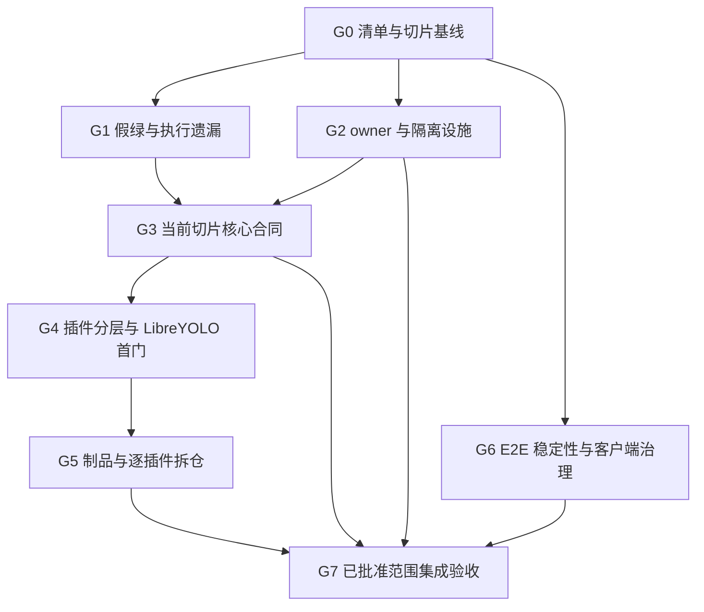

# 面向后端模组解耦与能力插件化的测试治理计划草案

> 状态：草案，待审阅；本轮只交付计划，不授权删除测试、修改生产实现、调整 CI 门禁、拆仓、发布或切换运行环境。
>
> 创建日期：2026-10-29。源码参考 HEAD：`c2bb66ba2`；该标识不是工作区无未提交改动的声明。实施前按目标切片记录实际源码、契约与制品身份。
>
> 目标：让测试真正保护公开行为、数据所有权和可替换能力，并随模组与插件边界迁移；消除已证实的假绿、遗漏执行和测试设施耦合，不以测试数量、目录数量或覆盖率数字代替验收。
>
> 本计划补充既有产品计划的测试与验收工作，不替代它们，不自行取消其目标或分配发布版本。

## 1. 与现有计划的关系

### 1.1 依据与权威来源

| 来源                                                                                                                 | 本计划继承的约束                                                               | 不扩大解释的部分                                                                           |
| -------------------------------------------------------------------------------------------------------------------- | ------------------------------------------------------------------------------ | ------------------------------------------------------------------------------------------ |
| [后端业务模块解耦与跨语言替换](1792160873_backend-module-decoupling.md)                                              | 单一数据 owner、公开契约、调用方事务、最终写入授权、消费者迁移、独立工件与恢复 | 进程内端口、目录拆分或一个 Node peer 不等于整模块独立部署／替代语言实现                    |
| [模块部署与边界台账](../../docs-site/dev/concepts/module-deployment.md#剩余工作台账)                                 | 核心模块剩余工作的唯一实时台账；实现、消费者迁移、运行资格和环境采用分开       | 本计划不复制另一份模块完成状态表，也不凭局部测试关闭 Assets、Learning、Insights 或装配缺口 |
| [核心能力、插件与 App 生态研究](../research/51-plugin-capability-boundaries-and-ecosystem.md)                        | 核心掌握权威状态与最终提交；扩展提供可替换能力；按真实纵向切片推进             | 研究中的继承式替代是建议，不构成原解耦计划已退役或取消全模块目标的授权                     |
| [LibreYOLO 首切片](1793156248_libreyolo-inference-plugin.md)                                                         | 真实训练回流、原生 CUDA、人工发布、当前任务与批量、生命周期及历史身份          | CPU、ASGI、静态资格报告或仅能启动服务均不能替代完整门槛；实际单卡授权不扩成双卡验收        |
| [推理后端插件化与 YOAO-Plugins 拆仓](1793184138_inference-plugins-repository-extraction.md)                          | 六个插件单元、统一协议而非统一算法基类；契约制品先行、独立发布、完整能力保留   | 不迁走核心 Inference owner、训练执行器或存储 Agent；不提前实现前端 SDK、通用插件框架       |
| [现行测试指南](../../docs-site/dev/testing.md)与[既有测试治理记录](../research/27-repository-optimization-ledger.md) | 复用 MSW、owned seed、实际 runner、必需套件审计与已有隔离机制                  | 既有审查清单是历史快照，不是当前全部测试仍被收集的证明；不重新打开已完成的历史工作包       |

### 1.2 当前进度的解释规则

LibreYOLO 首切片的最新 Outcome 已记录真实训练、GPU 试用、人工发布、当前任务／批量及部分历史退役证据；拆仓计划较早的进度段仍保留“这些尚未完成”的描述。两者不能直接拼成一个全绿状态。

实施时以首切片最新具名证据和实际制品为准，核对 `code revision / image digest / installation / runtime profile / GPU binding / scenario`。最新 Outcome 仍列出受控重启、三种 router mode 的完整在途生命周期、失败升级恢复及最终集成检查等未闭合门槛。已记录的交互撤权后仍 dispatch 和整组检查超时按原归属保留，不为确认它们再跑一次，也不混入检测插件切片顺手修复。

本计划只记录这些事实对测试分层和证据复用的影响；产品状态继续更新原计划及唯一模块台账。后续状态改变时按影响范围更新，不要求重复已经有效的未变验收。

### 1.3 范围与非目标

**纳入：** API 与核心模组、共享契约、Python 客户端／CLI／TUI、插件 SDK／运行时、六个推理提供方、训练执行器、存储 Agent、Web 单测／E2E、运维及文档工具测试的执行归属、有效性与设施边界。

**不纳入：** 为测试治理重写产品架构；把所有模组网络化；统一全部 Python／Torch／CUDA 环境；新增消息总线、通用测试框架或第二份协议；取消现有能力；修改生产数据库；公开或推送插件仓；放宽权限、重试、超时、覆盖率或 GPU 资格标准。

发现真实产品缺陷时，保留失败证据并按对应 owner 单独处理。只有它确实阻塞当前已批准验收时才列为前置；与当前切片无关的失败不授权扩修，也不被改成 skip 以制造通过。

## 2. 问题基线与治理原则

### 2.1 已有审查证据

以下是本次讨论前一轮的实际本地审查结果，不是新一轮全仓通过声明：

| 对象                                                   | 已观察的问题或结果                                                                                                                            | 处置方向                                                         |
| ------------------------------------------------------ | --------------------------------------------------------------------------------------------------------------------------------------------- | ---------------------------------------------------------------- |
| `apps/api/tests/test_list_pagination_api_contracts.py` | 在独立进程内将 decisions／feedback 的四个 round 过滤从 `==` 反转为 `!=`，原六个作用域测试仍通过；探针未加载 API 全局 conftest，也未连接数据库 | 用不同 round 的真实数据和独立期望验证作用域、总数及分页          |
| `apps/_shared/task_contract/tests/test_tasks.py`       | 内存中把 `keypoints` 错映射到 `detect`，整个文件 36 项仍通过；期望来自同一生产映射                                                            | 固定消费者语义向量，不从被测表产生答案                           |
| 两个存储绑定恢复 Web 测试                              | AuditArchive／报告附件用例都注入 `avatar_binding_target_missing`，定向两项通过                                                                | 改用各用途真实 machine code，再合并真正相同的交互场景            |
| 模组／插件执行入口                                     | API 默认仅收集自身 `tests`，ML runner 固定八套件；Jobs、训练执行器、插件 SDK 等独立目录及部分插件测试未进入对应现有入口                       | 当前发现集与实际 runner 收集集对账，补齐持续门禁                 |
| Jobs queue client                                      | 独立运行 19 项通过，无数据库依赖                                                                                                              | 保留有价值的请求、错误、取消和边界覆盖，不因 mock transport 删除 |
| 源码／E2E／fixture 审查                                | 发现 mock 自产节点再断言、旧 SQL 文本代表当前行为、宽 POST 成功代表持久化、过期 skip、测试函数互调及全表差集清理                              | 逐项分类，不将静态发现冒充已复现产品故障                         |

上述变异没有落盘修改；未执行全量数据库、浏览器或 GPU 验收。实施者不为重复获得这些统计而重跑；修正后需要证明同类错误确实使新回归失败。

### 2.2 每条测试必须回答的问题

1. **谁的合同？** 指定核心 owner、公开协议、客户端或插件能力，不用“后端测试”作为全部归属。
2. **失败保护什么？** 指向错误授权、错误状态、数据丢失、错误结果、资源泄漏、消费者不兼容等具体风险。
3. **答案从哪里来？** 固定业务例、已核验历史响应、独立参考实现或实际持久状态；不能只是被测常量、mock 返回值或当前实现的重新序列化。
4. **实际运行哪一层？** 纯函数、同事务 ASGI、真实 PostgreSQL、独立 HTTP、原生模型、GPU 或真实浏览器，明确替身所在边界。
5. **何时执行？** 可复现本地命令、CI／验收入口和必要资源；“文件存在”不算已接线。
6. **何时可删？** 合同已退役，或同一风险已有更准确且实际执行的替代覆盖；不是代码搬迁后补丁路径失效就删除。

### 2.3 用例处置类别

- `KEEP`：有独立行为价值，明确层级和入口。
- `REWRITE`：保留风险目标，替换自证、弱断言或错误边界。
- `MOVE`：随 owner／制品迁移，旧路径调用方同步迁移，不保留 re-export。
- `MERGE`：合并同层同边界同风险的重复场景；保留不同用途、权限、错误或运行方式的差异。
- `DELETE`：过期合同、无独立价值的实现形式断言、已有更强覆盖的重复用例。

对删除和合并记录原 case、风险、替代 case／退役依据及实际验证。不要为每条正常测试强行建人工台账；重点登记被修改／删除的案例和未解决缺口。新用例只保护可见行为、边界、错误或状态转换，不增加文件存在、原样转发、mock 回声和源码拼写测试。

## 3. 目标测试结构与所有权

### 3.1 分层按证明范围，而不是按工具命名

| 层级                   | 唯一职责                                                                  | 推荐位置／现有起点                                        | 不足以证明                         |
| ---------------------- | ------------------------------------------------------------------------- | --------------------------------------------------------- | ---------------------------------- |
| 规则单元               | 归一化、几何、状态转移、纯策略和边界                                      | owner 包的 `tests`；Web 源码旁测试                        | HTTP 装配、数据库事务、真实模型    |
| 公开契约一致性         | wire 字段、缺失与 null、标识符、数值、错误、排序／游标、历史向量          | 现有共享契约包与各模组 `conformance`                      | 安装、运行凭据、并发执行资格       |
| owner 持久化／运行集成 | 真实数据库能力、权限、锁、同事务提交／回滚、独立服务适配                  | owner 的集成测试；涉及统一迁移链和 API 组合的测试仍留平台 | 全链路产品操作或另一语言完整提供方 |
| 应用组合／消费者       | HTTP／WebSocket／worker／CLI 调用实际 owner，最终授权、错误映射及跨域结果 | `apps/api/tests` 按领域与执行依赖逐片组织                 | 插件真实权重、GPU 或浏览器像素     |
| 插件原生／制品         | 原生模型、运行依赖、实际池／session、wheel／镜像与 HTTP                   | 当前 backend／plugin 测试，未来随唯一源码迁仓             | 平台授权、人工发布、最终落库资格   |
| 业务验收／硬件资格     | 真实安装到项目使用、GPU 生命周期、重启／恢复、浏览器交互                  | 复用现有验收脚本和 `apps/web/e2e`                         | 其他硬件、未执行的能力或生产容量   |
| 架构与工具门禁         | 禁止私有依赖、工件一致性、runner 选择／失败传播、运维安全                 | 现有 AST 守卫、脚本及文档工具测试                         | 上述业务运行结果                   |

### 3.2 目录和 fixture 收敛

1. 各 owner 保留自己的测试，只有存在相应运行需求时才增加 `unit/contract/integration` 子目录；不生成空目录模板。
2. API 纯规则随实际 owner 下沉；API 保留协议适配、跨 owner 组合和集成。尚未提取的 Learning／Insights 继续在现有位置测试，不为目录整齐虚构独立包。
3. API 的 DB、ASGI 和运行环境 fixture 随相应集成子树收敛。顶层 conftest 仅保留必要收集规则及安全护栏；纯规则不隐式导入整个应用或依赖 Redis。移动时验证 pytest 实际 fixture 解析，不直接删除全局安全检查。
4. 保留 `factory.py`、现有 owned seed、`storage_migration_isolation.py` 等已有设施。将 `test_*` 间共享场景迁到邻近 support 模块，显式传入所需 fixture／客户端；不调用另一个可收集测试函数，不依赖其模块 autouse 副作用。
5. 区分“借用同一事务的 ASGI 客户端”和“真实 get_db／独立连接／冷进程客户端”。前者继续用于快速业务检查，后者验证独立提交、异常退出、最终回滚和生产错误映射；不把全局 monkeypatch 当作生产拓扑。
6. Web 保留源码旁测试、现有 `src/test` 与 E2E 分工；不为统一 `__tests__` 外观批量搬迁。页面测试复用 MSW 与 providers；真实 Canvas／WebGL／WebGPU 和布局仍由相应浏览器验证负责。
7. 不运行仓库根的一次 pytest 来混合所有后端。存在同名模块、不同 Python／Torch 版本及 `sys.modules` 桩时，继续使用独立解释器／环境。

### 3.3 跨仓后的唯一归属

| 内容                                                                                                   | 源码／规则归属              | 测试归属与消费者                                                               |
| ------------------------------------------------------------------------------------------------------ | --------------------------- | ------------------------------------------------------------------------------ |
| Identity、Workspace、Assets、Labeling、Learning、Jobs、Audit、Notifications、Insights 与核心 Inference | 平台仓                      | owner 行为、真实消费者、权限与事务留平台；不随模型服务迁出                     |
| wire schema、任务身份、训练产物、manifest、生命周期证明 schema 与权威纯校验                            | 平台维护的便携契约包        | 发布受审正反例和兼容向量；平台与插件消费同一版本，不各写一套规范               |
| 模型池、检测 SDK、算法侧运行时、证据采集、Mask 工具、原生 loader                                       | 按拆仓计划迁至 YOAO-Plugins | 单元／原生／打包测试随实现迁移；平台不依赖某个插件来决定资格                   |
| 六个算法插件与特定模型资产流程                                                                         | YOAO-Plugins 各插件         | 原生输出、完整能力目录、模型／设备／session 与制品测试；权重独立管理许可与摘要 |
| 管理员 SDK／CLI／TUI                                                                                   | 平台 `packages/python-sdk`  | 公共 API、确认／退出码、安装操作和发行物测试；不引入 Torch 为运行依赖          |
| 宿主安装、批准、项目启用、模型发布、最终写入和退役                                                     | 平台 owner／应用组合        | 使用实际插件制品的双端业务验收；插件不得自行批准自己的报告                     |

当前 `aap_backend_runtime.lifecycle_evidence` 同时被算法侧和宿主消费。迁移前先沿既有公共契约承接纯 schema／校验规则，再迁算法侧采集与运行代码；不让平台通过安装整个模型运行时获得权威校验器，也不复制第二份规则。

统一 schema 真值与独立测试答案并不冲突：字段类型由唯一 schema 生成／校验；“keypoints 必须表示 pose”“缺失全池清理证明必须拒绝”等语义由经审阅的固定向量保护，不能从当前实现动态推导。

### 3.4 E2E 的首要目标：抵抗内部重构，而不是跟着源码改答案

用户已明确指出，当前 PR 经常需要随源码修改 E2E。这应作为本轮治理的核心问题，而不是普通维护成本。**业务行为和公开契约不变时，已有 E2E 场景与业务期望应保持不变；仅内部重构不应要求重新定义成功。** 这不禁止为新增风险补测试，也不禁止在真正改变交互入口时调整操作适配。

#### 已核对的典型模式

| 现有对象                                                                                             | 静态观察                                                                                              | 治理决定                                                                                                      |
| ---------------------------------------------------------------------------------------------------- | ----------------------------------------------------------------------------------------------------- | ------------------------------------------------------------------------------------------------------------- |
| [Mask 编辑 E2E](../../apps/web/e2e/tests/mask-editor.spec.ts)                                        | 场景内理解内部 hover 容器、Radix 对话框实例与画布重渲染时机；选择首个候选；最终仅要求宽范围 POST 成功 | 固定目标 task／prediction；将必要 UI 操作收敛到窄 helper；业务断言提升为类型、lineage、内容、持久化及刷新恢复 |
| [Mask Worker 用例](../../apps/web/e2e/tests/mask-advanced-operations.spec.ts)中的“1080p 实际 Worker” | 直接导入 `/src/...`，调用 compute 函数、注入故障 Worker；已标明开发服务限制                           | 保留真实 Worker／取消／输入不变的价值，归入浏览器运行时集成，不作为产品黑盒或构建制品通过证据                 |
| [原生 Mask 创建与重编辑](../../apps/web/e2e/tests/raster-mask-native.spec.ts)                        | 按确切 task 等待写入，读取持久内容，刷新再编辑、再次读取                                              | 复用其业务证据方向；仍需逐项处理定位与等待，不因这个场景较强就把整个文件认定为完全稳定                        |
| `e2e/helpers/workbench-layout-matrix.ts`                                                             | 同时包含语义布局操作、Dockview DOM 解析和画布／WebGL context 身份检查                                 | 分清产品布局恢复与渲染生命周期专项；必要厂商 DOM 适配集中维护，不能把防止画布重建的有效约束一并删掉           |

上述检查没有新运行浏览器，不据源码推断具体 flaky 率，也不推断每一次历史 PR 修改都是错误修测。

#### 三类浏览器测试明确分工

- **产品 E2E**：从用户操作进入真实构建产物，经过实际服务，验证公开可见结果与持久状态。优先保留创建／编辑／保存／重载、审核、权限拒绝、关键失败恢复、插件试用／发布／使用等纵向业务切片；参数排列和局部组件分支下沉。
- **浏览器集成**：Worker、Canvas API、路由延迟／故障和页面状态组合等需要真实浏览器但不构成完整业务链的检查。允许明确的受控替身或直接模块入口，报告其边界；需要真实 Worker 的用例不能为减少 E2E 数量降为 jsdom 假 Worker。源码入口与 build 入口在现有 runner 中分开登记，不混算制品通过。
- **视觉／性能／渲染资格**：布局像素、单 renderer／context、资源预算、设备丢失与实际 GPU 路径。只读探针可以证明这些专项约束，但不代替保存、发布或用户可见结果；相关浏览器／设备和 artifact 要求保持。

#### 保持业务场景稳定，集中少量 UI 适配

1. 复用现有 `e2e/fixtures` 与 `e2e/helpers`，按操作概念保留窄 helper，例如打开指定标注的 Mask 编辑、确认指定转换、读取指定任务的已存标注；不引入覆盖所有页面的继承式 Page Object 框架。
2. 业务用例描述角色、明确资源、用户动作和独立期望；组件如何拆分、按钮放在哪个容器中、Dockview 内部类名如何变化，应只影响相关操作适配，而非重写整组业务结果。
3. 定位优先使用有作用域的 role／label／accessible name；Canvas、无可访问名称的稳定操作边界可使用语义 test id。test id 表达任务、标注和操作，不编码组件名、CSS 或 DOM 层级；新增可访问语义优先服务真实用户，不专门暴露可变内部对象。
4. 资源按 seed 返回的确切身份或唯一业务名称定位，先确认唯一性；不以 `.first()`／`.nth()` 隐藏错误候选或重复控件。表格第几列、真实层叠画布等有明确结构合同的使用可以保留在对应专项适配，不做全仓机械替换。
5. helper 不能同时支持一串新旧 selector、吞掉失败、强制点击遮挡控件、修改 store 代替用户动作，或补写后端把失败操作变成成功。每个 helper 只执行当前合法流程，业务断言仍在场景中可审查。
6. 数据与身份可以用受控 API／owned seed 准备，沿现有 `seed.injectToken` 集中封装非 auth 场景登录状态；不要求每条标注用例重复 UI 登录。真实登录、续期和撤权由独立场景验证；准备 fixture 不能注入本用例要证明的最终结果。
7. 公共 DTO／schema 的类型引用与规范版本不等于错误耦合。遵守现有单一 schema 来源；应移除的是运行时依赖私有实现来完成被测动作或生成 expected，不是机械禁止一切 `src` 字符串。

#### 观察结果而非内部实现步骤

- 保存成功必须对应指定资源及其公开合同：持久字段／版本／几何与 lineage 正确，必要时刷新重新进入仍一致。Toast、某个请求 2xx 或“调用了一次函数”只是中间证据，不是最终成功。
- 同一 API 和交互合同下，后端 owner 迁移、内部 HTTP／Native 绑定或插件实现替换，不改变产品 E2E 的期望。提供方专属算法、权重、设备和错误矩阵由插件契约／原生层承担；选择 fixture 或部署目标可参数化，不能从当前 `/setup` 输出推导正确答案。
- 不把“请求总次数、DOM 子节点顺序、生成 id、工具栏内部组合”固定成产品合同。若次数体现重复提交或节点身份体现不得重建 renderer，则在对应具名专项保留，说明消费者风险。
- 等待可操作状态、指定请求完成、持久查询收敛或实际画面就绪；不用 `networkidle`、任意 sleep、扩大 timeout 代替已知完成信号。确实验证“一个时间窗口内没有保存／重试”等负向时间合同可保留有依据的窗口，不一刀切删掉所有时间等待。
- 对话框按固定 fixture 的预期决策和业务身份处理；不能用短暂等待加 catch，把应出现的警告／确认当成可有可无。几何／像素 expected 来自可解释样本及独立结果，不重新调用被测几何实现生成答案。

## 4. 核心模组的契约与运行验收

### 4.1 不变量矩阵

| 所有者／边界         | 必须保留的检查                                                                | 实际观察点                                                               |
| -------------------- | ----------------------------------------------------------------------------- | ------------------------------------------------------------------------ |
| Identity／Workspace  | 账号与凭据撤销、项目成员／角色变化、资源关系和最终写入串行化                  | 真实允许／拒绝、持久副作用；不是只看入口 403 或鉴权 mock 调用            |
| Assets               | 原件／内容身份、授权读、版本、来源保留、输入发布、删除拒绝                    | 实际对象版本与字节、owner 记录、拒绝后数据不变；不得猜旧物理键           |
| Labeling             | task／batch／annotation 版本、锁、审核证据、候选 lineage、Mask 与视频结果提交 | 真实同事务状态及回滚、人工修改后迟到结果拒绝、像素／帧身份               |
| Inference            | manifest 许可与现场能力匹配、精确实例路由、冻结模型、准入、未知结果           | 实际目标实例／执行身份、禁止换模型／换设备回退、错误传播及结算           |
| Learning             | 冻结数据、run／attempt、产物摘要、部署试用、人工发布及旧引用                  | 不可变来源／类别／收据，发布前后行为；executor 成功不等于完整 owner 闭合 |
| Jobs                 | 稳定 job／execution ID、重复／丢响应、取消请求与真实停止、部分结果            | 持久账本、真实消息和领域终态；不将全部失败压成统一 cancelled             |
| Audit／Notifications | caller 事务、审计不可变、接收者权限、提交后发布与恢复                         | 真实回滚和发布顺序；无提前通知或错误接收者                               |
| Insights             | 跨 owner 范围、排序／分页、总数、新鲜度及保存视图写入                         | 多主体、多项目／round 的真实数据；不能以 page/count 互相作答案           |
| Runtime assembly     | 冷 API／worker／CLI、最小凭据、工件、迁移及恢复                               | 真正进程和受限角色；拒绝源码挂载、宽角色或私表回退造成的假独立           |

这不是要求每个 helper 都覆盖全矩阵。每个交付切片选择它实际触及的列，未触及的缺口继续留原台账。

### 4.2 Native／SQL、历史向量与源码断言的不同待遇

依据 [Native 数据能力协议](../../docs-site/api/guides/module-data.md) 和原解耦计划，保留以下有效证明：

- 发布包与迁移工件的 ABI／schema／函数体一致性，防止安装到不同实现；必须同时有行为检查，不能将“两个副本相等”当业务真值。
- 借用调用方事务、公开更新字段 mask、autoflush／触发器／锁顺序中确实影响行为的约束；它们不自动是内部实现细节。
- 有来源 commit／摘要的历史公开响应和冻结身份。不得用当前实现重新生成 expected，也不得删除仍受支持的历史数据读取。
- 实际受限 LOGIN、私表／列／序列／helper／角色提升拒绝、默认权限和分区权限；先迁真实消费者再撤销暂留权限。
- 真实旧数据升级、失败保持、dump／restore、必要回滚和重装；不以空库 upgrade 或直接 stamp 冒充。

替换仅搜索 SQL 字符串、注释、函数名、局部 AST 形状的行为测试。例如旧 `0193` 源码不能证明后来 `CREATE OR REPLACE` 的当前函数行为。迁移到 head 上的真实操作与失败／回滚断言后，删除失去独立价值的文字断言。

复用 `test_domain_package_architecture.py` 及其合成违规样本做依赖守卫；复用 `scripts/verify_module_data_boundary.py` 和 `aap_owner_data.verify_function_only_role` 做受限运行验证，不新建通用 Native 测试框架。

### 4.3 跨语言与证据完整性

沿用 Workspace／Jobs／Audit／Notifications 的 `conformance/node` 及现有 Identity peer；覆盖公开字段、UUID、缺失与 null、时间精度、超出安全整数的十进制字符串、错误、排序和事务结果。

同一固定向量分别作用于真实提供方和消费者。Node 自己回显、两端共享同一错误实现、单操作 peer 成功均不等于整模块语言替换。完整替代提供方仍按原计划独立选择、切换和验收。

当前模块验收器以退出码和“至少一个用例通过”排除空成功，仍不足以证明所选场景全部执行。应在既有证据输出上增加选定 case／必需场景与 JUnit 结果对账：缺失、unexpected skip、setup 失败、提前中断均不得变成完整通过。只为选定范围定义 required，不把历史所有场景永久塞进每次定向验收。

### 4.4 隔离与清理

- 沿现有 worktree test／e2e mode 验证数据库、桶、Redis、端口和 worker 归属；日常库不可用作测试库。
- 同事务 fixture 保留 rollback；独立提交测试采用已证明的私有 schema、独立数据库或精确创建资源登记，按实际约束选择，不强推一种方案。
- 替换 `raster_mask_isolation.py` 等全表前后差集清理。记录准确 ID、对象版本、命名空间、角色／进程和清理责任，不能把时间窗口内别人的新增数据当成自己的。
- 在启用同库并行前，实际交错两个测试的提交和清理，证明邻居及预存数据不受影响；失败／取消后的资源也可核对。没有此证据时保持已有串行或每 worker 独立资源策略，不先打开 xdist。
- 测试设置、受限执行角色与清理角色分开；设置方可以使用已授权的测试 owner，但被测请求不能借此获得宽权限。

## 5. 插件资格与可移植分发

### 5.1 六个能力单元，不能只剩检测通用测套

| 插件             | 需要独立保留的能力与回归                                                                                   | 资源／状态证据                                                            |
| ---------------- | ---------------------------------------------------------------------------------------------------------- | ------------------------------------------------------------------------- |
| LibreYOLO        | 原生 YOLOv9 t/s/m/c；多目标／空结果；受控权重、类别、尺寸、CPU 历史与 CUDA runtime；t 的真实训练到项目使用 | 当前授权单卡上的真实 CUDA、借用、排空、重启、安装／升级恢复和精确实例路由 |
| Ultralytics YOLO | 检测、分割、姿态、OBB、开放词表、exemplar、tracker；受控检测／分割与既有评估                               | 全部池、原图 RLE、模型身份；不能用 LibreYOLO bbox 用例替代                |
| RapidOCR         | det／rec／e2e、合法组合、阈值隔离、文字／方向／语言 schema 与真实输出                                      | 全部实际 det／cls／rec sessions 的 provider、借用和释放                   |
| ONNXTools        | 检测、crop 分类、composite、车型／颜色枚举                                                                 | 三句柄及最多四个业务 sessions；真实上游依赖与获准权重                     |
| Grounded-SAM2    | 文本／点／框／Mask／涂抹、多候选、批量框、跨窗视频与精确 Mask                                              | image／video 双池、embedding、对象／源帧、session 与取消                  |
| SAM3             | 文本／交互／exemplar、multiplex 与 PVS 两类视频合同                                                        | GPU-only；image／multiplex／PVS 三池和有状态会话，不制造 CPU 模型成功     |

CPU、原生依赖、真实权重、真实网络和 GPU 是不同证明维度。CPU job 可以验证 SAM3 的纯协议，但不能声称跑过其原生模型；ORT provider 列表不能代替实际 session 运行／释放；ASGI 原生执行也不能代替 TCP、安装器与平台仲裁。

### 5.2 公共负例与资格信任

1. 独立固定任务别名、模型身份、必要资格义务等语义向量。对必需证明项逐项缺失／false、池遗漏、设备／安装／摘要篡改和过期执行建立拒绝例，不能继续从 `REQUIRED_CONTRACT_CHECKS` 自动产生全部答案。
2. 在各实际 app 上验证缺失／错误凭据和正确凭据，不仅测试新建 FastAPI 上的 auth middleware。业务用例可使用显式认证 helper；真实应用认证用例不得被 autouse 自动补头。
3. manifest 是许可意图，`/setup` 是现场声明，资格报告是待核对证据；三者及实际部署身份一致才可准入。插件自报 `passed` 不得直接授予权限。
4. 小检测接口继续保留；OCR／交互／视频按现有完整 HTTP 协议验证，不强迫继承检测类或新增万能输出 JSON。
5. 修正 RapidOCR schema 的空迭代：分别验证 REC 与 E2E 必需字段及其输出语义，不能以“遍历现有字段均合法”代表必需字段存在。
6. 纯 CPU 环境的受控缺依赖 skip 记录适用范围；相应原生／发布门必须安装部署 pin 与提供授权资产，缺项应阻断该门，不退回 shim。已安装包的传递导入错误不能被宽泛 ImportError 当作“目标包未安装”。

### 5.3 复用现有工具，限定结论

- `aap-plugin init/prepare-assets/dev/check/build`：当前检测开发路径；`check` 的真实 HTTP 正反例可复用，不宣称已覆盖 OCR、交互和视频。
- `check --qualify-local`、`aap-libreyolo probe`：本地显式独占设备的模型／生命周期诊断；不颁发平台托管资格。
- `aap-libreyolo-evidence`、各 backend 的 `validate_managed_lifecycle.py`：复用证据采集和故障场景；标明哪些经过 ASGI、哪些经过真实网络。
- `apps/api/scripts/validate_gpu_arbitration.py`：平台仲裁与资源实际操作；必须使用已获准隔离环境和明确 run 身份。
- 现有 `live_provider_guard`、worktree 隔离与 worker 刷新流程：验证实际服务、镜像、挂载与凭据，不凭源码文件推断运行版本。

本计划不新增一套同时调度所有语言、数据库、模型与浏览器的测试平台；需要的新用例放进现有 owner runner。

### 5.4 LibreYOLO 首门与后续插件门

首门沿原计划完整要求：至少 t 的真实训练 checkpoint → GPU 受控安装／固定样本试用 → 浏览器人工发布 → 当前任务、批量及适用裁剪路径；t/s/m/c 的原生输出与实际 CUDA 对照仍保留。

同一制品与安装资格需要覆盖三种 router mode 的在途停用、受控重启、新 boot 绑定、失败升级恢复、精确实例禁止回退、未认证／资源许可拒绝、取消后实际计算未退出时不得提前释放。历史 CPU 收据和旧排队引用不改写；已退役实例不为测试方便重新恢复成活跃源码旁路。

沿现有标准核验两轮冷加载／释放：卸载基线波动不超过 64 MiB、工作集回收至少 90%，Torch allocated／reserved 最终为零；ORT 等非 Torch 插件同时证明自己的实际 sessions 释放。数值容差及性能预算沿相关原计划／改前样本，不任意新设或放宽。

GPU 仅使用授权的独占设备；当前首切片只验单卡，不接管主环境 GPU，也不把单卡同卡竞争称为跨卡隔离。硬件或许可不可用则该资格保持未验证，不能以 skip／CPU 成功关闭。

### 5.5 跨仓与发行物门

在首次实际拆仓前完成：

1. 便携契约有可实际获取、带版本和 SHA256 的 wheel／schema／一致性夹具；插件消费制品，不引用另一个 checkout。
2. 新仓干净检出，分别构建 SDK、运行时和目标插件 wheel／sdist／镜像，验证没有跨仓 editable、平台私包、ORM、Celery 或模型无关的重依赖泄漏。
3. 在仓库外安装制品并运行承诺支持的测试／开发者路径；检查实际归档包含所需 JSON／schema／模板／许可证。不能仅依据 MANIFEST 或 SOURCES.txt 推断打包成功。
4. Python 客户端 SDK 的仓内 OpenAPI／文档测试与可移植发行物测试分开标记；仓内缺 snapshot 仍失败，不能通过通用“文件不存在就 skip”掩盖遗漏。
5. 干净环境真实开发、HTTP 检查、构建和平台安装均可完成；基础镜像 apt 仍联网时不宣称整个构建离线。
6. 新制品 digest 的托管资格与实际平台闭环重新核对，旧镜像报告不能改名复用。未变纯规则证据可按影响范围复用。
7. 切换测试源码、CI、依赖、Compose 和文档后删除旧活跃实现及旧运行入口。保留历史向量／冻结记录与获准历史制品，不保留双维护源码、跨仓 re-export 或运行时回退。

每个插件独立版本、锁文件和运行环境。公共契约变更要验证受支持消费者组合；不要求六个插件同步升级，也不通过取消旧受支持组合让新制品通过。

## 6. 执行入口、CI 与证据模型

### 6.1 最小套件清单，而非第二个测试框架

在现有 runner 上增加轻量的套件执行归属清单，拟议位置为 `scripts/test-suites.json`；该文件及以下字段目前是设计，不是已提供的接口：

- `id / owner / repository / paths`：套件身份、责任和发现范围。
- `runner / cwd / command`：调用现有 pytest、Vitest、Playwright、Node 或具名验收命令；不引入万能执行器。
- `resources / contract_inputs`：所需服务、原生依赖／硬件、公共契约与工件输入。
- `selection_source / required_for`：由哪个现有 planner／job 选择，在 PR、原生资格、拆仓或发布门何时必需。
- `result_artifact / skip_policy`：真实结果位置和允许的不适用条件。

E2E 的详细路径选择继续由 `plan-e2e-suites.mjs` 维护，清单只引用其套件，不复制另一份选择规则。ML/shared 选择若迁入清单，则删除 runner 与 planner 的重复列表，由它们消费同一数据；不能新增第三份手工清单。历史 research TSV 保持历史，不被改写成实时配置。

发现侧覆盖 Python、Node、Vitest、Playwright 和独立脚本，区分可执行测试、fixture、vendor、生成物与历史证据。文件发现和真实 collection 双向对账；参数化 case 按当前 runner 收集，不手抄总数。一个 case 可以在多个环境运行，但必须标明原因，不能因计数重复误判为多份独立覆盖。

### 6.2 门禁安排

| 门禁                 | 主要执行范围                                               | 缺失／skip 处理                                                 |
| -------------------- | ---------------------------------------------------------- | --------------------------------------------------------------- |
| PR 快速规则与契约    | 所有受影响 owner、共享契约、SDK、脚本及 Web 单元／页面集成 | 未映射路径和新测试目录不能静默跳过；保守扩大范围                |
| PR 数据与消费者集成  | 受影响 API／模块、迁移、真实角色／事务与代表性消费者       | 已选中场景的失败、setup error、取消、未执行均失败               |
| 原生依赖／模型资格   | 部署 pin、真实权重、HTTP 和各 provider 特有行为            | 缺依赖或授权资产阻断对应资格；普通 CPU job 的 skip 不继承为通过 |
| GPU／生命周期        | 目标制品、实际设备、全部池／session、故障恢复和平台仲裁    | 只在授权资源上运行；缺硬件保持待验，不降低为 CPU                |
| 拆仓／制品切换       | 非 editable 安装、跨仓契约组合、真实安装和业务闭环         | 旧源码／旧镜像结果不能替代新制品                                |
| 主分支／定时完整检查 | 全部已登记的适用非硬件套件及既有 E2E 全量策略              | 不能用 PR 路径裁剪代替全量入口；硬件资格仍明确单列              |

先补现有入口遗漏，再优化选择。共享契约、运行装配、锁文件、runner、重命名／删除及未知路径采用保守策略。插件仓改动除自身测试外，还需将候选制品与兼容组合交给平台集成验证；不为取证自动公开私有仓或暴露密钥。

复用现有 E2E required-suite 审计和后端分片聚合的 fail-closed 语义；为模块／插件补足等价结果核对，但不把所有 runner 改写成 Playwright 报告格式。普通合并检查可在适用范围通过，GPU／发布资格必须有独立显式状态，不能被普通绿灯覆盖。

### 6.3 证据与覆盖率

每次集中验收至少记录：源码／制品与契约身份、命令和选定范围、实际收集与通过／失败／skip／not-run、所需环境归属、关键业务状态或产物、原始报告路径、复用依据及限制。GPU 额外记录实际设备、runtime、池／session 和采样条件。证据去除秘密，不提交模型权重、用户数据、数据库备份或个人 Token。

覆盖率按实际源码 owner 计量。当前 API `source=["app"]` 与 Codecov backend 路径不会自动包含移出的模组，需同步收集和路径映射；保持迁移前后相同逻辑源码的可比范围，再设置分域基线。不得借搬目录、扩大 exclude、carryforward 或降低阈值制造提升。现有 Web 阈值和 E2E 重试／超时策略不调整。

核心质量指标是：套件是否遗漏、关键风险是否有有效回归、所选验收是否完整执行、正常改内部实现是否引起无谓失败，以及本地／CI 成本。删除多少测试、文件变小多少、总用例增加多少均不作为完成目标。耗时与性能只比较同场景测量，不预设无来源的提速比例。

### 6.4 PR 中修改 E2E 的审查规则

不是要求“产品代码和测试不能同一个 PR 修改”，而是要求测试不能随错误实现一起改变答案。使用现有 PR 说明记录原因，不新增自动猜测业务语义的门禁或另一份审批系统：

| 变更类型                           | E2E 默认处理                                 | 必需说明／证据                                                             |
| ---------------------------------- | -------------------------------------------- | -------------------------------------------------------------------------- |
| 内部重构、owner 下沉、内部调用替换 | 旧业务场景与 expected 不改；允许补新风险回归 | 同一用户合同下原场景实际通过；若必须改测试，解释暴露的私有依赖及其移除方式 |
| 布局／控件位置变化，业务语义未变   | 只调整必要的操作定位／helper，不改变最终结果 | 用户仍可完成原操作；不能依赖强制点击或多 selector 回退                     |
| 明确批准的产品行为／公开协议改变   | 更新受影响场景与期望                         | 新旧合同、需求依据、错误／历史兼容的处置；不以“源码现在如此”为理由         |
| 修复已有缺陷                       | 默认保留正确旧期望，补缺失边界               | 新回归在旧错误行为下失败、修复后通过；不能将错误结果重新录成 golden        |
| fixture／依赖／环境或时序问题      | 修设施或明确同步，不放宽业务断言             | trace／请求／实际状态指出失败层；资源、构建及服务版本可核对                |

涉及删除断言、放宽匹配、增加 skip／retry／timeout 或更新视觉基线时，必须说明原断言保护什么、为何不再适用及替代证据。确实无意义的原断言按本计划删除，不为了“测试绝不改”继续保留；新的断言也不能更弱。

G6 以小批次先完成测试边界和操作适配，再用于真实产品重构；不要在一个大型 PR 中同时改业务合同、重新生成全部夹具并重写全部 expected，使回归失去独立参照。必要的同 PR 变更保留可审阅的分组差异和先失败后通过证据，不强制机械拆成多个 PR。

从现有 PR／报告记录必要的样本：是否改变业务合同、修改的是场景／期望／适配／设施、首跑失败原因及真实通过状态。用这些样本判断“纯重构触发测试重写”是否减少，而不是规定测试改动行数上限、禁止新增测试或只看重跑后成功率。

## 7. 分阶段实施包

以下 G 编号属于本测试治理计划，不是原产品计划 A–F 的重命名。每个阶段包含可独立验收的结果，不要求每个 helper 改动都启动完整环境。

### G0：当前清单、风险与切片基线

**输入：** 本计划及现行源码、runner、唯一模块台账、两份插件计划。

**工作：**

- 生成当前文件发现与实际收集对照，覆盖核心模组、共享包、SDK、六 provider、执行器／Agent、Web、脚本和文档工具。
- 确认 orphan、重复执行、条件跳过、collection error 和仅有手动入口的套件，不把未执行写成通过。
- 对当前交付切片列风险 → owner → 具名测试／实际验收 → 运行入口的映射，校正旧清单与较早插件进度描述的适用范围。
- 固定变更前可比较的源文件／契约／工件范围和主要耗时来源；复用前一轮已证实的两个变异结果。
- E2E 单独区分产品场景、浏览器集成和渲染专项；按已反馈的频繁修测问题，优先盘点私有状态依赖、场景内 selector、弱成功断言与测试修改理由，不将其仅归为 flaky 调参。

**交付：** 当前执行归属清单设计、候选处置表、必需场景集合及明确未覆盖项。

**退出门：** 新发现的测试目录均有责任和执行去向；没有靠人工历史总数证明 collection 完整；不要求先逐条审完全仓才能进入 G1。

### G1：优先修复假绿与执行遗漏

**依赖：** G0 中对应套件已确认。

**具体目标：**

- 重写 round 分页作用域和任务别名期望；修正两处存储绑定错误码。
- 为生命周期证明建立独立正反例，补必需项缺失、false、池和身份错配；保留控制流 mock，但取消其“硬件资格”含义。
- 补核心模组／契约／插件 SDK／剩余 LibreYOLO／执行器／Agent／脚本入口及触发路径，区分最小依赖和原生依赖，不全部塞进 API venv。
- 对验收器选定场景和报告做完整性核对，不能只有一个通过案例就结束。

**主要修改面：** 相关测试、现有 pyproject／package 脚本、`run-ml-cpu-tests.sh`、`plan-e2e-suites.mjs`、`ci.yml`／`backend-test.yml`／`ml-cpu-test.yml` 与现有证据审计入口。

**退出门：** 原先两个错误变体现在必然失败、正常实现通过；错误码测试覆盖真实用途；遗漏套件实际运行并产生报告；选定场景缺失／skip 不再误报通过。新接线暴露的既有失败单列，不删除或豁免以强行绿灯。

### G2：owner 测试归属与设施隔离

**依赖：** G0；各子域可独立推进，不依赖整个 G1 全仓完成。

**具体目标：**

- 先以 Jobs／Identity／Workspace 等已有独立包作样板，迁移纯规则与公开契约测试；API 留消费者组合。
- 从 `test_identity_e2e_native.py`、`test_workspace_e2e_native.py`、Workspace 兼容重放和 SDK 测试间导入抽出窄场景 helper，显式绑定原 autouse 前置。
- 将 DB／HTTP／运行 fixture 按使用域收敛；保持 test DB 守卫、rate limiter 等有作用的隔离，不机械删除。
- 替换全表差集资源清理；验证并发邻居、失败退出、原有数据和对象版本。
- 移动文件时同步测试导入、pytest 配置、架构门禁、runner、覆盖率路径和文档链接。按现有文件 hash 分片算法重新核对完整选集，不改变分片算法掩盖移动。

**退出门：** 选定 owner 可独立运行；纯测试无需基础服务；同事务和真实进程证据明确分开；迁移前后需保留的 case／风险均有映射；无旧别名或测试函数互调；清理不影响邻居。只有通过隔离门的范围才允许扩大并行。

### G3：核心公开合同、Native 与跨语言验收收口

**依赖：** 当前切片所需 G1 和 G2，不等待所有模块目录迁移。

**具体目标：**

- 按第 4 节保留真正协议／安装／恢复证明，替换 SQL 文字和私有名称自证。
- 用当前 head 的真实数据库、公开 owner 操作和受限角色验证行为；继续使用同一调用方事务，不为可测试性改成 RPC 或独立 commit。
- 复用现有 Node peers、冷 API／worker／CLI 和 restore 场景，区分单命令跨语言与完整提供方替换。
- 对 Assets／Learning／Insights 尚未完成的路径标明当前 owner 和验收缺口，在其产品切片迁移消费者时一起迁测试，不提前撤权或宣布完成。

**退出门：** 当前交付合同的成功、拒绝、并发／回滚、真实消费者及适用恢复均有完整证据；删掉的文字／重复用例已有更准确替代；旧公开向量和有效历史工件未改写；没有新私表访问或宽权限。

### G4：插件分层验收与 LibreYOLO 首门

**依赖：** G1，以及首切片实际触及的 G2／G3；不等待全后端独立部署。

**具体目标：**

- 按第 5 节分开纯契约、原生依赖、实际 HTTP、GPU／平台治理；实际 app 认证负例不被全局补头。
- 将资格纯校验和算法侧采集的测试归属划清，提供可移植且独立的契约向量。
- 跟随 LibreYOLO 当前实施补齐剩余生命周期场景，沿原制品／安装身份解释既有证据；不重做未变训练或恢复已退役分支。
- 建立六 provider 的能力验收矩阵；先实现当前检测切片必需的检查，再随复杂后端迁移增加其真实场景，不交空的“全能 conformance”占位。

**退出门：** LibreYOLO 原计划的剩余必需场景实际闭合后才宣称首门完成；本地检查、ASGI、CPU 与 GPU 证据没有混用；无隐式回退、假报告批准或遗漏池。其他五个插件仍按各自状态记录，不能随试点一并勾选。

### G5：便携制品、跨仓切换与六插件逐个迁移

**依赖：** 对应产品计划的实际授权；公共契约先行，首次拆仓继承 G4／原 LibreYOLO 首门，不绕过其完成条件。

**具体目标：**

- 先交付可获取契约包与归档资源检查，再迁 SDK／运行时／LibreYOLO，完成仓外安装与新 digest 平台闭环。
- 共享接缝稳定后，YOLO／RapidOCR／ONNXTools 各自迁移；Grounded-SAM2 固定有状态矩阵，SAM3 保留 multiplex／PVS 差异。实现可按真实独立边界并行，不共享环境依赖或 GPU 独占资格。
- 建立平台与插件仓的候选制品兼容检查及必需结果交接；不以远端仓存在代替代码迁入或发布完成。
- 逐插件切换新身份、项目启用和受控模型试用／发布；封住旧新引用后核对在途作业、session、全池排空、物理停止和零活动依赖，再退役实例与旧活跃源码。

**退出门：** 每个已迁插件都有完整能力、发行物、平台兼容和退役证据；未迁插件仍由原入口执行，不能失去 CI。历史任务／收据／发布身份不被改写；许可未清或硬件未验的能力不计为发布合格。

### G6：E2E 契约稳定化，以及 Web／SDK／运维测试治理

**依赖：** G0 的对应浏览器范围明确即可启动；G1 中相关错误码与执行入口在验收前合入。不等待 G2–G5，也不作为后端拆仓的无关前置。

**具体目标：**

E2E 按三步交付，第一步与 G1 并行开始：

1. **G6a 分层与冻结业务期望**：以 Mask 创建／AI 精修为首个样板，记录用户合同、准确资源、现有有效期望及弱项；从产品 E2E 中拆清 Worker 直接调用、受控页面集成和渲染专项，保留各自入口与必需覆盖。不是先删除再等待替代。
2. **G6b 操作适配与真实结果**：复用窄 helper，去掉场景内实现细节和任意首项定位，修正等待与结果观察；再推广到同类编辑、审核、布局恢复等高维护成本链路，不批量创建 Page Object 或为每个现有点击再包一层。
3. **G6c 抗重构验收**：使用一个实际、未改变业务合同的模块／组件重构作为样本，保持规范化后的场景、业务 expected 与 fixture 语义，验证前后实现；可复用适用的既有前态证据，不为演示专门改生产代码。另对首个样板施加具体错误，如保存未持久化或 lineage 错配，证明测试仍会失败，临时故障注入不进入产品代码。

- 移除 `WorkbenchShell` 的假对话框存在断言和无独立价值的源码／CSS 文字检查；共享组件归属规则若保留则作为明确静态规则，不计功能覆盖。
- 合并弱重复 Mask 创建 E2E；AI polygon 精修保留独立入口，验证精确 task／prediction、annotation 类型、lineage、内容和刷新恢复。
- 删除过期的旧视频栈 skip；保留现行精确帧／像素与真实交互测试，不只补一张截图。
- 三种存储绑定共同流程使用小型参数化场景，保留用途专属错误、API 及权限；MSW unexpected-request guard 按实际页面接入，不谎称已全局生效。
- SDK 按 API 覆盖清单保护真实序列化、分页、错误、关系授权、破坏性确认和退出码；核对 sdist／wheel 的 fixture 及仓内文档测试边界。
- 脚本测试驱动实际选择与受控操作结果，替换只抽取 AST 条件执行的检查；保留工件摘要、安装顺序及失败停止等真实运维约束。

**退出门：** 每个删除／合并均有风险去向；相关页面／CLI／脚本实际运行；产品 E2E 观察真实业务结果，浏览器集成与渲染专项另计。样板在业务合同不变的真实重构中不重写场景和 expected，且能拒绝已选错误行为；没有更宽 skip、catch、重试或超时。按变更影响选择浏览器表面，未修改 UI 不为文案治理重跑全站主题矩阵。

### G7：集成验收、文档与治理收口

**依赖：** 本次批准实施范围内的 G1–G6；尚未批准的插件产品迁移明确留在原计划，不因治理基础完成被标为已完成。

**工作与退出门：**

- 在同一集成根对发现、collection、runner 归属和必需报告做最终对账；所有可执行测试有当前去向，未执行范围明确。
- 对受影响 owner／契约／客户端／插件完成集中回归与实际 smoke；重跑范围由变更决定，不为收集数字重复成功验收。
- 核对源码迁移前后的覆盖率逻辑范围、首次失败和资源成本；不使用降低阈值或扩大排除作为收口。
- 补齐测试指南、对应模块／SDK／插件开发和运维文档。新增 API／环境／用户可见修复按仓库规则同步生成工件与相关文档；纯测试重构不虚构功能 changelog。
- 测试治理状态写本计划 Outcome；模块／插件产品资格仍写原权威入口。移除本任务临时探针和自有资源，保留去秘密的必要证据。

**完成措辞：** 可单独报告“测试治理基础已完成”“某插件迁移门已通过”；只有六插件各自门槛与原计划全部适用要求完成，才能报告六插件测试迁移完成。任何未验硬件、未迁模块和未取得生产资格必须明确列出。

## 8. 依赖与实施组织

图中的 G2／G3 依赖指目标切片需要的部分，不是要求全仓先整理完。若本轮仅批准治理基础，G5 不进入本轮集成根，其后续执行仍受原拆仓计划门槛约束，不能被写成完成。

实施责任按边界分配：CI 入口／结果审计一个集成 owner；核心 owner／fixture 一个切片 owner；插件 SDK／便携契约与 provider 使用明确接口交接；Web／客户端和脚本可独立推进。修改子任务按仓库要求使用隔离工作树，读审可共享 checkout；公共契约、清单、根 fixture 与 CI 不由多个修改者同时改写。

CPU 套件可以并行；真实数据库／对象存储先证明资源隔离；同一授权 GPU 的独占验收串行。每个 slice 在验收边界集中跑必要检查，不让每个 helper 提交都启动整套冷栈。

## 9. 首批具体处置清单

| 目标                                                                                       | 决定                 | 保护目标／替代证据                                                     | 阶段   |
| ------------------------------------------------------------------------------------------ | -------------------- | ---------------------------------------------------------------------- | ------ |
| `apps/api/tests/test_list_pagination_api_contracts.py`                                     | REWRITE              | 多 round 实际范围、总数、稳定分页及无权限；错误过滤变体失败            | G1     |
| `apps/_shared/task_contract/tests/test_tasks.py`                                           | REWRITE              | 独立 canonical／legacy 语义向量；错误别名和缺失别名失败                | G1     |
| `backend_runtime/tests/test_lifecycle_evidence.py` 及平台／SDK／LibreYOLO 的报告 fixture   | REWRITE／MERGE       | 固定资格义务、必需项缺失／false、池及身份篡改拒绝；不生成同源答案      | G1／G4 |
| 各实际 backend app 与认证 fixture                                                          | REWRITE              | 无／错凭据真实拒绝，业务 helper 显式认证；共享 middleware 测试继续保留 | G4     |
| `rapidocr-backend/tests/test_catalog_params.py`                                            | REWRITE              | REC／E2E 必需字段及真实输出映射，删除 schema 后明确失败                | G4／G5 |
| API 模组／共享契约／插件 SDK／训练执行器／Agent 与 scripts 的执行入口                      | KEEP＋接线           | 实际 collection、依赖隔离、PR 触发和必需结果                           | G0／G1 |
| `test_task_creation_job_contract.py` 的当前行为文字断言                                    | REWRITE              | 当前 head 的真实命令／失败／回滚；历史工件一致性另保留                 | G3     |
| `test_identity_actor_context_gateway.py`／`test_project_member_profiles.py` 的局部名称检查 | DELETE／REWRITE      | 真实身份调用、受限 DB 角色、成员响应和越权拒绝                         | G3     |
| `test_identity_e2e_native.py`／`test_workspace_e2e_native.py` 等测试互调                   | MOVE                 | 场景 helper 显式依赖，保留不同角色／绑定的真实消费者覆盖               | G2     |
| `raster_mask_isolation.py` 及类似差集清理                                                  | REWRITE              | 准确资源所有权和邻居安全，不靠随机 ID 推断归属                         | G2     |
| `AuditArchiveBindingChangeButton.test.tsx`／`StorageBindingChangeButton.test.tsx`          | REWRITE／MERGE       | 各用途真实错误码、清空选择与重新选择，保留专属权限                     | G1／G6 |
| `filterCoverage.test.ts`／Overlay CSS 文字／Shell 假节点断言                               | DELETE／明确静态归属 | 页面交互、实际几何／可见性和真正状态回调；不保留 mock 回声             | G6     |
| `mask-editor.spec.ts`                                                                      | MERGE／REWRITE       | 复用 native 强创建场景；保留 AI 精修 lineage 与持久内容                | G6     |
| `workbench-video-media-smoke.spec.ts`                                                      | DELETE               | 删除过期旧栈规格；现行精确帧／真实像素合同继续保留                     | G6     |
| `scripts/test_verify_module_data_boundary.py` 的条件抽取测试                               | REWRITE              | 驱动真实选择／bootstrap 凭据路径，分支体损坏可失败；不删有效工件校验   | G3／G6 |
| `packages/python-sdk` 及便携契约的发行物 fixture                                           | 核验后 REWRITE／MOVE | 真实 wheel／sdist 在仓外可运行；仓内 snapshot 缺失仍失败               | G5／G6 |

路径中的短前缀承接本仓对应 `apps/_shared`、`apps` 或 `apps/web`；正式实施台账使用完整路径和具名 case。此表是已知候选，不代表其整个文件无价值，也不授权一次性删除全部内容。

## 10. 验收、暂停与回退规则

### 10.1 每个切片的完成检查

- [ ] 当前风险、owner、公开合同、测试层和实际入口明确。
- [ ] 被修改／删除的案例有去向；替代行为已实际验证，不只编译或 collection 成功。
- [ ] 已知假绿的错误变体能被击穿；额外变异只针对具体不确定边界，不追求全仓 mutation 分数。
- [ ] 同事务、真实角色、冷进程、HTTP、原生模型、GPU 和浏览器证据分开。
- [ ] 没有新私表依赖、跨仓源码依赖、旧符号兼容层或同源 expected。
- [ ] 选定场景与实际报告一致；skip／not-run／失败未被混成 success。
- [ ] 原 API、错误、几何单位、冻结身份、权限、提交和取消语义保持，或产品变更已单独批准。
- [ ] 纯内部重构保持 E2E 业务场景与 expected；必要测试改动按 §6.4 分类，未把实现回归改成新期望。
- [ ] 受影响调用方、runner、覆盖率路径与文档同步；临时资源按精确身份清理。

### 10.2 暂停条件

出现以下情况暂停相应切片，不阻塞独立工作：公开合同缺少确定来源；真实权重许可／硬件不可用；角色／历史数据恢复要求未定义；旧活动执行无法证明退场；跨仓制品尚不能获取；修复需要改变原计划范围。

暂停时记录精确缺项、已完成部分和恢复条件。不能用模拟产物、宽凭据、CPU 回退、重新生成 golden、删除失败测试或全局 skip 替代。

### 10.3 回退与资料保留

测试组织／CI 变更使用独立提交并保留原选择基线；回退不能顺带恢复已退役生产适配器或重写数据。若新测试揭示已有缺陷，可先回退与其无关的结构迁移，但保留问题证据与对应验收未通过状态。

产品实例切换的回退仍遵守原计划的冻结新准入、执行所有权、数据可读性和历史收据约束，不是修改 URL 或重开旧源码目录。历史向量、受控迁移工件和必要审计记录不是清理目标。

## 11. 建议的批准与启动范围

建议首先批准 **G0＋G1、G6a／G6b 的 E2E 稳定性样板，以及 G2 中当前 owner／清理设施的有界样板**。E2E 不是后端拆分结束后的清理任务，应先减少“每次 PR 随源码改答案”的耦合，再用稳定业务场景保护后续拆分。LibreYOLO 正在推进的实际验收沿原计划继续，G4 为其补齐测试分层和证据完整性，不另设全仓治理前置。

G3 随核心 owner 切片接入；G5 跟随原拆仓计划逐插件授权与验收。这里的分批只是执行顺序，不删除本草案中的全范围目标。原解耦计划退役、通用插件宿主、前端 SDK、生产采用、仓库公开和发布仍需各自明确决策，不随本草案默认批准。

本轮交付仅为这份详细草案。实施后的长期规则进入现有测试指南与对应开发／运维文档，阶段证据追加本计划 Outcome；不把计划正文变成第二份产品状态台账。
