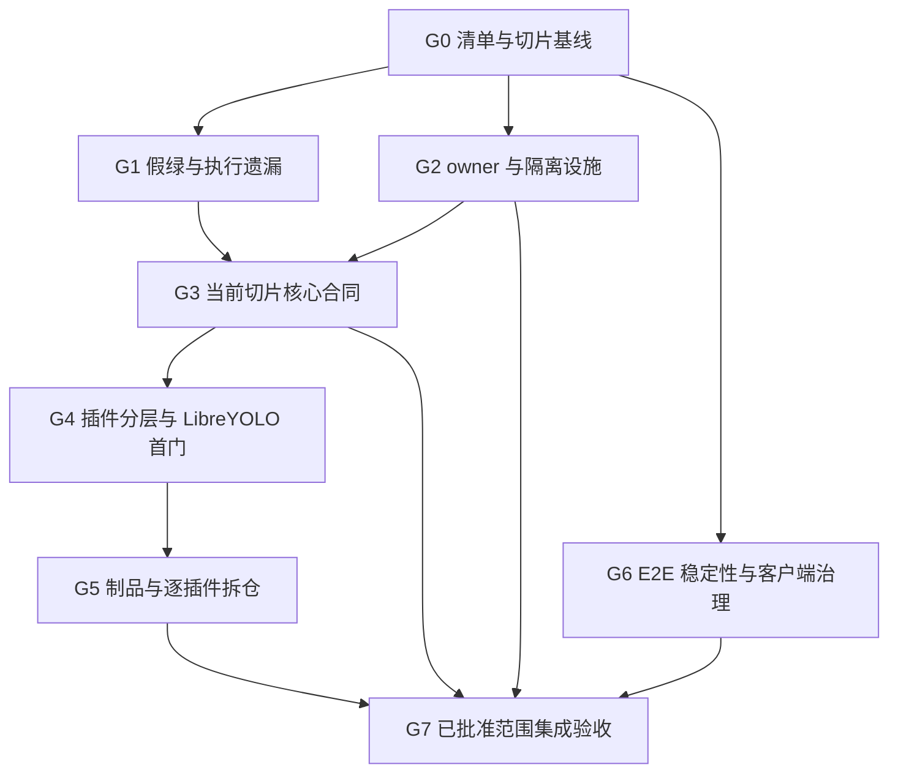

# 面向后端模组解耦与能力插件化的测试治理计划草案

> 状态：阶段 E 的本地集成验收已完成。第 16 节的阶段 F 正在实施：N4 四个切片、N6-K 已完成限定验收，N5 已按产品语言计划完成。N5 后的 T1／T2 联合验收未通过：默认验证器停在 ordinary 清理，后 17 组未运行。N6 后继及 J1／J2 四个批准门保持关闭；本轮不授权公开发布或生产采用。
>
> 创建日期：2026-10-29。源码参考 HEAD：`c2bb66ba2`；该标识不是工作区无未提交改动的声明。实施前按目标切片记录实际源码、契约与制品身份。
>
> 目标：让测试真正保护公开行为、数据所有权和可替换能力，并随模组与插件边界迁移；消除已证实的假绿、遗漏执行和测试设施耦合，不以测试数量、目录数量或覆盖率数字代替验收。
>
> 本计划补充既有产品计划的测试与验收工作，不替代它们，不自行取消其目标或分配发布版本。

## 1. 与现有计划的关系

### 1.1 依据与权威来源

| 来源                                                                                                                 | 本计划继承的约束                                                               | 不扩大解释的部分                                                                           |
| -------------------------------------------------------------------------------------------------------------------- | ------------------------------------------------------------------------------ | ------------------------------------------------------------------------------------------ |
| [后端业务模块解耦与跨语言替换](1792160873_backend-module-decoupling.md)                                              | 单一数据 owner、公开契约、调用方事务、最终写入授权、消费者迁移、独立工件与恢复 | 进程内端口、目录拆分或一个 Node peer 不等于整模块独立部署／替代语言实现                    |
| [模块部署与边界台账](../../docs-site/dev/concepts/module-deployment.md#剩余工作台账)                                 | 核心模块剩余工作的唯一实时台账；实现、消费者迁移、运行资格和环境采用分开       | 本计划不复制另一份模块完成状态表，也不凭局部测试关闭 Assets、Learning、Insights 或装配缺口 |
| [核心能力、插件与 App 生态研究](../research/51-plugin-capability-boundaries-and-ecosystem.md)                        | 核心掌握权威状态与最终提交；扩展提供可替换能力；按真实纵向切片推进             | 研究中的继承式替代是建议，不构成原解耦计划已退役或取消全模块目标的授权                     |
| [LibreYOLO 首切片](1793156248_libreyolo-inference-plugin.md)                                                         | 真实训练回流、原生 CUDA、人工发布、当前任务与批量、生命周期及历史身份          | CPU、ASGI、静态资格报告或仅能启动服务均不能替代完整门槛；实际单卡授权不扩成双卡验收        |
| [推理后端插件化与 YOAO-Plugins 拆仓](1793184138_inference-plugins-repository-extraction.md)                          | 六个插件单元、统一协议而非统一算法基类；契约制品先行、独立发布、完整能力保留   | 不迁走核心 Inference owner、训练执行器或存储 Agent；不提前实现前端 SDK、通用插件框架       |
| [现行测试指南](../../docs-site/dev/testing.md)与[既有测试治理记录](../research/27-repository-optimization-ledger.md) | 复用 MSW、owned seed、实际 runner、必需套件审计与已有隔离机制                  | 既有审查清单是历史快照，不是当前全部测试仍被收集的证明；不重新打开已完成的历史工作包       |

### 1.2 当前进度的解释规则

LibreYOLO 首切片的最新 Outcome 已记录真实训练、GPU 试用、人工发布、当前任务／批量及部分历史退役证据；拆仓计划较早的进度段仍保留“这些尚未完成”的描述。两者不能直接拼成一个全绿状态。

实施时以首切片最新具名证据和实际制品为准，核对 `code revision / image digest / installation / runtime profile / GPU binding / scenario`。最新 Outcome 仍列出受控重启、三种 router mode 的完整在途生命周期、失败升级恢复及最终集成检查等未闭合门槛。已记录的交互撤权后仍 dispatch 和整组检查超时按原归属保留，不为确认它们再跑一次，也不混入检测插件切片顺手修复。

本计划只记录这些事实对测试分层和证据复用的影响；产品状态继续更新原计划及唯一模块台账。后续状态改变时按影响范围更新，不要求重复已经有效的未变验收。

### 1.3 范围与非目标

**纳入：** API 与核心模组、共享契约、Python 客户端／CLI／TUI、插件 SDK／运行时、六个推理提供方、训练执行器、存储 Agent、Web 单测／E2E、运维及文档工具测试的执行归属、有效性与设施边界。

**不纳入：** 为测试治理重写产品架构；把所有模组网络化；统一全部 Python／Torch／CUDA 环境；新增消息总线、通用测试框架或第二份协议；取消现有能力；修改生产数据库；公开或推送插件仓；放宽权限、重试、超时、覆盖率或 GPU 资格标准。

发现真实产品缺陷时，保留失败证据并按对应 owner 单独处理。只有它确实阻塞当前已批准验收时才列为前置；与当前切片无关的失败不授权扩修，也不被改成 skip 以制造通过。

## 2. 问题基线与治理原则

### 2.1 已有审查证据

以下是本次讨论前一轮的实际本地审查结果，不是新一轮全仓通过声明：

| 对象                                                   | 已观察的问题或结果                                                                                                                            | 处置方向                                                         |
| ------------------------------------------------------ | --------------------------------------------------------------------------------------------------------------------------------------------- | ---------------------------------------------------------------- |
| `apps/api/tests/test_list_pagination_api_contracts.py` | 在独立进程内将 decisions／feedback 的四个 round 过滤从 `==` 反转为 `!=`，原六个作用域测试仍通过；探针未加载 API 全局 conftest，也未连接数据库 | 用不同 round 的真实数据和独立期望验证作用域、总数及分页          |
| `apps/_shared/task_contract/tests/test_tasks.py`       | 内存中把 `keypoints` 错映射到 `detect`，整个文件 36 项仍通过；期望来自同一生产映射                                                            | 固定消费者语义向量，不从被测表产生答案                           |
| 两个存储绑定恢复 Web 测试                              | AuditArchive／报告附件用例都注入 `avatar_binding_target_missing`，定向两项通过                                                                | 改用各用途真实 machine code，再合并真正相同的交互场景            |
| 模组／插件执行入口                                     | API 默认仅收集自身 `tests`，ML runner 固定八套件；Jobs、训练执行器、插件 SDK 等独立目录及部分插件测试未进入对应现有入口                       | 当前发现集与实际 runner 收集集对账，补齐持续门禁                 |
| Jobs queue client                                      | 独立运行 19 项通过，无数据库依赖                                                                                                              | 保留有价值的请求、错误、取消和边界覆盖，不因 mock transport 删除 |
| 源码／E2E／fixture 审查                                | 发现 mock 自产节点再断言、旧 SQL 文本代表当前行为、宽 POST 成功代表持久化、过期 skip、测试函数互调及全表差集清理                              | 逐项分类，不将静态发现冒充已复现产品故障                         |

上述变异没有落盘修改；未执行全量数据库、浏览器或 GPU 验收。实施者不为重复获得这些统计而重跑；修正后需要证明同类错误确实使新回归失败。

### 2.2 每条测试必须回答的问题

1. **谁的合同？** 指定核心 owner、公开协议、客户端或插件能力，不用“后端测试”作为全部归属。
2. **失败保护什么？** 指向错误授权、错误状态、数据丢失、错误结果、资源泄漏、消费者不兼容等具体风险。
3. **答案从哪里来？** 固定业务例、已核验历史响应、独立参考实现或实际持久状态；不能只是被测常量、mock 返回值或当前实现的重新序列化。
4. **实际运行哪一层？** 纯函数、同事务 ASGI、真实 PostgreSQL、独立 HTTP、原生模型、GPU 或真实浏览器，明确替身所在边界。
5. **何时执行？** 可复现本地命令、CI／验收入口和必要资源；“文件存在”不算已接线。
6. **何时可删？** 合同已退役，或同一风险已有更准确且实际执行的替代覆盖；不是代码搬迁后补丁路径失效就删除。

### 2.3 用例处置类别

- `KEEP`：有独立行为价值，明确层级和入口。
- `REWRITE`：保留风险目标，替换自证、弱断言或错误边界。
- `MOVE`：随 owner／制品迁移，旧路径调用方同步迁移，不保留 re-export。
- `MERGE`：合并同层同边界同风险的重复场景；保留不同用途、权限、错误或运行方式的差异。
- `DELETE`：过期合同、无独立价值的实现形式断言、已有更强覆盖的重复用例。

对删除和合并记录原 case、风险、替代 case／退役依据及实际验证。不要为每条正常测试强行建人工台账；重点登记被修改／删除的案例和未解决缺口。新用例只保护可见行为、边界、错误或状态转换，不增加文件存在、原样转发、mock 回声和源码拼写测试。

## 3. 目标测试结构与所有权

### 3.1 分层按证明范围，而不是按工具命名

| 层级                   | 唯一职责                                                                  | 推荐位置／现有起点                                        | 不足以证明                         |
| ---------------------- | ------------------------------------------------------------------------- | --------------------------------------------------------- | ---------------------------------- |
| 规则单元               | 归一化、几何、状态转移、纯策略和边界                                      | owner 包的 `tests`；Web 源码旁测试                        | HTTP 装配、数据库事务、真实模型    |
| 公开契约一致性         | wire 字段、缺失与 null、标识符、数值、错误、排序／游标、历史向量          | 现有共享契约包与各模组 `conformance`                      | 安装、运行凭据、并发执行资格       |
| owner 持久化／运行集成 | 真实数据库能力、权限、锁、同事务提交／回滚、独立服务适配                  | owner 的集成测试；涉及统一迁移链和 API 组合的测试仍留平台 | 全链路产品操作或另一语言完整提供方 |
| 应用组合／消费者       | HTTP／WebSocket／worker／CLI 调用实际 owner，最终授权、错误映射及跨域结果 | `apps/api/tests` 按领域与执行依赖逐片组织                 | 插件真实权重、GPU 或浏览器像素     |
| 插件原生／制品         | 原生模型、运行依赖、实际池／session、wheel／镜像与 HTTP                   | 当前 backend／plugin 测试，未来随唯一源码迁仓             | 平台授权、人工发布、最终落库资格   |
| 业务验收／硬件资格     | 真实安装到项目使用、GPU 生命周期、重启／恢复、浏览器交互                  | 复用现有验收脚本和 `apps/web/e2e`                         | 其他硬件、未执行的能力或生产容量   |
| 架构与工具门禁         | 禁止私有依赖、工件一致性、runner 选择／失败传播、运维安全                 | 现有 AST 守卫、脚本及文档工具测试                         | 上述业务运行结果                   |

### 3.2 目录和 fixture 收敛

1. 各 owner 保留自己的测试，只有存在相应运行需求时才增加 `unit/contract/integration` 子目录；不生成空目录模板。
2. API 纯规则随实际 owner 下沉；API 保留协议适配、跨 owner 组合和集成。尚未提取的 Learning／Insights 继续在现有位置测试，不为目录整齐虚构独立包。
3. API 的 DB、ASGI 和运行环境 fixture 随相应集成子树收敛。顶层 conftest 仅保留必要收集规则及安全护栏；纯规则不隐式导入整个应用或依赖 Redis。移动时验证 pytest 实际 fixture 解析，不直接删除全局安全检查。
4. 保留 `factory.py`、现有 owned seed、`storage_migration_isolation.py` 等已有设施。将 `test_*` 间共享场景迁到邻近 support 模块，显式传入所需 fixture／客户端；不调用另一个可收集测试函数，不依赖其模块 autouse 副作用。
5. 区分“借用同一事务的 ASGI 客户端”和“真实 get_db／独立连接／冷进程客户端”。前者继续用于快速业务检查，后者验证独立提交、异常退出、最终回滚和生产错误映射；不把全局 monkeypatch 当作生产拓扑。
6. Web 保留源码旁测试、现有 `src/test` 与 E2E 分工；不为统一 `__tests__` 外观批量搬迁。页面测试复用 MSW 与 providers；真实 Canvas／WebGL／WebGPU 和布局仍由相应浏览器验证负责。
7. 不运行仓库根的一次 pytest 来混合所有后端。存在同名模块、不同 Python／Torch 版本及 `sys.modules` 桩时，继续使用独立解释器／环境。

### 3.3 跨仓后的唯一归属

| 内容                                                                                                   | 源码／规则归属             | 测试归属与消费者                                                               |
| ------------------------------------------------------------------------------------------------------ | -------------------------- | ------------------------------------------------------------------------------ |
| Identity、Workspace、Assets、Labeling、Learning、Jobs、Audit、Notifications、Insights 与核心 Inference | 平台仓                     | owner 行为、真实消费者、权限与事务留平台；不随模型服务迁出                     |
| wire schema、任务身份、训练产物、manifest、生命周期证明 schema 与权威纯校验                            | 平台维护的便携契约包       | 发布受审正反例和兼容向量；平台与插件消费同一版本，不各写一套规范               |
| 模型池、检测 SDK、算法侧运行时、证据采集、Mask 工具、原生 loader                                       | 独立 Plugin-SDK 仓库       | 单元／原生／打包测试随实现迁移；平台不依赖某个插件来决定资格                   |
| 六个算法插件与特定模型资产流程                                                                         | YOAO-Plugins 各插件        | 原生输出、完整能力目录、模型／设备／session 与制品测试；权重独立管理许可与摘要 |
| 管理员 SDK／CLI／TUI                                                                                   | 平台 `packages/python-sdk` | 公共 API、确认／退出码、安装操作和发行物测试；不引入 Torch 为运行依赖          |
| 宿主安装、批准、项目启用、模型发布、最终写入和退役                                                     | 平台 owner／应用组合       | 使用实际插件制品的双端业务验收；插件不得自行批准自己的报告                     |

当前 `aap_backend_runtime.lifecycle_evidence` 同时被算法侧和宿主消费。迁移前先沿既有公共契约承接纯 schema／校验规则，再迁算法侧采集与运行代码；不让平台通过安装整个模型运行时获得权威校验器，也不复制第二份规则。

统一 schema 真值与独立测试答案并不冲突：字段类型由唯一 schema 生成／校验；“keypoints 必须表示 pose”“缺失全池清理证明必须拒绝”等语义由经审阅的固定向量保护，不能从当前实现动态推导。

### 3.4 E2E 的首要目标：抵抗内部重构，而不是跟着源码改答案

用户已明确指出，当前 PR 经常需要随源码修改 E2E。这应作为本轮治理的核心问题，而不是普通维护成本。**业务行为和公开契约不变时，已有 E2E 场景与业务期望应保持不变；仅内部重构不应要求重新定义成功。** 这不禁止为新增风险补测试，也不禁止在真正改变交互入口时调整操作适配。

#### 已核对的典型模式

| 现有对象                                                                                             | 静态观察                                                                                              | 治理决定                                                                                                      |
| ---------------------------------------------------------------------------------------------------- | ----------------------------------------------------------------------------------------------------- | ------------------------------------------------------------------------------------------------------------- |
| [Mask 编辑 E2E](../../apps/web/e2e/tests/mask-editor.spec.ts)                                        | 场景内理解内部 hover 容器、Radix 对话框实例与画布重渲染时机；选择首个候选；最终仅要求宽范围 POST 成功 | 固定目标 task／prediction；将必要 UI 操作收敛到窄 helper；业务断言提升为类型、lineage、内容、持久化及刷新恢复 |
| [Mask Worker 用例](../../apps/web/e2e/tests/mask-advanced-operations.spec.ts)中的“1080p 实际 Worker” | 直接导入 `/src/...`，调用 compute 函数、注入故障 Worker；已标明开发服务限制                           | 保留真实 Worker／取消／输入不变的价值，归入浏览器运行时集成，不作为产品黑盒或构建制品通过证据                 |
| [原生 Mask 创建与重编辑](../../apps/web/e2e/tests/raster-mask-native.spec.ts)                        | 按确切 task 等待写入，读取持久内容，刷新再编辑、再次读取                                              | 复用其业务证据方向；仍需逐项处理定位与等待，不因这个场景较强就把整个文件认定为完全稳定                        |
| `e2e/helpers/workbench-layout-matrix.ts`                                                             | 同时包含语义布局操作、Dockview DOM 解析和画布／WebGL context 身份检查                                 | 分清产品布局恢复与渲染生命周期专项；必要厂商 DOM 适配集中维护，不能把防止画布重建的有效约束一并删掉           |

上述检查没有新运行浏览器，不据源码推断具体 flaky 率，也不推断每一次历史 PR 修改都是错误修测。

#### 三类浏览器测试明确分工

- **产品 E2E**：从用户操作进入真实构建产物，经过实际服务，验证公开可见结果与持久状态。优先保留创建／编辑／保存／重载、审核、权限拒绝、关键失败恢复、插件试用／发布／使用等纵向业务切片；参数排列和局部组件分支下沉。
- **浏览器集成**：Worker、Canvas API、路由延迟／故障和页面状态组合等需要真实浏览器但不构成完整业务链的检查。允许明确的受控替身或直接模块入口，报告其边界；需要真实 Worker 的用例不能为减少 E2E 数量降为 jsdom 假 Worker。源码入口与 build 入口在现有 runner 中分开登记，不混算制品通过。
- **视觉／性能／渲染资格**：布局像素、单 renderer／context、资源预算、设备丢失与实际 GPU 路径。只读探针可以证明这些专项约束，但不代替保存、发布或用户可见结果；相关浏览器／设备和 artifact 要求保持。

#### 保持业务场景稳定，集中少量 UI 适配

1. 复用现有 `e2e/fixtures` 与 `e2e/helpers`，按操作概念保留窄 helper，例如打开指定标注的 Mask 编辑、确认指定转换、读取指定任务的已存标注；不引入覆盖所有页面的继承式 Page Object 框架。
2. 业务用例描述角色、明确资源、用户动作和独立期望；组件如何拆分、按钮放在哪个容器中、Dockview 内部类名如何变化，应只影响相关操作适配，而非重写整组业务结果。
3. 定位优先使用有作用域的 role／label／accessible name；Canvas、无可访问名称的稳定操作边界可使用语义 test id。test id 表达任务、标注和操作，不编码组件名、CSS 或 DOM 层级；新增可访问语义优先服务真实用户，不专门暴露可变内部对象。
4. 资源按 seed 返回的确切身份或唯一业务名称定位，先确认唯一性；不以 `.first()`／`.nth()` 隐藏错误候选或重复控件。表格第几列、真实层叠画布等有明确结构合同的使用可以保留在对应专项适配，不做全仓机械替换。
5. helper 不能同时支持一串新旧 selector、吞掉失败、强制点击遮挡控件、修改 store 代替用户动作，或补写后端把失败操作变成成功。每个 helper 只执行当前合法流程，业务断言仍在场景中可审查。
6. 数据与身份可以用受控 API／owned seed 准备，沿现有 `seed.injectToken` 集中封装非 auth 场景登录状态；不要求每条标注用例重复 UI 登录。真实登录、续期和撤权由独立场景验证；准备 fixture 不能注入本用例要证明的最终结果。
7. 公共 DTO／schema 的类型引用与规范版本不等于错误耦合。遵守现有单一 schema 来源；应移除的是运行时依赖私有实现来完成被测动作或生成 expected，不是机械禁止一切 `src` 字符串。

#### 观察结果而非内部实现步骤

- 保存成功必须对应指定资源及其公开合同：持久字段／版本／几何与 lineage 正确，必要时刷新重新进入仍一致。Toast、某个请求 2xx 或“调用了一次函数”只是中间证据，不是最终成功。
- 同一 API 和交互合同下，后端 owner 迁移、内部 HTTP／Native 绑定或插件实现替换，不改变产品 E2E 的期望。提供方专属算法、权重、设备和错误矩阵由插件契约／原生层承担；选择 fixture 或部署目标可参数化，不能从当前 `/setup` 输出推导正确答案。
- 不把“请求总次数、DOM 子节点顺序、生成 id、工具栏内部组合”固定成产品合同。若次数体现重复提交或节点身份体现不得重建 renderer，则在对应具名专项保留，说明消费者风险。
- 等待可操作状态、指定请求完成、持久查询收敛或实际画面就绪；不用 `networkidle`、任意 sleep、扩大 timeout 代替已知完成信号。确实验证“一个时间窗口内没有保存／重试”等负向时间合同可保留有依据的窗口，不一刀切删掉所有时间等待。
- 对话框按固定 fixture 的预期决策和业务身份处理；不能用短暂等待加 catch，把应出现的警告／确认当成可有可无。几何／像素 expected 来自可解释样本及独立结果，不重新调用被测几何实现生成答案。

## 4. 核心模组的契约与运行验收

### 4.1 不变量矩阵

| 所有者／边界         | 必须保留的检查                                                                | 实际观察点                                                               |
| -------------------- | ----------------------------------------------------------------------------- | ------------------------------------------------------------------------ |
| Identity／Workspace  | 账号与凭据撤销、项目成员／角色变化、资源关系和最终写入串行化                  | 真实允许／拒绝、持久副作用；不是只看入口 403 或鉴权 mock 调用            |
| Assets               | 原件／内容身份、授权读、版本、来源保留、输入发布、删除拒绝                    | 实际对象版本与字节、owner 记录、拒绝后数据不变；不得猜旧物理键           |
| Labeling             | task／batch／annotation 版本、锁、审核证据、候选 lineage、Mask 与视频结果提交 | 真实同事务状态及回滚、人工修改后迟到结果拒绝、像素／帧身份               |
| Inference            | manifest 许可与现场能力匹配、精确实例路由、冻结模型、准入、未知结果           | 实际目标实例／执行身份、禁止换模型／换设备回退、错误传播及结算           |
| Learning             | 冻结数据、run／attempt、产物摘要、部署试用、人工发布及旧引用                  | 不可变来源／类别／收据，发布前后行为；executor 成功不等于完整 owner 闭合 |
| Jobs                 | 稳定 job／execution ID、重复／丢响应、取消请求与真实停止、部分结果            | 持久账本、真实消息和领域终态；不将全部失败压成统一 cancelled             |
| Audit／Notifications | caller 事务、审计不可变、接收者权限、提交后发布与恢复                         | 真实回滚和发布顺序；无提前通知或错误接收者                               |
| Insights             | 跨 owner 范围、排序／分页、总数、新鲜度及保存视图写入                         | 多主体、多项目／round 的真实数据；不能以 page/count 互相作答案           |
| Runtime assembly     | 冷 API／worker／CLI、最小凭据、工件、迁移及恢复                               | 真正进程和受限角色；拒绝源码挂载、宽角色或私表回退造成的假独立           |

这不是要求每个 helper 都覆盖全矩阵。每个交付切片选择它实际触及的列，未触及的缺口继续留原台账。

### 4.2 Native／SQL、历史向量与源码断言的不同待遇

依据 [Native 数据能力协议](../../docs-site/api/guides/module-data.md) 和原解耦计划，保留以下有效证明：

- 发布包与迁移工件的 ABI／schema／函数体一致性，防止安装到不同实现；必须同时有行为检查，不能将“两个副本相等”当业务真值。
- 借用调用方事务、公开更新字段 mask、autoflush／触发器／锁顺序中确实影响行为的约束；它们不自动是内部实现细节。
- 有来源 commit／摘要的历史公开响应和冻结身份。不得用当前实现重新生成 expected，也不得删除仍受支持的历史数据读取。
- 实际受限 LOGIN、私表／列／序列／helper／角色提升拒绝、默认权限和分区权限；先迁真实消费者再撤销暂留权限。
- 真实旧数据升级、失败保持、dump／restore、必要回滚和重装；不以空库 upgrade 或直接 stamp 冒充。

替换仅搜索 SQL 字符串、注释、函数名、局部 AST 形状的行为测试。例如旧 `0193` 源码不能证明后来 `CREATE OR REPLACE` 的当前函数行为。迁移到 head 上的真实操作与失败／回滚断言后，删除失去独立价值的文字断言。

复用 `test_domain_package_architecture.py` 及其合成违规样本做依赖守卫；复用 `scripts/verify_module_data_boundary.py` 和 `aap_owner_data.verify_function_only_role` 做受限运行验证，不新建通用 Native 测试框架。

### 4.3 跨语言与证据完整性

沿用 Workspace／Jobs／Audit／Notifications 的 `conformance/node` 及现有 Identity peer；覆盖公开字段、UUID、缺失与 null、时间精度、超出安全整数的十进制字符串、错误、排序和事务结果。

同一固定向量分别作用于真实提供方和消费者。Node 自己回显、两端共享同一错误实现、单操作 peer 成功均不等于整模块语言替换。完整替代提供方仍按原计划独立选择、切换和验收。

当前模块验收器已核对选定 target、实际 collection 与 JUnit case，多余／缺失 case、skip、setup 失败、提前中断和旧报告不能变成完整通过。下一步是取得当前所选资格的完整运行证据，而不是再创建结果框架；只为选定范围定义 required，不把历史所有场景永久塞进每次定向验收。

### 4.4 隔离与清理

- 沿现有 worktree test／e2e mode 验证数据库、桶、Redis、端口和 worker 归属；日常库不可用作测试库。
- 同事务 fixture 保留 rollback；独立提交测试采用已证明的私有 schema、独立数据库或精确创建资源登记，按实际约束选择，不强推一种方案。
- 替换全表前后差集清理，并验证既有 ID 登记的事务边界；`raster_mask_isolation.py` 已采用准确 ID，需检验回滚与实际提交结果，而不是再次迁移差集。记录准确 ID、对象版本、命名空间、角色／进程和清理责任，不能把时间窗口内别人的新增数据当成自己的。
- 在启用同库并行前，实际交错两个测试的提交和清理，证明邻居及预存数据不受影响；失败／取消后的资源也可核对。没有此证据时保持已有串行或每 worker 独立资源策略，不先打开 xdist。
- 测试设置、受限执行角色与清理角色分开；设置方可以使用已授权的测试 owner，但被测请求不能借此获得宽权限。

## 5. 插件资格与可移植分发

### 5.1 六个能力单元，不能只剩检测通用测套

| 插件             | 需要独立保留的能力与回归                                                                                   | 资源／状态证据                                                            |
| ---------------- | ---------------------------------------------------------------------------------------------------------- | ------------------------------------------------------------------------- |
| LibreYOLO        | 原生 YOLOv9 t/s/m/c；多目标／空结果；受控权重、类别、尺寸、CPU 历史与 CUDA runtime；t 的真实训练到项目使用 | 当前授权单卡上的真实 CUDA、借用、排空、重启、安装／升级恢复和精确实例路由 |
| Ultralytics YOLO | 检测、分割、姿态、OBB、开放词表、exemplar、tracker；受控检测／分割与既有评估                               | 全部池、原图 RLE、模型身份；不能用 LibreYOLO bbox 用例替代                |
| RapidOCR         | det／rec／e2e、合法组合、阈值隔离、文字／方向／语言 schema 与真实输出                                      | 全部实际 det／cls／rec sessions 的 provider、借用和释放                   |
| ONNXTools        | 检测、crop 分类、composite、车型／颜色枚举                                                                 | 三句柄及最多四个业务 sessions；真实上游依赖与获准权重                     |
| Grounded-SAM2    | 文本／点／框／Mask／涂抹、多候选、批量框、跨窗视频与精确 Mask                                              | image／video 双池、embedding、对象／源帧、session 与取消                  |
| SAM3             | 文本／交互／exemplar、multiplex 与 PVS 两类视频合同                                                        | GPU-only；image／multiplex／PVS 三池和有状态会话，不制造 CPU 模型成功     |

CPU、原生依赖、真实权重、真实网络和 GPU 是不同证明维度。CPU job 可以验证 SAM3 的纯协议，但不能声称跑过其原生模型；ORT provider 列表不能代替实际 session 运行／释放；ASGI 原生执行也不能代替 TCP、安装器与平台仲裁。

### 5.2 公共负例与资格信任

1. 独立固定任务别名、模型身份、必要资格义务等语义向量。对必需证明项逐项缺失／false、池遗漏、设备／安装／摘要篡改和过期执行建立拒绝例，不能继续从 `REQUIRED_CONTRACT_CHECKS` 自动产生全部答案。
2. 在各实际 app 上验证缺失／错误凭据和正确凭据，不仅测试新建 FastAPI 上的 auth middleware。业务用例可使用显式认证 helper；真实应用认证用例不得被 autouse 自动补头。
3. manifest 是许可意图，`/setup` 是现场声明，资格报告是待核对证据；三者及实际部署身份一致才可准入。插件自报 `passed` 不得直接授予权限。
4. 小检测接口继续保留；OCR／交互／视频按现有完整 HTTP 协议验证，不强迫继承检测类或新增万能输出 JSON。
5. 修正 RapidOCR schema 的空迭代：分别验证 REC 与 E2E 必需字段及其输出语义，不能以“遍历现有字段均合法”代表必需字段存在。
6. 纯 CPU 环境的受控缺依赖 skip 记录适用范围；相应原生／发布门必须安装部署 pin 与提供授权资产，缺项应阻断该门，不退回 shim。已安装包的传递导入错误不能被宽泛 ImportError 当作“目标包未安装”。

### 5.3 复用现有工具，限定结论

- `aap-plugin init/prepare-assets/dev/check/build`：当前检测开发路径；`check` 的真实 HTTP 正反例可复用，不宣称已覆盖 OCR、交互和视频。
- `check --qualify-local`、`aap-libreyolo probe`：本地显式独占设备的模型／生命周期诊断；不颁发平台托管资格。
- `aap-libreyolo-evidence`、各 backend 的 `validate_managed_lifecycle.py`：复用证据采集和故障场景；标明哪些经过 ASGI、哪些经过真实网络。
- `apps/api/scripts/validate_gpu_arbitration.py`：平台仲裁与资源实际操作；必须使用已获准隔离环境和明确 run 身份。
- 现有 `live_provider_guard`、worktree 隔离与 worker 刷新流程：验证实际服务、镜像、挂载与凭据，不凭源码文件推断运行版本。

本计划不新增一套同时调度所有语言、数据库、模型与浏览器的测试平台；需要的新用例放进现有 owner runner。

### 5.4 LibreYOLO 首门与后续插件门

首门沿原计划完整要求：至少 t 的真实训练 checkpoint → GPU 受控安装／固定样本试用 → 浏览器人工发布 → 当前任务、批量及适用裁剪路径；t/s/m/c 的原生输出与实际 CUDA 对照仍保留。

同一制品与安装资格需要覆盖三种 router mode 的在途停用、受控重启、新 boot 绑定、失败升级恢复、精确实例禁止回退、未认证／资源许可拒绝、取消后实际计算未退出时不得提前释放。历史 CPU 收据和旧排队引用不改写；已退役实例不为测试方便重新恢复成活跃源码旁路。

沿现有标准核验两轮冷加载／释放：卸载基线波动不超过 64 MiB、工作集回收至少 90%，Torch allocated／reserved 最终为零；ORT 等非 Torch 插件同时证明自己的实际 sessions 释放。数值容差及性能预算沿相关原计划／改前样本，不任意新设或放宽。

GPU 仅使用授权的独占设备；当前首切片只验单卡，不接管主环境 GPU，也不把单卡同卡竞争称为跨卡隔离。硬件或许可不可用则该资格保持未验证，不能以 skip／CPU 成功关闭。

### 5.5 跨仓与发行物门

在首次实际拆仓前完成：

1. 便携契约有可实际获取、带版本和 SHA256 的 wheel／schema／一致性夹具；插件消费制品，不引用另一个 checkout。
2. 新仓干净检出，分别构建 SDK、运行时和目标插件 wheel／sdist／镜像，验证没有跨仓 editable、平台私包、ORM、Celery 或模型无关的重依赖泄漏。
3. 在仓库外安装制品并运行承诺支持的测试／开发者路径；检查实际归档包含所需 JSON／schema／模板／许可证。不能仅依据 MANIFEST 或 SOURCES.txt 推断打包成功。
4. Python 客户端 SDK 的仓内 OpenAPI／文档测试与可移植发行物测试分开标记；仓内缺 snapshot 仍失败，不能通过通用“文件不存在就 skip”掩盖遗漏。
5. 干净环境真实开发、HTTP 检查、构建和平台安装均可完成；基础镜像 apt 仍联网时不宣称整个构建离线。
6. 新制品 digest 的托管资格与实际平台闭环重新核对，旧镜像报告不能改名复用。未变纯规则证据可按影响范围复用。
7. 切换测试源码、CI、依赖、Compose 和文档后删除旧活跃实现及旧运行入口。保留历史向量／冻结记录与获准历史制品，不保留双维护源码、跨仓 re-export 或运行时回退。

每个插件独立版本、锁文件和运行环境。公共契约变更要验证受支持消费者组合；不要求六个插件同步升级，也不通过取消旧受支持组合让新制品通过。

## 6. 执行入口、CI 与证据模型

### 6.1 最小套件清单，而非第二个测试框架

现有 `scripts/test-suites.json` 按真实执行入口组织清单，不是第二个测试框架：

- `ml_cpu`：记录 `id / owner / paths / python / resources / skip_policy`。
- `owner_contracts`：记录独立包 `directory / options` 及所需 `system_packages`。
- `other_test_roots`：记录 `paths / owner / selection_source / resources / skip_policy`，指向现有 job，而不复制其执行逻辑。
- 真实 collection、命令及结果工件由对应 runner／验收器记录；不把尚未存在的统一字段或万能执行器描述为已交付接口。

E2E 的详细路径选择继续由 `plan-e2e-suites.mjs` 维护，清单只引用其套件，不复制另一份选择规则。ML/shared 选择若迁入清单，则删除 runner 与 planner 的重复列表，由它们消费同一数据；不能新增第三份手工清单。历史 research TSV 保持历史，不被改写成实时配置。

发现侧覆盖 Python、Node、Vitest、Playwright 和独立脚本，区分可执行测试、fixture、vendor、生成物与历史证据。文件发现和真实 collection 双向对账；参数化 case 按当前 runner 收集，不手抄总数。一个 case 可以在多个环境运行，但必须标明原因，不能因计数重复误判为多份独立覆盖。

### 6.2 门禁安排

| 门禁                 | 主要执行范围                                               | 缺失／skip 处理                                                 |
| -------------------- | ---------------------------------------------------------- | --------------------------------------------------------------- |
| PR 快速规则与契约    | 所有受影响 owner、共享契约、SDK、脚本及 Web 单元／页面集成 | 未映射路径和新测试目录不能静默跳过；保守扩大范围                |
| PR 数据与消费者集成  | 受影响 API／模块、迁移、真实角色／事务与代表性消费者       | 已选中场景的失败、setup error、取消、未执行均失败               |
| 原生依赖／模型资格   | 部署 pin、真实权重、HTTP 和各 provider 特有行为            | 缺依赖或授权资产阻断对应资格；普通 CPU job 的 skip 不继承为通过 |
| GPU／生命周期        | 目标制品、实际设备、全部池／session、故障恢复和平台仲裁    | 只在授权资源上运行；缺硬件保持待验，不降低为 CPU                |
| 拆仓／制品切换       | 非 editable 安装、跨仓契约组合、真实安装和业务闭环         | 旧源码／旧镜像结果不能替代新制品                                |
| 主分支／定时完整检查 | 全部已登记的适用非硬件套件及既有 E2E 全量策略              | 不能用 PR 路径裁剪代替全量入口；硬件资格仍明确单列              |

先补现有入口遗漏，再优化选择。共享契约、运行装配、锁文件、runner、重命名／删除及未知路径采用保守策略。插件仓改动除自身测试外，还需将候选制品与兼容组合交给平台集成验证；不为取证自动公开私有仓或暴露密钥。

复用现有 E2E required-suite 审计和后端分片聚合的 fail-closed 语义；为模块／插件补足等价结果核对，但不把所有 runner 改写成 Playwright 报告格式。普通合并检查可在适用范围通过，GPU／发布资格必须有独立显式状态，不能被普通绿灯覆盖。

### 6.3 证据与覆盖率

每次集中验收至少记录：源码／制品与契约身份、命令和选定范围、实际收集与通过／失败／skip／not-run、所需环境归属、关键业务状态或产物、原始报告路径、复用依据及限制。GPU 额外记录实际设备、runtime、池／session 和采样条件。证据去除秘密，不提交模型权重、用户数据、数据库备份或个人 Token。

覆盖率按实际源码 owner 计量。当前 API `source=["app"]` 与 Codecov backend 路径不会自动包含移出的模组，需同步收集和路径映射；保持迁移前后相同逻辑源码的可比范围，再设置分域基线。不得借搬目录、扩大 exclude、carryforward 或降低阈值制造提升。现有 Web 阈值和 E2E 重试／超时策略不调整。

核心质量指标是：套件是否遗漏、关键风险是否有有效回归、所选验收是否完整执行、正常改内部实现是否引起无谓失败，以及本地／CI 成本。删除多少测试、文件变小多少、总用例增加多少均不作为完成目标。耗时与性能只比较同场景测量，不预设无来源的提速比例。

### 6.4 PR 中修改 E2E 的审查规则

不是要求“产品代码和测试不能同一个 PR 修改”，而是要求测试不能随错误实现一起改变答案。使用现有 PR 说明记录原因，不新增自动猜测业务语义的门禁或另一份审批系统：

| 变更类型                           | E2E 默认处理                                 | 必需说明／证据                                                             |
| ---------------------------------- | -------------------------------------------- | -------------------------------------------------------------------------- |
| 内部重构、owner 下沉、内部调用替换 | 旧业务场景与 expected 不改；允许补新风险回归 | 同一用户合同下原场景实际通过；若必须改测试，解释暴露的私有依赖及其移除方式 |
| 布局／控件位置变化，业务语义未变   | 只调整必要的操作定位／helper，不改变最终结果 | 用户仍可完成原操作；不能依赖强制点击或多 selector 回退                     |
| 明确批准的产品行为／公开协议改变   | 更新受影响场景与期望                         | 新旧合同、需求依据、错误／历史兼容的处置；不以“源码现在如此”为理由         |
| 修复已有缺陷                       | 默认保留正确旧期望，补缺失边界               | 新回归在旧错误行为下失败、修复后通过；不能将错误结果重新录成 golden        |
| fixture／依赖／环境或时序问题      | 修设施或明确同步，不放宽业务断言             | trace／请求／实际状态指出失败层；资源、构建及服务版本可核对                |

涉及删除断言、放宽匹配、增加 skip／retry／timeout 或更新视觉基线时，必须说明原断言保护什么、为何不再适用及替代证据。确实无意义的原断言按本计划删除，不为了“测试绝不改”继续保留；新的断言也不能更弱。

G6 以小批次先完成测试边界和操作适配，再用于真实产品重构；不要在一个大型 PR 中同时改业务合同、重新生成全部夹具并重写全部 expected，使回归失去独立参照。必要的同 PR 变更保留可审阅的分组差异和先失败后通过证据，不强制机械拆成多个 PR。

从现有 PR／报告记录必要的样本：是否改变业务合同、修改的是场景／期望／适配／设施、首跑失败原因及真实通过状态。用这些样本判断“纯重构触发测试重写”是否减少，而不是规定测试改动行数上限、禁止新增测试或只看重跑后成功率。

## 7. 分阶段实施包

以下 G 编号属于本测试治理计划，不是原产品计划 A–F 的重命名。每个阶段包含可独立验收的结果，不要求每个 helper 改动都启动完整环境。

### G0：当前清单、风险与切片基线

**输入：** 本计划及现行源码、runner、唯一模块台账、两份插件计划。

**工作：**

- 生成当前文件发现与实际收集对照，覆盖核心模组、共享包、SDK、六 provider、执行器／Agent、Web、脚本和文档工具。
- 确认 orphan、重复执行、条件跳过、collection error 和仅有手动入口的套件，不把未执行写成通过。
- 对当前交付切片列风险 → owner → 具名测试／实际验收 → 运行入口的映射，校正旧清单与较早插件进度描述的适用范围。
- 固定变更前可比较的源文件／契约／工件范围和主要耗时来源；复用前一轮已证实的两个变异结果。
- E2E 单独区分产品场景、浏览器集成和渲染专项；按已反馈的频繁修测问题，优先盘点私有状态依赖、场景内 selector、弱成功断言与测试修改理由，不将其仅归为 flaky 调参。

**交付：** 当前执行归属清单设计、候选处置表、必需场景集合及明确未覆盖项。

**退出门：** 新发现的测试目录均有责任和执行去向；没有靠人工历史总数证明 collection 完整；不要求先逐条审完全仓才能进入 G1。

### G1：优先修复假绿与执行遗漏

**依赖：** G0 中对应套件已确认。

**具体目标：**

- 重写 round 分页作用域和任务别名期望；修正两处存储绑定错误码。
- 为生命周期证明建立独立正反例，补必需项缺失、false、池和身份错配；保留控制流 mock，但取消其“硬件资格”含义。
- 补核心模组／契约／插件 SDK／剩余 LibreYOLO／执行器／Agent／脚本入口及触发路径，区分最小依赖和原生依赖，不全部塞进 API venv。
- 对验收器选定场景和报告做完整性核对，不能只有一个通过案例就结束。

**主要修改面：** 相关测试、现有 pyproject／package 脚本、`run-ml-cpu-tests.sh`、`plan-e2e-suites.mjs`、`ci.yml`／`backend-test.yml`／`ml-cpu-test.yml` 与现有证据审计入口。

**退出门：** 原先两个错误变体现在必然失败、正常实现通过；错误码测试覆盖真实用途；遗漏套件实际运行并产生报告；选定场景缺失／skip 不再误报通过。新接线暴露的既有失败单列，不删除或豁免以强行绿灯。

### G2：owner 测试归属与设施隔离

**依赖：** G0；各子域可独立推进，不依赖整个 G1 全仓完成。

**具体目标：**

- 先以 Jobs／Identity／Workspace 等已有独立包作样板，迁移纯规则与公开契约测试；API 留消费者组合。
- 从 `test_identity_e2e_native.py`、`test_workspace_e2e_native.py`、Workspace 兼容重放和 SDK 测试间导入抽出窄场景 helper，显式绑定原 autouse 前置。
- 将 DB／HTTP／运行 fixture 按使用域收敛；保持 test DB 守卫、rate limiter 等有作用的隔离，不机械删除。
- 替换全表差集资源清理；验证并发邻居、失败退出、原有数据和对象版本。
- 移动文件时同步测试导入、pytest 配置、架构门禁、runner、覆盖率路径和文档链接。按现有文件 hash 分片算法重新核对完整选集，不改变分片算法掩盖移动。

**退出门：** 选定 owner 可独立运行；纯测试无需基础服务；同事务和真实进程证据明确分开；迁移前后需保留的 case／风险均有映射；无旧别名或测试函数互调；清理不影响邻居。只有通过隔离门的范围才允许扩大并行。

### G3：核心公开合同、Native 与跨语言验收收口

**依赖：** 当前切片所需 G1 和 G2，不等待所有模块目录迁移。

**具体目标：**

- 按第 4 节保留真正协议／安装／恢复证明，替换 SQL 文字和私有名称自证。
- 用当前 head 的真实数据库、公开 owner 操作和受限角色验证行为；继续使用同一调用方事务，不为可测试性改成 RPC 或独立 commit。
- 复用现有 Node peers、冷 API／worker／CLI 和 restore 场景，区分单命令跨语言与完整提供方替换。
- 对 Assets／Learning／Insights 尚未完成的路径标明当前 owner 和验收缺口，在其产品切片迁移消费者时一起迁测试，不提前撤权或宣布完成。

**退出门：** 当前交付合同的成功、拒绝、并发／回滚、真实消费者及适用恢复均有完整证据；删掉的文字／重复用例已有更准确替代；旧公开向量和有效历史工件未改写；没有新私表访问或宽权限。

### G4：插件分层验收与 LibreYOLO 首门

**依赖：** G1，以及首切片实际触及的 G2／G3；不等待全后端独立部署。

**具体目标：**

- 按第 5 节分开纯契约、原生依赖、实际 HTTP、GPU／平台治理；实际 app 认证负例不被全局补头。
- 将资格纯校验和算法侧采集的测试归属划清，提供可移植且独立的契约向量。
- 跟随 LibreYOLO 当前实施补齐剩余生命周期场景，沿原制品／安装身份解释既有证据；不重做未变训练或恢复已退役分支。
- 建立六 provider 的能力验收矩阵；先实现当前检测切片必需的检查，再随复杂后端迁移增加其真实场景，不交空的“全能 conformance”占位。

**退出门：** LibreYOLO 原计划的剩余必需场景实际闭合后才宣称首门完成；本地检查、ASGI、CPU 与 GPU 证据没有混用；无隐式回退、假报告批准或遗漏池。其他五个插件仍按各自状态记录，不能随试点一并勾选。

### G5：便携制品、跨仓切换与六插件逐个迁移

**依赖：** 对应产品计划的实际授权；公共契约先行，首次拆仓继承 G4／原 LibreYOLO 首门，不绕过其完成条件。

**具体目标：**

- 先交付可获取契约包与归档资源检查，再迁 SDK／运行时／LibreYOLO，完成仓外安装与新 digest 平台闭环。
- 共享接缝稳定后，YOLO／RapidOCR／ONNXTools 各自迁移；Grounded-SAM2 固定有状态矩阵，SAM3 保留 multiplex／PVS 差异。实现可按真实独立边界并行，不共享环境依赖或 GPU 独占资格。
- 建立平台与插件仓的候选制品兼容检查及必需结果交接；不以远端仓存在代替代码迁入或发布完成。
- 逐插件切换新身份、项目启用和受控模型试用／发布；封住旧新引用后核对在途作业、session、全池排空、物理停止和零活动依赖，再退役实例与旧活跃源码。

**退出门：** 每个已迁插件都有完整能力、发行物、平台兼容和退役证据；未迁插件仍由原入口执行，不能失去 CI。历史任务／收据／发布身份不被改写；许可未清或硬件未验的能力不计为发布合格。

### G6：E2E 契约稳定化，以及 Web／SDK／运维测试治理

**依赖：** G0 的对应浏览器范围明确即可启动；G1 中相关错误码与执行入口在验收前合入。不等待 G2–G5，也不作为后端拆仓的无关前置。

**具体目标：**

E2E 按三步交付，第一步与 G1 并行开始：

1. **G6a 分层与冻结业务期望**：以 Mask 创建／AI 精修为首个样板，记录用户合同、准确资源、现有有效期望及弱项；从产品 E2E 中拆清 Worker 直接调用、受控页面集成和渲染专项，保留各自入口与必需覆盖。不是先删除再等待替代。
2. **G6b 操作适配与真实结果**：复用窄 helper，去掉场景内实现细节和任意首项定位，修正等待与结果观察；再推广到同类编辑、审核、布局恢复等高维护成本链路，不批量创建 Page Object 或为每个现有点击再包一层。
3. **G6c 抗重构验收**：使用一个实际、未改变业务合同的模块／组件重构作为样本，保持规范化后的场景、业务 expected 与 fixture 语义，验证前后实现；可复用适用的既有前态证据，不为演示专门改生产代码。另对首个样板施加具体错误，如保存未持久化或 lineage 错配，证明测试仍会失败，临时故障注入不进入产品代码。

- 移除 `WorkbenchShell` 的假对话框存在断言和无独立价值的源码／CSS 文字检查；共享组件归属规则若保留则作为明确静态规则，不计功能覆盖。
- 合并弱重复 Mask 创建 E2E；AI polygon 精修保留独立入口，验证精确 task／prediction、annotation 类型、lineage、内容和刷新恢复。
- 删除过期的旧视频栈 skip；保留现行精确帧／像素与真实交互测试，不只补一张截图。
- 三种存储绑定共同流程使用小型参数化场景，保留用途专属错误、API 及权限；MSW unexpected-request guard 按实际页面接入，不谎称已全局生效。
- SDK 按 API 覆盖清单保护真实序列化、分页、错误、关系授权、破坏性确认和退出码；核对 sdist／wheel 的 fixture 及仓内文档测试边界。
- 脚本测试驱动实际选择与受控操作结果，替换只抽取 AST 条件执行的检查；保留工件摘要、安装顺序及失败停止等真实运维约束。

**退出门：** 每个删除／合并均有风险去向；相关页面／CLI／脚本实际运行；产品 E2E 观察真实业务结果，浏览器集成与渲染专项另计。样板在业务合同不变的真实重构中不重写场景和 expected，且能拒绝已选错误行为；没有更宽 skip、catch、重试或超时。按变更影响选择浏览器表面，未修改 UI 不为文案治理重跑全站主题矩阵。

### G7：集成验收、文档与治理收口

**依赖：** 本次批准实施范围内的 G1–G6；尚未批准的插件产品迁移明确留在原计划，不因治理基础完成被标为已完成。

**工作与退出门：**

- 在同一集成根对发现、collection、runner 归属和必需报告做最终对账；所有可执行测试有当前去向，未执行范围明确。
- 对受影响 owner／契约／客户端／插件完成集中回归与实际 smoke；重跑范围由变更决定，不为收集数字重复成功验收。
- 核对源码迁移前后的覆盖率逻辑范围、首次失败和资源成本；不使用降低阈值或扩大排除作为收口。
- 补齐测试指南、对应模块／SDK／插件开发和运维文档。新增 API／环境／用户可见修复按仓库规则同步生成工件与相关文档；纯测试重构不虚构功能 changelog。
- 测试治理状态写本计划 Outcome；模块／插件产品资格仍写原权威入口。移除本任务临时探针和自有资源，保留去秘密的必要证据。

**完成措辞：** 可单独报告“测试治理基础已完成”“某插件迁移门已通过”；只有六插件各自门槛与原计划全部适用要求完成，才能报告六插件测试迁移完成。任何未验硬件、未迁模块和未取得生产资格必须明确列出。

## 8. 依赖与实施组织

图中的 G2／G3 依赖指目标切片需要的部分，不是要求全仓先整理完。若本轮仅批准治理基础，G5 不进入本轮集成根，其后续执行仍受原拆仓计划门槛约束，不能被写成完成。

实施责任按边界分配：CI 入口／结果审计一个集成 owner；核心 owner／fixture 一个切片 owner；插件 SDK／便携契约与 provider 使用明确接口交接；Web／客户端和脚本可独立推进。修改子任务按仓库要求使用隔离工作树，读审可共享 checkout；公共契约、清单、根 fixture 与 CI 不由多个修改者同时改写。

CPU 套件可以并行；真实数据库／对象存储先证明资源隔离；同一授权 GPU 的独占验收串行。每个 slice 在验收边界集中跑必要检查，不让每个 helper 提交都启动整套冷栈。

## 9. 首批具体处置清单

| 目标                                                                                       | 决定                 | 保护目标／替代证据                                                     | 阶段   |
| ------------------------------------------------------------------------------------------ | -------------------- | ---------------------------------------------------------------------- | ------ |
| `apps/api/tests/test_list_pagination_api_contracts.py`                                     | REWRITE              | 多 round 实际范围、总数、稳定分页及无权限；错误过滤变体失败            | G1     |
| `apps/_shared/task_contract/tests/test_tasks.py`                                           | REWRITE              | 独立 canonical／legacy 语义向量；错误别名和缺失别名失败                | G1     |
| `backend_runtime/tests/test_lifecycle_evidence.py` 及平台／SDK／LibreYOLO 的报告 fixture   | REWRITE／MERGE       | 固定资格义务、必需项缺失／false、池及身份篡改拒绝；不生成同源答案      | G1／G4 |
| 各实际 backend app 与认证 fixture                                                          | REWRITE              | 无／错凭据真实拒绝，业务 helper 显式认证；共享 middleware 测试继续保留 | G4     |
| `rapidocr-backend/tests/test_catalog_params.py`                                            | REWRITE              | REC／E2E 必需字段及真实输出映射，删除 schema 后明确失败                | G4／G5 |
| API 模组／共享契约／插件 SDK／训练执行器／Agent 与 scripts 的执行入口                      | KEEP＋接线           | 实际 collection、依赖隔离、PR 触发和必需结果                           | G0／G1 |
| `test_task_creation_job_contract.py` 的当前行为文字断言                                    | REWRITE              | 当前 head 的真实命令／失败／回滚；历史工件一致性另保留                 | G3     |
| `test_identity_actor_context_gateway.py`／`test_project_member_profiles.py` 的局部名称检查 | DELETE／REWRITE      | 真实身份调用、受限 DB 角色、成员响应和越权拒绝                         | G3     |
| `test_identity_e2e_native.py`／`test_workspace_e2e_native.py` 等测试互调                   | MOVE                 | 场景 helper 显式依赖，保留不同角色／绑定的真实消费者覆盖               | G2     |
| `raster_mask_isolation.py` 的事务归属登记及其他资源清理                                    | REWRITE              | 准确资源所有权、提交／回滚边界和邻居安全，不靠随机 ID 推断归属         | G2     |
| `AuditArchiveBindingChangeButton.test.tsx`／`StorageBindingChangeButton.test.tsx`          | REWRITE／MERGE       | 各用途真实错误码、清空选择与重新选择，保留专属权限                     | G1／G6 |
| `filterCoverage.test.ts`／Overlay CSS 文字／Shell 假节点断言                               | DELETE／明确静态归属 | 页面交互、实际几何／可见性和真正状态回调；不保留 mock 回声             | G6     |
| `mask-editor.spec.ts`                                                                      | MERGE／REWRITE       | 复用 native 强创建场景；保留 AI 精修 lineage 与持久内容                | G6     |
| `workbench-video-media-smoke.spec.ts`                                                      | DELETE               | 删除过期旧栈规格；现行精确帧／真实像素合同继续保留                     | G6     |
| `scripts/test_verify_module_data_boundary.py` 的条件抽取测试                               | REWRITE              | 驱动真实选择／bootstrap 凭据路径，分支体损坏可失败；不删有效工件校验   | G3／G6 |
| `packages/python-sdk` 及便携契约的发行物 fixture                                           | 核验后 REWRITE／MOVE | 真实 wheel／sdist 在仓外可运行；仓内 snapshot 缺失仍失败               | G5／G6 |

路径中的短前缀承接本仓对应 `apps/_shared`、`apps` 或 `apps/web`；正式实施台账使用完整路径和具名 case。此表是已知候选，不代表其整个文件无价值，也不授权一次性删除全部内容。

## 10. 验收、暂停与回退规则

### 10.1 每个切片的完成检查

- [ ] 当前风险、owner、公开合同、测试层和实际入口明确。
- [ ] 被修改／删除的案例有去向；替代行为已实际验证，不只编译或 collection 成功。
- [ ] 已知假绿的错误变体能被击穿；额外变异只针对具体不确定边界，不追求全仓 mutation 分数。
- [ ] 同事务、真实角色、冷进程、HTTP、原生模型、GPU 和浏览器证据分开。
- [ ] 没有新私表依赖、跨仓源码依赖、旧符号兼容层或同源 expected。
- [ ] 选定场景与实际报告一致；skip／not-run／失败未被混成 success。
- [ ] 原 API、错误、几何单位、冻结身份、权限、提交和取消语义保持，或产品变更已单独批准。
- [ ] 纯内部重构保持 E2E 业务场景与 expected；必要测试改动按 §6.4 分类，未把实现回归改成新期望。
- [ ] 受影响调用方、runner、覆盖率路径与文档同步；临时资源按精确身份清理。

### 10.2 暂停条件

出现以下情况暂停相应切片，不阻塞独立工作：公开合同缺少确定来源；真实权重许可／硬件不可用；角色／历史数据恢复要求未定义；旧活动执行无法证明退场；跨仓制品尚不能获取；修复需要改变原计划范围。

暂停时记录精确缺项、已完成部分和恢复条件。不能用模拟产物、宽凭据、CPU 回退、重新生成 golden、删除失败测试或全局 skip 替代。

### 10.3 回退与资料保留

测试组织／CI 变更使用独立提交并保留原选择基线；回退不能顺带恢复已退役生产适配器或重写数据。若新测试揭示已有缺陷，可先回退与其无关的结构迁移，但保留问题证据与对应验收未通过状态。

产品实例切换的回退仍遵守原计划的冻结新准入、执行所有权、数据可读性和历史收据约束，不是修改 URL 或重开旧源码目录。历史向量、受控迁移工件和必要审计记录不是清理目标。

## 11. 建议的批准与启动范围

建议首先批准 **G0＋G1、G6a／G6b 的 E2E 稳定性样板，以及 G2 中当前 owner／清理设施的有界样板**。E2E 不是后端拆分结束后的清理任务，应先减少“每次 PR 随源码改答案”的耦合，再用稳定业务场景保护后续拆分。LibreYOLO 正在推进的实际验收沿原计划继续，G4 为其补齐测试分层和证据完整性，不另设全仓治理前置。

G3 随核心 owner 切片接入；G5 跟随原拆仓计划逐插件授权与验收。这里的分批只是执行顺序，不删除本草案中的全范围目标。原解耦计划退役、通用插件宿主、前端 SDK、生产采用、仓库公开和发布仍需各自明确决策，不随本草案默认批准。

实施后的长期规则进入现有测试指南与对应开发／运维文档，阶段证据追加本计划 Outcome；不把计划正文变成第二份产品状态台账。

## 12. Outcome：按里程碑集成

实施基线为 main 合并提交 `dc5ac3d46`。后续按用户要求，以具名里程碑分别提交实现、文档和验收记录；已存在的实施提交不改写。本节记录测试治理，不替代模块／插件的运行资格与环境采用台账。

### 12.1 G0：测试清单与执行归属

**状态：清单与入口门通过；实际套件执行并非全绿。**

- `scripts/test-suites.json` 是 ML CPU、20 个独立 owner 套件及其他测试根的单一归属源。CI 从该清单生成 owner 矩阵，不再维护另一份项目／依赖参数列表。
- `scripts/test-suite-inventory.mjs` 实际发现 40 个独立 Python 测试根，未登记项为 0；新增未登记根会使审计失败。实验、硬件、真实权重和特殊拓扑均保留独立入口与资源边界。
- owner 项目使用各自环境、Node 22 及明确的原生工具配置。媒体 Node peer 直接调用 Node，不依赖开发机的 `rtk` 包装；Protocol 测试显式声明 asyncio 插件。
- 清单回归 2 项通过；严格 workflow 命名检查通过。20 个 owner 根均已实际 collection，无 collection error；随后在独立 Python 3.11 环境实际执行，13 个根退出成功、7 个根退出失败，共记录 29 个失败报告、4 个因本机缺少 libvips 的跳过。collection 成功不计作执行成功。

| 未通过的 owner 根                 | 失败报告数 |
| --------------------------------- | ---------: |
| `apps/_shared/workspace_contract` |          2 |
| `apps/_shared/inference_contract` |         12 |
| `apps/jobs`                       |          2 |
| `apps/audit`                      |          5 |
| `apps/notifications`              |          3 |
| `apps/assets-catalog`             |          1 |
| `apps/assets-media`               |          4 |

逐项命令、退出状态、case 和原始 JUnit 保存在本地 `.artifacts/test-results/owner-execution/summary.json` 及同目录报告。现有合同、错误与冻结向量未为接线改写；上述失败保持真实失败门，交由对应 owner／G3 切片处理。未执行的真实硬件／发行物资格不在本里程碑结论中。

### 12.2 G1：结果完整性与执行门

**状态：本轮结果门与语义回归样板通过；全仓治理退出门仍未通过。**

- ML CPU、owner、SDK 和仓库 Python 脚本分别保留真实 JUnit；缺失必需报告不能当作成功。SDK 测试的本地共享契约由项目 `tool.uv.sources` 解析，不依赖临时 `--with` 安装未发布制品。
- 严格浏览器结果门核对实际 case 与通过统计。真实 CLI 已复现“统计为 1 个通过、case 为空”返回 0／success，修复后同一输入返回 1／failure；Markdown 和 JSON 同为失败。新增独立回归保护此边界，删除文案、计时转发与 mock I/O 回声断言，改用实际状态分类与失败尝试优先级。
- 报告／选择回归 18 项通过，模块选择回归 5 项及 20 个 subtest 通过。真实 Native、readonly 和源码 Worker 报告分别通过严格消费者，未把 skip／not-run 改记成功。
- 模块 verifier 已在任务自有 PostgreSQL 与 Node peer 下实际执行选定的两个分页 case，collection nodeid、JUnit 和通过数一致；已创建资源清理完成，报告无清理错误。证据为 `.artifacts/test-results/module-selected-cases-ready.json`，不等同整个模组部署或替代语言资格。
- 独立语义样板保留多 round 分页、canonical／legacy 别名和生命周期必需义务。内存变体将 keypoints 错配为 detect 时出现 1 个失败；反转 round 过滤时出现 2 个失败，未改写生产文件或使用同源 expected。
- 实际 ML runner 的 `inference-plugin-sdk` 冷环境执行为 33 通过／1 跳过，并生成独立 JUnit。跳过的是未安装 `aap_libreyolo_plugin` 时的真实 provider hook 用例，不是通过；SDK 最小环境不因这个用例引入算法框架，provider 资格另验。报告见 `.artifacts/test-results/ml-runner-artifact-smoke.json`。

严格门的修复前后证据为 `.artifacts/test-results/empty-execution-regression-evidence.json`。新增接线实际揭示的问题继续保留：owner 根见 G0；共享 runtime 集中回归为 146 通过／1 失败，仓库 Python scripts 为 798 通过／24 失败，相关原始报告保存在 `.artifacts/test-results/`。这些结果不通过删测、修改合同或放宽权限处理；未验证的 GPU、真实权重与发行物不因治理接线获得资格。

### 12.3 G2：owner 夹具隔离样板

**状态：当前 Mask／Playwright owner 样板通过；不是全仓夹具迁移完成。**

- 17 个前置准备／清理调用改由 worker 自有 Python 进程调用现有 seed router。普通产品创建／修改仍通过受限 HTTP API，不给 runtime 恢复私表权限。进程复用导入，每次响应前释放连接池，worker 与全局 teardown 显式结束进程；没有失败后改走 owner 写业务结果的 fallback。
- 通道拒绝开发模式、非 PostgreSQL、非显式测试库、owner／runtime 目标不一致和 seed 路由外请求；截图配置从明确的 `SCREENSHOT_DATABASE_URL` 绑定夹具目标。实际子进程负例 6 项通过，错误不回显 DSN 或凭据。
- 在任务自有 `aap_wt_2c9849816c479c7f_test` 实际运行 3 个清理回归：只移除本 engine 新分配的 owner；上传失败后仍能清理已提交分配；遇到其他 engine 的 publication 时拒绝删除并保留邻居 guard。连同通道负例共 9 项通过，JUnit 为 `.artifacts/test-results/g2-owner-isolation.xml`。
- 真实 owner 通道准备／清理已执行；构建产物 Native 21 项及 readonly 2 项均经此夹具准备后，通过普通 API 完成业务与清理。浏览器证据归 G6a，不把夹具 ASGI 调用记作独立 HTTP 服务部署资格。

本批保留 `seed.reset()` 的已记录全局串行例外；未迁移 workspace／Identity 的全部夹具，未改变原有数据库角色、存储归属或部署身份。

### 12.4 G6a：构建产物 E2E 与源码 Worker 分层样板

**状态：本轮 Mask 产品／Worker 切片通过；不是全部 E2E、真实 GPU 或插件资格完成。**

- Native 入口先构建 Web，以独立 `playwright.mask-product.config.ts` 启动 `vite preview`；源码 Worker 转入单独配置及静态页面，只启动 Vite，不依赖 API、认证或数据库。配置不再合并重复的 webServer，也不把源码集成计入产品黑盒通过数。
- Native／readonly 标签在 collection 时选择，不用条件 skip 掩盖未执行；持久化、RLE 像素、lineage 和刷新恢复断言保留。写入等待先匹配端点／方法，再核对状态与结果，错误响应不再伪装成超时。AI 精修用真实橡皮擦控制进入模式，专门的快捷键场景保留。
- 实际失败暴露的窄生产前置问题已修复：创建／更新统一使用 JSON 模式几何序列化；提交后用 command 的不可变 annotation ID 读回，避免过期对象的异步属性加载；内容读取和预测接受前置检查使用现有公开只读关系，不扩大私表权限或放宽资格检查。
- 任务自有普通 runtime、构建产物和 Chromium 实际执行：Native **21 通过**、readonly **2 通过**；真实源码 Worker **1 通过**。三份报告均无失败、skip、flaky 或 not-run，并由严格报告消费者核对。Worker 的一项 case 内验证真实完成／取消及受控错误；侵蚀面积使用独立矩形几何期望，不依赖仅非空、上下文转发或 mock 错误文案回声。

原始证据分别为 `.artifacts/test-results/mask-product-native-final.json`、`mask-product-readonly-final.json`、`mask-worker-browser-integration.json`。失败前报告及 `annotation-write-diagnostic.json` 保留，未重生 golden 或改写几何 expected。上述结果不授予真实设备 GPU、模型权重、六个插件或完整模组部署资格；后续 G6b／G3–G5 沿各自切片推进。

### 12.5 G3：冻结图像导出的公开 owner 合同

**状态：N1 必需的同事务图像导出切片通过；不是完整核心模块或替代语言资格。**

- Workspace 项目与 Labeling 核心行改用现有公开关系；新增四项有界精确锁覆盖预测、轨迹、区间及链接集合。保留 UPDATE／SHARE NOWAIT、全局 ID 顺序、父级插入围栏及 `max_rows + 1`，不按当前无轨迹夹具特判。完整行在数据库测量后才加载，最终预算和加载共享同一语句快照。
- Jobs 增加十五列原生 ABI 的 `read_job_for_update_nowait`，冻结 worker 的领取／发布检查及相关 Job 读取不再访问私表。原等待锁仍保留等待语义；新锁不建立 RPC、独立 commit、重试或私表授权。owner、生产／worktree grants、迁移与当前包资源同步；历史 SQL／Schema 不改写。
- 删除重复核对 Schema／SQL 文字和函数个数的纯用例。Jobs 的 autoflush 改为从公开能力观察实际已写／未写记录；新增实际冻结 worker 在普通受限角色下的 NOWAIT、范围及 savepoint 回滚回归，保留原行 ABI、缺失行、等待锁和只读事务证据。
- 隔离 PostgreSQL 的 Labeling 选定 **2 项通过**，Jobs **9 项通过**，均无失败、错误或跳过；两个 verifier 自有数据库、容器和对象资源均已清理，零清理错误。原始记录为 `.artifacts/test-results/g3-core-locks.json`、`g3-core-locks.junit.xml`、`g3-jobs-nowait.json` 和 `g3-jobs-nowait.junit.xml`。
- 本任务 e2e 库应用至 `bo0402`，普通 API 和实际 export worker 刷新后，以 `aap_json` 受理任务，后台完成并由浏览器下载 ZIP；包内未修改的 `annotations.json` 以原选择器预览、导入均返回 200，写入 2 条、错误 0。API 读回确认 0.73 多边形几何一致，原模型预测身份保留；输出仍为 `format: "aap"`、原生 schema `1.7`。证据为 `.artifacts/test-results/branding/native-roundtrip-proof.json`。

失败前证据保留：旧 collector 的私表 500、首次普通 runtime 缺少新函数 EXECUTE 的 500，以及 worker 私表读取造成的领取前失败。后者的精确任务已通过普通取消 API 结束，不计通过。主服务恢复的 503 是隔离环境缺少 probe owner 配置；配置现有函数专用 owner 后，实际设置返回 200，刷新及 API 读回均保留绑定，未使用 owner 写业务结果兜底。

权限核对同时记录了 worktree 原有 Jobs 兼容读权限；没有用它证明本切片。随后仅在自有验收库临时撤销 `async_jobs` 表和列的全部 CRUD，在 Workspace／Labeling 六项私表及 Jobs 均无直接 SELECT 的普通账号下，再次完成**非缓存**导出、精确任务下载及未修改 JSON 的预览／导入，写入 3 条、错误 0，原多边形与模型预测仍由普通 API 读回。严格证据为 `.artifacts/test-results/branding/native-strict-roundtrip-proof.json`；生产权限配置未扩展。

Jobs 与 Labeling 的实际 wheel 构建通过，新锁 SQL 和当前合同资源均在归档内，摘要及成员记录于 `.artifacts/test-results/g3-package-resources.json`。这只是构建与归档资源核验，不替代完整独立安装／运行资格。

既有点云内容身份／视频 FPS 失败报告未由本切片关闭；本轮不宣称它们通过，也不继承旧冷镜像、完整恢复、Node 替代提供方、真实模型或 GPU 资格。Assets 原有范围未提前撤权，模型端点仍是本任务的假夹具，不是推理资格证明。

### 12.6 后端优化分支整合与下一切片

源分支 `feat/plugin-opt@848e3cb22` 的成果整合到 `feat/backend-opt@ba225032b` 后，执行归属以已拆仓结构为准：

- 平台 ML CPU runner 只保留协议／任务契约和受控权重入库工具；Plugin-SDK 与六个官方模型插件由独立仓库执行，不恢复已删除源码。
- 生命周期资格的九项固定义务、缺失／false 拒绝及缺失／空池拒绝落入平台 `lifecycle_contract`；不再从被测实现的常量生成期望。
- 清单发现只纳入有 Python 测试源码的测试根；旧目录中的字节码和忽略的外部插件 checkout 不再误报为活跃平台套件。合并环境实际发现 32 个平台测试根，未登记项为零；清单与选择器回归 22 项通过，ML CPU 选择器 selftest 通过，生命周期契约 35 项通过。
- G3 导出锁迁移顺延为 `bo0414 → bo0415`，单一 head 已检查；四个相关 Python 项目的依赖锁均通过一致性检查。此处不等于新数据库迁移或集成运行通过。

下一项完整验收内容为 **G2 的 Identity／Workspace 原生场景 helper 隔离**：保留各角色、真实受限连接、事务及拒绝结果，把测试函数互调和隐式 autouse 依赖迁到邻近 support 模块；主进程集中执行集成验收。N3 公开发行名、已知 LiDAR／视频问题、全仓 fixture 整理和物理 GPU 资格不在这一切片内。上文源分支的历史失败和限制不因合并而关闭。

### 12.7 G2 后续：SDK 支持模块与原生夹具权限边界

两个独立工作树的提交已由主进程审核并集成：原生场景支持模块为 `c70fdac94`，SDK 支持模块为 `25b042486`。静态审核确认 SDK 120 个原测试函数和 18 个原 seed 场景的业务主体保持不变；这不替代运行验收。

- SDK 全套首轮为 1255 通过、1 失败，失败是合并后离线操作目录过期。沿现有生成器重建后，discovery／OpenAPI 契约 35 项复验通过；按 case 合并两轮最新结果为 1256 通过、无失败或跳过。与合入前 collection 对照时，仅规范化每次 collection 新生成的 UUID 参数，其余 nodeid 保持一致。原始报告保存在 `.worktree/plugin-opt-integration/sdk-g2.xml`、`sdk-catalog-fixed.xml` 与 `sdk-latest-results.json`，不是第二次全套执行的计数。
- 独立 PostgreSQL 与十个自有存储桶已从空库迁移至 `bo0415`。保留中的主工作树 `bo0400` 测试环境未被改动。原生首轮 124 个 case 中 60 通过、64 失败，另有 28 个 teardown 错误；后续级联失败不能当作独立产品缺陷计数。
- 原生失败暴露旧 seed consumer 假设与当前存储 owner 边界冲突；另有验收脚本漏装 Identity consumer profile、过时的会话替身及已不命中的故障注入。仅把清理范围改为公开只读关系仍无法完成附件清理，试探修改已撤回，未扩展生产权限。

用户明确选择统一到已有 **owner 夹具通道**：准备／清理由 owner 进程执行，真实业务请求保持受限 API；旧 seed 资格用例与报告必须同步调整，不能把 owner 执行计作受限 consumer 能力。对应提交 `5b17e49f9`、`441880faa` 已集成，进程内故障注入另使用只挂载 seed 路由的测试应用，不切换普通业务应用的数据库权限。

首轮 owner 通道集成验收选择 121 项，112 通过、9 失败、无 teardown 错误；报告为 `.worktree/plugin-opt-integration/native-owner-channel.xml`。较原 124 项移除的三项是跨进程后无法生效的重复 monkeypatch 场景，原 owner 层故障用例仍在同一选集中执行。当时剩余两项 Identity 清理 replay 尚未迁移 owner；四项 Workspace 全行快照因新增字段失配；三项清理保护需要核对物理收尾与最终记录删除的先后约定，不能以 SDK 通过、helper 提交或历史资格代替。

后续提交 `990dbeb75` 将 Identity 清理 replay 迁入 owner 子进程，保留原 surviving-account 快照与重复清理结果；移除四项只固定整行默认值的 Workspace oracle、孤立 JSON 和 capture 分支，不重新记录新默认值。项目职责、namespace 隔离、重建幂等与邻居保留仍由原功能场景覆盖。

提交 `687c256bf` 修复了真实的提前删对象风险：完整清理在准备 owner／删除对象前复用现有项目退役守卫；预检 savepoint 回滚，不提前持久化从未启动作业的许可，最终删除仍复核。两项最终数据库拒绝测试保留 SQLSTATE、子记录回滚、无提前许可及成功重试，明确已完成的对象删除不随最终事务回滚。

- 最终原生选集 **117 通过、0 失败／错误／跳过**，与 collection 的每个 nodeid 精确相等；`native-owner-final.xml`、`native-owner-final-nodeids.json` 和 `native-owner-final-summary.json` 均位于 `.worktree/plugin-opt-integration/`。报告实际读回 25 项 owner 夹具＋受限业务场景、2 项 owner 清理 replay，独立 Node、权限拒绝和借用事务证据分别保留。既有 anyio／JUnit property 格式警告仍在，不扩大为完整 verifier 或冷工件资格。
- 相邻评论附件／指南图片清理回归 **33 通过、0 失败／错误／跳过**，报告为 `seed-physical-cleanup.xml`；这些用例使用真实 SQL／HTTP 和受控对象提供方。
- 脱离 pytest 的实际 owner 子进程＋普通 API smoke 完成准备、表单同契约登录、项目读取和清理。添加本任务未退役 started-history 后，清理返回 409，五个真实 MinIO PNG 的 SHA256 与五条任务均保持，未生成退役许可；移除准确的测试历史后清理返回 200，项目和对象均已移除。证据为 `owner-pipe-safety-smoke.json`，fixture 连接为 `owner`、普通服务连接为 `legacy_runtime`，没有 owner fallback。

本切片不代表全仓 fixture 已整理、差集清理已支持并行、完整冷安装／恢复重新通过，或已知 LiDAR 内容身份／视频 FPS 问题已关闭。SDK、Web／文档构建与浏览器观察分别按其真实层级记录，不合并成模型、GPU 或发行资格。

收尾时文档站实际构建再次通过。六个已集成 Orca 工作树及分支已按 patch 等价性回收，API／Web 预览、浏览器和离线 TUI 均已停止；仅本任务 `04f88a7231ae7f6f:test` 的 PostgreSQL、Redis、十个桶及 PostgreSQL 匿名卷被销毁，`native-cleanup.json` 记录零清理错误。保留源工作树与用户未提交的 `.gitignore` 修改，不接管日常环境。

### 12.8 G2 后续：精确 keeper 清理与附件设施隔离

以 `1e71b02e7` 为基线，Orca Run `run_34fbb3c16367` 的两个独立工作树均实际使用 `openai-codex/gpt-6.1-terra:xhigh`。主进程审核并集成精确清理提交 `413d7eb96` 和附件支持模块提交 `9a2846a2b`，未改变生产代码、权限、迁移或发行名。

- `committed_owner` 不再查询全表前后差集；仅登记当前 owner 会话的 User／Project／模型服务实例 ORM 插入，回滚撤销归属，未提交事务先回滚，再按准确 ID 清理。载入／更新原有记录不认领归属，其他会话的插入不进入登记；原始 SQL 不在这个窄登记合同内。原 seed 范围仍由 owner 子进程清理，失败不被吞掉，业务 HTTP 没有 owner fallback。
- 新增正常／异常退出两项真实 PostgreSQL 回归，覆盖预存并更新的记录、独立会话新增数据、插入回滚后邻居复用 ID、未提交记录和准确 keeper 清理。固定 seed namespace 仍串行，不开放 xdist 或宣称整套同库并行。
- 评论附件／指南图片的 `Objects`、`build`、`upload` 迁到 `seed_attachment_support.py`，两组测试直接导入，不再互相导入测试模块。两个 context 及各自清理仍本地维护；三个迁移 helper 和原 82 个测试函数的 AST 均保持。
- 原 150 个 nodeid 全部保留，仅新增两项回归；主进程在新建 `bo0415` 隔离环境运行八个文件，**152 通过、0 失败／错误／跳过**，JUnit 与 collection 逐项相等。证据为 `.worktree/g2-precise-fixtures/native-final.xml`、`acceptance-summary.json`、`collection-comparison.json` 和 `test-body-preservation.json`。
- 独立于 pytest 的同一跨进程 smoke 在变更前实际复现：清理删除了另一个进程在登记开始后提交的账号。变更后，本用例记录被删除，预存并更新的账号和并发进程账号均保留；seed 收尾经过真实 owner 子进程。前后证据为 `smoke-before.json`／`smoke-after.json`，不是模拟事件调用次数。
- 文档站构建通过；保留既有 anyio／JUnit property、语法高亮回退及构建 chunk 警告。没有重跑未受影响的 SDK／Web，也不沿用其历史通过数充作本轮结果。

本轮只关闭上述原生 keeper 差集及两组附件测试的互相导入；`raster_mask_isolation.py` 等其他设施仍按各自切片治理。附件的 33 项仍使用受控对象提供方，不扩大为真实 S3、完整冷安装／恢复、全仓 fixture 或模型／GPU 资格。

两个 worker 均已释放，工作树和分支在 patch 等价性核对后回收。本任务 `70f13779ec8740b0:test` 的 PostgreSQL、Redis、十个桶及 PostgreSQL 匿名卷已按归属销毁，`cleanup.json` 记录零错误；源工作树、日常环境及用户 `.gitignore` 修改未接管。

### 12.9 G2 后续：RLE 事务归属与共享设施

以 `494d060e4` 为基线，Orca Run `run_5af70b55d4fa` 在两个独立工作树实际使用 `openai-codex/gpt-6.1-terra:xhigh`。主进程审核并集成支持模块提交 `4096021e4`、事务登记提交 `6c3ff5950`，并补齐审核发现的实际提交失败问题。未修改生产代码、权限、迁移、插件仓库或发行名。

- `raster_mask_isolation.py` 原本已经按 ID 清理，本轮不是再做差集迁移。真实 PostgreSQL 探针确认旧实现漏记 ORM-aware Core INSERT 的已提交许可，并在 ORM 根事务／savepoint 回滚后误删另一 engine 复用 ID 的 publication。
- 登记按连接与 savepoint 暂存，回滚撤销，成功释放 savepoint 合并到上层；根提交保留独立分配。Core 只跟踪当前原生许可路径的单行插入，不认领冲突未插入、upsert 更新或其他 engine 的记录，也不消费 `RETURNING`。批量、upsert 与原始 SQL 不属于这个窄登记合同。
- SQLAlchemy 的 commit 事件先于真实 COMMIT。主进程以临时表的延迟唯一约束触发实际提交失败，确认初版修复仍会误认领邻居复用的许可；随后增加失败撤销及覆盖对象、publication、许可和独立成功提交的回归。前后 smoke 使用相同数据库操作，不模拟事件调用次数。
- `Objects`、`Harness` 与 `harness` 迁到 `raster_mask_support.py`；对象、GC、Annotations 消费者和 managed mask repair 四个模块直接导入。三个 helper 及原 103 个测试函数的 AST 保持不变，无旧模块转发别名。
- 脱离 pytest 的八个数据库 smoke 通过：根／savepoint 回滚后邻居保留，冲突未插入不认领，本用例已提交许可／publication 准确删除，实际 COMMIT 失败后的邻居仍保留。前后证据为 `.worktree/g2-raster-isolation/` 下的 `smoke-before.json`／`smoke-after.json`、`orm-smoke-before.json`／`orm-smoke-after.json` 和 `commit-smoke-candidate.json`／`commit-smoke-after.json`。

本轮是 owner 层真实 PostgreSQL 元数据与受控对象提供方验证，不扩大为受限模块运行、真实 S3、渲染器、模型／GPU、完整冷安装／恢复或整套同库并行资格。既有固定 namespace 的串行约束保持；其他跨测试模块导入按后续范围治理。

完整选集保留原 201 个 nodeid，增加七项归属回归，实际结果为 **184 通过、24 失败、0 错误／跳过**；新增七项全部通过，JUnit 与 collection 的 208 项逐项一致。`raster-final.xml` 是这次完整执行的原始报告，不是全绿报告；`collection-comparison.json`、`test-body-preservation.json` 与 `acceptance-summary.json` 保留范围核对。

为区分本轮回归和已有问题，主进程从基线 `494d060e4` 导出完整原测试目录，恢复旧 tracker、原 fixture 和导入路径，在同一获准一次性数据库定向执行这 24 项；**24 项均以同类断言或缺失属性失败，无 setup 错误**。`baseline-failures.xml` 与 `baseline-attribution.json` 保留对照，不把它们删掉或改成跳过：

- 17 项涉及预测导入的类型化错误／多文件中止／回滚合同：现有普通 `ValueError` 分支把 409／503 变为 422，多文件分支还会继续处理。这些既有生产边界问题未由本轮夹具修复关闭。
- 六项 publication caller 场景的故障注入仍指向已不存在的 `predictions_import.lock_tasks_for_evidence` 或 `mask_qc.store_coco_rle`；应按当前 owner 能力迁移验收，不重新固定内部符号。
- 一项指南图片 unlink 后仍观察到 `ready` 而非期望的 `retired`，旧测试目录也复现；需要单独核对当前引用移除与退役合同，不能通过修改该断言宣称修复。

下一独立验收内容优先处理预测导入的失败原子性与公开错误合同，再同步当前 publication owner 场景和指南图片退役验收。当前只关闭 RLE 元数据归属与上述共享设施迁移，不宣称 G2 全部完成或扩展选集全绿。文档站构建通过，保留既有 anyio 重写、审计跨 event loop、语法高亮回退和 chunk 大小警告；没有以未执行的 SDK／Web／浏览器结果充数。

两个 worker 均已释放，两个工作树及分支已在 patch 等价性核对后删除。本任务 `35f95044222ad7c1:test` 的数据库、Redis、十个桶及 PostgreSQL 容器／匿名卷已按归属销毁，`cleanup.json` 记录零错误；基线导出、运行脚本和凭据一并移除，仅保留受保护的验收证据。`feat/plugin-opt` 源工作树、日常环境、保留中的主工作树测试资源及用户 `.gitignore` 修改未接管。

### 12.10 G2 后续：预测导入失败原子性与当前 publication 合同

以 `767136c868` 为基线，Orca Run `run_6908477a1b9c` 的两个独立工作树均实际使用 `openai-codex/gpt-6.1-terra:xhigh`。主进程审核并集成预测导入修复 `e7c1e648b` 和 publication 验收 `cf82a26cb`，再修正集成中发现的测试客户端接入、旧 COCO mock 与共享 helper 归属。未修改权限、迁移、插件仓库、发行名或业务 SDK。

- 预测导入将 `RasterMaskContractError` 与普通格式 `ValueError` 分开处理，保留结构化 409／503，立即停止后续文件。终止异常先回滚业务写入，再尽力记录失败回执；回执缺失或写入失败不会提交部分预测，也不替换原异常。普通多文件格式错误的跳过规则不变。
- 上阶段 24 项失败中，17 项预测导入合同及一项指南附件断言保留并通过。六项依赖旧内部符号的 publication 用例迁为十项当前 owner 场景，覆盖原生／COCO 的当前、缺失、过期权限／来源，真实 Task NOWAIT 竞争，以及 QC issue 成功／失败后的引用与回滚。不是恢复旧锁或 worker 别名。
- 指南 unlink 的独立 SQL／ASGI 探针观察到缓存值 `ready`、数据库值 `retired`，刷新后同为 `retired`；测试在原断言前刷新对象，未修改生产退役逻辑或放宽断言。
- 默认存储消费者使用共享 `consumer_mask_storage`，让真实 owner 流程的已捕获客户端连接同一受控对象提供方。删除一项仅检查 session 转发的测试；旧 COCO mock／措辞断言改为三个真实持久化场景，分别覆盖空前景、错误像素总数和不支持的压缩计数，同时核对有效 Mask／polygon、内容读回及去重归属。
- `_image_project_task`、`_rle`、`_seed_mask` 原样迁到 `raster_mask_support.py`，所有本轮调用者直接导入，不新增测试模块之间的依赖。三个 helper、既有 `Objects`／`Harness`／`harness` 及原 portability／QC 测试函数 AST 均保持。

脱离 pytest 的四个完整 FastAPI ASGI 请求使用正常 `legacy_runtime` 连接；owner 子进程只负责造数、独立观察与清理，普通请求不持有 owner URL：

| 请求（原生 JSON 与 COCO 各一例） | 变更前                               | 变更后                                         |
| -------------------------------- | ------------------------------------ | ---------------------------------------------- |
| 单文件遇到存储准入拒绝           | 返回 422，旧预测被删除               | 返回结构化 409，旧预测与计数保留               |
| 三文件，中间文件遇到存储准入拒绝 | 返回 200，继续后续文件并提交部分预测 | 立即中止并回滚整批，保留旧预测、计数和失败回执 |

隔离库的维护门禁实际触发 `ContentError(storage_maintenance)`；现有分配层再包装为 `raster_object_storage_binding_unproven`。异常链已通过独立分配探针读回，本轮保留这个公开原因，不宣称修改底层分类或完成 S3 故障验收。

最终选集 **157 通过、0 失败／错误／跳过**，collection 与 JUnit 逐项一致：核心五文件 114 项、pipeline validator 41 项、两个 helper 原调用者各一项。核心选集的原 95 项保留 87 项，上述六项旧注入、一项转发检查、一项聚合 mock 被明确替代，新增 27 项；没有隐藏跳过或将先前失败报告改成全绿。证据位于 `.worktree/import-failure-contracts/`：`acceptance-complete.xml`、`acceptance-summary.json`、`collection-comparison.json`、`helper-preservation.json`、`observed-before.json`／`observed-after.json`、`allocation-cause.json` 和 `guide-state-smoke.json`。

API／用户说明、README、测试指南与 Unreleased 已同步；仓库固定 Ruff 检查及文档站构建通过。保留既有 anyio 重写、语法高亮回退和 chunk 大小警告。当前结论只关闭上述失败合同与测试归属问题，不等于重跑此前全部 208 项、G2 全部完成、受限模块部署、真实 S3、浏览器／渲染器、模型／GPU、冷安装／恢复或整套同库并行资格。

两个 worker 已释放，两个工作树及分支在 patch 等价性核对后删除。本任务 `db91e217d18c9ada:test` 的数据库、Redis、十个桶及 PostgreSQL 容器／匿名卷已按归属销毁，`cleanup.json` 记录零错误；运行脚本、私有连接配置、临时 token 和 scratch 已清除，只保留受保护的验收证据。`feat/plugin-opt` 源工作树、日常及保留中的测试资源未接管，用户 `.gitignore` 内容与既有 stash 保持。

### 12.11 G2 后续：托管原件支持模块与 worker 清理归属

以 `f24951d61` 为基线，Orca Run `run_40650e6c85f2` 的两个独立工作树均实际使用 `openai-codex/gpt-6.1-terra:xhigh`。主进程审核并集成支持模块提交 `cc6c75beb`、归属修复提交 `441548084`，再把提交失败回归改为延迟唯一约束触发的真实 COMMIT 失败。本轮仅修改测试设施、回归与测试说明，未修改生产 API、权限、迁移、插件仓库或发行配置。

- `managed_original_provider_support.py` 接管 `error`、`response`、`Body`、`MemoryS3`、`check_error`；`managed_original_client_support.py` 接管 `Client`、`stage_client`。七个 helper 的 AST 原样保留，所有这些符号的调用者直接导入支持模块；历史创建／迁移夹具不在这次搬迁范围内。
- 受影响的 170 个测试函数在仅归一化上述导入路径后，装饰器、函数体与断言 AST 均保持。原 360 个 collection nodeid 全部保留，新增十项；三个 nuScenes／视频调用者文件的 60 项只做 collection 和导入迁移核对，没有重跑已知 LiDAR 内容身份／视频 FPS 问题，也不计作通过。
- `managed_worker_world` 原来只登记插入 ID，不撤销回滚归属。四个独立 PostgreSQL smoke 在基线实际观察到：根事务／savepoint 回滚后，另一会话提交的同 ID 账号会被正常或异常退出时的清理删除。
- 修复按当前 world 的 ORM 实例保留归属，成功根提交保留记录，回滚或未提交关闭撤销对应记录；不会因后续事务失败丢弃早先独立提交。载入／更新预存记录和其他会话的写入不被认领，监听器在正常和异常退出时解除。原始 SQL／Core 插入不在这个窄合同内。
- 新增十项真实数据库回归，覆盖根回滚、savepoint 回滚、释放 savepoint 后根回滚、未提交关闭及实际 COMMIT 失败，分别走正常／异常收尾，并核对四类业务记录的删除与邻居保留。十项全部通过；相同四个独立 smoke 修复后均保留邻居及预存更新，只删除本用例已提交记录。
- 脱离 pytest 的受控提供方 smoke 验证 staging 客户端接入、精确版本读回、当前版本变化拒绝、条件写冲突、保留替换版本，以及 body／客户端关闭；没有把旧版本仍可读取误作允许当前原件漂移，也不宣称真实 S3 资格。

扩展选集执行 **310 个唯一用例：248 通过、62 未通过、0 跳过**。原始 pytest 阶段结果为 18 个 failure、46 个 error，其中两个用例同时在执行和 teardown 失败；JUnit 按 nodeid 去重后与 collection 逐项一致。没有删掉失败用例或将报告替换成仅十项回归的全绿结果。

主进程从基线导出完整原测试目录，核验所有 `tests.*` 导入均来自该目录，并在第二套全新、同 migration head 的一次性数据库执行这 62 项：全部仍未通过。61 项的失败阶段和首行异常签名一致；ZIP 用例同样是期望 403、实际 200，但基线响应含存储失败、集成响应含两项成功写入，不能将两者的完整执行路径宣称等价。

| 既有失败组                  | 唯一用例数 | 当前观察                                                          |
| --------------------------- | ---------: | ----------------------------------------------------------------- |
| 预测提交边界夹具            |         26 | 仍调用已移除的 `PredictionService.create_from_ml_result`          |
| 原件及 Task target 历史夹具 |         18 | 重复安装 `dataset_item_scene_references`，setup 失败              |
| Task target 内部注入        |          2 | 仍引用已移除的读取／二次推理内部符号                              |
| 引用媒体导出                |         10 | 当前权限拒绝、连接替身及来源合同不匹配                            |
| Dataset 写入事务            |          2 | ZIP 预期拒绝未发生，以及复制场景的 job 外键失败                   |
| 预测执行／重试              |          4 | 重试回执、可见性及 snapshot 绑定合同漂移；两项还在 job 清理时报错 |

这些既有问题没有由本轮支持模块搬迁关闭。下一独立验收内容优先收敛预测提交／重试的当前 owner 场景和历史原件迁移夹具；ZIP 的拒绝合同及上述响应差异需单独诊断，不通过恢复旧入口、放宽断言或扩大 owner 权限处理。

证据位于 `.worktree/managed-fixture-ownership/`：`ownership-before.json`／`ownership-after.json`、`provider-smoke.json`、`acceptance.xml`、`acceptance-summary.json`、`baseline-failures.xml`、`baseline-attribution.json`、collection 对照及 helper／测试函数保留记录。固定 Ruff 检查通过；当前结论只覆盖 owner 夹具、真实 PostgreSQL 事务与受控提供方，不扩大为受限模块部署、真实 S3、浏览器、模型／GPU 或整套同库并行资格。

两个 worker 已释放，两个工作树和分支经 patch 等价性核对后回收。两套资源 `914ae98103a0dfc0:test`、`ebf0c4d1a301e93f:test` 的数据库、Redis、各十个桶及 PostgreSQL 容器／匿名卷均已按归属销毁，清理记录零错误；未接管源工作树、日常环境及用户保留的资源。

### 12.12 G2 后续：当前预标提交／重试合同与原件夹具

以 `e17fc4a7d` 为基线，Orca Run `run_c85d736f3816` 继续将测试治理和 N1 产品语言拆成独立工作树，worker 使用 `openai-codex/gpt-6.1-terra:xhigh`。主进程审核并集成 `f5b9d772a`、`68ae072cd`、`f2f4a156b`、`f6d02a42b`、`3fdcd972b`；`3d6ab86a1` 修复集成验收发现的原件入口与已分派草稿权限问题，随后完成真实清单、持久结果和取消竞争的闭环修复。

- 原件 publication 场景改走独立数据库中的真实 owner／参与者事实；历史迁移夹具仍测试历史迁移，按确切文件名选择，不重复安装同名对象。Task target 场景使用当前读取／二次推理边界，不恢复已移除符号。
- 提交场景从公开 `run_preannotation` 进入，真实捕获、准备并封存规范选择清单；只控制物理字节和模型响应。保留两候选原子性、失败回滚、已采纳／手工标注、作业终态、取消竞争、剩余选择和逐帧差异断言。
- 修复多阶段重试冻结元数据的 JSON 转换及事务绑定收据被深拷贝的问题。`bo0417` 将服务端已核验来源证明从普通结果元数据比较中对称剥离，普通元数据、实际结果及来源准入仍分别核验。
- 图片覆盖移到结果准备完毕后的候选事务；推理失败、SQL 写入回滚或取消先持锁时保留旧内容。多阶段部分失败保存可用候选，但失败行必须绑定原执行快照与确切候选 ID，不能计为成功。`bo0418` 保留完整 Native 写入证明与权限配置，只调整成员覆盖时点和部分失败结算。
- 缺少当前 Task 的模型结果记录明确失败，正常记录中的空检测结果仍成功。视频运行状态先 flush 再进行来源复核，保留视频派发前覆盖合同。取消与图片候选提交共用作业锁，迟到元数据不能覆盖停止意图；未开始成员通过既有 Native 接口登记跳过，broker ID 不替代持久租约。
- SQL 故障回归验证准备结果重放且不重新推理。三个假 Session 回显用例明确删除，稳定候选 ID／时间、失败 ID 改由既有真实 Native writer、提交及重试场景验证；纯编码器增加冻结轨迹身份保留场景。丢确认测试验证写入次数与回执恢复，不固定内部调用顺序。审计事件使用独立数据库整体退役，不关闭不可变审计守卫。

相关后端选集分批执行，按 nodeid 和最后一次对应结果去重为 **187 通过、0 失败／错误／跳过**：

| 验收范围                            | 唯一用例数 |
| ----------------------------------- | ---------: |
| 提交边界、预测执行与 worker 归属    |         49 |
| 原件与 Task target                  |         42 |
| 图片来源权限与工作台范围            |         25 |
| Native 结果、消费者及 writer 编码器 |         30 |
| 管线验证                            |         41 |

上一节的 62 项既有失败中，本轮逐项对应关闭 **50 项**；引用媒体导出的 10 项及 Dataset 写入事务的 2 项未纳入选集，仍待独立诊断。没有把它们记为通过，也没有重跑此前 310 项或宣称 G2 全部完成。`acceptance-summary.json` 保存各 nodeid 的原始报告来源、替代用例和剩余范围，早期失败报告保留。

脱离 pytest 的实际公开工作流 smoke 使用真实 PostgreSQL owner、来源清单和持久结果，分别验证推理失败保留旧内容、成功覆盖、部分失败原子提交，以及取消后已提交一题／跳过一题；独立观察者核对候选、标注、统计、快照与失败关联，结束后精确回收夹具。物理字节与模型响应受控，不冒充真实 S3、GPU 或受限部署验收。`bo0416`／`bo0417` 的前后对照及 `bo0418` 的升级—降级—升级证明行为和函数定义可逆，owner、ACL 与安全配置保持；普通元数据／候选篡改负例仍拒绝。

浏览器使用普通登录、owner 进程造数，实际完成清空预测和重置批次请求并由独立连接读回；提示词、预设、原因校验、取消／Escape、焦点恢复、历史导航及日／夜、桌面／窄屏均检查。产品语言和浏览器细节见命名计划的 12.5。公开请求／响应结构、OpenAPI 快照、Plugin-SDK 与官方插件发布渠道未改动。

固定版本 Ruff、改动控件 ESLint、Web 类型检查与生产构建、文档站构建通过；格式化前后 Python AST 一致。文档构建保留既有语法高亮回退和 chunk 提示，不把它们计为本轮修复。临时验证脚本、登录凭据和 runtime scratch 已删除，只保留受保护的验收报告。

证据位于 `.worktree/prediction-tests-language/`：最终后端报告、`acceptance-summary.json`、来源／收据／迁移对照、`atomic-workflow-smoke.json`、`cancel-workflow-smoke.json`、`browser-acceptance.json` 和清理记录。五个 worker 已释放，五个工作树及分支经 patch 等价性核对后回收；`09cfecab047918d9:test`／`:e2e` 的数据库、Redis、各十个桶及本轮 PostgreSQL 容器／匿名卷已按归属销毁，清理零错误。源工作树、日常及保留资源、用户 `.gitignore` 和既有 stash 不接管。

### 12.13 G2 后续：原请求授权、完整 ZIP 发布与导出验收

以 `02923b24c` 为基线，Orca Run `run_d38d4de57bb8` 将引用媒体导出和 Dataset 事务分到独立工作树，另设独立审核工作树；全部使用 `openai-codex/gpt-6.1-terra:xhigh`。主进程审核、逐项集成提交并运行真实验收，不采用 worker 自报测试结果作为完成证据。三个工作树和分支已核对 patch 等价性并回收。

- 用户授权的共享 Git prune 已完成：保留原分支、reflog 和既有 stash，回收约 94 MiB 对象空间；未将清理解释为删除用户数据或普通运行环境。
- 导出回归通过当前 owner 准备真实参与者、来源和权限事实，覆盖原始 Key 轮换、撤销、scope／期限变化，以及源变更、失败和取消后的准确归属。共享请求证明重新认证实际原 Bearer，并与首次准入的期限核对；不把期间取得的新期限替换为原请求授权。
- 用户确认本阶段完整处理 ZIP，而非只加 API 层检查。`bo0419` 使原生发布绑定原凭据、Dataset 生命周期和当前目录管理权限；所有批次的可入库字节先封存，再统一提交 Item、Scene、计数和收据。错误封存批次不留下部分标记，未知图片尺寸不能被完成请求伪造。扫描也先完成物理工作，不跨后续 I/O 持有最终发布权限锁。
- 独立来源进程不再把空的可选暂存字段传给严格原件分配合同；目录数据集准入改用现有 Identity 账号状态能力，不直接读取私有 `users` 表，不扩大 LOGIN 权限。图片回归必须完成真实来源绑定和准入；不可变原件／审计记录随已验证的一次性数据库整体退役，不关闭保护触发器。
- `bo0420` 将空间快照内的相机角色从逐项重复 JSON 扫描改为一次展开与连接，保持文本 UUID 匹配、缺失条目、排序和完整快照语义。相同 33,001 项导出用例从 3,399 秒降至 374 秒；这是本地同规模观测，不是普遍性能承诺。

脱离 pytest 的真实验收使用普通 API 运行角色、实际 MinIO 和独立 Source HTTP 进程：本地成功／迟到 Key 轮换、远端 201 文件成功／迟到 Key 轮换，以及远端目录权限、生命周期和 JWT 代次变化，共七个场景。发布闸门前逐件读回并核对全部物理字节；拒绝后 Item、Scene、计数均为零，已封存归属继续保留。Source 临时角色仅执行准确的 37 项能力，临时存储凭据与进程均已移除。

真实导出 smoke 实际执行导出 worker 函数并下载 ZIP，核对包内引用图片；在真实 PUT 后轮换原 Key 时不发布链接或产物索引，保留待确认物理归属。不是 Celery 进程或浏览器验收。原请求期限竞争有普通角色下的失败前／修复后对照；空间快照有完整结果一致性与缺失／非规范 UUID 对照。`bo0418` 与 `bo0420` 间实际 Alembic 往返保持所核对的公开入库能力与空间快照函数定义、owner、ACL 和安全配置完全一致。

相关选集按 nodeid 和最后一次对应报告去重为 **177 通过、0 失败／错误／跳过**：

| 验收范围                    | 唯一用例数 |
| --------------------------- | ---------: |
| 导出授权与引用媒体          |         58 |
| Dataset 写入事务            |         10 |
| Native 入库与独立来源进程   |         19 |
| 来源、连接与空间素材消费者  |         47 |
| Source 包协议、工作流与存储 |         43 |

12.12 留下的 **10 项引用媒体导出、2 项 Dataset 事务失败全部对应关闭**。ZIP 原单例扩展为正常完成、跨 200 项边界及迟到授权变化场景；不通过缩小输入规模或放宽发布守卫验收。删除只回显旧参数转发的用例和过时 thumbnail 派发 mock 断言；当前非图片交付改由真实 Native 租约测试覆盖私表拒绝、伪造 token 拒绝、正确确认持久化与不再重复领取。早期失败及 teardown 报告保留，`acceptance-summary.json` 记录确切替代关系，不把它们改写为一次全绿执行。

固定版本 Ruff、公开 OpenAPI 一致性、文档站构建及 `git diff --check` 通过；OpenAPI 无变化，文档构建保留既有语法高亮回退和 chunk 提示。当前结论不是整仓套件、远端 CI、浏览器或模型／GPU 验收，也不宣布 G2 或 N3–N6 全部完成。

证据位于 `.worktree/export-dataset-language/`，包含去重后的验收清单、原失败映射、真实 smoke、迁移往返、Git prune 前后状态与工作树清理记录。三个 worker 均已释放，三个工作树与分支已回收；六套 Native 验收环境及 `cfae843501c07954:test`／`:e2e` 的数据库、Redis、对象桶、任务自有 PostgreSQL 容器和卷均按归属销毁，清理零错误。临时脚本、运行凭据和 scratch 已移除；用户 `.gitignore`、既有 stash、主／源工作树及日常资源保持不变。

### 12.14 G2／G3 与 G6b／G6c：独立 owner、冷启动消费者和 Mask 产品门

以 `f9a9886c0` 为基线，Orca Run `run_78a35c68d7e2` 将 owner／脚本治理、Mask 操作适配、产品语言及验收发现的修复拆到独立工作树，worker 使用 `openai-codex/gpt-6.1-terra:xhigh`。主进程审核并逐项集成，再执行组合验收；不把 worker 的局部通过当作组合门通过，也不把本节解释为 G2／G3／G6 或整个命名计划全部完成。

- owner 合同从各自根目录执行，补齐当前声明依赖和 Source 可选依赖边界；未知或缺失作业的通知范围继续拒绝。删除只比较 SQL 源码、迁移文件名或数量的旧断言，逐项关联真实行为、安装产物、权限与事务验证，不重新固定新数量。
- `bo0423` 完整分离账号在线状态与安全事实；`bo0425` 将工作台偏好移到独立私表，迁移全部读取、写入、夹具与账号创建路径。偏好写入保留原有等待策略及账号／凭据保护，不把等待改成 NOWAIT；普通消费者仍不能直接访问在线状态、偏好表或初始化触发函数。
- `bo0426` 使图片只读准入与 Task 共享读取兼容，实际写入准入仍互斥；可选缩略图准备遇忙不再使任务列表失败，但后续账号、来源和当前权限复核不可省略。受限 owner／LOGIN 场景实际验证非法 actor、来源改绑、账号停用和竞争准入仍拒绝。
- 修复 Dataset 分页、工作台与训练版本查询的私表访问、审核批次的真实可见范围、直传初始化／完成的发布身份及来源物理写入回调。`bo0424` 固定上传发布身份，已入库文件由实际摘要、大小和图像尺寸核验，不靠完成请求自报。
- 独立环境保留用户明确指定的端口，部分资源准备失败仍按已有归属收尾；冷启动组装在 PostgreSQL 网络接入／移除前释放 owner 连接池。夹具删除遇真实外键依赖返回冲突，保留关联审计及必要账号直到一次性数据库整体退役，没有关闭不可变审计保护。

**后端退出门：** 按当前 nodeid 和最后一次对应结果对账，不将下表相加冒充独立总覆盖。

| 验收范围                    |                          当前结果 | 证据边界                                                                                                      |
| --------------------------- | --------------------------------: | ------------------------------------------------------------------------------------------------------------- |
| 八个独立 owner 根目录       |                 1393 个主用例通过 | 原 1390 项中，Media 图片控制文件的 54 项由当前 57 项整体替换；不是累加两版                                    |
| 平台脚本选集                | 820 个主用例、797 个 subtest 通过 | subtest 单列；最终 verifier 的 7 个主用例、20 个 subtest 为后续聚焦验证                                       |
| 当前 Native 选集            |              389 个唯一主用例通过 | 335 项组合报告中 1 项旧数量断言失败；删除该断言后，59 项后续运行替换其中 5 项并新增 54 项 Media seed 行为重放 |
| 冷启动 Notifications 消费者 |                    1 个主用例通过 | 实际独立 Identity／API／Socket 容器、普通角色、真实登录及 socket 链路；不是进程内替身                         |

Native 验收包含真实安装、冻结函数体、owner／ACL、事务及迁移往返。受限角色的 `bo0426 → bo0424 → bo0426` 另外验证偏好值、旧列权限恢复、账号创建、触发器 owner 和图片准入安全围栏；新鲜授权安装脚本也同步更新。Media seed 的历史捕获文件原字节保留，只排除无产品意义的 SQL 读取次数元数据，业务结果、回滚、提交与缓存语义继续逐字段比较。

原 owner 账本的 20 项仍适用用例均有当前通过证据，9 项源码／字节断言已退役且每项行为替代都匹配到实际通过节点。脚本历史失败中 20 项已通过、1 项数量断言由真实权限验证替代；另 1 项 terminal-drain 用例已移到独立 Plugin-SDK，本轮没有该仓库执行资格，明确保留为未验证，不记为平台修复或外部仓库通过。

冷启动先前暴露的镜像身份标签缺失、共享存储请求超时及任务私有 MinIO 只发布回环端口均保留原报告。最后一项由只绑定回环和 Docker 网关的任务私有存储解决，实际容器访问存储健康端点返回 200 后重跑冷消费者通过；未扩大业务权限、增加重试、跳过启动检查或修改共享 MinIO。最终冷启动资源清理零错误，私有存储确认零剩余桶后销毁容器、网络和卷。

**抗重构证据：** 采用已有 `MaskConfirmDialogs` 抽取前后的真实历史提交 `945b584b4`／`3caac4350`，在两个快照工作树执行同样的 D1／D3 用户场景，前后各两项通过，场景、业务 expected 与夹具语义保持。没有为演示新增生产重构。故意丢弃真实写入的负对照使 D1 持久结果断言失败；它是预期红灯，不算产品失败或通过项。历史源码补丁和提交身份保留在 `refactor-source-receipts.json`。

组合浏览器门在原长驻验收环境执行时，38 项中 **26 通过、3 失败、9 因整套时限未执行**，保留 `mask-product-final.json` 及原始 trace。复核显示：设置面板超时前已有六次同类点击成功；D2 尚在等待真实内容上传，不能把未到达 commit 拦截点当作重复输入保护失效；迟到的造数 404 也没有足够证据判为越权删除。两个独立诊断 worker 未提交推测性修复。新建独立数据库、Redis 和 MinIO 后，原 flood-fill 场景在原时限内通过，临时事件记录确认 owned → inject → cleanup 成功；这不证明旧环境延迟的根因。计时代码已完整撤回，未加入重试、扩大时限或修改业务 expected。

**最终浏览器退出门：** 当前集成源码 `bd51c24e3` 在新的任务私有环境完成以下验收；标准构建的 38 项与原失败报告逐项同名对账，没有缩小选集。两组均零重试、零跳过。

| 验收构建          |  当前结果 | 证据边界                                                                                       |
| ----------------- | --------: | ---------------------------------------------------------------------------------------------- |
| 标准生产构建      | 38 项通过 | 高级编辑、原生 Mask、主要动作、切分、持久读回、冲突与恢复；`mask-product-private-final.json`   |
| 单独受控 E2E 构建 |  1 项通过 | 小 tile 内存上限阻止新增绘制，但仍可保存已有草稿；`tile-budget-final.json`，不冒充标准构建证据 |

`mask-acceptance.final.json` 记录两组结果、源码身份和原选集对应关系。普通前端构建、受控 E2E 构建及文档站构建均通过；正常提交钩子的 Ruff、格式、ESLint 和类型检查通过。旧环境延迟仍无确定根因，不因最终门通过而标成已修复。

**阶段收尾：** 在此前九个中间工作树之外，又移除三个已集成修复工作树、两个历史抗重构快照和两个无代码变更的诊断工作树及对应分支；删除前保留提交、补丁等价性和验收证据。五个任务验收 lane／mode、任务 PostgreSQL、两个先后使用的私有 MinIO 及其卷、三个任务镜像均已退役；私有 MinIO 均先确认零桶再移除。临时虚拟环境、受控构建、探针、浏览器身份状态和凭据已清理，失败报告、截图及对账记录保留在权限为 `0700` 的证据目录。记录见 `remaining-worktree-cleanup.json`、`remaining-branch-cleanup.json`、`remaining-runtime-cleanup.json`、`private-storage-cleanup.json`、`task-image-cleanup.final.json` 和 `scratch-cleanup.final.json`。

共享 MinIO 保持运行；以下三个桶因归属证据不足而保留，不能仅按名称删除：`aap-wt-d44ff55fcbb18c58-test-accepted-inputs`、`aap-wt-23d18b50cacd8a44-dev-accepted-inputs`、`aap-wt-37bb4c8bebcd0a83-test-datasets`。可取得的归属恢复记录已归档到 `retained-ownership-journals/`。用户 `.gitignore`、既有 stash、`feat-plugin-opt` 和日常环境不在本轮清理范围。

证据根目录为 `.worktree/test-language-gates/`：`owner-case-ledger.final.json`、`script-runtime-case-ledger.final.json`、`native-case-ledger.final.json`、`notifications-cold-final-v4.json`、受保护的原始报告及 `mask-worker/sanitized/`。全局 `seed.reset` 仍是显式串行夹具例外；未宣称整个仓库、远端 CI、独立发行 wheel、真实模型／GPU 或其他浏览器渠道完成。产品语言与导入导航的实际窗口见命名计划 12.7。

## 13. 下一轮阶段并行安排

本轮基线为 `bc7e2b7ef`，Orca Run 为 `run_6b91abf3470a`。沿用独立工作树、`omp`／`openai-codex/gpt-6.1-terra:xhigh` 和主进程审核集成；阶段范围按下面的用户决策调整。

### 13.1 已确认的优先级

- 独立 Plugin-SDK 的 terminal-drain 历史用例后置优化，本轮不修改或执行该仓库；继续保留未验证状态，不阻塞当前平台夹具和产品语言阶段。
- 前一轮保留的三个共享桶按用户本次准确授权删除，不扩大为共享 MinIO 或其他环境清理。
- 长驻／共享环境延迟先建 issue 跟踪，本轮不提交推测性修复，不通过加时限或重试掩盖现象。
- 当前实施优先收敛全局 `seed.reset()` 和隐式共享 fixture 路径；产品语言独立清点后续 N1／N2／N7 范围。公开 SDK、持久协议及 N3–N6 不因此自动获得实施资格。

### 13.2 已执行的边界处置

- 延迟诊断已登记为 [issue #151](https://github.com/YOAO-Labs/ai-annotation-platform/issues/151)，保留原失败、对照环境和旧现场已退役的限制；不将该 issue 的登记记作修复。
- 三个准确授权的桶已删除。执行时均无对象版本、删除标记或未完成分片上传，删除后逐桶确认 404；其他桶集合未变化，共享 MinIO 未重启。证据为 `.worktree/seed-language-next/authorized-bucket-deletion.json`。第 12.14 节的“保留”是此前收尾事实，本节记录用户随后授权的处置。

### 13.3 并行阶段与合入门

| 阶段              | 测试治理通道                                                                                                     | 产品语言通道                                                                 | 汇合条件                                                                                         |
| ----------------- | ---------------------------------------------------------------------------------------------------------------- | ---------------------------------------------------------------------------- | ------------------------------------------------------------------------------------------------ |
| A：本轮实施与清点 | 删除全局 reset producer、隐式 filtering fallback，迁移 Python、Playwright、视频基准和手动 filtering 的真实调用者 | 只读核对剩余 N1／N7 场景，形成具体文件、消费者和保留标识清单                 | 主进程审核提交，并完成真实 owner／数据库／存储、手动入口和浏览器消费验收；不能只依赖 worker 检查 |
| B：下一轮三路并行 | `seed_project_roles` 强制 namespace，移除共享 fallback，迁移实际消费者并验证 A／B 和普通邻居存活                 | 外部预测导入决策说明；AI 工作流结果说明，两路文件所有权独立                  | A 的集成门通过后分别批准；各自独立工作树提交，再由主进程审核、合入和执行对应真实验收             |
| C：导出与组合收口 | 对本轮已迁移消费者复核权限、持久结果和剩余串行边界，不自动开放整套同库并行                                       | 导出选项描述与真实下载／原生预测导入衔接，保留机器值、冻结作业和历史制品身份 | 使用 B 已集成的导入／结果语言作为端到端验收基线；实际导出 worker、下载及内容证据齐备后关闭       |

A 的实现任务为 `task_5ba0b6caf97e`，语言清点为 `task_00843cd58804`，主进程集成门为 `task_848f4903592b`。后续任务为 `task_0e22c00047a1`（G2 project roles）、`task_87a3ab1a8952`（N1 预测导入）、`task_50ad99feab11`（N7 工作流说明）和 `task_4d0e7918cd15`（N1 导出）。后续任务均有明确的排期批准 gate，本次只规划，不把 ready／blocked 状态冒充实施结果。

本轮源码清点确认：`SeedAPI.reset()` 没有普通 Playwright 用例调用，但后端 reset、Python 场景、视频基准脚本及 filtering 的隐式共享路径仍有消费者。必须同时迁移 producer 和消费者，不能仅删除前端方法。视频基准继续支持原 Node 运行要求，通过现有 owner 进程造数和按准确 namespace 清理；手动 filtering 只向专用 setup 进程交付 owner 连接，普通 API／worker 仍用受限连接，保留空库、数据库归属和既有 manifest 复用／拒绝规则。

**仍不属于 A 的全局边界：** `global-teardown.ts` 的 `/seed/cleanup`、`seed_project_roles` 的可选共享分支、截图 seed／reconciliation 和 scale seed。它们有独立真实消费者，不能随 reset 删除一起暗中改变。B 只解决其中的 project roles；其余边界必须再按各自生产者、准确归属和失败收尾证据收敛。

每个执行阶段继续遵守：owner 通道准备和清理，普通身份执行产品请求；不增加重试、扩大时限、削弱业务 expected 或跳过失败。数据库／对象存储资源先隔离；浏览器运行期间不得创建／删除 Docker 容器或网络。测试数据和权限验收不被文案调整替代，文案验收也不被后端通过替代。

### 13.4 A 的集成结果与尚未通过的组合门

本节记录 A 的首次验收及当时的阻塞。用户随后批准的独立修复和最新组合门结果见第 13.5 节，不覆盖下列失败历史。

夹具实现提交 `2082cf1b3` 已审核并以 `66d7dcc0b` 合入当前分支。主进程补齐了两类真实收尾问题：造数进程异常后先关闭原 owner 通道，再用独立 owner 通道执行具名清理；WebCodecs 原片改为项目专属路径，准确回收本项目，不覆盖或删除邻居原片。外部 Identity 引用仍明确拒绝清理，移除引用后才允许继续；没有吞掉外键冲突。

真实消费者还暴露了两个产品问题：视频预测导入仍读取旧媒体汇总，以及同一任务的批量采纳并发争用写锁。前者改用现有当前原件派生摘要，后者改为同批依次提交，并在任务或账号退出后停止尚未提交的操作。视频用例增加实际画帧就绪前置条件，保留原业务 expected、用例时限、零重试和原生播放降级路径；服务端 NOWAIT、权限和版本围栏未调整。

| 验收范围                              | 实际结果                                                           | 证据与限制                                                                                                                                            |
| ------------------------------------- | ------------------------------------------------------------------ | ----------------------------------------------------------------------------------------------------------------------------------------------------- |
| worktree 脚本选集                     | 18 个主用例、10 个 subtest 通过                                    | `worktree-scripts.xml`                                                                                                                                |
| owner／普通身份／具名清理 Native 选集 | 125 项通过；修正测试自身夹具后，剩余引用拒绝回归聚焦通过 1 项      | `fixture-native-v3.junit.xml`、`reference-refusal-focused-v2.xml`；不是一次 126 项全绿运行                                                            |
| 视频预测导入                          | 4 项通过                                                           | `video-import-focused.xml`，覆盖当前原件摘要与旧汇总不一致                                                                                            |
| 批量采纳 owner 生命周期               | 6 项通过                                                           | 同任务不重叠写入，以及切题、换账号后不继续排空旧批次                                                                                                  |
| filtering 浏览器原四项                | 2 通过、1 失败、1 未执行；此前未执行的视频隐藏场景另外通过         | `filtering-browser-v5.json`、`filtering-video-hide.json`；不记为整组四项通过                                                                          |
| 手动 filtering 入口                   | 创建、停止、保留数据重启及六类拒绝守卫通过；真实登录和筛选结果可见 | `manual-guards.json`、`manual-browser-summary.json`；API 子进程仍是受限角色，普通 HTTP filtering 返回 500 权限拒绝，而非 403，已删除的 reset 返回 404 |
| 视频基准失败收尾与原片隔离            | 造数失败、单原片清理均无项目／对象残留，邻居保留                   | `setup-failure-fixed.json`、`video-source-fixed.json`；完整三分辨率基准不在通过项中                                                                   |

证据根目录为 `.worktree/seed-language-next/`。浅色／深色桌面与窄屏截图已检查，窄屏继续显示现有只读桌面端提示，没有强行绕过遮罩；无横向溢出。额外手动图片批量采纳观察没有发出 accept 请求，也没有持久写入，不作为通过证据，保留于 `manual-batch-observation.json`；实际批量写入证据来自上述通过的视频浏览器场景。

**组合门仍未关闭：**

- 图片隐藏、刷新后恢复显示返回 `409 task_busy`，记录为 [issue #153](https://github.com/YOAO-Labs/ai-annotation-platform/issues/153)。只观察到与邻居原件请求时间重叠，尚未证明持锁 SQL；不将其归因于 #151，不通过等待所有网络空闲、重试或削弱锁来改绿。
- 三分辨率视频基准的准确 namespace 清理返回 `e2e_seed_video_cleanup_busy`，仍有 126 项 retiring 输出，记录为 [issue #152](https://github.com/YOAO-Labs/ai-annotation-platform/issues/152)。失败后读取到零活跃存储操作不证明失败当时无竞争。临时驱动的 finally 清理异常发生在保存子进程输出之前，原始基准的首个失败阶段未取得，不能声称性能测量／GPU 资格通过。
- Plugin-SDK terminal-drain 继续后置；第 13.3 节列出的全局串行边界没有被隐式移除。

因此本轮 owner 迁移与已修复问题分别记录证据，但主进程集成任务保持 blocked，B／C 的排期批准 gate 不自动放行。后续需先审核图片恢复的实际锁边界并重新取得完整组合门；这不是把当前失败隐藏成下一轮已完成。

只读复核进一步确认了一个具体可产生冲突的合同：原件读授权对同一批次取 `FOR SHARE NOWAIT`，而 `record_annotation_actor` 经当时的 Labeling owner 工作流对批次取 `FOR UPDATE NOWAIT`，其锁错误统一映射为 `task_busy`。这不是已识别的原失败持锁连接，也不是共享图片对象造成 Task 身份混用。候选修复是仅对 contributor 记录采用批次 SHARE，继续保留准确 Task UPDATE、NOWAIT、身份／状态／来源复核和其他操作的原锁模式；必须新增前向 owner 迁移并以真实并发、批次重分配、撤权及原四项浏览器场景验证，不能修改冻结历史 SQL。该范围超出原先无迁移的 fixture 切片，用户随后已批准独立修复；实际实现还需保护写事务间的排他性，见下一节。

文档站构建通过，既有语法高亮与大 chunk 警告保留。浏览器全部关闭后，四个一次性 lane／mode 已退役；私有 PostgreSQL 确认无业务数据库和 worktree 角色，私有 MinIO 确认零桶，再移除这两个容器及私有网络、卷。两个 worker 工作树在确认干净及补丁已集成后移除，相应分支也已删除；共享 MinIO 仍是原容器且保持运行。临时原生依赖、虚拟环境、探针和私有凭据已移除，失败／成功报告及截图保留在 `0700` 的证据目录。收尾记录为 `owned-mode-cleanup.json`、`empty-private-infrastructure.json`、`private-infrastructure-retirement.json`、`worker-retirement-proof.json`、`worker-branch-retirement.json` 和 `scratch-retirement.json`。这些清理结果不替代尚未通过的组合门。

### 13.5 独立 Labeling 锁修复与原组合门补验

用户批准增加独立修复阶段后，复用两个隔离工作树，分别处理 owner 迁移与消费者回归；worker 使用 OMP `openai-codex/gpt-6.1-terra:xhigh`。主进程审核并合入 `06540cdc7`、`630d81b1b`、`436397ced`，没有修改历史 `0335` SQL、提高接口时限、添加重试或放宽权限。

前向迁移 `bo0427` 仅让 contributor 记录使用批次 SHARE，保留准确 Task UPDATE NOWAIT。主进程的真实双写探针发现：仅换成 SHARE 会在后续批次自动流转时形成锁升级死锁（`40P01`）。最终实现增加同批次 contributor 的非阻塞事务级 advisory 写入互斥：读者仍可共存，第二个写者在变更前得到 `55P03`／`409 task_busy`，提交或回滚后释放互斥，不同批次互不阻塞。批次调整、统计和其他需要排他锁的操作不因此获得并行承诺。

权限选集同时纠正了一个旧夹具：保留直接任务分派时，批次转为草稿并不撤销标注员的返工权限，不能继续断言拒绝。替换为没有任务分派覆盖的真实批次重新分派后，实际暴露出原件复核使用缓存批次负责人的缺陷。`original_content_access.visible_task` 的锁定批次读取现显式刷新 identity map；保留拒绝交付和关闭临时文件的断言，没有改成接受 `200`。

| 验收范围                          | 实际结果                                                                                                         | 证据                                                                                                                      |
| --------------------------------- | ---------------------------------------------------------------------------------------------------------------- | ------------------------------------------------------------------------------------------------------------------------- |
| 真实邻居原件读与 contributor 写   | `bo0426` 在 `task_batches` UPDATE 上产生 `55P03`；最终 `bo0427` 在读事务仍持锁时允许记录，回滚／提交结果符合预期 | `holder-before.json`、`holder-final-downgrade.json`、`holder-final-upgrade.json`                                          |
| 真实双 `AnnotationService.create` | 竞争写者立即拒绝且无标注／贡献者／状态残留；首写提交后新事务可写入                                               | `writer-upgrade-probe.json`、`writer-exclusion-final.json`                                                                |
| 迁移往返                          | 降级还原历史函数体，升级恢复最终函数体；OID、owner、ACL、SECURITY DEFINER 和函数配置保持不变                     | `migration-roundtrip-final.json`；最终函数体 SHA256 为 `027a35cab040cb4a3397a16eace630937b0e3ec7d854aaa90277c7a8f57bbf90` |
| Native 合同与权限                 | 原 42 项选集 41 通过、1 旧夹具失败；真实重新分派场景先失败，修复后 4 项来源／权限检查及邻居读写回归共 5 项通过   | `native-final.xml`、`native-authority-final.xml`、`native-authority-fixed.xml`；存在重叠项，不相加为一次全绿运行          |
| 原四项 Chrome 场景                | 4 通过、0 跳过、0 重试；图片／视频隐藏、刷新恢复、持久几何及当前帧画布断言通过，六张画布截图已检查               | `filtering-browser-fixed-env.json`、`filtering-browser-output-fixed-env/`                                                 |
| 文档                              | 文档站构建通过，既有语法高亮与 chunk 警告保留                                                                    | `pnpm docs:build`                                                                                                         |

证据根目录为 `.worktree/labeling-batch-lock-9900dda3b4/`。浏览器前两项使用原有 employee 标注员，图片／视频隐藏两项使用原有 super_admin 夹具，没有切换身份来消除冲突；受限数据库角色与普通当前身份的锁／权限证明来自 Native 和真实事务探针。最初一次浏览器启动因临时控制器未传递私有 MinIO 凭据而失败，未执行任何用例；修正临时环境后才取得上述完整四项结果。

**范围与保留边界：**

- 上述证据关闭 #153 对应的隐藏／恢复写入冲突及 A 的原四项行为组合门；不追认历史浏览器失败时的具体持锁 PID，也不将其归因于 #151。
- 另一次扩大至 58 项的 Native 运行达到 1800 秒执行期限，没有最终 JUnit；进度标记不计作通过项，未取得挂起栈，不声称扩展原件选集通过。
- 四项浏览器断言通过不等于整页无服务端异常。切换到 `tracker_only` 时日志出现 `TrackerJobStateConflict: tracker candidate is missing its accepted source map`；当前 filtering tracker 夹具只拼装了 `staged_result.results`。trace 未捕获对应失败 HTTP 响应，不能据此断言 tracker 预览健康或已修复。该 fixture 合同边界保留到后续 G2 验收，不在本次锁修复中添加 fallback 或修改 tracker 合同。
- #152 的完整三分辨率基准、#151 的长驻环境延迟、额外手动图片批量采纳未取得有效请求的观察仍保留。Plugin-SDK terminal-drain 继续后置；B 的三路并行与 C 的依赖不变，排期批准 gate 不自动放行。

浏览器退出后，两种 owned mode 的数据库、Redis 和桶已准确退役；私有 PostgreSQL 仅剩经核验为空的初始化 `owner` 数据库，无业务库、worktree 角色或其他客户端会话，私有 MinIO 零桶。随后移除这两个私有容器、卷与网络，确认共享 MinIO 原容器仍在运行。两个 worker 工作树在干净和补丁等价证明后由 Orca 移除，两个精确分支引用已不存在。临时探针、原生依赖、运行目录及私有凭据已删除，报告、trace 和截图保留；记录见 `owned-mode-cleanup.json`、`empty-private-infrastructure.json`、`private-infrastructure-retirement.json`、`worker-retirement.json`、`worker-branch-retirement.json`、`scratch-retirement.json`。未执行全局 prune，未推送或更新日常开发栈。

### 13.6 阶段 B：具名角色夹具、导入决策与结果说明

用户批准推进 B 后，以 `f16f863bd` 为基线，在同一 Orca Run 下启动三个隔离工作树；worker 继续使用 OMP `openai-codex/gpt-6.1-terra:xhigh`。主进程审核并依次合入：

| 通道                                      | worker 提交 | 集成提交    |
| ----------------------------------------- | ----------- | ----------- |
| G2 project-role namespace 与 tracker 夹具 | `3eff3ed50` | `dd1d79fdf` |
| N1 外部预测导入决策                       | `fb855da6b` | `58cc4d1c9` |
| N7 AI 工作流结果说明                      | `1763a067c` | `f632f4591` |

`seed_project_roles` 现在要求准确 namespace，删除共享 fallback，并迁移 Python、Playwright 与冷启动消费者。具名清理保留另一角色夹具和普通邻居。filtering 的 source-less tracker 使用实际预览合同，不再把仅有 `staged_result.results` 的拼装数据当作可预览候选；没有增加 accepted-source fallback 或改变正式 tracker 采纳合同。

主进程处理了验收中暴露的夹具边界：提交型 owner 夹具遗漏的 `seedroute` namespace 纳入同一准确清理集合；旧冷启动用例让受限普通 API 执行整套造数，已替换为 owner 子进程准备、普通安装镜像消费。冷启动环境只保留 Identity／Workspace consumer grants，普通 API 通过现有 `identity_auth_client` 读取认证能力，不获得 fixture／seed 权限或 owner DSN。导入探针在原有 CPU、内存和 PID 限额下固定单 OpenBLAS 线程；探针挂载权限和临时网络切换时的连接池生命周期按实际故障修正，没有提高资源上限、添加业务重试或吞掉权限错误。

| 验收范围                                                                           | 实际结果                                                                                                                                  | 证据与口径                                                                                                     |
| ---------------------------------------------------------------------------------- | ----------------------------------------------------------------------------------------------------------------------------------------- | -------------------------------------------------------------------------------------------------------------- |
| 角色 seed、具名清理、Identity／Workspace fenced HTTP、filtering 与导入 Native 选集 | 21 个去重后的当前用例通过，其中 1 项为实际冷启动镜像消费者                                                                                | `native-case-ledger.final.json`；来自分次聚焦运行，不冒充一次整套全绿。旧混合 API 造数节点已退役，不重复计入   |
| 冷启动普通 API                                                                     | 两个 namespace、角色访问和真实标注写入通过；清理 A 两次后 A 被拒绝，B 和普通邻居存活；私表及 owner 写能力拒绝                             | `identity-cold-owner-auth.json`／`.xml`；未执行旧的 HTTP seed 进程物理取消资格                                 |
| 浏览器角色与 tracker                                                               | employee 在 A 实际进入标注、在 B 审核通过且读回 completed；C 访问 404；source-less tracker 两次真实 preview 200，切到邻题后清除、切回恢复 | `g2-browser-proof.json` 与已检查截图；未采纳 tracker，也未运行模型                                             |
| 导入向导                                                                           | 9 项前端行为测试通过；项目菜单与 AI 详情入口均实际预览、确认、读回                                                                        | `n1-browser-api-proof.json`；逐条版本优先、默认版本补缺、替换／追加及正式标注／模型预测保留均有持久结果        |
| Jobs 与工作流说明                                                                  | 实际持久化夹具展示 completed 混合结果、失败、空结果和跳过；恢复链接、批次前置链接及旧锚点可用                                             | `n7-browser-outcomes.json`、`n7-rendered-docs-proof.json`、`rendered-guide-links.json`；不是推理或重试执行证据 |
| 文档与静态检查                                                                     | 文档站构建、固定版本 Ruff 检查／格式及 CSS token 检查通过                                                                                 | 现有语法高亮、chunk 和两处 Training `z-10` 提示保留                                                            |

证据根目录为 `.worktree/test-language-b-6c5b12d68d/`。两个导入入口共八张日／夜、桌面／390px 窄屏截图已检查，无页面横向溢出；文档也检查实际主题切换和宽窄布局。文档预览进程最初持有重建前的静态资源索引，产生脚本 404，重启后取得完整激活页面和最终 173 个无失败响应的请求窗口；旧的未激活或过渡动画截图不计作最终证据。

**仍保留的边界：**

- 浏览器没有未捕获 JavaScript 异常，但未修改页面仍出现 Konva 图层提示和 `MyBatchesCard` 嵌套按钮警告；B 审核访问中曾出现一次 `409 source_busy`，随后实际审核成功。没有据此宣称整页零异常，也没有添加重试或扩大为无证据的锁修复。
- AI 导入入口使用实际项目详情深链；该项目未绑定模型服务，不声称它出现在已启用模型的项目网格。YOLO 非空匹配文件在逐行校验前可能清除旧外部预测的既有边界仍按真实行为说明，不算本次修复。
- #151 长驻环境延迟、#152 完整三分辨率视频基准和独立 Plugin-SDK terminal-drain 后置项不变。全局 teardown、截图／reconciliation 和 scale seed 的串行边界未自动解除；不宣称整仓并行、远端 CI、模型／GPU 或 SDK 发行资格。

浏览器关闭后，阶段 B 自有 e2e 数据库、Redis、十个桶和冷启动镜像均已退役；三个 worker 工作树在干净及补丁等价证明后移除，精确分支引用已删除。用户随后询问旧 `bo0400` test 环境的清理范围；核实该 mode 已停止、数据库零连接且全部 owner 匹配后，按既有闲置环境清理授权准确删除其数据库、Redis 和十个桶。共享 MinIO 明确仍被运行中的生产 API 通过 `minio:9000` 和 `prod-*` 桶使用，原容器与生产 API 保持运行，日常开发栈未停止。记录见 `runtime-cleanup.json`、`old-test-retirement.json`、`worker-cleanup.json` 和 `worker-branch-cleanup.json`；私有 HAR、身份数据、探针和临时原生依赖已移除，脱敏报告与截图保留。

B 的上述组合门完成；C 的导出说明与真实导出／下载衔接仍由 `gate_b339edc6cc01` 单独批准，本次不启动 C、不推送、不发布，也不执行全局 prune。

### 13.7 阶段 C 扩展：五路独立实施与主进程组合验收

用户在 B 完成后批准推进 C，并要求增加产品语言工作树。以 `c1f426e40` 的实现为基线，先提交本节与产品语言计划的排期，再从同一个当前本地 HEAD 创建五个独立工作树；沿用 `run_6b91abf3470a`、OMP `openai-codex/gpt-6.1-terra:xhigh` 和主进程审核合并。已批准的是下面的明确切片，不包括 N3–N6。

| 通道                  | 独占修改范围                                    | 验收重点                                                                                       |
| --------------------- | ----------------------------------------------- | ---------------------------------------------------------------------------------------------- |
| C1 导出语言           | `ExportModal.tsx`、用户导出格式指南             | 图片／视频选项、普通权限实际导出、worker 完成、下载制品内容与图片原生预测导入                  |
| C2 导出消费者测试     | 原生导出与导入的既有 API 测试、导出弹窗行为测试 | 收敛默认值／序列化快照，强化真实批次范围、候选与正式标注边界；不将 mock 参数回声当作端到端证据 |
| C3 模型服务注册与目录 | 模型市场的注册表单、空目录／能力卡与相应指南    | 注册、连通与项目启用的区别；表单校验、取消、权限和可复制诊断不变，不运行模型                   |
| C4 批次管理           | 批次列表／看板、项目分派弹窗及批次指南          | 退回、重置、锁定与分派的实际影响；取消无写入，确认后的状态／标注／分派按既有合同读回           |
| C5 训练结果比较       | 比较页、指标表、结果展示及比较指南              | 最佳权重评估与最新轮次指标分开，执行耗时不冒充 GPU 时间；保留指标身份、分组、零值与缺失值      |

实现互不等待，公共组件、运行环境、CHANGELOG 和两份总计划仍由主进程独占。各 worker 只在分配的工作树内修改并正常提交；实现期间不启动服务、安装依赖或运行构建／测试／格式化，完成切片时执行正常提交钩子。主进程收到提交后审核、合入，再集中运行对应检查和真实浏览器验收。

测试通道复用现有 owner 夹具及函数级隔离，不另建生产测试入口或共享造数服务。对已经覆盖的行为不重复新增用例；现有仅固定文案、实现或偶然默认值的断言删除，不换成新字符串快照。普通 HTTP／worker 不获得 owner DSN，不放宽权限、锁、重试或时限来通过验收。

组合验收区分证据等级：导出必须取得实际后台执行与下载内容；模型注册／目录和训练比较可以使用真实 API 消费准确的 owner 准备状态，但不能据此声称模型连通、训练执行或 GPU 资格。视频只记录真实导出范围，不借图片往返补全视频往返。每个 UI 切片检查明暗主题、桌面／窄屏、操作控件、网络和控制台，并保留发现的具体限制。

创建全新的任务自有环境；已经退役的 B 和 `bo0400` test 不恢复为共享测试基线。生产共享 MinIO、日常服务和未知归属资源不清理。Docker 生命周期集中在浏览器运行之前或全部关闭之后。若发现直接阻碍本阶段验收的实现缺陷，先明确复现与责任范围；超出这些切片的架构／权限／协议变更必须另行批准，独立通道继续。

本节记录批准后的实施安排；实际交付与剩余边界见第 13.8 节。worker 已提交不替代主进程验收。

### 13.8 阶段 C：五路集成与真实导出验收

五个独立工作树均按指定 OMP 模型完成，主进程审核后合入：

| 通道          | 集成提交    | 实际交付                                                                                       |
| ------------- | ----------- | ---------------------------------------------------------------------------------------------- |
| C1 导出语言   | `5ded5b7ce` | 图片候选／正式标注、视频帧模式与格式选择说明及用户指南                                         |
| C2 导出消费者 | `bc56e030f` | 精确批次成员、相邻批次隔离、空任务保留、普通项目管理员预测导入；删除偶然默认值与 mock 转发断言 |
| C3 模型目录   | `a7eb25794` | 协议声明、缓存能力、连接、项目启用和资源声明的区别                                             |
| C4 批次管理   | `dee0dad99` | 重置、退回、锁定和分配的数据影响说明                                                           |
| C5 训练比较   | `09c03d3ba` | 最佳权重最终评估、最近上报轮次、历史执行和评估口径说明                                         |

**导出与消费者组合门：**

- 普通项目管理员通过实际 API 导出选定图片批次，下载原生 JSON／COCO／YOLO 包；精确保留该批次三个任务，包括空任务，不混入相邻批次。浏览器项目菜单另行提交 COCO／原生 JSON，实际 worker 完成，任务铃下载包精确包含项目的十二个任务及四个空任务。
- 将实际下载的图片原生候选重新导入：预览不写入，确认生成外部候选；独立读取验证正式标注 ID 和完整内容不变，不把候选计作正式标注。
- 视频使用真实 H.264 原片、原生媒体登记和普通运行角色。批次包实际完成；浏览器另行选择源帧闭区间 3–9、Video JSON／YOLO 逐帧检测／原生 JSON 和所有帧，预检有损后明确确认。实际 worker 完成，任务铃下载与独立 HTTP 下载逐字节一致：采样网格为 3、6、9，YOLO 三份标签的坐标正确，Video JSON 展开七帧；原生 JSON 和清单使用同一冻结媒体回执。此处没有声称视频导入往返或 GPU 解码资格。

**主进程修复了直接阻碍组合门的四个缺陷：**

1. 视频快照仍访问 Workspace／Labeling 私表。改用现有公开读关系，并通过迁移 `bo0428` 增加有界质量投影和只返回 ID 的 Segment／质量运行 SHARE NOWAIT 锁；保留作用域、JSON 预算及调用方事务，不增加私表权限。
2. 冻结视频打包被重复的可变媒体读取覆盖，原生视频序列化也未完全消费冻结元数据。打包与序列化改用同一冻结媒体事实／交付回执；回归检查禁止回到当前媒体读取。
3. 后续迁移曾将 ZIP／媒体配对约束恢复为仅图片。前向迁移 `bo0429` 恢复 schema 4 视频与图片的类型区分，保留项目、作业、输出、期限、状态和 lease 围栏。
4. 视频预检仍使用旧几何名称。逐帧检测／MOT 复用实际 writer 的几何集合，YOLO 分割限定多边形，COCO 分割保留多边形和 Mask 轨迹；不支持仍阻止导出，有损仍需确认。界面与指南不再把预检会拒绝的形状描述为“跳过”。

**新增产品语言的真实状态验证：**

- C3 以 owner 准备的离线服务及缓存目录验证搜索空结果、协议到模型导航、详情与权限；项目管理员没有注册写入口，管理员实际执行必填校验和取消，网络记录无注册写请求。能力卡与注册表单均检查明暗、桌面和 390px 窄屏。没有注册假健康服务、测试连接、预热或运行模型。
- C4 实际重置后读取草稿／待处理状态、保留人工标注及失效分派处理；锁定取消不写入，确认保留原批次状态并设置锁。分配取消前后记录一致，确认只修改选定角色且跳过锁定批次。退回夹具最初缺少冻结审核贡献证据，服务正确返回两次 `409 review_contributors_unknown`；通过既有 owner 夹具恢复待处理，再由实际标注员提交三题审核后，浏览器退回成功：批次为 `rejected`、三题为 `pending`、反馈保留、标注完整内容不变。没有放宽审核守卫。
- C5 使用真实 API 读取已持久化报告和事件：兼容组 Best 为 0.72／0.65，Last 为 0.32／0.36，排名不同；另一口径的 0.95 不参与该组排名。切换到后来失败的执行不复用历史成功报告；历史执行选择、URL、输入差异和曲线均实际操作。缺失值保持缺失，报告可用不等于模型已发布；未执行训练。

**检查结果与明确保留项：**

- 十个受影响前端套件共 120 项通过；最终导出提示修正后，该套件 18 项再次通过。类型检查、CSS token 检查、固定版本 Ruff 和文档构建通过。页面明暗／宽窄截图已检查，比较页和模型目录／表单未出现页面级横向溢出。
- 原生快照／读关系选集 17 项、冻结视频／交付格式选集 64 项、完整迁移下的媒体配对与原生视频选集 3 项、新增几何预检回归 1 项通过。这些选集有交集，不相加为独立用例总数。独立 module-data 验证器在 `bo0428` 对原生视频锁与权限通过并自行清理；`bo0429` 另由完整迁移数据库及真实交付验证。
- 原 API 扩展选集的 250 个不同用例中，233 通过、1 跳过、16 未通过：两项旧作用域 harness 仍依赖过时的 mock／调用签名，十四项图片／视频 worker harness 与当前 schema-qualified Jobs 外键不相容。没有放宽产品约束来适配这些夹具，也不将其当作真实 worker 失败的证据。
- 一次命令误启动前端全量检查，观察到 703 个文件通过、2 个文件失败，7496 项通过、3 项失败；失败位于未修改的 `useWorkbenchImageSource` 和 `useImageAnnotationActions`。没有基线对照，不声称已证明为既有失败或整仓通过。
- 验收环境未配置 GPU authority：管理员 `/admin/ml-integrations/gpu-resources`、`overview` 返回 500，`all` 返回 503；表单展示部分数据／资源读取失败，未计为健康服务管理资格。最终普通用户导出浏览器窗口没有失败 HTTP 响应或未捕获 JavaScript 异常，不覆盖此前的审核 409、管理员读取错误和最初失败的导出作业。
- #151、#152、独立 Plugin-SDK terminal-drain 及原有串行资格边界不变；不宣称远端 CI、模型／训练／GPU、SDK 发行或视频往返通过。

证据保留于 `.worktree/test-language-c-8afc874d/`，包括原生权限／回归报告、前后预检、实际 ZIP、导入与批次回读、比较／注册状态、脱敏网络记录及截图。五份 worker handoff 已归档。关闭浏览器后精确删除本阶段 test／e2e 数据库、Redis 和各十个桶；五个工作树先验证干净和补丁等价，并核实固定 TrackEval 子模块没有未提交内容、未发布提交或 stash，再释放终端、移除工作树与精确分支引用。共享生产 MinIO 和生产 API 的原容器 ID 与运行状态前后相同，日常开发栈未停止。

C1–C5 的上述组合门关闭；不据此关闭 N1／N7 的其他切片，也不自动启动 N3–N6、推送、发布或全局 prune。下一阶段可并行安排剩余导出 worker 夹具的 owner 化与另一个明确的产品语言切片，仍需单独确定范围和组合门。

## 14. 阶段 D：已知失败收敛与真实状态表达

用户在 C 收口提交 `107cdf1c4` 后批准确定下一阶段并行实施。本阶段先提交排期，再从同一已提交 HEAD 创建六个独立 Orca 工作树；修改 worker 继续使用 OMP `openai-codex/gpt-6.1-terra:xhigh`，主进程负责审核、集成和组合验收。新建 Run 的身份与任务规格记录在本轮独立 `.orca-dag/` 目录，实际结果另行追加，不将启动或源码清点记为通过。

### 14.1 六路独占范围

| 通道                          | 修改范围                                                                              | 要保留或修复的行为                                                                                                                                                                             |
| ----------------------------- | ------------------------------------------------------------------------------------- | ---------------------------------------------------------------------------------------------------------------------------------------------------------------------------------------------- |
| D1 图片／视频导出 worker 夹具 | `test_image_export_worker.py`、`test_video_export_worker.py` 及两者必要的邻近 support | 将十四项失败从历史随机 schema 切到现有完整迁移、明确归属的 owner 数据库；项目、媒体、Labeling 与 Jobs 看见同一已提交世界。保留缓存首个期限、空范围、标注漂移、取消、提交结果不明及配对责任断言 |
| D2 视频范围消费者夹具         | `test_video_export_scope.py`，必要时调整其直接共享原件 fixture 消费                   | 按当前 durable Jobs dispatch 和原件发布 actor 合同准备；保留区间 1–3 对应帧 3–9、持久 payload、无伪造 DatasetItem 的独立视频及非法 segment 拒绝                                                |
| D3 工作台消费者测试           | `useWorkbenchImageSource.test.ts`、`useImageAnnotationActions.test.ts`                | 两项图片旧 URL 断言改为认证读取、解码后的 owned 地址；一项批量并发断言按当前串行合同验证去重、跨帧范围和历史结果。不得恢复旧 URL fallback 或并发写入                                           |
| D4 项目取消数据集关联         | 项目 `DatasetsSection`、其行为测试、数据集用户指南                                    | 修复影响预览未完成／读取失败时仍允许确认的缺陷；未知影响不能写成零影响，取消不写入，成功预览后仍执行原名称确认和幂等请求                                                                       |
| D5 存储视频失败状态           | `StoragePage`、其行为测试、存储操作指南                                               | 区分加载、读取失败、当前权限范围内无失败和实际失败；不把零条记录称为整体健康。普通操作使用中文说明，诊断、资产类型及重试合同保留                                                               |
| D6 我的反馈                   | `SettingsPage` 的反馈区、其行为测试、设置指南                                         | 区分请求失败与成功空列表；准确说明当前账号最近返回的记录，不宣称已有展开详情／重新打开操作                                                                                                     |

D1 不修改被其他 LiDAR／缓存／原件消费者共用的历史 schema producer 来迁就新测试；沿用已有 `managed_database` 等设施，必要的两媒体共享准备只放邻近 support，不增加生产 seed 入口。D2 不通过改 `search_path`、补假外键或恢复旧发布签名来适配夹具。普通运行连接不获得 owner 凭据。

D3 当前证据只说明旧断言与现有合同不一致，不足以证明所有真实图片加载和串行采纳健康。先保留消费者目标，再验证认证地址、元数据轮询停止、准确任务失效、串行排空和在途去重；若新回归暴露实际缺陷，单独报告责任代码与最小修复，不按新的错误行为重写 expected。

D4–D6 是有具体源码证据的状态缺陷与语言联动，不是仅替换词汇。主进程合入前用新增定向回归在未修复实现上取得失败证据，合入后验证通过；模拟拒绝／延迟与真实 API 状态分开记录。

### 14.2 汇合门与未授权边界

- 六路实现互不等待；共享组件、根 fixture、运行配置、CHANGELOG 和两份总计划由主进程独占。worker 实现期间不启动服务或执行测试／构建／格式化；切片完成后正常提交，钩子不绕过。
- 对原十六项 API 失败和三项前端失败逐项对账，同时运行受影响的有效行为选集。删除无行为价值的源码／偶然默认值断言不能冒充原失败修复；新增用例保护真实边界而非文案快照。
- owner 数据库夹具须实际证明独立连接可见、当前原生关系有效、提交／回滚及准确清理；保留物理存储／通知替身的测试明确是定向集成证据，不冒充真实队列或授权资格。不重复整套 C 验收；如生产导出行为确有变更，再补对应真实 worker／下载路径。
- 浏览器使用全新的任务自有环境，owner 仅准备与清理。D3 验证认证图片及实际采纳结果；D4 只对明确可销毁夹具执行确认，并独立读回被解除的项目关系、任务／标注及保留的数据源。D5／D6 使用真实 API 的有记录／无记录状态，故障展示单独标识受控注入。受影响页面检查明暗、桌面／窄屏、网络、控制台和溢出。
- 不修改 API／文件协议、公开 SDK／CLI、签名域、持久命名或生产权限；N3–N6、训练执行、模型／GPU、视频回导、#151、#152 和独立 Plugin-SDK terminal-drain 仍不纳入。训练配置语言候选依赖真实可用目录及执行器／资源条件，留待独立切片，不以模拟预检代替成功资格。
- 日常环境与生产共享 MinIO 保留；只管理本轮有明确归属的资源。数据库、容器和网络生命周期与浏览器窗口错开，不执行全局 prune、推送或发布。

本节定义本阶段的实施与验收范围；实际结果见第 14.3 节。

### 14.3 阶段 D：六路集成与状态缺陷验收

Orca Run `run_5939cc27ecca` 从排期提交 `e74f38bba` 创建六个独立工作树。worker 均使用 OMP `openai-codex/gpt-6.1-terra`、reasoning `xhigh`，主进程审核后依次合入：

| 通道                | 集成提交    | 实际交付                                                              |
| ------------------- | ----------- | --------------------------------------------------------------------- |
| D1 导出 worker 夹具 | `9ac453798` | 图片／视频使用完整迁移数据库及已提交的原生父记录，不再依赖随机 schema |
| D2 视频作用域       | `2aff36618` | 当前异步 Jobs dispatch、原件发布 actor 与有效 segment 夹具            |
| D3 工作台消费者     | `cb39d5341` | owned 图片地址、串行采纳、在途去重与逐项历史结果                      |
| D4 取消数据集关联   | `a0a0125ee` | 影响读取失败／未完成时禁止确认，保留名称确认与源数据边界              |
| D5 视频失败状态     | `c3eaf744c` | 加载、不可用、当前可见空集与实际失败分开                              |
| D6 我的反馈         | `b4f52f4d8` | 请求失败不再冒充空列表，指南对齐现有只读能力                          |

**失败对账与本地验证：**

- 原十四项图片／视频 worker 失败和两项视频范围失败已收敛：两个 worker 文件十四项、完整范围文件六项，共二十个不同用例通过。首轮集成另暴露新夹具 display ID 超过 `varchar(20)`；主进程缩短随机后缀后重跑十四项，通过且未放宽产品 schema。
- pytest 外另用准确归属、完整迁移的临时数据库运行图片／视频准备；独立连接实际看见已提交的项目、媒体、任务、标注、Job 与 ExportMediaBundle。零客户端后按 OID／归属标记核验并删除临时库。
- 原三项前端失败对应的两个文件，连同原件、决定生命周期及三个产品状态套件，共七个文件、127 项通过。主进程删除新加的 owned 地址内部拼接格式断言，保留实际 blob、地址轮换和禁止旧签名地址回退的行为断言。
- D4–D6 的新增定向用例先在未修复源码取得八项失败，再在集成源码通过。第一次临时复制不完整导致的收集错误不计为失败前证据；纠正复制后才取得上述行为结果。

**真实浏览器与独立回读：**

- D3 的真实 64×48 托管图片通过认证 original-identity／original 接口读取；Konva 实际使用已解码 blob，刷新后仍可见。普通 API 导入三个当前任务候选及一个邻题候选，浏览器采纳已加载候选后读回三个准确父预测标注；一次撤销只删除最后一项，余下两个刷新后保留，邻题候选与标注不变。批量沿用逐项历史，不声称一次撤销整个批量；跨帧范围、串行重入和旧 owner 排空由定向测试证明，不冒充现场模型／视频执行。
- D4 实际预览五题、一条标注及一个空批次；取消没有 DELETE 请求。受控延迟和请求拒绝均禁用确认，未知影响不显示零影响；准确名称才允许真实确认。独立 owner 回读关联、五题、标注和空批次已删除，数据集和五个源文件的 ID、字节数及 SHA256 不变，邻居完整图与源文件不变。预览仍不是后端删除事务的锁。
- D5 普通 API 下管理员及有权项目管理员各见三条准确准备的失败，另一项目管理员见零条。浏览器实际刷新、复制诊断，原生剪贴板写入的多行诊断字节保持一致。受控拒绝分别覆盖首次读取失败和刷新失败保留旧行；它们不是实际解码器故障或重试恢复资格。
- D6 当前账号读取分别得到标注员一条、审核员一条和空账号零条，浏览器没有混入另一账号记录；拒绝注入显示不可用而不是空记录。账号切换使用现有 E2E auth bootstrap 后重新导航，不冒充人工登录或无需导航的热切换资格；记录由 owner 准备，未将创建反馈计作通过。
- D4–D6 的日／夜、1440px／390px 页面及错误／空态截图已检查，没有页面级横向溢出。浏览器未捕获 JavaScript 异常；网络中的主动拒绝单独标识。工作台夹具离线模型的能力协商警告保留，不宣称整页、模型服务或 GPU 健康。

证据位于 `.worktree/test-language-d-ea849e/`：`api-export-results.xml`、`api-workers-after.xml`、`ui-before-fixed-scaffold.json`、`ui-after.json`、`candidate-history-readback.json`、`managed-image-render.json`、`unlink-before.json`／`unlink-after.json`、`role-scoped-reads.json` 及实际截图。原生 worker 测试仍保留物理传输、通知、最终授权和部分 `_io` 替身；不是受限数据库角色、真实队列或实际媒体解码的资格验证。

### 14.4 新发现与下一阶段候选

本轮真实操作另定位两个独立问题，均未修改责任实现，也不记为通过：

1. **反馈创建的 Identity 消费边界：** 普通运行 API 的 `POST /api/v1/bug_reports` 返回 500；`bug_attachment_uploads._actor` 仍对 Identity `users` 执行直接 `FOR UPDATE`，受限 LOGIN 正确拒绝。后续应迁移到现有 owner 能力并验证普通权限创建及拒绝路径，不通过扩大私表权限修复。
2. **候选采纳的重做：** `useAnnotationHistory.applyLeaf` 的 `acceptPrediction` redo 明确只消耗历史而不恢复标注。浏览器一次撤销后从三条变两条，点击重做没有恢复写请求，读回仍为两条；这是独立历史能力缺口，不将本轮“历史写入正确”扩大为重做正确。后续先明确恢复身份与部分失败合同，再同步操作说明和行为测试。

下一阶段可将反馈 Identity 消费者与候选历史修复分到独立工作树，产品语言分别跟随各自可执行能力验收；共享类型、运行配置、总计划和合并仍由主进程负责。须另行确定最小修改范围及批准门，不以本节自动启动权限、持久历史或 API 合同改造。训练配置的真实目录／执行器前置条件、N3–N6、#151、#152、独立 Plugin-SDK terminal-drain 和原串行资格边界不变；未执行推送、发行或全局 prune。

### 14.5 检查与资源退役

前端类型检查、CSS token 检查、仓库要求的 Ruff `0.15.22` 检查与四个文件格式检查、文档站构建均通过。首次误用旧 Ruff 版本被配置拒绝，不计为源码检查失败；改用要求的版本后通过。保留两处既有 Training `z-10` 提示、文档高亮／大 chunk 提示及 Konva 图层提示，没有为检查扩大本轮修改范围。

浏览器关闭后停止本轮普通 API／Web／worker，按准确确认值删除当前工作树自有 test／e2e 数据库、Redis 和各十个桶。六个 worker 工作树验证干净、补丁已集成，所有子模块无未发布提交、未提交文件或 stash 后，由 Orca 移除；保留的六个分支再按预期旧提交原子删除。私有网络 headers、临时夹具脚本及本轮原生依赖已删除，脱敏记录和截图保留。共享生产 MinIO 与生产 API 的原容器 ID 和运行状态不变，日常环境未停止；没有全局 prune、推送或发布。详细回执见 `owned-mode-retirement.json`、`worker-retirement-eligibility.json`、`worker-submodule-retirement-eligibility.json`、`worker-retirement.json`、`worker-branch-retirement.json` 和 `scratch-retirement.json`。

## 15. 阶段 E：N1–N3 收尾与阻塞缺陷

用户批准在阶段 D 基线 `9887506c7` 上继续并行实施，完整收尾产品语言 N1–N3，并修复直接阻塞验收的缺陷。范围与跨仓边界以[产品语言计划第 15 节](1793263851_yoao-product-language-and-naming.md#15-阶段-en1n3-完整收尾)为准，不继续沿用阶段 D 对 N3 的未授权限制；N4–N6、真实发布和生产环境采用仍不自动放行。

测试治理本轮负责三个组合门：

- **反馈与历史行为：** 修复受限 API 创建反馈的 Identity 消费边界，以及候选采纳撤销后的 redo；先保存具体失败证据，修复后核对普通权限、持久结果、上下文隔离及错误路径，不能放宽 grants 或保留无效果的成功操作。
- **发行物消费者：** 当前包图和真正消费者均纳入；新契约先成为实际可安装制品，后切 SDK／CLI、作者 SDK、官方插件与平台运行消费者。仓外安装、独立资源查找、core-only／extras、模板和真实 HTTP 是退出门，源码 import 或 mock 转发不替代。
- **N1／N2 集成：** 对既有完成项与新增修改分别对账，真实 UI、文档、命令及业务 smoke 与行为测试相互印证；不为改名更换业务 expected，不新增源码文字或偶然默认值断言。

独立修改工作树使用指定 OMP 模型与 `xhigh`，主进程审核合并并集中执行组合验证。跨仓制品摘要、包名／import／命令映射、配置迁移和临时环境都有准确归属；普通 API／worker 不接触 owner 造数凭据。发现的实际阻塞按原 owner 最小修复，不纳入无关优化。公开发布、模型／GPU 资格和生产资源迁移不得冒充本轮完成结果。

### 15.1 阻塞闭环与真实消费者

| 阻塞／边界                                      | 最小修复或处理                                                            | 当前验证                                                                                                           |
| ----------------------------------------------- | ------------------------------------------------------------------------- | ------------------------------------------------------------------------------------------------------------------ |
| 反馈创建读取 Identity 私表                      | 使用已有当前账号／原凭据权限能力，不加私表 grants                         | 普通 API 上传、创建、读取、编辑；外部账号的附件绑定／下载拒绝，实际浏览器提交与管理筛选                            |
| 候选采纳撤销后 redo 无恢复写入                  | 恢复原正式标注身份与几何，保留任务、账号及当前版本围栏                    | 实际采纳三项 → 撤销 → 重做，原三个 ID 与几何完全恢复；相邻任务无标注，切换任务不混用历史                           |
| 冻结 LiDAR 元数据读取错误                       | detached 数据统一使用公开 `metadata`，不把 ORM 的 `MetaData` 当业务 JSON  | 冻结输入、ABA 修改隔离、归档打包及当前测试消费者通过；不重新读取可变媒体元数据                                     |
| 原生 LiDAR 导出缓存指纹读取私表、导入错误注册表 | 指纹读取已发布 Annotation／Task／Project facts，使用真实目录注册表实例    | 普通 worker 作业实际完成；新增受限读角色回归明确无三张私表权限，并验证项目、批次、显式任务、空范围与取消／隐藏排除 |
| SDK 相对签名链接附加 Bearer，MinIO 拒绝双重认证 | 导出签名下载明确不附加平台认证；一般 API 下载保留认证                     | 23 项导出／下载检查通过；修复后的 wheel／sdist 均在仓外独立环境下载真实 ZIP，摘要一致                              |
| 视频 Mask 夹具与持久几何断言漂移                | 夹具使用当前 owned metadata；比较真实持久几何，不重钉未持久化的可选空字段 | 相关采纳检查通过；真实原生 Mask 精修后重新加载，独立 RLE 验证 99 个前景像素及擦除／保留位置                        |
| GPU／模型能力的独立 owner 边界                  | GPU client 构造纳入结构化不可用错误；能力读取进入控制上下文               | GPU 不可用为结构化 503；真实 CPU 服务健康、启用、预热请求及命名编排保存／SDK 读回通过                              |
| 注册表不可用误显示空状态、窄屏筛选挤压          | 错误与空列表分开，缓存行保留；控件按现有布局约束换行                      | 实际 503 与重试；明暗／宽窄截图与真实交互，不仅快照或文字断言                                                      |

原生 LiDAR 实际作业 `9d5d8696-e801-4724-918c-ea28b1718b49` 产出 1,878 字节 ZIP，SHA256 为 `288630fe52a1ffe1fd4beeb2af47e340c45cced5a98e0340613ff6f8dadee197`。独立读取实时 API，核对两帧的 3D 几何、类别、工具单元、轨迹及 `[0, 1]` 时间区间；`aap_json`、文件 `format: "aap"` 与 schema `1.7` 保持原合同，`training_qualified` 仍为 false，不将标注导出提升为训练资格。

开发部署使用 `/minio/...` 相对签名地址时，SDK 连接同时提供 API 与对象存储代理的平台入口；仅 API 的内部端口并不提供这个代理。作业查询仍需身份认证，签名下载不携带平台 Bearer。两种发行物的并发登录曾触发一次账号更新 409；保留这个冲突保护，顺序执行剩余 sdist 消费者后成功，没有添加自动重试。

### 15.2 检查账本与非证明项

- 初次 API 组合检查为 168 项：144 通过、20 失败、4 跳过。20 个失败分别为 LiDAR 冻结元数据 7 项、历史测试事务失效对象 4 项、Mask 采纳夹具／持久几何 9 项；修复后对应三个文件的复验为 34 通过、1 个视频上下文失败，改用当前视频快照后该视频组 3 项通过。没有把初次失败隐藏为最终全量绿色。
- 4 个原生 Mask 函数权限场景随后在专门验证过的一次性拓扑中执行并通过，数据库、运行角色、owner 与 function-only 调用边界均有回执。它们不是完整 `module-data-verifier` 的替代；本轮实时 Inference 环境的接受标签也不能冒充该完整拓扑。
- 前端相关七文件 101 项通过，最终类型与 CSS token 检查通过，角色显示组 4 项通过；已有 Training 两处 `z-10` 提示保留，未为此扩大范围。反馈、历史、原生 Mask、管理页和在线 TUI 均另外取得真实路径证据。
- 私有临时名称使用实际视频探测／逐帧解码、临时目录清理、Node peer 三项和存储 CLI 38 项加 10 个子项验证；点云实际 WebGL／WebGPU 消费者通过，但 promotion gate 未通过，未宣称 GPU 性能资格。
- 客户端、作者 SDK、六官方插件与独立 owner 包分别保留源码行为检查、干净发行物安装、资源读取与真实消费者记录。CPU 模板插件实际 HTTP 预测有效；平台侧验证到服务连接、项目绑定和编排保存，不声称未执行的编排推理或批准权重加载已经通过。
- 新制品下载工具对清单摘要、成员路径及缺失文件先行校验，CI 使用显式清单与摘要入口；没有虚构远端 release 或配置未提供的远端凭据。源制品、当前分发物、测试及浏览器证据分别记录，API 镜像的早期命名检查不代表随后源码修复已被该旧镜像包含。

脱敏证据集中于 `.worktree/test-language-e-17482e/`，包括 `feedback-live-api.json`、`history-live-identities.json`、`native-mask-live-content.json`、`client-current-live-tui.json`、`live-pipeline-readback.json`、`live-management-requests.json`、`live-lidar-native-{wheel,sdist}-result.json` 和 `live-lidar-native-semantic.json`。当前限制与 N4–N6 归属见[产品语言计划 §15.5](1793263851_yoao-product-language-and-naming.md#155-保留边界及后续归属)，不混入本轮完成项。

### 15.3 最终检查与精确退役

- 31 个受影响 Python 文件的 Ruff 检查通过；需格式化的 8 个文件使用仓库要求的 Ruff `0.15.22` 处理。前端受影响文件完成格式检查及必要格式化，没有改动无关代码。
- 工作流命名严格检查通过；制品下载工具 3 项测试及 4 个子项通过。受限角色的原生导出指纹回归 1 项、SDK 导出／下载合同 23 项通过；真实 wheel／sdist 下载及语义核对另有独立证据。
- 最终文档站构建通过，路由索引包含 753 条路由、117 个模块，33 个 Excalidraw 图及文档代码片段检查通过。保留既有高亮回退及大 chunk 提示。实际文档页面核验后关闭浏览器与预览服务，不以构建代替页面证据。
- 工作树移除前检查干净状态、补丁集成及子模块所有权；两处因重放／命名切换而改变补丁身份的提交有独立 `range-diff` 对照。62 份交接、报告和截图复制后核对摘要，35 个工作树由 Orca 移除，43 个对应分支核对不存在；仍被保留的分支通过预期旧提交值原子删除，没有删除其他分支或共享 stash。
- 父工作树 test／e2e 与额外 Inference 资格环境按准确所有权销毁；自有 PostgreSQL、MinIO 及其匿名卷和闲置资格镜像已移除。当前普通服务、CPU demo、TUI、文档预览均退出；临时消费者环境、造数脚本及私有凭据清理，验收制品和脱敏证据保留。共享开发容器 ID 与镜像不变，8 个仓库 stash 完整保留；当前 API 开发环境、共享 Node 依赖与 `.artifacts/python/plugin-sdk` 保留用于继续开发。

退役回执位于同一证据目录：`original-runtime-retirement.json`、`fresh-runtime-retirement.json`、`worker-handoff-preservation.json`、`worker-retirement-eligibility.json`、`worker-retirement.json`、`rebased-integration-proof.json`、`branch-runtime-retirement.json`、`scratch-retirement.json` 和 `image-retirement.json`。本轮没有执行全局 prune、推送、公开发布或生产资源迁移。

## 16. 阶段 F 规划：迁移前后的并行测试治理

### 16.1 当前状态与调度约束

实现基线为 `52c1701bb`，规划提交为 `f4358c055`；用户随后明确要求“开始实施”。Orca Run `run_e7b759f25170` 已登记 14 个原始任务和 8 个批准／集成门，规格位于 `.orca-dag/20261104-074930-788/`；F0 已完成并派发七个独立工作树，J1／J2 尚未通过。产品目标、任务编号、文件责任及 N4–N6 保留边界见[产品语言计划](1793263851_yoao-product-language-and-naming.md)第 16 节。

F0 冻结合同与独立证据后，T1／T2 与 N4 的四路、N6-K 形成七路首批；T1 后串行准备 N5-S，再实施 N5-W。J1 由主进程审核集成并完成真实验收；随后 N6-S／N6-E 两路并行，J2 收口。N4-F、N5-S、N5-W、N6-S、N6-E 各自有明确批准门，J1／J2 是主进程集成门；F0 的总实施门不替代这些具体切换批准。

所有修改 worker 使用独立工作树、OMP `openai-codex/gpt-6.1-terra` 与 reasoning `xhigh`。主进程持有总计划、CHANGELOG、迁移 head、共享 grants／验证器和验收资源；后继从已集成的确切前置提交起步。任务状态／人工 checkpoint 不证明 Git 已合并。本 Run 不使用自动 merge worker；主进程继续承担审核和合入。不要以 viewer 默认共享工作树直接启动整图。

**后续范围决定：** 用户批准 D1／D2 保留旧键作为恢复证据，并将独立 Media／Images 读许可及 dataset 级 Jobs 围栏纳入 T2。用户同时确认当前为 Beta、无真实用户数据迁移负担：N4 改为一次性受控切换，不建设旧保存任务续跑、长期 alias、双写或多版本混跑。当前业务行为、受限权限、归属和物理排空验收不削减；只收敛历史执行兼容要求。

用户随后批准本阶段补齐真实推理作业的最小退役前置，以及新建私有夹具导出的创建时短保留期。前者复用现有受管 scope 协议，补齐 Job／执行代次与 scope 准入围栏、真实提供方排空和结果／输入／输出证明；不以固定输出 mock 替代真实录制，也不自动取得 GPU 资格。后者由 Export owner 根据真实运行归属在创建时冻结短期限，普通导出仍为 168 小时，已有交付期限不变；不改历史时间戳、不清空队列、不直接删除独立导出锚点。两项使用独立工作树，主进程持有后续前向迁移顺序及真实组合验收。

2026-11-12 用户恢复阶段 F，并改变调度方式：后续实施不再经 Orca Run 调度，改由 OMP 内置 `task` 子代理（使用 task 角色模型）在自当前本地 HEAD 派生的独立工作树中执行实现及其指定的真实运行；主进程负责审核、集成、迁移 head、共享 grants／验证器和验收。上述“所有修改 worker 使用 Terra／xhigh”的约束随之失效；Orca Run 的原任务规格和批准门作为历史依据保留，未开放的六个批准门不因调度方式变化而开放。

2026-11-13 用户进一步明确：当前 Beta 阶段不要求数据库降级／回退资格，正式版发布时再评估。阶段 F 的迁移验收聚焦全新库前向安装、既有状态前向升级及当前合同；不再为历史降级链补实现或把降级 roundtrip 作为 T1 阻塞。事务失败回滚、升级拒绝时的原子性、当前 head 的 dump／restore、权限隔离、数据完整性和物理排空仍必须验证。历史降级证据仅作为历史保留，不冒称当前具备回退能力。

用户随后明确以 v1 正式版前完成技术与产品语言收尾为目标，并批准开始 N5-S 及既定的 N5-W 负责人移交能力切片。当前 T1 在冻结候选上继续后台运行，N5 的源码实施不再等待这一长任务结束；这不是豁免 T1／T2 或把旧候选结果记为 N5 通过。N5-S 先补齐新旧 namespace 的安全识别，N5-W 再沿已审核的安全基线实施前向切换；真实切换和验收仅使用准确归属的可销毁环境，不采用到日常／生产。OMP `task` 子代理按用户指定使用 `deepseek/deepseek-flash`，主进程仍持有共享文件、审核、集成及真实验收。日常修改只运行受影响检查，完整门用于收口或后台基线，不因每次局部修改重新启动。

### 16.2 T1：补完整资格，不重建结果门

当前 `scripts/test-suites.json` 和 `verify_module_data_boundary.py::_passed_test_count` 已有真实执行归属与严格结果对账，分别不再当作“拟新增清单”和“仅要求至少一项通过”的缺口。本轮重点是阶段 E 四项函数权限场景没有覆盖的 **当前默认 module-data 验证器组合门**。

- F0 固定当前默认选集、原始 collection、实际代码／制品及环境身份；保留 default strict profile，不用定向 `--test-file` 缩小后冒称完整通过。
- 按当前已有角色、函数／读关系、Node peer、冷 API／worker、前向迁移及 restore 场景执行；owner 仅负责准备，产品请求和被测调用使用真实受限 LOGIN。
- 已知 58 项超时没有最终 JUnit，不为“确认失败”再次盲跑。先处理与本次资格相关的明确前置；若新运行停滞，保留首次 phase、请求／连接／锁证据和完整退出，不通过增加时限或重试改绿。
- 必需 target、实际收集 nodeid、JUnit 及验证器非 pytest 阶段逐项对账；缺失、错误、skip、中断、清理失败均保留为未通过。定向修复后的子集证据不能代替最终默认选集。
- 完成只意味着当前具名验证器的资格通过，不代表所有模块替代语言实现、GPU、生产拓扑或治理全计划通过。若某前置确需越出批准范围，只阻断对应门并报告，不偷换成更小选集。

独立测试修正 `98e65e23e` 已审核并合入集成工作树为 `5043630c3`，补丁等价比较一致。它保留当前 head 的 restore／replay，将历史退役拒绝放到准确 revision 的自有一次性数据库，保留真实拒绝与空库降级；并修正现行原件路径、流水线 HTTP 拒绝、批结果请求和 GPU 标量围栏覆盖。该提交没有运行数据库、默认 suite 或真实运行时验收，录制及旧 seed 调用方迁移仍单独进行，不能据此宣称 T1 已通过。

### 16.3 T2：收敛仍会跨运行清理的设施

当前 `global-teardown.ts` 仍调用 `/api/v1/__test/seed/cleanup`；E2E README 明确它可能影响其他命名空间，截图 reconciliation 和 scale seed 也保留独立串行边界。因此由一个 owner 完整迁移这条相连通道，避免三个 worker 分别修改同一 seed／cleanup 合同。

1. 复用现有 owner 通道、准确 namespace／ID／对象版本清单，迁移全局 teardown、截图准备／reconciliation 和 scale 的真实生产者与清理消费者。先迁完整 caller 再删除旧广域入口，不提交空 teardown、旧删除 fallback 或第二套通用 fixture 框架。
2. 在可销毁环境交错两个独立运行及一组普通预存数据，实际创建、更新、提交和清理；分别覆盖 owned、截图和 scale。A 成功／失败／取消退出时，B 的行、源文件和准确对象版本不变；新旧资源不能仅凭相同 SHA 或前缀判定归属。
3. 真实迟到请求、活动读取／执行、外部引用及归属变化保留拒绝语义，物理 I/O 未结束不能先删锚点。保留首个异常和准确清理结果，不能用 `finally` 覆盖原始失败。
4. 清理身份与运行身份分离；普通请求不得借夹具权限。未取得交错证明的 family 继续串行或独立数据库／桶，不据此全局打开 xdist 或宣称整套共享库并行。
5. #152 的三视频／126-output 退出门仍单列。若本切片证实同一因果缺陷且获准最小修复，须补其完整正常／错误退出及邻居保护；否则精确清理的一组通过不关闭该 issue。预算语义变更须单独评审，不能直接加等待。
6. 已批准扩展现有私有 owner 协议，迁移实际独立 Media／Images 原件读者，覆盖真实认证、GET／HEAD／Range、迟到请求及被终止读者的未知 I/O。补齐 `project_id` 为空的 dataset 级作业（包括 `media_backfill`）的类型化准入／退役围栏；未知 payload 不能判为无关。真实读者验证通过前，物理回收例外保持禁用；不另建通用代理、第二个删除引擎或旧协议 fallback。
7. 夹具存储由私有协调进程记录真实新建实例／卷、发布前状态及准确数据库身份，再登记不可变根回执；普通 seed 请求不能提供“已批准”的清单。协调入口复用现有 owner 通道，默认工作树与 CI／CLI 调用方必须一并接通，不以人工插入根记录作为最终交付。管理凭据不传给普通 API／worker。
8. 当前生产者先登记准确运行／item 身份、提交真实待写入 item，再开始物理创建。中断恢复只将已验证且 I/O 已结束的 Creation 挂回原有、身份未变的 item；尚未写入的分配仅允许经过精确 CAS 放弃。未知写入、并发挂接及身份变化继续阻止清理；不为旧的无 item 孤立对象扩展退休记录类型或伪造业务锚点。
9. 裸原件 URL 的签名限制必须在数据集预留前生效，并在最后一个根运行退役后保留，直到相应物理存储被准确退役；UUID 难猜、HEAD 不存在或 URL 到期均不能代替这个闭环。受跟踪的 owner delivery 与其他物理存储的普通读取保持各自合同。
10. 沿用原件回收 owner 的 location 级 `active → draining → stopped` 维护门。共享该专用 location 的 B 有实际活动操作时，A 清理保持阻塞且不改动双方数据；真实排空后串行进入维护窗口、仅回收 A 的准确版本，再由同一 owner 恢复并验证 B。交错运行的邻居保护不等于不同运行可以独立并发执行物理回收，不停止共享平台 location，也不新增逐 run 绕过。
11. nuScenes 截图实际使用独立 `map`／`raw_lidar` 辅助原件，不能伪造成 DatasetItem。沿现有 Assets 辅助原件 owner，在物理写入前登记准确运行、准入、原件／Creation 身份及来源合同；只恢复或退休本轮身份一致、已验证且 I/O 结束的真实意图。复用同一回收引擎，新增明确的 `dataset_auxiliary` 变体；原 `dataset_asset` 变体仍强制真实 item／asset 身份，不能扩成无锚点的通用 Creation 回收。公开回收 DTO、OpenAPI、Web 与 SDK 离线操作目录同步表达互斥身份，并验证实际 UI 消费者；SDK 覆盖表中尚未实现的回收端点继续保持 `uncovered`，不借此新增客户端能力或声称已覆盖。私有准入能力不因测试库后缀授予普通 API 账号；未知状态、外部引用及普通非夹具行为继续保留原保护。
12. 夹具专用目标不得覆盖平台默认 `datasets` 存储绑定。协调进程登记私有、不可变的目标身份与真实 generation；分配、读取、维护窗口及回收均复核该目标和原 location 门。普通 API 创建／上传／读取／退役仍使用原业务绑定，并与 A／B 夹具交错验证。复用现有 Python 分配器和 native 写入／核验能力，不保留已被替代的私有 SQL 分配旁路，不自动认领普通上传或放宽整桶签名限制。截图实际使用的本地多相机标定读取也须凭真实 item／接受操作取得许可；可选独立 Catalog／Spatial 部署不因这条本地路径通过而取得资格。
13. 截图中的真实邀请、注册和后台作业继续经过各自产品 owner。用户归属须在真实账号创建边界绑定，不能凭邀请接受者 ID／邮箱认领预存或并发注册的账号；已有账号接受邀请不产生夹具账号所有权。已派发作业不能改作未派发的展示夹具，Celery revoke、终态文案和直接删除 Jobs 行均不代表物理退役。当前恢复录制的真实 `prediction_retry` 缺少准确的 broker／provider／输出退役证明，会阻止整根清理；保留作业锚点和明确拒绝，不静默跳过原录制流程。该缺口与 #152 分开登记，不能以未派发的展示作业清理通过代替，也不在夹具改造中未经范围批准新建跨 provider／GPU 的退役体系。相应 Identity 录制测试继续执行原有 Labeling／Jobs／Identity 脚本消费者，改用真实运行级原件夹具，不以固定展示 ID、仅 ORM 元数据或直接 Identity 命令缩小其目标。

### 16.4 迁移验收矩阵

| 通道                  | 必需独立证据                                                                                                                                            | 不能替代它的结果                                                                                            |
| --------------------- | ------------------------------------------------------------------------------------------------------------------------------------------------------- | ----------------------------------------------------------------------------------------------------------- |
| N4-F 历史与新格式     | 保留旧 ZIP／向量及摘要；普通 worker 的新导出；当前支持的图像／视频／LiDAR annotation 导入和独立几何／轨迹／来源读回；直接和目录 reader 的版本／身份负例 | 用新 writer 重建全部旧 fixture；服务函数单测代替 worker；声称不存在的 LiDAR prediction 或完整视频跨实例往返 |
| N4-F 一次性切换边界   | 当前三种导出入口、幂等重放及 Mask preflight／部分恢复／journal；实际旧工作结算、旧准入与 writer 停止，新 selector 拒绝旧准入；保留旧制品原字节证据      | 旧任务在新运行时续跑；仅改 OpenAPI；取消／TTL／终态当物理停止；为通过验收改写旧摘要或遗失对象责任           |
| N4-D1 run／study 草稿 | 真实旧稿升级和重载；原 owner／revision／request／pending 不变；服务已提交后丢响应，用户显式恢复只得到一个原请求资源                                     | mock echo、Toast、自动重提；存储失败仍报告提交成功                                                          |
| N4-D2 数据集请求      | session／user／project／task／bridge 隔离；完整新 `ownerKey`；相同 request/body 的恢复和不同 body 的冲突                                                | 只替换键前缀；重新生成 request ID 规避冲突                                                                  |
| N4-D3 导入文字        | 实际向导 → 存储配置 → 返回／重载；成功单次消费及失败保留；仅持久化既定非秘密字段                                                                        | 删除后才验证；吞保存异常后跳走；承诺关闭标签页后的恢复                                                      |
| D1／D2 并发与错误     | 新标签页协作锁、无锁支持时拒绝、旧键与迁移指纹保留、旧标签页晚到写入、账号切换迟到回调、配额／损坏／旧新冲突及准确恢复                                  | 声称旧键比较删除具备原子性；永久双写、静默 fallback 或无需求的多版本升级链                                  |
| N5-S 安全识别         | 旧／新 namespace 中额外能力、PUBLIC／SECURITY DEFINER、私表／列／序列、CREATE／TEMP 和角色提升实际拒绝                                                  | 仅断言 SQL 含新字符串；为了新命名放宽整体 grants                                                            |
| N5-W owner-transfer   | 空库历史链、已有数据前向迁移、dump／restore、真实 LOGIN／Node、调用方 commit／rollback、重复／冲突回执、锁竞争及旧谱系拒绝                              | 单次 ALTER SCHEMA、source import、直接 stamp 或删掉 populated receipt 后“回滚成功”                          |
| N6-K 技能发现         | 单一来源／链接完整，新的隔离会话实际发现新名称，其他 checkout／用户全局链接未变                                                                         | 当前会话缓存、目录名称 grep 或改写全局 agent 配置                                                           |
| N6-S export 分配      | 新前缀真实 worker 产物；旧精确 key/version 的下载／保留／退役；错误／在途 I/O／外部引用拒绝与恢复                                                       | 相同字节即归属相同；批量替换 DB 字符串或复制／删除旧对象                                                    |
| N6-E 本地环境         | 精确新旧清单，普通 API／worker／队列／存储实跑，未知 owner／活跃连接／旧 manifest／变量冲突拒绝，状态性恢复及切换后新写入                               | 空库空卷启动成功；换标签取得所有权；共享生产环境替代可销毁验证                                              |

草稿源码核对已经定位 D1 持久化失败返回值和 D3 解析／导航顺序风险；格式核对发现目录空任务版本检查、普通 LiDAR worker 的 source-axis 传递需要单独证明。它们是下一批的验收／最小修复目标，**不是本次规划已经复现或修复的结论**。未影响的有效业务期望保持，新回归只保护数据丢失、权限、状态、身份和恢复等消费者可见风险。

### 16.5 组合门、资源窗口与后置事项

- J1 统一核对代码／候选制品／迁移 head 后执行真实格式、三类草稿、精确清理和 owner-transfer 组合门；J2 再在新命名环境核验新 export 分配、历史读取与恢复。两个 join 由主进程审核真实提交并执行，不能直接采纳 worker 的“完成”作为通过。
- 数据库／对象存储和重型资格使用各自确认过的隔离资源与明确窗口；浏览器操作／截图期间不创建或删除 Docker 容器／网络。UI 只对受影响页面检查明暗、桌面／窄屏、请求、控制台和溢出，不重录无关素材。
- 为每个持久切片分别记录切换前恢复点、停准入／旧 writer 退出、受支持的失败恢复以及新写入后的策略。恢复旧快照可能丢失新写入时必须拒绝无损回退声明，不能重新开放旧写者或擦除回执来通过。
- 整个 Run 没有公开发布、版本升级、生产／日常采用或无范围的全局 prune 授权。仅按后续明确批准清理默认 Docker builder 的未使用构建缓存，以及已弃用旧 ML backend 的准确容器与无容器引用的本地镜像；不扩展到数据卷、共享 Registry GC 或未决账本。其余只清理本任务准确归属的资源和已审核集成的干净工作树，保留脱敏证据。
- #151 长驻环境延迟、#152 完整视频退出门及单次原件身份 409 分别保留原证据与归属。对账阶段 E 的 `.worktree/test-language-e-17482e/sdk-runtime.xml` 后确认：165 项 runtime 报告包含通过的 `test_new_terminal_generation_fences_abandoned_drain_without_releasing_work`，原“该外部用例未执行”的欠账已关闭，不再为确认旧失败重复运行。它不证明实际 provider／GPU 物理排空或新控制合同资格；后者在改变相关制品／退役实例时仍须单独验收，不当作 N4／Workspace 的无关前置。
- 剩余 N5 namespace／GUC、跨 owner task-edit 锁域和跨仓路由／GPU 控制，以及 N6 其他存储用途／引用哨兵／真实 systemd 与 Compose，留给独立批准的后继。控制面必须先具备匹配制品和所有实际 provider 的物理排空／签名证明；CPU、未加载模型或控制 ACK 不能替代它。

本次规划只验证文档、任务图和批准状态；实际实施后再写 Outcome。默认完整验证器、每个首切片与后续环境采用保持独立结论，不以一张“阶段全绿”覆盖未执行范围。

### 16.6 当前状态

下表是 §16.1–§16.5 规划的十四项任务在当前最后状态下的结论；逐次尝试、原始回执与保留下来的失败证据见[阶段 F 运行账本](evidence/1793261328_test-governance-module-plugin-contracts/stage-f-run-ledger.md)。账本里的 `runtime-private/…` 回执位于 Run 私有目录 `.orca-dag/20261104-074930-788/runtime-private/`（未跟踪，不随 Git 分发）。

| 任务                          | 状态                       | 最佳单一证据                                                                                                          | 未关闭阻塞                                          |
| ----------------------------- | -------------------------- | --------------------------------------------------------------------------------------------------------------------- | --------------------------------------------------- |
| F0 基线与资源冻结             | 已完成（实施批准门已解除） | 迁移单头 `bo0430`；阶段 C／E 历史 ZIP 及 annotations 成员原始摘要；规划提交 `f4358c055`                               | 无                                                  |
| T1 默认完整资格               | 未通过                     | `t1-t2-joint-ff860a543-3`：ordinary 的 3,291 个不同节点中 2,976 通过、314 失败或错误、1 跳过                          | ordinary 清理失败；其余 17 组未运行                 |
| T2 跨运行清理收敛             | 定向证据保留；联合未通过   | 同一轮 44 个目标中 27 通过、15 失败或错误、2 未运行                                                                   | 截图目录、Node 事务；Identity 双运行与 scale 未运行 |
| N4-F 导入导出格式             | 已完成（格式批准门已解除） | `24a109c3d`（`825835225`／`089d9cfbb`／`ffb7fbce9`／`f09b09a13`）                                                     | 无                                                  |
| N4-D1 run／study 草稿         | 已完成功能验收             | `38e3ce262`（`fc4a32760`／`e28776742`／`250b168b8`）                                                                  | 无（`cleanup_safety_qualified=false` 见 §16.8）     |
| N4-D2 数据集请求草稿          | 已完成独立验收             | `6a86e7987`／`f7df93b55`                                                                                              | 无                                                  |
| N4-D3 导入文字草稿            | 已完成独立验收             | `ec897f30b`                                                                                                           | 无                                                  |
| N5-S 新 namespace 安全识别    | 已完成限定资格             | `n5/qualification.json`：14 项权限分类／运行时检查与 6 项真实 grant 案例通过；不扩大正向权限白名单                    | 无；不等于全部 namespace 已切换                     |
| N5-W Workspace owner-transfer | 已完成单能力试点资格       | `n5/qualification.json`：50 项去重案例＋34 项单元检查；填充旧库前向切换、四绑定、当前恢复及 Python／Node 受限镜像通过 | 无；完整 T1／T2 与后续批准门仍独立跟踪              |
| N6-K 技能发现                 | 已完成                     | `d4fc25259`                                                                                                           | 无                                                  |
| J1 集成组合门                 | 阻塞，批准门未开放         | §16.5                                                                                                                 | 依赖 T1／T2 与 N5 切片                              |
| N6-S export 新分配            | 阻塞，批准门未开放         | §16.4 合同                                                                                                            | 需单独批准                                          |
| N6-E 本地环境采用             | 阻塞，批准门未开放         | §16.4 合同                                                                                                            | 需单独批准；依赖 N6-S                               |
| J2 新命名环境收口             | 阻塞，批准门未开放         | §16.5                                                                                                                 | 依赖 N6-S／N6-E                                     |

八个批准门中 F0、N4-F、N5-S、N5-W 已获批准；N6-S、N6-E、J1、J2 四项仍未开放。批准实施不等于资格通过。阶段 F 集成线已作为 `c60d8c734` 合入 `feat/backend-opt`，这是 Git 集成，不是 J1 判定，也不改变上表未完成任务的验收状态。

2026-11-12 用户暂停阶段 F（不推进整体计划）。全部保留的阶段 F 测试环境、旧验收镜像、`/tmp` 根和 83 个干净工作树已在导出证据后整实例退役，回执、数据库 dump 与对象清单见 Run 私有目录 `retired-environments/20261112/README.md`；这是强制整实例退役，不是产品清理资格，也不关闭 §16.7 的任何一项。日常／生产／F0 保护资源、本 checkout 的 `yoao-stage-f-*-074930` 私有基础设施及最新 18 个制品镜像保留。保留规则改为“保留失败证据，不保留失败现场”，见 runtime 技能的[环境保留规则](../../.agents/skills/yoao-runtime/references/environment-retention.md)。

### 16.7 未关闭问题

- **T1 默认完整门未通过。** N5 后的 `t1-t2-joint-ff860a543-3` 以 428 个选择器覆盖 426 个文件，收集 3,336 个不同节点。ordinary 清理报 `WorktreeError`，其余 17 组未运行。收件箱 ACL 和 Audit append 的准备阶段已通过；两条随机参数名现已固定，不追认旧 JUnit。后续对照已证实一个可独立触发的阻塞：视频跟踪冷 worker 留下的 5 条未知范围作业使截图清理返回 409，随后新的摘要写入被拒绝。该 worker 的整份测试现用独立库，不放宽同库守卫、不删减默认节点，也不据此判定原 213 个同码错误全部关闭。各轮结果见[运行账本](evidence/1793261328_test-governance-module-plugin-contracts/stage-f-run-ledger.md)。
- **严格内存峰值（延期／未验证）。** 用户确认当前没有其他验收环境，且不便安装或重启；该单项不作为已获授权的独立开发与收尾工作的前置条件。不要求更改宿主、安装、重启或另找环境，也不在本机重复运行已知缺少 `memory.peak` 能力的检查。保留严格指标和未验证状态，不用应用侧预算或采样指标冒充内核峰值证明；正式发布评审时再决定补验安排。此决定不认定完整 T1／T2 通过，也不开放其他批准门。
- **Playwright owned teardown 与截图失败／取消邻居保护（已通过）。** 2026-11-12 的真实运行修复了推理 owner 关闭、supervisor 导入路径、私有 supervisor 存储凭据、provider 地址、API／Vite webServer 以 SIGTERM 优雅关闭及截图入口的多项首个阻塞，集成为 `d4f231adf`、`2cce80154`。此前每次普通 `exec --mode e2e -- playwright test` 都因 Playwright 以 SIGKILL 结束 Vite 而以 `descendant_boundary_unproved` 退出 1；现在 exec 边界只接受 0，或独立且已退出的 webServer 进程组的 SIGTERM（-15／143），SIGKILL、其他退出码、supervisor 自身进程组和仍存活的组长都保留为失败。`t2-playwright-teardown-10` 失败与取消两例通过，B 的五个原件版本保持、真实重载通过，exec 退出 0；`t2-screenshot-teardown-8` 通过、exec 退出 0（限制：真实截图输出失败而非生产场景失败处理器，消费者为活动浏览器而非在途原件读取）；`test_scale_cleanup_blocks_live_admission_and_preserves_neighbor` 1 项通过。两份环境均经 owning `destroy` 退役。
- **held-inference 邻居测试与 `batch_predict` 数据集范围（已通过）。** 此前 A 的真实 `batch_predict` 被物理挂起时，清理无关的 run C 得到 409 `fixture_dataset_job_unsettled`：`guard_fixture_dataset_jobs` 遇到任何范围未知、未退役的 Job 都拒绝清理，而 `fixture_job_dataset_scope` 不识别 `batch_predict`。`bo0456`（集成为 `59675c3f6`）在 fixture 预测 Job 出生时，由出生 payload 的准确 `task_ids` 经 Task、DatasetItem 解析出数据集集合，写入只允许出生触发器插入、不可更新或删除的 `aap_jobs_v1.fixture_prediction_job_datasets`；只有出生记录的 project／actor 与 Job 一致时，范围函数才返回这些数据集。缺少绑定、旧行或不一致时仍为 unknown 并继续阻塞。该 `task_ids` 是请求选择器，执行集合只会更小；全项目作业不带 `task_ids`，保持 unknown。两个守卫函数与退役证明均未改动。module-data 验证器单项 1 通过、exit 0，迁移头 `bo0456`，同时首次证明了新授权；测试模式 `test_fixture_run_ownership.py` 19 项通过。
- **T2 定向复验不等于组合通过。** 本轮默认清单包含全部 44 项：owned 的 27 项中 26 通过、1 失败；截图目录的 15 项中 1 通过、14 失败或错误。Identity 双运行与 scale 各 1 项未执行。owned 的失败节点已越过 Node 调用和事务恢复断言，实际停在权限清单对账：预期 8 个当前函数 OID，查询仍按 `aap_identity` 前缀枚举，得到空集。同一用例的视图清单也沿用旧前缀。后续须按当前授权在实库复验，不减少预期集合。历史定向结果不覆盖本次组合结果。
- **#151／#152 与单次原件身份 409。** 三项仍按原归属单独跟踪：#152 的三视频／126-output 退出门未通过，精确清理的一组通过不关闭它；#151 的长驻环境延迟与 409 归因也未被任何切片证明关闭。修复只跟随有因果证据且阻塞已批准切片的问题，不增加重试或时限、不删除失败项。
- **四个后继批准门。** N6-S、N6-E、J1、J2 仍未开放。[产品语言计划](1793263851_yoao-product-language-and-naming.md) §16.13 记录 N5 的完成范围和前向迁移证据；这不授予实际环境采用资格，也不替代默认 T1／T2。当前 Beta 不新增旧任务续跑兼容层、永久双写或孤立对象自动认领。
- **暂停期间的未提交工作（2026-11-12 已处置）。** 六个保留工作树经审查后处置：`stage-f-raster-retirement-diagnostic`／`-guard` 只含向冻结 `0434` SQL 写入的 `RAISE LOG` 与 stderr 诊断插桩，丢弃；`worktree-agent-stage-f-config-authority`、`-integration-074930`、`-reader-drain` 的提交已在 `feat/backend-opt`（patch-equivalent，或 `e810718d3` 等同名后续修订），未提交新增行均已在主线中或被更新实现取代，丢弃。`worktree-agent-stage-f-pyramid-owner-read` 的 native pyramid output ownership 半成品（含 `bo0455`）迁入新工作树完成后集成为 `6304b7969`。另删除 114 个无工作树、已合入（祖先、完整 patch-equivalent 或新增行全部在主线）的阶段 F 历史分支；21 个仍含主线缺失行的历史分支保留待需要时单独审查。各工作树补丁、HEAD、`.worktree/` 状态及两份分支清单保存在 Run 私有目录 `retired-environments/20261112/paused-worktrees/`。

### 16.8 已关闭切片

每条只登记该切片自己的结论，末尾的“不证明”从句界定不能外推的范围。完整回执名与失败原文见[运行账本](evidence/1793261328_test-governance-module-plugin-contracts/stage-f-run-ledger.md)。

- **共库回填与作业隔离**（`t1-backfill-88bfc8f62-2`）：真实 worker 的尺寸回填和缩略图回填均通过。每条路径都保留两个无关的待处理作业（预测重试、点云跨帧），核对截止时间、在途读取拒绝、迟到投递、准确版本已删除与邻居原件不变。迁移前未知作业仍阻止清理。不代表完整 T1／T2 或严格峰值通过。
- **普通 Native 保存输出整链**（`native-lifecycle-isolated-8a8b61477-1`）：真实生产端口、登记、独立读取、A→B 新写/旧读、未知 I/O 与读租约屏障、A/B/D 物理回收、恢复 A 绑定和正常退役全部通过；前置使用实际媒体缓存探针与受限身份，完整分页及重启续页不放宽。不证明编码器进程、浏览器 8K、通用 MinIO 替换、生产容量或默认完整 T1／T2。
- **规范 Raster 二十一项与源码 Worker（分阶段证据）**：二十项未受改动影响的产品案例保留 `candidate-canonical-raster-complete-5717af5f9` 原证据；8K 案例与源码 Worker 经 `candidate-canonical-pyramid-strict-7a459b704` 定向复验通过。8K 首次打开和重载均有实际解码瓦片与完整覆盖，瓦片错误／可见重试及浏览器 console/page error 为零；三次 Native 瓦片 GET 均为 200，版本与 CORS 响应头完整。原编辑／保存／重载、预算和 bfcache 断言保留，无重试／跳过，两份 trace 与截图完整留存，环境正常退役。这是二十项旧证据加一项增强复验，不冒充当前 HEAD 单次全量二十一项，也不证明严格内存峰值、默认 T1／T2 或通用存储替换。

- **Mask 字节 owner 路由（A′）**（`10a387cae`）：显式选择 owner 时持久 RLE 只经 owner 逻辑键存取、不回退，未选择时保留 API 保存归属；网关 7／7，视频 writer 六个变体经验证器通过（`mask-owner-video-2`）；不证明 T1 默认选集，也不迁移切换前已有的 Mask。
- **N4-F 格式与一次性切换**（`24a109c3d`）：七项当前导出、图像／视频／LiDAR 实际导入、Mask 部分恢复、仓外 SDK／CLI／TUI 与最终浏览器均有独立证据；不证明 T1 默认选集、T2 物理回收或旧任务续跑。
- **N4-D1 run／study 草稿**（`38e3ce262`）：真实服务提交后丢响应、重载与恢复只得到同一个 run／study；清理未取得独立读者物理排空证明（`cleanup_safety_qualified=false`），不构成 T2 证据。
- **N4-D2 数据集请求草稿**（`6a86e7987`／`f7df93b55`）：原生 RLE 与 polygon 版本 ready，改 body 返回 409；配额与无锁失败是浏览器注入，不称物理磁盘耗尽或跨浏览器资格。
- **N4-D3 导入文字草稿**（`ec897f30b`）：同标签页 sessionStorage 交接、单次消费与冲突保留通过；不承诺关闭标签页后的恢复。
- **N6-K 技能发现**（`d4fc25259`）：隔离 HOME 的 OMP RPC 实际发现十个 `yoao-*` 技能；未改全局技能或任何其他 checkout。
- **冷启动消费者切片**（第 23 次，安装镜像 `sha256:8475edb1…`）：私有 owner 准备、普通 API 权限隔离与真实原件读取、12 项角色边界 `42501` 通过；镜像不含后续辅助原件与提供方修复，不扩大为 T1／T2。
- **Audit 合同与 namespace**（`d5ef32219`、`859e7af69`、`bo0438`）：原生复合回执、认证私有调用者与按回执删除通过；不含物理回收闭环或完整角色矩阵。
- **Audit 历史迁移**（`10c83752b` 合入 `859e7af69`，`bo0436`／`bo0437`）：已有 UUID 回执时前向迁移明确拒绝且原行与约束不变，清单为空时升级通过；只证明这两条迁移路径。
- **展陈后端退役**（`bo0439`）：直接健康状态能力前向退役、冻结 `0369` 原件不变、运行角色授权例外移除；不代表其他存储用途或环境采用。
- **受管提供方与在途推理**（第 40 次，`bo0443`，17 项）：持有期间保留版本与邻居、取消后原生退休、提供方进程退出、原件版本物理消失；不代表真实模型／GPU。
- **独立 Media／Images 读者**（第 50 次 2 项、第 51 次故障烟测）：真实持有读、封闭后拒绝、SIGINT 与租约到期恢复、清理不提前撤销活跃读者凭据通过；不等同完整共享场景或整阶段 T2。
- **导出期限与硬中断**（第 48 次完整场景、第 64 次私有双格式 ZIP、`candidate-ordinary-export-after7`）：私有 900 秒到期、普通 168 小时、迟到投递与 SIGKILL 137 后恢复通过；第 64 次另四项普通 worker／Jobs 冷启动仍失败，不能合称冷组合通过。
- **冷 tracker 恢复**（`candidate-cold-tracker-after20`）：真实队列停机、取消重投、原子整库恢复与路由重新激活通过；不替代活跃窗口恢复、截图非干扰或 T1。
- **活跃窗口恢复**（`candidate-video-candidate-restore-after6`）：真实后端活跃请求／全局排空与恢复围栏通过；使用 native checkpoint 夹具，不跑生产视频 runner、不读 S3 原片。
- **截图 CLI 生命周期**（`candidate-screenshot-cli-after18`）：五类素材、Native Images／Media 输出、目录预检与实际 `/health/db` 通过；不含失败／取消或双运行交错。
- **截图双运行非干扰**（`candidate-screenshot-neighbor-after9`）：A 清理后 B 的创建记录、准确版本、大小、SHA256 与目录不变，B 随后准确退役；不等于失败／取消、owned／scale 或完整 T2。
- **native backfill 准入**（`candidate-native-backfill-scoped-after8`）：实际回填、邻居保护与原生退出通过；不扩大为 T1／T2 或浏览器资格。
- **图片导入与 installed scale**（`candidate-image-import-owned-after4`、`candidate-installed-scale-owned-after4`）：活跃许可阻止清理、canary 删除后下一版本 403、账本在时继续退休通过；源码 CLI 与安装制品资格分开登记，不互相替代。
- **恢复期限**（`candidate-restore-deadline-owned-after2`）：Workspace backend binding、Labeling module、Identity admin password 三次恢复约 29–31 秒，原 60 秒期限与断言保留；不证明其他恢复消费者。
- **物理故障保留**（`candidate-physical-missing-version-owned-after1`、`candidate-physical-lost-ack-owned-after2`）：缺失版本与丢 ACK 时拒绝继续删除并保留账本；证明的是拒绝与保留，不是这些故障环境已清理成功。
- **当前角色忙锁回归**（`candidate-current-role-busy-regressions-after1`）：四项当前权限／忙锁场景通过；定向结果不替代完整默认 T1。
- **worktree 生命周期与出生身份**（55 项回归＋真实子进程 smoke）：墙钟漂移下旧实现拒绝、新实现接受，其余身份不符均拒绝；不代替安装制品、完整二十一项与 Source Worker。
- **Source 校验运行时**（`candidate-source-verification-runtime-after8`）：verified／failed 两个同 Creation 场景通过；仅此两场景，Source 包 357 项检查属于源码级证明。
- **HTTP／进程排空与收尾**（`a1dde250f`、`14059f236`、`5cb8b02ba`、`2eeaa27ab` 与真实进程回归）：断连／关闭排空、后代接管后再停止、直接 worker 异常退出与提供方聚合关闭通过；不替代完整二十一项与 T1。
- **图片导出来源绑定**（`d0487f4e2`／`9915264ae`，52 通过／2 失败修正参数类型后复验）：来源围栏在写入前拒绝未绑定作业；未运行 900 秒冷组合与晚到投递。
- **模块镜像安装交付**（`659baea99`，13 个不可变镜像）：只读、无网络、无源码挂载的安装字节证明；只覆盖冻结时的输入。
- **辅助原件与提供方缺陷**（`bo0440` 第 26 次原子回归、第 28 次 6 项组合）：辅助原件退休、外部 Learning 引用前移检查与提供方进程退出通过；不替代默认选集、独立读者、在途推理、导出期限或浏览器。
- **队列心跳围栏**（18 个 socket-only Redis 边界）：只放行本次 run 两个固定 node 的有效 TTL 心跳，不追认更早失败瞬间；独立 guard 烟测不等于完整规范浏览器通过。
