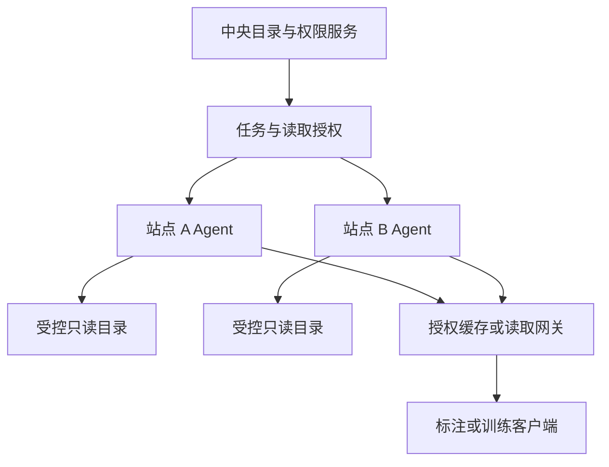

# EPIC-06：多端部署、站点 Agent 与就近读取

> 状态：trigger-gated research-draft；未排期，未批准实施，未分配发布版本。
> 转入日期：2026-10-22；本地核验基线：`e169d9ef53a9eda60abd4e67bf553ab4e6ab618e`。
> 实施前须通过 [backlog promotion gate](README.md#promotion-gate)。[草案总览](1792661016_dataset-storage-roadmap.md)、[架构契约](1792661016_dataset-storage-architecture.md)和[交付验收](1792661016_dataset-storage-delivery-acceptance.md)共同约束本系列。

> 优先级：P2，M3；M1 允许通过只读共享挂载先覆盖可直连服务器。
> 负责人角色：后端、运维；训练服务、前端协作。
> 依赖：EPIC-01/02/04/05 基础；EPIC-11 权限与 EPIC-12 观测的最小能力。

## 本项目基线与改造落点

下列为固定提交的静态证据，尚非运行/浏览器验收结果。

| 当前 owner / 代码锚点                                             | 已有能力、缺口与复用约束                                                                                       |
| ----------------------------------------------------------------- | -------------------------------------------------------------------------------------------------------------- |
| [sftp.py](../../../apps/api/app/services/sources/sftp.py)         | 只有中心主动拉取；SSH allow_agent 不是站点 Agent。当前没有 Site/AgentRegistration、配对/撤销、心跳和出站读流。 |
| [async_job.py](../../../apps/api/app/services/async_job.py)       | 复用中心任务记录；Agent 本地执行 checkpoint 和中心已确认水位分开，不建第二任务历史。                           |
| [gpu_arbitration](../../../apps/api/app/services/gpu_arbitration) | 计算调度由现有 owner 负责，近端存储候选不能覆盖项目权限、计算资格和预算。                                      |

候选修改入口：[base.py](../../../apps/api/app/services/sources/base.py)、[async_job.py](../../../apps/api/app/services/async_job.py)、[config.py](../../../apps/api/app/config.py)、[storage.py](../../../apps/api/app/services/storage.py)。新增表、适配器、迁移、测试和准确文件范围在晋升时固定，不直接由逻辑实体生成数据库。

## 1. 问题与当前基础

已有 SFTP 与 S3 拉取适配器可处理外部来源，但这不等同于跨网络站点的持续读取、离线恢复与本地计算能力。现有任务文件解析仍主要围绕全局对象桶；多站点需要可定位的内容和可选择的访问路径。[SFTP 适配器](../../../apps/api/app/services/sources/sftp.py)、[存储解析](../../../apps/api/app/services/storage.py)

本 Epic 解决“图片在不同服务器，平台统一管理但不全部集中复制”。它不等于建设分布式文件系统，也不要求用户先部署 Ceph 或把所有机器加入一个存储集群。

## 2. 分层部署方案

| 场景                                               | 建议路径                                             | 阶段                   |
| -------------------------------------------------- | ---------------------------------------------------- | ---------------------- |
| 平台与图片同机                                     | 服务端只读挂载受控目录                               | M1，EPIC-02/03         |
| 多台服务器在可控局域网                             | 经运维提供共享挂载，或经已验证的来源适配器访问       | M1/M2                  |
| 数据在独立网络、边缘站点或无法被平台入站连接的机器 | 站点 Agent 主动建立认证连接，执行允许的扫描/读取任务 | M3，本 Epic            |
| 训练节点靠近某些数据                               | 基于站点与副本选择就近读取/缓存，不改变版本内容      | M3，本 Epic 与 EPIC-10 |

只要 M1 场景能够完成“目录注册—浏览—标注—版本冻结”，就不应把 Agent 作为首期阻塞依赖。

## 3. 目标、范围与暂不做

目标：中央平台持有目录、权限和业务关系；Agent 在受控站点执行只读扫描和读取，离线时明确降级，恢复时继续任务。

范围包括站点登记、Agent 配对/轮换/撤销、心跳和协议版本、任务租约、断点恢复、分块传输、来源状态回报，以及有限的就近路由。

暂不做任意远程命令执行、站点间自由互联、通用文件同步客户端、来源目录双向写回和跨站点自动删除。原件复制、缓存预热必须对应明确任务与容量预算。

## 4. 用户故事

| 编号    | 用户故事                                                                         | 价值                         |
| ------- | -------------------------------------------------------------------------------- | ---------------------------- |
| E06-S01 | 作为运维，我能在数据所在服务器配对一个 Agent，并仅开放指定只读根。               | 无需开放整台机器或全部目录。 |
| E06-S02 | 作为数据管理员，我能把远端根内目录注册为数据集，看到初次扫描与后续同步进度。     | 统一目录和工作入口。         |
| E06-S03 | 作为标注人员，我能读取远端图片；站点离线时清楚知道原图不可用，已有预览仍可展示。 | 避免误认为数据已删除。       |
| E06-S04 | 作为训练任务负责人，我能优先使用同版本的就近副本，缺失时看到可执行的准备任务。   | 降低重复跨站点传输。         |
| E06-S05 | 作为运维，我能限制站点并发和带宽，并在 Agent 重启后续跑已确认任务。              | 不压垮源磁盘和链路。         |
| E06-S06 | 作为管理员，我能撤销 Agent，阻断新任务和读取授权，同时保留可审计的历史。         | 生命周期可控。               |

## 5. 架构与权限边界

图中箭头表示逻辑调用关系，不代表网络必须由中心主动入站。草案默认 Agent 发起出站 HTTPS 长轮询，读取采用受限中继；只有真实网络测量证明不适用时，才在晋升评审中改选通道。

- Agent 仅接受协议内的枚举、stat、受限读取和任务管理指令，不接受 shell 命令。
- 站点认证不替代用户鉴权。读取授权绑定用户/任务、Asset 内容修订、位置、有效期与用途。
- 中央目录不接收来源私钥明文，不把站点根目录结构全部公开给普通用户。
- 不可达站点不自动触发全量远程复制；可用副本必须通过内容校验和授权检查。
- 站点能力是被报告并核验的事实；不能因为某站点连通就推断浏览器可直连该站点。

## 6. 状态和任务协议草案

| 对象                | 建议字段/状态                                                     | 行为约束                                       |
| ------------------- | ----------------------------------------------------------------- | ---------------------------------------------- |
| `Site`              | `id/name/network_hint/region`                                     | 网络提示仅用于候选路由，不作为授权依据。       |
| `AgentRegistration` | `agent_id/site_id/protocol_version/credential_revision/last_seen` | 禁止复用已撤销身份。                           |
| Agent 状态          | `pending/online/degraded/offline/revoked`                         | 离线由心跳和操作证据判断，展示最后成功时间。   |
| 任务租约            | `job_id/attempt_id/lease_expiry/checkpoint`                       | 超时重派可能重复执行，写入索引和结果必须幂等。 |
| 扫描批次            | `scan_id/sequence/cursor/complete`                                | 未完整完成的扫描不能据此判定全目录缺失。       |
| 内容读取            | `asset_id/location_id/revision/range`                             | 路径重新验证；内容变化时拒绝冒充原 revision。  |

协议接口是提案，可复用现有 AsyncJob 与 worker 体系，不另建第二套任务历史。Agent 的本地 checkpoint 和中心已确认进度要区分，重试必须能处理“本地已完成、中心未收到确认”。

## 7. 断线、变化与路由语义

1. 心跳超时：标记站点暂不可用，保留样本和来源索引；不产生批量删除。
2. 扫描中断：保留扫描水位，恢复后从可验证 checkpoint 继续；必要时重扫小范围，不能跳过未确认文件。
3. 文件读取中断：客户端收到可区分的可重试错误；续传基于同一内容修订，原件变化后不得接着拼接新字节。
4. 只有预览缓存：允许只读浏览，禁止编辑/提交标注和需要完整原图的训练。若有同一内容修订的完整已验证缓存，可按既有授权继续读取和标注；不能按预览“看起来足够清楚”绕过原图门槛。
5. 多副本：先筛选可授权且内容校验一致的副本，再按站点、健康、延迟选路。不能把“路径相同”视为内容相同。
6. 站点重新上线：先验证身份、协议、根映射，再恢复新任务；旧失效租约不能继续提交修改。
7. Agent 撤销：阻断新签发读取与任务租约，现存短期 URL 按明确到期上限失效；需要立即撤销时走受控网关读取。

## 8. UI 边界

存储管理新增“站点/Agent”视图，显示站点、可用根、最近心跳、版本、带宽限制和受影响位置。位置详情展示受影响数据集数量和深链，不复制数据集目录。

数据集页展示来源站点、可用性和最近同步；站点离线时“原图暂不可用，已有预览可查看”比泛化“加载失败”更有用。Agent 配对凭据、端口和配置保留在管理员操作中。

## 9. 验收标准

| 编号     | 可验证标准                                                                                                 |
| -------- | ---------------------------------------------------------------------------------------------------------- |
| E06-AC01 | 在中心无法入站访问站点的测试拓扑中，Agent 配对后可完成受控目录扫描及授权读取，不要求开放来源目录公网访问。 |
| E06-AC02 | 来自未配对、已撤销、过期或协议不兼容 Agent 的任务提交被拒绝，并保留可定位错误。                            |
| E06-AC03 | 扫描期间断网与 Agent 重启后恢复任务，结果无重复 DatasetItem，未完成扫描不会把未见文件批量标为删除。        |
| E06-AC04 | 断网后数据集仍可搜索和查看已有元数据；原图与预览可用性分别显示，无法冻结的版本明确阻塞。                   |
| E06-AC05 | 同一资产存在两处校验一致副本时可按策略切换；不一致副本被排除，不向客户端拼接不同内容。                     |
| E06-AC06 | 受控根之外的文件和未授权项目文件无法通过构造 Agent 请求或读取 URL 访问。                                   |
| E06-AC07 | 配置站点并发与带宽上限后，新任务受限且业务读取优先级可验证；不以无限并发重试恢复站点。                     |
| E06-AC08 | Agent 撤销后不能获取新任务和新读取授权；已签发授权的最长残留有效期有记录并通过测试。                       |
| E06-AC09 | 接入一个远端站点不会改变同机/共享挂载位置的现有读取、扫描和标注流程。                                      |

## 10. 灰度、回滚与测试

- 首先用一个只读站点、一个非生产目录验证；平台保留独立开关，暂停新 Agent 接入不影响已有本地位置。
- Agent 协议至少支持明确的服务端兼容版本范围；升级前验证在跑任务 drain，不能让不兼容 Agent 继续领取任务。
- 回滚至旧 Agent 仅在协议、checkpoint 格式兼容时允许；不兼容时停止任务后重新配对，保留原内容标识。
- 网络故障测试覆盖高延迟、丢包、DNS/证书错误、连接中断、旧租约重放、源目录改名和根挂载缺失。
- 训练侧只消费版本清单，Agent 不在本地决定标签或 train/val 切分。

## 11. 风险和待决策

- 首期支持哪些运行环境：建议 Linux 容器或系统服务先行，Windows 桌面 Agent 留待明确需求。
- 是否需要现场预览网关：依据真实带宽/时延测量选择中继或短期直连，不同时实现所有传输方案。
- 站点能否离线缓存授权与任务：建议只完成已获租约的受限任务，中心不可用时不新增授权。
- 训练就近调度需与 GPU 调度能力协商，不能单以存储距离覆盖计算资源和权限约束。

## 12. 工程任务与完成定义

- [ ] 定义站点、Agent 身份、协议版本、任务租约和撤销机制。
- [ ] 实现只读根注册、扫描批次提交、读取 Range 与内容修订检查。
- [ ] 对接现有 AsyncJob 的进度、恢复、取消和授权失败展示。
- [ ] 实现带宽/并发限制和有限副本路由；接入观测指标。
- [ ] 交付部署包、升级/撤销/故障排查手册与隔离网络演练结果。
- [ ] 通过验收后，用户可把第二个站点已有目录接入同一数据集目录体系，且原图无需集中搬迁。

## 本项目推进切片与晋升条件

触发条件：运维提交至少一个无法通过共享挂载或已验证直连覆盖的真实站点，确认出站 HTTPS、Linux 运行环境、只读根和带宽预算。首选复用 Python 技术栈；只有实测表明默认通道不能满足才改选。配对产生独立身份凭据，不复用个人连接密钥。

| 切片  | 独立结果            | 交付范围                                                                                       | 验收 / 回退边界                                                   |
| ----- | ------------------- | ---------------------------------------------------------------------------------------------- | ----------------------------------------------------------------- |
| E06-A | 一个 Linux 只读站点 | 新增一个受限 Agent 部署单元，主动 HTTPS 长轮询/中继，配对、扫描/读取、租约恢复和撤销共同交付。 | 中心不可入站仍可使用；旧租约/已撤销身份拒绝；本地目录流程不退化。 |
| E06-B | 有限就近副本        | 多个授权同内容副本按站点/健康择路，受预算预取，不默认全量复制。                                | 续传不混内容；并发/带宽有界；撤权残留窗口可测。                   |

前置合同不等于等待前置 Epic 全量完成。每个切片合并后系统仍须可用；含新来源的回退保留兼容读取和授权，不能把其相对路径交给旧 S3 拼接逻辑。预计多数切片涉及超过 8 个文件，实施时明确大范围边界与准确清单。

已有回归入口：[test_dataset_import.py](../../../apps/api/tests/test_dataset_import.py)、[test_connector_crypto_guard.py](../../../apps/api/tests/test_connector_crypto_guard.py)、[test_storage_connections_api.py](../../../apps/api/tests/test_storage_connections_api.py)。这些仅为旧行为回归起点，新合同/状态/故障场景须补有意义的用例；不能以旧测试通过替代本 Epic 验收。分层命令、真实浏览器矩阵和产物清理见[交付验收](1792661016_dataset-storage-delivery-acceptance.md#本项目验证与文档交付)。

实现时同步：[index.md](../../../docs-site/ops/deploy/index.md)、[network-security.md](../../../docs-site/ops/deploy/network-security.md)、[storage-connections.md](../../../docs-site/dev/concepts/storage-connections.md)，以及适用 API 指南/快照/前端类型、`CHANGELOG.md` Unreleased。新增配置同步 `.env.example`、`pnpm docs:gen-env-vars`、`DEV.md`；涉及 SDK 合同按对应 skill 核验。正式 ADR 在实施时分配可用编号。

完成实施后按[计划规范](../README.md#required-completion-steps)追加 `## Outcome`，列实际提交、正式文档、验证证据、清理与剩余限制；草案清单不等于已实现。
