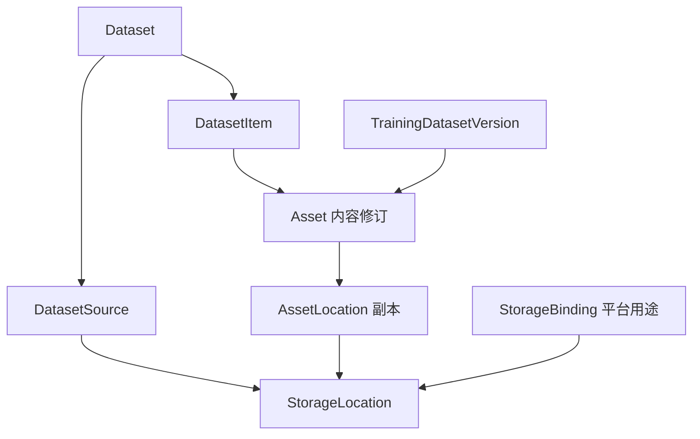
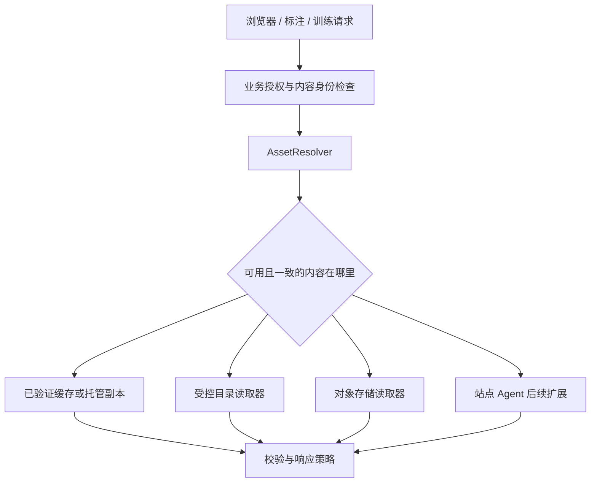

# 总体架构与关键决策草案

> 状态：research-draft；未排期，未批准实施，未分配发布版本。
> 转入日期：2026-10-22；本地核验基线：`e169d9ef53a9eda60abd4e67bf553ab4e6ab618e`。
> 实施前须通过 [backlog promotion gate](README.md#promotion-gate)。[草案总览](1792661016_dataset-storage-roadmap.md)、[架构契约](1792661016_dataset-storage-architecture.md)和[交付验收](1792661016_dataset-storage-delivery-acceptance.md)共同约束本系列。

> 适用范围：E01–E12。本文模型、接口和状态均为建议契约，除明确标注的既有能力外，不表示已实现。

## 与现有领域和 ADR 的关系

- 原始来源数据集继续使用 `Dataset`；Source Dataset 是产品概念，不新增同义 SourceDataset。`ProjectDataset`连接原始数据和项目；`DatasetSource`只表达某数据集的接入规则。
- `ProjectTaskDataset`及`TaskDatasetVersionMembership`已经存在，分别管理项目/规范任务流和版本序号；`TrainingDatasetVersion`仍拥有冻结内容。遵循 [ADR 0086](../../../docs/adr/0086-canonical-task-data-contracts.md)、[ADR 0087](../../../docs/adr/archive/0087-project-task-dataset-streams.md)、[ADR 0075](../../../docs/adr/0075-platform-identity-vs-project-authority.md)，不将管理序号或物理位置回填混入已冻结摘要。
- `TaskDatasetItemLink`的 task 是标注工作项，`ProjectTaskDataset`的 task 是 detect/segment 等机器学习任务；二者不可混用。
- 图片金字塔已有 `ImagePyramidAsset/Generation`、generation、源指纹、SHA-256 和构建租约；逻辑 DerivedArtifact 复用其 owner。StoredObjectRef 也只是历史定位合同，不要求统一大表。
- 当前 Dataset/Item 没有软删除状态；训练的删除 intent/tombstone 不是原始数据集的可恢复删除。新逻辑状态需单独迁移。
- 下文实体是拟议逻辑边界，不是直接建表指令。D01–D12 不是已接受或预留的正式 ADR；接口示例省略 `/api/v1`，尚未成为公开 API。

```text
用户/服务 -> 现有业务授权 -> 内容解析 -> 受控目录 / 托管 S3 / 同修订完整副本
                                  |
                                  +-> 派生 owner（预览不能替代原图）
固定项目标注快照 -> 现有训练 worker -> 持久 training 副本 -> ZIP/训练消费
扫描 worker -> 扫描/条目账本 -> 来源/样本/变化候选 -> 现有 AsyncJob 展示
```

## 1. 架构目标

将“数据集的业务身份”“某一份文件内容”和“内容所在的位置”拆开。数据集与项目可以长期引用稳定样本；原图可以位于受控目录或兼容对象存储；读取、缓存、训练冻结和迁移使用统一的内容解析入口。

已有实现中，外部流会通过 `DatasetService.ingest_one` 写入全局 datasets 桶；`DatasetItem` 保存 `file_path`，尚未表达位置与副本。新模型需要兼容这些历史记录，而不是要求重建全部数据集与任务。[代码依据](1792661016_dataset-storage-baseline.md)

### 不变量

1. 数据集改名不改原图定位，也不引起对象复制。
2. 同名文件、同一源路径和相同内容，是三种不同关系。
3. 已被任务或版本引用的内容身份不能原地改写。
4. 预览可用不代表原图可读；位置在线不代表其中每个文件存在。
5. 外部源离线不会触发批量删除；部分扫描不能证明未扫描文件已消失。
6. 原地引用目录的默认权限是只读，数据集删除不会删除外部原图。
7. 缓存、托管原件、训练冻结副本必须分别标记用途与保留策略。
8. 读取权限在服务端执行；前端隐藏按钮不是权限控制。

## 2. 领域对象

下表是逻辑对象边界。物理表名、拆表数量和 ORM 关系在 E01 中评审，避免先落一组不可逆的数据库结构。

| 对象                          | 负责的信息                                                | 不负责的信息                                          |
| ----------------------------- | --------------------------------------------------------- | ----------------------------------------------------- |
| `Dataset`                     | 名称、说明、类型、业务组织、可见范围                      | 桶地址、原图物理路径、连接密码                        |
| `DatasetSource`               | 某数据集从哪个位置的哪个相对根接入、过滤规则、扫描策略    | 数据集全部业务字段、可变凭据副本                      |
| `DatasetItem`                 | 稳定样本身份、数据集归属、Scene/frame_index、绑定内容修订 | 随目录变化自动替换的原图字节                          |
| `Asset`                       | 某次不可变内容修订，内容摘要、大小、媒体属性、校验状态    | 全局唯一的业务样本、任意路径的最新版                  |
| `AssetLocation`               | 同一内容修订在某位置的 locator、用途、校验与存在状态      | 与定位脱钩的业务删除授权                              |
| `DerivedArtifact`（逻辑关系） | 原 Asset、派生规格/程序版本、产物自己的摘要与位置         | 原图的完整字节副本；优先复用现有 thumbnail/media 模型 |
| `StorageLocation`             | 位置种类、端点/受控根、站点、能力、配置版本和健康         | 数据集筛选条件、标注进度                              |
| `StorageBinding`              | 平台某业务用途绑定的位置与前缀                            | 用户数据集的独立身份                                  |
| `StoredObjectRef`（逻辑契约） | 非样本业务对象的实际位置、配置修订/绑定代次、对象键       | 以当前用途绑定推算历史对象位置；不要求单独建统一大表  |
| `TrainingDatasetVersion`      | 所属项目、已有冻结清单、项目标注快照、分组切分、训练产物  | 活跃目录当前最新内容，或无项目上下文的混合标注        |

`StorageConnection` 已存在，优先扩展或由 `StorageLocation` 引用其密钥配置，不维护两套内容相同的“连接器”和“位置”产品入口。是否保留独立的内部凭据表属于实现选择。

### 关系图



同一个 Asset 可以被多个样本引用，但不能因内容 hash 相同就自动跨授权边界合并资产或暴露“已存在于其他项目”。授权、业务样本身份与物理去重分别决策。

图中仅展示核心原图关系。完整原图缓存是 AssetLocation；缩略图和转码是 DerivedArtifact，不能被 resolver 当作原图故障回退。平台头像、附件、归档和训练包通过 StoredObjectRef 或固定绑定代次定位，不要求强行创建 DatasetItem。

## 3. 身份、定位与变更

### 3.1 名称不参与身份

新托管对象键使用稳定 ID 与修订信息；数据集名称只用于展示。历史 `file_path` 按原值回填到旧后端的 AssetLocation，不靠当前数据集名称重算，也不为了迁移模型立刻搬动文件。

目录接入保存 `storage_location_id + config_revision + relative_path`。位置配置的受控根不能被悄悄改成另一块盘而继续声称是同一内容；更换根需要重新验证或显式重定位任务。

### 3.2 观测指纹不等于内容摘要

- `size + mtime + inode/file-id` 可用于发现候选变化，不能充当跨机器的全局内容身份。
- 内容摘要明确记录 `algorithm` 与 `value`；新可信摘要默认采用 SHA-256。
- `ETag`、对象版本 ID、内容摘要分别记录。迁移不得把未知来源的历史 32 位字符串自动升级为已验证 SHA-256。
- 图片可以先进入“已登记/待校验”状态，再按预算校验；界面不把这部分算作全部可标注。

### 3.3 源文件被覆盖

扫描发现变化后，旧 AssetLocation 标记 `changed`，原有 Asset 仍代表原内容；不更新旧任务看到的字节。默认将新内容作为候选新修订，用户确认后形成新样本/显式替换关系，并重新建立必要的业务任务。旧标注保留，不自动移植到新图。

如果旧内容既没有可验证副本，也没有冻结副本，则旧样本显示内容不可用。单靠索引或 hash 无法恢复被外部覆盖的字节；界面需明确这项边界。训练冻结版本通过其保留副本继续可重现。

重命名/移动只在能核实内容一致及权限不变时更新位置；无法确定时呈现“新增 + 缺失待确认”，不要用同名或大小猜测身份。

## 4. 原图策略与缓存策略

| 维度     | 选择                    | 行为                                                             |
| -------- | ----------------------- | ---------------------------------------------------------------- |
| 原图管理 | `reference` 原地引用    | 保存索引和内容身份，原件留在源位置                               |
| 原图管理 | `managed_copy` 复制托管 | 将已校验原图复制到平台管理位置，记录来源                         |
| 读取缓存 | `none`                  | 读取仍允许必要的受限临时缓冲，不持久保留原图缓存                 |
| 读取缓存 | `preview`               | 保留缩略图等派生预览；不能代替原件                               |
| 读取缓存 | `on_demand`             | 在策略允许的位置按需缓存已校验原图，受配额和淘汰规则管理         |
| 版本保留 | 训练冻结                | 按现有版本语义固定实际内容；属于可追溯产物，不能作为普通缓存淘汰 |

“原地注册”承诺的是**不强制生成整份持久化原图副本**。扫描读取、元数据、缩略图、临时缓冲、用户启用的缓存、训练冻结产物仍可能产生 I/O 或占用，必须在预检和统计中分别说明。

同一共享目录被两个数据集引用，可以有两个业务样本集合；存储位置物理占用不能简单把两个数据集的逻辑字节数相加。

位置级默认缓存策略、配额、上限和清理由存储管理维护；数据集来源只选择这些限制内的本来源策略。最终生效策略由服务端计算，两页不维护两份相同配置。

## 5. 访问链路



解析器返回受限读取描述符或短时 URL，并给出内容身份、过期时间和明确的不可用原因。浏览器不接收真实宿主机绝对路径、存储密钥或长期可复用的绕过授权地址。

可变文件系统的严格读取需要防止“校验后文件又被覆盖”。实现可以使用受限临时文件、已验证缓存、可信只读快照或版本化源；不能把单次 `stat` 当作永远一致的证明。标注提交携带与展示内容相同的修订上下文，服务端拒绝混用修订。

S3 预签名、反向代理与 worker 读取路径作为同一个兼容性契约验证。对签名 URL 的 host/path 改写要通过真实部署测试，不能只以 SDK 上传成功作为兼容通过标准。

## 6. 部署方式

| 情形                     | 首选接入                                      | 首期边界                                          |
| ------------------------ | --------------------------------------------- | ------------------------------------------------- |
| 图片与应用同机           | 只读 bind mount 到指定读取 worker，注册受控根 | 容器内路径与宿主路径映射由部署配置管理            |
| 多个容器/worker          | 共享只读挂载，或将任务路由到有该挂载的 worker | 调度必须理解位置可达性，不能随机发给不可达 worker |
| NAS/NFS/SMB              | 运维完成挂载后以受控目录接入                  | 应用不承担通用 NAS 管理功能                       |
| 可直接访问的外部 S3      | 注册只读连接和允许前缀                        | 持续引用能力需新增，既有导入能力不能当作已经支持  |
| SFTP 服务器              | 既有复制导入继续使用；持续读取单独验证        | 大量小图、随机读与连接池限制先试验                |
| 不可被中心直接访问的站点 | 站点 Agent 扫描和受控传输                     | E06 后续能力，不要求为了首期而开放整台主机        |
| 用户浏览器所在电脑       | 继续上传，或后续安装受控 Agent                | 浏览器文件夹选择不等于服务器持久挂载              |

现有 Compose 已支持将 MinIO 数据映射到宿主机指定目录。本方案改变的是数据管理和读取模型，不只是改 Docker volume 路径。[部署依据](1792661016_dataset-storage-baseline.md)

## 7. 状态和错误契约

### 7.1 状态必须分维度

| 维度         | 建议状态                                   | 使用位置                           |
| ------------ | ------------------------------------------ | ---------------------------------- |
| 位置启用     | `enabled / disabled`                       | 管理操作的结果                     |
| 位置健康     | `unknown / healthy / degraded / offline`   | 探测观测；存储详情与业务页只读摘要 |
| 文件位置观测 | `present / missing / changed / unverified` | 样本检查器、源差异列表             |
| 缓存         | `ready / missing / stale / failed`         | 样本读取和缓存管理                 |
| 业务可用性   | 原图可读 / 仅预览可用 / 暂不可用 / 待校验  | 数据集列表、样本列表               |
| 扫描任务     | 沿用 AsyncJob 状态并补充阶段/游标/统计     | 原有全局任务入口                   |

位置以 `enabled_state` 与 `health` 两个字段分别表达管理状态与健康观测，避免将离线自动当作停用。

### 7.2 建议错误类别

`SOURCE_UNREACHABLE`、`SOURCE_PERMISSION_DENIED`、`SOURCE_CHANGED`、`SOURCE_MISSING`、`ROOT_NOT_ALLOWED`、`CONTENT_UNVERIFIED`、`CONTENT_MISMATCH`、`NO_READABLE_REPLICA`、`CAPABILITY_UNSUPPORTED`、`ACCESS_DENIED`、`QUOTA_EXCEEDED`、`VERSION_FROZEN`。

错误码是接口草案；实施时映射项目已有错误规范。错误响应包含用户可行动的信息、可重试性和关联 job/source/item 标识，不包含密码、私钥或未经授权的绝对路径。

### 7.3 跨文档字段与接口约定

- 位置种类使用 `filesystem / s3 / sftp / agent`；Agent 类型不表示 M1 已支持。
- 原图策略使用 `ownership_mode`；缓存使用 `cache_policy`，并返回受位置限制计算出的 `effective_cache_policy`。
- 可用性字段使用 `original_availability / preview_availability / verification_state / last_checked_at`。
- 容量测量使用 `measured_at / scope / source / coverage / is_estimate`；允许视图补充展示字段，不更换指标含义。
- 位置配置使用 `config_revision`，用途绑定的路由版本使用 `generation`；历史对象保留对应的 `binding_generation` 或明确位置引用。
- API 示例统一省略项目已有的版本前缀，位置资源使用 `/storage/locations`；其他 URI 仍以现有 API 规范评审为准。

## 8. 扫描与同步原则

扫描分为计划、枚举、登记/校验、差异归并、报告。手动首扫与定时增量共享同一逻辑。每次扫描记录世代/游标和最终是否完整完成；只有完整、可确认的枚举才允许把未出现的条目标记为候选缺失。

大目录采用流式枚举、分页写入和有界队列。按文件重试不会重复产生样本、项目任务或预览；取消不回滚已经确认完成的索引，也不把未完成任务误标成功。预检需要耗时扫描时同样走后台任务，不阻塞 HTTP 请求。

目录事件监听可以降低延迟，但属于后续优化；周期核对仍负责修正丢失事件、网络挂载和停机期间的变化。

## 9. 兼容与迁移

1. 先加入兼容解析层和新可空字段，保留旧读取能力。
2. 将现有 MinIO 作为一个默认存储位置，回填九类业务用途绑定。
3. 按已有 `file_path` 回填 DatasetItem → Asset → AssetLocation 关系；其他用途逐一回填 StoredObjectRef 或固定绑定代次。不改业务 ID、不自动移动原件。
4. 采用可恢复回填与影子比对验证新旧读取结果；未知历史 checksum 标记可信度。
5. 仅对启用新模型的数据集开放原地目录注册；新旧功能共同运行。
6. 迁移完成后再逐步限制旧式“按名称构造路径”写入；旧字段删除是独立收缩变更。

用途绑定仅决定后续写入。若某用途的历史对象尚无法固定定位，则阻止独立更改该用途的写入位置，或先完成整用途迁移和对账后原子切换。必须验证新头像、附件、训练包写入 B 后，旧对象仍从 A 正确读取。

对象存储后端的生产替换属于 E07。它必须覆盖 annotations、datasets、bug-reports、media-cache、audit-archive、import、export、avatars、training 九类用途。迁移数据模型和替换供应商分开切换，以降低问题定位难度。

## 10. 关键决策记录

| 草案决策 ID | 决策主题             | 草案默认                                                                                        | 何时定案     | 责任角色             |
| ----------- | -------------------- | ----------------------------------------------------------------------------------------------- | ------------ | -------------------- |
| D01         | 逻辑数据集与位置关系 | 独立 DatasetSource / AssetLocation，样本保持稳定身份                                            | M0           | 后端负责人           |
| D02         | 首期目录访问         | 只读受控挂载；按位置路由 worker                                                                 | M0           | 运维、后端           |
| D03         | 图片目录首扫         | 分批登记、渐进校验；未校验项不可伪装成可标注                                                    | M1 开发前    | 产品、后端           |
| D04         | 同一路径内容变化     | 先阻止旧引用读新字节，显式接纳新修订                                                            | M1 开发前    | 产品、标注模块负责人 |
| D05         | 数据集重复内容       | 提示/可筛选，不默认跨数据集合并业务样本                                                         | M1           | 产品、后端           |
| D06         | 预览与原图缓存       | 独立策略，首期默认预览缓存，原图按需可选                                                        | M1           | 产品、运维           |
| D07         | 动态视图与固定版本   | 保持 project_id 和项目标注快照；M1 支持单目录最小冻结，M2 扩展视图/多来源；不默认混合跨项目标注 | M1–M2        | 训练模块负责人       |
| D08         | 新增授权粒度         | 保持现有角色语义，增加资源使用授权；无“知道ID即可读”                                            | M0–M1        | 后端、产品           |
| D09         | S3 候选选择          | SeaweedFS / RustFS 实测比较；不预先认定胜者                                                     | E07 试验后   | 运维、技术负责人     |
| D10         | 全局双写             | 首次迁移不依赖未验证双写；冻结写入与最终增量可作为基线                                          | 切换方案评审 | 运维、后端           |
| D11         | 站点 Agent           | 真实网络条件需要时再启动，复用已有任务控制面                                                    | M3 启动前    | 技术负责人           |
| D12         | 备份 RPO/RTO         | 由可接受数据丢失与停机窗口推导；先演练再承诺                                                    | M2 上线前    | 项目负责人、运维     |

RPO/RTO、默认缓存配额、扫描并发、目录数量和候选硬件目前均未知。这些是需要校准的配置/运营决策，不影响先评审模型、页面边界与首期链路。

## 11. 不在本轮默认范围内

- 自研通用分布式文件系统，或实现对所有 S3 功能的兼容。
- 自动跨站点删除外部原图、双向目录同步或任意远程命令执行。
- 从浏览器自由读取用户机器的任意目录。
- 将所有历史标注自动迁移到源目录里被覆盖后的新图片。
- 在目录原件会变且未保留副本时，承诺历史内容永久可恢复。

以上限制用于划定本次产品的可交付边界。若未来确实需要，分别提出新的能力与验收要求。
